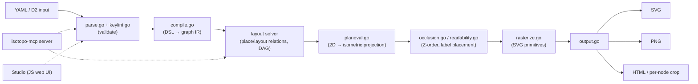
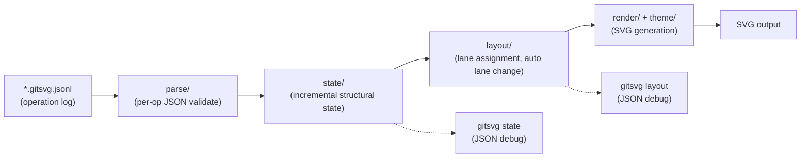
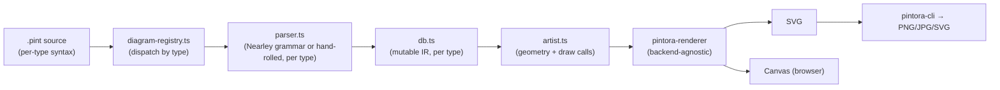
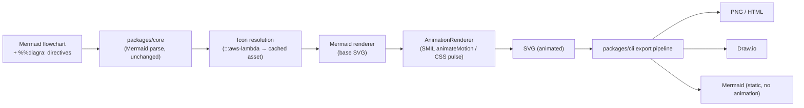

# Weekly Scan — Diagram Tooling (2026-06-26 → 2026-07-03)

**Executive summary:**
- `iso-topology` (Go, 40★) là repo đáng chú ý nhất tuần này: DSL "coordinate-free" (quan hệ `place`/`layout` thay vì tọa độ) render ra isometric SVG design-grade, kèm bộ MCP tools cho agent tự sinh/tự sửa diagram — mô hình agent-first gần nhất với hướng đi của kymostudio mà chúng tôi từng thấy.
- `gitsvg` (Python, 0★ nhưng 1186 test, 98% coverage) là ví dụ hiếm về renderer JSONL→SVG chuyên biệt (git graph) với thuật toán auto-lane-assignment đáng đối chiếu với fan-in/trunk-lane staggering của kymo.
- `pintora` (TypeScript, 1.3k★) và `diagra` (TypeScript, 2★, extension trên Mermaid) là hai điểm tham chiếu về kiến trúc "nhiều parser/renderer theo từng loại diagram" và về kỹ thuật animate SVG bằng SMIL thay vì CSS keyframes — đáng so sánh trực tiếp với cách kymo đang làm animation.

**Mục lục**
1. [Shortlist 9 repos](#shortlist)
2. [iso-topology](#iso-topology)
3. [gitsvg](#gitsvg)
4. [pintora](#pintora)
5. [diagra](#diagra)

---

## Shortlist

9 repo được publish/update trong 7 ngày qua (2026-06-26 → 2026-07-03), qua GitHub topic search (`diagram-as-code`, `dsl`) + lọc theo relevance filter / exclusions của task. 4 repo cuối được chọn deep-dive (đánh dấu **★**):

| Repo | Stars | Last push | Vì sao đáng chú ý |
|---|---|---|---|
| **MarkovWangRR/iso-topology** ★ | 40 | 2026-07-02 | Isometric DSL, coordinate-free layout, agent-native |
| **bertpl/gitsvg** ★ | 0 | 2026-06-14 (release) | JSONL→SVG git graph, lane-assignment algorithm, 98% coverage |
| **hikerpig/pintora** ★ | 1,284 | 2026-07-01 | Extensible text-to-diagram lib, Nearley grammar, per-diagram-type plugin |
| **shahzadbadar/diagra** ★ | 2 | recent (13 commits) | Mermaid extension, SMIL-based animated data-flow |
| goadesign/model | 462 | 2026-07-02 | Go C4 DSL, ELK-powered auto layout (Layered/Force/Tree/Radial) |
| tt-a1i/archify | 2,271 | 2026-07-02 | Claude-skill, đẹp về visual output nhưng không rõ parser/IR (không đủ evidence để deep-dive) |
| FigDown/figdown | 0 | design-phase | Markdown-native diagram standard, agent-readable text + deterministic SVG — ý tưởng rất gần kymo nhưng repo mới chỉ có spec draft, chưa có implementation (HTML 97%/JS 3%, "no installable release yet") nên loại khỏi deep-dive theo rule "insufficient evidence" |
| SchemaTex/SchemaTex | 39 | recent | "Pure SVG, zero dependencies" text DSL cho industry-standard diagrams |
| c4hero/c4hero | 36 | recent | Local-first C4, edit visual → lưu `.dsl` text, Structurizr-compatible |

Loại trừ theo rule đề bài: `ai-excalidraw`, `ai-sketchnote` (AI-generate, không phải deterministic DSL), `networkx`/`codebase-memory-mcp` (graph analysis, không phải diagram renderer), các repo 0 sao không có code thực (`igraph-vlk`, `graph-editor`, v.v.).

---

## iso-topology

### §1 — Quick context
DSL isometric "coordinate-free" (`place: rightOf/behind/above`) sinh SVG 2.5D chất lượng thiết kế, khác biệt với hầu hết diagram-as-code tool ở chỗ layout không cần tọa độ tuyệt đối và có bộ MCP tools để LLM tự generate/validate/tự sửa diagram. Stack: Go 86.5% (core `iso25d/`), JS 7.4% (Studio web UI), Python 3.4% (tooling). Output: SVG, PNG, per-node SVG crop, HTML. Health: 40★, 1 fork, v0.15.0 (2026-07-02), 418 commit — hoạt động rất tích cực, có CI (`.github/`). Distribution: static Go binary, không phụ thuộc runtime; có `isotopo-mcp` server riêng cho Claude Code/Cursor.

### §2 — Architecture deep-dive

**A. Component inventory**
- `parse.go` — ingest YAML/D2, validate schema (`docs/agent/schema/dsl.schema.json`)
- `keylint.go` — semantic/key-typo checking ("did you mean")
- `compile.go` — DSL → internal graph representation
- Layout solver (trong `iso25d/` + core) — resolve quan hệ `place`/`layout` thành tọa độ
- `planeval.go` / `planeval_iso.go` — 2D → isometric 3D projection
- `occlusion.go` / `readability.go` — Z-ordering, label placement, contrast repair
- `rasterize.go` — hình học → SVG primitive
- `output.go` — ghi SVG/HTML/per-node crop
- `iso25d/shape_*.go` (prism, cylinder, sphere, wedge, rack, array, cloud, person...) — 18 primitive isometric
- `cmd/isotopo`, `cmd/isotopo-mcp` — CLI và MCP server, hai entry point riêng cho human và agent

**B. Pipeline / control flow**
1. User chạy `isotopo render scene.yaml -o out.svg` (hoặc agent gọi MCP tool `iso_render`).
2. `parse.go` đọc YAML (hoặc D2 — tự convert sang iso-topology YAML qua relational layout).
3. `compile.go` build internal graph; layout solver giải các ràng buộc `place`/`layout` (mode `row|column|grid|ring|auto`, DAG-driven khi `auto`).
4. `planeval*.go` chiếu tọa độ 2D lên isometric 3D; `occlusion.go`/`readability.go` xử lý Z-order và tránh chồng nhãn.
5. `rasterize.go` sinh SVG primitive (face, gradient, glass effect, `faceSplit` lighting).
6. `output.go` xuất SVG (+ PNG/HTML/crop tuỳ flag).

**C. Data model / IR**
Internal graph representation (Go structs, không phải dataclass thuần vì Go) — có pha compile riêng biệt trước layout, giống ý tưởng "lower IR" của D2's TALA nhưng đơn giản hơn: DSL → graph → (layout solve) → plane (2D) → iso-plane (3D projected) → raster. Mỗi giai đoạn là một struct/file riêng, không thấy dấu hiệu mutate ngược lại giai đoạn trước.

**D. Input language**
YAML là format chính (`nodes`, `connectors`, `theme`, `canvas`), D2 được auto-convert. Không phải hand-written recursive-descent parser lộ diện trên README (dùng YAML parser chuẩn + validation layer riêng). Error reporting đáng chú ý: `validate` command trả JSONPath cụ thể + "did you mean" suggestion + exit code phân loại (0/2/3) — tốt hơn nhiều tool DSL khác chỉ ném lỗi generic.

**E. Layout algorithm**
Coordinate-free, quan hệ-based (`rightOf`, `behind`, `above`, `gap`) + container mode (`row|column|grid|ring|auto`) với DAG-driven auto layout khi cần đệ quy composition. Có overlap detection + constraint satisfaction, không phải force-directed hay Sugiyama truyền thống — đây là điểm khác biệt lớn nhất so với ecosystem (elkjs/dagre) mà kymo nên nghiên cứu kỹ vì nó rất gần với alignment-resolver hiện tại của kymo (anchor cha/con, auto-bounds).

**F. Rendering/output**
SVG là chính, cộng PNG/HTML/per-node crop. Không có animation. Deterministic: cùng input → byte-identical SVG, dùng cho golden-file regression test — giống hệt triết lý golden SVG test của kymo.

**G. Extensibility**
18 primitive shape đã hard-code trong `iso25d/shape_*.go`; theme qua `themes/` với semantic role preset (`hero`, `tray`, `chip`). Icon: 200+ icon recolorable từ Simple Icons (CC0), embed trực tiếp, không phải plugin runtime.

**H. Dev experience**
CLI có `isotopo capabilities` (machine-readable DSL inventory cho agent), `isotopo evaluate` (chấm điểm bố cục: balance, alignment, rhythm, crossing/overlap defect), `isotopo repair` (tự sửa và giữ comment gốc trong source) — đây là bộ 3 tool agent-loop hoàn chỉnh nhất mà chúng tôi thấy trong domain này. Có Studio web UI live-edit + drag-to-layout.

### §3 — Architecture diagram

### §4 — Verdict
Đáng học nhất: bộ 3 CLI verb `capabilities` / `evaluate` / `repair` biến DSL thành thứ agent tự vòng lặp sửa được — kymo hiện chưa có cơ chế "agent tự đánh giá chất lượng layout rồi tự sửa" nào tương tự, đáng cân nhắc cho `kymo` CLI (một lệnh `kymo evaluate` chấm điểm crossing/overlap sẽ rất hợp với MCP/agent use-case mà CLAUDE.md nhắc tới `packages/mcp`). Layout coordinate-free (`rightOf`/`behind`/`gap`) là ý hay để tham khảo cho phần alignment resolver của kymo, dù kymo đã có parent/child anchoring tương tự ở mức khác. Red flag: không thấy test coverage % công khai, không rõ error handling khi layout solver không hội tụ (cyclic `place` constraints). Open question: coordinate-free solver dùng thuật toán gì cụ thể (constraint propagation? topological sort?) — không đủ evidence từ README, cần đọc source `iso25d/` sâu hơn nếu muốn adopt. **Verdict: study deeper.**

---

## gitsvg

### §1 — Quick context
CLI chuyên render git-graph (branch/commit/merge/PR) từ JSONL operations sang SVG — khác biệt vì input là **sequence of operations** áp dụng tuần tự (không phải static tree description) và có `import` op để replay/compose diagram khác làm prelude. Stack: Python 99.8%, output SVG (+ JSON state/layout debug). Health: 0★ nhưng cực kỳ trưởng thành về engineering — 218 commit, 31 release (mới nhất v0.3.6, 2026-06-14), **1,186 test, 98.33% coverage**, có fuzzing (`fuzz/`), OpenSSF Scorecard, security policy. Distribution: PyPI + `uv tool`, có GitHub Action và MkDocs plugin riêng.

### §2 — Architecture deep-dive

**A. Component inventory**
- `parse/` — đọc JSONL, mỗi dòng là một op (`branch`, `commit`, `merge`, `highlight`, `remove`, `import`, `pull_request`, `theme`)
- `state/` — structural state model, được các op mutate tuần tự (build-up incremental)
- `layout/` — lane assignment + geometry resolution
- `render/` — sinh SVG từ state đã layout
- `theme/` — named theme (default/muted/dark/compact/gui), áp trong lúc render
- `validate/` — kiểm tra input trước khi build
- `errors/` — error taxonomy riêng
- `cli/` — verb: `render`, `state`, `layout`, `validate`, `schema`, `theme`, `errors`
- `_pipeline.py` — nối các stage lại (điều phối chung, ở root package chứ không phải trong `cli/`)

**B. Pipeline / control flow**
1. User chạy `gitsvg render diagram.gitsvg.jsonl -o diagram.svg`.
2. CLI đọc từng dòng JSONL qua `parse/`, mỗi op là một JSON object.
3. `state/` áp op tuần tự (top-to-bottom) để build structural state — `import` op cho phép replay file khác làm prelude trước khi tiếp tục.
4. `layout/` resolve lane: auto lane assignment (branch tự chọn lane trống), có "auto lane change" để branch dịch inward khi lane rảnh; row mode `shared` (compact) hoặc `unique` (giữ thứ tự authoring).
5. `render/` sinh SVG, áp `theme/` (màu, spacing, font, orientation `bt|tb|lr|rl`).
6. Output SVG; user cũng có thể chạy `gitsvg state`/`gitsvg layout` để lấy JSON debug ở từng giai đoạn — 3 lệnh riêng biệt tương ứng 3 checkpoint trong `_pipeline.py`, cho phép inspect từng bước mà không cần chỉnh code.

**C. Data model / IR**
Structural state (Python, không rõ dataclass hay dict thuần từ evidence có được — "không xác định") được build **incremental/mutable** qua từng op — khác hẳn kymo (parse toàn bộ trước rồi mới resolve). Có JSON schema chính thức (lệnh `gitsvg schema`) để validate cấu trúc mỗi op.

**D. Input language design**
Không phải DSL text truyền thống mà là **operation log** (JSONL) — mỗi dòng độc lập, áp dụng tuần tự như event sourcing. Không có formal grammar (BNF/EBNF) vì input đã là JSON có cấu trúc; "parser" thực chất là JSON validation + schema check theo từng op type. Error reporting: `errors/` module riêng + `gitsvg validate` verb + `gitsvg errors` verb để tra cứu mã lỗi — thiết kế lỗi khá chuyên nghiệp cho một CLI 0★.

**E. Layout algorithm**
Lane-assignment chuyên biệt cho git graph: auto-assign lane, auto lane change (compact hoá khi lane trống), PR arc "live-tracked" tự nối dài khi branch có thêm commit. Không phải orthogonal/force-directed/Sugiyama tổng quát — là thuật toán domain-specific cho git-graph, tương tự về tinh thần với "fan-in/trunk-lane edge staggering" trong `alignment.py` của kymo (cùng bài toán: nhiều nhánh chia sẻ không gian tuyến tính mà không chồng lấn).

**F. Rendering/output**
SVG duy nhất là output chính (JSON state/layout chỉ để debug, không phải target render). Không có animation. Theme là named preset, bao gồm cả mode `gui` (table layout) — nghĩa là cùng data model có thể render ra 2 kiểu hình dạng khác nhau (graph vs table), một dạng pluggable renderer nhẹ.

**G. Extensibility**
Theme thêm được qua `theme/` module (named theme). Op type mới (thêm operation) sẽ cần sửa `parse/` + `state/` + schema — không thấy plugin system runtime.

**H. Dev experience**
CLI có 7 verb rõ ràng, JSON schema công khai để IDE autocomplete/validate `.gitsvg.jsonl`, có GitHub Action + MkDocs plugin (nhúng git-graph vào doc site) — dev experience tốt cho một niche tool. Không thấy VS Code extension hay watch mode trong evidence thu thập được.

### §3 — Architecture diagram

### §4 — Verdict
Đáng học nhất: model "operation log áp dụng tuần tự" thay vì "static tree description" — với kymo, `.kymo` DSL vẫn là static declarative, nhưng ý tưởng `import` op (replay file khác làm prelude) có thể hữu ích nếu kymo muốn hỗ trợ composition/include giữa nhiều `.kymo` file trong tương lai. Thuật toán "auto lane change" (dịch branch vào lane rảnh) đáng đối chiếu trực tiếp với fan-in/trunk-lane staggering pass trong `alignment.py` — cùng lớp bài toán, đáng đọc code thật (không chỉ README) để so sánh cách xử lý biên. Red flag: 0★ nghĩa là chưa ai dùng thật, nên chưa rõ thuật toán có scale tốt với git history lớn (hàng trăm commit) không — không có benchmark công khai. Open question: lane-assignment có phải NP-hard approximation hay greedy đơn giản — cần đọc `layout/` trực tiếp. **Verdict: study deeper** (riêng phần layout/lane-assignment), phần còn lại chỉ **glance**.

---

## pintora

### §1 — Quick context
Thư viện text-to-diagram tổng quát (không phải single-purpose) hỗ trợ Sequence/ER/Component/Activity/Mindmap/Gantt/DOT/Class trong cùng một engine, chạy được cả browser lẫn Node — khác biệt ở kiến trúc "mỗi loại diagram là 1 plugin độc lập" (parser+db+artist riêng) thay vì một renderer chung. Stack: TypeScript 74.3%, Nearley (grammar DSL) 6.6%, output SVG/Canvas (browser), PNG/JPG/SVG (Node CLI). Health: 1,284★, 37 fork, v0.8.2 (2026-02-13), 725 commit, 25 release — trưởng thành, có CI/test (`harness/cases/`, jest). Distribution: npm (`pintora-cli`, `pintora-standalone`, `pintora-core`...).

### §2 — Architecture deep-dive

**A. Component inventory**
- `packages/pintora-core/src/diagram-registry.ts` — đăng ký từng loại diagram (plugin registry)
- `packages/pintora-core/src/symbol-registry.ts` — đăng ký symbol/icon
- `packages/pintora-core/src/config-engine.ts`, `config.ts` — cấu hình theo diagram type
- `packages/pintora-diagrams/src/<type>/parser.ts` — parser riêng cho mỗi loại (vd. `dot/parser.ts`, `sequence/parser.ts`)
- `packages/pintora-diagrams/src/<type>/db.ts` — intermediate mutable state model riêng cho mỗi loại (mô hình giống Mermaid: build state qua các lệnh trong lúc parse)
- `packages/pintora-diagrams/src/<type>/artist.ts` (+ `artist/` subfolder ở diagram phức tạp như `sequence`) — vẽ từ `db` ra canvas trừu tượng
- `packages/pintora-renderer` — backend-agnostic drawing abstraction (SVG/Canvas)
- `packages/pintora-cli` — Node CLI, xuất PNG/JPG/SVG
- `packages/pintora-standalone` — bundle nhúng browser
- `sequence/event-recognizer.ts` — nhận diện cú pháp sự kiện đặc thù cho sequence diagram

**B. Pipeline / control flow**
1. User gọi `pintora-cli render diagram.pint -o out.svg` (hoặc nhúng qua `pintora-standalone` trong browser).
2. `diagram-registry.ts` xác định loại diagram từ header cú pháp, dispatch tới `parser.ts` tương ứng (một số loại như `dot`/`sequence` dùng Nearley grammar `.ne`, phần còn lại có thể hand-rolled — không xác định chắc cho từng loại).
3. Parser build `db.ts` — mutable intermediate state riêng cho loại diagram đó (thêm node, thêm edge, thêm actor... theo thứ tự cú pháp).
4. `artist.ts` (+ `artist-util.ts`) đọc `db` đã hoàn chỉnh, tính toán geometry và vẽ qua drawing API trừu tượng của `pintora-renderer`.
5. `pintora-renderer` dịch lệnh vẽ trừu tượng sang SVG (Node/browser) hoặc Canvas (browser).
6. Output: SVG string / Canvas render trực tiếp trong browser, hoặc PNG/JPG/SVG file qua `pintora-cli`.

**C. Data model / IR**
Mỗi diagram type có `db.ts` riêng — mutable, build incremental trong lúc parse (giống pattern "parser gọi thẳng vào db API" của Mermaid.js) chứ không tách bạch "parse xong mới build IR" như kymo. Không thấy một IR chung xuyên suốt các loại diagram — mỗi `db.ts` là độc lập, chỉ chia sẻ interface tối thiểu qua `type.ts` ở core.

**D. Input language design**
**Không đồng nhất giữa các loại diagram**: Nearley (parser combinator/EBNF-based, 6.6% codebase) cho ít nhất `dot` và có thể `sequence`; các loại khác không xác định (có thể regex/hand-rolled). Đây là điểm khác biệt lớn với kymo — kymo dùng MỘT grammar line-oriented cho toàn bộ `.kymo`, còn pintora chấp nhận cú pháp khác nhau hoàn toàn theo từng diagram type (đánh đổi: linh hoạt cú pháp per-type nhưng học phí cú pháp cao hơn cho user dùng nhiều loại diagram).

**E. Layout algorithm**
Không xác định rõ từ evidence thu thập được (không thấy elkjs/dagre trong dependency list quan sát được, không thấy tên thuật toán cụ thể trong README) — nhiều khả năng mỗi `artist.ts` tự tính toán layout riêng theo quy tắc cứng của loại diagram đó (vd. sequence diagram luôn có layout tuyến tính theo lifeline). Cần đọc code `artist.ts` trực tiếp để xác nhận.

**F. Rendering/output**
Đa backend thật sự: SVG + Canvas trong browser, PNG/JPG/SVG qua Node — kiến trúc pluggable emitter rõ ràng nhất trong 4 repo tuần này (`pintora-renderer` tách hẳn khỏi logic diagram). Không có animation built-in theo evidence thu thập được.

**G. Extensibility**
Thêm diagram type mới = thêm 1 module con vào `pintora-diagrams/src/` và đăng ký qua `diagram-registry.ts` — plugin pattern rõ ràng, đúng như README mô tả "modular and highly extensible". Theme qua `themes/` ở core.

**H. Dev experience**
Có website riêng (docs MDX), CHANGELOG.md đều đặn qua 25 release — dấu hiệu release process kỷ luật. Không thấy VS Code extension/LSP hay watch mode trong evidence thu thập được ("không xác định").

### §3 — Architecture diagram

### §4 — Verdict
Đáng học nhất: kiến trúc "mỗi diagram type = 1 module tự trị (parser+db+artist)" đăng ký qua registry trung tâm — nếu kymo tương lai muốn support nhiều "diagram family" khác nhau (không chỉ BPMN + generic component diagram) trong cùng một `.kymo` front-end, đây là pattern đáng tham khảo thay vì nhồi tất cả vào `dsl.py` một khối. Việc tách `pintora-renderer` khỏi logic diagram cũng là gợi ý tốt cho việc kymo giữ `to_svg.py`/`to_figma.py`/`to_excalidraw.py` càng "dumb" càng tốt (đúng tinh thần "renderer deliberately dumb" đã ghi trong CLAUDE.md). Red flag: cú pháp không nhất quán giữa các diagram type (Nearley cho vài loại, có thể hand-rolled cho loại khác) tạo gánh nặng học cú pháp cho user — kymo nên tránh lặp lại việc này khi mở rộng DSL. Open question: layout cho mỗi diagram type có share code không hay hoàn toàn duplicate logic — cần đọc `artist.ts` của 2-3 loại để so sánh. **Verdict: study deeper** (phần plugin/registry architecture), phần layout cần điều tra thêm.

---

## diagra

### §1 — Quick context
Extension trên Mermaid flowchart (giữ 100% tương thích cú pháp gốc) thêm icon cloud provider, theme, và **animated data flow** qua directive comment — điểm khác biệt chính là animation dùng SVG SMIL (`animateMotion`) thay vì CSS keyframes như phần lớn tool khác (bao gồm kymo). Stack: TypeScript 94.7%, output SVG/PNG/HTML/Draw.io/Mermaid. Health: chỉ 2★, 13 commit — **rất sớm giai đoạn**, MIT license, monorepo pnpm 2 package (`cli`, `core`). Distribution: npm + CLI, có hướng dẫn tích hợp agent (Claude Code/Cursor/Copilot) trong README.

### §2 — Architecture deep-dive

**A. Component inventory**
- `packages/core` — xử lý Mermaid syntax gốc + custom `%%diagra:` directive
- `packages/cli` — CLI wrapper, export pipeline
- `AnimationRenderer` (module trong core, tên xác nhận qua `diagra-spec.md`) — inject animation vào SVG sau khi compose
- Icon resolution layer — map short name (`:::aws-lambda`) sang icon cache theo OS-specific dir, phân biệt "generic icon" (bundled, Lucide) và "official cloud icon" (tải/cache riêng)

**B. Pipeline / control flow**
1. User chạy CLI trên file `.diagra` hoặc `.mmd` có thêm `%%diagra:` directive (vd. `%%diagra:animate flow`).
2. `packages/core` parse như Mermaid flowchart chuẩn (không viết lại parser Mermaid — dựa vào cú pháp comment hợp lệ để giữ tương thích ngược), đồng thời đọc riêng các dòng `%%diagra:*` làm config.
3. Node có class `:::aws-lambda` được ánh xạ qua icon resolution layer sang asset SVG cụ thể (cache local nếu là icon "official" cần tải).
4. Renderer Mermaid gốc build SVG cơ bản (dashed edge tự nhận diện là "observability lane", subgraph = swim lane).
5. `AnimationRenderer` chạy **sau khi** SVG đã compose xong, chèn `<circle>` + `<animateMotion dur="1.5s" repeatCount="indefinite">` với `mpath` trỏ vào path của edge (mode `flow`), hoặc CSS pulse cho node (mode `pulse`).
6. Export pipeline chuyển SVG này sang PNG/HTML/Draw.io/hoặc xuất lại Mermaid thuần (không animation) tuỳ định dạng đích.

**C. Data model / IR**
Không xây IR riêng — tận dụng thẳng cấu trúc dữ liệu nội bộ của Mermaid (diagra là **layer phủ lên trên**, không phải standalone engine). Đây là khác biệt căn bản với 3 repo còn lại tuần này: diagra không có parser/model của riêng mình cho phần diagram logic, chỉ có model riêng cho phần animation/icon/theme.

**D. Input language design**
Không có grammar riêng — tái dùng 100% cú pháp Mermaid flowchart, mở rộng qua **comment-as-directive** (`%%diagra:animate flow`) là kỹ thuật an toàn về tương thích ngược (Mermaid coi `%%` là comment nên file `.diagra` vẫn render được bằng Mermaid gốc, chỉ mất phần animation/icon). Đáng chú ý: đây chính là kỹ thuật "extend without forking the grammar" — đánh đổi lấy việc bị giới hạn hoàn toàn trong biểu cảm của flowchart Mermaid.

**E. Layout algorithm**
Không có — thừa hưởng 100% layout engine của Mermaid gốc (không tự làm layout).

**F. Rendering/output**
Đa target thật (SVG/PNG/HTML/Draw.io/Mermaid) nhưng animation chỉ áp dụng cho SVG target — export ra PNG/Draw.io sẽ mất animation (theo README: "static rendering for export formats"). Kỹ thuật animation: **SMIL `animateMotion`** cho flow (dot di chuyển dọc theo path edge qua `mpath`), CSS keyframes cho pulse — tức là **kết hợp cả 2 kỹ thuật** tuỳ mode, không chỉ SMIL thuần.

**G. Extensibility**
Icon system có 2 tier (generic bundled vs cloud provider cài riêng) — thêm icon set mới cần sửa icon resolution layer, không thấy plugin API public. Theme giới hạn 3 preset cứng (dark/light/neutral).

**H. Dev experience**
README có hướng dẫn tích hợp trực tiếp cho Claude Code/Cursor/Copilot ("agent-ready with specific instructions") — xu hướng chung của tool mới trong domain này (giống iso-topology). Không thấy VS Code extension hay watch mode.

### §3 — Architecture diagram

### §4 — Verdict
Đáng học nhất: **kỹ thuật SMIL `animateMotion` + `mpath`** cho flow animation là hướng khác hẳn CSS `@keyframes` mà kymo đang dùng (`to_svg.py` hiện có `edge-flow`, `edge-pulse`, `component-breath`, `alert-flash` toàn bộ qua `@keyframes`) — SMIL bám path thật của edge (kể cả curve/spline phức tạp) mà không cần tính toán offset thủ công như CSS `stroke-dashoffset` animation thường dùng, đáng thử nghiệm cho các edge cong nhiều đoạn trong kymo. Điểm hay thứ hai: kỹ thuật "extend qua comment directive để giữ 100% backward-compat" — nếu kymo có ý định thêm cú pháp thử nghiệm mà không muốn phá `docs/DSL.md` hiện tại, đây là mẫu an toàn (dù kymo là ngôn ngữ riêng nên áp dụng khác kiểu). Red flag: repo mới 13 commit, 2★, "AnimationRenderer" chỉ được nhắc trong spec chứ chưa xác nhận triển khai đầy đủ qua code thật — cần đọc `packages/core/src` trực tiếp trước khi tin hoàn toàn vào mô tả README. Open question: animation SMIL có tương thích tốt với mọi trình duyệt/renderer SVG (đặc biệt resvg mà kymo dùng để rasterize) hay không — SMIL từng bị Chrome cân nhắc deprecate nhiều năm trước, cần kiểm chứng trước khi áp dụng. **Verdict: glance only** cho toàn bộ repo (còn quá sớm/nhỏ), nhưng **study deeper riêng kỹ thuật animation** (đối chiếu SMIL vs CSS keyframes, có thể là một spike nhỏ độc lập trong kymo).
