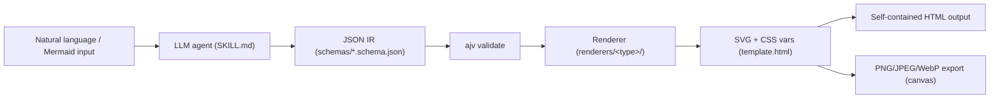
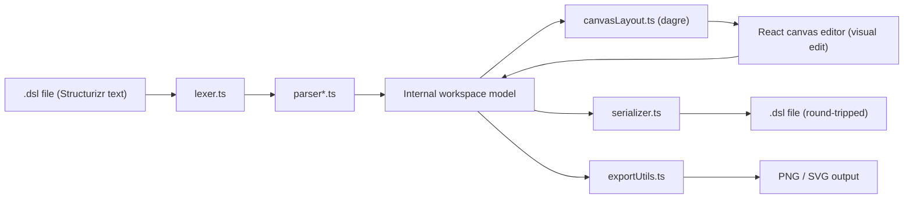
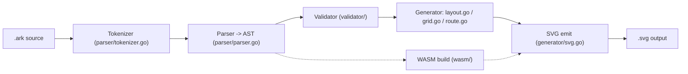
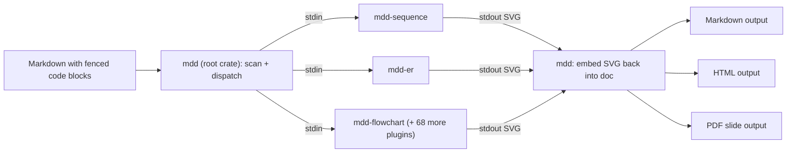

# Weekly Diagram Tooling Scan — 2026-07-04

Phạm vi: các repo diagram-as-code / visual-tooling / layout-algorithm / SVG-animation được publish hoặc update đáng kể trong 7 ngày qua (2026-06-27 → 2026-07-04).

## Tóm tắt điều hành

- Tuần này không có "big bang" nào (không có Mermaid/D2-killer mới), nhưng nổi lên một pattern rõ: **diagram tool đang được đóng gói lại thành "agent skill"** — cả `archify` (2.5k★, release v2.8.0 ngay trong tuần) lẫn `d2-diagram-skill`, `excalidraw-skill-pack` đều là diagram renderer được gói cho Claude Code/Codex/agent CLI dùng trực tiếp, cho thấy hướng phân phối mới của diagram-as-code là "cài vào agent" thay vì "cài vào máy dev".
- Về mặt kiến trúc, hai repo nhỏ nhưng rất đáng đọc là `kurrik/arkitecture` (Go) và `c4hero/c4hero` (TypeScript) — cả hai đều tách rõ **semantic layer / layout layer** giống triết lý `model.py` → `alignment.py` → `to_svg.py` của kymostudio, và đều dùng **golden-test** để khoá byte-for-byte output, đúng pattern kymostudio đang áp dụng.
- `ppdx999/mdd` (Rust) đáng chú ý nhất về **extensibility**: 71 crate độc lập (`mdd-sequence`, `mdd-er`, `mdd-flowchart`, …), mỗi crate là một binary `mdd-{type}` nói chuyện qua stdin/stdout — một cách tách "renderer per diagram-type" cực đoan hơn nhiều so với emitter pattern hiện tại của kymostudio.

## Mục lục

1. [tt-a1i/archify](#1-tt-a1iarchify)
2. [c4hero/c4hero](#2-c4heroc4hero)
3. [kurrik/arkitecture](#3-kurrikarkitecture)
4. [ppdx999/mdd](#4-ppdx999mdd)

### Các ứng viên khác đã xét (không deep-dive)

| Repo | Lý do đưa vào danh sách | Lý do không chọn deep-dive |
|---|---|---|
| `FigDown/figdown` | Ý tưởng khá mới: một chuẩn Markdown-native mà AI agent đọc như text, người đọc thấy SVG xác định (deterministic) — đúng tinh thần "figures as text" | Repo mới ở giai đoạn spec/docs (97.5% HTML là 1 file PoC `poc/figdown.html`), 0 sao, chưa có renderer thật để phân tích |
| `awslabs/diagram-as-code` | Diagram-as-code cho kiến trúc AWS, 1.5k★, "updated yesterday" theo search | Kiểm tra commit log thực tế thì hoạt động gần nhất là từ tháng 4/2026 (chỉ dependabot/docs gần đây) — không phải update đáng kể trong 7 ngày |
| `kieler/elkjs` | ELK — layout-algorithm engine JS được dùng rộng rãi (Sugiyama/layered, force, box), search show "updated 4 days ago" | Không tìm được changelog cụ thể cho lần update này; đây là engine layout thuần, không phải diagram-as-code end-to-end nên ít điểm mới để phân tích riêng tuần này |
| `isatimur/excalidraw-skill-pack` | Cùng xu hướng "diagram tool → agent skill" như archify | Là skill/prompt wrapper quanh Excalidraw có sẵn, không có renderer/layout code riêng |
| `khollingworth/d2-diagram-skill` | Cũng xu hướng agent-skill, wrap D2 với TALA/ELK + "self-checking render loop" | Chỉ là Claude Code plugin gọi D2 CLI có sẵn, không có kiến trúc mới để mổ xẻ |
| `DimonSmart/DbSketch` | Sinh sơ đồ DB schema + Markdown docs từ SQL Server/PostgreSQL/MySQL sống (reverse-engineer → diagram) | Domain hẹp (DB schema only), ít liên quan trực tiếp tới pipeline DSL→layout→render của kymostudio |

---

## 1. tt-a1i/archify

### §1 Quick context

Archify là "agent skill" sinh 5 loại diagram (architecture/workflow/sequence/dataflow/lifecycle) thành **1 file HTML self-contained** — khác biệt chính so với Mermaid/D2 là output nhắm vào con người dùng chat với AI agent, không phải người viết `.kymo`/`.d2` tay. Tech stack: Node.js (`.mjs`), JSON Schema + `ajv` để validate IR, SVG + CSS custom properties cho theming, không có framework UI. Output: HTML (chứa SVG inline) và raster PNG/JPEG/WebP tới 4× qua canvas. Repo health: 2.5k★, license MIT, có `.github/workflows` CI, script test riêng (`node test/golden.mjs && node --test test/*.test.mjs`) — dùng golden test giống kymostudio. Release mới nhất v2.8.0 ngay trong cửa sổ 7 ngày (fork mở rộng từ Cocoon-AI v1.0). Phân phối: không qua npm/PyPI mà qua zip cài trực tiếp vào `~/.agents/skills/` hoặc `.claude/skills/` của agent CLI.

### §2 Architecture deep-dive

**A. Component inventory**
- `archify/SKILL.md` — chỉ dẫn cho AI agent: khi nào dùng renderer nào, khi nào fallback thủ công.
- `archify/schemas/*.schema.json` (`architecture`, `workflow`, `sequence`, `dataflow`, `lifecycle`, `common`) — JSON Schema định nghĩa IR đầu vào cho mỗi loại diagram.
- `archify/renderers/{architecture,dataflow,lifecycle,sequence,workflow,shared}/` — mỗi thư mục là renderer riêng cho 1 loại diagram, cộng `shared/` cho code dùng chung.
- `archify/bin/archify.mjs` — CLI entry (`render`, `validate`, `check`, `examples`).
- `archify/assets/template.html` — CSS-class design system dùng khi agent phải "hand-place" SVG (fallback path).

**B. Pipeline (happy path, 4 bước)**
1. Agent (hoặc user) mô tả ý muốn bằng ngôn ngữ tự nhiên hoặc paste Mermaid.
2. Agent (theo `SKILL.md`) soạn một JSON theo schema tương ứng (`nodes`, `connections`, `lanes`, metadata).
3. `node bin/archify.mjs render <type> <input.json> <output.html>` — script validate JSON qua `ajv`, gọi renderer tương ứng để tính toán layout, collision detection, và emit SVG.
4. Renderer nhúng SVG + CSS variables (theming) + JS (toggle theme, export) vào `template.html` → xuất 1 file HTML ~19KB tự chứa; xuất thêm PNG/JPEG/WebP/SVG qua `check`/export script nếu cần.

**C. Data model/IR**: JSON thuần theo JSON Schema (không phải class/dataclass) — đây chính là khái niệm "IR trung gian" giống D2's TALA: agent không vẽ trực tiếp, mà sinh ra IR có cấu trúc rồi renderer xử lý layout/SVG.

**D. Input language**: không phải một DSL text — input là JSON có schema, "ngôn ngữ" thực chất là hướng dẫn tiếng Anh trong `SKILL.md` cho LLM. Error-reporting qua `ajv` (JSON Schema validation errors) và script `check` (self-review checklist).

**E. Layout**: renderer tự tính toạ độ, "collision detection" (theo mô tả SKILL.md) — không xác định rõ đây là thuật toán gì (không phải Sugiyama/force-directed kinh điển đã biết tên), khả năng là heuristic thủ công theo loại diagram (ví dụ swimlane cho workflow, lane theo timestamp cho sequence).

**F. Rendering/output**: SVG là backend chính, dual-theme (theo `prefers-color-scheme`) nhúng CSS variables; raster PNG/JPEG/WebP qua canvas ở phía client (browser). Kiến trúc renderer là **pluggable theo loại diagram** (`renderers/<type>/`), không phải 1 renderer chung.

**G. Extensibility**: thêm loại diagram mới = thêm 1 schema JSON + 1 thư mục renderer mới dưới `renderers/`; theming qua CSS custom properties + class semantic (`c-backend`, `t-primary`) — không hardcode màu.

**H. Dev experience**: CLI có `validate`/`check`/`examples`; không có LSP/VS Code extension; không có watch mode xác nhận được; "preview" là mở file HTML output trực tiếp trong trình duyệt.

### §3 Architecture diagram



### §4 Verdict

Bài học cụ thể cho kymostudio: (1) mô hình "IR JSON có Schema validate trước khi render" là cách rẻ tiền để có error message tốt hơn regex/line-based hiện tại của `.kymo` — kymostudio có thể cân nhắc JSON Schema cho `Diagram`/`Component` dataclass để bắt lỗi sớm hơn khi build tool bên thứ 3 sinh diagram; (2) golden-test cho HTML/SVG output là điểm chung đáng yên tâm — không phải phát minh mới nhưng xác nhận cách làm của kymostudio đúng hướng; (3) dual-theme SVG tự chứa (CSS variables + `prefers-color-scheme`) là tính năng nhỏ nhưng kymostudio's `to_svg.py` hiện chưa có, đáng xem xét cho theming. Red flag: layout "collision detection" không có tên thuật toán rõ ràng, khó tin cậy khi diagram phức tạp; toàn bộ pipeline phụ thuộc LLM soạn JSON đúng schema — không có DSL text nên không portable/versionable như file `.kymo`. Verdict: **glance only** — ý tưởng IR+schema và theming đáng ghi nhận, nhưng kiến trúc cốt lõi (agent sinh JSON) không áp dụng trực tiếp cho mô hình DSL-text-first của kymostudio.

---

## 2. c4hero/c4hero

### §1 Quick context

c4hero là GUI kéo-thả để thiết kế diagram C4 architecture nhưng lưu ra **Structurizr DSL dạng text thuần** trong repo — khác biệt với Structurizr Lite ở chỗ chạy hoàn toàn local-first trong trình duyệt, không cần server/account. Tech stack: TypeScript, React (suy từ `App.tsx`/`components/`), Vite, `dagre` cho auto-layout, Vitest (unit) + Playwright (E2E). Output: Structurizr `.dsl` text, PNG, SVG. Repo health: 36★, 7 fork, Apache-2.0, có CI (GitHub Actions), release gần nhất v0.2.1 (2026-06-13) — nằm sát mép cửa sổ 7 ngày, do 1 solo contributor. Phân phối: source-available web app (không phải npm package), chạy `npm run dev` tại `localhost:3004` hoặc self-host.

### §2 Architecture deep-dive

**A. Component inventory**
- `src/lib/dsl/lexer.ts` — lexer cho Structurizr DSL.
- `src/lib/dsl/parser.ts` + `parser-model.ts` + `parser-relationship.ts` + `parser-styles.ts` + `parser-views.ts` — parser tách theo từng phần ngữ pháp Structurizr (model, relationship, styles, views).
- `src/lib/dsl/serializer.ts` — ghi ngược từ model nội bộ ra text DSL (round-trip).
- `src/lib/canvasLayout.ts` — layout engine cho canvas, dùng `dagre` auto-layout.
- `src/lib/workspaceDocument.ts`, `folderIO.ts`, `fileIO.ts` — quản lý workspace/file trên local storage.
- `src/lib/exportUtils.ts`, `themes.ts`, `templates.ts` — export PNG/SVG, theming, templates diagram.
- `src/components/`, `src/store/`, `src/hooks/` — lớp UI/React (editor kéo-thả, tool rail, element inspector).

**B. Pipeline (happy path, 5 bước)**
1. User mở file `.dsl` có sẵn hoặc tạo mới trong trình duyệt (local-first, không upload).
2. `lexer.ts` → `parser*.ts` đọc text Structurizr DSL thành model nội bộ (workspace/system/container/relationship/view).
3. `canvasLayout.ts` gọi `dagre` để auto-layout các node chưa có toạ độ thủ công.
4. User chỉnh sửa trực quan (kéo/thả/nối) trên canvas React; thay đổi được ghi ngược vào model nội bộ.
5. `serializer.ts` ghi model trở lại thành Structurizr DSL text (round-trip) và lưu vào file `.dsl` trên máy; `exportUtils.ts` xuất thêm PNG/SVG khi cần.

**C. Data model/IR**: model TypeScript nội bộ (không xác định rõ class hay plain object) đại diện cho workspace Structurizr; đặc điểm nổi bật là bộ test round-trip rất lớn (`id-stability.test.ts`, `roundtrip.test.ts`, `scope-roundtrip.test.ts`, `location-roundtrip.test.ts`, `properties-roundtrip.test.ts`, `interaction-style-roundtrip.test.ts`, …) — cho thấy model được thiết kế để **parse → sửa → serialize lại bit-for-bit tương đương**, không chỉ one-way render.

**D. Input language**: Structurizr DSL — không phải ngôn ngữ tự chế; c4hero implement lại parser cho ngôn ngữ đã có sẵn (không xác định recursive-descent hay khác, nhưng việc tách `lexer.ts` riêng khỏi `parser*.ts` gợi ý kiến trúc lexer/parser cổ điển). Không có EBNF riêng trong repo này (ngữ pháp tham chiếu chuẩn Structurizr).

**E. Layout**: `dagre` — thuật toán layered/hierarchical (Sugiyama-style) tiêu chuẩn; auto-layout dùng khi node chưa có vị trí thủ công, cho phép override bằng kéo thả tay (giống triết lý "manual override" của kymostudio's alignment resolver).

**F. Rendering/output**: canvas-based renderer trong trình duyệt (không xác định thư viện canvas cụ thể); xuất PNG/SVG qua `exportUtils.ts`. Không có bằng chứng về animation.

**G. Extensibility**: `themes.ts` + `templates.ts` cho theming/mẫu diagram có sẵn; thêm phần tử C4 mới cần sửa cả parser lẫn serializer để giữ round-trip.

**H. Dev experience**: web GUI trực quan (không phải CLI); không xác định IDE/LSP integration; không xác định watch mode, nhưng do chạy live trong browser với Vite dev server nên có HMR khi phát triển tool (không phải khi dùng để vẽ diagram).

### §3 Architecture diagram



### §4 Verdict

Bài học cụ thể: (1) bộ test **round-trip theo từng tính năng** (`*-roundtrip.test.ts` riêng cho id-stability, scope, location, properties, interaction-style...) là mẫu test rất đáng học cho kymostudio khi cần đảm bảo `dsl.py`/`dsl.ts` parse rồi re-serialize không mất thông tin — hiện kymostudio test chủ yếu bằng golden SVG output, chưa có lớp test round-trip DSL text; (2) việc dùng `dagre` sẵn có thay vì tự viết layout hierarchical là một trade-off hợp lý để tập trung effort vào UX/round-trip, đáng cân nhắc so với việc kymostudio tự viết toàn bộ `alignment.py`. Red flag: solo-maintainer, chỉ 36★, còn rất sớm (v0.2.x). Câu hỏi mở: chưa rõ engine canvas cụ thể và cách xử lý xung đột khi auto-layout ghi đè vị trí đã chỉnh tay. Verdict: **study deeper** phần round-trip test design, phần còn lại chỉ cần glance.

---

## 3. kurrik/arkitecture

### §1 Quick context

Arkitecture là DSL Go cho SVG architecture diagram với **positioning thủ công chính xác thay vì auto-layout đoán** — khác biệt rõ so với Mermaid/D2 vốn ưu tiên auto-layout. Tech stack: Go 1.23+, biên dịch ra CLI, Go library, và WebAssembly (thư mục `wasm/`). Output: SVG. Repo health: 0★ (repo rất mới), MIT, có CI (`.github/workflows`), test coverage gồm cả `arkitecture_test.go` và `golden_test.go` (golden SVG test giống hệt cách kymostudio test `to_svg.py`). Phân phối: Go module (`go get`/`go build`), không có npm/PyPI, chưa có release chính thức.

### §2 Architecture deep-dive

**A. Component inventory**
- `parser/tokenizer.go`, `parser/token.go` — tokenizer.
- `parser/parser.go` — parser sinh AST (thư mục `ast/` tồn tại riêng, nội dung file không xác định).
- `validator/` — kiểm tra ràng buộc ngữ nghĩa (nội dung file không xác định).
- `generator/generator.go`, `layout.go`, `grid.go`, `route.go`, `svg.go`, `text.go`, `widen.go`, `channel.go` — sinh SVG: `layout.go`/`grid.go` tính toạ độ, `route.go` định tuyến mũi tên, `svg.go`/`text.go` emit SVG, `widen.go`/`channel.go` (không xác định chi tiết, tên gợi ý auto-resize theo nội dung/kênh routing).
- `resolve/` — resolver, có thể xử lý `@use`/`@block` (không xác định chi tiết nội dung).
- `cmd/arkitecture/` — CLI entry point.
- `wasm/` — build target WebAssembly cho dùng trên web.
- `generator/testdata/golden/` — golden fixtures cho `golden_test.go`.

**B. Pipeline (happy path, 5 bước, dựa trên README + cấu trúc thư mục)**
1. User chạy `arkitecture diagram.ark diagram.svg`.
2. `parser/tokenizer.go` tokenize source `.ark`.
3. `parser/parser.go` parse token stream thành AST (semantic layer: node id/label/kind/anchor + layout layer: block `@layout` với direction/grid/anchor).
4. `validator/` kiểm tra ràng buộc (ví dụ id trùng, anchor không tồn tại) — lỗi được "collect thành structured diagnostics" thay vì throw ngay (theo README).
5. `generator/` tính toạ độ (`layout.go`/`grid.go`), định tuyến mũi tên (`route.go`, hỗ trợ "straight" hoặc "orthogonal"), rồi `svg.go` emit SVG file cuối cùng.

**C. Data model/IR**: AST Go struct (thư mục `ast/` riêng) — có tách rõ 2 tầng dữ liệu: **semantic** (node tree: id, label, kind, anchor) và **layout** (block `@layout` theo dotted path tới node). Đây gần như đúng khái niệm "IR + layout resolver riêng" mà kymostudio đang có (`model.py` Diagram vs `alignment.py` resolve), chỉ khác là arkitecture để **user tự viết layout thủ công trong DSL** thay vì auto-resolve.

**D. Input language design**: custom tokenizer + recursive-descent-style parser (tách file `token.go`/`tokenizer.go` riêng khỏi `parser.go`) — không dùng PEG/ANTLR. Có ví dụ cú pháp cụ thể trong `examples/annotated.ark`:
```
api { label: "API Gateway"; anchors: [south] }
api --> database
@layout { api { direction: vertical; anchor south: [0.5, 1.0] } }
```
Không xác định có file EBNF/BNF chính thức riêng biệt (README mô tả ngữ pháp bằng văn xuôi + ví dụ, giống cách `docs/DSL.md` của kymostudio làm với `.kymo`). Error-reporting: structured diagnostics tại bước validate (không xác định format chi tiết).

**E. Layout algorithm**: **không auto-layout kiểu force-directed/Sugiyama** — vị trí do user khai báo tường minh qua `@layout` (`direction: vertical/horizontal`, `cols`/`rows` cho grid, `anchor` theo toạ độ tương đối `[0,1]`). Routing mũi tên hỗ trợ 2 chế độ: "straight" (mặc định) và "orthogonal" — không có crossing minimization (không cần vì không tự động layout).

**F. Rendering/output**: chỉ 1 backend — SVG (không có Figma/Excalidraw/PNG). Không có animation.

**G. Extensibility**: `@block` để định nghĩa layout tái sử dụng, `@use` để import block, `@group` để nhóm node chỉ ở mức hiển thị (không đổi semantic) — cơ chế tương tự "template/kind" gán layout mặc định theo loại node.

**H. Dev experience**: CLI có `--validate-only`; build bằng `go test ./...`; có bản build WebAssembly (`wasm/`) nên có thể chạy trong browser — không xác định có site/preview trực tuyến hay không dù có thư mục `site/` và `internal/sitegen/` (gợi ý một trang preview tĩnh được generate, nhưng không xác nhận được nội dung).

### §3 Architecture diagram



### §4 Verdict

Đây là repo gần triết lý kymostudio nhất tuần này: tách **semantic layer / layout layer** ngay trong cú pháp DSL (node tree vs block `@layout` theo dotted path) — gần tương đương việc kymostudio tách `.kymo` component declarations khỏi `layout { }` block trong `dsl.py`. Bài học cụ thể: (1) cách arkitecture cho `kind` của node tự động áp layout mặc định tương ứng (kind → default `@layout`) là một pattern gọn để giảm boilerplate — kymostudio có thể tham khảo cho các preset shape/region phổ biến; (2) tách file generator theo mối quan tâm hẹp (`layout.go`, `route.go`, `svg.go`, `text.go`, `grid.go` riêng biệt) là cách tổ chức code rõ ràng hơn so với 1 `to_svg.py` lớn, đáng cân nhắc khi `to_svg.py` phình to; (3) target WebAssembly ngay từ đầu (thư mục `wasm/`) là điểm kymostudio JS chưa làm (JS lib hiện dependency-free nhưng chưa build WASM để nhúng cross-runtime). Red flag: 0★, dự án rất mới, không rõ độ trưởng thành của `validator`/`resolve` (nội dung file không đọc được). Câu hỏi mở: cơ chế "structured diagnostics" cụ thể ra sao, và `channel.go`/`widen.go` làm gì chính xác. Verdict: **study deeper** — đặc biệt phần tách semantic/layout trong grammar và tổ chức module generator.

---

## 4. ppdx999/mdd

### §1 Quick context

mdd là Markdown preprocessor biến code block (` ```sequence `, ` ```er `, …) thành SVG nhúng thẳng vào Markdown — khác biệt chính là **không tự làm renderer, mà định nghĩa 1 giao thức plugin** (`mdd-{type}` binary qua stdin/stdout) cho 71 loại diagram độc lập. Tech stack: Rust, Cargo workspace, build bằng `make`. Output: Markdown (SVG nhúng), HTML, PDF (slide). Repo health: 0★, cập nhật gần nhất 2026-06-30 (trong cửa sổ 7 ngày), có CI (`.github/workflows`), `action.yml` (dùng như GitHub Action). Phân phối: install script (`install.sh`/`install.ps1`) tải binary về `~/.cargo/bin/`, không qua npm/PyPI, có GitHub Action riêng.

### §2 Architecture deep-dive

**A. Component inventory**
- `crates/mdd` (root crate) — preprocessor chính: quét Markdown, tìm code block theo language identifier, gọi plugin, ghép SVG output trở lại Markdown/HTML/PDF.
- `crates/mdd-sequence`, `mdd-er`, `mdd-flowchart`, `mdd-gantt`, `mdd-state`, … (tổng cộng 70 crate loại diagram, ví dụ đã đọc trực tiếp: `crates/mdd-sequence/src/main.rs`) — mỗi crate là 1 binary độc lập nhận input qua stdin, in SVG ra stdout.
- `install.sh` / `install.ps1` — cài đặt toàn bộ workspace đã build thành các binary `mdd-*` trong PATH.

**B. Pipeline (happy path, 4 bước)**
1. User chạy `mdd input.md > output.md` (hoặc `mdd html`/`mdd slide`/`mdd watch`).
2. Root crate `mdd` scan Markdown, tìm mọi fenced code block, đọc language identifier (vd. ` ```sequence `).
3. Với mỗi block, `mdd` tìm binary `mdd-{language}` trong `$PATH`, pipe nội dung block vào stdin của binary đó.
4. Binary con (ví dụ `mdd-sequence`) tự parse cú pháp riêng của nó (dùng `HashMap` để track participant, regex/line-based đơn giản theo file đã đọc), tự tính layout (độ rộng box theo độ dài tên, độ rộng label giữa participant liền kề), tự emit SVG XML-escaped, in ra stdout; `mdd` thay code block gốc bằng ảnh SVG này trong Markdown output.

**C. Data model/IR**: **không có IR chung** giữa các plugin — mỗi crate tự định nghĩa struct riêng (ví dụ `mdd-sequence` dùng `HashMap` participant→id) và tự lo layout/SVG của riêng mình. Đây là điểm khác biệt lớn nhất so với D2 (TALA IR) hay archify (JSON Schema IR chung): mdd chọn **không chuẩn hoá IR**, đánh đổi lấy khả năng mỗi loại diagram có ngôn ngữ và cách render hoàn toàn độc lập, dễ thêm loại mới mà không đụng code core.

**D. Input language design**: mỗi plugin có cú pháp riêng, phần lớn line-based đơn giản (ví dụ `mdd-sequence`: `A -> B: "label"`; `mdd-er`: `table Users { * id, name, email }` và `Users 1--* Posts`) — không có 1 ngữ pháp chung, không có EBNF tổng thể (mỗi crate tự tài liệu cú pháp của nó). Error-reporting của `mdd-sequence`: "validates syntax, rejecting unrecognized lines with error messages" (không xác định format chi tiết, không xác định có số dòng hay không).

**E. Layout algorithm**: theo `mdd-sequence` đã đọc — hoàn toàn thủ công/heuristic (không phải Sugiyama hay force-directed): tính bề rộng participant box từ độ dài tên (`CHAR_WIDTH = 8.0`), khoảng cách participant cố định (`PARTICIPANT_GAP = 60.0`), self-message vẽ vòng lặp bên phải. Không xác định layout của các plugin khác (mỗi plugin tự quyết).

**F. Rendering/output**: mỗi plugin tự render SVG bằng string-building thủ công (không xác định dùng SVG library nào, `mdd-sequence` có vẻ tự ghép XML string với escaping thủ công). Output cuối: Markdown (SVG nhúng làm ảnh), HTML, PDF slide.

**G. Extensibility**: đây là điểm mạnh nhất — thêm loại diagram mới = viết 1 binary mới tên `mdd-{type}` đọc stdin/in SVG ra stdout, không cần đụng vào root crate `mdd` hay các plugin khác. Đây là "plugin qua process boundary", ngôn ngữ-độc-lập (không nhất thiết phải viết bằng Rust dù toàn bộ 71 crate hiện tại đều là Rust).

**H. Dev experience**: CLI có `mdd watch` (hot-reload khi sửa file), `mdd html`/`mdd slide` cho output khác; có GitHub Action (`action.yml`) để chạy trong CI/docs pipeline. Không xác định IDE/LSP integration.

### §3 Architecture diagram



### §4 Verdict

Bài học cụ thể đáng cân nhắc nhất tuần này: mô hình "**renderer per diagram-type là 1 process/binary độc lập nói qua stdin/stdout**" là một cách radical để mở rộng emitter pattern hiện tại của kymostudio (`to_svg.py`/`to_figma.py`/`to_excalidraw.py` đều là module Python trong cùng codebase) — nếu kymostudio muốn cho phép cộng đồng viết emitter/shape-plugin mới mà không cần đụng vào `packages/python` hay `packages/js`, giao thức stdin/stdout kiểu mdd (ngôn ngữ-độc-lập) là một tiền lệ đáng tham khảo, dù đánh đổi là mất type-safety và IR chung (mỗi loại tự parse/layout/render, không tái dùng `alignment.py`). Red flag: không có IR chuẩn hoá nghĩa là không thể áp dụng chung 1 layout algorithm hay 1 theming system cho toàn bộ 71 loại diagram — mỗi plugin tự vẽ tay layout (constants cứng như `CHAR_WIDTH = 8.0`), khó bảo trì nhất quán về sau. Câu hỏi mở: 71 crate có thực sự được maintain đều hay phần lớn là scaffold tối thiểu (chỉ đọc kỹ được `mdd-sequence`). Verdict: **study deeper** riêng phần plugin protocol (stdin/stdout dispatch), **glance only** phần layout/rendering từng plugin.
