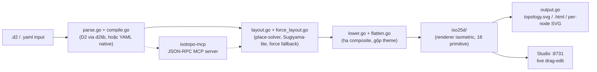
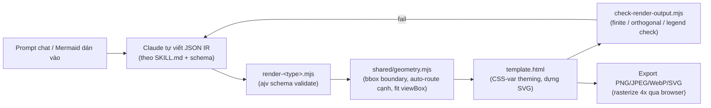
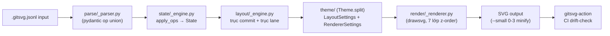
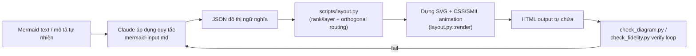

# Weekly scan — Diagram-as-code & visual tooling (2026-07-05)

**Tóm tắt (executive summary):**
- Quét topic/keyword GitHub (`diagram-as-code`, `dsl`, `svg-animation`, `graph-visualization`, `layout-algorithm`, `pushed:>2026-06-28`) trả về ~50 repo, phần lớn là noise (dependency-bump, GitHub-profile SVG art, portfolio "built with Mermaid"). Sau khi loại các repo chỉ có hoạt động dependabot/renovate trong 7 ngày (ví dụ `c4hero`, `pintora` — cả hai có kiến trúc đáng học nhưng không có commit tính năng thực sự trong tuần) và các repo <300 LOC/còn ở giai đoạn design-only (`FigDown`), 4 repo dưới đây sống sót qua bộ lọc relevance và có bằng chứng kiến trúc rõ ràng để đọc sâu.
- Điểm chung bất ngờ: **2/4 repo** (`gitsvg`, `dashmotion`) tự tách bạch "state/IR câm" khỏi styling gần như y hệt bộ ba `model.py` / `alignment.py` / `to_svg.py` của kymo, và cả hai đều dùng **lane/trunk-routing thay vì crossing-minimization đầy đủ** (barycenter/Sugiyama) — một tín hiệu xác nhận hướng đi hiện tại của `alignment.py` (fan-in/trunk-lane staggering) là lựa chọn hợp lý, không phải thiếu sót.
- `iso-topology` và `archify` là hai thái cực đối lập về "trí thông minh layout nằm ở đâu": `iso-topology` tái dùng layout engine 2D có sẵn (dagre/ELK, qua d2) rồi chiếu affine khả nghịch sang isometric; `archify` bỏ hẳn auto-layout, để LLM tự đặt toạ độ và renderer chỉ làm việc cơ học (bbox, edge routing, viewBox). Cả hai là bài học đối chiếu hữu ích nếu kymo cân nhắc thêm projection mode hoặc một "no-DSL LLM-authored" front-end trong tương lai.

## Mục lục
1. [MarkovWangRR/iso-topology](#1-markovwangrriso-topology) — DSL text (D2/YAML) → isometric 2.5D SVG, agent-first MCP loop
2. [tt-a1i/archify](#2-tt-a1iarchify) — Claude Skill, JSON IR do LLM tự đặt toạ độ, không auto-layout
3. [bertpl/gitsvg](#3-bertplgitsvg) — git-graph JSONL → SVG, layout tách bạch state/theme cực rõ
4. [Northwestern-caddo190/dashmotion](#4-northwestern-caddo190dashmotion) — Mermaid → animated SVG (CSS + SMIL), LLM-parse + Python-layout

---

## 1. MarkovWangRR/iso-topology

### §1 — Quick context
DSL text (D2 syntax hoặc YAML) sinh ra kiến trúc diagram **isometric 2.5D chất lượng Figma**, khác các tool diagram-as-code khác (Mermaid, D2 thuần) ở chỗ output có chiều sâu/phối cảnh thay vì phẳng, và tự nhận là "agent-first": DSL là một machine-checkable contract mà LLM agent tự sửa lỗi qua MCP.
**Stack:** Go 1.25, phụ thuộc `oss.terrastruct.com/d2` v0.7.1 (cho layout dagre/ELK) + `yaml.v3`; output SVG/HTML/PNG, single static binary, không runtime dep. **Sức khoẻ repo:** 43 sao, v0.16.0 (release 2026-07-04, hôm nay), 451 commit, corpus test cực nặng (property/regression/fuzz-style test file cho occlusion, depth-sort, cycle-breaking, XSS-injection…), Apache-2.0. **Phân phối:** `go install`, không có gói PyPI/npm — chỉ binary.

### §2 — Architecture deep-dive

**A. Component inventory**
- `dsl.go` — data model thuần (`Document`, `Node`, `CompositePart`, `Connector`, `Layout`, `Place`, `Style`, `Theme`, `Canvas`) — comment gốc: "the shape (discrete enum) is orthogonal to the style (continuous palette)".
- `parse.go` — `ParseYAML`/`ParseJSON`/`Parse` (auto-detect theo phần mở rộng).
- `compile.go` — `CompileD2()` bọc `d2lib.Compile()` của D2, chọn layout engine Dagre hoặc ELK.
- `layout.go` — solver quan hệ: biến `layout {…}` (auto-arrange container) và `place: {rightOf|behind|above}` (quan hệ anh em) thành offset cụ thể; hàm chính `arrangeAuto` (Sugiyama-lite từ topology connector), `arrangeContainer` (đóng gói hàng/cột/lưới), `placeSiblings` (DFS constraint solver), `solveContainer` (đệ quy nhóm lồng nhau).
- `force_layout.go` — fallback force-directed (Fruchterman-Reingold tất định) cho đồ thị có chu trình/mesh, kèm phát hiện feedback-edge (Eades–Lin–Smyth).
- `lower.go` — hạ tầng cây `group`/`stack` phía author xuống cấu trúc phẳng mà `iso25d` cần.
- `flatten.go` — trộn theme + default shape + override style thành option render cuối.
- `iso25d/` — package render isometric riêng (mỗi shape một file: cylinder, prism, rack, cloud, person…, 18 primitive).
- `output.go` — đóng gói SVG/HTML/per-node fragment.
- `planeval.go` / `planeval_iso.go` — chấm điểm chất lượng layout (occlusion, contrast, route crossing) tách biệt khỏi bước render.
- `cmd/isotopo/main.go` — CLI (`render`/`serve`/`validate`/`repair`/`evaluate`/`capabilities`).
- `cmd/isotopo-mcp/main.go` — MCP server JSON-RPC 2.0 qua stdio, tự viết tay (không dùng MCP SDK Go chính thức).

**B. Pipeline (happy path)**
1. User chạy `isotopo render scene.d2 ./out`.
2. `loadDocument()` dispatch theo phần mở rộng → `.d2` qua `compile.go`/D2, `.yaml`/`.json` qua `parse.go`.
3. `layout.go` (DAG thường) hoặc `force_layout.go` (có chu trình) resolve `place`/`layout` thành offset tuyệt đối.
4. `lower.go` + `flatten.go` gộp theme/style, hạ cây composite xuống phẳng.
5. `iso25d` chiếu hình học phẳng qua phép biến đổi isometric, vẽ 18 primitive thành SVG.
6. `output.go` ghi `out/topology.svg` (+ `.html`, per-node fragment).

**C. Data model / IR:** struct Go thuần (không immutable), nhưng có kỷ luật rõ: sau khi `layout.go` giải xong, field `Place`/`Layout` của node được xoá — tức bước solve là tất định, idempotent, không lặp lại. Không có khái niệm "lower IR" tường minh kiểu D2's TALA, nhưng về tinh thần `layout.go` → `lower.go`/`flatten.go` chính là hai bước hạ cấp tương tự.

**D. Input language design:** không tự viết grammar hình thức — DSL thực chất là "cú pháp D2 (parse qua d2lib) HOẶC data model YAML/JSON riêng". Không có EBNF do chính dự án viết ra (uỷ thác cho D2 upstream). Error reporting: subcommand `validate` + MCP tool `iso_validate` trả lỗi định vị theo JSONPath kèm gợi ý sửa.

**E. Layout algorithm:** layered/Sugiyama-lite cho DAG + solver quan hệ tường minh cho `place: rightOf/behind/above` (DFS, giải đệ quy nhóm lồng nhau) + fallback force-directed tất định khi có chu trình. Điểm hay nhất: phép chiếu isometric `P(x,y) = ((x−y)·cos30°, (x+y)·sin30°)` là **affine khả nghịch**, bảo toàn vị trí tương đối và số giao cắt cạnh — nên toàn bộ bài toán đặt vị trí/route/crossing-minimization có thể tái dùng layout engine 2D "industry SOTA" (dagre/ELK có sẵn trong D2); cái mới của dự án chỉ là objective 2.5D occlusion + "projection-repair loop" cho view isometric. Doc thiết kế (`docs/design/layout-engine-master-plan.md`) nói thẳng: không tái phát minh Sugiyama.

**F. Rendering / output:** một backend duy nhất (`iso25d`, tự viết), 18 primitive, hiệu ứng gradient/glass/grain/backglow/drop-shadow; không có animation (SVG tĩnh); output byte-deterministic để diff được trong Git. Web Studio (`serve`, localhost:8731) có live drag-edit nhưng đó là tương tác, không phải animation.

**G. Extensibility:** icon (200+ icon: Simple Icons vendor + custom qua URL/data-URI), theme (file YAML preset, ít nhất 4 theme có sẵn: clean-light, clickhouse-dark, handdrawn-paper, navy-glass), shape mới qua escape hatch `shape_custom_path.go`.

**H. Dev experience:** CLI tài liệu hoá rõ trong README (`render`/`serve`/`validate`/`repair`/`evaluate`/`capabilities`); Studio đóng vai trò watch-mode/browser-preview (phản hồi dưới giây); một file skill `skills/draw-iso-diagram/SKILL.md` đóng gói sẵn để tích hợp Claude Code; docs cấu trúc theo Diátaxis (getting-started/guides/reference/concepts/agent). Không xác định: có `--help` transcript đầy đủ hay không (flag parser tự viết tay, không xác nhận được từ mã nguồn).

### §3 — Architecture diagram

### §4 — Verdict
Đáng học: (1) vòng lặp MCP `iso_validate → iso_repair → iso_evaluate` cho agent tự sửa lỗi trước khi render — kymo đã có MCP nhưng chưa có cặp tool repair/evaluate tường minh kiểu này, đáng cân nhắc thêm. (2) Kỹ thuật "tái dùng layout engine 2D có sẵn qua phép chiếu affine khả nghịch" là cách sạch để thêm projection mode mới (vd. isometric) mà không phải viết lại thuật toán layout — liên quan trực tiếp nếu kymo từng muốn thử isometric/3D-ish output. (3) DFS solver cho `place: rightOf/behind/above` gần giống tinh thần parent/child anchoring của `alignment.py` — đáng so sánh chi tiết implementation. Red flag: ~100 file `.go` phẳng ở root package, khó điều hướng hơn cấu trúc `src/kymo` theo module của kymo. Câu hỏi mở: cơ chế occlusion/depth-sort trong `iso25d` (chưa đọc source). **Verdict: study deeper.**

---

## 2. tt-a1i/archify

### §1 — Quick context
Claude Code Skill sinh diagram kiến trúc/workflow/sequence/dataflow/lifecycle bằng cách để chính LLM tự viết ra một **JSON IR** (không phải DSL text, không auto-layout) rồi renderer chỉ làm việc cơ học — khác biệt hoàn toàn với kymo (DSL text → parse → auto layout/alignment resolver).
**Stack:** Node.js ESM (`.mjs`), phụ thuộc runtime duy nhất là `ajv` (JSON Schema validation); output HTML tự chứa + SVG, export PNG/JPEG/WebP/SVG (rasterize 4x qua trình duyệt). **Sức khoẻ:** 2606 sao (rất cao so với tuổi đời), v2.9.0 (CHANGELOG ghi 2026-07-05, README/API ghi 2026-07-04 — lệch 1 ngày, không quan trọng), MIT, có `node --test` + golden test. **Phân phối:** không qua npm registry — cài như Claude Skill (`archify.zip`) hoặc `npx skills add`.

### §2 — Architecture deep-dive

**A. Component inventory**
- `archify/SKILL.md` — chính là "ngữ pháp": văn bản hướng dẫn LLM cách viết JSON IR, nguyên tắc bố cục ("one main path", "few labeled edges"…), và vòng lặp validate.
- `archify/renderers/{architecture,workflow,sequence,dataflow,lifecycle}/render-*.mjs` — 5 renderer theo loại diagram, mỗi cái nhận IR JSON → SVG.
- `archify/renderers/shared/{geometry,utils,cli,validator,layout-report}.mjs` — hàm hình học/validate dùng chung, thuần function.
- `archify/schemas/*.schema.json` — JSON Schema draft 2020-12 cho từng loại, `additionalProperties:false`.
- `archify/bin/archify.mjs` — CLI (`render`/`validate`/`inspect`/`check`/`examples`).
- `archify/scripts/check-render-output.mjs` — linter hậu-render (finite-value, orthogonal-arrow, legend-clearance).
- `archify/assets/template.html` — shell theming (CSS custom properties + `[data-theme]`) và pipeline export raster.

**B. Pipeline (happy path)**
1. User mô tả hệ thống trong chat; Claude đọc `SKILL.md` + một ví dụ JSON đã hoàn chỉnh.
2. Claude tự viết `<name>.<type>.json` — **tự chọn `pos`/`size` cho mọi node** (không có bước tính toán vị trí).
3. `archify render <type> input.json out.html` gọi renderer tương ứng: validate qua `ajv` theo JSON Schema, tính bbox boundary + auto-route cạnh (1 khúc cua) + auto-fit viewBox, xuất HTML/SVG tự chứa.
4. `archify validate`/`check` chạy lại `check-render-output.mjs` (giá trị hữu hạn, không có mũi tên chéo 1-đoạn, không đè lên legend) — lặp tới khi 0 vi phạm.
5. Claude giao `out.html`; người dùng có thể đổi theme hoặc export raster ngay trên `template.html`.

**C. Data model / IR:** một object JSON phẳng theo schema (components/boundaries/connections/cards), validate bằng JSON Schema; renderer chỉ thêm field dẫn xuất (x/y/width/height đo được) lên bản sao — không có khái niệm "lower IR" nhiều tầng.

**D. Input language design:** không có grammar hình thức nào — "DSL" chính là JSON Schema (draft 2020-12) cộng văn xuôi ràng buộc trong `SKILL.md`. Error reporting: lỗi ajv theo `instancePath`, được hậu xử lý gắn thêm id/label gần nhất để LLM dễ đọc (vd. `/components/3 (id/label:"router")/label`).

**E. Layout algorithm:** **KHÔNG CÓ** — đây là phát hiện đáng chú ý nhất. Vị trí node luôn là toạ độ `pos:[x,y]` do LLM viết tay, hoặc `row/col` qua công thức ô lưới cố định (`grid.mjs`). Phần hình học duy nhất được tính: bbox boundary + padding, auto-router cạnh 1 khúc cua, auto-fit viewBox. CHANGELOG ghi rõ: "bringing it to validation parity... **without auto-layout**. Claude still picks all coordinates."

**F. Rendering/output:** một backend, SVG dựng bằng template string tay (không dùng thư viện render), theming qua CSS custom properties + `[data-theme]`, export 4x-resolution qua thủ thuật set `width`/`height` = `viewBox × scale` để trình duyệt tự rasterize nét hơn. Có field `meta.animation: "trace"|"none"` trong schema và một hàm `animateAttr()` được gọi khi render component — gợi ý có chế độ animation nhẹ, nhưng cơ chế CSS/SMIL cụ thể **không xác định được** (chưa đọc sâu code renderer đủ để xác nhận).

**G. Extensibility:** thêm loại diagram mới = thêm `render-*.mjs` + `*.schema.json` + ví dụ; theme = khối biến CSS trong `template.html`; không có hệ plugin ngoài đó.

**H. Dev experience:** CLI rõ ràng (`render`/`validate`/`inspect`/`check`/`examples`), có fallback "no-Node" (tự vẽ SVG tay + tự `grep` kiểm tra không có màu hardcode), không watch-mode/LSP — vòng lặp render→validate do chính LLM chạy, không phải dev loop người dùng.

### §3 — Architecture diagram

### §4 — Verdict
Đáng học nhưng vì lý do khác `iso-topology`: archify chứng minh một diagram tool có thể **bỏ hẳn auto-layout**, đẩy toàn bộ suy luận không gian cho LLM lúc sinh, đổi lại renderer chỉ cần validate + hình học cơ học (bbox, route, viewBox). Kỹ thuật đáng tham khảo: `check-render-output.mjs` là một "linter hậu-render" rẻ tiền (giá trị hữu hạn, không mũi tên chéo lạc, không đè legend) — kymo hiện chỉ test byte-identity của golden SVG, chưa có lớp "diagram này có hợp lý về mặt thị giác không" độc lập với golden. Pattern "two-rect mask" (rect mask trong suốt + rect style) để cạnh không đè lên node là thủ thuật render đơn giản, dễ áp dụng. Red flag: không có DSL/parser thật — phụ thuộc hoàn toàn vào phán đoán của LLM để đặt vị trí, nghĩa là output **không tất định/không reproducible** giữa các lần chạy (đánh đổi được thừa nhận công khai, không phải bug, nhưng loại archify khỏi vai trò tham khảo cho DSL front-end của kymo). Câu hỏi mở: cơ chế animation "trace" hoạt động thế nào (chưa xác minh được). **Verdict: study deeper (góc nhìn kiến trúc, không phải làm mẫu cho DSL).**

---

## 3. bertpl/gitsvg

### §1 — Quick context
CLI Python render đồ thị git branch/commit thành SVG từ input **JSONL khai báo tuần tự** (branch/commit/merge/pr…) — khác biệt: input là log thao tác từng dòng chứ không phải toàn đồ thị tĩnh, và kiến trúc tách bạch state/layout/theme cực kỳ rõ ràng.
**Stack:** Python ≥3.11, `click` + `pydantic` v2 + `drawsvg` + `defusedxml`; output SVG (kèm 4 mức minify `--small 0-3`). **Sức khoẻ:** 0 sao nhưng CI cực nặng — 9 GitHub Actions workflow (unit test, CodeQL, fuzz bằng `atheris`, OpenSSF Scorecard), coverage gate 90%, v0.3.6/31 release, MIT. **Phân phối:** cài qua `uv`/`pip` (package name `gitsvg`, không xác nhận đã lên PyPI hay chỉ Git-installable), kèm GitHub Action riêng (`gitsvg-action`) cho CI.

### §2 — Architecture deep-dive

**A. Component inventory**
- `gitsvg/parse/_parser.py` — parser JSONL, mỗi dòng qua `pydantic` discriminated-union `TypeAdapter` theo field `op:`.
- `gitsvg/state/_engine.py` + `_apply/` — `apply_ops()` dispatch theo loại op, dựng `State` (dict `branches`/`commits`/`pull_requests`).
- `gitsvg/layout/_engine.py` — `compute_layout()`: 3 pha (trục commit, trục branch/lane, dựng object hình học).
- `gitsvg/theme/` — `Theme` là `pydantic.BaseModel`, 5 theme đặt tên sẵn (default/muted/dark/compact/gui), `Theme.split()` tách `LayoutSettings` khỏi `RendererSettings`.
- `gitsvg/render/_renderer.py` + `_primitives/` — 7 hàm vẽ theo thứ tự z-order cố định, dùng thư viện `drawsvg`.
- `gitsvg/cli/_cli.py` — CLI `click` với 7 subcommand: `schema`/`theme`/`errors`/`validate`/`render`/`state`/`layout`.
- `gitsvg/errors/` — catalog lỗi có mã (E001–E108) + `ValidationReport` (không bao giờ raise, chỉ tích luỹ).

**B. Pipeline (happy path)**
1. User chạy `gitsvg render diagram.gitsvg.jsonl -o diagram.svg`.
2. `parse_jsonl_file` đọc từng dòng, validate qua pydantic → `list[ParsedOp]`, tích luỹ `ValidationReport`.
3. `resolve_imports` mở rộng op `import` trước, rồi `apply_ops` chạy `State` + `ThemeBuilder` song song qua từng handler (branch/commit/merge/pr/highlight/remove/theme/grid).
4. `compute_layout(state, settings)` giải trục commit (quy tắc chuỗi cha dài nhất) + trục branch/lane (heuristic free-lane tĩnh HOẶC bộ dồn lane `auto_lane_change`) → `Layout` (không chứa dữ liệu trình bày).
5. `render(layout, theme)` chạy 7 lớp vẽ theo z-order qua `drawsvg` → file SVG, tuỳ chọn `--small 0-3` để minify.

**C. Data model / IR:** dataclass Go... à Python thuần (`slots=True`, không frozen) cho `State`; `Layout` là cây dataclass dựng mới hoàn toàn mỗi lần render (không mutate giữa các pha) — 4 cấu trúc dữ liệu tách biệt (parse→state→layout→render), gần nhất với khái niệm "lower IR" trong 4 repo được khảo sát. `Theme` là pydantic model, cố tình tách khỏi `State`/`Layout` — cùng triết lý "model câm, không logic" như `model.py` của kymostudio.

**D. Input language design:** không phải text DSL mà JSONL khai báo (mỗi dòng = một thao tác, phân biệt bằng field `op:`), "ngữ pháp" chính là tập model pydantic chứ không phải BNF/EBNF viết tay. Có subcommand `gitsvg schema` để lộ ra schema cho tooling khác. Error reporting: rất chi tiết, dạng `path:line: [code] field: message` (giống compiler diagnostic), được fuzz-test bằng `atheris`.

**E. Layout algorithm:** hybrid, cả hai phần đều **tự nhận không phải crossing-minimization**. Trục commit: quy tắc đơn giản `commit_pos = max(cha)+1+gap` (có mode ép mỗi commit một hàng riêng). Trục branch: (a) mặc định = bốc lane trống đầu tiên theo greedy (dò `lane+1, +2…` tới khi không bị chặn, theo dõi bằng cấu trúc `Occupancy`), hoặc (b) `auto_lane_change` = event-sweep dồn lane theo độ ưu tiên cố định, sinh nhiều `LaneSegment` + cạnh nối `LANE_CHANGE` — tài liệu nội bộ ghi rõ đây là "fixed-priority greedy packer", không phải Sugiyama/barycenter. Routing cạnh: mọi connector là "single-row hop" (đường branch gánh toàn bộ di chuyển dọc dài) — về tinh thần rất gần fan-in/trunk-lane staggering của `alignment.py`, chỉ khác là gitsvg giới hạn trong ngữ nghĩa git-DAG.

**F. Rendering:** một backend (SVG qua `drawsvg`), không animation, style connector (rounded/straight/bezier/double_rounded/double_bezier) chọn theo theme qua registry, có 4 mức minify.

**G. Extensibility:** theme = subclass pydantic override từng `_resolve_*` classmethod (5 theme có sẵn); thêm loại op mới cần mở rộng discriminated union + handler `_apply_*_op` mới — không có hệ plugin nhưng điểm mở rộng kiến trúc rất sạch.

**H. Dev experience:** CLI đầy đủ với các subcommand introspection hiếm gặp (`schema`/`errors`/`state`/`layout` — cho phép xem JSON state/layout trung gian mà không cần render), không có LSP/VSCode extension, không thấy watch-mode, nhưng có GitHub Action riêng cho CI render + drift-check.

### §3 — Architecture diagram

### §4 — Verdict
Đáng học sâu nhất trong 4 repo — kiến trúc gần nhất với kymostudio: bộ ba state/layout/theme câm khớp gần như 1:1 với `model.py`/`alignment.py`/`to_svg.py`, kể cả kỷ luật test golden. Kỹ thuật cụ thể đáng "cầm về": chiến lược snapshot 3 tầng của gitsvg (state JSON snapshot + layout JSON snapshot + SVG snapshot, cả ba byte-exact, đều regen được qua CLI flag) thêm một lớp golden layout-JSON mà bộ test của kymo (chỉ golden SVG cuối) chưa có — lớp này sẽ bắt được regression về layout *trước khi* nó lan tới rendering, giúp debug "gãy ở tầng nào" nhanh hơn nhiều so với diff byte SVG cuối cùng. Cũng đáng xem: cấu trúc `Occupancy` (lane-blocking theo tập hợp) và bộ dồn lane `auto_lane_change` như một giải pháp nhẹ thay cho crossing-minimization đầy đủ khi chỉ cần lane-migration (không phải đặt vị trí 2D tổng quát). Red flag: không đáng kể — codebase rất kỷ luật (fuzz, coverage 90%, OpenSSF Scorecard) dù 0 sao/ít người biết. Câu hỏi mở: chưa đọc code `_apply/*` từng loại op nên chưa xác nhận cách xử lý tie-break khi một commit có nhiều cha. **Verdict: study deeper — ưu tiên cao nhất.**

---

## 4. Northwestern-caddo190/dashmotion

### §1 — Quick context
Claude Skill chuyển Mermaid (`flowchart`/`graph`/`stateDiagram-v2`) hoặc mô tả tự nhiên thành SVG có **animation CSS + SMIL** tự chứa trong một file HTML — khác biệt: bỏ hẳn hình học gốc của Mermaid, LLM tự "parse" theo bộ quy tắc văn xuôi rồi gọi một script Python để tính layout + animation, thay vì LLM tự viết SVG tay.
**Stack:** HTML (~79%) + Python (~21%), **zero dependency** (chỉ thư viện chuẩn); output HTML tự chứa (SVG inline + CSS + JS tối giản cho pause/reduced-motion). **Sức khoẻ:** 0 sao nhưng CHANGELOG thật từ v2.0.0, có một đánh giá nội bộ có ngày tháng (2026-06-11) so sánh trước/sau, MIT, v2.2.3. **Phân phối:** Claude Code skill (`npx skills add`), không phải package npm/PyPI độc lập.

### §2 — Architecture deep-dive

**A. Component inventory**
- `skills/dashmotion/SKILL.md` — hướng dẫn quy trình cho Claude: parse input thành JSON đồ thị ngữ nghĩa, khi nào/cách nào gọi script Python.
- `skills/dashmotion/references/mermaid-input.md` — bộ quy tắc văn xuôi ánh xạ cú pháp Mermaid → đồ thị ngữ nghĩa của dashmotion; **không phải code**, LLM tự áp dụng quy tắc này để "parse".
- `skills/dashmotion/scripts/layout.py` (1069 dòng) — engine layout rank/layer tất định + orthogonal routing + dựng SVG/CSS/SMIL, CLI độc lập.
- `skills/dashmotion/scripts/check_diagram.py` — self-check cấu trúc hậu sinh (9 lớp vi phạm C1–C9).
- `skills/dashmotion/scripts/check_fidelity.py` — parser Mermaid dựa trên regex, dùng để kiểm chứng HTML sinh ra trung thành với `.mmd` gốc.
- `eval/` — một đánh giá A/B thật có ngày tháng (2026-06-11) và quyết định **không** áp dụng elkjs, kèm số liệu.

**B. Pipeline (happy path)**
1. User dán Mermaid hoặc mô tả; Claude đọc `mermaid-input.md` (nếu có Mermaid) và tự viết JSON đồ thị ngữ nghĩa (node/edge/label/containment/loại-cạnh) — **không có code nào parse Mermaid lúc sinh**.
2. Claude ghi JSON ra file tạm rồi gọi: `python3 scripts/layout.py graph.json --render out.html`.
3. `layout.py` tính layer DAG (`longest_path_layers` sau khi phát hiện back-edge bằng DFS), đặt node quanh trục x trung tâm cố định theo layer, route cạnh (L-route trực tiếp giữa layer liền kề, dùng "trunk lane" dọc dùng chung cho cạnh xa/ngược), dựng bbox nhóm/boundary từ dưới lên, chuẩn hoá toạ độ, rồi lắp SVG+CSS(+SMIL)+JS thành một chuỗi HTML.
4. Claude chạy `check_diagram.py out.html` (phải in "0 violations") và, nếu input là Mermaid, `check_fidelity.py source.mmd out.html` (phải in "PASS") — lặp tới khi cả hai qua.
5. Claude giao `out.html` — diagram animated tự chứa, không cần server/build.

**C. Data model / IR:** một object JSON đồ thị ngữ nghĩa (node/edge/tier/group) do LLM viết một lần, sau đó object `Layout` nội bộ (không lưu lại) do các hàm thuần của `layout.py` sinh ra — chỉ một bước hạ cấp (đồ thị ngữ nghĩa → hình học đã giải), rồi render trực tiếp; không có chuỗi IR nhiều tầng mutable như kymo (parse→layout→alignment→render).

**D. Input language design:** hai "front-end" song song — (1) tập con Mermaid, được LLM "parse" bằng quy tắc văn xuôi (không phải code), và (2) JSON đồ thị ngữ nghĩa — đây mới là "DSL" thật của dashmotion, không có file grammar hình thức. Có một parser regex Mermaid **thật sự tồn tại** (`check_fidelity.py::parse_mermaid`, tách theo regex mũi tên + che chuỗi trong ngoặc kép + khớp ngoặc shape dài nhất trước) nhưng chỉ dùng để kiểm tra hậu-sinh, không bao giờ dùng để dẫn động việc sinh — thiết kế "parse để verify, không parse để compile" khá thực dụng và bất thường.

**E. Layout algorithm:** rank/layer-based (leveling longest-path trong DAG kiểu Kahn, back-edge phát hiện trước bằng DFS), tự thừa nhận không crossing-minimized ("no barycenter sweep... layers centered, not barycenter-aligned to parents"). Routing cạnh hoàn toàn orthogonal: cạnh layer liền kề có L-bend trực tiếp, cạnh dài/ngược dùng chung một "trunk lane" dọc nằm ngoài node (tối ưu fan-out/dùng chung lane) — lại một lần nữa gần với khái niệm trunk-lane staggering của `alignment.py`. Đội ngũ đã chạy một đánh giá thật và quyết định không đáng để thêm elkjs ("layout arithmetic failure rate = 0/10... vấn đề elkjs giải quyết hiện không phải nỗi đau của dashmotion") — một ví dụ hiếm về quyết định buy-vs-build layout có số liệu đi kèm.

**F. Rendering/output:** một backend — một script Python sinh trọn một file HTML tự chứa (SVG inline + `<style>` + `<script>` nhỏ). Animation là tính năng chủ đạo: vòng lặp keyframe CSS `stroke-dashoffset` cho cạnh "chảy" (3 tốc độ/pattern dash khác nhau cho loại cạnh sync/async/auth), SMIL `<animateMotion>` tái dùng chính chuỗi `d` của path cạnh cho "dot di chuyển", thời lượng dot suy từ độ dài path/tốc độ cố định, các dot nối tiếp qua timing SMIL `begin="prevId.end+0.3s"` (không cần vòng lặp JS). Gated hoàn toàn sau `@media (prefers-reduced-motion: no-preference)`, có JS fallback xoá `.dot` và nút pause khi giảm chuyển động. Kỷ luật z-order rõ ràng (grid→connector→dot→node→legend) để dot "biến mất vào" node thay vì trượt đè lên.

**G. Extensibility:** chỉ có 2 "mode" (flow/architecture) làm trục mở rộng hiện tại, mỗi mode một doc tham chiếu + template HTML riêng; không có hệ plugin; theming dựa trên bảng màu ngữ nghĩa cố định, không thấy cơ chế cho người dùng ghi đè.

**H. Dev experience:** có CLI độc lập thật (`layout.py`, `check_diagram.py`, `check_fidelity.py` chạy được ngoài Claude), vòng lặp self-check bắt buộc và cơ học ("never verify by opening a browser... the script is the authority" — kỷ luật chống ảo giác khá mạnh cho một tool do LLM dẫn động), không có watch-mode/live-preview/IDE integration — đây là tool batch một-lần theo thiết kế, không phải editor tương tác.

### §3 — Architecture diagram

### §4 — Verdict
Đáng học sâu nhất trong 4 repo về mảng animation — liên quan trực tiếp tới target `--animate` của kymo. Kỹ thuật cụ thể đáng cầm về: SMIL `animateMotion` "dot di chuyển" tái dùng chính chuỗi `d` đã render của cạnh (không cần tính toán toạ độ quỹ đạo riêng cho dot) — nếu renderer animation của kymo chưa làm vậy, đây là thủ thuật rẻ và sạch. Quyết định buy-vs-build có số liệu (từ chối elkjs) là tiền lệ hữu ích khi kymo cân nhắc có nên thay `layout.py`/`alignment.py` tự viết bằng thư viện layout ngoài hay không. Cũng đáng chú ý: kỷ luật "chạy script kiểm tra, không bao giờ tự nhìn screenshot" để giữ một tool do LLM dẫn động trung thực — không trực tiếp áp dụng cho kymo (kymo tất định, không do LLM tự viết DSL) nhưng liên quan nếu MCP server của kymo sau này cho phép LLM tự sửa `.kymo` trực tiếp. Red flag: layout tự thừa nhận không crossing-minimized và tái tạo hình học từ đầu (bỏ hẳn layout gốc của Mermaid) — ổn với flowchart đơn giản, nhưng cách tiếp cận "một trunk lane, layer căn giữa" nhiều khả năng xuống cấp với diagram dày đặc/rộng (giới hạn tự thừa nhận). Câu hỏi mở: "architecture mode" khác "flow mode" ở đâu trong nội bộ chưa được xác minh (doc tham chiếu chưa đọc đủ). **Verdict: study deeper.**
