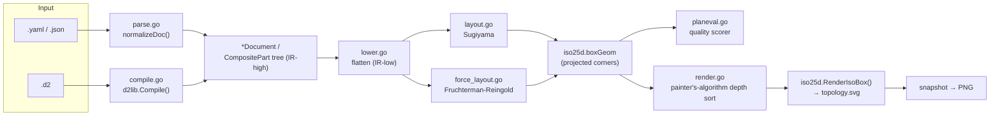
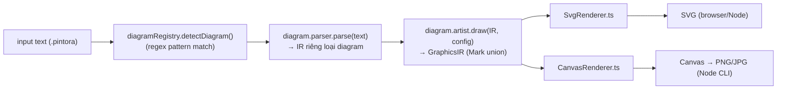
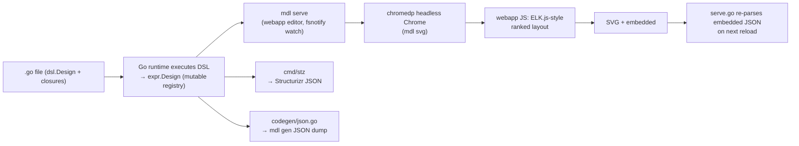
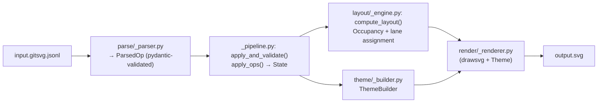

# Weekly Diagram Tooling Scan — 2026-07-06

**Nguồn dữ liệu**: GitHub API bị chặn 403 trong môi trường này (không có `gh` CLI, GitHub MCP giới hạn phạm vi `kymostudio/kymostudio`), nên scan này dùng `github.com/topics/diagram-as-code?o=desc&s=updated` (fetch trực tiếp qua WebFetch) + WebSearch để xác nhận từng repo, thay vì `gh api search/repositories`. Cửa sổ thời gian: cập nhật trong 29/06–06/07/2026.

## Executive summary

- **iso-topology** (Go, 45★) là phát hiện đáng chú ý nhất tuần này: DSL coordinate-free cho isometric 2.5D SVG, dùng 2 layout backend khác nhau tùy input dialect (D2 compiler thật cho `.d2`, Sugiyama/force-directed tự viết cho YAML thuần), và có một **layout-quality scorer** độc lập (`planeval.go`) mà kymostudio's `alignment.py` hiện chưa có tương đương.
- **gitsvg** (Python, 0★ nhưng 1186 tests/98% coverage/31 releases) là một "vanity-grade" project bị undiscovered, nhưng thuật toán `Occupancy` (tách biệt "phải không chồng lấn" khỏi "chỉ đi ngang qua") và lane-segment migration là so sánh trực tiếp hữu ích với fan-in/trunk-lane resolver của kymostudio.
- **pintora** và **goadesign/model** đều là kiến trúc đã ổn định (1.3k★ / 462★), ít tính "mới" hơn nhưng cho hai góc nhìn đối lập về input-language design: plugin registry text-DSL (pintora) versus DSL-là-chính-ngôn-ngữ-host (Go closures, goadesign/model) — đáng tham khảo khi cân nhắc mở rộng front-end của kymostudio ngoài `.kymo`.

## Mục lục

1. [iso-topology](#1-iso-topology) — MarkovWangRR/iso-topology
2. [pintora](#2-pintora) — hikerpig/pintora
3. [goadesign/model](#3-goadesignmodel) — goadesign/model
4. [gitsvg](#4-gitsvg) — bertpl/gitsvg
5. [Shortlist đầy đủ (8-10 repos, không deep-dive)](#shortlist-đầy-đủ)

---

## 1. iso-topology

`https://github.com/MarkovWangRR/iso-topology`

### §1 Quick context

DSL YAML/JSON/D2 coordinate-free biên dịch thành SVG isometric 2.5D chất lượng thiết kế — khác các tool kiến trúc khác ở chỗ nó được xây **agent-first** (lệnh `capabilities` tự mô tả, vòng lặp validate→repair, MCP server, "skill" cài được cho Claude Code/Cursor). Stack: Go 1.25, binary tĩnh, nhúng thư viện D2 thật của Terrastruct (`oss.terrastruct.com/d2 v0.7.1`) làm auto-layout cho input `.d2`. Sức khỏe repo: 45★, 1 fork, Apache-2.0, v0.16.0 (bản thứ 24), bộ test golden-file lớn. Phân phối: chỉ qua `go install` — chưa có npm/PyPI.

### §2 Architecture deep-dive

**A. Component inventory**
- `cmd/isotopo/main.go` — CLI + HTTP endpoints cho `serve`
- `cmd/isotopo-mcp` — MCP server binary
- `parse.go`/`dsl.go` — parse YAML/JSON thành `*Document`
- `compile.go` — bọc `d2lib.Compile()` cho input `.d2`
- `lower.go` — hạ cấp cây `CompositePart` lồng nhau thành slice phẳng
- `layout.go` (Sugiyama), `layout_elk.go` (ELK), `force_layout.go` (Fruchterman-Reingold) — layout tự viết cho input YAML thuần
- `render.go` — depth-sort painter's-algorithm + gọi `iso25d.RenderIsoBox()`
- `occlusion.go`, `planeval.go`/`planeval_iso.go` — chấm điểm chất lượng layout
- `editops.go`/`interact.go` — API live-edit của studio
- `validate.go`/`lint.go`, `theme.go`, `icons.go`, `capabilities.go`
- `iso25d/` — package riêng vẽ SVG isometric (`iso.go`, `geometry.go`, `shape_*.go`)
- `studio/` — UI xem trước tĩnh HTML/CSS/JS phục vụ bởi `serve`

**B. Pipeline** — happy path `isotopo foo.yaml`:
1. `main.go` phân loại input theo phần mở rộng (yaml/json/d2).
2. `.yaml`/`.json` → `parse.go` unmarshal vào `*Document`, `normalizeDoc()` dọn nil-pointer + sửa nhập nhằng cú pháp flow-map. `.d2` → `compile.go` gọi thẳng `d2lib.Compile()` thật (dagre mặc định hoặc elk).
3. Áp theme/readable-profile.
4. `lower.go` hạ cây `group`/`stack` lồng nhau thành `[]*CompositePart` phẳng (không mutate cây gốc).
5. Input không phải D2 chạy layout riêng: Sugiyama layered ranking (cắt chu trình bằng GreedyFAS) hoặc force-directed Fruchterman-Reingold (240 vòng lặp cố định) tùy hình dạng đồ thị.
6. `render.go` depth-sort các part theo tổng góc x+y+z (painter's algorithm), gọi `iso25d.RenderIsoBox()` từng phần.
7. Ghi `topology.svg`/`.html`/bản sao nguồn + gallery từng node.

**C. Data model/IR** — Cặp IR rõ ràng kiểu "lower-to-lower-IR": `*Document`/cây `CompositePart` (mutable, tác giả thấy) → slice phẳng của `lower.go` (IR thấp cho renderer, dựng không phá cây gốc) → `iso25d.boxGeom` bất biến (tọa độ góc A–H đã chiếu, IR thực sự của renderer).

**D. Input language design** — Không phải grammar/PEG tự viết: unmarshal trực tiếp qua `yaml.v3`/`encoding/json` vào struct, cộng một pass chuẩn hóa. Nhánh `.d2` tái dùng nguyên bộ parser/compiler của D2. Lỗi báo qua `validate.go`/`lint.go` dưới dạng JSON có cờ "repairable", không phải error-recovery kiểu parser truyền thống.

**E. Layout algorithm** — Thực sự coordinate-free cho input D2 (giao hết cho layout đồ thị của D2/dagre/ELK); cho quan hệ YAML gốc (`rightOf`/`behind`/`above`) tự chạy solver riêng: Sugiyama cho DAG, rơi về force-directed cho đồ thị có chu trình/dày đặc. `planeval.go` là **một pass đánh giá chất lượng độc lập** (đếm crossing, cạnh xuyên node, cạnh ngược, chồng lấn, số khúc gấp) — tách biệt khỏi objective function của solver.

**F. Rendering/output** — Một renderer duy nhất: SVG (qua `iso25d`), có `snapshot` để raster ra PNG. Không tìm thấy backend khác (không Figma/PDF). Không có animation.

**G. Extensibility** — Theme là file YAML dữ liệu thuần (`themes/*.yaml`, 4 bản có sẵn) do `theme.go` đọc. Icon: `iso25d/icons_si.go` + `brand_icons.go` (~150+ logo dựa trên Simple-Icons). Không thấy plugin API hình thức.

**H. Dev experience** — Lệnh `capabilities` xuất JSON máy-đọc-được (shapes/keys) cho agent khám phá; `validate`/`repair`/`evaluate` tạo thành vòng tự sửa lỗi rõ ràng cho LLM agent; `serve` chạy studio tại :8731 với drag-to-edit và endpoint HTTP thao tác cấu trúc (`/api/move`, `/api/edit`, `/api/op`, `/api/source`) — một IDE trình duyệt thật, không chỉ preview tĩnh. `skills/draw-iso-diagram` đóng gói cả workflow này thành skill cài được cho Claude Code/Cursor.

### §3 Architecture diagram

### §4 Verdict

Kỹ thuật đáng học nhất cho kymostudio: **`planeval.go`** — một pass chấm điểm layout tách biệt (crossings/tunneling/overlaps/backward-edges) có thể chạy độc lập trong CI hoặc vòng self-correction của agent. `alignment.py` của kymostudio hiện không có tương đương — đây là gap cụ thể, không lý thuyết suông. Cách đặt tên/pattern "lowering không phá cây gốc" của `lower.go` cũng đáng tham khảo cho `resolve_alignments()`. Ý tưởng dùng D2 thật làm layout backend cho một nhánh input trong khi tự viết Sugiyama/force-directed cho nhánh khác là một lựa chọn kiến trúc thú vị (2 backend theo dialect thay vì 1 solver thống nhất), nhưng ít áp dụng trực tiếp vào kymostudio vì kymostudio chỉ có một DSL.

Red flags: claim "zero runtime deps" chỉ đúng cho binary đã build — cây dependency build-time qua `d2lib` khá nặng (goja JS VM, chroma, freetype, brotli...). Toàn bộ root package (80+ file Go) nằm trong một `package isotopo` không chia subpackage — mùi monolith dù test coverage tốt. Câu hỏi mở: extensibility cho icon/shape mới có thực sự chỉ là "thêm 1 file Go" hay có cơ chế khác — chưa xác định được từ evidence.

**Verdict: study deeper** — đặc biệt phần `planeval.go` và mô hình lowering IR.

---

## 2. pintora

`https://github.com/hikerpig/pintora`

### §1 Quick context

Thư viện JS/TS "text-to-diagrams" mở rộng được, chạy cả browser lẫn Node.js — khác Mermaid/D2 chủ yếu ở kiến trúc plugin tường minh cho từng loại diagram và output không làm ô nhiễm CSS global. Stack: TypeScript ~74%/JS ~12%/grammar Nearley ~6.6%. ~1.3k★, 725 commits, bản mới nhất v0.8.2 (02/2026), MIT. Monorepo pnpm workspaces + Turbo, test bằng Jest. Phân phối: npm (`@pintora/standalone`, `@pintora/core`, `@pintora/cli`), extension VS Code riêng (`pintora-vscode`), plugin Gatsby remark, live editor online.

### §2 Architecture deep-dive

**A. Component inventory** — 9 package dưới `packages/`: `pintora-core` (registry, config, theme, base types), `pintora-diagrams` (toàn bộ plugin loại diagram), `pintora-renderer` (backend Canvas/SVG), `pintora-cli`, `pintora-standalone` (bundle browser), `pintora-harness` (dev harness), `pintora-target-wintercg` (runtime WinterCG), `development-kit`, `test-shared`.

**B. Pipeline** — xác nhận qua `pintora-core/src/index.ts`'s `parseAndDraw(text, opts)`: (1) `diagramRegistry.detectDiagram(text)` chạy regex `pattern` của từng diagram đã đăng ký để nhận diện loại (mặc định `sequenceDiagram` nếu không khớp gì — `diagram-registry.ts`); (2) `parser.parse(text, context)` của diagram khớp dựng IR riêng loại đó (`D`); (3) `artist.draw(diagramIR, config, opts)` hạ IR đó xuống `GraphicsIR` dùng chung; (4) `CanvasRenderer.ts`/`SvgRenderer.ts` trong `pintora-renderer/src/renderers/` duyệt `GraphicsIR` để vẽ pixel hoặc xuất SVG.

**C. Data model/IR** — Hạ cấp 2 tầng: tầng 1 là IR riêng từng loại diagram (vd. model `db.ts` cho sequence), dựng gần-như-bất-biến bởi parser. Tầng 2 là graphics IR dùng chung (`packages/pintora-core/src/types/graphics.ts`) — discriminated union `Mark` (Group/Rect/Circle/Ellipse/Text/Line/PolyLine/Polygon/Marker/Path/GSymbol) kế thừa `IMark` gốc. `GraphicsIR extends Figure` thêm width/height + màu nền. Interface TypeScript thuần, không phải class.

**D. Input language design** — Grammar Nearley riêng cho từng loại diagram (xác nhận `packages/pintora-diagrams/src/sequence/parser/sequenceDiagram.ne`), tokenize bằng lexer fork `@hikerpig/moo`, parse bằng fork `@hikerpig/nearley` (cả hai đều là fork riêng trong `package.json`). Sequence diagram còn có `event-recognizer.ts` riêng cho tương tác/sự kiện, tách khỏi grammar parser. Cách báo lỗi cụ thể: không xác định được.

**E. Layout algorithm** — `pintora-diagrams` phụ thuộc `@pintora/dagre` (fork) và `@pintora/graphlib` cho layout kiểu đồ thị, cộng `d3-shape`/`d3-scale`/`d3-interpolate` cho path/curve và scale tọa độ. Loại diagram nào dùng dagre vs layout tự viết: không xác định được (chỉ xác nhận dependency dùng chung, chưa xác nhận theo từng thư mục).

**F. Rendering/output** — `pintora-renderer/src/renderers/` có `CanvasRenderer.ts`, `SvgRenderer.ts`, `base.ts` — một interface/base dùng chung cho 2 backend cụ thể, cùng ăn một `GraphicsIR`. README xác nhận SVG/Canvas ở browser, PNG/JPG/SVG ở Node qua `pintora-cli`. Animation: không xác định được.

**G. Extensibility** — Xác nhận qua `pintora-core/src/type.ts`: một plugin loại diagram implement `IDiagram<D, Config>` = `{pattern: RegExp, parser: {parse(text, context): D}, artist: {draw(diagramIR, config, opts): GraphicsIR}, clear(), eventRecognizer?, configKey?}`, đăng ký qua `diagramRegistry.registerDiagram(name, diagram)`. Theme: `ThemeRegistry.registerTheme(name, variables)`, singleton `themeRegistry`, 4 theme có sẵn (`ThemeDefault`, `ThemeDark`, `ThemeLarkLight`, `ThemeLarkDark`) cộng bảng màu (`AYU_LIGHT`, `DRACULA`).

**H. Dev experience** — package `pintora-cli` riêng, extension VS Code riêng (`pintora-vscode` — syntax highlight + preview cho file `.pintora` và code-fence Markdown), live editor online, lệnh `pnpm watch` build lại khi đổi file qua Turbo.

### §3 Architecture diagram

### §4 Verdict

Ý tưởng chuyển giao được nhiều nhất cho kymostudio: **hợp đồng plugin 2 hàm thống nhất** — mỗi loại diagram chỉ là `{pattern, parser.parse(text)→D, artist.draw(D, config)→GraphicsIR}` đăng ký vào một `diagramRegistry`, và cả hai backend Canvas/SVG cùng ăn một `GraphicsIR` dùng chung. kymostudio đã có sự tách biệt tương tự (DSL→Diagram→alignment→emitter) nhưng chỉ cho một grammar; pattern registry của pintora gợi ý cách kymostudio có thể hình thức hóa nhiều "front-end" ngôn ngữ khác nhau (vd. một format import phi-BPMN trong tương lai) thành cặp `parser`+`artist` hoán đổi được, dùng chung một `model.py`/GraphicsIR-tương-đương, mà không đụng đến renderer — củng cố đúng nguyên tắc "renderer dumb trên plain data" mà kymostudio đã theo, nhưng áp cho phía input.

Red flags: hai dependency lõi bị fork riêng (`@hikerpig/nearley`, `@hikerpig/moo`, `@pintora/dagre`) gợi ý patch chưa merge ngược upstream — rủi ro bảo trì/bus-factor mà kymostudio tránh được nhờ tự viết parser. Đáng chú ý: `diagram-registry` mặc định về `sequenceDiagram` khi không khớp pattern nào, thay vì báo lỗi — hành vi "trả lời sai thay vì báo lỗi" mà parser của kymostudio (dù "không validate gì" theo CLAUDE.md) dường như không có.

**Verdict: glance only** — pattern registry hai-hàm đáng ghi nhớ, nhưng kiến trúc tổng thể không đủ mới để nghiên cứu sâu hơn.

---

## 3. goadesign/model

`https://github.com/goadesign/model`

### §1 Quick context

Thư viện/CLI Go hiện thực C4 model bằng cách viết code Go thật (hàm + closure), không phải ngôn ngữ text riêng — "DSL" được chính `go build` type-check. Stack: Go 1.26 module, frontend web TS/JS cho editor đồ họa (Go ~70%, TS ~26.5%). ~462★, 20 releases, mới nhất v1.15.0 (02/06/2026), MIT, CI qua GitHub Actions ("Run Static Checks and Tests"). Phân phối: Go module `goa.design/model`, cài CLI qua `go install .../cmd/mdl` và `.../cmd/stz`.

### §2 Architecture deep-dive

**A. Component inventory** — `dsl/` (bề mặt DSL: `design.go`, `elements.go`, `person.go`, `relationship.go`, `views.go`, `deployment.go`, `styles.go`); `expr/` (model/IR: `system.go`, `element.go`, `component.go`, `container.go`, `person.go`, `relationship.go`, `views.go`, `render.go`, `model.go`, `registry.go`, `design.go`); `cmd/mdl/` (`main.go` với subcommand `serve`/`gen`/`svg`/`version`, `serve.go`, `watch.go` dùng fsnotify, `webapp/` — editor đồ họa TS/JS+CSS); `cmd/stz/main.go` (upload/download Structurizr); `codegen/json.go`; `plugin/generate.go` (điểm tích hợp Goa plugin); `examples/` (basic, big_bank_plc, json, nested, relationship_style, shapes, usage).

**B. Pipeline** — 1) Dev viết file `.go` gọi `dsl.Design(...)`, `SoftwareSystem(...)`, `Container(...)`, `Views(...)` — các hàm này chạy ở runtime của chương trình Go, mutate registry `expr` toàn cục như tác dụng phụ. 2) `cmd/mdl` được trỏ tới **import path** Go (không phải file) — load/chạy package đó để trigger DSL evaluation, dựng `expr.Design` trong bộ nhớ. 3) `mdl serve` mở HTTP server host editor đồ họa `webapp/` (tự reload qua fsnotify của `watch.go`); `mdl svg` tự động hóa cùng server ở chế độ headless. 4) Với `svg`, `chromedp` điều khiển Chrome headless vào URL server, đợi phần tử `svg#graph`, JS phía browser (webapp) tính layout (ELK.js-kiểu ranked layout) và vẽ SVG trong DOM. 5) Endpoint save của server (`handleSave` trong `serve.go`) nhận SVG body qua POST, ghi `{id}.svg` — SVG có kèm khối `<script type="application/json">` chứa dữ liệu vị trí layout. 6) Khi reload, server parse lại khối JSON nhúng đó từ SVG (fallback về `layout.json` cũ) để khôi phục vị trí đã lưu — **file `.go` gốc không bao giờ bị ghi lại.**

**C. Data model/IR** — package `expr`: `Design`, `SoftwareSystem`, `Container`, `Component`, `Person`, `Relationship`, `View(s)`/`FilteredView` — struct mutable được điền dần một cách mệnh lệnh trong lúc DSL chạy (gọi hàm append/mutate registry `expr` toàn cục), không phải giá trị bất biến do một parser dựng.

**D. Input language design** — Không có parser/lexer tự viết: "DSL" chính là ngôn ngữ Go, dùng closure lồng nhau (`func(){...}`) để biểu diễn phân cấp/scope, vd `Container(..., "desc", func(){ Tag("x") })`. Tính hợp lệ về cấu trúc được compiler Go tự đảm bảo (type, scope) lúc `go build`/`go vet`; validate ngữ nghĩa (vd tên không được chứa "/") chạy runtime bên trong hàm DSL (`dsl/elements.go`).

**E. Layout algorithm** — Hybrid. `dsl/views.go`'s `AutoLayout(rank, ...)` hỗ trợ layout ranked tự động, chọn `ImplementationGraphviz` hoặc `ImplementationDagre` (mặc định), có tham số `RankSeparation`/`NodeSeparation`/`EdgeSeparation` (mặc định 300/600/200px theo `DSL.md`). Đặt vị trí thủ công cũng được hỗ trợ tường minh qua `Coord(X, Y)`, và `Vertices(...)` + `Routing(RoutingDirect|Curved|Orthogonal)` cho đường quan hệ. Editor đồ họa `mdl` cho phép người dùng kéo-thả vị trí tương tác, nhưng dữ liệu vị trí đó chỉ round-trip qua JSON nhúng trong SVG xuất ra (xem mục B), không quay lại được vào DSL nguồn.

**F. Rendering/output** — SVG là export chính (`mdl svg`, qua render chromedp-driven của webapp). `stz` xuất JSON tương thích Structurizr service. `mdl gen` xuất JSON thuần của struct `Design` (`codegen/json.go`). Không tìm thấy bằng chứng export PlantUML/Mermaid.

**G. Extensibility** — `DSL.md` xác nhận `ElementStyle()`/`RelationshipStyle()` áp quy tắc hiển thị theo tag (hình dạng, màu, viền, opacity) — cơ chế styling theo tag hơn là API theming đầy đủ. `plugin/generate.go` cho phép Model móc vào pipeline sinh code của Goa, gợi ý câu chuyện extensibility dựa vào kiến trúc plugin của Goa hơn là một API "thêm loại element mới" độc lập, có tài liệu.

**H. Dev experience** — `mdl serve` + `watch.go` cho live-reload (fsnotify theo dõi file/package DSL); editor hỗ trợ undo/redo đầy đủ, snap lưới, phím tắt (Ctrl+S lưu, Ctrl+Z/Y undo/redo, Ctrl+L auto-layout, Ctrl+A chọn tất cả, mũi tên để nudge). CLI theo subcommand (`serve`/`gen`/`svg`/`version`) với cờ `-out`, `-dir`, `-port`, và cho `svg`: `-direction`, `-compact`, `-timeout`, `-view` (lặp lại được)/`-all`.

### §3 Architecture diagram

### §4 Verdict

Kỹ thuật chuyển giao đáng chú ý nhất: **dùng compiler của chính host-language làm parser và bộ báo lỗi cho DSL.** Grammar `.kymo` của kymostudio (`dsl.py`) phải tự tay dựng tokenize, scope, và thông báo lỗi, và bước parse "thuần khai báo, không validate gì" của nó dồn hết việc kiểm tra đúng-sai sang `alignment.py`. goadesign/model được validate cấu trúc (block chưa đóng, sai arity/type tham số, scope tên) miễn phí từ `go build`/`go vet`, và IDE cho autocomplete trên API có type mạnh mà không tốn công cụ riêng — đây là khác biệt cấu trúc lớn nhất giữa "phải tự xây" và "được cho không" của một tool diagram-as-code. Không áp dụng trực tiếp được vào format text `.kymo` hiện tại, nhưng gợi ý một entry point khác kymostudio chưa nhấn mạnh: front-end "DSL lập trình được" bằng Python/TS (đã có một phần qua `.py` source với `DIAGRAM`/`LAYOUT`) có thể học idiom closure lồng nhau của Model để có cấu trúc được IDE kiểm tra mà không đụng grammar `.kymo`.

Ý tưởng cụ thể hơn, độc lập với câu hỏi DSL: **round-trip vị trí layout qua dữ liệu nhúng trong chính SVG xuất ra** thay vì file `layout.json` song song. Vì kymostudio đã coi SVG là artifact bền vững và có alignment resolver tính vị trí một lần, một pattern "trạng thái diagram đi kèm trong SVG" tương tự có thể cho một editor trực quan tương lai của kymostudio lưu chỉnh sửa thủ công mà không mutate `.kymo` nguồn hay phải duy trì file layout song song — đúng cái khoảng trống mà fallback `layout.json` cũ của Model gợi ý họ đã từng gặp và bỏ đi.

Red flags: vị trí layout hoàn toàn tách khỏi nguồn chân lý — kéo-thả trong `mdl serve` không bao giờ đụng vào file `.go`, nên "diagram as code" và "diagram do người chỉnh" là hai artifact có thể lệch nhau âm thầm, ngược với pipeline single-source `.kymo` → resolver → SVG của kymostudio. Export SVG bắt buộc phải shell ra Chrome headless qua chromedp — dependency nặng, dễ vỡ theo môi trường (cần binary Chrome, `--no-sandbox`, biến môi trường `CHROME_BIN`) so với emitter Python/TS trực tiếp của kymostudio.

**Verdict: study deeper** — riêng ý tưởng "DSL = host language" và "vị trí nhúng trong SVG xuất ra", phần còn lại glance only.

---

## 4. gitsvg

`https://github.com/bertpl/gitsvg`

### §1 Quick context

Khác một ảnh chụp `git log --graph` ở chỗ coi diagram là build artifact khai báo: một script JSONL các thao tác `branch`/`commit`/`merge`/`highlight`/`pull_request` được biên dịch — qua schema validate bằng pydantic, một engine lane-assignment riêng, và hệ theme pluggable — thành SVG chính xác, tách biệt "chuyện gì đã xảy ra" khỏi "vẽ thế nào". Stack: Python 3.11+, pydantic, click, drawsvg. Sức khỏe có nghịch lý: 0★/0 fork nhưng 218 commits, 1186 tests, coverage 98.33%, 31 releases — đầu tư kỹ thuật nặng nhưng chưa ai biết đến. Phân phối: PyPI (`pip install gitsvg`, trusted publishing/PEP 740) cộng GitHub Action đồng hành `gitsvg-action` và plugin `mkdocs-gitsvg`.

### §2 Architecture deep-dive

**A. Component inventory** (tất cả dưới `gitsvg/`) — schema input: `file_format/_schema.py`, `file_format/ops/framework/` (base pydantic `OpBase`), `file_format/ops/impl/_{branch,commit,merge,highlight,import,remove,pull_request,theme,grid}.py` (một model pydantic mỗi loại op); parse: `parse/_parser.py`, `parse/_parsed_op.py`; state/graph: `state/`; layout: `layout/_engine.py` (`compute_layout`), `layout/_occupancy.py` (class `Occupancy`), `_layout.py`, `_layout_arc_kind.py`, `_layout_settings.py`, `_serialization.py`; render: `render/_renderer.py`, `_canvas.py`, `_geometry.py`, `_colors.py`, `_glyph_metrics.py`, subpackage `_primitives/`, `_table/`, `_minify/`; theme: `theme/_theme.py`, `_builder.py`, `_default_theme.py`, `_named_themes.py`; CLI: `cli/_cli.py` (group click nối `schema`/`theme`/`errors`/`validate`/`render`/`state`/`layout`); hub điều phối: `gitsvg/_pipeline.py:apply_and_validate()`.

**B. Pipeline** — `gitsvg render input.gitsvg.jsonl`: 1) CLI đọc file `.gitsvg.jsonl`. 2) `parse/_parser.py` parse mỗi dòng thành `ParsedOp` (validate bằng pydantic theo `file_format/ops/impl/*`). 3) `_pipeline.py:apply_and_validate()` — khởi tạo `ThemeBuilder()`, chạy `apply_ops()` dựng đồ thị `State` và resolve theme override, rồi `check_resolved_config()` + `check_cross_reference()` validate ngữ nghĩa/tham chiếu treo. 4) `layout/_engine.py:compute_layout(state, layout_settings)` cho ra `Layout` (vị trí, arc, lưới). 5) `render/_renderer.py` duyệt `Layout` + `Theme`, xuất SVG (qua `drawsvg`). 6) CLI ghi file `.svg` (tùy chọn minify qua `_minify/`).

**C. Data model/IR** — Pipeline theo giai đoạn, gần như bất biến giữa các bước: `ParsedOp` (op đã validate) → `State` (đồ thị dựng bằng cách apply ops) → `Layout` (output thuần của `compute_layout`, "render-ready... vị trí lưới nguyên, arc tính sẵn, kích thước lưới") → SVG. `Layout`, `LayoutBranch`, `LayoutCommit`, `LayoutArc`, `LayoutGrid`, `LayoutPullRequest`, `LaneSegment` là các dataclass layout; `compute_layout` được mô tả là "phép biến đổi thuần" — không mutate tại chỗ mà dựng lại từ `State`.

**D. Input language design** — Một object JSON/dòng; op xác nhận: `branch`, `commit`, `merge` (field `op`, `from_`/"from", `into`, `as_`/"as", `msg`, `hash`, `gap`), `highlight`, `remove`, `import`, `pull_request`, `theme`. Mỗi op là subclass pydantic `BaseModel` của `OpBase` với field có type (`IdStr`, `NonEmptyStr`, `NonNegativeInt`). Quy tắc cấp file: mỗi dòng một op, tối đa một `import` và phải đứng đầu. Lệnh `gitsvg schema` expose việc này: `gitsvg schema` in danh mục op + mô tả 1 dòng + ràng buộc cấp file; `gitsvg schema <op>` in đầy đủ JSON Schema (của pydantic); `gitsvg schema --list-ops` in tên trần.

**E. Layout algorithm** (so sánh gần nhất với fan-in/trunk-lane resolver của kymostudio) — 3 pha. Pha 1 duyệt commit theo thời gian; `commit_pos = max(vị trí parent hiệu lực) + 1 + gap`. Pha 2 tính phạm vi line-end/occupancy-end của mỗi branch (`_branch_extents`), rồi hoặc (a) chế độ fixed: `_assign_branch_lanes()` gán mỗi branch một lane, bắt đầu từ lane của parent+1 và dò ra ngoài tới khi `Occupancy.is_blocked_at_or_after()` trả false, hoặc (b) chế độ `auto_lane_change`: `_assign_lane_segments()` làm event-sweep packing cho phép branch di chuyển vào lane trống thấp hơn theo thời gian, sinh nhiều `LaneSegment` mỗi branch (xác nhận qua ví dụ `12_auto_lane_change.gitsvg.jsonl`). `Occupancy` bản thân chỉ là một dict `_rows_by_lane: dict[int, set[int]]` — commit chiếm điểm, còn line/arc/label branch là "hiện diện nhưng không chặn". Pha 3 dựng `LayoutBranch`/`LayoutCommit`/arc từ lane đã gán.

**F. Rendering/output** — Renderer dựa `drawsvg` (`render/_renderer.py` + `_primitives/`, `_table/` cho theme "gui", `_geometry.py` cho biến đổi tọa độ/hướng). 4 hướng xác nhận (bt/tb/lr/rl cộng alias Mermaid/CSS), không tìm thấy bằng chứng animation.

**G. Extensibility** — Theme: `theme/_theme.py` (class `Theme` lõi), `_builder.py` (`ThemeBuilder`, áp override theo op `theme` tuần tự trong pipeline), `_default_theme.py`, `_named_themes.py` (registry tên→theme: default/muted/dark/compact/gui). Theme trông như object config pydantic theo builder pattern, resolve trước layout/render.

**H. Dev experience** — CLI có `validate` (kiểm schema+ngữ nghĩa không render, có option xuất JSON), `state` (dump JSON đồ thị đã resolve), `layout` (dump JSON hình học/arc), `schema`/`errors` (introspection), `theme` (list/inspect). Docs qua MkDocs+Material, host trên ReadTheDocs.

### §3 Architecture diagram

### §4 Verdict

Kỹ thuật đáng học nhất cho kymostudio: cấu trúc `Occupancy` — một dict tối giản `lane -> set(hàng đã chiếm)` với một query duy nhất `is_blocked_at_or_after(lane, threshold)`, loại trừ tường minh các phần tử "hiện diện nhưng không chặn" (line/arc/label) khỏi occupancy. Sự tách biệt rạch ròi giữa "cái không bao giờ được chồng lấn" (điểm commit) và "cái chỉ đi ngang qua không gian" (connector) là một primitive sạch hơn việc lồng collision-avoidance thẳng vào code hình học — và chế độ event-sweep lane-migration (`_assign_lane_segments`, `auto_lane_change`) — cho phép lane của một branch đổi theo thời gian qua các `LaneSegment` nối với arc chuyển tiếp tường minh — là kỹ thuật mà trunk-lane resolver trong `alignment.py` của kymostudio có thể học: thay vì một lane cố định suốt vòng đời edge/branch, cho phép tái gán lane theo đoạn khi lane phía trên giải phóng, kèm hình học arc tường minh cho đoạn chuyển tiếp.

Red flags: 0★/0 fork dù có 218 commits, 1186 tests, 31 releases, trang docs riêng, repo Action đồng hành, và plugin MkDocs — gợi ý mạnh đây là dự án solo, mới xuất bản, chưa quảng bá chứ không phải bị bỏ rơi (churn 31 release cùng kỷ luật CI/coverage hiện tại đọc ra là đang hoạt động, chỉ chưa ai biết). Không tìm thấy bằng chứng có contributor ngoài — đọc như công cụ cá nhân tỉ mỉ của một người, không phải red flag về chất lượng, chỉ về mức độ được biết đến/adopt.

**Verdict: study deeper** — riêng thuật toán `Occupancy` + lane-segment migration, đáng đối chiếu trực tiếp với `alignment.py`'s fan-in/trunk-lane staggering.

---

## Shortlist đầy đủ

10 repo xác định là đáng nghiên cứu trong tuần (cập nhật 29/06–06/07/2026), 4 repo trên đã deep-dive, 6 repo còn lại ghi nhận để theo dõi:

| Repo | Mô tả ngắn | Vì sao đáng chú ý | Deep-dive? |
|---|---|---|---|
| MarkovWangRR/iso-topology | Isometric arch diagrams as code, text DSL → 2.5D SVG | Novel DSL + rendering craft + agent-native UX | ✅ §1 |
| hikerpig/pintora | Text-to-diagrams lib, browser+Node | Plugin registry cho nhiều loại diagram | ✅ §2 |
| goadesign/model | C4 model diagrams viết bằng Go thật | DSL-là-host-language, layout round-trip qua SVG | ✅ §3 |
| bertpl/gitsvg | Git graph → SVG từ JSONL | Lane-assignment/occupancy algorithm | ✅ §4 |
| bertpl/gitsvg-action | GitHub Action wrap gitsvg | Companion repo, cùng tác giả/kiến trúc | — (trùng gitsvg) |
| kazukifujiwara/network-topo-draft | VSCode canvas editor cho network topology file | Cross-format DSL + editor tích hợp IDE | — chưa xác minh được nội dung repo qua search/fetch, cần theo dõi tuần sau |
| makedirectory/strata | Canvas registry-driven modeling hạ tầng cloud như typed graph | Data model "typed graph" cho infra-as-diagram | — 0★, quá mới để đánh giá |
| DimonSmart/DbSketch | Sinh diagram schema DB + docs Markdown từ DB sống | Cross-format: DB introspection → diagram | — 9★, ngách hẹp |
| FigDown/figdown | Chuẩn Markdown-native cho diagram mà AI agent đọc như text | Dual-purpose DSL (người + AI cùng đọc) | — 0★, ý tưởng thú vị nhưng chưa đủ code để đánh giá kiến trúc |
| awslabs/diagram-as-code | Diagram-as-code cho kiến trúc AWS | Tool đã ổn định, cập nhật trong tuần nhưng không có thay đổi kiến trúc nổi bật được xác minh | — established, không phải phát hiện mới |

Ghi chú giới hạn: `network-topo-draft`, `strata`, `figdown` xuất hiện trên trang topic GitHub với mô tả rõ nhưng không lấy được nội dung README/code qua WebSearch (có thể do quá mới, chưa được index) — cần fetch trực tiếp lại vào lần scan sau nếu vẫn còn hoạt động.
