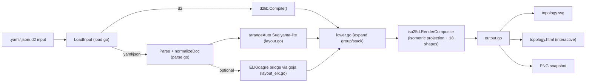
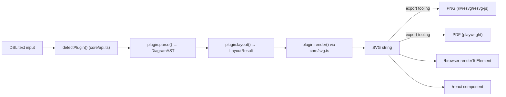
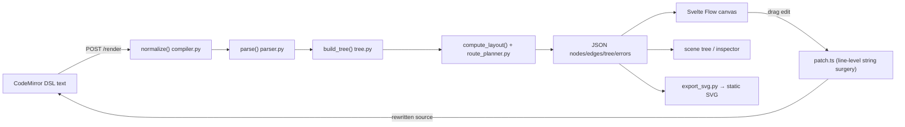

# Weekly Scan — Diagram Tooling (2026-07-07)

**Executive summary:**
- Tuần này nổi bật hai hướng đối lập: `iso-topology` là engine Go trưởng thành nhanh (agent-first, isometric 2.5D, layout tự viết) trong khi `SchemaTex` chọn chiều rộng — 49 loại diagram TypeScript zero-dep nhưng mỗi loại tự viết layout riêng, không có core layout dùng chung.
- `dicegram` đáng chú ý nhất về mặt kiến trúc UX: text DSL là single source of truth, canvas edit patch ngược lại source qua "string surgery" theo dòng (regex-based) thay vì mutate AST rồi serialize lại — một pattern kymostudio nên cân nhắc nếu làm editor tương tác.
- `figdown` vẫn ở giai đoạn spec/PoC (chỉ 1 file HTML ~3500 dòng làm renderer thật), nhưng đáng theo dõi vì đúng use-case "AI agent đọc text, người xem SVG" mà kymostudio cũng đang nhắm tới qua MCP.

**Mục lục:**
1. [iso-topology](#1-iso-topology-markovwangrriso-topology)
2. [SchemaTex](#2-schematex-schematexschematex)
3. [dicegram](#3-dicegram-desastregerdicegram)
4. [figdown](#4-figdown-figdownfigdown)

---

## 1. iso-topology (`MarkovWangRR/iso-topology`)

### §1 — Quick context

Isometric architecture-diagram-as-code engine viết bằng Go: DSL YAML/JSON (hoặc D2 native) đầu vào, xuất SVG/HTML/PNG isometric 2.5D — khác biệt so với các tool diagram-as-code thông thường (Mermaid, D2) ở chỗ có hẳn một engine chiếu isometric riêng (`iso25d/`) và định vị rõ ràng là "agent-native" (có sẵn MCP server binary). Stack: Go 1.25, phụ thuộc Terrastruct D2 library cho input `.d2` và layout ELK/dagre qua `goja` (JS runtime nhúng). Output: SVG, HTML tương tác, PNG snapshot. Sức khỏe repo: 48 sao, dự án một tác giả, tạo ngày 09/06/2026 (mới ~1 tháng), version đã lên tới v0.16.0, có CI (`test.yml`, `release.yml`) và ~35 file test ở root. Phân phối: `go install` (binary tĩnh qua goreleaser), không có package npm/PyPI.

### §2 — Architecture deep-dive

**A. Component inventory** — `parse.go` (sniff format + normalize), `dsl.go` (struct `Node`/composite = data model), `compile.go` (wrap `d2lib.Compile()` cho input D2), `layout.go` (auto-layout "Sugiyama-lite" cho dialect gốc), `layout_elk.go` (cầu nối sang ELK/dagre của D2 qua `goja`), `lower.go` (lowering pass: expand `group`/`stack`, tính offset tuyệt đối), `iso25d/` (engine hình học isometric thật sự: `iso.go` phép chiếu, 18 file `shape_*.go`), `planeval.go`/`editops.go` (chấm điểm chồng lấn/route-crossing và sửa tự động), `cmd/isotopo/main.go` + `cmd/isotopo-mcp/` (CLI và MCP server).

**B. Pipeline** (1) `isotopo render scene.yaml out` → `main.go` route theo `os.Args` → (2) `LoadInput()` dispatch yaml/json/d2 → (3) nếu D2: `d2lib.Compile()` chạy parse+layout riêng của D2; nếu YAML/JSON: `Parse()` + `normalizeDoc()` → (4) `arrangeAuto` (native) hoặc bridge ELK/dagre qua D2 → (5) `lower.go` expand container, tính offset, chèn connector → (6) `iso25d.RenderComposite` chiếu isometric và vẽ 18 primitive shape → (7) `output.go` đóng gói `topology.svg`/`.html`/PNG.

**C. Data model/IR** — Hai IR song song không hợp nhất: struct `Node`/composite (Go, con trỏ để phân biệt "nil = kế thừa" vs "set = override", mutable qua nhiều pass) cho dialect gốc, và `d2target.Diagram` của D2 cho input `.d2` — chỉ gặp nhau ở tầng render `iso25d`. Không có tài liệu IR hình thức.

**D. Input language/parser** — Không phải parser tự viết cho phần lớn cú pháp: dialect gốc dùng YAML/JSON unmarshal chuẩn (`gopkg.in/yaml.v3`) vào struct có tag, cộng thêm patch `normalizeFlowColons` vá lỗi flow-mapping của YAML. Input `.d2` parse hoàn toàn bởi thư viện D2 ngoài — nghĩa là phần lớn "ngôn ngữ" thực chất mượn cú pháp D2. Không có EBNF hình thức được xác nhận. Lỗi được validate theo enum cố định (`arrowNames`, `routingNames`) kèm gợi ý "gần đúng" cho lỗi chính tả.

**E. Layout algorithm** — Auto-layout quan hệ, không phải toạ độ cố định: "Sugiyama-lite" (longest-path ranking, 4 sweep barycentric giảm crossing, 6 pass median alignment, snap-to-grid), tự chuyển sang force-directed nếu đồ thị nhiều cạnh ngược (>1/3). Phép chiếu isometric `project(x,y,z) = ((x−y)cos30, (x+y)sin30 − z)` chỉ là biến đổi tuyến tính cố định áp dụng SAU khi layout world-space đã tính xong — tức layout chạy trên lưới trực giao, "camera" isometric là bước cuối riêng biệt. Có tuỳ chọn route lại qua ELK/dagre của D2 (timeout 30s, fallback im lặng về layout gốc nếu lỗi/timeout).

**F. Rendering/output** — Một backend SVG duy nhất viết tay trong `iso25d` (không tìm thấy hỗ trợ animation). `output.go` bọc thành SVG/HTML tương tác (nhúng cả DSL gốc)/PNG snapshot. Không pluggable — lựa chọn duy nhất là chế độ chiếu (`--projection iso|top`).

**G. Extensibility** — Thêm shape mới = thêm file `shape_*.go` trong `iso25d/` (compile-in, không có plugin runtime). Icon: 200+ icon tái tô màu + brand logo Simple Icons qua URI `iso://si/<brand>/<color>`. Theme là YAML preset (data-driven).

**H. Dev experience** — CLI có bộ subcommand hướng-agent rộng (`capabilities`, `validate`, `evaluate`, `repair`, `render`, `snapshot`, `serve`) với exit code phân biệt rõ (0/1/2/3) để agent tự động hoá dễ gate. `isotopo serve` mở web editor "Studio" local. Không tìm thấy watch-mode rõ ràng. Tích hợp IDE gần như không có — điểm khác biệt chính là MCP server (`isotopo-mcp`) cho agent gọi trực tiếp, cùng `CLAUDE.md`/`llms.txt` ở root để brief agent code.

### §3 — Architecture diagram



### §4 — Verdict

Điểm học được cụ thể cho kymostudio: (1) tách "layout world-space" khỏi "camera projection" như một bước cuối riêng — kymostudio hiện chỉ có SVG 2D, nhưng nếu từng muốn thêm chế độ isometric/3D-look thì pattern "layout trước, chiếu sau" của `iso.go` là đúng hướng, không cần viết lại layout engine. (2) Cơ chế exit-code phân tầng (0/1/2/3: ok/lỗi-IO/có-thể-sửa/lỗi-validate) cho agent gate tự động là ý hay, kymostudio's `kymo` CLI hiện chưa phân biệt rõ mức này. Red flag: kiến trúc phẳng (toàn bộ core nằm chung 1 package Go ở root, không tách `internal/`), và tên file test (`badcase_intake_test.go`, `agent_feedback_corpus_test.go`, `editfuzz_test.go`) cho thấy pattern "vá lỗi từng cái do agent phát hiện" hơn là test suite thiết kế trước — rủi ro bảo trì dài hạn với dự án 1 tác giả, 1 tháng tuổi. Verdict: **study deeper** — riêng phần tách layout/projection và exit-code design đáng đọc kỹ code thật (`iso25d/iso.go`, `layout.go`).

---

## 2. SchemaTex (`SchemaTex/SchemaTex`)

### §1 — Quick context

Thư viện TypeScript render 49 loại diagram chuyên ngành (genogram y khoa, ladder logic IEC 61131-3, SLD điện, fault tree, BPMN, ERD...) từ text DSL ra SVG thuần, không phụ thuộc runtime — khác các tool "một DSL cho mọi thứ" như Mermaid ở chỗ mỗi loại diagram có parser/layout/renderer riêng biệt, tối ưu cho domain hẹp thay vì tổng quát hoá. Stack: TypeScript strict, build bằng `tsup` (ESM+CJS+`.d.ts`), test bằng `vitest`, zero runtime dep cho core (react/ai/zod chỉ là optional peer dep cho sub-entrypoint). Sức khỏe repo: 44 sao, license AGPL-3.0 (có bản thương mại), có CI (`ci.yml`, `publish.yml`) và test suite thật (57 thư mục test, nhiều file `*.test.ts`/loại). Phân phối: npm (`schematex`), có subpath export theo từng loại diagram (`schematex/genogram`...), chưa có CLI (roadmap "coming soon").

### §2 — Architecture deep-dive

**A. Component inventory** — `src/core/api.ts` (public API: `render()`, `parse()`, plugin registry + `detectPlugin()`), `src/core/types.ts` (IR dùng chung: `DiagramAST`, `LayoutResult`, interface `DiagramPlugin`), `src/core/svg.ts` (SVG builder chung: `el()`, `group()`, `text()`), `src/core/layered/bk.ts` (helper layout kiểu Brandes–Köpf, nhưng KHÔNG dùng chung cho mọi loại — ví dụ genogram không đụng tới), `src/diagrams/<type>/{parser,layout,renderer,index}.ts` — mỗi loại diagram (genogram, ladder, sld...) là một module tự chứa hoàn toàn.

**B. Pipeline** (1) gọi `render(text, {type?})` → (2) `detectPlugin()` tìm plugin khớp (theo `config.type` hoặc thử `plugin.detect(text)` từng plugin trong registry cứng) → (3) `plugin.parse(text)` sinh AST riêng cho loại đó → (4) `plugin.layout(ast)` tính toạ độ ra `LayoutResult` → (5) `plugin.render(layoutResult)` build chuỗi SVG qua `core/svg.ts` → (6) `renderPreview()` fallback về SVG chẩn đoán lỗi thay vì throw nếu parse fail.

**C. Data model/IR** — Không có một graph model tổng quát; mỗi loại có AST riêng (`DiagramAST` cho họ genogram-like, nhưng `PhyloTreeAST`, `FishboneAST`, `VennAST`, `BpmnAst`, `FbdAst`... hoàn toàn khác cấu trúc), mỗi AST có `LayoutResult` riêng tương ứng. Interface chung duy nhất: `DiagramPlugin { type, detect(), parse(), render(), lint()? }`.

**D. Input language/parser** — Parser viết tay theo dòng, state-machine, không dùng PEG/parser-combinator. Ví dụ genogram: `ParserState` theo dõi vị trí dòng/thụt lề, regex longest-match cho operator quan hệ (`~/~`, `-//`, `-x-`...), tách bracket-depth-aware. Không tìm thấy file EBNF hình thức (khác kymostudio có `docs/DSL.md`). Lỗi báo dạng `"Line X, col Y: message → source"`, có validate tồn tại-trước-khi-tham-chiếu và enum hợp lệ.

**E. Layout algorithm** — Không có layout core dùng chung cho 49 loại — mỗi `src/diagrams/<type>/layout.ts` tự viết. Genogram: BFS gán generation từ root, gom family-unit/couple, sắp thứ tự trong-generation, resolve chồng lấn ngang lặp lại — độc lập hoàn toàn với `core/layered/bk.ts`. Edge routing tuỳ loại quan hệ: đường thẳng cho couple, drop dọc + thanh ngang cho parent-child, Bezier bậc 2 cho quan hệ tình cảm, Manhattan cho foster/adopted. Đây là kiến trúc "mỗi loại diagram lạ một layout thủ công riêng" — bề mặt bảo trì lớn ở quy mô 49 loại.

**F. Rendering/output** — Một backend duy nhất: SVG string/DOM builder qua `core/svg.ts`, không tìm thấy animation (`<animate>`/CSS keyframes). Export PNG/PDF nằm ở tầng tooling riêng (`src/export.ts` dùng `@resvg/resvg-js`/`playwright`), không phải emitter SVG bổ sung — tương đương một backend SVG, không pluggable kiểu `to_svg`/`to_figma`/`to_excalidraw` của kymostudio.

**G. Extensibility** — Interface `DiagramPlugin` + mảng `plugins` đăng ký cứng trong `core/api.ts`, không có cơ chế load plugin động — thêm loại mới nghĩa là thêm module `src/diagrams/<type>/` và đăng ký thủ công. Theme qua `core/theme.ts`.

**H. Dev experience** — CLI: chưa có (roadmap). IDE integration: chưa có (Obsidian/remark plugin mới nằm roadmap). Watch mode: `tsup --watch` chỉ build thư viện, không phải preview diagram. Có playground web hosted (schematex.dev/playground) và API `/browser` (`renderToElement`). Có entrypoint `/ai` tích hợp Vercel AI SDK tool — định vị rõ "made for AI".

### §3 — Architecture diagram



### §4 — Verdict

Điểm học được cụ thể: `renderPreview()` fallback về SVG-chẩn-đoán-lỗi thay vì throw exception là UX pattern đáng học cho `kymo` CLI/playground — khi parse fail giữa lúc gõ, hiển thị SVG báo lỗi ngay tại vị trí thay vì màn hình trắng. Ngược lại, kiến trúc "mỗi loại diagram một layout riêng, không core dùng chung" là phản-pattern so với triết lý kymostudio (`alignment.py` một resolver 5-pass dùng chung cho mọi loại) — nếu kymostudio mở rộng sang nhiều "diagram family" chuyên ngành (như genogram, ladder logic) trong tương lai, nên tránh lặp lại việc viết layout riêng cho từng loại như SchemaTex đang làm, thay vào đó tìm cách tổng quát hoá layout core hiện có. Red flag: mô tả GitHub ("20 diagrams") lệch với package.json thực tế (49) — dự án tăng trưởng nhanh hơn tài liệu công khai; và claim "zero deps" chỉ đúng cho core, không đúng cho toàn bộ package (react/ai/zod/resvg là optional). Câu hỏi mở: `core/layered/bk.ts` (Brandes–Köpf) được dùng ở loại nào, hay là code chết? Verdict: **glance only** cho kiến trúc tổng thể, nhưng đáng đọc riêng phần error-recovery UX.

---

## 3. dicegram (`desastreger/dicegram`)

### §1 — Quick context

Editor diagram text-first tự host được: DSL code, canvas kéo-thả, scene tree, và inspector panel đồng bộ hai chiều với nhau — khác các tool DSL→SVG một chiều (kể cả kymostudio) ở chỗ cho phép sửa trên canvas rồi ghi ngược lại vào text DSL. Stack: backend FastAPI + SQLModel (Python), frontend SvelteKit 2/Svelte 5 + `@xyflow/svelte` (Svelte Flow) + CodeMirror 6. Sức khỏe repo: 0 sao (rất mới), license AGPL-3.0 (có bản thương mại), **không có CI** (`.github/` chỉ có issue/PR template), test coverage gần như không có (chỉ 1 cặp file Vitest scaffold ví dụ). Phân phối: hosted (dicegram.desastreger.cloud) hoặc self-host qua Docker (`./deploy.sh`), không có CLI/package riêng.

### §2 — Architecture deep-dive

**A. Component inventory** — `backend/app/dsl/parser.py` (parser regex theo dòng), `backend/app/dsl/compiler.py` (thực chất là normalizer nguồn→nguồn, tên gây hiểu lầm — 9 rule idempotent như grid-snap, dedupe ID), `backend/app/dsl/tree.py` (IR: dataclass `TreeNode`/`Tree`, mutable), `backend/app/dsl/layout.py` (`compute_layout()` — auto-layout dạng lưới/lane), `backend/app/dsl/route_planner.py` (tính toạ độ cạnh, gửi cố định cho frontend), `backend/app/dsl/export_svg.py` (serializer SVG tĩnh), `frontend/src/lib/patch.ts` (lớp "string surgery" đồng bộ canvas→DSL), `frontend/src/lib/render.ts` (gọi backend `/render`, đổ kết quả vào Svelte Flow).

**B. Pipeline** — Chiều text→canvas: (1) người dùng gõ DSL trong CodeMirror → (2) frontend POST source lên `/render` → (3) backend: `normalize()` → `parse()` → `build_tree()` → `compute_layout()` + `route_planner.py` → (4) trả JSON nodes/edges/lanes/tree/errors → (5) frontend vẽ trực tiếp vào Svelte Flow + panel tree/inspector, không tính toán routing thêm ở client. Chiều canvas→text (ngược lại): (1) người dùng kéo node/cạnh trên canvas hoặc scene tree → (2) `patch.ts` tìm dòng tương ứng trong source bằng regex (`findNodeLineIndex`...) → (3) parse riêng dòng đó thành struct kiểu `NodeLineParts`, áp mutation, serialize lại chỉ dòng đó → (4) ghép ngược vào source string, gửi lại `/render` để refresh mọi view.

**C. Data model/IR** — Không có AST bền vững: **DSL source text chính là source of truth duy nhất** (string). Mỗi request `/render` parse one-shot ra `Parsed` rồi `Tree` (mutable, dict `TreeNode` theo id). Canvas edit KHÔNG mutate tree trực tiếp — nó "phẫu thuật" chuỗi source qua `patch.ts` rồi re-parse toàn bộ. Tức: text-là-nguồn-sự-thật với IR dẫn xuất lại mỗi request, không phải OT/CRDT, không phải mutate-AST-rồi-serialize.

**D. Input language/parser** — Viết tay, regex + state machine theo dòng, có `stack` tường minh để xử lý block lồng nhau (`{ }` cho swimlane/box) và cờ (`edge_collecting`) cho cạnh multi-dòng dạng block. Không có EBNF hình thức. Lỗi không fatal — tích luỹ thành `ParseError{line, column, message}` (ví dụ `"unrecognized: {line[:80]}"`), parser suy giảm nhẹ nhàng thay vì raise exception.

**E. Layout algorithm** — Auto-layout dạng lưới/lane tất định (`compute_layout`, điều khiển bởi `step:` và swimlane), vị trí `position` ghim thủ công sẽ override con trỏ tự động — không phải Sugiyama/force-directed cổ điển, cũng không phải hoàn toàn thủ công. Routing cạnh tách riêng ở `route_planner.py`, gửi toạ độ cố định cho frontend (frontend không route lại).

**F. Rendering/output** — Hai đường render riêng: (1) canvas tương tác qua `@xyflow/svelte` (thư viện DOM/SVG-based) ăn JSON từ `/render`; (2) export tĩnh qua `export_svg.py` (`render_svg()`) tự build chuỗi SVG, hỗ trợ 8 shape (rect/rounded/stadium/circle/diamond/parallelogram/hexagon/cylinder) và 7 kiểu terminator mũi tên. Không có animation. `jsPDF` gợi ý có export PDF phía client (chưa xác nhận sâu).

**G. Extensibility** — Không có plugin system — shape/connector/terminator là enum cứng trong `parser.py`/`export_svg.py` (8 shape, 5 kiểu nét, 7 terminator theo README). Theme thì data-driven (`palette.py`, theme per-user) — theming mở rộng được, vocabulary shape thì không (cần sửa code).

**H. Dev experience** — Vite/SvelteKit dev loop chuẩn (hot reload). Self-host bằng 1 lệnh Docker (`deploy.sh`, có option Caddy TLS). Không có CLI, không có VS Code extension.

### §3 — Architecture diagram



### §4 — Verdict

Điểm học được cụ thể cho kymostudio: nếu tương lai muốn làm editor tương tác (canvas + text đồng bộ) cho `.kymo`, cách `dicegram` chọn — **không** giữ AST canonical rồi mutate + serialize, mà "phẫu thuật" trực tiếp trên text qua regex theo dòng — là một lựa chọn kiến trúc thực dụng, tránh phải viết lại toàn bộ pretty-printer/AST↔text round-trip, nhưng đổi lại giòn (fragile) với các thao tác cấu trúc (đổi swimlane cha, cạnh multi-dòng) — nên nếu áp dụng, cần test kỹ các case tái cấu trúc, không chỉ sửa 1 dòng đơn giản. Red flag: hoàn toàn không có CI dù đã deploy hosted service, test coverage gần như bằng 0 — với dự án 0 sao 3 tháng tuổi thì đây là dấu hiệu rủi ro chất lượng thật, không chỉ là "sớm quá chưa kịp viết test". Câu hỏi mở: `patch.ts` xử lý thế nào khi 2 client sửa đồng thời (không có evidence về locking/OT). Verdict: **study deeper** riêng phần patch.ts (bidirectional text↔canvas sync), phần còn lại **glance only**.

---

## 4. figdown (`FigDown/figdown`)

### §1 — Quick context

Đặc tả (spec) cho một Markdown-native diagram format "một nguồn, hai người đọc" — AI agent đọc thẳng text, người xem SVG render tất định — khác các DSL sẵn có (Mermaid nhúng trong Markdown) ở việc thiết kế tường minh để text không bao giờ trôi khỏi nghĩa gốc và không phụ thuộc LLM để render. Stack: chỉ có vanilla JS (PoC `poc/figdown.html`, ~3500 dòng, không thư viện ngoài) + 1 script Node nhỏ (`tools/build-svg.js`). Sức khỏe repo: 0 sao, mới tạo 02/07/2026 (5 ngày tuổi), MIT license, không CI, chưa có test. Phân phối: chưa có — README tự nhận "chưa có gì để cài".

### §2 — Architecture deep-dive

**A. Component inventory** — `syntax-draft.md` (đặc tả cú pháp), `requirements-notes.md` (57KB, các requirement R0-R... và decision D1-D... về triết lý layout/extensibility), `census.md` (khảo sát 774 tài liệu hardware-design thực, 2177 loại diagram, kết luận Mermaid/PlantUML/D2/Graphviz chỉ phủ ~12% nhu cầu block-architecture + packet-bitfield — đây là data-driven rationale, không phải cảm tính), `gallery-plan.md` (roadmap ví dụ tương lai kiêm regression test), `poc/figdown.html` (82KB, playground live trong browser: textarea → `parse()`/`render()` → SVG preview + thao tác kéo/marquee-select ghi ngược vào source), `tools/build-svg.js` (2.1KB — **không có parser riêng**, nó trích xuất hàm `parse`/`render` từ chính `poc/figdown.html` qua `new Function(...)` lúc build, rồi nhúng hash SHA-256 của source vào `<metadata>` SVG).

**B. Pipeline (dự kiến, theo tài liệu)** — Text `.fd` (nguồn duy nhất) → parser/renderer tất định (không phụ thuộc LLM, decision D1) → SVG (nhúng trong Markdown hoặc file sidecar kèm source+hash) → hai kênh tiêu thụ: người xem SVG, agent đọc text gốc. Kế hoạch bootstrap: "Stage 0 = quy ước sidecar + CLI generator, chạy được ngay hôm nay."

**C. Data model/IR** — Không có tên IR chính thức. Tài liệu nói tới "hệ layout ba tầng" (tự động hoàn toàn → ràng buộc ngữ nghĩa như flow/rank/zone → escape-hatch `pin`/`size` tường minh) nhưng không có schema. Object `doc` nội bộ trong PoC (do `parse()` sinh, `render()` tiêu thụ) là thứ gần IR nhất, nhưng không tài liệu hoá, chỉ tồn tại ngầm trong JS.

**D. Input language/parser** — Không phải Markdown superset — một ngôn ngữ chỉ thị (directive) đóng, theo dòng, sống trong block code fenced ` ```figdown ` hoặc file `.fd` riêng. Mỗi dòng bắt đầu bằng keyword đã biết; dòng lạ là lỗi cứng kèm số dòng. Cú pháp: `keyword positional-args… key=value-options…`, chuỗi có khoảng trắng dùng quote, `#` comment, không có ngữ nghĩa thụt lề, không macro/expression. Không có BNF/EBNF hình thức — chỉ mô tả + ví dụ minh hoạ. ~16 keyword lõi, mục tiêu học được trong <120 dòng tài liệu.

**E. Layout algorithm** — Chưa phải thuật toán thật, mới là triết lý: ổn định layout là yêu cầu cứng ("sửa nhỏ ở nguồn phải tạo thay đổi nhỏ ở hình"). `pin` là toạ độ px tuyệt đối; "pin-on-first-touch" (editor tự ghi toạ độ vào dòng `pin` khi người dùng kéo lần đầu); pin 2 cấp (thành viên trong group toạ độ local). Không có thuật toán auto-layout đồ thị nào (không Sugiyama/dagre-style) được đặt tên — layout gần như chưa được đặc tả ngoài cơ chế `pin` escape-hatch.

**F. Rendering/output** — `tools/build-svg.js` không phải renderer độc lập — nó chỉ là wrapper CLI mỏng, lấy thẳng hàm `parse`/`render` từ `poc/figdown.html` bằng `new Function()` lúc build rồi chạy trên file `.fd`, ghi ra `.svg` kèm source+hash SHA-256 nhúng `<metadata>`. Logic parser/renderer thật nằm hoàn toàn trong PoC HTML — đây là playground sống thật sự (không phải demo tĩnh hay spec-render-thành-HTML): textarea → `parse()`/`render()` real-time → panel SVG, cộng thao tác trực tiếp (kéo/marquee/threshold-drag) ghi ngược vào source text — toàn bộ vanilla JS tự chứa, không thư viện ngoài.

**G. Extensibility** — Mới là đề xuất, chưa xây: "core nhỏ + extension theo domain" qua cơ chế template (flowchart/block/bitfield/table/sequence... dùng chung 1 grammar lõi). Có nguyên tắc mở rộng thận trọng: chỉ thêm template mới "KHI ngữ nghĩa hoàn toàn không thể biểu đạt chính xác bằng construct hiện có".

**H. Dev experience** — Chưa có CLI package riêng — `tools/build-svg.js` là script Node thủ công, chưa publish. `requirements-notes.md` coi "phải có editor" là yêu cầu cứng, và chọn kiến trúc `poc/figdown.html` (thao tác canvas trực tiếp + build-from-engine) làm tham chiếu cho editor thật. File-watcher/editor-on-save/CI integration mới được nhắc tới, chưa xây.

### §3 — Architecture diagram

Insufficient evidence — Insufficient evidence cho pipeline hoàn chỉnh (input→parser→IR→renderer→output): repo hiện chỉ có 1 file PoC (`poc/figdown.html`) chứa parser+renderer gộp chung không tách module, và 1 script build phụ thuộc ngược vào PoC đó qua `eval`. Không đủ 3 component tách biệt có evidence rõ ràng trong code để vẽ pipeline nghiêm túc — bỏ qua theo quy tắc.

### §4 — Verdict

Điểm học được cụ thể cho kymostudio: `census.md` là một cách tiếp cận đáng học — trước khi thiết kế tính năng mới (ví dụ mở rộng DSL hay icon), khảo sát định lượng corpus thực tế (774 tài liệu, 2177 loại diagram) để tìm khoảng trống thị trường thay vì đoán, là kỷ luật thiết kế tốt hơn cách kymostudio hiện đang thêm tính năng theo yêu cầu ad-hoc. Ý tưởng "hai người đọc" (agent đọc text, người xem SVG kèm source+hash nhúng `<metadata>`) cũng đáng cân nhắc cho câu chuyện MCP của kymostudio — nhúng DSL gốc + hash vào SVG output để agent có thể "đọc ngược" diagram đã render mà không cần file `.kymo` riêng. Red flag: khoảng cách quy mô — 57KB requirement/decision (mức độ rigor gần như spec ngôn ngữ) nhưng cả implementation chỉ là 1 file HTML 82KB, không tách parser/layout/renderer, build script phụ thuộc `new Function()` để "mượn" code từ PoC — đây là hack tạm, không phải tooling production. Câu hỏi mở: dự án có tiếp tục được duy trì không, hay chỉ là một design sprint 5 ngày rồi dừng? Verdict: **glance only** cho kiến trúc hiện tại (chưa đủ để học kỹ thuật cụ thể), nhưng **theo dõi tiếp** vì hướng đi (dual-reader diagram cho agent) trùng với roadmap kymostudio.
