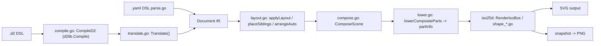
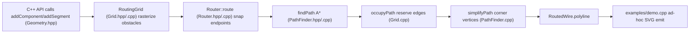
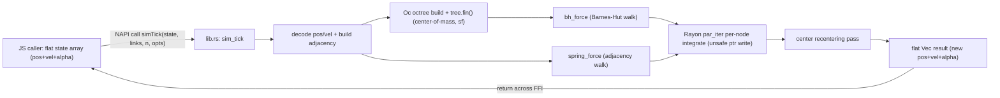
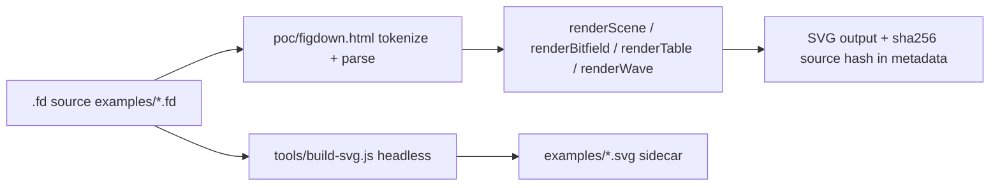

# Weekly Scan: Diagram Tooling — 2026-07-08

Phạm vi quét: repo mới publish hoặc có release/hoạt động đáng chú ý trong cửa sổ **2026-07-01 → 2026-07-08**, domain diagram-as-code / layout algorithm / SVG rendering / cross-format conversion, phục vụ nghiên cứu cạnh tranh cho kymostudio.

**Executive summary:**
- Tuần này không có repo nào "chín" theo nghĩa production-ready — cả 4 repo đào sâu đều mới tạo trong vòng ≤7 ngày (0-50 sao), nên đây là snapshot của *ý tưởng đang thành hình*, không phải công cụ đã kiểm chứng.
- **iso-topology** là phát hiện đáng giá nhất: kiến trúc hai front-end (YAML tự viết + D2 dùng thẳng thư viện gốc) hội tụ về một IR chung, cộng constraint quan hệ tường minh (`rightOf/behind/above`) — mô hình đáng tham khảo trực tiếp cho `alignment.py` của kymo.
- Ba repo còn lại (**sch-wire-router**, **force-rs**, **FigDown**) đều ở giai đoạn quá sớm để áp dụng nguyên khối, nhưng mỗi cái có một ý tưởng hẹp đáng liếc: cost-model A* có bend-cost riêng, octree Barnes-Hut gọn, và triết lý "closed line-oriented grammar" đo bằng chi phí dạy AI agent.

**Mục lục**
1. [iso-topology](#1-marko​nwangrriso-topology) — DSL isometric 2.5D, D2-compatible front-end
2. [sch-wire-router](#2-safvalsch-wire-router) — orthogonal wire auto-router (C++)
3. [force-rs](#3-xingwangzheforce-rs) — Barnes-Hut force-directed layout (Rust/NAPI)
4. [FigDown](#4-figdownfigdown) — Markdown-native "figures as text" spec

Danh sách đầy đủ 10 candidate tìm được trong pha discovery (không đào sâu hết, để tham khảo): `MarkovWangRR/iso-topology`, `safval/sch-wire-router`, `xingwangzhe/force-rs`, `FigDown/figdown`, `khollingworth/d2-diagram-skill` (Claude Code plugin lái D2+TALA/ELK), `kanushka/cell-architect` (bằng chứng mỏng), `DimonSmart/DbSketch` (SQL schema → ER diagram qua Graphviz), `kazukifujiwara/network-topo-draft` (VS Code canvas cho `*.topo.json`), `Frigzer/Graph-blueprint-viewer` (C++23 ImGui, bằng chứng mỏng), `FBklyra/mermaid-to-visio` (Mermaid → native `.vsdx`).

---

## 1. MarkovWangRR/iso-topology

**Repo**: https://github.com/MarkovWangRR/iso-topology

### §1 — Quick context

DSL (YAML hoặc cú pháp D2) biên dịch sang SVG isometric 2.5D deterministic, khác kymostudio ở chỗ dùng constraint quan hệ (`rightOf`/`behind`/`above`) thay vì auto-layout phẳng thuần túy. Stack: Go 1.25, phụ thuộc chính `oss.terrastruct.com/d2` (dùng thẳng D2 compiler làm front-end thứ hai) + `gopkg.in/yaml.v3`; output SVG + PNG snapshot. Repo health: 50 sao, Apache-2.0, release mới nhất v0.16.0 (2026-07-04), nhiều `*_test.go` (golden + fuzz tests) cho thấy test coverage khá dày; số contributor không xác định. Phân phối: `go install` binary (`isotopo`, `isotopo-mcp`), không có PyPI/npm/web playground công khai — chỉ `isotopo serve` chạy local studio ở `:8731`.

### §2 — Architecture deep-dive

**A. Component inventory**
- `parse.go` — `ParseYAML`/`ParseJSON`/`Parse` (auto-detect) → struct `Document`.
- `translate.go` — `Translate(diagram *d2target.Diagram, opts *RenderOpts) *Document`, cầu nối D2 compiler → model nội bộ, `d2ShapeCatalog` map shape D2 → shape iso.
- `compile.go` — `CompileD2(ctx, d2text, engine)` gọi thẳng `d2lib.Compile` (chọn ELK/Dagre).
- `layout.go` — solver quan hệ: `applyLayout`, `arrangeAuto` (DAG layering kiểu Sugiyama-lite), `placeSiblings` (DFS + cycle detection cho `rightOf/leftOf/inFrontOf/behind/above`).
- `lower.go` — `lowerCompositeParts` hạ cây `CompositePart` lồng nhau thành `partInfo` phẳng cho renderer.
- `compose.go` — `ComposeScene`, sửa lỗi căn chỉnh hình học (không phát SVG).
- `iso25d/iso.go` + `iso25d/shape_*.go` — renderer thật (`RenderIsoBox`, `svgHeader`, `faceTag`), sinh SVG bằng `strings.Builder`.
- `cmd/isotopo/main.go` — CLI (`render`, `serve`, `validate`, `evaluate`, `repair`, `snapshot`, `preview`, `capabilities`).
- `capabilities.go`, `lint.go` — "machine-checkable contract" cho agent.

**B. Pipeline** (`isotopo render scene.yaml ./out`):
1. Đọc file → `Parse()` (hoặc `.d2` thì `CompileD2` → `Translate`) sinh `Document`.
2. `applyLayout` chạy solver quan hệ trên từng `Node`/`CompositePart`, gán tọa độ world.
3. `lowerCompositeParts` hạ `group`/`stack` thành `partInfo` phẳng.
4. `ComposeScene` sửa lệch căn chỉnh.
5. `iso25d` render từng shape thành SVG fragment, gộp thành SVG hoàn chỉnh.
6. Ghi `out/nodes/<id>.yaml` (fragment round-trip) + file SVG cuối.

**C. Data model/IR**: `Document`/`Node`/`CompositePart` là struct Go, **mutable**, sửa dần qua từng pass. Có "compile-to-lower-IR" rõ ràng (author tree → flat `partInfo`) — ngược hướng nhưng cùng tinh thần với `Diagram` dataclass phẳng của kymostudio.

**D. Input language design**: hai front-end song song — YAML tự viết bằng custom unmarshal (có patch `normalizeFlowColons` vá lỗi YAML flow-mapping), và D2 dùng thẳng thư viện D2 gốc rồi dịch sang model riêng (không tự viết parser D2). Không thấy EBNF chính thức; có `docs/agent/schema/dsl.schema.json` (JSON schema máy đọc được, chưa fetch chi tiết). Error reporting: `isotopo validate` phân biệt exit code 0/2/3 (clean/warning/error), bắt cycle và anchor không giải được.

**E. Layout algorithm**: auto-layout DAG (longest-path ranking + 4 sweep giảm crossing + 6 median-alignment pass, fallback force-directed cho đồ thị dày/cyclic) cộng constraint quan hệ tường minh + container `row/grid/ring`. Routing: `straight/orthogonal/bezier`, orthogonal ràng buộc theo trục iso ±30°. Có tùy chọn dùng ELK qua `layout_elk.go` cho path D2, không có ILP tự viết.

**F. Rendering**: renderer đơn (SVG only, không animation SMIL/CSS) nhưng modular theo shape (mỗi shape một file, dispatch qua `Convert2DTo25D`). `snapshot` xuất PNG (cơ chế rasterize không xác định).

**G. Extensibility**: không có plugin system; thêm shape mới cần sửa đồng bộ 5 nơi (`iso25d/shape_<name>.go`, dispatcher, `d2ShapeCatalog`, `capabilities.go`, CLI + Studio JS) — tài liệu tự cảnh báo lệch 1 chỗ khiến Studio GUI fallback về rectangle âm thầm.

**H. Dev experience**: CLI đầy đủ (`validate/evaluate/repair/preview/snapshot`), `isotopo serve` (web studio local) và MCP server riêng (`isotopo-mcp`) tích hợp Claude Code — định vị rõ ràng "agent-native". Không có LSP.

### §3 — Architecture diagram

### §4 — Verdict

Đáng học nhất: **hai front-end hội tụ về một IR** (YAML tự viết song song D2 dùng thẳng thư viện gốc rồi `Translate()`) — kymo có thể áp dụng mô hình tương tự nếu muốn thêm cú pháp thứ hai mà không viết lại layout/renderer. Constraint quan hệ tường minh (`rightOf/behind/above` + `gap`/`align`) đáng tham khảo cho `alignment.py` nếu muốn thêm author-facing constraint bên cạnh auto-layout. Chi tiết nhỏ hay: `layout: {mode: row|grid|ring}` với `cols` tự động `ceil(√n)`. Red flag: không có plugin system thật — thêm shape phải sửa đồng bộ 5 file, tự tài liệu thừa nhận dễ lệch. Câu hỏi mở: cơ chế snapshot PNG dùng gì; không có animation nên không liên quan trực tiếp hướng "animated SVG" của kymo. **Verdict: study deeper** phần constraint-solver (`layout.go`) + lower-IR (`lower.go`); phần renderer/CLI glance only.

---

## 2. safval/sch-wire-router

**Repo**: https://github.com/safval/sch-wire-router

### §1 — Quick context

Thư viện C++ thuần định tuyến dây orthogonal (chỉ góc 90°) quanh vật cản cho sơ đồ schematic/P&ID — khác các diagram-as-code tool (kymostudio, D2, Mermaid) ở chỗ **không có DSL/parser/renderer**, chỉ là API định tuyến trần trụi để nhúng vào ứng dụng khác. Stack: C++17, CMake 3.16, zero dependency, output chỉ là `vector<Point2>` (polyline world-coord) — vẽ SVG do caller tự làm. Repo health: 0 sao, 2 commit, không CI badge, MIT, chưa có release, README ghi rõ "developed with the assistance of Claude Code". Có test thật (assert-based CTest, 4 file test khớp 1-1 với 4 module src). Phân phối: source library để vendor/`add_subdirectory`, không header-only, không gói binary/vcpkg.

### §2 — Architecture deep-dive

**A. Component inventory**
- `include/schwire/Geometry.hpp` + `src/Geometry.cpp` — primitives: `Point` (int, grid), `Point2` (double, world), `Rect`, `Segment`, enum `Dir`, `dirBetween()`.
- `include/schwire/Grid.hpp` + `src/Grid.cpp` — `RoutingGrid`: mô hình lưới + occupancy.
- `include/schwire/PathFinder.hpp` + `src/PathFinder.cpp` — `findPath()` (A*) và `simplifyPath()`.
- `include/schwire/Router.hpp` + `src/Router.cpp` — facade `Router`, struct `Net`/`RoutedWire`.
- `examples/demo.cpp` — demo tự viết SVG bằng `fprintf` (không thuộc lib).
- `tests/test_{geometry,grid,pathfinder,router}.cpp` — CTest, assert thuần.

**B. Pipeline** (`Router::route`):
1. `Router r{bounds, pitch}` → `RoutingGrid` dựng lattice theo `pitch`.
2. `addComponent(Rect)`/`addSegment(Segment)` → rasterize vật cản lên grid.
3. `route(Net)`: `grid_.snap()` đưa 2 đầu world-coord về node grid gần nhất.
4. `findPath()` — A* trên grid, trả chuỗi node.
5. `grid_.occupyPath()` — reserve ngay cạnh vừa đi qua (sequential, không rip-up/reroute).
6. `simplifyPath()` — gộp đoạn thẳng liên tiếp thành đỉnh góc.
7. Trả `RoutedWire{ok, nodes, polyline}`; caller tự vẽ.

**C. Data model/IR**: raster grid, không phải graph/scene-graph. `RoutingGrid` giữ 3 `vector<uint8_t>` phẳng (`blocked_`, `hEdge_`, `vEdge_`), **mutable** — mỗi lần add obstacle/route thành công ghi đè state, không có undo/immutability.

**D. Input language**: không có DSL/file format — chỉ struct C++ truyền qua API call. Không parser, không exception; lỗi báo qua `RoutedWire.ok == false` (test xác nhận endpoint kẹt trong component thân → fail rõ ràng).

**E. Layout/routing algorithm (core)**: A* với **state = (node, hướng đến)** thay vì chỉ node — điểm hay nhất, cho phép tách chi phí bẻ góc (`PathCosts.bend`, mặc định 4) khỏi chi phí bước (`step`, mặc định 1); heuristic Manhattan×step vẫn admissible vì bẻ góc chỉ cộng thêm. Priority queue tự viết, tie-break ưu tiên `g` lớn hơn, loại entry cũ qua so `g`. Tránh vật cản: `canMove()` kết hợp bounds + node-blocked + edge-free. Cho phép hai dây cắt nhau tại node nếu dùng cạnh vuông góc, nhưng cấm dùng chung cạnh (enforce ở mức cạnh, không phải node-exclusivity). **Không có global optimization/rip-up-reroute** — routing tuần tự, comment code ghi thẳng "Order matters — route the important nets first": giải pháp greedy, phụ thuộc thứ tự input.

**F. Rendering**: thư viện không render — chỉ trả polyline. `examples/demo.cpp` tự build SVG bằng `fprintf` thủ công, không có serializer chung.

**G. Extensibility**: thêm vật cản mới = viết `addXxx()` theo pattern có sẵn trên `RoutingGrid`; thêm constraint = mở rộng `PathCosts`; thêm output format = tự viết consumer cho `RoutedWire.polyline`. Không plugin system, không DI — 4 cặp .hpp/.cpp, độ phức tạp thấp.

**H. Dev experience**: build/test rõ ràng (`cmake` → `ctest`), test thật sự exercise hành vi (đường thẳng, chữ L, cắt nhau, né dây, endpoint kẹt, `routeAll` giữ thứ tự) chứ không phải smoke test.

### §3 — Architecture diagram

### §4 — Verdict

Bài học cụ thể cho fan-in/trunk-lane staggering của kymostudio: (1) tách chi phí bẻ góc khỏi chi phí bước bằng mở rộng state (node, hướng) trong A* là kỹ thuật gọn để có "wire trông giống schematic" thay vì zig-zag ngẫu nhiên — đáng học nếu `alignment.py` cần route tối ưu hơn thay vì heuristic staggering thuần vị trí; (2) mô hình "reserve edge ngay sau khi route, cho phép cắt nhau tại node nhưng cấm chung cạnh song song" đơn giản, rẻ, đáng tham khảo cho trunk-lane spacing; nhưng (3) đây là giải pháp greedy tuần tự, không rip-up/reroute, phụ thuộc thứ tự input — nhược điểm cần tránh nếu kymo muốn fan-in ổn định bất kể thứ tự khai báo edge trong DSL. Red flags: repo 2 ngày tuổi, 0 sao, 1 tác giả, README tự nhận do Claude Code viết, chưa ai kiểm chứng ngoài test nội bộ, không CI, không benchmark trên lưới lớn. Câu hỏi mở: xử lý ra sao khi component chạm nhau hoặc pitch quá thô so với khoảng cách pin. **Verdict: glance only** — ý tưởng A* có bend-cost đáng liếc làm tài liệu tham khảo kỹ thuật, chưa đủ chín để "study deeper".

---

## 3. xingwangzhe/force-rs

**Repo**: https://github.com/xingwangzhe/force-rs

### §1 — Quick context

Không phải layout library JS mới, mà một NAPI native addon (Rust) thay thế toàn bộ tick loop CPU-bound của d3-force-3d, giữ JS chỉ làm state owner/renderer. Stack: Rust 2021, deps `napi`/`napi-derive` 3.0.0 + `rayon` 1.12.0; output là NAPI addon (`.node`) + `index.js`/`index.d.ts` tự sinh, phân phối qua npm (`@xingwangzhe/force-rs`), 6 target platform. Repo health: 1 sao, 0 fork, 7 commit, tác giả duy nhất, release mới nhất v0.1.1 (2026-07-04). Có CI (`.github/workflows/CI.yml`): build 6 target, test qua `node --test`, lint (oxlint + rustfmt + clippy), publish npm theo tag semver. Không publish crates.io.

### §2 — Architecture deep-dive

**A. Component inventory**: toàn bộ logic nằm trong **một file duy nhất** `src/lib.rs` — struct octree `Oc`, hàm `bh_force`, `spring_force`, entrypoint `#[napi] sim_tick`. Ngoài ra: `build.rs` (napi-build wiring), `index.d.ts`/`index.js` (binding tự sinh), `force.test.mjs` (16 test case, `node --test`).

**B. Pipeline** (JS→positions, happy path): (1) caller giữ state phẳng `[x,y,z,vx,vy,vz]×n + alpha`; (2) gọi đồng bộ, blocking `simTick(state, links, n, opts)` qua NAPI; (3) Rust decode pos/vel (sanitize NaN/inf); (4) dựng adjacency + degree từ mảng `links` phẳng; (5) build lại octree từ đầu **mỗi tick** (root cố định, half-width `1e5`, không bounding box động); (6) `tree.fin()` — duyệt stack-based, tính center-of-mass + hệ số hiệu chỉnh `sf = sqrt(4/occupied_children)`; (7) mỗi node: `bh_force` (duyệt octree) + `spring_force` (duyệt adjacency trực tiếp); (8) update vận tốc/vị trí bán-ẩn (semi-implicit Euler); (9) song song qua Rayon `par_iter` (fallback tuần tự nếu <2 thread), ghi buffer chung qua raw pointer `unsafe`; (10) center force hậu xử lý; (11) giảm alpha; (12) trả `Vec<f64>` mới qua FFI.

**C. Data model/IR**: stateless-per-call ở phía Rust — mọi state băng qua FFI mỗi tick dưới dạng mảng phẳng; octree bị dựng lại từ đầu mỗi lần gọi, không amortize qua nhiều tick.

**D. Input**: N/A (API-driven, không DSL) — `ForceOptions{repulsion, link_distance, center_strength, theta, velocity_decay, alpha_decay}` + 2 mảng số (`state`, `links`) + `n`.

**E. Layout algorithm (core)**: octree Barnes-Hut thật (8-children, chia lazily, leaf ngừng chia khi `hw<=MIN_CELL=1.0`), `theta` truyền từ caller, MAC chuẩn `cell_width²/theta² < d²`. Có hệ số hiệu chỉnh ad-hoc `sf=sqrt(4/occupied_children)` không rõ nguồn gốc vật lý chuẩn. `DISTANCE_MIN2=1.0` chống singularity. 3 loại lực: repulsion (Barnes-Hut), spring (degree-biased strength, dùng vị trí dự đoán pos+vel — tựa symplectic), center (hậu xử lý dịch centroid). Tích phân: semi-implicit Euler, không Verlet. Song song hóa Rayon chỉ ở tầng per-node force+integrate; bước dựng octree/`fin()` KHÔNG song song hóa.

**F. Output**: chỉ trả vị trí/vận tốc mảng phẳng — không renderer nào trong repo; downstream tự vẽ (three.js, d3 3D viz…), giống hợp đồng tick() của d3-force-3d.

**G. Extensibility**: không có pluggable force registry (khác `simulation.force(name, fn)` của d3-force) — 3 loại lực hard-code trong `sim_tick`, chỉ tune qua 6 tham số số.

**H. Dev experience**: API 1 hàm, type-safe qua `.d.ts` tự sinh. 16 test case khá đầy đủ cho repo 7 commit. Không có `cargo bench` — số liệu "~0.01s/tick, 47K nodes/89K edges" trong README không kèm harness kiểm chứng được trong các file đã fetch.

### §3 — Architecture diagram

### §4 — Verdict

Force-directed layout gần như không liên quan trực tiếp đến triết lý deterministic-alignment của kymostudio (kymo declarative/exact-position, force-rs stochastic/iterative-convergence) — giá trị chính là tham khảo kỹ thuật, không phải kiến trúc để áp dụng. Đáng học: octree lazy-split đơn giản (insertion + finalize hai pha rõ ràng), và pattern Rayon fallback tuần tự khi ít thread — cả hai tái dùng được nếu kymo từng cần spatial indexing (ví dụ collision-avoidance trong auto-layout). Red flag: `unsafe` raw-pointer write trong vòng lặp song song (an toàn thực tế nhưng compiler không xác nhận tĩnh), hệ số correction factor không rõ nguồn gốc, benchmark không kèm harness, octree dựng lại toàn bộ mỗi tick (không amortize). Câu hỏi mở: độ chính xác lực Barnes-Hut so với công thức chuẩn 1/d² chưa xác minh kỹ. **Verdict: glance only** — không cần study sâu cho kymostudio hiện tại, trừ khi có nhu cầu spatial-index cho large-graph auto-layout trong tương lai.

---

## 4. FigDown/figdown

**Repo**: https://github.com/FigDown/figdown

### §1 — Quick context

Spec Markdown-native cho "diagram-as-text" nhắm network/hardware documentation (bitfield, topology) — khác Mermaid (không pin được vị trí) và D2 (không đảm bảo local-edit stability) ở cam kết "layout stability": sửa nhỏ nguồn → thay đổi nhỏ ở hình. Định dạng: spec là markdown thuần (`syntax-draft.md`, `requirements-notes.md`, `census.md`), PoC renderer là một file HTML độc lập (~1058 dòng vanilla JS, zero dependency). Repo health: 0 sao, contributor data không tải được, 61 commit trong ~6 ngày (2026-07-02 → 2026-07-07), **không có `.github/`** (xác nhận không CI, không test tự động), MIT. Giai đoạn: design-phase/PoC thuần túy, chưa publish package/CLI nào.

### §2 — Architecture deep-dive

**A. Component inventory**: `README.md`/`README.zh-tw.md`; `requirements-notes.md` (8 axiom + rationale so với Mermaid/D2/PlantUML); `syntax-draft.md` (grammar draft v0.0); `census.md` (methodology corpus); `gallery-plan.md` (roadmap); `poc/figdown.html` (renderer PoC single-file); `tools/build-svg.js` (script Node build SVG); `examples/*.fd` + `*.svg` (20 cặp ví dụ: ethernet-ii, arp, ipv4/ipv6, tcp/udp, gre, mpls, quic, vxlan, evpn-fabric...).

**B. Pipeline**: chưa có CLI/package publish. Pipeline thực tế duy nhất chạy được: `.fd` source → `poc/figdown.html` (`tokenize()` → `parse()` → `renderScene()`/`renderBitfield()`/`renderTable()`/`renderWave()`) → chuỗi SVG có nhúng metadata. Song song, `tools/build-svg.js` là script Node headless tạo `examples/*.svg` cho gallery — không xác định có tái dùng parser của `poc/figdown.html` hay là bản triển khai song song.

**C. Data model/IR**: không có file IR/AST hình thức riêng. IR chỉ tồn tại ngầm trong object trả về bởi `parse()` trong PoC (scene: node/group/edge/layer + typed blocks: bitfield/table/wave/plot) — không xác định mức độ ổn định của cấu trúc này.

**D. Input language design (trọng tâm)**: nguyên tắc nền "Closed, line-oriented grammar" — trích nguyên văn: *"every line starts with a known keyword"* — cho phép autocomplete liệt kê được và báo lỗi theo số dòng, one-pass, "reject partial output for determinism". Mượn nguyên vẹn cú pháp Mermaid/D2 (`->`, `--`, `<->`) để "borrowing existing AI prior knowledge to minimize teaching overhead"; metric thiết kế tường minh: *"how many prompt tokens to teach an AI agent this language"* là hard constraint (R7). Layout 3 tier: không hint (auto), soft hint (`flow right`, `rank`), hard constraint (`pin at=<x>,<y>` pixel tuyệt đối, `size w= h=`) — với bất biến trích nguyên văn: *"Stripping every `pin` and `size` line must leave a document that still parses identically under auto-layout"* (semantic-completeness invariant). Sub-grammar theo domain mượn chuẩn có sẵn: GFM pipe table nguyên vẹn, alphabet WaveDrom nguyên vẹn (`p/0/1/x/=`), bitfield cú pháp gọn `field C:1, R:1, K:1`. Census thực nghiệm: 774 tài liệu hardware nội bộ (.docx), 12.342 ảnh nhúng, dedup MD5 còn 2.177 ảnh duy nhất, phân loại bằng AI vision — kết quả: block-architecture 24.3%, packet-bitfield 23.7%, table 9.6%, flowchart 8.3%, waveform 7.2%, topology 5.0%; core scene + 3 typed block phủ 78% figure occurrence (lưu ý: corpus thiên hardware/network switch, nhận định "Mermaid-native diagram types chỉ ~12% nhu cầu thực" không phổ quát). So với D2 — được gọi "closest neighbor" nhưng bị chê thiếu Markdown-ecosystem penetration và không đảm bảo local-edit stability; câu hỏi mở OQ1 (extend D2 hay độc lập) chưa quyết định.

**E. Layout**: PoC có thật, không chỉ stub — `renderScene()` dùng "longest-path layering for rank assignment" (kiểu Sugiyama layering) + hệ toạ độ 2 tầng (group origin + local) + `borderPoint()` cắt cạnh vào biên shape. Chưa có tài liệu thuật toán hình thức, chưa test verify layout-stability guarantee.

**F. Rendering**: render thẳng ra chuỗi SVG trong trình duyệt, nhúng SHA-256 của source vào `<metadata id="figdown-source">` để round-trip/staleness check — hiện thực axiom "sidecar convention" (`X.fd` + `X.svg`).

**G. Extensibility**: axiom "Templates via Application Profiles, Not Language Proliferation" — core grammar chung, mỗi template (bitfield/table/wave) có vocabulary/default riêng. Roadmap còn thiếu: `sequence` template (chưa thiết kế), "dynamic profile", math label qua `$...$`.

**H. Dev experience**: chỉ có `poc/figdown.html` — UI thao tác trực tiếp (kéo node ghi lại dòng `pin`, double-click đổi tên, marquee tạo group), hiện thực axiom "GUI bidirectionality". Không CLI, không package, không playground online, không test, không CI, không grammar file máy đọc được (EBNF/PEG/ANTLR) — `syntax-draft.md` chỉ là prose + ví dụ.

### §3 — Architecture diagram

### §4 — Verdict

Ý đáng học cho kymostudio: "every line starts with a known keyword" + closed grammar + "AI teaching cost (prompt tokens)" như design metric tường minh là góc nhìn mới cho `docs/DSL.md` — DSL của kymo đã line-oriented rồi, nhưng có thể cân nhắc thêm điều khoản tường minh về agent-parseability. Ý "semantic-completeness invariant" (bỏ hết `pin`/`size` vẫn parse y hệt dưới auto-layout) là test tốt để mượn cho layout stability của `alignment.py`. Red flags: 61 commit trong <1 tuần, 0 sao, không CI/test, PoC layout chỉ là longest-path layering thô, chưa chứng minh "layout stability" bằng thực nghiệm; census 774-doc chỉ đại diện domain hardware/network hẹp, kết luận tổng quát hoá quá tay. Câu hỏi mở: quan hệ thật với D2 (OQ1) chưa giải quyết. **Verdict: glance only** — đáng liếc phần triết lý grammar-constraint và semantic-completeness invariant để lấy ý tưởng thiết kế, nhưng chưa đủ chín để nghiên cứu sâu hay so sánh kỹ thuật ngang hàng.
