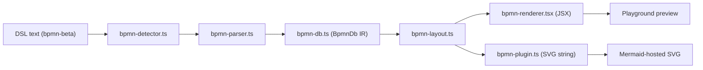
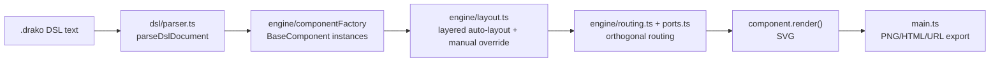
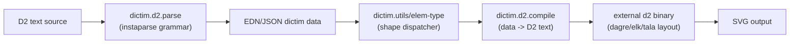
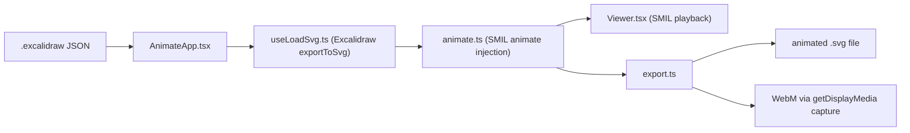

# Weekly Scan — Diagram Tooling (2026-07-09)

**Tóm tắt (3 bullet):**

- Không repo nào tuần này đạt mức "study deeper" — cả 4 repo được chọn đều dừng ở **glance only**: hầu hết là prototype non-published (mermaid-diagram-bpmn), side-project cá nhân chưa CI (DrakoFlow), hoặc dự án đã chững lại vài tháng (dictim, excalidraw-animate). Không có đối thủ trực tiếp nào vượt qua kỷ luật golden-SVG/BPMN-corpus/conformance hiện có của kymostudio.
- Ba kỹ thuật cụ thể đáng mượn ý tưởng (không mượn code, xem lưu ý license): **SMIL stroke-per-segment reveal** của excalidraw-animate cho hiệu ứng "vẽ tay" mượt hơn animation hiện tại; **manual-override song song với auto-layout** (`manualX/manualY` re-serialize vào DSL) của DrakoFlow cho playground kymo.studio/app/; và **round-trip parser D2↔EDN** của dictim như tiền lệ tham khảo (không phải để copy) cho mục tiêu BPMN import/export parity.
- Pattern nên tránh khi thấy lặp lại: **hai renderer trùng lặp cho cùng IR** (mermaid-diagram-bpmn — JSX và SVG-string tách rời, dễ lệch pha) đối lập trực tiếp với kiến trúc "renderer dumb" một back-end của kymostudio; **metadata nhét vào ID qua regex** (excalidraw-animate); **CLI luôn `exit 0` kể cả khi lỗi** (dictim) — nguy hiểm cho pipeline CI.

## Mục lục

1. [mermaid-diagram-bpmn (OKHP3/mermaid-diagram-bpmn)](#mermaid-diagram-bpmn-okhp3mermaid-diagram-bpmn)
2. [DrakoFlow (pazvanti/DrakoFlow)](#drakoflow-pazvantidrakoflow)
3. [dictim (judepayne/dictim)](#dictim-judepaynedictim)
4. [excalidraw-animate (dai-shi/excalidraw-animate)](#excalidraw-animate-dai-shiexcalidraw-animate)

**Phương pháp thu thập:** GitHub API/CLI tìm kiếm theo `pushed:>7d` không khả dụng trong phiên này (session bị giới hạn GitHub MCP scope chỉ vào `kymostudio/kymostudio`); thay vào đó dùng WebSearch + WebFetch để dò các GitHub Topics liên quan (`text-to-diagram`, `diagram-as-code`, `graph-layout`, BPMN DSL, SVG animation) rồi xác minh độ mới bằng cách đọc trực tiếp trang commit history của từng repo. Do đó độ mới của 2/4 repo (dictim, excalidraw-animate) không đạt ngưỡng "7 ngày" nghiêm ngặt — đã ghi rõ trong từng §1 và được chọn vì mức độ liên quan kiến trúc cao với kymostudio.

---

## mermaid-diagram-bpmn (OKHP3/mermaid-diagram-bpmn)

**§1 — Quick Context**

Prototype text-first DSL ("bpmn-beta") cho BPMN, khác biệt ở chỗ nó nhắm trở thành **Mermaid diagram-type chính thức** (không phải công cụ độc lập) và né hoàn toàn bpmn-js runtime — SVG được vẽ tay trực tiếp từ IR. Stack: TypeScript/React/Vite, pnpm workspaces. Sức khỏe repo: 3 stars, 157 commits, contributors không tải được, chưa có release nào published. CI chỉ có `deploy-gh-pages.yml` (deploy), không thấy workflow chạy test/typecheck. Phân phối: không có npm/PyPI package — chỉ là web playground tại `okhp3.github.io/mermaid-diagram-bpmn` (GitHub Pages), chưa merge upstream vào Mermaid. Hoạt động gần nhất: 23-26/06/2026.

**§2 — Architecture Deep-Dive**

**A. Component inventory** (tất cả tại `app/src/lib/`):

| Component (path) | Vai trò |
|---|---|
| `bpmn-detector.ts` | nhận diện text `bpmn-beta` để Mermaid load đúng plugin |
| `bpmn-parser.ts` | regex/line-based parser, xuất `BpmnDb` |
| `bpmn-db.ts` | class IR mutable, implement Mermaid `DiagramDB` interface (nodes/flows/pools/lanes) |
| `bpmn-layout.ts` | layered/topological layout (`assignLevels`), lồng pool/lane |
| `bpmn-renderer.tsx` | SVG qua React JSX, dùng cho playground preview |
| `bpmn-plugin.ts` | entry point `ExternalDiagramDefinition` của Mermaid; dựng SVG bằng string templates (`innerHTML`), nối detector→parser→layout→style |
| `bpmn-styles.ts` | theme/CSS (`getStyles`, `buildMermaidTheme`) |
| `bpmn-examples.ts` | các mẫu DSL đóng gói sẵn |

**B. Pipeline**: (1) người dùng viết block ` ```bpmn-beta ` ; (2) `bpmn-detector.ts` khớp header, Mermaid gọi `loader` của `bpmnPlugin`; (3) `bpmn-parser.ts` (regex + context stack cho pool/lane lồng nhau) đổ dữ liệu vào `BpmnDb`; (4) `bpmn-layout.ts` gán level topological, tính tọa độ cột (200px/lvl) và xếp pool/lane (gap 24px); (5a) đường Mermaid thật: `bpmn-plugin.ts.draw()` ghép chuỗi SVG (`renderNodeSvg`/`renderFlowSvg`/`defsSvg`) rồi set `el.innerHTML`; (5b) đường playground: `bpmn-renderer.tsx` render cùng `BpmnDb`/layout bằng JSX; (6) SVG hiện trên trang.

**C. Data model/IR**: `BpmnDb` — class mutable, implement `DiagramDB` của Mermaid, có `addNode/addFlow/addPool/addLane/clear`. Kiểu: `BpmnNode{id,kind,subtype,...}`, `BpmnFlow{id,source,target,kind}`, `BpmnPool{laneIds}`, `BpmnLane`. Không có khái niệm "lower IR" tách biệt — `bpmn-layout.ts` ghi thẳng x/y/points vào cùng record.

**D. Input language design**: parser viết tay, regex line-by-line + context stack (không phải PEG/ANTLR/recursive-descent), không có grammar hình thức (EBNF) hiện tại — docs xác nhận grammar Langium chỉ mới **planned**, chưa triển khai (lý do: JISON deprecated, cần Langium để merge upstream Mermaid). Báo lỗi bằng `throw new Error("Line N: ...")` — dừng ở lỗi đầu tiên, không gom nhiều lỗi, không recovery.

**E. Layout algorithm**: auto-only kiểu Sugiyama-lite (`assignLevels` topological), cột lưới cố định, pool/lane xếp chồng dọc; docs còn nhắc optional hint `@[row,col]` mỗi node. Routing cạnh: đường thẳng điểm-tới-điểm, không orthogonal, không có crossing minimization.

**F. Rendering**: hai emitter SVG song song cho cùng IR — JSX (`bpmn-renderer.tsx`, playground) và string-template SVG (`bpmn-plugin.ts`, tích hợp Mermaid thật) — không phải kiến trúc pluggable-emitter mà là **2 lần hard-code trùng lặp** logic vẽ. Không có animation. Theme qua `<style>` trong `<defs>`, class CSS `bpmn-*`.

**G. Extensibility**: thêm shape/icon mới = sửa cả hai file renderer (JSX và SVG-string), không có shape registry hay plugin system tách biệt; icon hard-code dạng component JSX riêng lẻ.

**H. Dev experience**: Vite dev server + playground React (chỉnh DSL, xem preview live) — có watch-mode qua `npm run dev`. Không có CLI (`package.json` không có `bin`). Có Vitest + thư mục `__tests__` nhưng không xác nhận được CI nào chạy test/typecheck (chỉ thấy workflow deploy). Không có IDE/LSP integration (chờ Langium).

**§3 — Architecture Diagram**



**§4 — Verdict**

Bài học cụ thể: kymostudio đã tránh được lỗi mà repo này mắc — có **một** back-end resolve/render dùng chung (`alignment.py`→`to_svg.py`, tương tự `alignment.ts`), trong khi ở đây `bpmn-renderer.tsx` và `bpmn-plugin.ts` là hai lần triển khai SVG song song cho cùng IR, dễ lệch pha. Layout của họ (đường thẳng, không crossing-min) sơ khai hơn `alignment.py`'s fan-in/trunk-lane staggering — không có gì để học ở đây. Đáng chú ý: kế hoạch chuyển parser regex sang Langium grammar (giống việc `dsl.py`/`dsl.ts` giữ EBNF chuẩn hóa trong `docs/DSL.md`) xác nhận hướng đi grammar-formal là đúng, không phải quá mức. Red flag: parser dừng ở lỗi đầu tiên (không multi-error), không CI xác nhận chạy test. Câu hỏi mở: có golden-test/regression suite nào giống `test_bpmn_corpus.py` không — không tìm thấy bằng chứng.

**Kết luận: glance only** — kiến trúc quá sơ khai (prototype, chưa publish) để nghiên cứu sâu hơn.

---

## DrakoFlow (pazvanti/DrakoFlow)

**§1 — Quick Context**

Client-side text-to-diagram engine viết bằng TypeScript, biên dịch custom DSL (`.drako`) trực tiếp trong trình duyệt thành SVG có drag-and-drop coordinate override — khác biệt chính so với các tool khác là kết hợp auto-layout với override thủ công ngay trong cùng một DSL. Stack: TypeScript + Vite + Vitest, dependency runtime duy nhất là `lz-string`. Sức khỏe repo: 10 sao, 1 fork, 39 commit trên `main`, không thấy release chính thức, không có `.github/workflows` (chỉ có `FUNDING.yml`) — tức không có CI khả kiểm dù có bộ test Vitest (`tests/{dsl,engine,components,editor,catalog,utils}`). Phân phối: web editor tại pazvanti.github.io/DrakoFlow/, VS Code extension (`.vsix`), không thấy bằng chứng publish npm registry. Hoạt động gần nhất: 20/06/2026 (VS Code extension + error highlighting).

**§2 — Architecture Deep-Dive**

**A. Component inventory**

| Component (path) | Vai trò |
|---|---|
| `src/main.ts` (~3246 dòng) | Entry point: gắn kết parser, layout, renderer, custom textarea editor, export, URL sharing |
| `src/dsl/parser.ts` | DSL text → AST (`parseDslDocument`, `ParsedNode`) |
| `src/dsl/componentTypes.ts` | Định nghĩa kiểu component cho DSL |
| `src/engine/layout.ts` | `layoutRootComponents`, layered auto-layout LTR/TTB, barycenter, chống chồng lấp |
| `src/engine/routing.ts` | `routeOrthogonal` — routing cạnh orthogonal |
| `src/engine/relationshipRenderer.ts`, `ports.ts` | Render quan hệ, tính điểm neo (port) trên biên component |
| `src/engine/componentFactory.ts`, `componentIndex.ts` | Registry khởi tạo component theo type |
| `src/components/*.ts` (47 file) | `BaseComponent<TProps,TStyle>` và các subclass shape (Rectangle, Cube, Cylinder, Package, Actor, Diamond, Hexagon, Process, Class, Lifeline...) — mỗi class tự `render()` ra SVG |
| `src/utils/PlantUmlTranslator.ts` | Transpiler PlantUML text → Drako DSL text |
| `src/utils/HTMLPlayerExporter.ts`, `highlighter.ts` | Export self-contained HTML, syntax highlight/bidirectional hover |
| `vscode-extension/` | VS Code extension bọc engine, preview `.drako` trực tiếp |

**B. Pipeline**: (1) User gõ `.drako` trong textarea tùy biến → (2) `parseDslDocument()` sinh AST (component + relationship + layout directive), lỗi được gắn `err.line`; (3) `componentFactory` khởi tạo `BaseComponent` instances, `layoutRootComponents()` gán layer + sắp xếp barycenter + dịch chuyển chống chồng (60px/lần, tối đa 20 lần), trừ khi có `manualX/manualY` (drag-drop) đè lên; (4) `routing.ts` + `ports.ts` tính đường orthogonal giữa các port; (5) mỗi component tự `render()` ra phần tử SVG, `main.ts` ráp vào viewport (pan/zoom transform); (6) export PNG/self-contained HTML hoặc share qua URL nén `lz-string`.

**C. Data model/IR**: AST (`DslDocument`/`ParsedNode`) rồi map trực tiếp sang instance OOP `BaseComponent` **mutable** — layout ghi đè x/y ngay trên object component, không có một "lower IR" trung lập tách biệt như `Diagram` dataclass của kymostudio.

**D. Input language**: parser là **regex + scanner tuần tự thủ công** (không phải recursive-descent cổ điển, không PEG/ANTLR), có đệ quy `parseNode()` cho cấu trúc lồng nhau. Không tìm thấy grammar hình thức (EBNF) nào — ngược với `docs/DSL.md` của kymostudio. Lỗi chỉ có **line number** (`code.slice(0,offset).split('\n').length`), không có column. README chỉ tuyên bố "Editor ↔ Canvas highlighting" (hover đồng bộ hai chiều) — **không tìm thấy** tuyên bố "highlight dòng sai" nào trong README; tính năng đó không được xác nhận.

**E. Layout**: hybrid — auto layered layout (LTR/TTB, barycenter minimize crossing) + **override thủ công qua drag-and-drop** (`manualX/manualY` serialize lại vào DSL). Routing: orthogonal thuần túy, không Bézier, không tránh vật cản động.

**F. Rendering**: SVG native (render nằm ngay trong từng component class, không tách emitter riêng). Output: PNG, self-contained HTML, DSL download, URL chia sẻ. **Không có animation**. Kiến trúc không rõ pluggable-emitter như kymostudio (renderer "dumb" tách khỏi model).

**G. Extensibility**: shape mới = subclass `BaseComponent`, cài `validateProps/calculateMinDimensions/render`. PlantUML translator là **transpiler string-to-string theo dòng bằng regex**, chỉ hỗ trợ activity/class/sequence cơ bản, bỏ qua multiplicity connector (`o*+`) — không phải parser AST đầy đủ.

**H. Dev experience**: highlight hai chiều editor↔canvas (xác nhận), editor textarea tùy biến (không CodeMirror/Monaco) với gutter + `highlighter.ts`, VS Code extension có live preview/pan/zoom/minimap/theme, web live preview tại pazvanti.github.io. Không thấy watch-mode CLI riêng.

**§3 — Architecture Diagram**



**§4 — Verdict**

Đáng chú ý nhất cho kymostudio: cơ chế **manual override song song với auto-layout** (`manualX/manualY` re-serialize vào DSL sau drag-and-drop) — kymo.studio/app/ playground hiện chưa có escape-hatch này, có thể tham khảo cho `alignment.py`/`alignment.ts`. Thuật toán orthogonal routing + đặt label trên segment dài nhất là kỹ thuật nhẹ, cụ thể, đáng so sánh với `to_svg.py`. Highlight hai chiều editor↔canvas là ý tưởng UX tốt cho playground kymostudio.

Red flag: **license GPL-3.0** trong khi kymostudio là Apache-2.0 — không được copy code/thuật toán triển khai sát nguyên văn từ DrakoFlow; chỉ nên học ý tưởng và tự viết lại độc lập. Parser DrakoFlow không có grammar hình thức (khác biệt bất lợi so với `docs/DSL.md` normative của kymostudio) và không có CI workflow dù có test Vitest — dấu hiệu độ trưởng thành thấp hơn kỷ luật golden-SVG/BPMN-corpus/conformance của kymostudio. PlantUML translator là regex transpiler nông, không nên làm mẫu nếu kymostudio thêm PlantUML importer — cách tiếp cận `from_bpmn.py` (parse cấu trúc rồi map) đáng tin hơn.

Câu hỏi mở: chưa đọc nội dung test thực tế nên chưa rõ độ phủ; chưa xác nhận publish npm; không có animation (khác biệt của kymostudio với `--animate`).

**Kết luận: glance only** (lướt qua lấy vài ý tưởng layout/routing/UX, không cần nghiên cứu sâu).

---

## dictim (judepayne/dictim)

**§1 — Quick Context**

dictim biểu diễn diagram bằng plain EDN/JSON data (nested vectors/maps) thay vì custom text syntax, compile ra D2 source rồi giao render cho D2 engine bên ngoài — ngược hẳn với text-DSL của kymostudio. Stack: Clojure (93.3%) + instaparse + Babashka/GraalVM native binaries. Repo health: 24 stars, MIT license, CircleCI (không thấy GitHub Actions), release mới nhất 0.9.4 (01/03/2026), commit gần nhất cũng 01/03/2026 — khoảng 4 tháng trước ngày báo cáo (09/07/2026), tức **không đạt ngưỡng freshness 7 ngày**, được giữ lại vì giá trị kiến trúc (xem §4). Phân phối: Homebrew tap, Scoop, tải binary thủ công (macOS/Linux/Windows/ARM64), hoặc bbin/jar cho thư viện Clojure.

**§2 — Architecture Deep-Dive**

**A. Component inventory**

| Component (path) | Vai trò |
|---|---|
| `src/cmd/dictim.clj` | CLI entry point (Babashka script, `-main`, dispatch flag) |
| `src/cmd/file_watcher.clj` | Watch mode (recompile on file change) |
| `src/cmd/serve.cljc` | Dev server live-reload (http-kit) cho `--image --watch` |
| `src/dictim/d2/compile.cljc` | Bộ biên dịch data → D2 text (`layout` multimethod) |
| `src/dictim/d2/parse.cljc` | Bộ phân tích D2 text → dictim data (grammar `instaparse`) — chiều round-trip |
| `src/dictim/d2/attributes.cljc` | Danh sách/whitelist D2 attribute keys hợp lệ |
| `src/dictim/utils.cljc` | `elem-type` — bộ phân loại hình dạng vector ("switch board of dictim") |
| `src/dictim/validate.cljc` | Validate dữ liệu dictim trước compile |
| `src/dictim/format.cljc` | Pretty-print/format D2 text đầu ra |
| `src/dictim/template.cljc` | Áp template/style tách biệt khỏi cấu trúc |
| `src/dictim/graphspec.clj` | API bậc cao: graph-spec (nodes/edges) → dictim |
| `src/dictim/json.cljc`, `walk.cljc`, `flat.cljc` | Chuyển đổi JSON, keywordize/stringify keys, dạng "flat" thay thế |

**B. Pipeline**

*data → SVG:* (1) CLI đọc EDN/JSON qua stdin/file/inline (`read-data` thử JSON trước, EDN sau) → (2) merge template nếu có `-t` (`dictim.template/apply-template`) → (3) `dictim.d2.compile/d2` validate rồi walk data, in ra D2 text (`dictim.format/fmt`) → (4) shell ra binary `d2` ngoài (`d2 --layout … -`) để render SVG → (5) ghi ra file `-o` hoặc phục vụ qua dev server (watch mode).

*D2 → data (round-trip):* (1) đọc D2 text → (2) `dictim.d2.parse/dictim` chuẩn hoá line-ending rồi chạy parser instaparse (`defparser` sinh từ hàm `grammar`) → (3) `insta/transform` biến parse-tree thành literal EDN, gắn metadata `:tag` (`:ctr`,`:shape`,`:conn`,`:attrs`,`:vars`,…) → (4) `try-parse-primitive` khôi phục int/float/bool từ string → (5) tuỳ chọn keywordize (`-k`), xuất JSON (`-j/-m`), hoặc bỏ style (`-r`).

**C. Data model/IR**: IR **chính là** EDN/JSON thô — không có AST/class trung gian. Kiểu phần tử chỉ được suy ra runtime qua `elem-type` (cấu trúc/arity của vector) và metadata `:tag` gắn khi parse ngược từ D2. Không hề có bước layout/toạ độ trong dictim — khác hẳn `Component/Region/Edge` dataclass đã resolve x/y của kymostudio.

**D. Input language design**: ngữ nghĩa diagram được suy ra từ **quy ước hình dạng vector** trong `elem-type` (utils.cljc): giá trị đơn (string/keyword/number) → node trần; map 1-key `"vars"/"classes"` → block đặc biệt; vector có phần tử thứ 2 là `"->"/"<-"/"<->"/"--"` → connection; vector chứa vector con → container; còn lại → shape. Không có token/tag tường minh — chỉ dựa vị trí và kiểu phần tử. Báo lỗi: rất thô — vector không khớp mẫu nào ném exception runtime `"element type not recognized"`, không có dòng/cột (vì input không phải text). Chỉ chiều D2→data mới có lỗi kèm số dòng (`format-error`).

**E. Layout**: hoàn toàn giao cho D2 (`dagre/elk/tala` qua `--layout`) — dictim không tự tính toạ độ.

**F. Rendering**: cũng giao 100% cho binary `d2` bên ngoài (phải cài sẵn, kiểm tra bằng `installed?`). Giá trị gia tăng của CLI: layer template/theming (`-t`), `graphspec` (data đồ thị → dictim, lấy cảm hứng từ Rhizome), watch mode + dev server live-reload.

**G. Extensibility**: template EDN/JSON merge trước compile (tách style khỏi cấu trúc). Tính năng D2 mới phải được thêm thủ công vào `dictim.d2.attributes.cljc` + case mới trong `elem-type` — changelog cho thấy mỗi lần bump "d2 compatibility" (vd 0.9.0.4 thêm `suspend/unsuspend`, c4-shapes) là một release riêng, không có cơ chế pass-through D2 syntax tuỳ ý.

**H. Dev experience**: CLI là Babashka script + native binary GraalVM (không tốn JVM cold-start); JVM fallback qua `deps.edn` cho dùng như thư viện. CI: CircleCI (badge README), không thấy GitHub Actions. `-main` luôn `(System/exit 0)` dù lỗi — chỉ in message, **không trả exit code khác 0**.

**§3 — Architecture Diagram**



**§4 — Verdict**

Bài học cho kymostudio: cơ chế round-trip của dictim (D2 text → grammar instaparse → EDN gắn `:tag`) là tiền lệ đáng tham khảo cho mục tiêu BPMN import/export parity, nhưng dùng cả một parser-generator riêng cho việc này có vẻ nặng nề so với nhu cầu. Ý tưởng "data-as-diagram" (vector shape dispatch) thú vị như input phụ dành cho sinh diagram bằng máy, nhưng kymostudio đã có Component/Region/Edge dataclass đóng vai trò IR tương đương — dictim chỉ gộp 2 lớp (surface syntax + IR) làm một.

Red flags: lỗi runtime không có vị trí ở chiều data→D2; CLI luôn exit 0 kể cả khi lỗi (nguy hiểm cho CI); phụ thuộc cứng vào binary `d2` cài sẵn, không tự render/layout.

Câu hỏi mở: chưa rõ độ phủ test thực tế; cộng đồng nhỏ (24 sao, có vẻ một người bảo trì chính) và hoạt động đã chậm lại ~4 tháng.

**Kết luận: chỉ lướt qua (glance only)** — riêng phần thiết kế round-trip-parser và cơ chế phân loại shape đáng đọc nhanh, nhưng kiến trúc "giao hết cho binary ngoài" và quy mô cộng đồng nhỏ không phải mô hình để kymostudio noi theo toàn bộ.

---

## excalidraw-animate (dai-shi/excalidraw-animate)

**§1 — Quick Context**

Tool chuyển một bản vẽ Excalidraw tĩnh (JSON scene) thành animation "vẽ dần từng element" — khác các diagram tool khác ở chỗ nó không có input DSL, mà animate hoá *hand-drawn whiteboard JSON có sẵn*, xuất ra SVG (SMIL) hoặc WebM. Stack: TypeScript 89.5% + React 19 + Vite, dựa trên `@excalidraw/excalidraw` 0.18.1. Repo health: 2.000 sao, 135 fork, 10 issue mở, 186 commit, MIT license; commit gần nhất "fix deploy workflow" ngày 29/5/2026 (~6 tuần trước ngày báo cáo) — không phải mới toanh nhưng vừa có đợt cập nhật đáng kể: release v0.7.2 (24/4/2026), bump dependency, thêm bộ e2e test bằng Playwright (`e2e.yml`, `playwright.yml` bên cạnh `test.yml`, `deploy.yml`, `publish.yml`). Phân phối: npm package `excalidraw-animate`, web tool tại dai-shi.github.io/excalidraw-animate.

**§2 — Architecture Deep-Dive**

**A. Component inventory**

| Component (path) | Vai trò |
|---|---|
| `src/AnimateApp.tsx` | Orchestrator top-level: nối `useLoadSvg`, `Toolbar`, `Viewer` |
| `src/useLoadSvg.ts` | Hook load scene JSON, gọi `exportToSvg` gốc của Excalidraw rồi truyền qua `animate.ts` |
| `src/animate.ts` | Engine tính ordering/duration và bơm SMIL `<animate>`/`<animateMotion>` vào SVG |
| `src/export.ts` | Xuất file: serialize SVG animated, và ghi WebM qua screen-capture |
| `src/Viewer.tsx` | UI phát lại animated SVG |
| `src/Toolbar.tsx` / `AnimateConfig.tsx` | UI cấu hình order/duration per-element/per-group, trigger export |
| `src/library.ts` | Parse `.excalidrawlib` (mỗi item animate riêng) |
| `src/ExcalidrawApp.tsx` | Chế độ "Edit" (Excalidraw editor thuần, tách biệt data với Animate mode) |

**B. Pipeline**: (1) User load `.excalidraw`/`.json`/`.excalidrawlib` hoặc paste shareable link (giải nén bằng `pako`) → (2) `useLoadSvg` gọi thẳng `exportToSvg()` gốc của Excalidraw để lấy SVG tĩnh baseline → (3) `animate.ts::animateSvg()` group elements theo `groupIds`, đọc `animateOrder`/`animateDuration` (encode trong element ID qua regex), rồi gọi các hàm patch theo shape-type để chèn `<animate>` với `begin=` so le → (4) `Viewer.tsx` render DOM SVG animated, phát bằng chính API timing của SMIL → (5) User chỉnh order/duration ở Toolbar, re-run `animate.ts` → (6) Export: `exportToSvgFile` serialize SVG (rewind về frame 0), hoặc `prepareWebmData` gọi `getDisplayMedia()` + `MediaRecorder` để quay lại màn hình trong lúc SVG tự phát.

**C. IR**: Không có timeline IR tách biệt — element JSON của Excalidraw là input, nhưng "animation IR" thực chất được ghi thẳng vào DOM SVG output dưới dạng thuộc tính `begin`/`dur`/`fill` của `<animate>`, cộng metadata order/duration nhét tạm vào ID (một kênh khá hacky, không phải object cấu hình sạch).

**D. Input language**: N/A — input là JSON scene gốc của Excalidraw, "parse" chỉ là `JSON.parse`/giải nén pako, không có lớp validate/grammar riêng.

**E. Layout**: N/A — vị trí/path giữ nguyên từ bản vẽ gốc, xác nhận rõ trong code (không tính toán lại toạ độ).

**F. Rendering/output (core finding)**: Cơ chế animate là **SVG SMIL native** (`<animate>`, `<animateMotion>`), không phải CSS keyframes, không phải JS vẽ frame-by-frame. Kỹ thuật: decompose path `d` (regex trên lệnh M/C/L) thành từng đoạn Bézier, rồi phát từng đoạn bằng chuỗi `<animate>` xếp `begin=` nối tiếp + `fill="freeze"` (path-morphing dFrom→dTo, không dùng `stroke-dasharray`). Freedraw/image dùng opacity 0→1; text được "vẽ" trái-sang-phải qua `textPath` trên một line ẩn; có tuỳ chọn pointer icon di chuyển theo path bằng `animateMotion`. Kết quả là file `.svg` tự chứa, chạy được ở mọi renderer hỗ trợ SMIL, không cần JS. WebM export **không phải renderer thật** — nó là screen-recording qua `getDisplayMedia()`/`MediaRecorder`, giải thích đúng cảnh báo "not perfect" trong README (phụ thuộc lựa chọn màn hình của user, cần permission dialog, không deterministic/headless).

**G. Extensibility**: Order/duration cấu hình qua UI per-element/group (default 500ms/element, 5000ms chia đều cho group), không có plugin point rõ ràng — thêm shape-type mới phải sửa trực tiếp các hàm patch trong `animate.ts`.

**H. Dev experience**: Web tool live-preview có drag-drop + shareable link; publish npm library để dùng lập trình; có unit test (vitest) và e2e (Playwright, mới thêm); không có CLI (không có `bin` trong package.json).

**§3 — Architecture Diagram**



**§4 — Verdict**

excalidraw-animate xác nhận SMIL vẫn là encoding khả thi cho reveal-animation SVG, đối lập với hướng CSS mà kymostudio đang dùng — CSS an toàn hơn về lâu dài (SMIL từng bị Chrome doạ deprecate). Đáng học: kỹ thuật stroke-per-segment reveal (path-morphing dFrom→dTo theo từng Bézier segment) tạo hiệu ứng "vẽ tay" mịn hơn nhiều so với opacity/keyframe per-component; kymostudio có thể mô phỏng bằng CSS `stroke-dashoffset` transition trên từng path segment cho edge/connector thay vì animate cả path một lần. Red flag rõ: WebM export dựa vào screen-capture (`getDisplayMedia`) thay vì renderer thực sự — không nên copy pattern này; và metadata order/duration nhét vào element ID qua regex là anti-pattern nên tránh khi thiết kế IR của kymostudio. Câu hỏi mở: chưa xác nhận được API export thực tế của npm library, và SMIL animation có tôn trọng `prefers-reduced-motion` hay không.

**Kết luận: glance only** — chỉ đáng tham khảo kỹ thuật stroke-segment reveal, còn lại (SMIL, screen-capture WebM, ID-smuggled metadata) không nên áp dụng trực tiếp.
