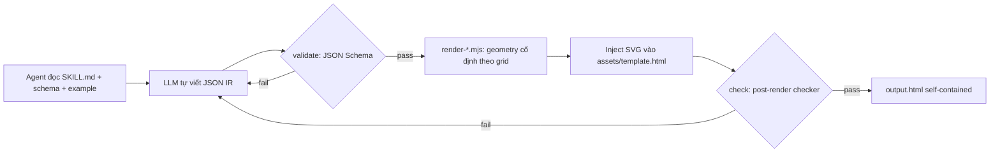
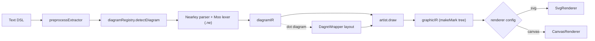
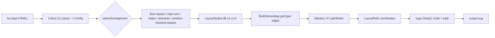
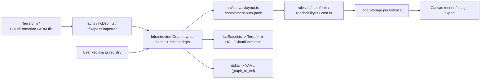

# Weekly scan — diagram-as-code & visual tooling (2026-07-10)

**Executive summary**
- Không tìm được repo nào mới hoàn toàn (`created:>7d`) đạt ngưỡng chất lượng; danh sách deep-dive tuần này pha trộn 1 repo rất mới (`strata`, 0 sao, commit hôm qua), 1 repo agent-skill đang viral (`archify`, 3.2k sao, release cách đây 5 ngày), và 2 repo kiến trúc đáng học dù không "mới" theo nghĩa 7 ngày (`pintora`, `layli`) — vì GitHub search theo `topic:` + `pushed:>7d` + `stars:>50` gần như rỗng trong domain diagram-as-code tuần này.
- Phát hiện đáng chú ý nhất: `archify` dùng LLM agent làm "parser" (agent tự viết JSON IR theo JSON Schema thay vì chạy grammar) — một hướng front-end hoàn toàn khác kymo's `dsl.py`/`dsl.ts`, đáng theo dõi vì đang được 3.2k sao đồng tình.
- Về mặt kỹ thuật lõi cho kymo: `layli` (Go, grid + Dijkstra/A* routing) cho ý tưởng tách bạch "arrange node" khỏi "route edge" rõ ràng nhất trong 4 repo; `strata`'s registry-driven IaC round-trip là case study gần nhất với kymo's BPMN import/export parity effort.

**Mục lục**

| # | Repo | Sao | Lý do chọn | Deep-dive |
|---|------|-----|-----------|-----------|
| 1 | [tt-a1i/archify](#1-tt-a1iarchify) | 3.2k | Agent-authored JSON IR thay DSL text, dual-theme SVG | ✅ §1-4 |
| 2 | [hikerpig/pintora](#2-hikerpigpintora) | 1.3k | Nearley grammar + IR 2 tầng (diagramIR→graphicIR), Dagre layout | ✅ §1-4 |
| 3 | [dnnrly/layli](#3-dnnrlylayli) | 22 | Grid pathfinding (Dijkstra/A*) tách khỏi node arrangement | ✅ §1-4 |
| 4 | [makedirectory/strata](#4-makedirectorystrata) | 0 | Typed-graph registry + IaC round-trip (Terraform/CFN/ARM) + MCP server | ✅ §1-4 |
| 5 | mermaid-js/layout-elk (npm) | — | ELK layout engine tích hợp Mermaid, publish gần đây | Ecosystem-activity, không deep-dive (chỉ là 1 layout plugin, không phải diagram tool độc lập) |
| 6 | FigDown/figdown | 0 | "Markdown-native standard for diagrams readable by AI agents" | Loại — repo quá mỏng (0 sao, 2 ngày tuổi), không đủ evidence kiến trúc để deep-dive |
| 7 | kazukifujiwara/network-topo-draft | 0 | VSCode canvas editor cho network topology, human+AI cùng edit | Loại — là editor/canvas UI, không phải compiler diagram-as-code |
| 8 | nordstad/PinViz | 5 | Generator sơ đồ đấu dây GPIO ra SVG bằng Python | Loại — quá niche (< vài trăm dòng theo cấu trúc thấy được), không đại diện cho kỹ thuật layout/parser mới |
| 9 | isatimur/excalidraw-skill-pack | 0 | "Universal skill pack for Excalidraw diagrams" | Loại — là wrapper/skill-pack, không phải bản thân 1 diagram engine |

Data source đã dùng: GitHub web search UI (`github.com/search?type=repositories`, sort theo `updated`) qua WebFetch — không có quyền `gh` CLI / GitHub REST API trực tiếp trong phiên này (session bị giới hạn chỉ truy cập repo `kymostudio/kymostudio` qua MCP), nên phải fallback sang duyệt trang search công khai + WebSearch. Bậc 1 (`topic:diagram-as-code stars:>50 pushed:>7d`) và bậc 2 (keyword+`created:>30d`) đều bị GitHub search UI rate-limit (429) khi query có `pushed:`/`created:` filter phức tạp; danh sách trên tổng hợp từ nhiều lần fetch không filter ngày cứng, lọc thủ công theo "updated" timestamp hiển thị trên trang.

---

## 1. tt-a1i/archify

### §1 Quick context
Agent skill (không phải app/CLI độc lập) biến mô tả tiếng Anh thành diagram kiến trúc/workflow/sequence dạng HTML tự chứa, dùng JSON IR do chính LLM agent viết tay thay vì một text DSL có grammar. Tech stack: JavaScript thuần (78.7%) + HTML, **zero runtime dependency**, output là 1 file HTML self-contained (SVG inline + ~19KB JS cho theme/export), export thêm PNG/JPEG/WebP. Repo health: 3.2k sao, 227 fork, release mới nhất v2.10.0 (05/07/2026 — cách ngày quét 5 ngày), có CI (`ci.yml`, `release.yml`); số contributor không xác định (trang contributor không tải được qua WebFetch). Phân phối: `npx skills add tt-a1i/archify -g` cài vào `~/.claude/skills/` (Claude Code), `~/.agents/skills/`, hoặc `~/.config/opencode/skills/` — không publish npm package riêng.

### §2 Architecture deep-dive
**A. Component inventory** — `bin/archify.mjs` (CLI entry, dispatch bằng `switch` trên `process.argv`); `schemas/*.schema.json` (1 JSON Schema/loại diagram, `additionalProperties:false`); `renderers/{architecture,workflow,sequence,dataflow,lifecycle}/render-*.mjs` (1 module/loại, tự chứa geometry riêng); `renderers/shared/{geometry.mjs,generated-validators.mjs,validator.mjs,layout-report.mjs}` (helper hình học thuần túy — overlap detection, anchor points, label placement); `assets/template.html` (shell HTML/CSS-vars dùng chung cho mọi loại); `scripts/check-render-output.mjs` (post-render checker).

**B. Pipeline** — (1) agent đọc `SKILL.md` + schema + example JSON; (2) agent tự viết file JSON IR (không có parser); (3) `archify.mjs validate <type> <input>.json` chạy JSON Schema validator; (4) `archify.mjs render <type> <input>.json <output>.html` — renderer tính pixel geometry từ IR rồi build chuỗi SVG bằng template-literal, ghép vào `template.html`; (5) `archify.mjs check <output>.html` — kiểm tra artifact (overlap, off-canvas); (6) fail ở bước 3/5 → SKILL.md ra lệnh "sửa JSON, không được sửa renderer" — một vòng lặp sửa lỗi hoàn toàn ở tầng IR.

**C. Data model/IR** — JSON phẳng, có `schema_version`, `diagram_type` discriminant, mảng `lanes/nodes/edges` tùy loại. Không có khái niệm mutable/immutable rõ ràng vì IR chỉ được validate 1 lần rồi tiêu thụ 1 lần; không có pass "lower xuống IR thấp hơn" tách biệt khỏi chính renderer.

**D. Input language design** — Không có DSL text/grammar hình thức nào cả. "Front-end" chính là bản thân LLM agent, được hướng dẫn bởi `SKILL.md` (prose) + JSON Schema + example, tự viết JSON trực tiếp. Đây là khác biệt cơ bản với `dsl.py`/`dsl.ts` của kymo: archify không có tầng parse-time enforcement, tính đúng đắn phụ thuộc agent đọc kỹ hướng dẫn + lặp lại theo lỗi validator.

**E. Layout algorithm** — Grid cố định, không auto-layout/force-directed. `render-workflow.mjs` hardcode `colXs`, `laneY/laneH/laneGap`, `nodeW/nodeH`; node chỉ khai `lane`+`col` (index 0-5)+`yOffset` tùy chọn, `measureNode()` map ô lưới → pixel rect. Cạnh có `route` enum tường minh (`auto/straight/drop/outside-right/return-left/bottom-channel/up-channel`) + `fromSide/toSide/via` — nghĩa là **agent (IR author) tự chọn route**, renderer chỉ hỗ trợ tính anchor/label.

**F. Rendering** — 1 file HTML self-contained, SVG build bằng string concatenation, theme qua CSS custom properties dưới `:root`/`[data-theme]`, resolve thứ tự URL param → `localStorage` → `prefers-color-scheme` — đúng pattern dual-theme mà Artifact tool của chính Claude Code cũng khuyến nghị. Export dùng thuần Browser Canvas/Clipboard API, không thư viện ngoài.

**G. Extensibility** — Thêm loại diagram mới cần: schema mới + renderer `.mjs` mới + example + wiring vào CLI dispatch — không có plugin API chính thức, chỉ "làm theo 5 cái đã có".

**H. Dev experience** — Không có watch mode. `doctor` command tự kiểm Node version + tồn tại file schema/renderer/example. SKILL.md nhấn mạnh kỷ luật "chỉ sửa JSON", cấm inline `fill="rgba(...)"` vì phá theme switching.

### §3 Architecture diagram

### §4 Verdict
Điểm học được cho kymo: dual-theme CSS-var pattern (`prefers-color-scheme` + `data-theme` override, resolve qua URL→localStorage→media-query) trùng khớp với cách Artifact tool render — xác nhận đây là pattern đáng chuẩn hóa nếu kymo muốn output SVG "tự theme" mà không cần JS runtime. Route enum tường minh (`drop/outside-right/bottom-channel`...) cho phép author chỉ định chiến lược routing per-edge — kymo hiện chủ yếu để `alignment.py` tự quyết; có thể học ý tưởng expose 1 vài route hint tương tự cho case khó tự động hóa. Red flag: không có grammar/parser thật, độ tin cậy phụ thuộc hoàn toàn kỷ luật của LLM — không dùng được ngoài ngữ cảnh agent, và mỗi renderer tự chứa geometry riêng (nguy cơ trùng lặp code giữa 5 loại diagram). Câu hỏi mở: 4 renderer còn lại (sequence/dataflow/lifecycle/architecture) có cùng pattern grid cố định như workflow không — chưa xác nhận trực tiếp. **Verdict: study deeper** phần theming + route-hint design, bỏ qua phần "IR do LLM viết tay" vì không áp dụng được cho kymo's DSL-first triết lý.

---

## 2. hikerpig/pintora

### §1 Quick context
Thư viện TypeScript text-to-diagram "lấy cảm hứng trực tiếp từ Mermaid.js và PlantUML" — 8 loại diagram (Sequence, ER, Component, Activity, Mind Map, Gantt, DOT, Class), chạy được cả browser lẫn Node.js. Tech stack: TypeScript 74.3%, Nearley grammar (`.ne` files, 6.6% codebase — xác nhận có grammar hình thức thật), Moo tokenizer, monorepo npm scoped packages (`@pintora/core`, `/diagrams`, `/renderer`, `/standalone`, `/cli`, `/harness`). Repo health: 1.3k sao, 37 fork, release mới nhất v0.8.2 (13/02/2026 — không phải trong 7 ngày qua nhưng đủ trưởng thành để làm case study kiến trúc), CI (`ci-check.yml`, `update-tests.yml`), versioning qua Changesets. Phân phối: npm (`@pintora/standalone`), VSCode extension, CLI riêng (`@pintora/cli`).

### §2 Architecture deep-dive
**A. Component inventory** — `pintora-core/src` (kernel: `diagram-registry.ts`, `symbol-registry.ts`, `config-engine.ts`, `themes/` — không tự parse/render); `pintora-diagrams/src/<type>/` (mỗi loại diagram có `parser/*.ne` riêng + `db.ts` semantic-action state + `artist.ts`); `pintora-renderer/src/renderers/` (`SvgRenderer.ts`, `CanvasRenderer.ts` cùng implement `base.ts`); `pintora-standalone/src/index.ts` (glue API `render`/`renderTo`); `pintora-cli` (yargs + `canvas` + `jsdom`); `pintora-harness` (golden-case test harness).

**B. Pipeline** (trace từ `parseAndDraw(text, opts)`) — (1) `preprocessExtractor.parse(text)` strip pre-block; (2) `diagramRegistry.detectDiagram(text)` — regex pattern match, mặc định `sequenceDiagram` nếu không khớp; (3) `diagram.parser.parse(text)` [Nearley + Moo] → **diagramIR**; (4) config theo `configKey` được resolve; (5) `diagram.artist.draw(diagramIR, config)` → **graphicIR**; (6) `renderTo()` chọn `SvgRenderer`/`CanvasRenderer` theo `config.core.defaultRenderer` để xuất SVG/Canvas.

**C. Data model/IR** — Kiến trúc **IR 2 tầng**: `diagramIR` (cấu trúc semantic riêng từng loại, build bởi `db.ts` trong lúc parse) → `graphicIR` (drawing tree renderer-agnostic, build qua helper `makeMark('rect'|'path'|'text', {...})` tích lũy vào `Group.children`). Cả hai đều là **plain object mutable**, không có khái niệm immutable/freeze.

**D. Input language** — Grammar Nearley thật (`.ne`, ví dụ `sequence/parser/sequenceDiagram.ne`) + Moo tokenizer đa trạng thái (`main/line/configStatement/noteState`); cover participants, 8 biến thể arrow/signal, note, block `loop/opt/par/alt`, divider — semantic action gọi vào `db` qua `setYY()`. Không thấy tầng error-reporting friendly riêng — có vẻ dựa vào hành vi fail mặc định của Nearley (chưa xác nhận có wrapper thân thiện hơn ở nơi khác).

**E. Layout algorithm** — Với diagram dạng graph (xác nhận ở `dot/artist.ts`): **delegate hẳn cho Dagre** qua `DagreWrapper` (`rankdir`, `nodesep`, `edgesep`, `ranksep`, `splines` map từ `edgeType`) — routing/crossing-minimization đến từ Dagre, không code tay. Chưa xác nhận `class/er/component` có dùng chung wrapper này không (plausible nhưng không kiểm chứng từng file); Sequence/Gantt/Mindmap layout — không xác định.

**F. Rendering** — Pluggable emitter pattern rõ ràng: `SvgRenderer`/`CanvasRenderer` cùng implement `base.ts`, chọn runtime bằng config string. Theme sống ở `pintora-core/src/themes/`.

**G. Extensibility** — `diagramRegistry.registerDiagram(name, {pattern, parser, artist, configKey, eventRecognizer?})` — plugin object đầy đủ, tên trùng chỉ warn không throw.

**H. Dev experience** — VSCode extension (syntax highlight + preview), CLI thật, playground online (pintorajs.vercel.app), tích hợp bên thứ 3 (Gatsby, Observable, web component, Obsidian). Watch mode — không xác định.

### §3 Architecture diagram

### §4 Verdict
Đây là repo "gần kymo nhất" về mặt kiến trúc trong 4 repo tuần này: pipeline `text → parser → diagramIR → artist → graphicIR → pluggable renderer` gần như song song với `dsl.py → Diagram model → alignment.py → to_svg.py` của kymo, nhưng pintora đi xa hơn 1 bước bằng cách tách riêng **graphicIR làm renderer-agnostic drawing tree** (`makeMark` rect/path/text + `Group.children`) — kymo hiện để `to_svg.py`/`to_figma.py`/`to_excalidraw.py` mỗi cái tự derive geometry từ `Diagram` model riêng; một lớp `graphicIR` trung gian có thể giảm trùng lặp giữa 3 emitter này. `registerDiagram()` (pattern regex + parser + artist + configKey) là mẫu plugin gọn cho "thêm 1 sub-dialect" nếu kymo từng cân nhắc việc đó. Việc delegate layout đồ thị cho Dagre (thay vì tự viết) đáng cân nhắc cho các trường hợp kymo's alignment.py chưa xử lý tốt (ví dụ đồ thị tự do không theo auto-layout frame). Red flag: error reporting parser có vẻ yếu (dựa Nearley default) — ngược hẳn triết lý "error tốt" mà 1 DSL cần. Câu hỏi mở: Dagre wrapper có dùng chung cho graph-like diagram khác ngoài `dot` không. **Verdict: study deeper** — đáng đọc kỹ source `graphicIR`/`makeMark` và `registerDiagram` trước khi cân nhắc refactor emitter layer của kymo.

---

## 3. dnnrly/layli

### §1 Quick context
Công cụ diagram-as-code viết bằng Go: user viết YAML mô tả node/edge, `layli` tự sắp xếp node (5 thuật toán) rồi tự route từng cạnh trên 1 grid bằng Dijkstra/A* né chướng ngại — tách bạch rõ "arrange" và "route" thành 2 pha độc lập, pluggable riêng từng pha. Tech stack: Go 94.1% + Gherkin/godog cho acceptance test, xuất SVG qua `svgo`. Repo health: chỉ 22 sao, 1 fork, release v0.0.16 (14/02/2026), commit gần nhất ~18/02/2026 — **dự án đang dormant khoảng 5 tháng** tính đến ngày quét; có CI đầy đủ (`pr.yml`, `golangci-lint.yml`, `release.yml` qua goreleaser). Phân phối: `go install github.com/dnnrly/layli/cmd/layli`.

### §2 Architecture deep-dive
**A. Component inventory** — `main.go` (Cobra CLI, subcommand `to-absolute`, `config`); `layout/` — lõi engine: `config.go` (Config/ConfigEdge, bind YAML), `arrangements.go` (5 thuật toán sắp node), `layout.go` (LayoutNode/LayoutPath, `GetPorts`/`GetCentre`, SVG Draw method), `path.go` (PathFinder interface, `BuildVertexMap`, `FindPath`), `vertext_map.go` (grid `VertexMap`, cấu trúc đồ thị Arc/Arcs), `position.go` (Point, sinh SVG path string), `diagram.go` (`Draw()` canvas qua `svgo`, `AbsoluteFromSVG()` import ngược); `pathfinder/dijkstra/{dijkstra.go,astar.go}` (A* như biến thể Dijkstra có heuristic, kèm `ASTAR.md` + benchmark — pathfinder "bidirectional" được quảng cáo trong README/config nhưng **không định vị được file cụ thể**, chưa xác nhận nằm ở đâu); `algorithms/{tarjan,topological}/` (thuật toán đồ thị chuẩn, `graph.RankNodes()`).

**B. Pipeline** — (1) Cobra parse `foo.layli` (YAML) → `Config`; (2) `selectArrangement()` dispatch theo `Config.Layout` vào 1-trong-5 hàm arrangement → `LayoutNodes` (đã có vị trí); (3) với mỗi cạnh: `path.go` build `VertexMap` (đánh dấu border/node interior/path đã vẽ là "blocked"), `GetArcs()` nối các ô lưới trống liền kề, chạy pathfinder đã chọn (Dijkstra/A*, heuristic Euclidean/Manhattan) tìm đường port-to-port; (4) `diagram.go.Draw()` dựng canvas `svgo` theo kích thước layout, vẽ node/path; (5) ghi `.svg` (hoặc stdout) qua `OutputFunc`.

**C. Data model/IR** — Struct Go thuần (`Config`, `LayoutNode`, `LayoutPath`, `Point`) phần lớn **immutable** — hàm arrangement trả về `LayoutNodes` mới thay vì mutate; riêng `VertexMap` (`[][]bool`) là mảng 2D mutable, được build mới mỗi lần tìm đường cho 1 cạnh.

**D. Input language** — YAML chuẩn (`layout:`, `nodes:` [id/contents/class/style/position], `edges:` [from/to/class/style], `width/height/border/margin/spacing`) — không phải grammar tự chế, dùng YAML unmarshal thẳng vào `Config`. Error message qua `mapError()` bóc bớt prefix nội bộ để CLI output sạch hơn.

**E. Layout algorithm (dimension trọng tâm)** — Port sinh tự động ở cả 4 cạnh bounding-box mỗi node (`GetPorts()`, trừ góc), cho nhiều điểm vào ứng viên; `GetCentre()` làm fallback. Grid `VertexMap` coi mỗi ô trống là 1 vertex; `GetArcs()` nối các ô thẳng hàng ngang/dọc còn trống. Dijkstra/A* tìm đường ngắn nhất port-to-port trên đồ thị này, bị chặn bởi border/node khác/path đã vẽ trước — **cạnh vẽ sau phải né cạnh vẽ trước (order-dependent)**. Việc sắp xếp node (giảm diện tích/tránh chồng lấn) tách hẳn khỏi routing, xảy ra trước, bởi 5 thuật toán: `flow-square` (lưới `ceil(√n)`), `topo-sort` (1 hàng qua `RankNodes()`), `tarjan` (nhiều hàng qua SCC ranking), `absolute` (tọa độ user, validate overlap), `random-shortest-square` (shuffle thứ tự N lần, giữ arrangement có tổng `ConnectionDistances()` nhỏ nhất). Crossing minimization chỉ **ngầm định** (grid blocking + thứ tự vẽ), không phải mục tiêu tối ưu hóa tường minh.

**F. Rendering** — SVG imperative qua `svgo`: rect+text/node, path+arrow-marker/edge, kèm `data-*` attribute cho phép round-trip ngược lại config qua `to-absolute`.

**G. Extensibility** — `CONTRIBUTING_LAYOUTS.md` ghi rõ quy trình 7 bước: thêm type constant → viết `func LayoutX(c *Config) (LayoutNodes, error)` → đăng ký ở `selectArrangement()` → đăng ký ở adapter `selectArranger()` → thêm vào `GetLayoutOptions()` (phục vụ `layli config`) → viết test bằng helper `assertLeftOf()`/`assertAbove()` → verify build/test/CLI.

**H. Dev experience** — `layli config` xuất JSON danh sách layout/pathfinder/heuristic khả dụng cho tooling; flag `--show-grid` visualize grid routing để debug. Docs có cấu trúc tốt bất ngờ với 1 repo 22 sao (`docs/architecture/`, `ADDING_FEATURES.md`, `AGENT_GUIDE.md`, `FEATURE_MAP.md`).

### §3 Architecture diagram

### §4 Verdict
Ý tưởng đáng học nhất tuần này: **tách rời "arrange" (5 hàm pluggable, cùng 1 signature) khỏi "route"** (grid + pathfinder pluggable riêng, heuristic riêng) — kymo's `alignment.py` hiện gộp chung vị trí node + edge staggering trong 1 resolver 5-pass; layli cho thấy 1 đại số sạch hơn: 2 stage độc lập, test được riêng lẻ. Grid-blocking với port ở cả 4 cạnh cũng cho routing né-chồng-lấp thật sự — thứ mà edge rendering hiện tại của kymo (chủ yếu straight/bezier, không collision avoidance) chưa làm. `CONTRIBUTING_LAYOUTS.md` là mẫu tài liệu "cách thêm 1 layout algorithm" tốt — kymo hiện chưa có tài liệu tương đương. Red flag: crossing minimization chỉ ngầm định/order-dependent (nhược điểm tự documented, không phải tối ưu toàn cục); dự án dormant ~5 tháng, 22 sao — ít được battle-test; file pathfinder "bidirectional" quảng cáo trong README nhưng không tìm thấy trong code — README có thể overstate. Câu hỏi mở: A* có admissible/consistent với các heuristic đang dùng không, hay có thể ra đường đi suboptimal trên grid. **Verdict: study deeper** riêng phần kiến trúc "arrange/route tách rời" + grid pathfinder, không nên adopt nguyên khối vì dự án nhỏ/dừng phát triển.

---

## 4. makedirectory/strata

### §1 Quick context
Canvas trực quan (không phải text DSL chính) để model hạ tầng cloud dạng typed-graph registry-driven — kéo-thả service, nối bằng typed relationship (`contains/routes_to/invokes`...), round-trip 2 chiều với Terraform/CloudFormation/Azure ARM, kèm MCP server 19 tool cho agent thao tác graph trực tiếp. Tech stack: Next.js/React/TypeScript, Zod validation, Vitest. Repo health: **0 sao** (rất mới), Apache-2.0, 216 commit, commit gần nhất **09/07/2026** (hôm qua so với ngày quét) — effectively solo + AI-assisted (contributor: `makedirectory`, `claude`, `dependabot[bot]`); CI đầy đủ (`ci.yml`, `codeql.yml`, `gitleaks.yml`). Phân phối: self-host (`npm install && npm run dev`), demo hosted tại strata.mk-dir.com, 2 CLI qua `npx tsx` — chưa publish npm package.

### §2 Architecture deep-dive
**A. Component inventory** — `src/aws/{types.ts,model.ts,registry.ts,categories.ts,relationshipClasses.ts}` (model đồ thị + registry); `src/aws/services/*.ts` (data catalog theo category: compute/storage/database/networking/security/containers/...); `src/aws/{iac.ts,iacExport.ts,hclJson.ts,tfRepo.ts}` (import/export IaC); `src/aws/{rules.ts,autofix.ts,reachability.ts,cost.ts,drift.ts,discovery.ts,planDiff.ts,review.ts}` (engine phân tích); `src/aws/dsl.ts` (round-trip graph↔YAML); `src/canvas/{arrange.ts,geometry.ts,layout.ts,navGrid.ts,imageExport.ts}` (layout/geometry thuần, không phụ thuộc framework); `src/mcp/{server.ts,bin.ts}` (MCP stdio server); `src/cli/bin.ts` (CLI riêng); `src/gcp/`, `src/azure/` (song song `src/aws/` cho đa cloud, chưa xác nhận độ đầy đủ tương đương).

**B. Pipeline** — (1) user kéo-thả service từ registry lên canvas, hoặc gọi `import_iac` trên file Terraform/CFN/ARM; (2) importer (`iac.ts`/`hclJson.ts`/`tfRepo.ts`) parse IaC gốc → `InfrastructureGraph` (node + typed relationship); (3) `src/canvas/layout.ts` auto-pack theo containment hierarchy (VPC▸subnet▸resource), traversal post-order, số cột = `ceil(√n)`; (4) `rules.ts`/`autofix.ts`/`reachability.ts`/`cost.ts` chạy validate/phân tích trên graph; (5) lưu `localStorage` (client-only, không bắt buộc backend); (6) `iacExport.ts` serialize ngược lại thành Terraform HCL/CloudFormation, hoặc `dsl.ts` xuất YAML qua MCP tool `graph_to_dsl`/`graph_from_dsl`.

**C. Data model/IR** — Interface TypeScript thuần + Zod-validated, không phải class hierarchy. Node: `ServiceDefinition {id,name,fullName,provider?,category,icon,scope,isContainer?}`. Edge: `RelationshipKind` (16 giá trị: `contains/attached_to/routes_to/depends_on/allows/targets/reads_from/writes_to/invokes/publishes_to/subscribes_to/assumes/grants/monitors/peers_with/connects_to`) bọc trong `RelationshipDefinition{kind,label,description,symmetric?,style}`. Registry entry pre-declare quan hệ khả dĩ qua `CommonConnection{to,relationship,description?}` để auto-wire (ví dụ EC2 tự link `ebs-volume`(attached_to), `security-group`(attached_to), `subnet-private`(depends_on), `iam-role`(assumes)).

**D. Input language** — Không có DSL text chính — xác nhận rõ đây là canvas + registry visual-first. Tuy nhiên `src/aws/dsl.ts` cung cấp YAML serialization thật (metadata/accounts/resources kèm parent ref/config/tags/position + relationships, key-sorted deterministic, error-collecting), thiết kế để human hoặc AI edit tay rồi import lại lossless — expose qua MCP.

**E. Layout algorithm** — `src/canvas/layout.ts`: auto-pack containment/hierarchical (không force-directed, không freeform), traversal post-order `build(id, onPath)` để size container vừa khít children + padding, children chảy vào lưới `Math.max(1, Math.ceil(Math.sqrt(n)))` cột, xử lý container rỗng/collapsed + leaf summarization. User chỉ đặt tay vị trí node top-level.

**F. Rendering** — **Không xác định** chính xác backend render canvas (SVG/Canvas2D/DOM thuần) — `imageExport.ts` tồn tại cho export ảnh nhưng nội dung chưa fetch được. Export IaC là string-concat/template-based (không AST-based): CloudFormation qua `JSON.stringify`/`js-yaml`; Terraform qua `renderBlock()`/`hclValue()` tự ghép chuỗi với wrapper `HclRaw` cho raw expression.

**G. Extensibility** — Thêm service = append 1 object `ServiceDefinition` vào file category tương ứng trong `src/aws/services/` — data-driven, không thấy registration API riêng; `src/gcp/`, `src/azure/` mirror cấu trúc `src/aws/` cho đa cloud.

**H. Dev experience** — 2 CLI: `npm run mcp` (MCP stdio server) và `npm run strata` (CLI tổng quát, nội dung chưa kiểm tra). Docs đáng kể: Nextra site dưới `src/content/architecture/` (data-model, service-registry, visual-mapping, persistence, mcp-integration, iac-import, drift, rules-engine, testing, roadmap) + `ARCHITECTURE.md`/`CONTRIBUTING.md`/`ROADMAP.md`/`SECURITY.md` ở root.

### §3 Architecture diagram

### §4 Verdict
Registry-driven extensibility (thêm 1 `ServiceDefinition` object là đủ, không đụng UI) cùng triết lý với `icons.py` của kymo (scan file-backed + `ICONS` dict hand-coded), nhưng strata đi xa hơn: registry entry pre-declare "quan hệ khả dĩ" (`CommonConnection`) để auto-wire — ý hay nếu kymo muốn auto-suggest edge khi user thêm component cùng category icon. Điểm đáng học nhất: round-trip IaC (import Terraform → typed graph → export lại Terraform, lossless) là case study cross-format conversion gần nhất với BPMN import/export parity effort của kymo — đáng xem cách họ tách domain model (`ServiceDefinition`/`RelationshipDefinition`) khỏi cả layout lẫn 2 chiều serialization, để "logic mô hình" không phụ thuộc format cụ thể nào. Red flag: backend render (SVG/Canvas2D/DOM) không xác định được — chưa rõ đây có phải "diagram-as-code" đúng nghĩa DSL hay chỉ graph editor có xuất YAML phụ; layout chỉ containment auto-pack đơn giản (lưới √n), không có orthogonal routing hay force-directed thật; export Terraform bằng string-concat (không AST-based) có rủi ro escaping/format edge-case; 0 sao, solo + AI-assisted, độ trưởng thành thấp — code có thể đổi hướng nhanh. Câu hỏi mở: GCP/Azure registry có đủ song song với AWS không; `src/cli/bin.ts` làm gì chưa kiểm tra được. **Verdict: glance only** cho phần canvas/rendering, nhưng **study deeper** riêng `dsl.ts` + registry/relationship model cho ý tưởng cross-format design.
