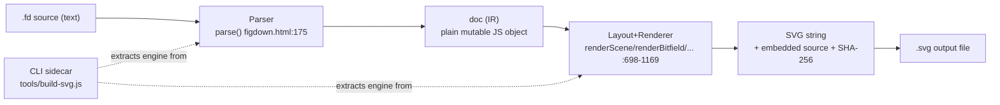
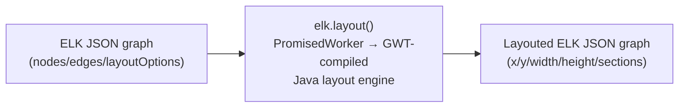
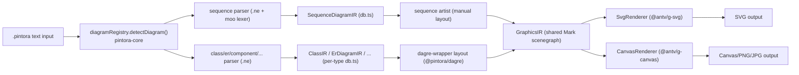
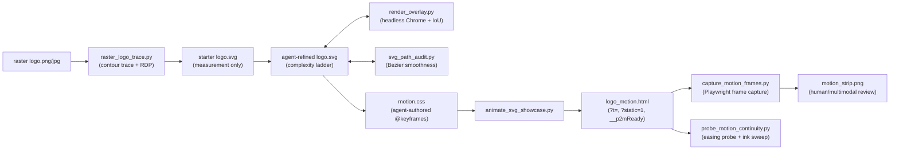

# Weekly scan — diagram-as-code & visual tooling (2026-07-11)

**Kỳ quét:** 2026-07-04 → 2026-07-11 · **Nguồn:** GitHub search API (topic + keyword fallback), không dùng `gh` CLI (không có quyền truy cập ngoài `kymostudio/kymostudio`) · **Repo đọc sâu:** 4/13 ứng viên tìm được (clone local, đọc source thực tế, không suy đoán).

## Executive summary

- **FigDown** (mới toanh, 1 commit) là ứng viên gần triết lý kymostudio nhất — "diagram-as-text, AI đọc text/người đọc SVG" — nhưng hiện là prototype 1 file HTML 2150 dòng, chưa có test/CI, layout chỉ DFS longest-path (không crossing-minimization). Đáng theo dõi ý tưởng, không đáng học kỹ thuật.
- **elkjs** xác nhận kymostudio đang đi đúng hướng: layered/Sugiyama layout tổng quát (ELK) giải bài toán khác hẳn (đồ thị tự do, tối ưu crossing) so với mô hình khai báo + anchoring hiện tại của `alignment.py` — không đáng nhúng, nhưng ELK JSON schema (node/edge/port/section) là tham khảo tốt nếu kymostudio cần thêm chế độ auto-layout cho đồ thị không có cấu trúc frame rõ ràng.
- **pintora** là sibling gần nhất để so sánh kiến trúc (per-diagram-type IR + registry plugin + dagre layout cho graph-type, layout thủ công cho sequence/gantt) — đáng **study deeper** phần grammar hình thức (nearley/moo) và chiến lược "layout theo họ diagram" thay vì một `alignment.py` chung; **pixel2motion** cho một kỹ thuật portable trực tiếp: seek-hook `?t=<ms>` + "Final Frame Contract" để test animation ở mốc thời gian xác định, mở rộng golden-SVG hiện có sang golden-frame động.

## Mục lục

1. [FigDown (FigDown/figdown)](#1-figdown-figdownfigdown)
2. [elkjs (kieler/elkjs)](#2-elkjs-kielerelkjs)
3. [Pintora (hikerpig/pintora)](#3-pintora-hikerpigpintora)
4. [pixel2motion (nolangz/pixel2motion)](#4-pixel2motion-nolangzpixel2motion)

**Ứng viên khác tìm được nhưng không đào sâu** (đủ tiêu chí sơ bộ nhưng ưu tiên thấp hơn 4 repo trên, giới hạn max 4/kỳ quét): `sidorov-as/c4-diagrams` (C4-as-code, 5 sao, quá nhỏ để đánh giá kiến trúc), `kazukifujiwara/network-topo-draft` (VSCode canvas editor cho network topology-as-code, 0 sao, quá mới), `DimonSmart/DbSketch` (SQL schema → DOT/Mermaid ER, .NET CLI, cross-format nhưng niche), `tt-a1i/archify` (AI-agent skill sinh architecture diagram HTML/SVG, giống pixel2motion về hình thái "agent skill" hơn là tool độc lập). `plantuml/plantuml` xuất hiện trong kết quả (push 2026-07-10) nhưng là commit định kỳ của dự án đã trưởng thành, không phải update đáng chú ý trong kỳ này.

---

## 1. FigDown (FigDown/figdown)

### §1 Quick context

FigDown là chuẩn mở "figures as text" — nhúng diagram dạng text `.fd` vào Markdown, render tất định sang SVG, để AI đọc text còn người đọc hình (khác Mermaid ở việc phủ network topology/bitfield/wave và cam kết "small edit → small layout change"). Tech stack: **một file HTML/JS thuần** (`editor/figdown.html`, ~2150 dòng, không framework, không build step) chứa cả parser lẫn renderer; Node.js chỉ dùng cho script CLI mỏng (`tools/build-svg.js`) trích engine ra từ file HTML lúc chạy. Không có `package.json`/`pyproject.toml`/`Cargo.toml` — không dependency, không package manager nào cả. Repo health: đúng như README tự nhận — "Requirements & design phase", "Nothing to install yet", lịch sử git chỉ có **1 commit**, pushed 2026-07-11 — cực kỳ mới, tiền phát hành, chưa có CI/test suite nào được tìm thấy. Phân phối: không có npm/PyPI/registry — chỉ `git clone`/copy file trực tiếp (`cp -r skill/figdown ~/.claude/skills/` cho agent-skill).

### §2 Architecture deep-dive

**A. Component inventory**
- `Parser` (`editor/figdown.html:111-677`, hàm `parse()`) — parser dòng-theo-dòng, tự viết tay, trả về `{doc, errs}`.
- `Layout+Renderer` (`editor/figdown.html:679-1169`) — `render()` điều phối chung (698), `renderScene()` cho block/topology/flowchart (750), `renderBitfield()` (976), `renderTable()` (1013), `renderPlot()` (1072), `renderWave()` (1121) — mỗi loại figure có emitter riêng, emit chuỗi SVG trực tiếp (string concat, không DOM/canvas trung gian).
- `UI + SVG export` (`editor/figdown.html:1170-1989`) — panel ví dụ, direct-manipulation (kéo-thả node ghi lại thành dòng `pin`), export SVG kèm `<metadata>` nhúng source + SHA-256.
- `CLI sidecar` (`tools/build-svg.js`, 64 dòng) — không phải engine độc lập: `readFileSync` chính `editor/figdown.html`, cắt chuỗi từ `"const SHAPES"` đến `"// 3. UI"` bằng `indexOf`, rồi `new Function(...)` để lấy `{parse, render}` — nguyên tắc "regenerate, don't fork" ghi rõ trong comment.
- `skill/figdown/` — bản sao mechanically-generated cho agent-skill, tạo bởi `tools/make-skill.js`.
- Không tìm thấy: test suite, CI config, LSP/syntax-highlighter riêng, package manifest.

**B. Pipeline (happy path, `X.fd → X.svg`)**
1. User viết/sửa `X.fd` (tay hoặc trong editor).
2. Chạy `node tools/build-svg.js X.fd` (hoặc gõ trực tiếp trong `editor/figdown.html`).
3. `build-svg.js` trích xuất engine từ `editor/figdown.html`.
4. `parse(text)` → `doc` (plain JS object) + mảng lỗi `errs`.
5. Nếu không lỗi: `render(doc)` chạy layout rồi emit chuỗi SVG.
6. SHA-256 của source được nhúng vào `<metadata>` cuối SVG, ghi ra `X.svg`.

**C. Data model/IR** — `doc` là plain JS object mutable (`nodes/edges/groups/blocks/ranks/pins...`), không có lớp IR trung gian tách biệt hay bước "compile xuống lower IR": parser tạo trực tiếp cấu trúc mà renderer tiêu thụ và còn mutate thêm field tính toán (`n.x`, `n.y`, `n.rank`) ngay trên bản sao node. Không immutability, không "resolve pass" tách biệt render như `alignment.py` của kymostudio.

**D. Input language design** — Hand-rolled tokenizer + state-machine parser theo dòng (`tokenize()`, `parseEdgeLine()` có scanner riêng cho nhãn `[label]` lồng nhau) — không regex-only, không PEG, không combinator library. Không có formal grammar file (không EBNF); `spec/syntax-draft.md` mô tả bằng văn xuôi, tự nhận "pre-standard sketch". Grammar đóng: dòng lạ → lỗi. Error reporting: `"Line N: <message>"`, gom vào `errs`, không recovery nâng cao.

**E. Layout algorithm** — Không có Sugiyama đầy đủ. Rank gán bằng **DFS longest-path layering** thủ công (`dfs()`, cycle-guard đơn giản), sau đó đảo ngược để nguồn có rank 0; positioning trong mỗi lane là căn giữa theo thứ tự khai báo — **không có crossing-minimization** (không median/barycenter). Edge routing: đường thẳng đơn giản giữa hai điểm biên hình học, không orthogonal, không tránh chồng lấp. "Pin" cho phép ghi đè tọa độ tuyệt đối, phần chưa pin vẫn auto-layout để giữ "layout stability".

**F. Rendering/output** — Một backend duy nhất: SVG string, không animation engine (README: "Static first; dynamic later"). Không pluggable-emitter — mỗi loại figure switch bằng `if/else` cứng trong `render()`.

**G. Extensibility** — Không plugin system. Thêm loại diagram = sửa trực tiếp `SHAPES` array + case trong `parse()` + hàm render mới — thiết kế có chủ đích ("small, closed, token-lean core"), đối lập triết lý renderer "dumb + pluggable emitters" của kymostudio.

**H. Dev experience** — CLI không cờ, output tối giản, không watch mode built-in. IDE integration: không xác định trong repo này (chỉ được *đề cập* như hướng tương lai). Browser preview: có — single-file editor, auto re-render on-input, direct-manipulation, Ctrl+S ghi ngược file, undo/redo, autosave.

### §3 Architecture diagram

### §4 Verdict

Đáng học: (1) attribute model rigid/flexible — thuộc tính khai báo tường minh (`pin`/`size`/`color`) cứng, phần còn lại tự điều chỉnh tối thiểu ("small edit → small layout change") — đáng đối chiếu với `alignment.py`'s auto-layout/anchoring về độ ổn định layout khi edit nhỏ; (2) SHA-256 + source nhúng trong `<metadata>` SVG — cơ chế nhẹ cho round-trip về source, đáng cân nhắc cho `to_svg.py`; (3) error message chuẩn `Line N: message` cho mọi lỗi — hỗ trợ tốt vòng lặp AI write→validate→fix, đáng audit xem `dsl.py` đã nhất quán chưa.

Red flags: kiến trúc 1 file HTML 2150 dòng chứa cả parser+renderer+UI, trích xuất CLI bằng cắt chuỗi `indexOf` — giòn, không type safety, không test/CI nào. Layout chỉ DFS longest-path + center alignment, kém xa yêu cầu production của kymostudio. Prototype ý tưởng-giai đoạn (1 commit), chưa phải competitor kỹ thuật. Câu hỏi mở: có kế hoạch tách engine khỏi HTML để test được không; "closed grammar" có mở rộng nổi cho diagram phức tạp hơn (BPMN-class) không.

**Verdict: glance only** (theo dõi ý tưởng axioms/error-format).

---

## 2. elkjs (kieler/elkjs)

### §1 Quick context

elkjs là một **layout engine thuần túy** (thuật toán bố trí đồ thị Sugiyama/layered + các thuật toán khác), không phải công cụ diagram-as-code — không có parser DSL, không render, chỉ nhận JSON đồ thị và trả về JSON đồ thị đã có tọa độ. Tech stack: lõi thuật toán viết bằng Java (dự án Eclipse ELK riêng), biên dịch sang JS qua **GWT**; wrapper JS thủ công rất mỏng (`src/js/*.js`, ~170 dòng). Build dùng Gradle + Babel + Browserify. Repo health: 2652 sao, phiên bản `0.12.0`, có CI (build hàng ngày + trên PR), publish tự động lên npm khi release. Distribution: npm (`elkjs`), dùng được cả Node.js (fake Web Worker) và trình duyệt (Web Worker thật).

### §2 Architecture deep-dive

**A. Component inventory**
- `src/js/main-api.js`, `main-node.js`, `elk-api.js` — toàn bộ code JS viết tay của repo (~200 dòng): class `ELK` (`layout()`, `knownLayoutAlgorithms()`...) và `PromisedWorker` bọc worker thành Promise API.
- `src/java/org/eclipse/elk/js/ElkJs.java` — entry point GWT (`onModuleLoad`), dispatcher xử lý `{cmd: 'layout'|'algorithms'|'options'|'categories'|'register'}`.
- `src/java-additional/.../JsonAdapter.xtend` — chuyển đổi JSON ↔ mô hình đồ thị nội bộ ELK.
- **Toàn bộ thuật toán bố trí thực tế** (layered/force/mrtree/radial/spore/rectpacking) **không nằm trong repo elkjs** — import từ repo `eclipse/elk` phải checkout cạnh elkjs lúc build. elkjs về đúng nghĩa là một lớp GWT-transpile mỏng bọc quanh code Java của dự án khác.
- Output build (`lib/elk-api.js`, `elk-worker.js`, `elk.bundled.js`) là generated code, không có sẵn trong git checkout.

**B. Pipeline (không có bước parse/render)**
1. User dựng đối tượng đồ thị JSON (`{id, children, edges, layoutOptions}`).
2. Gọi `elk.layout(graph, options)`.
3. `ELK.layout()` gửi message qua `PromisedWorker` tới worker (thật hoặc fake).
4. `ElkJs.layout()` (Java/GWT) dùng `JsonImporter` → `ElkNode`, áp `layoutOptions`, chạy thuật toán đã đăng ký (mặc định `layered`), export ngược lại JSON.
5. Kết quả JSON (node/edge giờ có `x/y/width/height`, `sections`) `postMessage` trả về, Promise resolve.

**C. Data model/IR** — **ELK Graph JSON**: `ElkNode {id, x?, y?, width?, height?, children?, ports?, edges?, labels?, layoutOptions?}`, `ElkExtendedEdge {sources, targets, sections?}`, `ElkEdgeSection {startPoint, endPoint, bendPoints?}`. Một object JSON bị mutate/mở rộng tại chỗ qua vòng đời layout — khác kymostudio (nhiều pass tách biệt: `dsl.py` → `Diagram` → `layout()` → `resolve_alignments()`); ELK xử lý nội bộ bằng model Java riêng rồi serialize lại 1 lần.

**D. Input language design** — N/A. Không có DSL văn bản; input là JSON object dựng bằng code (gọi API, không "viết file").

**E. Layout algorithm (trọng tâm)** — Mặc định `layered` (Sugiyama-style: cycle breaking → layer assignment → crossing minimization → node placement → edge routing; có `GreedyCycleBreaker`, `ReversedEdgeRestorer` xác nhận trong log mẫu). Các thuật toán khác đăng ký được: `stress`, `mrtree`, `radial`, `force`, `disco` (tạm tắt do lỗi CI), `sporeOverlap`, `sporeCompaction`, `rectpacking`, cộng `box`/`fixed`/`random`. Cấu hình qua `layoutOptions` namespace theo package Java (`elk.algorithm`, `elk.direction`, `elk.spacing.nodeNode`...), set global hoặc per-element. Chi tiết edge routing (orthogonal/polyline/spline) và crossing-minimization cụ thể (barycenter/median) nằm bên `eclipse/elk`, không vendor vào elkjs — **không xác định** từ repo này.

**F. Rendering/output** — **Không có.** README nói thẳng: "no rendering, styling, etc. is provided". Output chỉ là JSON đồ thị có toạ độ; downstream (sprotty, reactflow, netlistsvg, d3...) tự vẽ.

**G. Extensibility** — Gần như sealed từ phía JS. Không thể thêm thuật toán layout mới bằng JS thuần — phải sửa Java bên `eclipse/elk` rồi biên dịch lại qua GWT. Phía JS chỉ can thiệp ở tầng cấu hình (`layoutOptions`) và chọn algorithm theo id đã đăng ký.

**H. Dev experience** — API gọn (constructor + `layout()` trả Promise), `.d.ts` đầy đủ. Hỗ trợ Web Worker sẵn (Node lẫn browser), fallback fake-worker. README tự thừa nhận vấn đề chưa giải quyết: lỗi do GWT-transpile ("g is not defined"), khó tích hợp webpack/react, modularization kém.

### §3 Architecture diagram

Pipeline rất hẹp — chỉ 3 khối, không có bước parse (input đã là JSON có cấu trúc) và không có bước render (output vẫn là JSON, cần công cụ khác vẽ ra SVG/canvas).

### §4 Verdict

elkjs xác nhận rõ: layered/Sugiyama là engine layout **tổng quát**, giải bài toán khác hẳn `layout.py`/`alignment.py` của kymostudio — ELK tối ưu vị trí cho đồ thị bất kỳ (crossing minimization, cycle breaking), còn kymostudio dùng mô hình **khai báo + anchoring** (auto-layout frames, parent/child anchor, region auto-bounds, edge staggering) nơi tác giả `.kymo` kiểm soát trực tiếp bố cục — phù hợp triết lý "renderer dumb, data quyết định".

Bài học cụ thể: (1) format ELK JSON (node/edge/port/section) là tham khảo tốt cho IR trung gian nếu kymostudio muốn thêm chế độ "auto-layout đồ thị tự do" (BPMN phức tạp hoặc graph không có cấu trúc frame rõ ràng) — tính năng mới, không thay thế `alignment.py`. (2) Nhúng ELK (qua elkjs/wasm) kéo theo GWT-compiled blob khó debug, không hợp triết lý "hai impl Python/JS song song, tự viết" — vi phạm parity vì cần binding thứ 3 riêng. (3) Red flag: engine gần như sealed từ JS/Python — muốn tuỳ biến thuật toán phải sửa Java lõi, không hợp mã nguồn nhỏ dễ audit của kymostudio.

Câu hỏi mở: kymostudio có cần crossing-minimization thực sự (đồ thị dày đặc) hay auto-layout frame + edge staggering hiện tại đã đủ cho phần lớn use-case "diagram có cấu trúc" (flowchart, BPMN)?

**Verdict: glance only** — tham khảo ELK JSON schema và ý tưởng "layered algorithm as escape hatch", không đáng nhúng nguyên khối.

---

## 3. Pintora (hikerpig/pintora)

### §1 Quick context

Pintora là thư viện text-to-diagram nhiều loại sơ đồ (sequence/ER/class/component/activity/mindmap/gantt/DOT), lấy cảm hứng trực tiếp từ Mermaid.js và PlantUML, với kiến trúc plugin cho phép đăng ký thêm loại sơ đồ mới. Tech stack: TypeScript, pnpm workspace + Turborepo, nearley (PEG-like) parser generator + `moo` lexer, `@antv/g-svg`/`@antv/g-canvas` làm renderer scenegraph, `@pintora/dagre` (fork riêng) cho layout dạng đồ thị, Jest, Docusaurus cho docs. Repo health: 1284 sao, release gần nhất `0.8.1` (changesets), có CI (build + coverage + test-report + codecov); shallow clone nên không xác định chính xác số contributor lịch sử — dấu hiệu cho thấy có thể phần lớn do một tác giả chính duy trì. Distribution: monorepo đa gói npm scope `@pintora/*` (`core`, `diagrams`, `renderer`, `cli`, `standalone`...), gói cho end-user là `@pintora/standalone`.

### §2 Architecture deep-dive

**A. Component inventory**
- Grammar: `packages/pintora-diagrams/src/sequence/parser/sequenceDiagram.ne` (nearley, lexer `moo`), compile ra `parser.ts` qua script `gen-parser`.
- IR theo loại sơ đồ: `sequence/db.ts` (class `db`, export `SequenceDiagramIR`), IR nền `util/ir.ts` (`BaseDiagramIR`).
- Layout: thủ công trong `sequence/artist.ts` (tính `actorX` tuần tự); layout kiểu đồ thị (`@pintora/dagre`) qua `util/dagre-wrapper.ts`, dùng bởi class/er/component/activity/mindmap/dot.
- Renderer: `pintora-renderer/src/renderers/{SvgRenderer,CanvasRenderer,base}.ts`.
- Mỗi loại sơ đồ: bộ ba `parser.ts` + `db.ts` + `artist.ts` + `config.ts` + `index.ts` (đăng ký).

**B. Pipeline (trace qua sequence diagram, 6 bước)**
1. Input `.pintora` vào `parseAndDraw()` (`pintora-core/src/index.ts`).
2. `preprocessExtractor.parse()` tách block `@pre` (config), `diagramRegistry.detectDiagram(text)` match pattern (vd `/^\s*sequenceDiagram/`) để chọn implementation.
3. `diagram.parser.parse(text)` chạy nearley grammar compiled, `postProcess` gọi `db.apply(results)` build `SequenceDiagramIR`.
4. `diagram.artist.draw(diagramIR, config)` (~1500 dòng): tính vị trí actor/message/loop/note thủ công, trả `GraphicsIR` (cây `Mark`).
5. `parseAndDraw` trả `{diagramIR, graphicIR}`, phía gọi đưa `graphicIR` vào `makeRenderer(ir, 'svg'|'canvas')`.
6. `SvgRenderer`/`CanvasRenderer` (dùng `@antv/g-svg`/`@antv/g-canvas`) duyệt cây `Mark` vẽ ra SVG DOM hoặc canvas.

**C. Data model/IR** — Hai tầng: (1) `DiagramIR` theo từng loại sơ đồ (không chia sẻ giữa các loại ngoài `BaseDiagramIR` tối thiểu); (2) `GraphicsIR` — IR chung duy nhất (`Mark` scenegraph: Group/Rect/Circle/Text/Line/Path) mà mọi artist phải hội tụ về. `db.ts` stateful/mutable khi parse (`clear()` gọi trước mỗi lần parse mới) — không phải pure/immutable pass.

**D. Input language design** — Grammar hình thức thật sự: file `.ne` (nearley, PEG-like) + lexer `moo` (state machine, push/pop state cho block note nhiều dòng). Không phải hand-written recursive descent. Compile-time `.ne` → `.ts` qua script build riêng. Error reporting: không xác định mức độ chi tiết (không thấy custom error formatter rõ trong các file đã đọc).

**E. Layout algorithm** — Khác nhau theo loại sơ đồ: sequence/gantt dùng thuật toán tuần tự thủ công (accumulate `actorX`, đo text, không crossing vì lifeline tuyến tính); class/ER/component/activity/mindmap/DOT dùng `@pintora/dagre` (fork Dagre — layered/Sugiyama, crossing minimization tự nhiên của Dagre) qua `DagreWrapper` chung.

**F. Rendering/output** — Cả SVG và Canvas backend, cùng một `GraphicsIR`, khác biệt chỉ ở `Renderer` implementation (pluggable emitter thật: `rendererRegistry.register()`). Không tìm thấy animation support (grep "animat" không ra kết quả) — khác biệt lớn với kymostudio's `--animate`.

**G. Extensibility** — Cơ chế cụ thể: `diagramRegistry.registerDiagram(name, diagram: IDiagram)` (interface `pattern`, `parser`, `artist`, `configKey`, `clear()`). Có skill nội bộ chính thức `.ai/skills/add-new-diagram/SKILL.md` hướng dẫn từng bước: tạo `.ne` grammar → compile → viết `artist.ts` → viết `config.ts` → `registerDiagram()` → snapshot test → docs → verify trong live editor.

**H. Dev experience** — CLI Node (`yargs`, xuất SVG/PNG/JPG, render trong subprocess), live editor/playground (Vite dev), build cho edge runtime (Deno-compatible), types TypeScript đầy đủ. Không xác định watch-mode cho end-user (chỉ có ở cấp build nội bộ monorepo).

### §3 Architecture diagram

### §4 Verdict

Cơ chế extensibility của pintora (đăng ký `IDiagram` per-type qua `diagramRegistry`, mỗi loại có parser/db/artist/config riêng) mạnh hơn kymostudio ở chỗ mỗi diagram type có ngữ pháp và IR hoàn toàn độc lập, hội tụ về một `GraphicsIR` chung — đổi lại đánh mất tính "renderer dumb, data model thống nhất" mà kymostudio đang giữ (một `Diagram`/`Component`/`Region`/`Edge` cho mọi shape). Đáng học: (1) dùng grammar hình thức (`.ne`/nearley + `moo` lexer) thay vì hand-rolled parser thuần — error location/whitespace-handling tốt hơn; (2) tách layout theo "họ" sơ đồ — tuyến tính (sequence/gantt) vs. đồ thị phân lớp (dagre cho class/ER/activity) — kymostudio hiện dùng một `alignment.py` chung, đáng cân nhắc dagre-style cho các trường hợp graph phức tạp thay vì fan-in/trunk-lane staggering thủ công.

Red flag: `artist.ts` của sequence dài ~1500 dòng, logic layout+draw trộn lẫn (khác triết lý "renderer dumb"); không có animation support; contributor pool có vẻ mỏng. Câu hỏi mở: pintora có golden/conformance test giữa nhiều implementation không (không thấy multi-impl như kymostudio Python/JS).

**Verdict: study deeper** cho phần grammar-file + per-type layout algorithm selection, phần còn lại chỉ glance.

---

## 4. pixel2motion (nolangz/pixel2motion)

### §1 Quick context

Skill AI cho Claude/Codex biến logo raster thành SVG tối giản rồi thành animation CSS, kèm quy trình QA bằng Playwright. Tech stack: Python 3.10+ (Pillow, NumPy) cho vector tracing/QA; headless Chrome/Chromium cho render overlay; Playwright + Chromium cho motion QA; output là CSS `@keyframes` thuần, không framework JS. Repo health: 1597 sao, pushed 2026-07-10; trong bản clone cục bộ **không có** `.github/workflows` (không CI), **không có** git tag/release, **không có** `requirements.txt`/`pyproject.toml`/`package.json` (dependency chỉ ghi trong README dạng lệnh `pip install`). Distribution: **không phải** CLI/thư viện độc lập để cài đặt — là một **AI-agent skill** (`SKILL.md` + `agents/openai.yaml`) được Claude/Codex đọc và làm theo từng bước, gọi các script Python/Node rời rạc trong `scripts/` như công cụ hỗ trợ, không có entrypoint "build" duy nhất.

### §2 Architecture deep-dive

**A. Component inventory** — `scripts/raster_logo_trace.py` (vector tracer contour-marching tự viết + RDP simplify); `scripts/render_overlay.py` (render SVG qua headless Chrome, tính IoU, tạo overlay QA); `scripts/svg_path_audit.py` (audit độ mượt Bezier — phát hiện tangent-jump/kink); `scripts/fit_ribbon_centerline.py`; `scripts/overlay_progress_strip.py`; `scripts/animate_svg_showcase.py` ("CSS choreographer" + HTML demo generator — parse SVG thành JSON node tree, tái tạo DOM bằng JS, nhúng `motion.css`, thêm replay/slow-mo/speed control + QA hook); `scripts/animate_svg_html.py` (fallback tối giản); `scripts/capture_motion_frames.py` và `scripts/probe_motion_continuity.py` (2 harness Playwright QA); `scripts/svg_to_js_html.py`, `scripts/export_claude_videos.mjs`. Không có script "semantic ID assigner" — ID (`#mark`, `#wordmark`, `#dot`...) do agent LLM tự gán tay theo quy ước trong `SKILL.md`, không phải công cụ tự động.

**B. Pipeline** — (1) agent phân tích raster, viết `motion_spec.md` (personality, part inventory); (2) `raster_logo_trace.py` tạo SVG "measurement" thô (loop đa giác thẳng, không Bezier); (3) agent tinh chỉnh geometry theo "complexity ladder" (primitive → curve → trace), lặp tối đa 10 vòng, mỗi vòng gọi `render_overlay.py` (IoU + overlay cyan) và `svg_path_audit.py`; (4) chốt `logo.svg` với ID ngữ nghĩa ổn định + `pathLength="1"` cho draw-on; (5) agent viết tay `motion.css` (`@keyframes`, custom property, easing literal); (6) `animate_svg_showcase.py` đóng gói thành `logo_motion.html`; (7) `capture_motion_frames.py` + `probe_motion_continuity.py` (Playwright) chụp frame xác định, kiểm easing/continuity; (8) agent xem strip bằng multimodal vision để chốt đạt yêu cầu.

**C. Data model/IR** — Không có IR hình thức/schema. IR thực chất là chính DOM SVG (`logo.svg`, mutable — agent sửa tay trực tiếp), cộng "IR" thứ hai là `motion.css` (CSS thuần, không compile). `motion_spec.md` là IR bán cấu trúc dạng Markdown, không có script nào parse/validate nó khớp với CSS thật.

**D. Input language design** — Không có config YAML/JSON cho choreography. "Ngôn ngữ" là quy ước prose trong `SKILL.md` + `references/*.md` (naming ID, CSS custom-property token `--p2m-duration`/`--p2m-ease-*`, easing phải literal trong `@keyframes`). Tuân thủ dựa vào agent tự kiểm, không grammar máy kiểm — khác hẳn DSL EBNF chính quy của kymostudio.

**E. Spatial fidelity** — `raster_logo_trace.py` tự viết thuật toán kiểu marching-squares (duyệt biên pixel-by-pixel, đóng loop) + RDP simplify; chỉ sinh cạnh thẳng (M/L/Z), không tự fit Bezier — làm mượt sang cong do agent làm tay ở Phase 2. Fidelity đo bằng IoU/precision/recall pixel-mask nhưng không có ngưỡng cố định — gate thực sự là kiểm tra thị giác (overlay + zoom).

**F. Rendering/output (mấu chốt)** — Cơ chế animation = **CSS `@keyframes` thuần + CSS custom properties**, target ID ngữ nghĩa, bọc trong `@media (prefers-reduced-motion: no-preference)` (xác nhận trong `docs/index.html`, ví dụ `#horizon-line`, `#sun`, `#ripple-1..3` với `cubic-bezier(...)` literal). Không SMIL; JS chỉ dùng cho micro-interaction phụ và dựng DOM SVG từ JSON. QA Playwright dựa trên hook `?t=<ms>` (pause + seek toàn bộ Web Animations, tránh race đồng hồ thực) — kỹ thuật cốt lõi. `capture_motion_frames.py` chụp frame ở mốc thời gian cố định, ghép film-strip cho **con người/multimodal xem bằng mắt** (không tự động diff frame-to-frame), cộng một check số học tự động: diff pixel frame cuối vs `final_render.png` tĩnh ("Final Frame Contract", mang tính advisory). `probe_motion_continuity.py` thêm 2 probe số: (a) đọc `getComputedStyle` bắt lỗi Chromium âm thầm rớt easing về linear khi dùng `var()` trong `@keyframes` (bug thật, có tài liệu); (b) "ink-delta sweep" đếm pixel tối theo frame để phát hiện pattern "flatline rồi jump". Không có baseline lưu trong git để so sánh hồi quy. Backend duy nhất: Playwright + Chromium, không pluggable.

**G. Extensibility** — Không hệ plugin. Thêm animation style mới = thêm pattern văn xuôi + khung CSS vào `references/reveal-patterns.md`, để agent tự chọn.

**H. Dev experience** — Script argparse rõ ràng, thông báo lỗi tốt. Không watch mode, không lệnh build duy nhất — 7 bước thủ công do agent LLM điều phối. Không deterministic về hạ tầng: mỗi lần chạy đều cần Chrome/Chromium thật (render geometry) và Playwright + Chromium thật (motion QA), không cache; không manifest dependency, không test suite cho chính scripts, không CI.

### §3 Architecture diagram

### §4 Verdict

Đáng học nhất: cơ chế QA **seek** — hook `?t=<ms>` pause + seek toàn bộ `getAnimations()` cộng cờ `window.__p2mReady`, giúp Playwright chụp frame xác định (không đua wall-clock). kymostudio's `--animate` có thể thêm hook tương tự để test golden-frame ở mốc thời gian cố định, mở rộng golden-SVG byte-for-byte hiện có sang trạng thái động mà không cần video diff. Ý tưởng "Final Frame Contract" (frame cuối ≡ SVG tĩnh đã verify) cũng portable trực tiếp. Easing-computed-style probe cảnh báo một bug Chromium thật (`var()` trong `@keyframes` rớt về linear) — đáng kiểm tra nếu kymostudio dùng token CSS variable trong keyframes.

Red flags: không CI, không dependency manifest, QA phụ thuộc hoàn toàn vào Chrome/Chromium thật mỗi lần chạy (không hermetic), phần "kiểm tra" cốt lõi là con người/LLM xem ảnh bằng mắt chứ không assert trong code — không phải test suite theo nghĩa kymostudio đang có.

**Verdict: glance only** — mượn ý tưởng seek-hook + Final Frame Contract, không nên coi đây là công cụ/thư viện để phụ thuộc.
