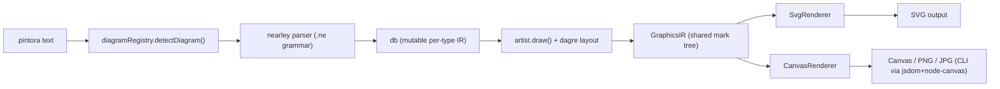
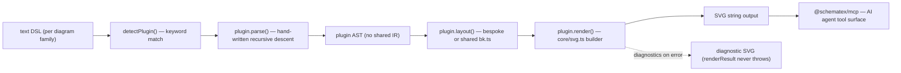
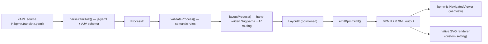

```mermaid
flowchart LR
  A["input graph JSON (ElkNode/ElkEdge, hierarchical)"] --> B["JsonImporter — parse to in-memory ElkNode"]
  B --> C["LayoutConfigurator — apply layoutOptions"]
  C --> D["cycle breaking (GreedyCycleBreaker)"]
  D --> E["layering (NETWORK_SIMPLEX)"]
  E --> F["crossing minimization (LAYER_SWEEP)"]
  F --> G["node placement (BRANDES_KOEPF)"]
  G --> H["edge routing (ORTHOGONAL / POLYLINE / SPLINES)"]
  H --> I["transferLayout() — write x/y/bendPoints back to JSON"]
  I --> J["output graph JSON (positioned)"]
  J -.consumed by.-> K["downstream renderer (sprotty, reactflow, ...)"]
```

# Weekly Scan: Diagram Tooling — 2026-07-12

**Executive summary:**
- Tuần này topic search (`diagram-as-code`, `svg-animation`, `graph-visualization`, `layout-algorithm`, `dsl`) trả về phần lớn noise (AI-agent-skill repo, GitHub-profile SVG generator, portfolio) — 4 repo dưới đây được chọn vì có kiến trúc thật đáng học, không phải vì "mới ra mắt tuần này" theo nghĩa hype.
- Đáng chú ý nhất cho kymostudio: **SchemaTex** có shape gần giống kymo nhất (zero-dep, nhiều diagram type, pure-SVG SSR) nhưng chọn "50 plugin độc lập, không IR chung" — đối lập trực tiếp với `model.py` dùng chung của kymo; và **elkjs** là bằng chứng sống, production-grade của đúng pipeline 5-phase Sugiyama mà `alignment.py` đang làm một phần.
- Phát hiện bất ngờ nhất: **transitrix-studio** vẫn khai báo `elkjs` trong `package.json` nhưng đã âm thầm gỡ nó khỏi pipeline thật từ v2.9.0 (theo CHANGELOG), thay bằng Sugiyama + A* tự viết cho routing theo BPMN lane — dữ liệu thực chiến cho câu hỏi "khi nào nên tự viết layout thay vì dùng ELK".

**Mục lục:**
1. [hikerpig/pintora](#1-hikerpigpintora)
2. [SchemaTex/SchemaTex](#2-schematexschematex)
3. [transitrix/transitrix-studio](#3-transitrixtransitrix-studio)
4. [kieler/elkjs](#4-kielerelkjs)

---

## 1. hikerpig/pintora

### §1 Quick context
Thư viện JS text-to-diagram lấy cảm hứng từ Mermaid/PlantUML, nhưng renderer pluggable (SVG/Canvas) và mỗi diagram type có parser + layout + artist riêng. Tech stack: TypeScript, pnpm/turborepo monorepo, parser sinh từ grammar `nearley` (Earley parser) + lexer `moo`, layout hierarchical qua fork riêng `@pintora/dagre`; output SVG/Canvas trong browser, PNG/JPG qua CLI (jsdom + node-canvas). 1.284 sao, push gần nhất 2026-07-08, tag mới nhất `v0.8.2`, CI đầy đủ (prettier, `turbo run compile`, jest + coverage, Percy visual-regression, bundle-size report). Phân phối: npm (`pintora`, `@pintora/*`), CLI bin `pintora`.

### §2 Architecture deep-dive
**A. Component inventory** — `packages/pintora-core` (`diagram-registry.ts` đăng ký diagram theo regex `pattern`, `config-engine.ts`, `themes/`); `packages/pintora-diagrams/src/<type>/{parser.ts,db.ts,artist.ts}` × 8 loại (sequence, class, component, activity, mindmap, gantt, dot, er); `packages/pintora-diagrams/src/util/dagre-wrapper.ts` dùng chung cho các diagram dạng graph; `packages/pintora-renderer/src/renderers/{SvgRenderer,CanvasRenderer}.ts`; `packages/pintora-cli` (yargs + jsdom).

**B. Pipeline** — 1) `preprocessExtractor` bóc block config `%%{...}%%`; 2) `diagramRegistry.detectDiagram()` match `pattern` regex, mặc định fallback sequence; 3) `parser.parse()` (nearley) → `db.apply()` build IR mutable của diagram đó; 4) `artist.draw()` chạy dagre/layout riêng, sinh `GraphicsIR` (mark tree chung); 5) `render()` chọn `SvgRenderer`/`CanvasRenderer` từ `rendererRegistry`, vẽ mark tree; 6) CLI patch `window`/`document` qua jsdom rồi serialize ra SVG/PNG/JPG.

**C. Data model/IR** — Không có IR đỉnh chung: mỗi type extend `BaseDiagramIR` tối giản rồi hoàn toàn khác nhau (`ActivityDiagramIR`, `SequenceDB`...), build qua singleton `db` mutable tích lũy qua callback của grammar. Nhưng có một "lower IR" thật sự dùng chung — `GraphicsIR` (mark tree rect/text/path/group) mà mọi artist hội tụ về và mọi renderer tiêu thụ; đây gần với khái niệm TALA của D2 (compile diagram-specific model xuống một graphics IR trung lập trước khi render).

**D. Input language design** — Grammar `.ne` (nearley) viết tay riêng cho từng diagram type, biên dịch qua script `build-grammar.js`; có sub-grammar dùng chung (`bind`, `comment`, `config`, `style`, `whitespace`). Không có formatter lỗi cú pháp thân thiện — lỗi parse nearley ném thẳng ra `onError` callback (mặc định `console.warn`).

**E. Layout** — Không có force-directed. Diagram dạng graph (activity/class/component/er/dot/mindmap) dùng `DagreWrapper` (Sugiyama-style, crossing minimization có sẵn của dagre). Sequence diagram layout bespoke tay (lifeline trái→phải, message xếp trên→dưới). Gantt dùng `d3-scale` time axis, không phải graph layout.

**F. Rendering** — Renderer registry pluggable, built-in `svg`/`canvas`, consumer có thể `rendererRegistry.register()` thêm backend. Không có animation.

**G. Extensibility** — Đơn vị plugin là interface `IDiagram` (`{pattern, parser, artist, clear()}`), đăng ký qua `diagramRegistry.registerDiagram()`. Theme cũng là registry riêng (`themeRegistry`), theme mới = object cùng shape.

**H. Dev experience** — CLI yargs với flags `-i/-o/-p/--theme/--width`, không có watch mode. Có live editor browser (`demo/live-editor`), nhưng không có VS Code extension trong chính repo này.

### §3 Architecture diagram

### §4 Verdict
Đáng học nhất: khái niệm `GraphicsIR` — một "lower IR" graphics-primitive trung lập giữa layout-per-type và renderer-per-backend, giúp thêm renderer mới (Canvas) mà không đụng logic layout. kymo hiện `to_svg.py`/`to_figma.py`/`to_excalidraw.py` render trực tiếp từ `Diagram` model — tách một graphics-IR mỏng có thể giảm trùng lặp giữa các emitter. Red flag: lỗi parse không có message thân thiện, error reporting kém hơn hẳn philosophy "declarative, không validate khi parse" của `dsl.py`. Câu hỏi mở: dagre fork riêng (`@pintora/dagre`) sửa gì so với dagre gốc — không xác định từ evidence hiện có. **Verdict: study deeper** (riêng phần GraphicsIR + renderer-registry pattern).

---

## 2. SchemaTex/SchemaTex

### §1 Quick context
Rendering engine TypeScript zero-runtime-dependency sinh 50 loại diagram chuẩn ngành (genogram, ladder logic, BPMN, UML, PERT/CPM, network topology...) từ DSL dạng text riêng cho từng loại — khác kymo/Mermaid ở chỗ mỗi diagram family có grammar, layout, renderer hoàn toàn độc lập thay vì một DSL chung. Tech stack: TypeScript strict, 0 runtime deps, build bằng `tsup`, output SVG string thuần (SSR-safe), có `@schematex/mcp` (MCP server) làm entry AI-agent riêng. 46 sao, push 2026-07-10, có website Next.js làm docs/gallery, không thấy thông tin CI rõ ràng trong evidence thu thập được. Phân phối: npm (`schematex`, export subpath theo từng diagram type để tree-shake), `@schematex/mcp` riêng.

### §2 Architecture deep-dive
**A. Component inventory** — Core dùng chung tối thiểu ở `src/core/`: `api.ts` (mảng plugin hardcode + orchestration), `types.ts` (interface `DiagramPlugin`, 2335 dòng), `svg.ts` (SVG string builder, không DOM), `theme.ts` (design token 2 lớp), `diagnostics.ts` (error model có cấu trúc), `layered/bk.ts` (Brandes-Köpf layout module dùng lại được). 50 thư mục `src/diagrams/<type>/{index.ts,parser.ts,layout.ts?,renderer.ts}` độc lập hoàn toàn, không qua registry runtime mà qua npm `exports` subpath để tree-shake tĩnh.

**B. Pipeline** — 1) `preprocess()` bóc code-fence/frontmatter/comment; 2) `detectPlugin()` match `config.type` hoặc gọi `plugin.detect(text)` từng plugin trong mảng hardcode; 3) `normalizeHeader()`/`recoverHeader()` "tha thứ" header viết tắt/thiếu — thiết kế rõ ràng cho LLM-generated input; 4) `plugin.parse()` → AST riêng của plugin; 5) `layout()` nội bộ plugin tính geometry; 6) `plugin.render()` → SVG string (gọi lại parse+layout+render nội bộ, không tái dùng AST bước 4). `renderResult()` không bao giờ throw — lỗi trả về một SVG chẩn đoán (diagnostic SVG) thay vì crash.

**C. Data model/IR** — Không có IR chung: `DiagramPlugin` chỉ ràng buộc `{type, detect, render}`, AST là `unknown` từ góc nhìn core. Đây là đối lập gần như hoàn toàn với triết lý `model.py` của kymo (dataclass `Component/Region/Edge/Diagram` dùng chung cho mọi renderer).

**D. Input language design** — Không một DSL chung; mỗi family tự detect qua keyword dòng đầu, parser viết tay "hand-written recursive descent, no parser generators, no dependencies" (trích `CONTRIBUTING-NEW-DIAGRAM.md`). Mỗi grammar có **doc chuẩn hóa riêng, đánh số** (`docs/reference/01-GENOGRAM-STANDARD.md` … `52-SITEPLAN-STANDARD.md`) — tương đương `docs/DSL.md` của kymo nhưng chia nhỏ per-diagram-type thay vì một file EBNF chung. Error reporting là điểm mạnh nhất: `SchematexDiagnostic{severity, code, message, line, column, hint, fatal}` có cấu trúc, cộng `dsl-suggest.ts` — gợi ý "did you mean" bằng Levenshtein distance cho từ khóa sai; comment trong code nói thẳng lý do là "LLMs routinely..." generate sai cú pháp.

**E. Layout** — Hoàn toàn per-plugin: genogram dùng generation-tree assignment riêng; ladder logic dùng hằng số hình học cố định (rail/rung); flowchart là plugin duy nhất dùng lại `layered/bk.ts` (Brandes-Köpf) dùng chung — routing cạnh flowchart chỉ là Manhattan polyline đơn giản, comment tự ghi nhận "M1, chờ A*/orthogonal trong tương lai".

**F. Rendering** — SVG string builder thuần (`core/svg.ts`), không DOM, SSR-safe. Accessibility bắt buộc: mọi renderer emit `<title>/<desc>` + `role="img"`. Theming qua CSS class + CSS custom properties (`--schematex-*`), không inline style. Export PNG/PDF chỉ chạy được trong browser (Canvas), Node phải tự dùng `sharp`/`puppeteer` bên ngoài — khác kymo (dùng `kymostudio-core`/resvg làm sole runtime dep để PNG hoạt động cả server-side).

**G. Extensibility** — Có tài liệu contract rõ ràng nhất trong 4 repo tuần này: `CONTRIBUTING-NEW-DIAGRAM.md` mô tả pipeline "Text → Parser → AST → Layout → LayoutResult → Renderer → SVG" và template file tối giản cho plugin mới. Nhưng đăng ký plugin vẫn phải sửa tay mảng `plugins[]` trong `api.ts` — không có dynamic registration API thật.

**H. Dev experience** — Không có CLI độc lập; thay vào đó `@schematex/mcp` là cổng chính cho AI agent (tool discover/syntax/example/validate/render qua MCP). Có `<SchematexDiagram>` React component fallback về diagnostic SVG khi lỗi. Website Next.js làm gallery/docs, script `generate-gallery-svgs.mjs` sinh preview tĩnh.

### §3 Architecture diagram

### §4 Verdict
Đáng học nhất cho kymo: hệ thống diagnostic có cấu trúc (`SchematexDiagnostic` + line/column + Levenshtein "did you mean") — kymo's `dsl.py` hiện "parsing thuần declarative, không validate" theo CLAUDE.md, nghĩa là lỗi cú pháp DSL của kymo gần như chắc chắn kém thân thiện hơn. Đáng cân nhắc thứ hai: `renderResult()` never-throws + trả diagnostic SVG — hữu ích cho playground/editor.kymo.studio khi user gõ sai giữa chừng. Red flag: 50 plugin không IR chung nghĩa là bug/feature phải sửa lặp lại N lần (đối lập triết lý "renderer dumb" của kymo) — đánh đổi lấy tree-shaking triệt để mà kymo (2 gói, không cùng mức granularity) chưa cần. Câu hỏi mở: không xác định được liệu 50 grammar riêng có thực sự tránh được trùng lặp logic hay chỉ đang copy-paste ngầm giữa các `parser.ts`. **Verdict: study deeper**, đặc biệt phần diagnostics/error-UX.

---

## 3. transitrix/transitrix-studio

### §1 Quick context
VS Code + IntelliJ extension và CLI biên dịch YAML text-first (BPMN, Goals, DGCA...) sang BPMN 2.0 XML — khác kymo ở chỗ output chuẩn là BPMN XML (không phải SVG animation) và có 2 preview renderer song song (bpmn.io hoặc native SVG). Tech stack: TypeScript, `js-yaml` + AJV schema validation, `xmlbuilder2` cho emit XML, layout tự viết (không dùng ELK dù còn khai trong `package.json`). 3 sao, push 2026-07-11, tag mới nhất `v3.0.5`, có CHANGELOG chi tiết theo version. Phân phối: VS Code Marketplace extension, IntelliJ plugin (Gradle), npm CLI `@transitrix/cli`.

### §2 Architecture deep-dive
**A. Component inventory** — `src/parser.ts` (`parseYamlToIr`, validate qua AJV + `schemas/bpmn-dsl.schema.json`); `src/ir.ts` (`ProcessIr`/`FlowElement` trước layout, `LayoutIr`/`PositionedFlowElement` sau layout); `src/validator.ts` (1134 dòng semantic rule); `src/layout.ts` + `layout-placement.ts` + `layout-routing.ts` (layout engine tự viết); `src/emitter.ts` (emit BPMN XML); `extension/src/extension.ts` (637 dòng, activate host); `extension/webview/viewer.ts` (bpmn-js `NavigatedViewer`); `extension/src/process-preview.ts` (renderer SVG native thay thế, chọn qua setting `transitrix.bpmnRenderer`); `intellij/` (Gradle, JCEF webview, chỉ preview read-only).

**B. Pipeline** — 1) User save file `*.bpmn.transitrix.yaml`, `onDidSaveTextDocument` trigger (chỉ trigger khi save, không live-per-keystroke); 2) `parseYamlToIr()` — `js-yaml` load → AJV validate → build `ProcessIr`; 3) `validateProcess()` chạy rule semantic → `ValidationReport`; 4) `layoutProcess()` tính vị trí (Sugiyama placement tự viết + A* routing) → `LayoutIr`; 5) `emitBpmnXml()` serialize BPMN 2.0 XML kèm DI geometry; 6) webview nhận XML, render qua `bpmn-js` (mặc định) hoặc SVG renderer native (`custom` setting); panel diagnostic hiện lỗi theo `elementId`, không có số dòng YAML.

**C. Data model/IR** — `ProcessIr`/`LayoutIr` là model tự viết hoàn toàn, **không phải** ELK graph JSON dù tên option (`elk.spacing.nodeNode`...) vẫn mô phỏng naming của ELK.

**D. Input language design** — YAML ràng buộc bởi JSON Schema (AJV `strict:false, allErrors:true`), lỗi format dạng `instancePath message`, không map ngược về dòng YAML gốc — yếu hơn hẳn error UX của SchemaTex. Thêm notation mới = module riêng dưới `packages/diagrams/src/<notation>/` + file-suffix ngôn ngữ riêng (`.goals.transitrix.yaml`), không mở rộng chung schema BPMN.

**E. Layout — phát hiện quan trọng nhất repo này**: `elkjs` vẫn còn trong `dependencies` của `package.json` và naming option vẫn bắt chước ELK, nhưng **không file nào import `elkjs`** trong toàn repo. CHANGELOG v2.9.0 (2026-07-03) ghi rõ: *"`elkjs` is no longer used by the BPMN layout path"*, thay bằng pipeline tự viết "lane-aware Sugiyama placement + channel-routed orthogonal A*" (`layout-placement.ts`: cycle-breaking, barycenter ordering, PAVA Y-assignment; `layout-routing.ts`: sparse-grid A* với penalty cho bend/congestion/crossing, có track nudging) — lý do nhiều khả năng là cần kiểm soát chặt semantics BPMN lane/pool mà một layout-agnostic library như ELK không biết về.

**F. Rendering** — BPMN XML là output chính; preview có 2 đường độc lập (bpmn.io hoặc SVG native `@transitrix/diagrams/webview/render-process.js`). Lệnh "export SVG" qua đường bpmn.io thực ra là **stub chưa cài** (`notYet('SVG')` trong `extension.ts`). Không có animation.

**G. Extensibility** — Không có plugin system: mỗi notation là module hardcode, đăng ký tay vào `extension.ts` + `extension/package.json`, theo checklist thủ công trong `docs/repo-layout.md`.

**H. Dev experience** — Preview chỉ trigger khi save (không live), 59 command đăng ký, nhưng **không có** diagnostics collection hay completion provider (`grep DiagnosticCollection`/`CompletionItemProvider` rỗng), cũng không có syntax-highlighting grammar cho YAML (`language-configuration.json` chỉ có bracket/comment config). CLI có `compile/validate/migrate/serve`, **không có watch mode**. IntelliJ plugin chỉ preview read-only, phạm vi notation hẹp hơn VS Code — README của 2 phần (root vs extension) còn mâu thuẫn số lượng notation ("13" vs "17").

### §3 Architecture diagram

### §4 Verdict
Đáng học nhất cho kymo: bằng chứng thực chiến rằng khi layout cần hiểu domain semantics sâu (BPMN lane/pool exit-side conventions), team này đã **bỏ ELK để tự viết** Sugiyama+A* riêng — một data point trực tiếp cho câu hỏi kymo có nên tích hợp ELK cho `alignment.py` hay tiếp tục tự viết (hiện kymo cũng tự viết 5-pass resolver). Red flag lớn: dependency stale (`elkjs` khai nhưng không dùng) — nhắc kymo tự kiểm tra định kỳ dependency thật-dùng vs khai-báo. Red flag thứ hai: error reporting không map về dòng YAML gốc, và feature "export SVG" là stub — dấu hiệu docs/marketing đi trước implementation. Câu hỏi mở: lý do cụ thể bỏ ELK (perf? độ chính xác lane routing? độ phức tạp tích hợp GWT-worker?) không xác định được từ CHANGELOG. **Verdict: study deeper** riêng phần layout-removal rationale; phần còn lại glance only.

---

## 4. kieler/elkjs

### §1 Quick context
Binding JS/WASM của Eclipse Layout Kernel (ELK) — không phải công cụ diagram-as-code đầy đủ (không parser text, không renderer), mà là **layout algorithm library thuần túy**: nhận graph JSON, trả về graph JSON đã có tọa độ. Tech stack: JS wrapper (`src/js/*.js`) bọc quanh engine layout thật được biên dịch từ Java (Eclipse ELK core) qua GWT — không phải hand-written JS. 2.654 sao, push 2026-07-08, version `0.12.0`, có CI, test mocha, playground ngoài ("elklive"). Phân phối: npm (`elkjs`), dùng làm dependency bởi nhiều tool khác (sprotty, reactflow, reaflow, netlistsvg, cytoscape.js-elk).

### §2 Architecture deep-dive
**A. Component inventory** — `src/js/elk-api.js` (class `ELK`, method `layout()`, quản lý danh sách algorithm đăng ký); `src/js/main-node.js` (`ELKNode extends ELK`, chọn Web Worker thật, polyfill `web-worker`, hoặc "fake worker" đồng bộ tùy môi trường); `lib/elk-worker.js`/`elk-worker.min.js` — **build artifact**, không phải source thủ công, sinh từ `src/java/org/eclipse/elk/js/ElkJs.java` qua GWT (`build.gradle`, task `gwtc`), biên dịch code Java thật của Eclipse ELK core (`org.eclipse.elk.alg.layered`, `.alg.force`, `.alg.mrtree`, `.alg.radial`, `.alg.rectpacking`...); `typings/*.d.ts` định nghĩa đầy đủ model `ElkNode/ElkEdge/ElkPort/ElkLabel`.

**B. Pipeline (control flow của lần gọi layout)** — 1) `new ELK({algorithms, workerUrl, defaultLayoutOptions})` khởi tạo worker và gửi lệnh `register`; 2) `elk.layout(graphJson, {layoutOptions})` gửi lệnh `layout`; 3) worker-side `JsonImporter().transform(graph)` parse JSON vào object `ElkNode` in-memory; 4) `LayoutConfigurator` áp `layoutOptions` (resolve theo suffix qua `LayoutMetaDataService`); 5) `RecursiveGraphLayoutEngine().layout()` chạy thuật toán thật (đệ quy cho compound node lồng nhau); 6) `transferLayout()` ghi ngược `x/y/width/height/bendpoints` vào chính object JSON gốc; 7) Promise resolve với graph đã có tọa độ.

**C. Data model** — "ELK graph JSON format" chuẩn (cùng schema Eclipse ELK core `graphdatastructure/jsonformat.html`), hierarchical qua `children` lồng nhau (compound node), route cạnh biểu diễn bằng `sections: ElkEdgeSection[]` với `startPoint/endPoint/bendPoints[]` — đúng dạng multi-segment polyline mà `alignment.py` của kymo cũng cần cho fan-in/trunk-lane edge staggering.

**D. Input language design** — Không áp dụng (không có text DSL, chỉ JSON-in/JSON-out).

**E. Layout algorithm (phần giá trị nhất)** — Hỗ trợ nhiều thuật toán: `layered` (mặc định, Sugiyama-style), `stress`, `mrtree`, `radial`, `force`, `disco`, `sporeOverlap/sporeCompaction`, `rectpacking`. Thuật toán `layered` có đúng 5 phase kinh điển: (1) **cycle breaking** — mặc định `GREEDY`; (2) **layering/ranking** — mặc định `NETWORK_SIMPLEX`; (3) **crossing minimization** — mặc định `LAYER_SWEEP` (họ heuristic barycenter/median theo layer-sweep) cộng post-pass `GREEDY_SWITCH` hai chiều; (4) **node placement** — mặc định `BRANDES_KOEPF` (cùng thuật toán mà SchemaTex tự triển khai lại ở `core/layered/bk.ts`); (5) **edge routing** — 3 style chọn được: `ORTHOGONAL` (mặc định), `POLYLINE`, `SPLINES`. Đây gần như là "sách giáo khoa sống" của đúng những gì `alignment.py` đang làm thủ công qua 5-pass resolver riêng.

**F. Rendering** — Không áp dụng, chỉ trả tọa độ. README liệt kê hệ sinh thái consumer tự render: sprotty, reaflow, reactflow, netlistsvg, d3-hwschematic, cytoscape.js-elk, Vega Editor.

**G. Extensibility** — Cấu hình qua flat property system `layoutOptions: {key: value}` gắn vào bất kỳ element nào của graph (`elk.algorithm`, `elk.direction`, `elk.spacing.nodeNode`...), resolve qua suffix-match. Không có cách thêm thuật toán custom phía client — muốn thêm phải rebuild `elk-worker.js` từ Java source (hardcoded switch trong `ElkJs.registerLayoutAlgorithms`).

**H. Dev experience** — API Promise-based, 3 chế độ concurrency (sync fake-worker mặc định Node, Web Worker thật, hoặc `web-worker` polyfill); TypeScript defs đầy đủ; playground ngoài "elklive" (dựa trên sprotty) + môi trường Gitpod one-click.

### §3 Architecture diagram

### §4 Verdict
Đáng học nhất: elkjs là reference implementation rõ ràng nhất tuần này cho đúng bài toán `alignment.py` đang giải bằng tay — đặc biệt `BRANDES_KOEPF` node placement (đã có sẵn cả ở SchemaTex lẫn ELK, đáng để kymo xem xét thay vì tự nghĩ heuristic mới) và 3 style edge-routing (`ORTHOGONAL/POLYLINE/SPLINES`) làm option tường minh thay vì cố định một kiểu. Layout-options-as-flat-property-map (gắn theo suffix, không cần schema cứng per-node) cũng là pattern gọn hơn cách kymo cấu hình layout hiện tại. Red flag: engine thật là Java biên dịch qua GWT — không tái dùng logic được ở Python side, và pipeline build cần checkout riêng `eclipse/elk` core, tăng chi phí vendor nếu định fork. Câu hỏi mở: transitrix-studio (repo #3) đã thử dùng elkjs rồi bỏ — chưa rõ nguyên nhân kỹ thuật cụ thể, đáng đọc thêm Eclipse ELK reference docs (không vendor trong repo này) trước khi quyết định có đáng tích hợp. **Verdict: study deeper**, tập trung vào tài liệu thuật toán 5-phase và Brandes-Köpf, không cần vendor code JS/Java thật.
