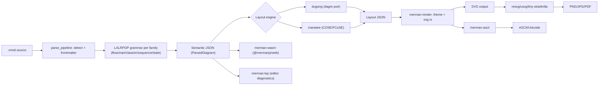
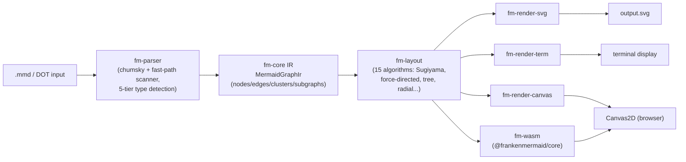
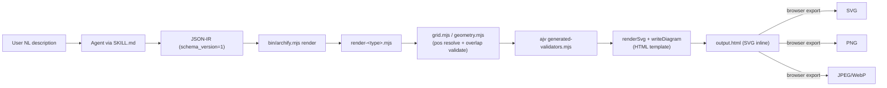
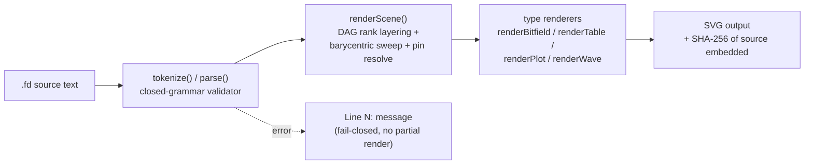

# Weekly Scan — Diagram Tooling (2026-07-06 → 2026-07-13)

**Tóm tắt điều hành:**
- Tuần này nổi bật hai bản triển khai lại Mermaid bằng Rust ra đời gần như song song (`merman`, `frankenmermaid`) — cả hai đặt cược vào "headless, không browser, IR tách khỏi layout" nhưng khác nhau về độ trưởng thành: `merman` có 20-crate workspace, đa target (crates/npm/PyPI/pub.dev) và registry-per-family rõ ràng; `frankenmermaid` là dự án 1 tác giả với nhiều module toán "kêu to" (CGA, e-graph, Adapton) chưa kiểm chứng được mức độ dùng thực chất.
- `archify` (3.9k sao, agent skill cho Claude/Codex) đáng chú ý không phải vì layout — nó **không có auto-layout thật**, chỉ grid pixel math — mà vì pattern "schema-first IR + validator ajv biên dịch sẵn thành JS tĩnh", một ý tưởng cụ thể áp dụng được cho parity Python↔JS của kymostudio.
- `figdown` là dự án rất sớm (0 sao, 9 ngày tuổi) nhưng đáng ghi chú vì triết lý "layout stability" (sửa cục bộ → chỉ đổi cục bộ) và error-format fail-closed `Line N: message` — cùng lớp vấn đề mà golden-SVG test byte-for-byte của kymostudio đang giải quyết.

**Mục lục**
1. [Latias94/merman](#1-latias94merman) — study deeper
2. [Dicklesworthstone/frankenmermaid](#2-dicklesworthstonefrankenmermaid) — glance only
3. [tt-a1i/archify](#3-tt-a1iarchify) — glance only
4. [FigDown/figdown](#4-figdownfigdown) — glance only
5. [Candidates khác đã cân nhắc](#5-candidates-khác-đã-cân-nhắc-nhưng-không-deep-dive)

---

## 1. Latias94/merman

### §1 — Quick Context

Merman là bản triển khai lại Mermaid.js **hoàn toàn headless** bằng Rust — không cần browser/DOM/JS runtime để parse, layout và render, khác biệt với mermaid.js gốc (chạy trong browser/DOM) hay các wrapper puppeteer-based (mermaid-cli). Tech stack: Rust edition 2024 (MSRV 1.95), LALRPOP (parser generator), `dugong`/`dugong-graphlib` (dagre port), `manatee` (COSE/FCoSE), `resvg`/`usvg`/`tiny-skia`/`krilla`, `roughr` (Rough.js fork). Output: semantic JSON, layout JSON, SVG, PNG/JPG/PDF, ASCII, diagnostics JSON. Repo health: 431 sao, 17 fork, 1 issue mở, CI badge có, tạo 2026-02, đang active (push hôm nay), bản `v0.8.0-alpha.3` (còn alpha). Phân phối: crates.io, npm (`@mermanjs/web` wasm), Homebrew, PyPI (UniFFI thử nghiệm), pub.dev, Swift/Android bindings, C FFI.

### §2 — Architecture Deep-Dive

**A. Component inventory** (20 crate trong `crates/`):
- `merman-core` (`crates/merman-core/src`) — detect diagram type, dispatch parser theo family, chứa `parse_pipeline.rs` (orchestrator), `common_db.rs` (sanitize), `models/`.
- `crates/merman-core/src/diagrams/*_grammar.lalrpop` — grammar LALRPOP riêng cho flowchart, class, ER, sequence, state.
- `merman-render` (`crates/merman-render/src`) — layout (`dagre/`, `block/`, `flowchart/`) + SVG emission (`svg.rs`, `svg/`, `text.rs`), styling (`theme.rs`, `mermaid_style.rs`).
- `dugong` / `dugong-graphlib` — port dagre/graphlib (layout DAG phân lớp).
- `manatee` — layout COSE/FCoSE cho compound graph (architecture diagrams).
- `merman-elk-layered` / `merman-layout-elk` — hỗ trợ ELK layered ở mức detect/config, **chưa** phải implementation đầy đủ (ghi rõ là non-goal trong docs).
- `merman-ascii` — backend render ASCII/Unicode riêng cho terminal.
- `merman-analysis` — diagnostics/linting; `merman-editor-core` + `merman-lsp` — language server.
- `merman-cli` (`main.rs` 27 dòng, mỏng) → `cli.rs`/`commands.rs`/`render.rs`.
- `merman-ffi`/`merman-wasm`/`merman-uniffi` — C ABI, wasm-bindgen, UniFFI bindings.
- `roughr` — fork Rough.js cho style vẽ tay.

**B. Pipeline (happy path)**: 1) user chạy `merman-cli render x.mmd` → `main.rs` gọi `cli::parse` rồi `commands::run`. 2) `parse_pipeline` tách frontmatter, detect diagram type. 3) parser LALRPOP theo family sinh semantic model, `common_db::apply_common_db_sanitization()` sửa model tại chỗ. 4) `merman-render` chọn layout engine theo family (đa số `dugong`/dagre; architecture dùng `manatee`; elk thử nghiệm) tính geometry. 5) `svg.rs` áp theme/style rồi emit SVG DOM tương thích mermaid.js; nếu target raster thì qua `resvg`/`tiny-skia`/`krilla`, nếu ASCII thì qua `merman-ascii`. 6) ghi file output.

**C. Data model/IR**: `ParsedDiagram { ParseMetadata, model }`, model là `serde_json::Value` (diagram JSON-based) hoặc `RenderSemanticModel` (typed). Có 2 tầng IR tách biệt: **Semantic JSON** (trước layout) và **Layout JSON** (geometry/routing đã resolved) — output riêng của từng tầng. Mutable-in-place qua các pass (sanitize, remap span), không phải kiểu functional-immutable "lower xuống IR mới" mỗi bước.

**D. Input language**: LALRPOP (LR(1), giống yacc/bison) — grammar formal viết tường minh trong file `.lalrpop`. Error reporting có span coordinates qua `EditorSemanticFacts`/`DiagramWarningFact`, và `EditorParseSourceMap` remap lại về vị trí gốc trong source (kể cả sau khi strip frontmatter).

**E. Layout**: hierarchical/Sugiyama-style DAG layout qua `dugong` (dagre port); compound force-directed (COSE/FCoSE) qua `manatee` cho architecture diagrams; ELK chỉ detect/config, chưa full. Chi tiết thuật toán spline routing cụ thể — không xác định.

**F. Rendering/output**: nhiều backend chia sẻ 1 IR — SVG chính (parity với mermaid.js), raster PNG/JPG/PDF, ASCII/Unicode (backend riêng hoàn toàn), diagnostics JSON. Không tìm thấy cơ chế animation nào — không xác định.

**G. Extensibility**: thêm diagram type mới phải đăng ký vào "Diagram Family Facts" registry, tự viết parser+layout+SVG trong module riêng của family, ghi "Admission Inventory". Theming qua `theme.rs`/`mermaid_style.rs` + SVG postprocessors. Không có plugin runtime động — mở rộng ở compile-time.

**H. Dev experience**: CLI dùng `clap`; `merman-lsp` cho IDE (LSP); `playground/` là editor browser-based dùng wasm build; `tools/` có VS Code extension. Watch-mode — không xác định.

### §3 — Architecture Diagram

### §4 — Verdict

Điểm đáng học nhất cho kymostudio: (1) **tách IR thành 2 tầng riêng** — Semantic JSON (trước layout) và Layout JSON (geometry/routing sau layout) như định dạng output độc lập — kymostudio có thể cân nhắc expose `Diagram` sau `resolve_alignments()` như một golden IR chính thức, hữu ích cho debug/tooling ngoài SVG. (2) Grammar formal viết tường minh (LALRPOP `.lalrpop` per diagram family) đáng tham khảo nếu `dsl.py`/`dsl.ts` (hiện line-oriented, tự viết) từng cần EBNF chính thức hơn — nhưng `docs/DSL.md` đã đóng vai trò tương đương nên rủi ro thấp. (3) Cơ chế "Diagram Family Facts" registry — mỗi family sở hữu parser+layout+render+parity-exception của chính nó — gần giống nguyên tắc "renderer dumb, dispatch theo shape" của kymostudio; cách merman ép buộc registry tập trung (thay vì rải rác if/else) có thể tham khảo khi thêm shape/BPMN element mới.

Red flag: dự án còn alpha (v0.8.0-alpha.3), license field trên GitHub API hiện "Other/NOASSERTION" dù README ghi MIT OR Apache-2.0 — cần double-check trước khi trích dẫn pháp lý. ELK layout được quảng cáo nhưng tự nhận là chưa implement đầy đủ — dấu hiệu roadmap vượt tiến độ thực tế.

Câu hỏi mở: thuật toán edge-routing/spline cụ thể (crossing minimization ra sao) chưa xác minh được từ code đã đọc; cơ chế animation cho SVG (nếu có) không tìm thấy bằng chứng.

**Verdict: study deeper** — riêng phần "2-tầng IR" và registry-per-family đáng đọc kỹ code thật (không chỉ README) trước khi áp dụng.

---

## 2. Dicklesworthstone/frankenmermaid

### §1 — Quick Context

Khác biệt cốt lõi: thay vì một trình thông dịch JS chạy trên browser (mermaid.js), frankenmermaid là engine Rust biên dịch AOT với IR dùng chung cho 4 backend, nhắm tới tốc độ (~871× so với mermaid-js 11.15 trên benchmark nội bộ) và tính deterministic byte-for-byte. Tech stack: Rust 2024 edition, 9 crate workspace, `chumsky` (parser combinator) + hand-written fast-path scanner, `egg` (e-graph), `nalgebra`/`good_lp`, `wasm-bindgen`. Output: SVG, terminal (braille/block), Canvas2D, PNG, WASM. Repo health: 19 sao, 2 fork, 1,288 commit, dường như một tác giả duy nhất, CI có (`ci.yml`, `pages.yml`), test đa dạng (unit, proptest, fuzz, golden SVG, conformance). Phân phối: crates.io (9 crate) + npm (`@frankenmermaid/core` WASM) + script cài Rust toolchain.

### §2 — Architecture Deep-Dive

**A. Component inventory** (9 crate dưới `crates/`):
- `fm-core/src/lib.rs` — định nghĩa IR (`MermaidGraphIr`, `IrNode`, `IrEdge`, `IrCluster`, `IrSubgraph`) và các module toán học đặc biệt (`cga.rs` — Conformal Geometric Algebra, `epoch.rs`, `leapfrog.rs`, `quotient_filter.rs`, `succinct.rs`, `art.rs`).
- `fm-parser/src/{mermaid_parser.rs, dot_parser.rs, ir_builder.rs}` — parser Mermaid + cầu nối DOT/Graphviz, builder dựng IR.
- `fm-layout/src/*` — 19 file gồm `adapton.rs` (incremental layout kiểu Adapton), `egraph_crossing.rs`/`egraph_ordering.rs` (crossing minimization qua e-graph), `cga_routing.rs` (edge routing), `spatial.rs`, `spectral.rs`, `polyhedral.rs`, cụm `fnx_*.rs` (tích hợp graph-intelligence tùy chọn `franken_networkx`).
- `fm-render-svg`, `fm-render-term`, `fm-render-canvas` — ba backend render riêng biệt.
- `fm-wasm` — binding WASM, expose `parse()`, `renderSvg()`, hệ thống "lens" (chỉnh sửa cấu trúc 2 chiều giữ nguyên trivia).
- `fm-cli/src/main.rs` — CLI dùng clap-derive với subcommand `render/parse/detect/diff/validate/capabilities`.
- `fm-regression-harness` — harness so sánh hồi quy.

**B. Pipeline**: 1) người dùng chạy `fm-cli render input.mmd --format svg`; 2) `load_input()` đọc file/stdin; 3) `parse_with_mode_and_config()` chạy 5-tier detection (DOT keyword → exact match → fuzzy Levenshtein → heuristic → fallback flowchart) rồi parse ra `MermaidGraphIr`; 4) `layout_diagram_traced_with_config_and_guardrails()` chọn 1 trong 15 thuật toán layout, có "guardrail" fallback khi vượt ngân sách; 5) `render_format()` gọi backend SVG/terminal/Canvas2D tương ứng; 6) `write_output()` ghi file.

**C. Data model/IR**: `MermaidGraphIr` là struct chứa `Vec<IrNode>/IrEdge/IrCluster/IrSubgraph`, mutable qua accessor (`interaction_mut()`, `extras_mut()` lazy-allocate boxed field) — không theo builder pattern nghiêm ngặt, mà "pay-for-what-you-use". Có label interning, span tracking (byte offset + line/col) phục vụ click-to-source.

**D. Input language**: hybrid — `chumsky` (parser combinator, kiểu PEG) cho cú pháp phức tạp, cộng hand-written byte-level fast path (dùng `memchr`/SIMD) cho trường hợp phổ biến để tối ưu tốc độ; không thấy grammar EBNF chính thức nào được viết ra (README không đề cập). Error recovery: parser "best-effort", không panic — node treo cạnh được auto-tạo placeholder, lỗi degrade thành IR + diagnostics thay vì crash.

**E. Layout**: 15 thuật toán tự chọn theo loại diagram — Sugiyama (hierarchical, 4 chiến lược cắt cycle), Fruchterman-Reingold + Barnes-Hut (force-directed), Reingold-Tilford (tree), radial (mindmap), cộng 8 layout chuyên biệt (sequence/gantt/sankey/kanban/...). Crossing minimization dùng barycenter+transpose+sift, tùy chọn e-graph equality saturation (`egg`). Coordinate assignment kiểu Brandes-Köpf; edge routing orthogonal, có hỗ trợ CGA cho tránh vật cản.

**F. Rendering**: pluggable — 3 backend độc lập (SVG/terminal/Canvas2D) cùng ăn một IR đã layout; SVG hỗ trợ CSS animation, gradient, shadow; không thấy cơ chế animation timeline như kymostudio.

**G. Extensibility**: không xác định rõ plugin system chính thức; thêm shape/diagram type có vẻ đòi sửa trực tiếp `fm-core`/`fm-parser`/renderer (không có manifest/plugin API tách biệt được tài liệu hóa).

**H. Dev experience**: CLI mạnh (`detect`, `validate --fail-on`, `diff`, `capabilities`), có `watch`/`serve` (feature-gated), "Interactive" split-pane terminal editor; demo web (`web/`, `web_react/`) với live editor 80+ ví dụ. Không xác định LSP.

### §3 — Architecture Diagram

### §4 — Verdict

Đáng học nhất: (1) "5-tier detection pipeline" (DOT keyword → exact → fuzzy Levenshtein → heuristic → fallback) để đoán diagram type — kymostudio DSL đang tường minh (`.kymo`/`.bpmn`) nên ít cần, nhưng ý tưởng "never crash, degrade to IR + diagnostics" đáng tham khảo cho `dsl.py` khi gặp input lỗi. (2) Layout guardrail/budget ledger (chọn thuật toán rồi fallback khi vượt ngân sách thời gian) là mẫu hữu ích nếu kymostudio mở rộng auto-layout phức tạp hơn ở `alignment.py`. (3) Golden SVG + BLESS-mode test rất giống cơ chế `KYMO_UPDATE_GOLDEN` hiện có — xác nhận đây là pattern đúng, không cần đổi.

Cờ đỏ: parser mô tả trong README (recursive descent) không khớp code thực tế (chumsky + hand-rolled fast path) — README có thể phóng đại/lỗi thời; claim "871× speedup" chỉ dựa trên 13-diagram corpus tự chọn, cần nghi ngờ. Dự án có vẻ 1 tác giả, 1,288 commit trong ~5 tháng, rất nhiều module toán "kêu to" (CGA, e-graph, Adapton) nhưng không rõ mức độ dùng thực chất — nghi ngờ over-engineering/marketing-driven naming.

Câu hỏi mở: license "Other/NOASSERTION" trên GitHub API dù README ghi MIT — cần làm rõ trước khi tham khảo code. Không tìm thấy ví dụ `.mmd` chính thức trong `examples/`, chỉ có test string inline.

**Verdict: glance only** — layout-guardrail và multi-tier fallback-parsing đáng ghi chú ngắn, nhưng dự án quá mới/1-người để tin cậy về kiến trúc; không cần đọc sâu code.

---

## 3. tt-a1i/archify

### §1 — Quick Context

Archify là một **agent skill** (không phải app độc lập) cho Claude/Codex/opencode: agent đọc mô tả tiếng Anh của người dùng, tự viết ra JSON-IR theo schema cố định, rồi một renderer Node.js thuần (zero runtime deps) biến JSON đó thành file HTML tự chứa (SVG inline + CSS theming + export JS). Khác các tool khác ở chỗ *layout không tự động* — agent tự đặt tọa độ/grid, renderer chỉ validate + vẽ. Stack: JavaScript (Node ≥18, ESM `.mjs`), devDep duy nhất `ajv` (schema validation, dùng để generate validator tĩnh). Output: HTML/SVG, và PNG/JPEG/WebP qua rasterization trên trình duyệt (canvas). Repo: 3.9k sao, 379 fork, MIT, release mới nhất v2.10.0 (2026-07-05, 11 release), có CI (`ci.yml`, `release.yml`) và test suite (`npm test` chạy validator check + golden test + `node --test`). Phân phối: zip cài qua `npx skills add tt-a1i/archify -g` hoặc thủ công vào thư mục skill của agent — không phải npm package thường, không có binary riêng.

### §2 — Architecture Deep-Dive

**A. Component inventory**:
- `archify/SKILL.md` — hướng dẫn cho agent: chọn loại diagram, quy tắc CSS/class, cấu trúc IR, danh sách lệnh CLI.
- `archify/bin/archify.mjs` — CLI dispatcher (`render`, `validate`, `inspect`, `check`, `doctor`, `demo`, `examples`).
- `archify/schemas/*.schema.json` (+ `common.schema.json`) — 5 JSON Schema (architecture/workflow/sequence/dataflow/lifecycle).
- `archify/scripts/generate-validators.mjs` — sinh `renderers/shared/generated-validators.mjs` (validator ajv biên dịch sẵn, không cần ajv lúc runtime của skill).
- `archify/renderers/<type>/render-<type>.mjs` — renderer riêng cho từng loại (5 module, ví dụ `render-architecture.mjs`).
- `archify/renderers/architecture/grid.mjs` — resolver tọa độ grid→pixel + validator va chạm (không phải auto-layout).
- `archify/renderers/shared/geometry.mjs` — primitive hình học thuần (anchor, rectsOverlap, polylinePath, roundedPath, labelPoint).
- `archify/renderers/shared/{cli.mjs, layout-report.mjs, utils.mjs, validator.mjs}` — I/O, báo cáo layout, template/escaping/marker SVG, hàm validate chung.
- `archify/test/` — test suite (golden, geometry, grid, layout-rules, animation, render-output-checks).

**B. Pipeline (happy path)**: 1) Agent (theo `SKILL.md`) diễn giải mô tả người dùng → viết file JSON theo schema tương ứng. 2) Người dùng/agent gọi `node bin/archify.mjs render architecture input.json output.html`. 3) `bin/archify.mjs` spawn `renderers/architecture/render-architecture.mjs` qua `spawnSync`. 4) Renderer: `loadDiagram()` đọc JSON → đo kích thước component → `gridLayout()`/`resolveComponentPos()` tính pixel từ `pos` hoặc `row/col` → `validateArchitecture()` (schema + hình học: overlap, khoảng cách cạnh, label) → `renderSvg()` sinh SVG → `writeDiagram()` nhúng SVG vào template HTML kèm CSS theme + JS export. 5) File `.html` (~19KB, self-contained) xuất hiện tại đường dẫn output. 6) (Tùy chọn) `check` chạy `check-render-output.mjs` kiểm tra chất lượng artifact HTML đã sinh.

**C. Data model/IR**: JSON-IR có `schema_version` cố định = 1, `diagram_type`, `meta`, mảng `components`/`connections` (architecture) hoặc tương đương theo loại. Có schema chính thức (JSON Schema per loại + `common.schema.json` dùng chung). IR bất biến trong quá trình parse nhưng renderer **augment** component bằng field tính toán (`x,y,width,height,cx,cy`) sau bước đo — nên về bản chất là mutate-in-place, không phải pass IR bất biến qua nhiều giai đoạn tách biệt rõ ràng. Validation: ajv-compiled static validator (`generated-validators.mjs`) sinh trước bằng script, cộng validate hình học thủ công sau layout.

**D. Input language design**: Không có DSL cú pháp riêng — agent nhận ngôn ngữ tự nhiên rồi **tự sinh JSON-IR** theo schema (không parse Mermaid cơ học: SKILL.md nói rõ "đọc Mermaid để lấy cấu trúc, không parse máy móc, rồi layout lại từ đầu"). Lỗi report qua validator: liệt kê lỗi schema + lỗi hình học (overlap, out-of-bounds, duplicate cell) với thông điệp hành động được (v2.10 thêm "actionable validator hints").

**E. Layout algorithm**: **Không có auto-layout thật sự** — comment trong `grid.mjs` nói thẳng "Not auto-layout — fixed cell math only." Component được đặt bằng `pos:[x,y]` tường minh hoặc `row/col` map sang pixel qua `stepX = cellW+gapX`; renderer chỉ **validate** chồng lấn (gap 8px) chứ không tự dịch chuyển để tránh. Routing cạnh: 4 kiểu thủ công (`straight`, `orthogonal-h`, `orthogonal-v`, `auto` — auto chọn qua midpoint heuristic đơn giản). Không có crossing-minimization.

**F. Rendering/output**: Renderer sinh SVG nhúng trong HTML template (một "kênh" xuất, mỗi diagram-type có renderer riêng). Export sang PNG/JPEG/WebP/SVG xảy ra **trong trình duyệt lúc runtime** (client-side canvas rasterization, lên tới 4×), không phải build-time. Animation ("trace" mode) — cơ chế cụ thể (SMIL vs CSS vs JS) không xác định trong thời gian nghiên cứu.

**G. Extensibility**: Thêm diagram-type mới = thêm schema + renderer module theo cùng convention, CLI tự dò qua `rendererPath()`. Theme/style: quy ước class CSS bắt buộc (`c-<type>`, `t-<variant>`), không hardcode màu — nhưng không thấy plugin system chính thức, chỉ convention.

**H. Dev experience**: CLI rõ ràng (`doctor`, `demo`, `validate`, `inspect --layout-json`). Không có watch mode xác nhận. Zero runtime deps thật (validator ajv biên dịch sẵn thành file JS tĩnh). Preview: mở file HTML trực tiếp trên trình duyệt, phím tắt T (theme) / E (export).

### §3 — Architecture Diagram

### §4 — Verdict

Kỹ thuật đáng học nhất cho kymostudio: **schema-first IR với validator biên dịch sẵn** (ajv → JS tĩnh qua `generate-validators.mjs`, chạy trong CI) — kymostudio có thể áp dụng để lock JSON Schema của `Diagram`/`Component`/`Edge`, đặc biệt hữu ích cho parity Python↔JS: một schema JSON dùng chung, cả hai impl validate cùng contract thay vì chỉ dựa vào golden test. Thứ hai, "two-rect pattern" (mask rect + styled rect) và document-order bắt buộc (arrow trước component) là mẹo SVG nhỏ nhưng cụ thể, đáng xem lại cách `to_svg.py` layer z-order.

Điểm cần cảnh giác: archify **không có auto-layout thật** — khác biệt lớn với kymostudio, vốn có `layout.py`/`alignment.py` làm auto-layout + trunk-lane staggering thực sự. Đừng học nhầm layout algorithm ở đây vì nó không tồn tại. Export raster làm ở client-side canvas lúc runtime, khác cách kymostudio dùng `kymostudio-core`/resvg ở build-time — không áp dụng trực tiếp nhưng xác nhận hướng "SVG là nguồn chân lý, raster là hậu xử lý" là đúng.

Câu hỏi còn mở: cơ chế animation "trace" mode chưa xác minh được (SMIL/CSS/JS). Verdict: **glance only** (giá trị chính là ý tưởng schema-validator-generation, không phải layout/routing).

---

## 4. FigDown/figdown

### §1 — Quick Context

FigDown là chuẩn mở "figures as text, one source, two readers": file `.fd` (markdown-native, line-oriented, closed grammar) vừa là văn bản AI-agent đọc trực tiếp vừa render deterministic ra SVG cho người xem — khác Mermaid/D2 ở tính đóng của grammar và cam kết "layout stability" (sửa cục bộ → thay đổi cục bộ). Tech stack: 100% vanilla JS nhúng trong một file HTML duy nhất (`editor/figdown.html`, ~2.600-2.800 dòng), không dependency ngoài. Repo health: 0 sao, tạo 2026-07-02, ~78 commit tính đến 2026-07-11 (đồng tác giả với "claude"), **không CI/không test, không package.json, không release**. Distribution: có engine hoạt động thực sự (parser + layout + renderer trong editor), không chỉ tài liệu spec.

### §2 — Architecture Deep-Dive

**A. Component inventory**:
- `README.md` / `README.zh-tw.md` — pitch + 8 axioms.
- `AGENT-GUIDE.md` — quy trình dành cho AI agent maintain diagram.
- `spec/syntax-draft.md` (v0.0) — ngữ pháp `.fd` (17 top-level directive).
- `spec/MIGRATIONS.md` — quy tắc nâng cấp schema.
- `design/census.md`, `design/prior-art.md`, `design/requirements-notes.md`, `design/gallery-plan.md`, `design/engine-backlog.md` — nhật ký quyết định R0–R30+/D1–D3, phân tích corpus 774 tài liệu, so sánh Mermaid/PlantUML/Graphviz/D2/DBML.
- `editor/figdown.html` — **engine thật**: tokenizer/parser (`tokenize()`, `parse()`, `parseEdgeLine()`), layout engine (`renderScene()` — DAG layering nhiều rank, barycentric sweep 3-pass, waypoint cho multi-layer edge), renderer con (`renderBitfield()`, `renderTable()`, `renderPlot()`, `renderWave()`), cộng UI thao tác trực tiếp (kéo-thả node → ghi lại thành dòng `pin`).
- `examples/*.fd` + `.svg` — 23 cặp ví dụ thật (giao thức mạng: tcp, udp, ipv4/6, bgp, vxlan, mpls...).
- `tools/build-svg.js`, `tools/make-skill.js` — script build/validate CLI (Node.js).
- `skill/` — Claude agent skill cài đặt được.

**B. Pipeline/control flow** — CÓ implement thật (không chỉ spec): `.fd` text → `tokenize()` → `parse()` (validate closed grammar, lỗi `Line N: <message>`) → `renderScene()` (layout: rank/barycenter/pin resolution) → renderer theo loại block (scene/bitfield/table/wave/plot) → SVG có nhúng SHA-256 của source. `tools/build-svg.js` chạy cùng pipeline này ngoài trình duyệt để CI/agent dùng.

**C. Data model/IR**: không xác định rõ ràng — không thấy tài liệu mô tả IR trung gian tường minh (kiểu `Diagram`/`Component` dataclass như kymostudio); model suy ra từ các hàm parse trả về cấu trúc node/edge/group nội bộ trong `figdown.html`, nhưng không có spec riêng cho IR.

**D. Input language design**: line-oriented, mỗi dòng non-blank bắt đầu bằng keyword đã đăng ký (`node`, `edge`, `group`, `flow`, `rank`, `pin`, `size`, `bitfield`, `table`, `wave`, `class`, `bundle`, `line`, `fill`...). 8 axioms: (1) text là nguồn chân lý duy nhất, figure là artifact sinh 100%; (2) deterministic rendering; (3) layout stability; (4) dual audience (AI đọc source, người xem SVG); (5) sensible defaults; (6) lean core — dòng lạ luôn lỗi; (7) editor-driven (thao tác GUI dịch ngược thành text edit); (8) static-first. Determinism đạt được nhờ: không random/Date, `pin`/`size` là ràng buộc cứng, layout tự động chỉ sắp phần còn lại. Error-reporting cho AI loop: strict mode báo `Line N: message`, không render một phần (fail toàn bộ để tránh output "gần đúng" gây hiểu lầm) — hướng tới vòng lặp write→validate→fix của agent.

**E. Layout algorithm**: có implement — DAG multi-rank layering (longest-path) + barycentric sweep 3 pass để sắp thứ tự node trong rank, hệ toạ độ 2 tầng (group-origin + member-relative pin), chèn waypoint cho cạnh bắc qua nhiều layer, kênh orthogonal cho back-edge.

**F. Rendering/output strategy**: SVG thuần, sinh trực tiếp bằng JS string/DOM build (không qua thư viện ngoài), nhúng SHA-256 của source `.fd` vào SVG để phát hiện lệch (staleness).

**G. Extensibility**: không xác định rõ; có "Reserved (chưa spec)" keyword (`page`, `step`, `set`, `pulse`) và cơ chế `x-` prefix cho extension lines được lenient-mode bỏ qua có cảnh báo — cho thấy dự định mở nhưng chưa có cơ chế plugin chính thức.

**H. Dev experience**: CLI validate/build (`tools/build-svg.js`), trình soạn thảo trực quan trong trình duyệt (kéo-thả ghi ngược thành `.fd`), Claude Code agent skill cài đặt được (`skill/`). Không có VS Code extension, không CI, không test suite tự động, không package/npm publish.

### §3 — Architecture Diagram

### §4 — Verdict

Đáng nghiên cứu sâu hai điểm cụ thể: (1) **axiom "layout stability"** — cam kết sửa cục bộ chỉ đổi cục bộ, đối lập với kiểu re-layout toàn cục của D2/Mermaid — đây là vấn đề kymostudio cũng gặp (golden SVG test byte-for-byte, `KYMO_UPDATE_GOLDEN`), nên xem cách FigDown ràng buộc `pin`/`size` làm "hard constraint" quanh đó auto-layout mới chạy. (2) **closed-grammar fail-fast với lỗi `Line N: message`, không render một phần** — hợp với triết lý agent-loop mà `AGENT-GUIDE.md` mô tả, đáng so với cách `dsl.py` hiện xử lý lỗi parse.

Cờ đỏ: 0 sao, 0 fork, chưa có test/CI/release, commit lịch sử chỉ 9 ngày, đồng tác giả với "claude" — rủi ro rất cao là dự án cá nhân/thử nghiệm chưa được kiểm chứng cộng đồng, có thể bị bỏ dở. Câu hỏi mở: engine trong `figdown.html` có tách thành thư viện dùng lại được không, hay mãi mãi kẹt trong file editor demo?

**Verdict: glance only** — đáng đọc `AGENT-GUIDE.md` và `spec/syntax-draft.md` để lấy ý tưởng về error-format cho agent loop, nhưng còn quá sớm và quá nhỏ để đầu tư nghiên cứu sâu hơn lúc này.

---

## 5. Candidates khác đã cân nhắc nhưng không deep-dive

Từ vòng discovery ban đầu (đã lọc theo tiêu chí đề tài diagram-as-code/DSL/layout/rendering, loại trừ chart library, dashboard, icon pack, portfolio repo):

- **khollingworth/d2-diagram-skill** — Claude Code plugin bọc D2 (TALA/ELK layout) với "self-checking render loop": agent tự render, tự audit trực quan PNG (label chồng lấn, cạnh rối) rồi sửa lại tại source, lặp 2-4 vòng. v0.3.0 (2026-07-10). Kỹ thuật QA-vòng-lặp đáng ghi chú cho quy trình test/preview của kymostudio, nhưng bản thân đây là lớp điều phối mỏng trên D2 (không tự implement renderer/layout) nên không đủ "thịt kiến trúc" để deep-dive theo khung §2.
- **kazukifujiwara/network-topo-draft** — VSCode canvas editor cho `*.topo.json`, đồng bộ hai chiều canvas/text, CLI validator, MCP server cho agent thao tác topology. v0.6.1 (2026-07-11). Chủ đề "agent-editable text/visual duality" trùng với figdown, nhưng repo còn rất sớm (0 sao).
- **hikerpig/pintora** — thư viện text-to-diagram mermaid-alternative đã trưởng thành (từ 2021, ~1.284 sao), push 2026-07-10 nhưng không xác nhận được release/changelog cụ thể trong tuần — có thể chỉ là cập nhật routine (CI/deps), không đưa vào deep-dive.
- **DimonSmart/DbSketch** — sinh sơ đồ DB schema + Markdown docs từ SQL Server/Postgres/MySQL sống. Phạm vi hẹp (ER-diagram generator chuyên biệt), ~20 sao.
- **kieler/elkjs** — kiểm tra trực tiếp trang release: không có release nào từ tháng 3/2025, push gần đây nhiều khả năng chỉ là routine (deps/CI), không phải cập nhật đáng chú ý dù đây là thư viện layout algorithm tham chiếu quan trọng.
- **isatimur/excalidraw-skill-pack** — skill pack đa-agent cho Excalidraw, cập nhật 2026-07-12 nhưng 0 sao, là lớp wrapper mỏng chứ không phải engine render/layout mới.
