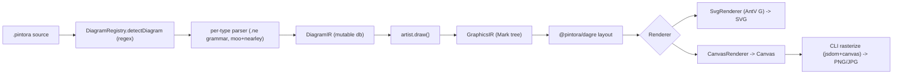
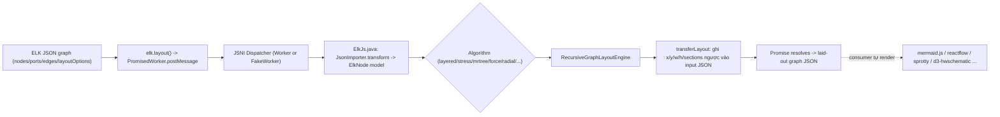
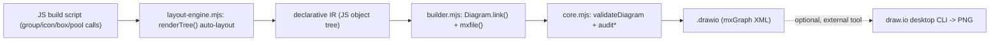
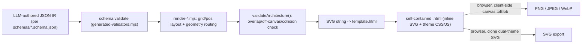

# Weekly Scan — Diagram Tooling (2026-07-14)

**Nguồn**: GitHub REST search API (`topic:diagram-as-code`, `topic:graph-visualization`, `topic:layout-algorithm`, `topic:dsl+topic:diagram`, keyword fallback `created:>2026-06-14`), lọc theo `pushed:>2026-07-07`. Kết quả bị nhiễu nặng bởi spam/AI-slop repos (xem lưu ý cuối bài) — 4 repo dưới đây là phần còn lại sau khi loại trừ.

## Executive summary

- **Pintora** (hikerpig/pintora) là repo *gần nhất về kiến trúc* với kymostudio: TypeScript, custom lexer/grammar per-diagram-type (moo+nearley fork), dagre layout, dual SVG/Canvas renderer qua AntV G, và một `IDiagram` plugin contract rất đáng tham khảo cho việc mở khoá thêm diagram type trong `packages/js`.
- **elkjs** không phải diagram tool mà là *pure layout engine* (Java ELK core cross-compiled qua GWT) — đáng nghiên cứu vì đây là layout backend mà mermaid.js, reactflow, sprotty… đều dùng chung; cấu trúc "ELK JSON" IR (`layoutOptions` per-node, `sections`/`bendPoints` cho edge) là một convention đáng học cho việc tách layout options ra khỏi model.
- **drawio-ai-kit** và **Archify** đều là "agent skill" packages (Claude/Codex skill wrapper quanh 1 CLI thật) — cả hai xác nhận một pattern mới đang nổi: JSON/JS-object IR do LLM author, code thật (không phải LLM) làm validate + auto-layout hẹp + render, output là draw.io XML hoặc SVG→canvas rasterize. Đáng để ý về mặt distribution model (skill-first, không publish npm) hơn là về thuật toán.

## Table of contents

1. [Pintora](#1-pintora) — text-to-diagram library, TypeScript, plugin-based diagram registry
2. [elkjs](#2-elkjs) — Eclipse Layout Kernel, layout-only engine dùng bởi mermaid/reactflow/sprotty
3. [drawio-ai-kit](#3-drawio-ai-kit) — declarative JS IR → draw.io XML, agent-skill distribution
4. [Archify](#4-archify) — JSON-schema IR → SVG → client-side PNG/JPEG/WebP export, agent-skill distribution

---

## 1. Pintora

### §1 Quick context

Text-to-diagram library JS/TS chạy được cả browser lẫn Node — điểm khác biệt so với kymostudio: Pintora dùng parser thật (moo+nearley) **riêng cho từng diagram type** thay vì một grammar chung, và tách renderer khỏi diagram logic qua một `Mark`-tree trung gian (AntV G). Stack: TypeScript pnpm monorepo (turborepo), `@hikerpig/nearley` + `@hikerpig/moo` (parser fork), `@pintora/dagre` + `@pintora/graphlib` (layout fork), `@antv/g-svg`/`@antv/g-base` (render abstraction). Repo health: ~1.284 stars, CI xanh (`ci-check.yml`: build + `format:check` + Jest coverage + Percy visual e2e), 37 file `*.spec.ts`, version hiện tại `0.8.2` release qua Changesets (per-package, không lockstep). Distribution: npm, 5 package con (`@pintora/core`, `@pintora/diagrams`, `@pintora/renderer`, `@pintora/cli`, `@pintora/standalone`), có VS Code extension riêng (`pintora-vscode`, ngoài monorepo).

### §2 Architecture deep-dive

**A. Component inventory**
- `DiagramRegistry` (`packages/pintora-core/src/diagram-registry.ts`) — map tên diagram type → `IDiagram`, detect type bằng `pattern: RegExp`.
- `parseAndDraw()` (`packages/pintora-core/src/index.ts`) — hàm orchestrate toàn pipeline.
- Mỗi diagram type là một thư mục riêng dưới `packages/pintora-diagrams/src/<type>/` gồm `parser/*.ne` (grammar), `db.ts` (mutable IR builder), `artist.ts` (IR→Mark tree), `config.ts` (theme hook).
- `DagreWrapper` (`packages/pintora-diagrams/src/util/dagre-wrapper.ts`) — gọi `@pintora/dagre`.
- `BaseRenderer` + `SvgRenderer`/`CanvasRenderer` (`packages/pintora-renderer/src/renderers/`) — walk `Mark` tree qua AntV G.
- `packages/pintora-cli/src/cli.ts` — CLI entry, rasterize PNG/JPG qua `jsdom`+`canvas`.

**B. Pipeline** (1) `pintora render -i file.pintora -o out.png` → (2) `cli.ts` đọc file, gọi `render()` → (3) `parseAndDraw()`: `diagramRegistry.detectDiagram(text)` chọn `IDiagram` bằng regex → (4) `diagram.parser.parse(text)` sinh diagram-specific IR → (5) `diagram.artist.draw(diagramIR, config)` sinh `GraphicsIR` (Mark tree) → (6) `@pintora/renderer` walk Mark tree ra SVG/Canvas, CLI serialize ra file.

**C. Data model / IR** — hai tầng, đều là plain object/class, **mutable**: tầng 1 là `DiagramIR` riêng từng loại (vd `ErDiagramIR`), build bởi một `db` object bị mutate trong lúc parse (reset qua `diagram.clear()` trước mỗi lần parse); tầng 2 là `GraphicsIR` chung — cây `Mark` union (`rect|circle|text|line|path|group|symbol|...`). Không có "compile xuống lower IR" kiểu D2 TALA — chỉ 2 tầng cố định.

**D. Input language design** — parser thật, không phải regex line-based: mỗi diagram type có grammar `.ne` riêng (Earley parser qua nearley fork), tokenize bằng moo fork, biên dịch qua `pnpm gen-parser`. Grammar fragment dùng chung nằm ở `shared-grammars/` (`whitespace.ne`, `config.ne`, `comment.ne`, `bind.ne`) và được `@include`. Không có EBNF doc tổng — mỗi `.ne` tự là grammar. Error reporting: dùng exception mặc định của nearley, không có module error-recovery riêng.

**E. Layout algorithm** — dagre fork (`@pintora/dagre` + `@pintora/graphlib`), tức Sugiyama-style layered layout tiêu chuẩn; không có crossing-minimization code riêng trong Pintora (delegate hết cho dagre). Gantt/mindmap nhiều khả năng dùng positioning riêng, không qua dagre (chưa verify từng loại).

**F. Rendering/output** — kiến trúc pluggable emitter thật: `SvgRenderer` và `CanvasRenderer` cùng implement `IRenderer`, cùng consume một `GraphicsIR`, chọn bằng `RendererType` string tại runtime. CLI rasterize thêm PNG/JPG qua `jsdom`+`canvas`. Không tìm thấy animation mechanism (grep "animat" toàn repo ra 0 kết quả) — khác biệt lớn với kymostudio (vốn có `--animate` target).

**G. Extensibility** — plugin system rõ ràng: `diagramRegistry.registerDiagram(name, diagram: IDiagram)`, có agent-facing skill doc sẵn trong repo (`.ai/skills/add-new-diagram/SKILL.md`) hướng dẫn từng bước thêm diagram type. Theme cũng pluggable qua `themeRegistry` (`packages/pintora-core/src/themes/`).

**H. Dev experience** — CLI đơn giản (`render -i/-o/-p/-b/-t/-w` qua yargs), không có `--watch`. Có live editor browser-based (`demo/live-editor`, Vite) và VS Code extension riêng cho syntax highlight + preview.

### §3 Architecture diagram

### §4 Verdict

Điểm áp dụng được vào kymo: (1) `IDiagram` contract (`pattern`/`parser`/`artist`/`clear()`) là một khuôn plugin gọn hơn nhiều so với việc thêm case rẽ nhánh trong `dsl.py`/`dsl.ts` — nếu kymo mở rộng sang nhiều "chế độ" DSL (vd sequence riêng, gantt riêng) đây là mẫu đáng cân nhắc. (2) Tách `GraphicsIR`/`Mark` tree khỏi renderer cụ thể giống triết lý "renderer dumb" của kymo (`model.py` + emitters) — xác nhận hướng đi hiện tại là đúng. (3) Per-diagram-type grammar fragment dùng chung (`shared-grammars/`) là ý hay nếu kymo DSL từng bước tách thành nhiều "dialect". Red flag: không có animation mechanism dù tên gợi ý "diagrams" tổng quát — kymo's animated-SVG target vẫn là điểm khác biệt cạnh tranh thực sự. Open question: crossing-minimization thực tế ra sao (nằm trong dagre fork, chưa đọc source fork). **Verdict: study deeper** — plugin contract và Mark-tree IR đáng đọc kỹ hơn khi kymo cần thêm diagram type mới.

---

## 2. elkjs

### §1 Quick context

Không phải diagram tool mà là **layout engine thuần** — cross-compile Eclipse Layout Kernel (Java) sang JS/WASM qua GWT, expose 1 API `elk.layout(graph)` trả về toạ độ, không vẽ gì cả. Stack: Java core (từ repo `eclipse/elk`) build bằng GWT 2.11.0 + Gradle/Xtext, JS wrapper tay viết (`src/js/`), TypeScript typings đầy đủ. Repo health: version `0.12.0` khớp git tag mới nhất (20 tags, từ `0.3.0`), commit gần nhất đúng ngày scan, CI chạy trên node 14/24 × Java 17 kèm nightly cron, auto-publish npm khi có GitHub release, có Mocha test suite (9 file). License EPL-2.0/GPL-3.0. Distribution: npm (`elkjs`), dùng làm layout backend cho netlistsvg, d3-hwschematic, cytoscape.js-elk, reaflow, reactflow, sprotty, và Vega Editor.

### §2 Architecture deep-dive

**A. Component inventory** — `elk-api.js` (public `ELK` class + `PromisedWorker`), `main-node.js` (Node subclass, chọn real Worker hay "FakeWorker" sync), `ElkJs.java` (GWT entry point, JSNI dispatcher, cầu nối Java↔JS thật), `JsonAdapter.xtend`/`SVGImage.java` (shim cho code không tương thích GWT). `lib/` (output build, không có trong source tree) chứa `elk-worker.js`/`.min.js` — phần Java compile ra.

**B. Pipeline** — đây là layout-only, không có parser/renderer: (1) `elk.layout(graph, opts)` gói message `{cmd:'layout', graph, layoutOptions}` post vào Worker (thật hoặc fake) → (2) JSNI dispatcher route tới `ElkJs.layout()` compiled từ Java → (3) `JsonImporter().transform(graph)` parse JSON đầu vào thành `ElkNode` object model nội bộ → (4) áp `layoutOptions` qua `LayoutConfigurator` → (5) `RecursiveGraphLayoutEngine().layout()` chạy thuật toán đệ quy theo hierarchy node → (6) `importer.transferLayout()` ghi x/y/width/height/edge sections ngược lại đúng object JSON đầu vào (mutate in-place) → (7) Promise resolve với graph đã có toạ độ.

**C. Data model / IR** — "ELK JSON": `ElkNode` (id, x/y/width/height, `children`, `ports`, `edges`, `layoutOptions`, `labels`) đệ quy; edge là `ElkExtendedEdge` (`sources[]`, `targets[]`, `sections[]` gồm `startPoint`/`endPoint`/`bendPoints`). **Mutable** — object JSON đầu vào bị ghi đè trực tiếp và cũng chính là object trả về (round-trip cùng reference).

**D. Input language design** — không áp dụng (không có text DSL, input là JSON object trực tiếp).

**E. Layout algorithm** — nhiều thuật toán chọn được qua `elk.algorithm`: `layered` (Sugiyama-style — README dẫn thẳng nguồn Sugiyama et al.), `stress`, `mrtree`, `radial`, `force`, `disco` (hiện bị comment out do lỗi CI, xem issue #291), `sporeOverlap`, `sporeCompaction`, `rectpacking`, cộng `box`/`fixed`/`random` built-in. `layoutOptions` là key/value map gắn per-element hoặc global, catalogue query runtime qua `knownLayoutOptions()`. Crossing-minimization nội bộ nằm trong Java core `eclipse/elk` (không có trong repo elkjs) — không xác định chi tiết thuật toán từ repo này.

**F. Rendering/output** — README nói rõ: "elkjs itself is a graph layout engine only... no rendering, styling, etc. is provided" — chỉ trả toạ độ, renderer là trách nhiệm consumer.

**G. Extensibility** — không có plugin hook cấp JS; thêm thuật toán mới đòi hỏi rebuild Java/GWT (thêm module vào `build.gradle` + đăng ký trong `ElkJs.registerLayoutAlgorithms`).

**H. Dev experience** — API tối giản (5 method), TypeScript type shipped đầy đủ, docs README tốt cho usage nhưng đẩy full option reference ra ngoài (eclipse.org/elk). Async mặc định kể cả không có Worker thật (FakeWorker sync trong Node, cùng Promise API).

### §3 Architecture diagram

### §4 Verdict

Điểm áp dụng vào kymo: kymo tự viết `layout.py`/`layout.ts` + `alignment.py`/`ts` (5-pass resolver) thay vì dùng ELK — đúng hướng cho use-case hiện tại (auto-layout frame có cấu trúc rõ, không cần general graph layout). Nhưng convention "ELK JSON" — `layoutOptions` tách hẳn khỏi node geometry, và catalogue `knownLayoutOptions()`/`knownLayoutAlgorithms()` query được runtime — là một pattern đáng học nếu kymo muốn expose nhiều "chế độ" layout tuỳ chỉnh cho user mà không hardcode. Red flag: build phụ thuộc Java/GWT/Gradle toolchain nặng, không tự-host được nếu chỉ cần 1 thuật toán — quá nặng để vendor vào kymo. Open question: chi tiết crossing-minimization thật (nằm ở `eclipse/elk`, chưa đọc). **Verdict: glance only** — hữu ích để hiểu convention IR options, nhưng không có code path nào đáng port trực tiếp; giá trị chính là tham khảo API design (`layoutOptions` separation), không phải thuật toán.

---

## 3. drawio-ai-kit

### §1 Quick context

CLI + engine Node.js thật (không phải chỉ prompt) sinh draw.io/mxGraph XML từ một JS-object IR khai báo, đi kèm 5 file "skill" Markdown dạy AI agent gọi đúng API — khác kymo ở chỗ "DSL" ở đây là **fluent JS builder function** chứ không phải text syntax có parser riêng. Stack: Node ESM thuần, zero runtime deps, phụ trợ Python 3.11 stdlib-only cho catalog generation. Repo health: version `1.0.0`, không có git tag, CI xanh (`npm ci && npm audit && npm test`), 82 test pass (`node --test`). Distribution: **chưa publish npm** — cài thẳng từ GitHub qua `npx skills add sparklabx/drawio-ai-kit`.

### §2 Architecture deep-dive

**A. Component inventory** — `src/core.mjs` (705 dòng: catalog loader, icon search+scoring, `validateDiagram`, các hàm `audit*` cho aesthetics/AWS-convention/geometry/edge-crossing/BPMN-semantics), `src/builder.mjs` (614 dòng: `class Diagram`, XML cell emission, `mxfile()`), `src/layout-engine.mjs` (299 dòng: hàm khai báo `group`/`icon`/`box`/`phantom`/`grid`/`pool` + `renderTree` auto-layout), `src/layout.mjs` (160 dòng, edge-routing hỗ trợ), `src/bpmn.mjs` (63 dòng, BPMN shapes), `src/types.mjs` (89 dòng: `DIAGRAM_TYPES` registry — topology preset pipeline/hierarchy/network/hubspoke/hybrid/mesh/sequence/bpmn), `src/cli.mjs`+`src/cli-lib.mjs` (CLI), `catalog/*.json` + `data/shape-index.json.gz` (2106 icon), `vendor/*.py` (Graphviz auto-layout cho graph lớn), `skills/drawio-{aws,azure,gcp,databricks,bpmn}/SKILL.md`.

**B. Pipeline** — (1) agent/dev viết script `.mjs` import `Diagram` + `group/icon/box/renderTree` → (2) `renderTree(d, tree)` duyệt cây khai báo, tính x/y/w/h (group ôm sát children, row/col tự giãn) → (3) `d.link(idA, idB, label, opts)` thêm edge theo id, router chọn corner-style/lane theo `DIAGRAM_TYPES` → (4) `d.validate()` chạy `validateDiagram` (stencil tồn tại, dangling edge, duplicate id, geometry/audit) → (5) `d.mxfile(name)` serialize ra XML `<mxfile>`, ghi `out/*.drawio` → (6, optional) `drawio-ai render file.drawio -o out.png` shell ra draw.io desktop CLI, agent `Read` PNG để tự-kiểm-tra bằng vision.

**C. Data model / IR** — có IR khai báo thật trước khi ra XML: cây object JS thuần (`{kind: "group"|"icon"|"box"|"phantom"|"grid"|"pool", id, children, dir, gap, ...}`, `layout-engine.mjs:16-78`). `renderTree` duyệt IR này tính geometry, rồi `builder.mjs`'s `Diagram` mới biến node đã resolve thành mxGraph XML cell — gần với triết lý tách `Diagram model`/layout của kymo hơn một bộ dịch text→XML thẳng, nhưng IR là JS object literal dựng trong code, không phải text DSL có parser riêng.

**D. Input language design** — **không có parser text-format**. "Declarative" nghĩa là (a) IR object-tree ở trên, dựng qua gọi hàm export (`group()`, `icon()`, `box()`...) trong script `.mjs`, và (b) rule tiếng Anh tự nhiên trong `rules/*.md` dạy LLM gọi đúng các hàm đó. Không tìm thấy file lexer/parser/tokenizer nào trong `src/` — đây là fluent builder API, không phải DSL có concrete syntax riêng.

**E. Layout algorithm** — auto-layout thật, không phải toạ độ LLM đoán: `layout-engine.mjs` tính width/height kiểu flexbox row/col (`autoBox` co giãn theo độ dài label/số dòng, group "ôm sát" children, row/col "tự giãn cách"). `vendor/autolayout.py` cho thêm layout Graphviz với graph >15 node (optional). Edge routing (corner bo tròn/vuông, corridor/shared-bus/hub-center) chọn theo topology preset trong `types.mjs`. README khẳng định "no hand-placed coordinates".

**F. Rendering/output** — output chính: draw.io/mxGraph XML. Render PNG delegate ra ngoài (draw.io desktop CLI, cần cài riêng, không bundle). Validate correctness bằng code thật: `validateDiagram` (tra cứu tên stencil trong catalog 2106 icon, check dangling-edge/duplicate-id, lint `aspect=fixed`) cộng 5 hàm `audit*` phân tích geometry tĩnh (overlap, tràn khỏi parent, mũi tên chồng nhau, edge dài/cắt nhau, quy tắc in/out-degree cho BPMN gateway) — tất cả qua regex/string parsing XML, không phải full XML/mxGraph schema validator.

**G. Extensibility** — icon/shape mới: sửa `packs/<name>/manifest.json` rồi chạy `scripts/build_pack.py` (chain fallback devicon→vectorlogo→gilbarbara→simple-icons→text). Topology type mới: thêm entry vào `DIAGRAM_TYPES`. Domain rule mới: thêm `rules/<cloud>-architecture.md` + `skills/drawio-<domain>/SKILL.md`.

**H. Dev experience** — CLI `drawio-ai` (search/validate/render), gọi trực tiếp bởi người/agent, hoặc qua 5 file skill Markdown cài bằng `npx skills add`. **Không có MCP server** — đã bỏ chủ động, ghi rõ trong `docs/adr/0002-cli-only-remove-mcp.md`. Không server chạy nền, thuần CLI + module import được.

### §3 Architecture diagram

### §4 Verdict

Điểm áp dụng vào kymo: (1) tách rõ IR khai báo (object tree, ôm-sát-children semantics) khỏi bước serialize XML là mô hình giống `resolve_alignments()`/`to_svg.py` của kymo — xác nhận hướng "renderer dumb" đúng, không có gì mới để học ở tầng này. (2) `validateDiagram` + `audit*` (geometry overlap, edge-crossing, off-canvas) là ý hay: kymo hiện không có bước "lint" hậu-layout tương tự — có thể đáng thêm một audit pass phát hiện overlap/crossing trước khi render, đặc biệt hữu ích khi AI agent tự sinh `.kymo`. (3) Distribution model "skill-first, chưa npm publish" là tín hiệu xu hướng: ngày càng nhiều tool nhắm agent-authoring trước, human-CLI sau — kymo có thể cân nhắc một skill/MCP tương tự để AI agent tạo `.kymo` đúng cú pháp (kymo đã có `packages/mcp`, có thể học `docs/adr/0002-cli-only-remove-mcp.md` — họ bỏ MCP, đáng đọc lý do trước khi kymo mở rộng MCP). Red flag: input "declarative" chỉ là JS function call, không phải text DSL — không so sánh trực tiếp được với `.kymo`'s line-oriented grammar. **Verdict: study deeper** — riêng phần `audit*`/`validateDiagram` (geometry lint) đáng đọc kỹ để áp dụng.

---

## 4. Archify

### §1 Quick context

Agent-skill package (Claude/Codex/opencode) render JSON IR do LLM tự viết thành 1 file HTML self-contained chứa SVG inline, rồi rasterize PNG/JPEG/WebP **hoàn toàn client-side qua canvas** trong browser — khác kymo ở việc auto-layout thực chất rất hẹp (fixed-arithmetic grid, không phải constraint solver), phần "đẹp" chủ yếu do LLM tự chọn toạ độ theo hướng dẫn budget cố định. Stack: Node ESM thuần, zero runtime deps (ajv chỉ dev-time để pre-compile validator tĩnh). Repo health: version `2.10.0`, có tag từ v2.0.0, CI thật (golden-file diff + schema + package-smoke), test suite 7 file. Distribution: **không publish npm** (tên `archify` trên npm registry thuộc package khác/abandoned) — cài qua `npx skills add tt-a1i/archify -g` hoặc file `archify.zip` commit sẵn.

### §2 Architecture deep-dive

**A. Component inventory** — `bin/archify.mjs` (CLI: render/validate/inspect/check/examples/doctor/demo), `schemas/{architecture,workflow,sequence,dataflow,lifecycle,common}.schema.json` (IR schema — 5 loại diagram), `renderers/shared/generated-validators.mjs` (ajv validator pre-compile sẵn, để skill không cần `npm install`), `renderers/{architecture,workflow,sequence,dataflow,lifecycle}/render-*.mjs` (JSON IR → SVG string), `renderers/shared/geometry.mjs` (anchor point, rounded-corner path, overlap/segment-intersection test, label placement), `renderers/architecture/grid.mjs` (grid placement arithmetic), `assets/template.html` (HTML shell + theme/export JS client-side), `SKILL.md` (định nghĩa skill, mapping table Mermaid→IR).

**B. Pipeline** — (1) agent viết `<name>.architecture.json` theo `schemas/architecture.schema.json`, dựa theo `examples/*.json` → (2) `archify.mjs render architecture in.json out.html` gọi `render-architecture.mjs` → (3) renderer validate qua schema, tính rect component/boundary, route connection (`geometry.mjs`), chạy `validateArchitecture()` (check overlap/off-canvas/label-collision/toạ độ non-finite, throw kèm gợi ý sửa) → (4) build chuỗi SVG, nhúng cùng theme CSS/export JS vào `template.html`, ghi 1 file HTML độc lập → (5, optional) `archify.mjs check out.html` chạy sanity check hậu-render (SVG lỗi, mũi tên chéo bất thường, route cắt legend) → (6) user mở HTML trên browser; toggle theme đổi `data-theme` (CSS custom properties); menu Export dùng JS client-side: serialize SVG → `` → `<canvas>` → `canvas.toBlob(mime)` ra PNG/JPEG/WebP, hoặc serialize SVG dual-theme trực tiếp cho vector export.

**C. Data model / IR** — 5 JSON Schema thật định nghĩa `components`/`connections`/`boundaries` (architecture), `lanes`/`nodes`/`edges`/`phases`/`groups` (workflow), `participants`/`messages`/`segments`/`activations` (sequence), `stages`/`nodes`/`flows` (dataflow), `lanes`/`states`/`transitions` (lifecycle). Không phải prompt→ảnh trực tiếp: LLM author JSON này, code Node xác định (không phải LLM) mới biến nó thành SVG.

**D. Input language design** — không có DSL text/parser. Input là JSON schema-validated, LLM tự viết theo `SKILL.md` + ví dụ. Route text tự do/Mermaid **chủ động bị cắt bỏ**: README ghi rõ "the automatic Mermaid parser route was cut" — khi cần convert Mermaid, LLM tự đọc text rồi tự re-author IR JSON theo bảng mapping trong `SKILL.md`, không có code parser Mermaid nào trong repo.

**E. Layout algorithm** — thật nhưng rất hẹp, không phải engine auto-layout tổng quát (không Dagre/force-directed/constraint solver). Architecture mode: hoặc `pos:[x,y]` tự do (LLM chọn toạ độ) hoặc `layout.mode:"grid"` — công thức cố định `origin + col*(cellW+gapX)` (`grid.mjs`); chính `SKILL.md` ghi rõ "This is **not** auto-layout — spacing is fixed cell math". Workflow/sequence/dataflow/lifecycle dùng bảng toạ độ lane/column/row cố định hard-code trong `SKILL.md` (vd "participants sit at x = 62 + index×108"). Phần code thật: tính boundary box từ danh sách `wraps`, chọn anchor/side + route orthogonal bo góc (`geometry.mjs`), và validate overlap/collision/off-canvas cơ học kèm gợi ý sửa.

**F. Rendering/output** — SVG dựng bằng template-literal string trong các renderer `.mjs`, nhúng vào `template.html`. **Không có thư viện rasterize server-side** (không sharp/resvg/puppeteer/canvas trong `package.json`) — toàn bộ PNG/JPEG/WebP rasterize **client-side trong browser**: clone SVG, bake CSS variable theo theme hiện tại vào `:root`, set `width`/`height` theo `scale×viewBox` (scale tối đa 4, giới hạn 16M pixel), load vào `Image`, vẽ vào `<canvas>`, xuất qua `canvas.toBlob(mime)`. SVG export tương tự nhưng nhúng cả 2 bộ CSS variable (dark+light) dưới `@media (prefers-color-scheme)` để file đứng độc lập vẫn theme-responsive. Dark/light theming thật: CSS custom property trên `:root`/`[data-theme]`, class semantic (`c-frontend`, `t-muted`...) — không hex màu inline.

**G. Extensibility** — diagram type mới = schema file mới + `renderers/<type>/render-<type>.mjs` mới + đăng ký type string trong `bin/archify.mjs` + ví dụ JSON — không có plugin system. Theme/màu mới = mở rộng CSS custom-property set + map `componentFill`/`componentText` trong `geometry.mjs`.

**H. Dev experience** — chủ yếu dùng như agent skill, không phải CLI cho người dùng cuối trực tiếp: `SKILL.md` (frontmatter YAML, bảng trigger-phrase) là định nghĩa mà Claude/Codex CLI/opencode consume qua `npx skills add` hoặc unzip thủ công vào thư mục skill. CLI `bin/archify.mjs` (render/validate/inspect/check/doctor/demo) là thứ agent tự shell ra, không hướng tới người dùng cuối gõ tay.

### §3 Architecture diagram

### §4 Verdict

Điểm áp dụng vào kymo: (1) mechanical post-layout `validateArchitecture()` (overlap/off-canvas/label-collision kèm gợi ý sửa cụ thể) là pattern lặp lại lần 2 trong scan tuần này (giống drawio-ai-kit) — càng củng cố ý tưởng thêm 1 audit pass cho kymo, đặc biệt vì kymo đã có `--animate`/nhiều target, một lint geometry chung sẽ hữu ích trước khi render sang bất kỳ backend nào. (2) Client-side-only rasterize (canvas.toBlob, không cần server renderer) là hướng đi khác hẳn kymo (`kymostudio-core`/resvg native) — không đáng port vì kymo cần PNG chất lượng cao qua CLI, không chỉ browser preview, nhưng đáng ghi nhận như một lựa chọn nhẹ-cân cho tương lai nếu kymo từng làm playground-only export. Red flag rõ: tự nhận "aesthetic core is Claude's layout judgment, not the CSS" — nghĩa là chất lượng bố cục phụ thuộc hoàn toàn vào LLM tuân thủ đúng budget số cố định trong `SKILL.md`, không có gì đảm bảo về thuật toán; đây là hạn chế cấu trúc, không phải chi tiết vụn. Open question: độ ổn định layout khi LLM lệch khỏi budget — chưa test. **Verdict: glance only** — chỉ phần audit/validate pattern đáng mượn ý tưởng, phần layout/rendering không có kỹ thuật mới để học sâu.

---

## Ghi chú về data source

Kết quả GitHub search API tuần này bị nhiễu nặng: nhiều repo top-kết-quả không liên quan diagram tooling (dashboard, trading bot, phần mềm crack/silent-install, AI photo/fashion tool, hardware firmware) hoặc star count bất thường (1 repo báo 31.151 sao cho một MCP server "code intelligence" hoàn toàn lệch chủ đề — khả năng cao là star-inflation/spam, đã loại bỏ khỏi kết quả). Không dùng bất kỳ nội dung nào từ các repo bị loại này để tránh nhiễu report.
