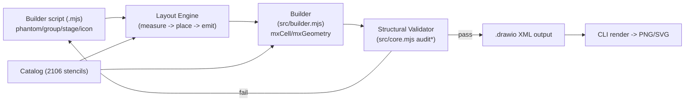
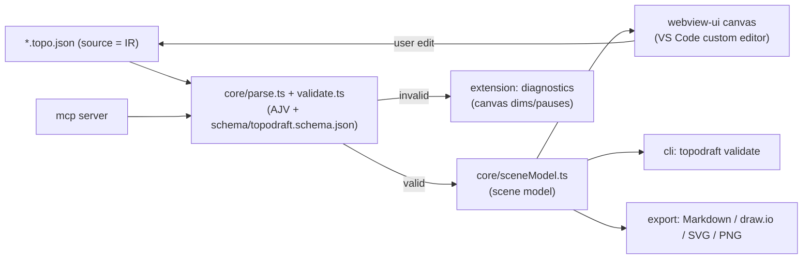
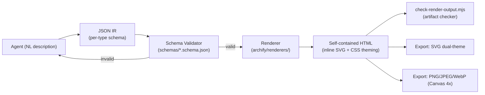
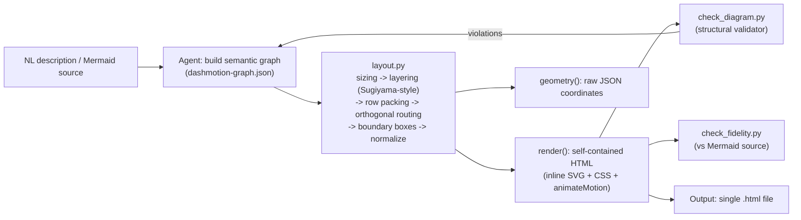

# Weekly Research Scan — Diagram Tooling / Visual DSL (2026-07-15)

## Tóm tắt (Executive Summary)

- Tuần này không có "next Mermaid/D2" nào nổi lên; các repo mới hoạt động mạnh nhất đều là **agent-facing tooling** — công cụ để AI coding agent (Claude Code, Codex...) sinh diagram chính xác, chứ không phải ngôn ngữ DSL mới cho con người viết tay. Điều này phản ánh xu hướng chung: diagram-as-code đang bị "bao vây" bởi lớp validator + schema để trị hallucination của LLM, không phải bởi layout algorithm mới.
- Kỹ thuật đáng chú ý nhất là **`dashmotion`**: một layout engine Python thuần stdlib tách biệt hoàn toàn "semantics" (LLM quyết định) khỏi "geometry" (script tính toán tất định) — cùng triết lý "renderer dumb, data thông minh" mà kymostudio đang theo, và có animation contract (`stroke-dashoffset` + `animateMotion`) rất gần với `--animate` của kymo.
- **`network-topo-draft`** (TopoDraft) là ví dụ tốt nhất về domain-specific IR (network topology) với đồng bộ hai chiều canvas↔JSON text và MCP server cho agent — mô hình đáng tham khảo nếu kymostudio muốn có editor trực quan sau này.

## Mục lục

1. [drawio-ai-kit (sparklabx)](#1-drawio-ai-kit-sparklabx)
2. [network-topo-draft / TopoDraft (kazukifujiwara)](#2-network-topo-draft-topodraft-kazukifujiwara)
3. [archify (tt-a1i)](#3-archify-tt-a1i)
4. [dashmotion (Northwestern-caddo190 / csthink)](#4-dashmotion-northwestern-caddo190--csthink)

---

## 1. drawio-ai-kit (sparklabx)

`https://github.com/sparklabx/drawio-ai-kit`

### §1 Quick Context

Bộ layout engine + validator giúp AI agent sinh sơ đồ draw.io (AWS/Azure/GCP/BPMN) đúng cấu trúc bằng cách khai báo topology thay vì gõ toạ độ tay. Tech stack: JavaScript (Node ≥18, ESM `.mjs`, zero runtime dependency) cho engine/CLI, Python 3.11 chỉ dùng để build-time sinh catalog icon. Output: file `.drawio` (mxGraph XML), có thể render ra PNG/SVG qua pipeline riêng. Repo health: 460 sao, 88 fork, 1 issue mở, release v1.0.0 ngày 2026-07-10, có `.github/workflows/` (CI) và bộ `test/`. Phân phối: npm package (`drawio-ai-kit`, bin `drawio-ai`) + 5 "Domain Skills" cho Claude/Codex.

### §2 Architecture Deep-dive

**A. Component inventory**
- `Catalog` (`catalog/`, nạp bởi `src/core.mjs:loadCatalog`) — ánh xạ 2.106 stencil ID (AWS 983, Azure 626, GCP 216, OSS 281) sang taxonomy + màu chính thức.
- `Core` (`src/core.mjs`) — search/style cho icon & group, và toàn bộ **Structural Validator** (`validateDiagram`, `auditAesthetics`, `auditAwsConventions`, `auditEdgeLabels`, `auditGeometry`, `auditEdges`, `auditBpmn`) — parse XML bằng regex (không DOM).
- `Layout Engine` (`src/layout-engine.mjs`) — thuật toán measure→place→emit 3 pha, xuất cây layout thành lệnh gọi Builder.
- `Layout` (`src/layout.mjs`) — các node creator khai báo: `icon`, `box`, `group`, `frame`, `phantom`, `grid`, `pool` (BPMN swimlane), cùng các theme creator (`stage`, `band`, `subnet`, `endpoint`...).
- `Builder` (`src/builder.mjs`) — API `d.link()` v.v. để build cây diagram + cạnh nối, có cờ `flow: true` cho cạnh animated.
- `BPMN` (`src/bpmn.mjs`) — hỗ trợ shape/pool riêng cho BPMN.
- `CLI` (`src/cli.mjs`, `src/cli-lib.mjs`) — 7 lệnh: `search`, `style`, `validate`, `audit`, `render`, `categories`, `principles`.

**B. Pipeline** — 1) Agent/user viết file `.mjs` khai báo cây `phantom → group → stage → icon` bằng Layout API (vd `examples/aws/build_pipeline.mjs`); 2) `layout-engine.mjs` chạy measure (bottom-up, đo kích thước icon/box theo ký tự) → place (top-down, gán x/y, căn giữa theo hàng/cột) → emit (sinh lệnh Builder, phantom không sinh cell mà tái gắn con vào cha gần nhất); 3) Builder xuất `mxCell`/`mxGeometry` thành file `.drawio` XML; 4) `validateDiagram`/`audit*` chạy static analysis kiểm tra stencil sai, chồng lấn hình học, style lệch chuẩn; 5) CLI `render` xuất ảnh; nếu audit fail, vòng lặp "vision self-correction" (render PNG → agent xem lại → sửa) được mô tả trong README.

**C. Data model/IR**: cây node bất biến trong quá trình measure (đọc), biến đổi 1 chiều measure→place→emit — không có khái niệm "hạ IR" kiểu TALA của D2; catalog là JSON tĩnh nạp 1 lần và cache.

**D. Input language design**: không phải text DSL mà là **JS builder API** (hàm lồng nhau `phantom(...)`, `group(...)`) — giống kiểu "code as config" của mingrammer/diagrams hơn là ngôn ngữ dòng lệnh riêng. Không có BNF/EBNF. Error reporting qua validator trả `{ok, errors[], warnings[]}` với message mô tả rõ vi phạm (stencil không hợp lệ, ID trùng...).

**E. Layout algorithm**: constraint-based/flexbox-style (không phải force-directed hay Sugiyama) — measure/place là thuật toán "auto-sizing container" quen thuộc từ CSS flexbox, áp cho 6 kiểu topology khai báo (`pipeline`, `hierarchy`, `network`, `hubspoke`, `mesh`, `sequence`). Edge routing: engine chọn straight hoặc "corridor path" (dạng orthogonal) tuỳ vị trí tương đối — không xác định chi tiết thuật toán tránh giao cắt.

**F. Rendering**: single backend mxGraph XML (draw.io format), không phải SVG trực tiếp — export ảnh qua công cụ ngoài. Animation: cờ `flow: true` trên cạnh (không xác định cơ chế render động cụ thể — chỉ thấy flag trong Builder API, chưa thấy code SVG animation).

**G. Extensibility**: thêm stencil mới = thêm entry vào catalog (`data/`, build bằng script Python `gen:catalog`), không cần sửa engine — đúng triết lý "registry-driven". Theme qua `theme.mjs`.

**H. Dev experience**: CLI đầy đủ (search/validate/render), không có VS Code extension/LSP, không watch mode được ghi nhận trong README.

### §3 Architecture Diagram

### §4 Verdict

Ý tưởng đáng học nhất cho kymostudio: **validator tách biệt khỏi renderer**, chạy static-analysis trên output (chồng lấn hình học, style lệch chuẩn) — kymostudio hiện có golden-SVG test nhưng chưa có "audit" ngữ nghĩa kiểu này để bắt lỗi layout tinh vi (label bị cắt, cạnh giao icon...). Cờ `flow: true` cho cạnh động là gợi ý hay để đối chiếu với `--animate` của kymo. Điểm yếu: đây không phải SVG renderer thật (chỉ xuất XML draw.io), nên rendering/animation craft không áp dụng trực tiếp. Câu hỏi mở: cơ chế "vision self-correction loop" (render→agent xem→sửa) có thật sự chạy tự động hay chỉ là hướng dẫn prompt. Verdict: **glance only** — học validator pattern, không cần đọc sâu layout engine (đã là flexbox quen thuộc).

---

## 2. network-topo-draft / TopoDraft (kazukifujiwara)

`https://github.com/kazukifujiwara/network-topo-draft`

### §1 Quick Context

Editor mạng "network-topology-as-code" cho VS Code: sửa file `*.topo.json` bằng canvas kéo-thả hoặc bằng text (kể cả AI agent), hai chế độ đồng bộ realtime hai chiều. Tech stack: TypeScript monorepo (core/webview-ui/extension/cli/mcp/protocol/app-view), esbuild, Vitest, chỉ 1 runtime dep (`jsonc-parser`). Output: JSON topology + export Markdown/draw.io/SVG/PNG. Repo health: version `0.0.1`, Apache-2.0, có README song ngữ (EN/JA), CI qua `.github/workflows/`, test coverage qua Vitest — không xác định số sao/contributor (không hiển thị trong kết quả fetch). Distribution: VS Code Marketplace extension + npm CLI (`topodraft validate`) + MCP server.

### §2 Architecture Deep-dive

**A. Component inventory**
- `core` (`packages/core/src/`) — model thuần TS không phụ thuộc DOM/Node: `model.ts` (kiểu `Topology`, `Device`, `Network`, `Cable`...), `parse.ts`, `serialize.ts`, `validate.ts`, `geometry.ts`, `sceneModel.ts`, `operations.ts`, `glyphs.ts`, `cidr.ts`, `generators/`.
- `webview-ui` — render canvas trong VS Code webview, panel thuộc tính.
- `extension` — host VS Code, custom editor, cơ chế đồng bộ text↔canvas, diagnostics.
- `cli` — lệnh `topodraft validate` chạy headless.
- `mcp` — MCP server cho agent (Claude Code, Copilot) thao tác trực tiếp trên model.
- `protocol` — kiểu message dùng chung giữa webview và host.
- `schema/topodraft.schema.json` — JSON Schema chính thức cho format v1.

**B. Pipeline**: 1) Người dùng/agent mở `*.topo.json` trong VS Code → custom editor kích hoạt canvas; 2) mọi thao tác canvas (kéo device, nối cable) được `sceneModel.ts`/`operations.ts` biên dịch thành patch JSON, ghi lại vào text document qua `serialize.ts`; 3) `parse.ts` + `validate.ts` (dùng AJV, theo `schema/topodraft.schema.json`) parse lại JSON mỗi khi text đổi, sinh diagnostics (dòng/cột cụ thể) nếu sai; 4) nếu hợp lệ, canvas re-render; nếu không, canvas "dims and pauses" cho tới khi text hợp lệ trở lại; 5) `cli topodraft validate` chạy cùng logic validate headless trong CI; 6) export lệnh sinh Markdown/draw.io/SVG/PNG từ model đã validate.

**C. Data model/IR**: `Topology` là cấu trúc TS thuần (interface, không phải class), gồm `devices[]`, `provider_networks[]`, `networks[]`, `cables[]`, `circuits[]`, `logical_links[]`. Đây chính là bản thân file nguồn (JSON) — không có bước "hạ xuống IR thấp hơn"; model = IR = format lưu trữ. VRF của device được **derive** (suy ra) từ 3 nguồn: khai báo `vrfs[]` tường minh, VRF gán ở interface, và VRF từ endpoint của logical link — theo thứ tự chèn (insertion order), một dạng resolve pass giống `alignment.py` của kymostudio nhưng cho domain mạng.

**D. Input language design**: không phải DSL text tự do mà là **JSON Schema có kiểm định AJV** — người dùng viết JSON trực tiếp (được hỗ trợ bằng canvas). Lỗi báo theo range dòng/cột cụ thể (`jsonc-parser` để map lại vị trí text ↔ JSON path), kèm gợi ý sửa cho field sai chính tả/tên không hợp lệ — thiết kế rõ ràng nhắm tới cả agent lẫn người.

**E. Layout algorithm**: không xác định rõ có auto-layout thuật toán (force-directed/hierarchical) hay không — README chỉ đề cập `position coordinates` trên từng `Device`, gợi ý vị trí là do người dùng đặt tay trên canvas (user-specified), không thấy bằng chứng về thuật toán tự động sắp xếp.

**F. Rendering**: pluggable — webview canvas (trong-editor), CLI export ra draw.io XML, SVG/PNG, Markdown. Không có animation.

**G. Extensibility**: thêm loại thiết bị mới = mở rộng `iconKey()` pattern-matching trong `glyphs.ts`/`model.ts`; theme không xác định.

**H. Dev experience**: đây là điểm mạnh nhất — VS Code custom editor thật, đa ngôn ngữ UI theo VS Code locale, lệnh sinh `AGENTS.md` tự động chứa toàn bộ format contract cho agent, MCP server cho phép agent đọc/sửa có structured diagnostics ngay sau khi edit, undo/redo native VS Code.

### §3 Architecture Diagram

### §4 Verdict

Điểm đáng học nhất cho kymostudio: **mô hình "text là nguồn sự thật duy nhất, canvas chỉ là view đồng bộ hai chiều"** — nếu kymostudio từng cân nhắc thêm visual editor cho `.kymo`, đây là blueprint tốt (source luôn là `.kymo`/JSON, editor ghi patch ngược lại text, không tồn tại state canvas rời khỏi text). Cách derive VRF theo insertion order cũng gợi nhớ đến `alignment.py`'s multi-pass resolver của kymostudio — một ví dụ khác về "resolve field suy ra từ nhiều nguồn theo thứ tự ưu tiên rõ ràng". Red flag: version 0.0.1, chưa rõ layout tự động (E) hay số liệu sao/cộng đồng — dự án còn rất sớm. Câu hỏi mở: MCP server có tránh race-condition giữa agent-edit và người dùng-edit đồng thời không. Verdict: **study deeper** phần đồng bộ text↔canvas nếu kymostudio làm editor; phần còn lại glance only.

---

## 3. archify (tt-a1i)

`https://github.com/tt-a1i/archify`

### §1 Quick Context

Agent skill (Claude/Codex/opencode) biến mô tả tiếng Anh thành sơ đồ HTML/SVG tự chứa có toggle theme và xuất đa định dạng tới 4× độ phân giải. Tech stack: JavaScript thuần (78.9%) + HTML, zero runtime dependency, Canvas API để raster hoá. Output: HTML tự chứa (SVG inline) → PNG/JPEG/WebP/SVG. Repo health: 4.6k sao, 411 fork, 5 issue mở, 1 PR mở, 11 release, mới nhất v2.10.0 (2026-07-05), rất active (cập nhật vài giờ trước lúc khảo sát). Distribution: `npx skills add tt-a1i/archify -g` (agent skill) hoặc CLI độc lập (`bin/archify.mjs`).

### §2 Architecture Deep-dive

**A. Component inventory**
- `archify/schemas/` — 6 JSON Schema riêng theo loại diagram: `architecture.schema.json`, `dataflow.schema.json`, `lifecycle.schema.json`, `sequence.schema.json`, `workflow.schema.json`, dùng chung `common.schema.json` (định nghĩa `id`, `point`, `componentType`...).
- `archify/renderers/` — bộ renderer theo loại diagram, sinh HTML/SVG từ IR đã validate.
- `bin/archify.mjs` — CLI hợp nhất, điều phối build → validate → render → export.
- `archify/scripts/` — hỗ trợ (không xác định chi tiết từng script ngoài `check-render-output.mjs` ở root `scripts/` — artifact checker hậu-render).
- `archify/assets/` — CSS custom properties cho theming.

**B. Pipeline**: 1) Agent (Claude...) viết ra JSON IR mô tả node/edge theo 1 trong 6 schema (architecture/workflow/sequence/dataflow/lifecycle); 2) `bin/archify.mjs` chạy schema validation (AJV-kiểu) đối chiếu `schemas/*.schema.json`; 3) renderer tương ứng loại diagram nhận IR đã hợp lệ, sinh HTML với SVG inline + CSS custom properties cho theme; 4) `scripts/check-render-output.mjs` là "post-render artifact checker" bắt lỗi hậu kỳ; 5) export pipeline: clone SVG, inline style, resolve theme variable, raster hoá qua Canvas API ở 4× hoặc xuất SVG dual-theme dùng `@media (prefers-color-scheme)`; 6) file HTML tự chứa xuất hiện, mở trực tiếp trong trình duyệt.

**C. Data model/IR**: JSON IR tường minh theo schema — đây là điểm khác biệt lớn nhất so với drawio-ai-kit (builder API) và gần với triết lý "IR trung gian rõ ràng" của D2's TALA hơn (dù không xác định archify có "hạ IR" thêm cấp nữa hay không — có vẻ IR JSON → renderer trực tiếp, 1 cấp).

**D. Input language design**: không phải text DSL người dùng gõ tay — IR JSON do **agent sinh ra**, người dùng tương tác bằng tiếng Anh tự nhiên rồi agent dịch sang JSON đúng schema. Error reporting: schema validation trả lỗi có "actionable validator hints" (theo README) hướng dẫn agent sửa field nào.

**E. Layout algorithm**: **không dùng thuật toán tự động** (không force-directed/hierarchical) — README nói rõ "Claude handles semantic layout decisions rather than relying on automatic force-directed algorithms"; có tuỳ chọn grid placement thủ công (`row`/`col`, từ v2.10) hỗ trợ agent đặt vị trí lưới. Đây là thiết kế cố ý: giao layout cho LLM quyết định ngữ nghĩa, engine chỉ hỗ trợ constraint lưới cơ bản.

**F. Rendering**: đơn backend nhưng multi-format export phong phú (SVG dual-theme, PNG/JPEG/WebP qua Canvas 4×). Animation: không xác định có animation thật trong SVG hay chỉ CSS transition cho theme toggle — README chỉ nói "theme toggle" và "clipboard copy", không có bằng chứng animateMotion/dashoffset.

**G. Extensibility**: thêm loại diagram mới = thêm 1 schema + 1 renderer tương ứng (kiến trúc theo cặp schema/renderer song song, dễ mở rộng). Theme qua CSS custom properties, dark/light chuyển bằng biến CSS.

**H. Dev experience**: CLI thống nhất qua `bin/archify.mjs`; không VS Code extension/LSP; không watch mode xác định; nổi bật là "self-repo dogfooding" (ví dụ trong `examples/archify-repo.html` render chính kiến trúc archify).

### §3 Architecture Diagram

### §4 Verdict

Kỹ thuật đáng lấy nhất cho kymostudio: **cặp schema/renderer song song theo loại diagram** (architecture/workflow/sequence/dataflow/lifecycle) — kymostudio hiện có 1 `to_svg.py` dùng chung cho mọi kiểu diagram; nếu cần thêm rendering-mode chuyên biệt (vd sequence diagram riêng), pattern "1 schema JSON + 1 renderer file, dùng chung `common.schema`" là gọn và dễ audit. Export pipeline dual-theme SVG (`@media (prefers-color-scheme)` nhúng ngay trong 1 file SVG) đáng tham khảo cho `to_svg.py` nếu kymostudio muốn hỗ trợ dark mode mà không sinh 2 file riêng. Red flag: layout hoàn toàn phó mặc cho LLM (không có auto-layout thật), nên không có gì để học về thuật toán layout — đây là điểm khác biệt cốt lõi với triết lý kymostudio (`alignment.py` tự động resolve). Verdict: **glance only** cho phần layout, nhưng **đáng xem** phần export multi-format/dual-theme.

---

## 4. dashmotion (Northwestern-caddo190 / csthink)

`https://github.com/Northwestern-caddo190/dashmotion`

### §1 Quick Context

Claude Agent Skill biến mô tả tiếng Anh hoặc sơ đồ Mermaid thành **sơ đồ SVG có chuyển động** (dot chạy dọc theo cạnh, đường nối dashed animate) trong 1 file HTML tự chứa. Tech stack: HTML (78.9%) + Python thuần stdlib (21.1%, không dependency ngoài) cho layout engine; output SVG/CSS animation + `animateMotion`, không JS runtime nào khác. Repo health: 0 sao (rất mới), MIT license, có `CHANGELOG.md`, README song ngữ EN/ZH-CN — không xác định CI/test badge (không thấy `.github/workflows` trong tree, nhưng có `eval/` — thư mục đánh giá riêng). Distribution: `npx skills add csthink/dashmotion -a claude-code -g` (Claude Skill), không phải package PyPI/npm độc lập.

### §2 Architecture Deep-dive

**A. Component inventory**
- `skills/dashmotion/SKILL.md` — "orchestrator" mô tả quy trình 6 bước cho agent, chỉ định rõ ranh giới: agent quyết định ngữ nghĩa (semantics, copy, node type), script quyết định hình học (geometry).
- `skills/dashmotion/scripts/layout.py` — **layout engine tất định**, thuần Python stdlib (`import json, sys`), chứa các class `Node`, `Edge`, `Group`, `Layout` (orchestrator).
- `skills/dashmotion/scripts/check_diagram.py` — validator cấu trúc, chạy lặp tới khi in ra `0 violations`.
- `skills/dashmotion/scripts/check_fidelity.py` — đối chiếu output với Mermaid nguồn (khi input là `.mmd`) để đảm bảo không mất topology/label.
- `skills/dashmotion/references/`, `resources/` — không xác định chi tiết nội dung.
- `eval/` — bộ đánh giá riêng (không xác định cấu trúc cụ thể).

**B. Pipeline**: 1) Agent nhận mô tả tiếng Anh hoặc file Mermaid (`flowchart`/`graph`/`stateDiagram-v2`); 2) Agent parse ngữ nghĩa (node, edge, group, journey — chuỗi hop cần animate) thành `dashmotion-graph.json`, tự quyết node type/tier/copy; 3) Agent gọi `python3 scripts/layout.py graph.json --render <topic>-dashmotion.html` — **script, không phải agent, tính toán toạ độ**; 4) `layout.py` chạy 6 pha nội bộ (xem mục E) rồi emit HTML hoàn chỉnh (SVG + CSS + `<animateMotion>`); 5) agent chạy `check_diagram.py` (và `check_fidelity.py` nếu có nguồn Mermaid), sửa lặp tới khi "0 violations"; 6) file HTML tự chứa xuất hiện, mở trực tiếp trên trình duyệt, có nút pause/play tôn trọng `prefers-reduced-motion`.

**C. Data model/IR**: `Layout` (`scripts/layout.py`) là class orchestrator, mutable qua từng pha (sizing → layering → placement → routing → boundary → normalize) — mỗi pha ghi thêm thuộc tính hình học (`x, y, w, h`, `points`) lên cùng object `Node`/`Edge`/`Group`, giống style "resolve pass" nhiều lượt của `alignment.py` trong kymostudio hơn là compile xuống 1 IR thấp hơn tách biệt (không có khái niệm kiểu TALA của D2).

**D. Input language design**: input là **JSON đồ thị ngữ nghĩa** (`dashmotion-graph.json`, do agent tự sinh, không phải người dùng gõ tay theo grammar cố định) hoặc Mermaid text hiện có (được agent dịch lại). Không có BNF/EBNF publish. Error reporting: 2 lớp — `check_diagram.py` (structural, đếm violation cơ học) và `check_fidelity.py` (semantic, đối chiếu Mermaid gốc) — cả hai chạy lặp tới khi sạch, một dạng "compiler diagnostics as a loop" khá đặc trưng cho agent-facing tool.

**E. Layout algorithm — chi tiết nhất trong 4 repo tuần này**:
1. *Sizing* (`size_nodes`): đo text wrap tối đa 2 dòng, width theo ký tự (CJK 14px, ký tự hẹp như "i"/"l" 5px, ký tự rộng "m"/"W" 11px, mặc định 8px); height theo shape (pill 40px, step 44px/58px).
2. *Layering* (`assign_layers`): 2 chế độ — `tier` khai báo tường minh trong JSON, hoặc tính tự động bằng DFS phát hiện back-edge, longest-path trên DAG còn lại để định độ sâu layer (bản chất là **Sugiyama-style layering**, không xác định có bước crossing-minimization giữa các layer hay không — README nói rõ "within-layer crossing minimization not implemented").
3. *Row packing* (`place`): xếp ngang trong layer, nhóm liền kề theo thứ tự input, gap ngang 30px (flow)/40px (arch), gap dọc 56px co giãn quanh boundary group.
4. *Orthogonal routing* (`route`): phân cấp chiến lược theo quan hệ layer — cạnh xuống layer liền kề dùng L-route/dogleg; cạnh nhảy nhiều layer kiểm tra cột trống trước khi vẽ thẳng, nếu không thì dùng "vertical lane" bên lề; cạnh cùng layer/đi lên dùng rail dưới hàng; nhiều cạnh cùng gốc **gộp chung 1 lane có nhánh rẽ ngang** (trunk consolidation) để giảm rối — kỹ thuật này gần giống "trunk-lane edge staggering" mà `alignment.py` của kymostudio đã có (theo CLAUDE.md, pass 5).
5. *Boundary boxes* (`build_groups`): bounding box tính bottom-up (nested sâu nhất trước), padding 20px.
6. *Normalize*: dịch toạ độ về không âm, serialize cạnh sang SVG path (M/V/H/L).

**F. Rendering/output**: SVG + CSS, animation dùng 2 "contract" cố định: `stroke-dashoffset` cho dòng chảy trên connector, `<animateMotion>` cho dot di chuyển theo path (tốc độ 0.6–4s/cạnh, stagger + chained `begin`). Có 2 chế độ xuất: `geometry()` (JSON toạ độ thô cho renderer ngoài dùng) và `render()` (HTML hoàn chỉnh). Accessibility: bọc CSS animation trong `@media (prefers-reduced-motion: no-preference)`, có nút pause toggle SMIL.

**G. Extensibility**: thêm node type/edge kind mới = mở rộng style-layer trong `layout.py` (mapping type→fill/stroke, kind→class `flow`/`flow-async`/`flow-auth`) — không có plugin system tách biệt, sửa trực tiếp script.

**H. Dev experience**: không CLI độc lập ngoài lời gọi `python3 scripts/layout.py`, không VS Code extension/LSP, không watch mode — hoàn toàn vận hành qua vòng lặp agent (Claude Skill), không nhắm tới người dùng người viết tay DSL.

### §3 Architecture Diagram

### §4 Verdict

Đây là repo **đáng học sâu nhất tuần này cho kymostudio**, vì cùng chung địa hạt animated SVG. Ba điểm cụ thể áp dụng được: (1) triết lý "script owns geometry, LLM/DSL owns semantics" trùng khớp chính xác nguyên tắc "renderer dumb" của kymostudio — layout.py là bằng chứng sống cho việc tách bạch này vẫn khả thi ở scale 35+ component; (2) "trunk consolidation" (nhiều cạnh cùng gốc gộp 1 lane rồi rẽ nhánh) đáng đối chiếu trực tiếp với "fan-in/trunk-lane edge staggering" đã có trong `alignment.py` — có thể lấy chi tiết cài đặt (margin lane, tránh box) làm tham khảo cải tiến; (3) 2 animation contract (`stroke-dashoffset` cho luồng chảy, `animateMotion` cho dot di chuyển) là kỹ thuật SVG animation gọn, không cần JS, đáng so sánh với cơ chế `--animate` hiện tại của kymo xem có dùng chung được không. Red flag: 0 sao, dự án rất mới, chưa có CI xác nhận; tự thừa nhận chưa có crossing-minimization giữa các layer (hạn chế thật). Verdict: **study deeper** — đọc kỹ `layout.py` (đặc biệt phần `route()`) khi có dịp cải tiến edge routing của kymostudio.
