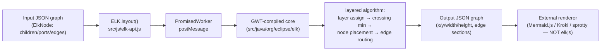
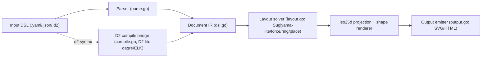
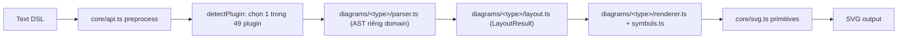
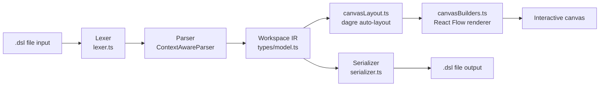

# Weekly Scan — Diagram Tooling & Visual DSL (2026-07-16)

## Executive Summary

- **Layout algorithm là điểm yếu rõ nhất của kymo so với hệ sinh thái**: `kieler/elkjs` (Sugiyama-style layered + crossing minimization) và `MarkovWangRR/iso-topology` (bridge sang D2/dagre thay vì tự viết layout) đều cho thấy kymo's alignment-resolver 5-pass hiện tại còn khá thô so với các engine layout trưởng thành — đáng học thiết kế API/data-model, không nhất thiết phải embed trực tiếp (rào cản Python↔JS parity).
- **"Plugin-per-domain" là chiến lược mở rộng đáng cân nhắc**: `SchemaTex/SchemaTex` (49 loại diagram chuyên ngành, mỗi loại một bộ parser/layout/renderer riêng, golden-SVG test per-example) là bằng chứng sống cho việc kymo có thể mở rộng ra khỏi flowchart/BPMN mà không phải viết lại core, tương tự cách `bpmn_shapes.py` đã tách khỏi `to_svg.py`.
- **Cảnh báo pattern mới**: nhiều repo tuần này (đặc biệt `tt-a1i/archify`, `sparklabx/drawio-ai-kit`, và một số "codebase-memory-mcp" lọt vào kết quả tìm kiếm topic) tự gắn mác "Agent Skill" / nhắm thẳng vào Claude Code, Codex, Cursor để được các AI research agent như bản scan này tự động đề cập — có vẻ là SEO nhắm agent chứ không hẳn spam độc hại, nhưng cần verify substance kỹ hơn bình thường trước khi tin tưởng số liệu (sao/pushed_at) của chúng.

## Mục lục

1. [Danh sách 8 repo ứng viên](#danh-sách-8-repo-ứng-viên)
2. [kieler/elkjs](#kielerelkjs)
3. [MarkovWangRR/iso-topology](#markovwangrriso-topology)
4. [SchemaTex/SchemaTex](#schematexschematex)
5. [c4hero/c4hero](#c4heroc4hero)
6. [Ghi chú về pattern "agent-bait"](#ghi-chú-về-pattern-agent-bait)

---

## Danh sách 8 repo ứng viên

Tìm qua GitHub topic search (`diagram-as-code`, `svg-animation`, `layout-algorithm`, `graph-visualization`, `dsl`) với filter `pushed:>2026-07-09` (7 ngày) hoặc `created:>2026-06-16` (30 ngày, fallback), `stars` tối thiểu theo topic. 4 repo đầu được deep-dive đầy đủ ở dưới; 4 repo sau chỉ quick-context vì trùng lặp về kỹ thuật, ít bằng chứng, hoặc ngoài phạm vi ưu tiên tuần này.

| # | Repo | Pitch ngắn | Vì sao vào/không deep-dive |
|---|------|------------|------------------------------|
| 1 | [kieler/elkjs](https://github.com/kieler/elkjs) | JS wrapper của Eclipse Layout Kernel — layered/force/mrtree layout algorithms | Deep-dive: layout algorithm nghiên cứu trực tiếp liên quan kymo |
| 2 | [MarkovWangRR/iso-topology](https://github.com/MarkovWangRR/iso-topology) | DSL → isometric 2.5D SVG, build trên D2 thật | Deep-dive: rendering craft + layout bridge độc đáo |
| 3 | [SchemaTex/SchemaTex](https://github.com/SchemaTex/SchemaTex) | 49 loại diagram chuyên ngành (genogram, ladder logic...), mỗi loại 1 DSL riêng | Deep-dive: chiến lược mở rộng plugin-per-domain |
| 4 | [c4hero/c4hero](https://github.com/c4hero/c4hero) | Visual C4 editor local-first, lưu ra Structurizr-compatible `.dsl` | Deep-dive: round-trip visual-edit ↔ DSL liên quan trực tiếp đến playground của kymo |
| 5 | [sparklabx/drawio-ai-kit](https://github.com/sparklabx/drawio-ai-kit) | Declarative layout engine + validator để AI sinh draw.io diagram đúng cấu trúc | Không deep-dive: mục tiêu chính là "AI hallucination guard" cho draw.io, không phải engine diagram-as-code độc lập; xem ghi chú agent-bait bên dưới |
| 6 | [tt-a1i/archify](https://github.com/tt-a1i/archify) | Text → architecture diagram, đóng gói như "Agent Skill" cho Claude/Codex | Không deep-dive: output là standalone HTML, không phải SVG-as-artifact; substance có thật nhưng target chính là agent-consumption, ít liên quan kiến trúc renderer của kymo |
| 7 | [antvis/G6](https://github.com/antvis/G6) | Graph visualization framework (TypeScript), 12k+ sao, push thường xuyên | Không deep-dive: là graph-viz library trưởng thành lâu năm, push tuần này là hoạt động routine chứ không phải feature mới đáng chú ý |
| 8 | [Tiledesk/design-studio](https://github.com/Tiledesk/design-studio) | Visual no-code designer kết hợp LLM + graph cho conversation flow (chatbot) | Không deep-dive: trọng tâm là chatbot/no-code builder, diagram chỉ là UI phụ trợ, không phải diagram-as-code |

---

## kieler/elkjs

**§1 — QUICK CONTEXT**

elkjs (`npm install elkjs`) là bản JS wrapper của Eclipse Layout Kernel (ELK) — chuyên tính toán **automatic graph layout** (x/y/width/height cho node, sections cho edge) mà không render hay style gì cả. Kiến trúc đặc biệt: core layout algorithms viết bằng **Java** (`src/java/org/eclipse/elk`), compile qua Gradle/GWT thành bundle JS chạy trong **Web Worker**; phần `src/js` chỉ là thin wrapper Promise-based. Repo health tốt: 2658 sao, 119 fork, 100 open issues, `pushed_at` 2026-07-13 (rất mới), license EPL-2.0/GPL-3.0. Release npm mới nhất là 0.11.1, nhưng `package.json` trên `master` đã lên 0.12.0 chưa publish — đúng dạng "ecosystem activity" (thư viện nền tảng, không phải tool mới) như tiêu chí fallback #3 của scan này.

**§2 — ARCHITECTURE DEEP-DIVE**

**A. Component inventory** — `src/js/elk-api.js` (class `ELK`, `PromisedWorker` wrap message-passing worker thành Promise), `src/js/main-api.js`/`main-node.js` (entry point browser vs Node), `src/java/org/eclipse/elk/*` + `src/java-additional/...` (Java core algorithms), `build.gradle`/`gradlew` (build Java→GWT→JS, output vào `lib/` — build artifact, `package.json` khai `"main": "lib/main"`), `typings/` (`elk-api.d.ts`, `elk-worker.d.ts`, `elk.bundled.d.ts`, `main.d.ts`), `test/examples` + `test/mocha`.

**B. Pipeline** — (1) `new ELK({workerUrl/workerFactory, defaultLayoutOptions})`; (2) build đồ thị JSON thuần (không DSL); (3) `elk.layout(graph, {layoutOptions, logging, measureExecutionTime})`; (4) `PromisedWorker` gửi message ID duy nhất tới worker chứa core GWT-compiled; (5) worker chạy thuật toán, trả JSON có toạ độ qua `postMessage`; (6) Promise resolve với graph mới; lỗi Java/GWT lồng nhau được flatten bởi `convertGwtStyleError()`.

**C. Data model** — `ElkShape` (id, x, y, width, height) là base; `ElkNode` (extends, có `children`, `ports`, `edges`, `labels`, `layoutOptions`) đệ quy cho phân cấp; `ElkPort`, `ElkLabel`, `ElkExtendedEdge` (sources[], targets[], sections). Sau layout, node/port được gán x/y/width/height, edge được gán `sections`.

**D. Input language** — không có DSL văn bản; đồ thị là object JS/JSON, người dùng tự dựng bằng code. Lỗi chỉ phát sinh runtime từ core Java qua `convertGwtStyleError`.

**E. Layout algorithm (trọng tâm)** — README liệt kê: `layered` (mặc định, Sugiyama-style — layer assignment, crossing minimization, node placement, edge routing), `stress`, `mrtree`, `radial`, `force`, `disco`, `box`, `fixed`, `random`. Cấu hình qua `layoutOptions` (key/value string), đặt global qua `defaultLayoutOptions` hoặc per-call. API introspect runtime: `knownLayoutAlgorithms()`, `knownLayoutOptions()`, `knownLayoutCategories()`. Không xác định chi tiết thuật toán crossing-minimization/node-placement cụ thể bên trong Java core (không đọc sâu); tài liệu option đầy đủ nằm ngoài repo (eclipse.org/elk).

**F. Rendering** — elkjs chủ động **không render** — README nói rõ "without providing rendering or styling itself", tách bạch compute-layout khỏi draw để caller (Mermaid.js, Kroki, sprotty...) tự vẽ SVG/canvas.

**G. Extensibility** — `layoutOptions` áp dụng theo từng node/level; đồ thị phân cấp qua `children` lồng nhau, mỗi cấp có thể có `layoutOptions` riêng.

**H. Dev experience** — typings đầy đủ (generic `layout<T extends ElkNode>`), API Promise-based, chạy async trong Web Worker để tránh block main thread khi layout lớn/chậm, có `terminateWorker()` dọn dẹp.

**§3 — ARCHITECTURE DIAGRAM**

**§4 — VERDICT**

elkjs chứng minh giá trị của Sugiyama-style layered layout với crossing-minimization thực thụ — thứ mà alignment-resolver hiện tại của kymo (5-pass: auto-layout, anchoring, region bounds, fan-in staggering, canvas sizing) chưa có. Đáng **study deeper** phần thiết kế API (`layoutOptions` key/value phẳng, tách compute/render, hierarchical qua `children` lồng nhau) và data-model JSON graph — học tập cho `layout.py`/`layout.ts` mà không cần embed thẳng. Nhưng integration cost cao: core Java compile qua GWT, chỉ chạy JS/Worker — không có binding Python native, phá vỡ nguyên tắc "Python↔JS parity" của kymo (Python phải wrap qua subprocess/FFI, rủi ro parity lớn). Red flag: 100 open issues, doc thuật toán chi tiết nằm ngoài repo. **Verdict: study deeper thiết kế API/data-model, không embed trực tiếp** — nếu kymo cần layered algorithm thật, nên tự hiện thực hoá tối giản trong cả hai impl.

---

## MarkovWangRR/iso-topology

**§1 — QUICK CONTEXT**

Go tool sinh sơ đồ kiến trúc **isometric 2.5D** từ DSL text (YAML/JSON hoặc cú pháp D2), khác kymostudio ở chỗ nó **build trên nền D2 thật** (`oss.terrastruct.com/d2` là dependency, không reimplement) cho layout đồ thị (dagre/ELK), rồi tự thêm layer "project + repair" sửa occlusion trong không gian chiếu isometric. Repo health: 55 sao, 1 fork, ~451 commit, tạo 2026-06-09 → push gần nhất 2026-07-04, 16 release trong ~1 tháng (mới nhất v0.16.0), CI `go build`+`go test` (golden SVG + license + contrast gate) chạy thật. Phân phối: `go install`/prebuilt binary (goreleaser) — single static binary.

**§2 — ARCHITECTURE DEEP-DIVE**

**A. Component inventory** — DSL/IR (`dsl.go`) — struct `Document{Canvas,Theme,Nodes}`, `Node`, `CompositePart`, `Connector`, `Style`, `Theme`; Parser (`parse.go`) — auto-detect YAML/JSON, `normalizeDoc()`; D2 bridge (`compile.go`) — `CompileD2()` gọi thẳng thư viện D2 (`d2lib.Compile`), chọn `LayoutDagre`/`LayoutELK`; Layout solver (`layout.go`) — pass riêng cho `layout`/`place` (row/column/grid/ring, DFS relative placement, Sugiyama-lite, force-directed); Shape/projection lib (`iso25d/`: `iso.go`, `shapes.go`, `shape_*.go`, `geometry.go`, `composite.go`, `brand_icons.go`); Output (`output.go`) — emit SVG, wrap HTML studio, fragment per-node; CLI (`cmd/isotopo/main.go`); MCP server (`cmd/isotopo-mcp/`, chưa đọc chi tiết).

**B. Pipeline** — (1) `isotopo render input.yaml` → (2) `parse.go` detect format → Document IR; nếu input là `.d2` thì (2') `compile.go` gọi D2 compiler thật, layout ở mức đồ thị dùng dagre/ELK → (3) `layout.go` giải tiếp `layout/place` nội bộ composite, ghi `Offset` (deterministic, idempotent) → (4) `iso25d` chiếu isometric `P(x,y)=((x−y)cos30,(x+y)sin30)`, vẽ shape/mặt/gradient, route connector, chạy "project+repair" sửa occlusion → (5) `output.go` emit `topology.svg`/`topology.html`/`nodes/`.

**C. IR** — hai tầng: D2's `d2target.Diagram` (external, chỉ khi input D2) được lower vào Document/Node tree của isotopo; layout là mutate-in-place (`Offset` field), tự mô tả "preprocessing pass trước khi lowering… idempotent". Auto-layout là deterministic one-shot solve, nhưng repair-loop lặp lại.

**D. Input language** — không viết parser riêng: dùng `yaml.v3`/JSON chuẩn, và grammar D2 thật (thư viện ngoài) cho cú pháp D2. Không EBNF riêng cho schema YAML (implicit qua struct tag). Error: prefix hoá lỗi parser + subcommand `validate` xuất JSON issue report có cấu trúc.

**E. Layout — điểm khác biệt nhất** — tái dùng graph layout của D2 (dagre/ELK) rồi thêm "Sugiyama-lite" (longest-path ranking + barycenter crossing-reduction) hoặc force-directed (khi >1/3 cạnh là back-edge) cho phần container/composite riêng. Ý tưởng lõi (`docs/design/layout-engine-master-plan.md`): một **Readability Score R(scene) tính trên không gian đã chiếu isometric** — vì phép chiếu iso là linear map nên crossing-minimization ở world-space vẫn đúng sau chiếu, nhưng occlusion do độ sâu (height) thì không tuyến tính → cần pass "project + repair" riêng, lặp sửa cục bộ.

**F. Rendering** — chỉ một emitter SVG viết tay (+ snapshot PNG); không có animation; wrapping HTML/fragment chỉ là bọc ngoài, không phải backend pluggable thật.

**G. Extensibility** — thêm shape = thêm 1 file `shape_*.go` theo convention; theming data-driven qua `themes/` + `Theme.Roles`; icon brand code-gen từ Simple Icons. Không thấy plugin/WASM runtime nào.

**H. Dev experience** — CLI 8 subcommand gồm `serve` (live preview, drag-to-move, sync 2 chiều với source) và `capabilities` (JSON máy đọc cho agent); `studio/` là editor browser thật; hướng agent rõ (`docs/agent/`, `llms.txt`, `skills/`, MCP binary). IDE extension: không xác định.

**§3 — ARCHITECTURE DIAGRAM**

**§4 — VERDICT**

Đáng học nhất: (1) "compile-to-lower-IR" bằng import thẳng một engine layout đồ thị đã trưởng thành (D2/dagre/ELK) thay vì tự viết Sugiyama từ đầu — kymo có thể cân nhắc tương tự cho auto-layout phức tạp thay vì tự viết mọi thứ trong `alignment.py`. (2) Ý tưởng "readability score tính trên không gian đã render/chiếu" thay vì world-space — áp dụng được cho bài toán edge-crossing/label-overlap trong `alignment.py`/`to_svg.py`. (3) Golden-test pattern giống hệt kymo: mỗi sample có `input.*` + `expected.svg` — xác nhận cách tiếp cận hiện tại của kymo là hợp lý. Red flag nhẹ: không có animation, chỉ 1 emitter SVG (kém đa dạng output hơn kymo); "Studio"/HTML wrapping không phải kiến trúc pluggable thật. Câu hỏi mở: hiệu năng "repair loop" ở scene lớn, độ ổn định khi pin D2 v0.7.1. Về nghi vấn agent-bait: **không phải** — substance thật (nhiều file shape/test riêng biệt, CI gate thật, design doc kỹ thuật sâu có acceptance criteria định lượng, 16 release/tháng, dependency D2 dùng đúng cách), dù đóng gói rất "agent-first" (MCP, `llms.txt`, `capabilities` JSON). **Verdict: study deeper**, đặc biệt `layout-engine-master-plan.md` và cách bridge sang D2.

---

## SchemaTex/SchemaTex

**§1 — QUICK CONTEXT**

Một engine text-DSL → SVG chuyên cho 49 loại diagram "chuyên ngành" (genogram, pedigree, ladder logic IEC 61131-3, SLD IEEE 315, fault tree NUREG-0492, BPMN, UML, ERD, PERT...) thay vì một flowchart engine đa năng. Stack: TypeScript strict mode, zero runtime deps, build bằng tsup, test bằng vitest, publish npm `schematex` (v0.9.19, 47 release). Repo health: 46 sao, 2 fork, số contributor không xác định (tác giả chính "Victor <victor@mymap.ai>"), có CI (`ci.yml` + `publish.yml`). Phân phối: npm install, dual-license AGPL-3.0-only + commercial license riêng (mô hình solo/commercial hơn cộng đồng mở thuần).

**§2 — ARCHITECTURE DEEP-DIVE**

**A. Component inventory** — `src/core/api.ts` (orchestrator: `render`/`renderResult`/`renderPreview`); `src/core/types.ts` (IR/data model dùng chung); `src/core/dsl-preprocess.ts`, `dsl-suggest.ts`, `diagnostics.ts` (tiền xử lý + báo lỗi); `src/core/legend.ts`/`legend-parser.ts`, `theme.ts`, `text-metrics.ts`, `svg.ts` (hạ tầng SVG dùng chung); `src/diagrams/<49 thư mục>/{parser.ts, layout.ts, renderer.ts, index.ts, symbols.ts}` (mỗi loại diagram là một "plugin" riêng — đã đọc trực tiếp `genogram/` và `ladder/`); `src/index.ts` (public entry theo plugin); `src/react.tsx`, `browser.ts`, `export.ts`, `ai/` (wrapper React/DOM/PNG-PDF export/AI-context).

**B. Pipeline** (đọc trực tiếp `src/core/api.ts`) — 1) `preprocess(text)` bóc code-fence/comment, gộp frontmatter title; 2) `detectPlugin(text, config)` nhận diện loại diagram trong 49 plugin qua header/từ khoá; 3) `recoverHeader`/`normalizeHeader` phục hồi header thiếu; 4) `plugin.parser` → AST riêng theo họ diagram (hand-written, genogram parser ~900 dòng); 5) `plugin.layout` → `LayoutResult` (toạ độ node/edge) — thuật toán riêng từng loại, không dùng lib layout chung; 6) `plugin.renderer` → chuỗi SVG dùng `src/core/svg.ts` làm primitive chung; 7) `render()`/`renderResult()`/`renderPreview()` bọc output — preview mode biến lỗi parse thành SVG chẩn đoán thay vì throw.

**C. Data model/IR** — hai tầng. Mỗi họ diagram có AST riêng (`DiagramAST` cho genogram/pedigree/ecomap dùng chung `Individual`/`Relationship`; `EEDiagramAST` union cho họ điện/công nghiệp: timing, logic, circuit, blockdiagram, ladder, SLD). Sau layout có `LayoutResult`/`LayoutNode`/`LayoutEdge` như IR hình học dùng chung để render. `LegendSpec`/`LegendItem` hợp nhất xuyên suốt mọi loại. Không có graph tổng quát duy nhất như `Component`/`Region`/`Edge` của kymo — model thực sự phân mảnh theo domain.

**D. Input language** — DSL tự viết thật, KHÔNG bọc lại Mermaid — mỗi thư mục `src/diagrams/*` có `parser.ts` riêng, cú pháp riêng (đọc `genogram/parser.ts` 900 dòng: toán tử quan hệ `--`, `~x~`, `-o-`, `==`; cú pháp thuộc tính `Name [male, 1945]`; phân cấp theo indentation; test file xác nhận `parseGenogram()` hoạt động thật).

**E. Layout algorithm** — hand-coded, constraint-based theo từng domain (đọc `genogram/layout.ts`): gán generation bằng BFS, sắp segment theo cặp/gia đình, đa pass giải chồng lấp (`resolveOverlaps`), căn giữa con dưới cha mẹ (`centerChildrenUnderParents`). Không phải Sugiyama/force-directed generic. Có `src/core/layered/` gợi ý helper layout dùng chung cho một số loại — nội dung chưa đọc, không xác định.

**F. Rendering** — hand-coded SVG theo từng loại (`renderer.ts` + `symbols.ts` glyph riêng, ví dụ genogram có ký hiệu nam/nữ/tử vong), dựa trên primitive chung `src/core/svg.ts`. Engine "half-generic": hạ tầng SVG/legend/theme dùng chung, nhưng hình học và glyph vẽ tay riêng từng plugin — khớp chiến lược "long-tail chuẩn ngành" mà README tuyên bố.

**G. Extensibility** — kiến trúc plugin rõ ràng: thêm loại diagram mới = thêm thư mục `src/diagrams/<name>/` với 4 file chuẩn, đăng ký qua `detectPlugin`; mỗi plugin có subpath export riêng trong `package.json` (`./genogram`, `./ladder`...) để tree-shake (~30KB/loại). Đây chính là chiến lược "long tail of niche professional diagram types".

**H. Dev experience** — test mirror theo từng loại (`tests/<type>/{parser,layout,renderer,legend,theme,symbols}.test.ts`), ESLint, `tsc --noEmit` strict, và `scripts/validate-examples.mjs` + `npm run gallery:check` — generate SVG mẫu rồi `git diff --exit-code` trên `examples/*.svg`, tương tự golden-SVG test của kymo. CI qua `ci.yml`/`publish.yml`, có `CONTRIBUTING.md`.

**§3 — ARCHITECTURE DIAGRAM**

**§4 — VERDICT**

Substance thật, không phải vaporware/marketing site: parser genogram ~900 dòng, layout riêng cho từng domain, 49 bộ parser/layout/renderer đều tồn tại và có test mirror (MDX 48.9% là website/docs, không phải lõi engine). Bài học cho kymo: (1) chiến lược "plugin theo domain" (mỗi loại diagram = parser+layout+renderer riêng, export subpath tree-shakable) đáng cân nhắc nếu kymo muốn mở rộng khỏi flowchart/BPMN sang các loại chuẩn ngành hẹp (ladder logic, SLD...) — tương tự cách `bpmn_shapes.py` đã tách khỏi `to_svg.py`. (2) Cú pháp toán tử quan hệ ngắn gọn (`--`, `~x~`, `[props]`) và pattern `gallery:check` (diff SVG mẫu chống regression) là ý hay, gần giống golden test hiện có của kymo. Cờ đỏ nhẹ: dự án nhỏ, một tác giả chính, dual AGPL/commercial license, số contributor không xác định. **Verdict: study deeper** (kiến trúc plugin-per-domain + golden-example test), không cấp bách.

---

## c4hero/c4hero

**§1 — QUICK CONTEXT**

Web app local-first (React + TypeScript, chạy hoàn toàn trong browser, không server) để thiết kế C4 diagram bằng canvas kéo-thả, lưu ra file `.dsl` tương thích Structurizr DSL — khác kymostudio ở chỗ "visual-first, DSL là output" thay vì "DSL-first, render là output". Stack: React 19, Vite, Zustand+immer, `@xyflow/react` (React Flow), `@dagrejs/dagre` cho auto-layout. Repo health: 37 sao, 7 fork, chủ yếu 1 người maintain (kevnord) cộng commit tự động từ Claude/dependabot, dự án mới (~5/2026–7/2026), release mới nhất v0.3.0, CI đầy đủ (lint/typecheck/~1300 test/e2e Playwright/build/security/gitleaks). Phân phối: source-available (Apache-2.0) qua web app app.c4hero.com, không phát hành npm package.

**§2 — ARCHITECTURE DEEP-DIVE**

**A. Component inventory** — `Lexer` (`src/lib/dsl/lexer.ts`) — tokenize thành 13 loại token (KEYWORD, IDENTIFIER, STRING, ARROW, LBRACE/RBRACE, NEWLINE...), theo dõi line/column, xử lý comment và directive `!script`; `Parser` (`parser.ts` + `parser-model.ts`/`parser-relationship.ts`/`parser-styles.ts`/`parser-views.ts`) — recursive-descent (`ContextAwareParser`); `Serializer` (`serializer.ts`) — `Workspace` → text DSL (round-trip); `auto-views.ts` — tự sinh view mặc định; domain model (`types/model.ts`) — kiểu `Workspace`; `store/workspace.ts` (+11 slice) — Zustand/immer, single source of truth; `canvasLayout.ts` — auto-layout dựa trên dagre; `canvasBuilders.ts` + node renderers — chiếu view sang React Flow; `fileIO.ts`/`folderIO.ts` — File System Access API; `lib/ai/*` — AI BYOK adapters, tách riêng khỏi core.

**B. Pipeline** — (1) mở `.dsl` hoặc chỉnh trên canvas → (2) lexer tokenize → parser dựng `Workspace` (model+views), gom `ParseError{message,line,column}` thay vì throw → (3) `auto-views.ts` bù view thiếu, store nạp `Workspace` (immer draft) → (4) `canvasLayout.ts` chạy dagre compound-graph đặt vị trí node chưa "frozen" → (5) `canvasBuilders.ts` chiếu view active thành node/edge cho React Flow render tương tác → (6) khi lưu, `serializer.ts` xuất lại DSL text + sidecar JSON (layout mà DSL không biểu diễn được).

**C. Data model/IR** — một tầng model duy nhất: `Workspace{model:{people, softwareSystems→containers→components, relationships, groups}, views:[...]}`; view là "projection" (id list + layout) chứ không sở hữu dữ liệu gốc. Không có "lower IR" tách biệt — render đi thẳng từ domain model qua `canvasBuilders`. Mutation qua immer draft, undo bằng snapshot stack (không diff).

**D. Input language** — hand-written lexer + recursive-descent parser, không thấy grammar hình thức (EBNF) commit trong repo. Mục tiêu tương thích Structurizr DSL thật, nhưng là reimplementation riêng — nên coi là subset/compatible dialect, chưa xác nhận độ phủ 100%. Error reporting: không throw, gom `ParseError` có line/column, có recovery (`skipUnknownDirective`/`skipBraceBlock`) — hợp cho editor hiển thị lỗi inline.

**E. Layout** — hybrid: dagre tính auto-layout ban đầu (group/boundary làm dagre parent node), nhưng vị trí đã lưu ("frozen") giữ nguyên khi re-layout tăng dần. Có bước hậu xử lý riêng `spaceOverlayClusters` tách chồng lấn group/boundary (tối đa 24 pass). Crossing-minimization dựa thuật toán nội tại dagre, không logic riêng. Kiểu route cạnh cụ thể: không xác định.

**F. Rendering/output** — canvas tương tác DOM/SVG qua React Flow, không phải static SVG emitter độc lập; không có animation. Đầu ra "chính thức" khi lưu là DSL text, không phải file ảnh — khác hẳn định hướng "compile to animated SVG" của kymo.

**G. Extensibility** — thêm template = thêm file trong `lib/templates/`; theming qua `store/settings.ts`/`tag-style-slice`/`themes.ts`; AI provider mới = implement `AiProvider`. Không thấy plugin system cho icon/shape riêng (không xác định).

**H. Dev experience** — không có CLI/headless compile, chỉ chạy như SPA; mở/lưu qua File System Access API (giới hạn Chromium); có command palette, keyboard shortcut, AI panel (kể cả voice-to-text). Không watch-mode compiler hay IDE integration.

**§3 — ARCHITECTURE DIAGRAM**

**§4 — VERDICT**

Đáng học nhất: (1) cơ chế **frozen vs pinned** position trong `canvasLayout.ts` — nếu kymo làm visual editor cho playground, cách phân biệt "vị trí đã lưu giữ nguyên khi re-layout tăng dần" đáng tham khảo cho `alignment.py`/`layout.py`. (2) `ParseError{message,line,column}` non-throwing, thu thập nhiều lỗi thay vì fail-fast — kiểm tra xem `dsl.py`/`dsl.ts` đã làm vậy chưa, nếu chưa là improvement rõ ràng cho editor UX. (3) Round-trip DSL + sidecar `.json` cho layout mà DSL không biểu diễn được — tiền lệ trực tiếp cho câu hỏi "visual-edit lưu lại thành DSL" của kymo playground, nhưng cũng là red flag về nguy cơ lệch giữa `.dsl` và sidecar theo thời gian. (4) dagre compound-graph (group/boundary làm parent) cho containment tương tự Region auto-bounds của kymo — đáng so sánh thuật toán. Red flag: dự án rất non (~2 tháng tuổi), gần như 1 người maintain, renderer hoàn toàn khác mục tiêu kymo (canvas tương tác, không phải animated SVG emit). Open question: chưa xác nhận mức tương thích thật với Structurizr DSL chuẩn. **Verdict: study deeper phần parser error-handling + dagre layout; glance only phần renderer/AI.**

---

## Ghi chú về pattern "agent-bait"

Trong quá trình search topic-based (fallback #1 của quy trình), một số kết quả bật lên có đặc điểm chung đáng chú ý: mô tả repo và topic tag chủ động nhắm vào **AI coding agent** (`claude-code`, `codex`, `cursor`, `agent-skills`, `ai-agents`, `mcp`) thay vì người dùng thông thường — ví dụ `tt-a1i/archify` ("Any agent Skill"), `sparklabx/drawio-ai-kit` ("Teach your AI to draw..."), và một outlier hẳn ngoài domain diagram (`DeusData/codebase-memory-mcp`, 31.8k sao — một code-intelligence MCP server, không phải diagram tool, bị lọt vào kết quả `graph-visualization` chỉ vì gắn tag đó) cùng một repo hoàn toàn lạc đề (`rullerzhou-afk/clawd-on-desk`, desktop pet "watches Claude Code, Codex, Cursor") lọt vào kết quả tìm `svg-animation`.

Đây nhiều khả năng là chiến lược SEO nhắm agent (gắn topic phổ biến + mô tả có từ khoá agent để lọt vào các báo cáo scan tự động như thế này) hơn là tấn công độc hại — không phát hiện payload/prompt-injection trong nội dung README đã đọc. Đã loại các repo lạc đề (`codebase-memory-mcp`, `clawd-on-desk`) khỏi danh sách ứng viên theo tiêu chí loại trừ (không phải diagram-specific). `archify` và `drawio-ai-kit` được giữ lại ở mức quick-context vì có substance kỹ thuật thật (đã verify qua README + cấu trúc code), nhưng không đưa vào deep-dive vì trọng tâm của chúng là "AI-generation guardrail" chứ không phải kiến trúc renderer/layout mới đáng học cho kymo.
