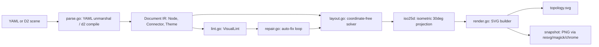
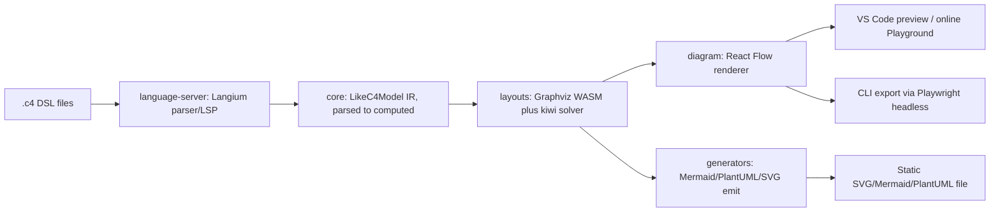
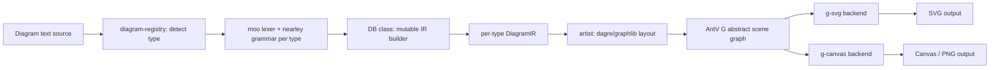
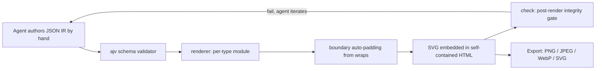

# Weekly Scan — Diagram Tooling & Visual Tech (2026-07-17)

**Executive summary:**
- Xu hướng rõ rệt tuần này: hàng loạt tool mới (`figdown`, `archify`, `monodraw-llm`, `iso-topology`) được thiết kế để **agent LLM là người viết/đọc chính**, không phải human — một số bỏ hẳn text-DSL parser và thay bằng JSON Schema + validate/repair loop cho agent tự sửa lỗi.
- Không tool nào tìm được có built-in **animated SVG** như kymostudio — cả LikeC4 lẫn pintora đều thiếu, đây vẫn là điểm khác biệt cạnh tranh thực sự.
- Đáng chú ý nhất về kỹ thuật layout: `iso-topology`'s coordinate-free constraint solver (`place: {rightOf, gap}`) + phép chiếu isometric 30° chỉ ~3 dòng code — ý tưởng dễ tách ra làm output mode mới cho kymo.

## Mục lục
1. [iso-topology](#1-iso-topology-markovwangrriso-topology) — isometric 2.5D diagram-as-code, agent-native
2. [LikeC4](#2-likec4-likec4likec4) — C4-model DSL trên nền Langium
3. [pintora](#3-pintora-hikerpigpintora) — multi-diagram-type text-to-diagram, dual canvas/SVG
4. [Archify](#4-archify-tt-a1iarchify) — JSON-IR "agent skill", không có text-DSL parser

**Candidates khác đã rà nhưng không deep-dive** (đủ tiêu chí thời gian/relevance nhưng evidence mỏng hơn hoặc trùng lặp ý tưởng với 4 repo trên): `figdown` (FigDown/figdown — markdown-native dual-reader format, 0 sao, giai đoạn thiết kế, chưa có release), `DrakoFlow` (pazvanti/DrakoFlow — offline-first text-to-diagram, 10 sao), `xaligo-vscode-extension` (.xal DSL cho AWS architecture, 1 sao), `arkitecture` (kurrik/arkitecture — Go DSL tách semantics/layout hai lớp, v0.1.0 mới ra 12/07/2026), `monodraw-llm` (p404/monodraw-llm — ASCII → native Monodraw format qua agent skill, 0 sao), `ARKHE` (Go binary quản trị C4 catalog với LSP+WASM, evidence gián tiếp qua GitHub topic page).

---

## 1. iso-topology (`MarkovWangRR/iso-topology`)

### §1 Quick Context
Sinh diagram kiến trúc dạng **isometric (2.5D)** từ text DSL — khác biệt chính so với Mermaid/D2 (flat 2D) là thể hiện tự nhiên các hệ thống nhiều tầng (edge/mid-tier/data) và node xếp chồng (replica, HA). Tech stack: **Go 1.25**, output SVG thuần (không cần browser/font), có d2-shorthand tự convert qua d2 compiler thật. Repo health: 55 sao, 1 fork, tác giả đơn (single-author), 24 release (mới nhất v0.16.0, 04/07/2026), Apache-2.0. Phân phối: static Go binary (`isotopo`, `isotopo-mcp`), không qua npm/PyPI.

### §2 Architecture Deep-Dive
**A. Component inventory** — root package: `dsl.go` (types `Document/Node/CompositePart/Connector/Layout/Place/Theme`), `parse.go`, `compile.go` (`CompileD2` — chạy compiler d2 thật rồi convert output sang IR chung), `layout.go` (solver coordinate-free), `lint.go` (`VisualLint`), `repair.go` (`RepairScene`), `render.go` (SVG builder). `iso25d/` là core hình học/chiếu (`iso.go`, `geometry.go`, per-shape files, `brand_icons.go` nhúng Simple Icons). `cmd/isotopo` (CLI) và `cmd/isotopo-mcp` (MCP server cho agent). `studio/` là editor JS/HTML thuần, không framework.

**B. Pipeline** — `isotopo render` → `parse.go` unmarshal YAML (hoặc `compile.go` chạy d2 compiler thật cho input `.d2`) thành `Document` IR chung → `layout.go` giải các ràng buộc `place`/`layout` thành world coordinates → `VisualLint` phát hiện lỗi chồng lấn → `render.go` gọi `iso25d.RenderComposite` vẽ từng node rồi ghép connector/label → SVG. Agent loop riêng: `validate` → `repair` (tối đa 16 vòng lặp, rollback nếu không cải thiện) → `render`.

**C. Data model/IR** — `Document{Canvas, Theme, Nodes map[string]*Node, Annotations}`, style cascade Theme→Theme.Shapes[type]→override. Input d2-shorthand đi qua compiler d2 **thật** (không tự viết lại) rồi convert kết quả vào cùng struct `Document`/`Node` — layout/render code không biết nguồn gốc dữ liệu. Struct bị mutate tiến dần qua các pass (parse → layout → lint/repair), không immutable.

**D. Input language** — YAML unmarshal (`gopkg.in/yaml.v3`) + validate ngữ nghĩa bằng Go, không phải grammar tự viết. Có JSON Schema chính thức (`docs/agent/schema/dsl.schema.json`, draft 2020-12). Lỗi báo theo document path (`nodes.{id}`), không có số dòng.

**E. Layout algorithm** (phần novel nhất) — layout container (`row/column/grid/ring`) là arrangement khai báo; mode `auto` dùng longest-path ranking từ source node cho trục +x, sắp thứ tự trong rank bằng median-based crossing reduction, đồ thị có chu trình fallback về force-directed. Phép chiếu isometric là affine 30°: `project(x,y,z) = (quant(x·cos30 − y·cos30), quant(x·sin30 + y·sin30 − z))`, có quantize để đảm bảo output byte-deterministic. `VisualLint`/`repair.go` tự sửa overlap, label che khuất, connector cắt nhau, tương phản thấp — có rollback dựa trên đo lường trước/sau.

**F. Rendering** — SVG thuần; PNG qua chuỗi fallback rasterizer resvg → ImageMagick → headless Chrome → biến môi trường override. Không thấy animation.

**G/H. Extensibility & DX** — theme là preset cascading, icon bundle Simple Icons + custom glyph URI. CLI phong phú (`render/serve/validate/evaluate/repair/snapshot/preview/capabilities`), MCP server cho agent, golden-file test thật (`samples/*/expected.svg`).

### §3 Architecture Diagram

### §4 Verdict
Đáng học nhất: (1) vòng lặp `validate → repair → render` như một API machine-readable — `alignment.py` của kymo có thể expose tương tự một danh sách Issue thay vì chỉ tính toán âm thầm; (2) API `place: {rightOf, gap}` coordinate-free gọn hơn cách định vị tường minh hiện tại của kymo ở một số case; (3) phép chiếu isometric 30° tách biệt rõ (~3 dòng) — ứng viên tốt cho một output mode mới của kymo. Red flag: single-author, "zero deps" là **sai** — compile path d2-shorthand kéo theo cả cây phụ thuộc của d2 thật (goja JS VM, chroma, brotli...); tài liệu kiến trúc rải rác, không có architecture.md tổng hợp. Open question: liệu plan-view 2D fallback (nhắc trong docs) có thật sự hoạt động hay chỉ là sample chưa verify. **Verdict: study deeper** — riêng phần layout solver + isometric projection đáng đọc kỹ code thật.

---

## 2. LikeC4 (`likec4/likec4`)

### §1 Quick Context
Architecture-as-code theo C4 model, khác Structurizr DSL ở chỗ cho phép tùy biến element/relationship kind và built trên nền **Langium** (LSP miễn phí: hover, autocomplete, go-to-definition ngay trong editor). Tech stack: TypeScript 97.7%, pnpm+Turborepo monorepo, output SVG/PNG/Mermaid/PlantUML/React. Repo health: 3.8k sao, MIT, release v1.58.0 (05/06/2026), CI + e2e/ visible, cộng đồng Discord/Discussions hoạt động. Phân phối: npm (`likec4`), VS Code extension (Open VSX + Marketplace).

### §2 Architecture Deep-Dive
**A. Component inventory** — `packages/language-server` (Langium grammar `like-c4.langium`, LSP), `packages/core` (`LikeC4Model`, `ElementModel`, `LikeC4ModelBuilder` + `WorkspaceCache`), `packages/layouts` (Graphviz WASM `@hpcc-js/wasm-graphviz` + kiwi constraint solver `@lume/kiwi`), `packages/diagram` (React + `@xyflow/react` renderer, XState, Panda CSS), `packages/generators` (model→Mermaid/PlantUML/SVG/TS), `packages/likec4` (CLI, Playwright cho export headless), `packages/mcp` (MCP server cho LLM).

**B. Pipeline** — user viết `.c4` (`model{}` + `views{}`) → Langium parse+link+validate (LSP diagnostics) → `LikeC4ModelBuilder` build model "computed" (giai đoạn tách biệt khỏi AST thô, cache theo `WorkspaceCache`) → `layouts` chạy Graphviz+kiwi tính toạ độ mỗi view → `diagram` (React Flow, tương tác) hoặc `generators` (static) tiêu thụ model đã layout → CLI export qua Playwright chụp headless.

**C. Data model/IR** — nhiều tầng đặt tên rõ: **parsed → computed → dump**, factory `fromParsed`/`fromDump`, memoize theo cache key thay vì mutate in-place — khác với cách mutate tiến dần của kymo/iso-topology.

**D. Input language** — Langium (PEG-style, dựa trên Chevrotain, không phải ANTLR) — grammar file thật `like-c4.langium` với rule `LikeC4Grammar`, `SpecificationRule`, `ModelViews`... Lỗi báo qua LSP diagnostics real-time, không chỉ CLI parse-fail.

**E. Layout** — auto-layout only (không có manual coordinate DSL), engine chính là Graphviz WASM + kiwi; ELK chỉ đang được **đề xuất** (Discussion #1591), chưa ship. `dagre` cũng có mặt phía `packages/diagram` cho auto-arrange React Flow view động.

**F. Rendering** — renderer chính là React + React Flow (hybrid canvas/SVG), không phải SVG emitter thuần phía server; export tĩnh đi qua Playwright headless-screenshot React app — nặng hơn nhiều so với "dumb renderer" của kymo. Không có animated-SVG (một feature request SVG-export, Discussion #1804, vẫn mở).

**G/H. Extensibility & DX** — element/relationship kind khai báo trong `specification{}`; theme qua Panda CSS. CLI, VS Code extension, chokidar watch mode, playground online, `create-likec4` scaffolder.

### §3 Architecture Diagram

### §4 Verdict
Đáng học: (1) tách named stage parsed→computed→dump với cache key có thể giúp 5-pass resolver của `alignment.py` dễ debug/test tăng dần hơn; (2) việc Graphviz-vs-ELK vẫn đang tranh luận sống trong một project tương đồng — xác nhận lựa chọn layout engine của kymo đáng benchmark lại định kỳ; (3) animated-SVG vẫn là gap thật của LikeC4 — điểm khác biệt cạnh tranh kymo nên giữ trong docs so sánh. Red flag: export tĩnh dựa vào full headless-browser render (Playwright) thay vì emitter phía server thuần — chậm và nặng hơn hẳn `to_svg.py`. Open question: có kế hoạch SVG-export server-side thật sự (không qua Playwright) hay không. **Verdict: study deeper** — riêng phần Langium grammar + LSP đáng tham khảo nếu kymo muốn đầu tư editor tooling.

---

## 3. pintora (`hikerpig/pintora`)

### §1 Quick Context
Thư viện text-to-diagram đa loại (sequence, class, ER, gantt, mindmap...) chạy được cả browser lẫn Node — khác biệt là **không tự viết renderer riêng cho canvas và SVG** mà dùng chung một graphics-abstraction library (AntV G) rồi chọn backend lúc render. Tech stack: TypeScript, pnpm+Turborepo, Jest, output SVG/canvas/PNG. Repo health: ~1.3k sao, MIT, 25 release (mới nhất v0.8.2), CI có (`ci-check.yml`). Phân phối: npm scope `@pintora/*` (`@pintora/standalone` cho dùng nhanh), VS Code extension, Obsidian plugin.

### §2 Architecture Deep-Dive
**A. Component inventory** — `packages/pintora-core` (diagram-registry, symbol-registry, theme config), `packages/pintora-diagrams` (mỗi loại diagram một thư mục: `sequence/`, `class/`, `er/`... mỗi cái có `parser/*.ne` grammar nearley, `db.ts` mutable IR builder, `artist.ts` renderer), `packages/pintora-renderer` (wrapper `@antv/g-canvas` + `@antv/g-svg`), `packages/pintora-cli`, `packages/pintora-standalone`.

**B. Pipeline** — text nguồn (vd bắt đầu bằng `sequenceDiagram`) → `diagram-registry.detectDiagram` match regex chọn `IDiagram` phù hợp → lexer **moo** (stateful) tokenize → grammar **nearley** (`.ne`, compile sẵn ở build time) parse → action gọi `apply()` trên class `*DB` mutable tích luỹ state → `db.getDiagramIR()` xuất `*DiagramIR` → `artist` layout (dagre/graphlib cho diagram dạng graph; custom cho sequence/gantt) và vẽ ra AntV G primitives → `pintora-renderer` chọn backend `g-svg` hoặc `g-canvas` để render ra cùng scene graph.

**C. Data model/IR** — mỗi loại diagram có `*DiagramIR` riêng (không unified), build mutable qua `*DB extends BaseDb`, IR cuối là kết quả read-only của `getDiagramIR()`.

**D. Input language** — xác nhận dùng **nearley + moo** (không phải chevrotain như giả thuyết ban đầu — không tìm thấy dependency chevrotain nào). Mỗi diagram type có `.ne` grammar riêng, formal, biên dịch qua `scripts/build-grammar.js`; có `shared-grammars/` dùng chung. Không có bằng chứng về lớp error-message thân thiện riêng.

**E. Layout** — auto layout qua **`@pintora/dagre` + `@pintora/graphlib`** (fork riêng của dagre/graphlib) cho diagram dạng đồ thị; sequence/gantt dùng logic vị trí custom trong `artist.ts` riêng.

**F. Rendering** — điểm kiến trúc đáng chú ý nhất: pintora không tự viết dual renderer mà **giao phó cho AntV G** — artist vẽ vào một graphics API trừu tượng, `pintora-renderer` chọn backend cụ thể (canvas browser / SVG tĩnh / PNG qua canvas Node) lúc render. Không có animation API built-in.

**G. Extensibility** — plugin-per-diagram-type sạch sẽ qua `diagram-registry.registerDiagram(name, diagram: IDiagram)` với interface `{pattern, parser, db, artist, configKey, eventRecognizer, clear}` — thêm loại diagram mới không cần sửa core.

**H. DX** — CLI, live editor online (pintorajs.vercel.app), VS Code extension, tích hợp Gatsby/Observable/Obsidian. Không thấy watch-mode built-in trên CLI.

### §3 Architecture Diagram

### §4 Verdict
Đáng học: (1) interface `IDiagram` là template gọn cho việc thêm "dialect" mới nếu kymo từng muốn hỗ trợ nhiều DSL front-end pluggable hơn `.kymo`+BPMN hiện tại; (2) việc giao phó canvas/SVG cho một graphics-abstraction library (AntV G) đáng cân nhắc so với chiến lược per-target emitter riêng (`to_svg.py`/`to_figma.py`) của kymo — được canvas "miễn phí" nhưng đánh đổi bằng coupling vào thư viện ngoài; (3) `.ne` grammar formal compile-time là hướng để `docs/DSL.md` có thể máy-kiểm-tra được thay vì chỉ mô tả bằng tay. Red flag: fork riêng `@pintora/dagre`/`@pintora/graphlib`/`@hikerpig/nearley` là gánh nặng bảo trì — kymo's from-scratch `layout.py` tránh được vấn đề này. Không có animation — gap kymo có thể khai thác trong so sánh cạnh tranh. **Verdict: study deeper** cho phần plugin-per-diagram-type pattern, glance-only cho phần renderer abstraction.

---

## 4. Archify (`tt-a1i/archify`)

### §1 Quick Context
"Agent skill" sinh diagram kiến trúc/workflow/sequence/dataflow/lifecycle — khác biệt căn bản: **không có text-DSL parser nào cả**, "ngôn ngữ" chính là 5 JSON Schema mà LLM tự điền trực tiếp, không qua bước parse text. Tech stack: JS/Node ≥18, ajv validation, output HTML tự chứa (SVG nhúng) + export PNG/JPEG/WebP/SVG. Repo health: ~5.5k sao (tăng rất nhanh, 2-3 tuần từ ~2.750→5.5k nhờ GitHub Trending #9), MIT, v2.11.0 (16/07/2026), CI có (`ci.yml`+`release.yml`), là bản rewrite thật (không phải fork mỏng) từ Cocoon-AI's architecture-diagram-generator v1.0, xác nhận qua CHANGELOG. Phân phối: npm package cài như "agent skill" (`npx skills add ... -g`), không phải thư viện thông thường.

### §2 Architecture Deep-Dive
**A. Component inventory** — `archify/schemas/` (5 JSON Schema: architecture/workflow/sequence/dataflow/lifecycle + `common.schema.json` dùng chung), `archify/renderers/<type>/` (mỗi loại một renderer module, `renderers/shared/` chứa geometry, validator ajv-generated, layout-report, CLI), `archify/bin/archify.mjs` (CLI), `archify/SKILL.md` (agent-invocation manifest — chính là "hợp đồng" của tool).

**B. Pipeline** — user hỏi agent (Claude/Codex/opencode) vẽ diagram bằng tiếng Anh thường hoặc paste Mermaid → agent (theo hướng dẫn `SKILL.md`) **tự viết tay** file JSON IR với `pos`/`row`/`col` do chính LLM tự chọn (nếu có Mermaid, agent chỉ đọc cấu trúc để re-layout, không parse cơ học) → `archify validate <type> <input>.json` chạy validator ajv-generated, lỗi trả về kèm path + fix hint → `archify render` tính geometry phái sinh (boundary padding, edge routing) rồi xuất HTML+SVG tự chứa → `archify check` là gate kiểm tra tính toàn vẹn layout hậu-render → agent lặp lại đến khi cả ba bước pass.

**C. Data model/IR** — JSON phẳng, mutable, không có object "compiled" versioned (ngoài `schema_version`). Cấu trúc thật (từ ví dụ `architecture.json`): `{schema_version, diagram_type, meta, components[], boundaries[], connections[], cards[]}`. `boundaries` tự động tính bounding box bao quanh (`wraps: [ids]`) — bước "lowering" có công thức rõ ràng (`y = inner.y − 30`, `h = inner.h + 50`) — về mặt cấu trúc gần với auto-bounds của `Region` trong `alignment.py` của kymo.

**D. Input language** — xác nhận **không có DSL parser**, chỉ có JSON Schema (ajv strict mode) + `SKILL.md` viết bằng prose hướng dẫn LLM cách tự điền JSON hợp lệ (toán lưới theo từng mode, checklist tự review). Lỗi validate báo theo path cụ thể kèm gợi ý sửa — thiết kế riêng cho một LLM tự đọc và tự sửa trong vòng lặp.

**E. Layout** — **không có auto-layout tổng quát**: mỗi mode quy định sẵn lưới/toạ độ cố định mà LLM phải tự tuân theo (workflow: 6 cột x cố định; sequence: `x = 62 + index×108`; dataflow: `x = 100 + stage×215`...). Renderer chỉ tự suy ra hộp bao (`boundaries`) và chạy các layout **check** (overlap/off-canvas), không có force-directed/DAG placement. Một ví dụ JSON còn tự gắn tag `"no auto-layout"` để tài liệu hoá chủ đích thiết kế này.

**F. Rendering** — SVG nhúng trong HTML tự chứa; theme toggle qua CSS custom properties + `prefers-color-scheme`, phím tắt **T**; export PNG/JPEG/WebP tới 4× (canvas rasterize phía client) và SVG (phím **E**). Animation opt-in (`meta.animation: "trace"`), tôn trọng `prefers-reduced-motion`, mặc định tắt.

**G/H. Extensibility & DX** — thêm loại diagram mới cần: schema mới + renderer module mới + wiring vào `generate:validators`. Không có GUI editor cho người — hoàn toàn CLI + agent-invoked (`validate/render/check/inspect/doctor/demo/examples`).

### §3 Architecture Diagram

### §4 Verdict
Đáng học: (1) schema-as-contract + lỗi validate path-addressed thiết kế riêng cho LLM tự sửa — kymo có thể áp dụng ý tưởng này cho thông báo lỗi DSL nếu muốn tối ưu cho agent-authoring; (2) `wraps`-based boundary auto-padding gần giống auto-bounds của `Region` — đáng so sánh công thức offset cụ thể; (3) đóng gói như "agent skill" cài qua `npx skills add` là hướng phân phối kymo hiện chưa có. Điểm đối lập đáng ghi vào so sánh: Archify **cố tình bỏ auto-layout**, giao hết việc đặt toạ độ cho LLM — ngược hẳn triết lý 5-pass resolver của kymo. Red flag (nhẹ): tốc độ tăng sao rất nhanh (~2.750→5.5k trong 2-3 tuần, nhờ Trending #9) — không thấy bằng chứng mua sao nhưng đường cong dốc bất thường luôn đáng cảnh giác về độ bền. Open question: liệu cách tiếp cận "no auto-layout, LLM tự tính toạ độ" có scale tốt cho diagram phức tạp hơn ví dụ mẫu hay không. **Verdict: glance only** — thú vị như case study đối lập triết lý, nhưng ít kỹ thuật layout/parser để đào sâu thêm.
