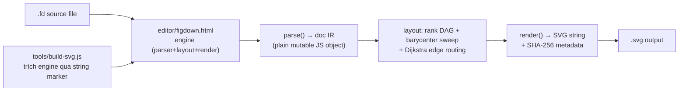
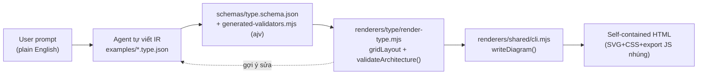
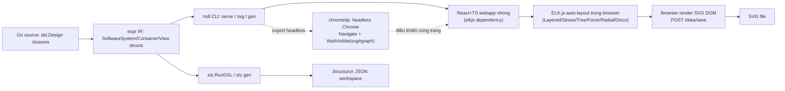
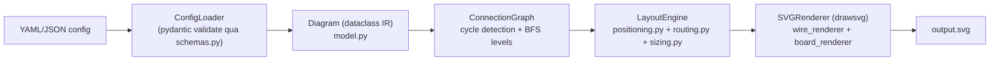

# Weekly Diagram Tooling Scan — 2026-07-18

**Nguồn dữ liệu:** GitHub topic search (`topic:diagram-as-code`, `pushed:>2026-07-11`) qua GitHub REST API public (không dùng `gh` CLI — session này không có quyền `gh`/API search ngoài phạm vi `kymostudio/kymostudio`). Query keyword-based và ecosystem-release fallback không cần thiết vì topic search đã trả về đủ (>15) kết quả sau 7 ngày.

## Executive summary

- **FigDown** đáng chú ý nhất về mặt kiến trúc DSL: closed-grammar line-oriented parser + invariant "strip all manual pins → vẫn phải auto-layout đúng" — một conformance rule cụ thể mà kymostudio có thể thêm vào bộ golden test của `alignment.py`.
- **Archify** (~5.6k sao, fork của Cocoon-AI) chứng minh một pattern ngược hẳn với triết lý của kymostudio: bỏ hết auto-layout algorithm, để AI agent tự chọn toạ độ rồi renderer chỉ validate/collision-check — nhưng CLI `validate --json` với gợi ý sửa lỗi theo toạ độ cụ thể là ý tưởng đáng học cho một future MCP-driven `.kymo` authoring loop.
- **goadesign/model** và **PinViz** đều cho bài học layout cụ thể: goadesign dùng ELK.js chạy *trong trình duyệt* + `chromedp` để export headless (phức tạp, không hợp với triết lý dependency-light của `packages/js`), còn PinViz có một `OverlapResolver` sample-collision-rồi-điều-chỉnh thực sự — pattern áp dụng được trực tiếp cho fan-in/trunk-lane staggering của `alignment.py`.

## Mục lục

1. [FigDown/figdown](#1-figdownfigdown)
2. [tt-a1i/archify](#2-tt-a1iarchify)
3. [goadesign/model](#3-goadesignmodel)
4. [nordstad/PinViz](#4-nordstadpinviz)

---

## 1. FigDown/figdown

### §1 — Quick context

Chuẩn Markdown-native cho diagram-as-text: cùng một nguồn `.fd` vừa để AI agent đọc semantic, vừa deterministic-render ra SVG cho người xem — khác các DSL diagram khác ở chỗ *toàn bộ engine nằm trong một file HTML duy nhất* và được CLI Node "trích xuất" ra bằng string marker chứ không phải một package riêng.

Tech stack: vanilla JS thuần (không dependency) — engine là `editor/figdown.html` (~2400 LOC gộp parser+layout+render), CLI `tools/build-svg.js` chỉ dùng `fs`/`path`/`crypto`. Repo health: 0 sao, 0 fork, không có CI (`.github/workflows` trả 404), tự mô tả đang ở giai đoạn "requirements and design phase" (spec v0.0/v0.1), nhưng đã có bộ conformance fixtures (`conformance/`, đánh số 01x–9xx). Distribution: chưa publish npm/PyPI, chỉ là git repo + một "Claude Code skill" cài vào `~/.claude/skills/figdown`.

### §2 — Architecture deep-dive

**A. Component inventory**
- `editor/figdown.html` — engine độc nhất, chia 3 phần đánh số: PARSER (~800 LOC), LAYOUT+RENDER (~1400 LOC), UI+SVG EXPORT (~200 LOC).
- `tools/build-svg.js` — CLI Node; hàm `loadEngine()` **trích chuỗi** engine từ `figdown.html` giữa hai marker literal `const SHAPES` … `// 3. UI`, bọc lại thành `{parse, render}`. Một engine, hai host (browser + CLI).
- `spec/syntax-draft.md` — spec kèm ABNF, yêu cầu "parser phải implement được mà không cần đọc reference PoC".
- `conformance/` + `conformance/run.js` — fixture `.fd` + `.model.json` + `.errors.txt`, runner Node không dependency.
- `design/census.md`, `design/prior-art.md` — tài liệu rationale thiết kế (xem §4).

**B. Pipeline** (CLI happy path): (1) `node tools/build-svg.js file.fd` → `loadEngine()` trích engine từ `figdown.html`; (2) đọc file `.fd`; (3) `engine.parse(src)` → `{doc, errs}`; (4) nếu có lỗi → in `Line N: message` theo từng dòng, dừng (spec: "document có lỗi thì không render gì cả"); (5) `engine.render(doc)` → chuỗi SVG; (6) nhúng SHA-256 của source vào `<metadata data-sha256>`; (7) ghi file `.svg`.

**C. Data model/IR**: một object JS thuần (không class): `doc = {title, nodes, groups, edges, layers, flow, ranks, pins, sizes, blocks, trunks, glines, fills, classes}` — **một IR mutable duy nhất**, layout ghi trực tiếp x/y/w/h lên chính object mà `parse()` sinh ra, không có tầng lower-IR/scenegraph riêng.

**D. Input language design**: parser line-oriented top-down tự viết (không regex-only, không PEG/ANTLR). `tokenize(line)` tách whitespace có tôn trọng quoted string; dòng edge có scanner riêng `parseEdgeLine()`. Grammar **đóng** — validate theo registry `DIRECTIVE_OPTS`/`OPT_KEYS`, keyword/option lạ = lỗi. Lỗi có số dòng (`Line N: msg`), multi-error recovery khi parse nhưng render thì all-or-nothing. Có 2 chế độ conformance: strict (authoring) vs lenient (viewer bỏ qua dòng `x-` extension lạ).

**E. Layout algorithm**: auto-layout mặc định, override thủ công 3 tầng (`flow <dir>`, `rank a b`, `pin id at=x,y` + `size`). Có invariant "D6" tường minh: bỏ hết `pin`/`size` khỏi document hợp lệ thì vẫn phải parse+render đúng dưới auto-layout thuần. Thuật toán: rank DAG bằng DFS (phát hiện cycle qua trạng thái gray/black) + longest-path layering; **3-pass barycenter sweep** (xuống/lên/xuống) để giảm crossing; waypoint ảo cho edge đa-rank; back-edge routing dạng channel/concentric-ring cho cycle; anti-parallel edge fan-out; toạ độ 2 tầng (group-local vs canvas-absolute) cho pin. Edge không pin dùng Dijkstra tránh vật cản (`routeAround`).

**F. Rendering/output**: chỉ SVG, dựng bằng string/template literal (không build DOM). Không có animation ("None. This is a static renderer."). Một file engine với sub-renderer theo template type (`renderScene`, `renderBitfield`, `renderTable`, `renderPlot`, `renderWave`) — không phải kiến trúc pluggable/sibling-emitter như `to_svg`/`to_figma`/`to_excalidraw`/`to_webp` của kymostudio.

**G. Extensibility**: không tìm thấy plugin/extension point — bằng chứng cho thấy bộ 6 template + 7 shape cố định, sửa trực tiếp trong engine file. Theming qua `color=` + cơ chế `class`. Đường mở rộng duy nhất có tài liệu là lenient-mode tolerance với dòng `x-` lạ.

**H. Dev experience**: CLI zero-install. Browser editor tự chứa (một `<textarea>`, re-parse/re-render mỗi keystroke, autosave). Không có VS Code extension/LSP. Không có CI dù đã có fixture suite. Điểm DX đáng chú ý: một "Claude Code skill" đóng gói dạy AI agent đọc/maintain cặp `.fd`+`.svg` trực tiếp — kymostudio hiện chưa có tương đương.

### §3 — Architecture diagram

### §4 — Verdict

Kỹ thuật áp dụng được cụ thể: (1) nhúng SHA-256(source) vào `<metadata>` trong SVG output — `to_svg.py` có thể làm tương tự để phát hiện staleness mà không cần diff byte-for-byte đầy đủ; (2) invariant "D6" (bỏ pin/size thủ công thì vẫn phải auto-layout đúng) là một conformance rule kymostudio có thể thêm thành một category golden test cho `alignment.py`; (3) `design/census.md` — quét 774 tài liệu nội bộ ra 2.177 hình để xác định archetype ưu tiên (block-arch + bitfield = 48%) — xác nhận cách tiếp cận corpus-driven mà kymostudio đã dùng cho BPMN (MIWG corpus), đáng tiếp tục.

Red flag: trích engine bằng string marker literal là fragile — refactor đổi tên/di chuyển marker sẽ silently break CLI, không có compile-time safety gì cả — đúng kiểu anti-pattern mà kiến trúc "dumb renderer"/module tách biệt của kymostudio (`model.py`/`dsl.py`/`to_svg.py`) đã tránh được. Không có CI dù có 100+ fixture. Chỉ render tĩnh, không có gì học được cho `--animate`.

**Verdict: study deeper** — chưa phải đối thủ cạnh tranh (0 sao, không CI, engine fragile), nhưng grammar discipline, invariant D6, và phương pháp corpus-driven scoping là ý tưởng cụ thể, chuyển giao được cho `dsl.py`/`alignment.py`.

---

## 2. tt-a1i/archify

### §1 — Quick context

Một agent *skill* (không phải app độc lập) cài qua `npx skills add tt-a1i/archify -g` vào Claude Code/Codex CLI/opencode, biến mô tả tiếng Anh thuần thành diagram HTML/SVG tự chứa (architecture/workflow/sequence/dataflow/lifecycle) — khác các tool khác ở chỗ *AI agent tự quyết định toạ độ layout*, renderer chỉ làm việc validate/collision-check chứ không tính toán layout.

Tech stack: Node.js ≥18, ESM thuần, **zero runtime dependency** trong CLI đã ship (ajv chỉ là devDependency, compile schema offline thành `generated-validators.mjs` checked-in). Repo health: ~5.6k sao, 12 release (mới nhất v2.11.0, 2026-07-16), CHANGELOG cho thấy iterate rất nhanh (11 version từ tháng 4 đến tháng 7/2026); có `.github/workflows/ci.yml` + `release.yml`; `test/golden.mjs` là byte-for-byte fixture test không có auto-update mode. Distribution: đóng gói dạng agent skill (`archify.zip`), không phải npm library để import lập trình.

### §2 — Architecture deep-dive

**A. Component inventory**: `bin/archify.mjs` (CLI entry, dispatch `render|validate|inspect|check|examples|doctor|demo`); `schemas/<type>.schema.json` (JSON Schema riêng cho mỗi loại diagram, `additionalProperties:false`); `renderers/<type>/render-<type>.mjs` (5 renderer riêng biệt: architecture/workflow/sequence/dataflow/lifecycle — script top-level, không phải exported function API); `renderers/shared/` (`geometry.mjs`, `validator.mjs`+`generated-validators.mjs`, `cli.mjs` chứa `loadDiagram()`/`writeDiagram()`, `layout-report.mjs`).

**B. Pipeline**: (1) agent đọc yêu cầu tiếng Anh, chọn `diagram_type`; (2) agent tự viết file `<name>.<type>.json` theo schema — **agent tự quyết định vị trí/nhóm node**, theo hướng dẫn spatial-narrative trong `SKILL.md` (đây là bước "layout judgment" — không có thuật toán tính toạ độ ở bước này); (3) `node bin/archify.mjs render <type> <input>.json <output>.html` gọi `renderers/<type>/render-<type>.mjs` qua `spawnSync`; (4) renderer load JSON, validate schema, rồi tính geometry cơ học (`gridLayout()`/`resolveComponentPos()` cho grid mode, hoặc `pos:[x,y]` thô cho free mode); (5) chạy `validateArchitecture()` — overlap detection, label-width vs box-width, viewBox bounds — throw danh sách lỗi định dạng nếu fail; (6) `validate --json`/`inspect` cho kết quả check độc lập kèm gợi ý sửa (offset toạ độ/`labelDy`); (7) agent lặp: sửa → render lại → validate lại cho tới khi sạch; (8) `writeDiagram()` template-fill vào `assets/template.html` ra một file HTML tự chứa (SVG+CSS+~19KB export/theme JS).

**C. Data model/IR**: JSON IR có kiểu, một schema/loại diagram, versioned (`schema_version: 1`). IR **được agent chỉnh sửa giữa các vòng validate, không đi qua transform pass nội bộ nào** — renderer đọc JSON, tính geometry pixel trong memory (`cx`/`cy`), emit SVG mà không ghi ngược vào file JSON. Hai tầng validate riêng: ajv-schema (structural) + geometry/collision check tay (semantic).

**D. Input language design**: không phải grammar tự viết — là **JSON Schema-constrained IR mà LLM agent tự viết trực tiếp**, luật ngôn ngữ chia làm 2: (a) JSON Schema máy-check được, (b) hướng dẫn văn xuôi trong `SKILL.md` mà chỉ agent đọc lúc generate (spatial-narrative rules, "bỏ bớt edge cho tới khi main path rõ ràng", "Cardinal Rule" chỉ style qua CSS class). Lỗi schema là message ajv theo JSON-path; lỗi layout có gợi ý sửa cụ thể (offset toạ độ, `labelDy`/`labelDx`) — thiết kế rõ ràng cho agent tự sửa lặp lại, không phải cho người debug.

**E. Layout algorithm**: xác nhận **không có thuật toán auto-layout thật nào** trong renderer (không dagre, không force-directed, không constraint solver). "Layout judgment over generic auto-layout" nghĩa đen là: agent tự chọn `pos`/`row`/`col` theo heuristic văn xuôi, renderer chỉ làm việc cơ học — quy đổi grid→pixel, tính box size, check collision/overlap. Vậy layout là **toạ độ do AI quyết**, được validate bằng heuristic **deterministic**, không phải thuật toán layout thật. Edge routing thì có thuật toán nhỏ thật sự: `pathFor()`/`routeVia()` hỗ trợ straight/`orthogonal-h`/`orthogonal-v`/auto (chọn orthogonal-h trừ khi lệch <4px), rồi `roundedPath()` bo góc, cache trong `pathCache`.

**F. Rendering/output**: một emitter/loại diagram, không phải kiến trúc multi-backend pluggable; output luôn là HTML tự chứa (SVG+CSS+JS nhúng), export client-side (JS trong browser) ra PNG/JPEG/WebP/SVG tới 4×. Animation ("trace" mode qua `meta.animation`): xác nhận điều khiển bằng CSS custom property — element có `data-animation="trace"`, `data-animate`, `style="--step:N"`; cơ chế keyframe CSS chính xác (SMIL/CSS `@property`/JS timer) không xác định được từ code đã đọc.

**G. Extensibility**: không có plugin system. Thêm loại diagram mới cần viết tay schema mới + renderer mới + đăng ký trong `bin/archify.mjs`. Subtype ngữ nghĩa (component `type`, message `variant`) hardcode cả trong schema enum lẫn CSS class cố định — mở rộng phải sửa 3 chỗ cùng lúc. Theming: CSS custom property, dark/light toggle persist `localStorage`, tôn trọng `prefers-color-scheme`; "Cardinal Rule" cấm hardcode `fill`/`stroke` trong SVG output.

**H. Dev experience**: có `doctor` (check môi trường/schema) và `demo` (scaffold example) để onboard. Thiết kế rõ ràng cho **agent-in-the-loop**: validator output có cấu trúc (`--json`), gợi ý sửa theo toạ độ cụ thể chứ không phải prose cho người đọc; `SKILL.md` dặn agent "không đoán offset mù quáng" — đọc gợi ý, áp dụng, render lại, validate lại.

### §3 — Architecture diagram

### §4 — Verdict

`model.py`/`alignment.py` của kymostudio (5-pass resolver tính toạ độ thật bằng thuật toán) đã là nửa "cao cấp" hơn của pattern này — Archify chủ động **không** làm việc đó. Điểm mới thật sự đáng học: **vòng validate-với-gợi-ý-sửa như một CLI verb hạng nhất** — `validate --json`/`inspect` trả lỗi có JSON-path kèm gợi ý sửa số cụ thể (overlap → offset gợi ý; label tràn → gợi ý widen/shorten). `dsl.py` của kymostudio hiện "không validate gì lúc parse" — nếu kymostudio làm MCP/agent-driven `.kymo` authoring, một chế độ `kymo validate --json` với repair hint theo toạ độ là ý tưởng cụ thể đáng cân nhắc.

Red flag liên quan đến golden SVG test byte-for-byte của kymostudio: render step của Archify là deterministic khi JSON cố định (`test/golden.mjs` so byte-for-byte, giống hệt cách tiếp cận `test_diagrams.py`) — nhưng **toạ độ trong JSON do AI chọn không có thuật toán support**, nghĩa là 2 lần chạy agent độc lập trên cùng một prompt tiếng Anh có thể ra 2 IR khác nhau (cả hai đều schema-valid) → không reproducible ở tầng "prompt → diagram", dù "IR → SVG" thì có. Đây là trade-off ngược hẳn kymostudio, nơi `alignment.py` đảm bảo "cùng DSL source → cùng SVG" bằng construction.

**Verdict: glance only** — triết lý layout cố tình phi thuật toán (không phải resolver để port), nhưng pattern `validate --json` với repair hint đáng nhìn kỹ hơn nếu kymostudio có agent loop cho `.kymo`.

---

## 3. goadesign/model

### §1 — Quick context

DSL Go thuần cho kiến trúc phần mềm theo C4 model, xuất ra Structurizr workspace + SVG — khác các diagram tool text-based ở chỗ *DSL không phải text được parse, mà là code Go thực thi được* (closures), nên có compile-time type check và IDE tooling miễn phí, đổi lại mất tính "diagram = file text độc lập đọc được".

Tech stack: Go 1.26 cho core/CLI; TypeScript + React 19 cho webapp editor nhúng; ELK.js (`elkjs ^7.0.11.1`) cho auto-layout — nhưng chạy hoàn toàn **trong browser**, không phải trong process Go; `chromedp` để export SVG headless. Repo health: ~462 sao, ~22 fork, MIT, release mới nhất `v1.15.0`, có GitHub Actions CI. Distribution: chỉ qua `go install` (`goa.design/model/cmd/mdl` và `cmd/stz`), không có binary release riêng xác nhận được.

### §2 — Architecture deep-dive

**A. Component inventory**: `dsl/` (`design.go`, `elements.go`, …) — DSL builder function (`Design()`, `SoftwareSystem()`, `Container()`); `expr/` (`design.go`, `system.go`, `render.go`, …) — struct IR thật sự mà DSL function populate (`expr/render.go` chỉ resolve *nội dung* view, không render pixel); `stz/` — tích hợp Structurizr (`RunDSL()`, `NewClient/Put/Get`); `stz/layout.go` xác nhận chỉ là utility merge/apply toạ độ đã tính sẵn — **không có thuật toán layout ở đây**; `cmd/mdl/` — CLI (`serve`/`gen`/`svg`), `webapp/` là SPA React+TS nhúng qua `embed.FS`.

**B. Pipeline**: (1) user viết Go code dùng `dsl.Design(func(){...})`; (2) hoặc gọi `stz.RunDSL()` rồi `client.Put()` để đẩy JSON lên Structurizr cloud, hoặc chạy CLI `mdl`; (3) `mdl serve <package>` (`cmd/mdl/serve.go`) khởi HTTP server, evaluate DSL, serve webapp React/TS nhúng cùng model+layout JSON; (4) trong browser, webapp (React+`elkjs`) render view C4, chạy ELK.js auto-layout theo yêu cầu, cho kéo-thả thủ công, toạ độ round-trip về server; (5) `POST /data/save` nhận SVG do client tạo (kèm block JSON layout nhúng) và ghi ra file — **SVG được tạo trong browser, không phải trong Go**; (6) export không tương tác: `mdl svg <package>` chạy cùng HTTP server local rồi dùng **headless Chrome qua `chromedp`** để `Navigate` tới URL từng view với `auto=1&save=1`, `WaitVisible("svg#graph")`, poll filesystem tới khi endpoint save ghi xong SVG — tức là browser-automation của đúng con đường render tương tác.

**C. Data model/IR**: `dsl/*.go` là builder closure mỏng gọi vào `expr.Root`/`expr.Design`; `expr/*.go` giữ struct IR thật (`SoftwareSystem`, `Container`, `Relationship`, `View`, `Registry`) — có IR tách biệt khỏi tầng gọi DSL, được mutate in-place qua model 2-pha của `goa/eval` (`eval.Execute(dsl, expr.Root)`), không immutable.

**D. Input language design**: literally Go source code, được **Go compiler/runtime thực thi**, không parse text. Evaluate 2 pha qua `eval` package: DSL function đăng ký expression ở pass 1, `eval.Execute` walk+validate ở pass 2. Đối lập trực tiếp với grammar text `.kymo` của kymostudio: được tooling IDE miễn phí (autocomplete, go-to-def) và compile-time check, đổi lại cần toolchain Go và mất tính "diagram là file text độc lập". Lỗi: Go code sai cú pháp → compile error; lỗi ngữ nghĩa (ví dụ `Container` ngoài `SoftwareSystem`) → runtime validation qua `eval.ReportError`/`eval.IncompatibleDSL`.

**E. Layout algorithm (mục quan trọng nhất)**: ELK.js **không** chạy trong process Go qua WASM hay subprocess-bridge như giả định ban đầu. Thay vào đó: ELK.js chạy **hoàn toàn client-side trong browser**, bundle vào webapp React/TS qua webpack; Go binary chỉ (1) embed+serve static file của webapp, (2) serve/nhận model+layout JSON qua HTTP, (3) cho export không tương tác thì **điều khiển một Chrome headless thật qua `chromedp`** để chạy đúng code ELK.js phía browser rồi lấy SVG ra. Thuật toán expose theo `webapp/README.md`: Layered (mặc định, hierarchical), Stress (force-directed), Tree, Force, Radial, Disco (component rời rạc) — 6 loại, README ghi nhận đã migrate từ Dagre.js sang ELK.js, có "orthogonal edge routing" và "minimal crossings" cho Layered — đây là năng lực sẵn có của ELK.js, không phải goadesign/model tự cài. Không tìm thấy code layout/crossing-minimization phía Go ở đâu cả.

**F. Rendering/output**: 2 backend thật: Structurizr JSON workspace (qua `stz.RunDSL()`/`stz gen`); SVG, luôn tạo phía browser (tương tác qua `mdl serve`, hoặc headless qua `mdl svg`+chromedp). Không có backend PlantUML. Không có animation. Không có abstraction "pluggable emitter" phía Go (rendering là việc của webapp/browser, không phải Go interface).

**G. Extensibility**: thêm element type mới cần sửa code Go ở `expr/` (struct) + `dsl/` (builder function) — không data-driven từ phía user. Styling qua `dsl/styles.go` (file tồn tại, nội dung chưa đọc sâu), phù hợp chuẩn Styles DSL của Structurizr.

**H. Dev experience**: `mdl serve` cho editor đồ hoạ tương tác (kéo-thả, undo/redo, align/distribute, phím tắt — xác nhận trong `webapp/README.md`). `watch.go` gợi ý file-watch/auto-reload; webapp README có tài liệu dev-loop live-reload qua `lrserver`/`fsnotify`, cờ `DEVMODE=1`. Không có VS Code extension.

### §3 — Architecture diagram

### §4 — Verdict

Pattern ELK.js của goadesign/model *không* phải WASM-trong-Go như giả định — mà là "ship ELK.js như JS bundle trong web editor nhúng, rồi puppet Chrome (`chromedp`/CDP) để scrape SVG ra khỏi DOM cho export headless". Kiến trúc này khác hẳn pipeline in-process thuần Python/TS của kymostudio.

Đường rẻ hơn cho kymostudio nếu muốn "auto-layout mode": dùng `elkjs` trực tiếp như thư viện Node headless (nó có bundle "no browser", chạy standalone không cần DOM) ngay trong `packages/js` — feed component/edge data thành ELK JSON, nhận lại toạ độ/routing, merge vào `Diagram`/`Region`/`Edge` model trước khi `renderSVG` — tương tự việc `stz/layout.go`'s `ApplyLayout()` làm (merge toạ độ tính sẵn) nhưng tính in-process, không cần browser — né hẳn độ phức tạp chromedp của goadesign/model.

Red flag nếu copy nguyên xi approach của goadesign/model: thêm dependency nặng và giòn (Chrome/Chromium binary, sandbox flags, navigation timeout, CI fragility) — trực tiếp mâu thuẫn với nguyên tắc "packages/js library dependency-free" ghi trong CLAUDE.md. Phía Python không có tương đương `elkjs` (chỉ có ở JS) — muốn auto-layout mode đồng bộ Python↔JS sẽ cần binding Python ELK hiếm/non-mature hoặc subprocess gọi Node, tăng rủi ro cross-language đúng chỗ mà nguyên tắc parity (Python = reference, JS reconcile theo) đang cố tránh.

**Verdict: study deeper** — không phải để copy cơ chế browser/chromedp (red flag với triết lý dependency-light), mà cụ thể để đánh giá vendor `elkjs` headless thẳng vào `packages/js` như một auto-layout pass tuỳ chọn, feed vào `Diagram` model sẵn có, bỏ qua browser hoàn toàn.

---

## 4. nordstad/PinViz

### §1 — Quick context

Sinh sơ đồ đấu dây GPIO (Raspberry Pi/ESP32/ESP8266) từ YAML/JSON hoặc Python API ra SVG — một DSL text-to-visual "adjacent domain" (hardware wiring, không phải software architecture), khác các diagram tool chung ở chỗ auto-layout dùng **hierarchical level + centroid positioning** và wire routing bằng **Bezier cong có collision detection thật sự**, không phải orthogonal/Manhattan.

Tech stack: Python ≥3.12; `drawsvg` cho SVG, `pydantic` cho validate config, `typer`+`rich` cho CLI, `mcp>=1.22.0` cho MCP server. Repo health: 5 sao, 4 fork, tạo 2025-11-20, push gần nhất 2026-07-13 (5 ngày trước scan này), gần như solo project (`nordstad`: 334 commit, 2 contributor khác chỉ 2-1 commit), có CI đầy đủ (`ci.yml`, `validate-tests.yml`, `docs.yml`, `publish.yml`, `brew-publish.yml`). Distribution: pip (`pip install pinviz`) và Homebrew.

### §2 — Architecture deep-dive

**A. Component inventory**: `model.py` — dataclass IR (`Diagram`, `Board`, `Device`, `Connection`, enum `PinRole`/`WireColor`); `schemas.py` (44.8KB, file lớn nhất repo) — pydantic `BaseModel` validate input YAML/JSON, tách biệt khỏi runtime dataclass; `config_loader.py` — `ConfigLoader` load+validate+convert sang `Diagram`; `connection_graph.py` — `ConnectionGraph`: adjacency list có hướng, board = virtual root level -1, phát hiện cycle (DFS), BFS tính level; `layout/` package — `engine.py` (`LayoutEngine.layout_diagram()`), `positioning.py` (`DevicePositioner`), `routing.py` (`PathGenerator`, `RailAssigner`, `OverlapResolver`), `sizing.py`, `types.py` (`LayoutResult` immutable); `render_svg.py` — `SVGRenderer.render()` dùng `drawsvg`; `wire_renderer.py`, `board_renderer.py`, `component_renderer.py`; `boards.py`/`device_configs/*.json`/`board_configs/*.json` — data-driven; `mcp/server.py` — MCP server.

**B. Pipeline**: (1) `ConfigLoader` đọc YAML/JSON; (2) validate qua pydantic schema, lỗi format theo field path; (3) convert sang dataclass `Diagram` runtime, board load qua factory + `board_configs/*.json`; (4) `ConnectionGraph` check cycle/orphan device/duplicate pin; (5) `LayoutEngine.layout_diagram()`: `DevicePositioner` (tier phân cấp từ level) → `PathGenerator`/`RailAssigner`/`OverlapResolver` (routing) → `CanvasSizer` → `validate_layout()` → trả `LayoutResult` immutable; (6) `SVGRenderer.render()`: canvas → title → board (renderer hoặc SVG asset fallback) → số pin GPIO → wire (sort theo z-order) → box device → wire đè lên box → pin device (top layer) → bảng chú giải tuỳ chọn → ghi file SVG.

**C. Data model/IR**: 2 tầng — pydantic `BaseModel` (`schemas.py`) chỉ để validate input; IR làm việc thật là dataclass thường (`model.py`) không frozen. Output của `LayoutEngine` (`LayoutResult`) tường minh là immutable ("cho phép renderer dùng trực tiếp không cần mutate thêm") — cấu trúc gần giống `model.py` dataclass + `alignment.py` resolver → `to_svg.py` của kymostudio, nhưng PinViz tách riêng validation (pydantic) khỏi runtime shape (dataclass) thay vì một dataclass model duy nhất không validate lúc parse như kymostudio.

**D. Input language design**: YAML/JSON, không phải grammar text tự viết. Schema hình thức = pydantic `BaseModel` (code-as-schema, không phải file JSON Schema riêng). Lỗi: `ValidationError.errors()` map ra field path + message qua `format_config_error()`; lỗi tầng graph (duplicate pin, orphan device) báo riêng kèm gợi ý ("Suggestion: Check device and pin names…"). Có sẵn fixture `examples/invalid_cycle.yaml` để test path phát hiện cycle.

**E. Layout algorithm (mục quan trọng nhất)**: device auto-position theo level/tier (không force-directed, không grid cố định) — `ConnectionGraph.calculate_device_levels()` BFS từ board (root, level -1); `DevicePositioner` map mỗi level thành X-tier, Y = **centroid của các pin đã kết nối**, rồi áp constraint khoảng cách tối thiểu trong tier. Wire routing: **Bezier cong**, không orthogonal (đối lập kymostudio) — `PathGenerator` dựng "gentle arc" cho wire cùng Y, "S-curve" cho wire lệch Y xa, có logic tangent-alignment để tránh gãy khúc chỗ Bezier gặp đoạn thẳng dẫn vào pin. **Collision avoidance là thật, không chỉ staggering tĩnh**: `OverlapResolver` sample mỗi wire tại vị trí cố định dọc Bezier, check khoảng cách theo cặp (bbox pre-filter cho hiệu năng) so với `min_separation`, rồi lặp điều chỉnh `y_offset` từng wire (clamp bởi `MAX_ADJUSTMENT`) tới khi hết xung đột. Fan-out nhiều wire: `RailAssigner` gán mỗi device đích một "rail" ngang riêng ngoài rìa board, dàn đều wire quanh rail đó đối xứng. Toạ độ pin board: **tính từ công thức + tham số JSON mỗi board** (mm → px qua `scale_factor = 3.0`), không phải bảng pixel cố định.

**F. Rendering/output**: `render_svg.py` dùng thư viện **`drawsvg`** (không string templating thô, không `svgwrite`). Wire vẽ 2 lớp: "halo" dày (chọn màu theo luminance WCAG) + "core" màu đè lên. **Màu theo chức năng** là dict tĩnh `DEFAULT_COLORS: dict[PinRole, str]` trong `model.py` (POWER_5V đỏ, GROUND đen, I2C_SDA xanh lá, v.v.) — lookup enum→hex đơn giản, không phải hệ theme pluggable ở tầng này. **Component nhúng (resistor/capacitor/diode) là shape sinh bằng code**, không phải icon file — `wire_renderer.py` vẽ zigzag/rect/triangle bọc trong `draw.Group(transform="translate(...) rotate(angle)")` để căn theo hướng wire — tương tự ý tưởng `icons.py` của kymostudio nhưng generate bằng code thay vì SVG file-backed.

**G. Extensibility**: thêm device mới = thêm JSON vào `device_configs/<category>/*.json` (16 sensor có sẵn) — data-driven, không cần code; có cả wizard CLI tương tác (`device_wizard.py`). Thêm board mới = thêm `board_configs/<name>.json` + SVG asset fallback, nhưng `boards.py` có 1 factory function/board đã biết nên board hoàn toàn mới có thể cần thêm chút code (chưa xác định rõ mức độ generic). Màu: `DEFAULT_COLORS` tĩnh, connection có thể override `color` trực tiếp trong YAML.

**H. Dev experience**: CLI (`typer`+`rich`) — `pinviz render diagram.yaml -o output.svg`. Không tìm thấy bằng chứng watch-mode. **MCP server** (`mcp/server.py`, entry point `pinviz-mcp`): 9 tool MCP (`list_devices`, `generate_diagram`, v.v.). Đáng chú ý: **LLM không dựng diagram qua nhiều tool call cấu trúc từng bước** — `generate_diagram` nhận một prompt tiếng Anh, parse nội bộ bằng "regex + LLM fallback", rồi trả về nguyên một chuỗi YAML trong field `yaml_content`, kèm chỉ dẫn tường minh cho LLM gọi: "DO NOT modify or reconstruct the YAML — use `yaml_content` exactly as provided" — tức là single-shot NL→YAML phía server, chủ động không tin LLM gọi sẽ đụng vào output.

### §3 — Architecture diagram

### §4 — Verdict

Kỹ thuật áp dụng được cụ thể cho edge routing (so với fan-in/trunk-lane staggering của `alignment.py`): `OverlapResolver` của PinViz làm điều mà staggering tĩnh của kymostudio chưa làm — **sample-based pairwise collision detection rồi điều chỉnh lặp**, không chỉ gán lane theo công thức một lần. Nếu trunk-lane staggering hiện tại của kymostudio là công thức vị trí một-pass, pattern "detect-rồi-adjust" của PinViz là hướng cụ thể đáng cân nhắc cho case lane math tĩnh vẫn để wire gần/chồng nhau (đặc biệt nếu kymostudio sau này thêm curved edge — logic tangent-continuity của PinViz giải đúng vấn đề Bezier bị gãy khúc tại điểm nối pin).

Kỹ thuật cho icon/component embedding (so với `icons.py`): PinViz vẽ resistor/capacitor/diode bằng **shape hình học sinh bằng code kèm transform rotate**, ngược hẳn approach file-backed icon của kymostudio. Không nên copy nguyên (icon library của kymostudio phong phú hơn nhiều), nhưng xác nhận một hybrid đáng cân nhắc: tầng hand-coded `ICONS` dict của `icons.py` có thể dùng generated-geometry-with-rotation cho symbol schematic đơn giản, thay vì luôn cần file SVG riêng — đường mở rộng nhẹ hơn cho các icon đơn giản mới.

Red flag/open question: 2 tầng IR (pydantic validate + dataclass runtime) là nhiều máy móc hơn thiết kế single-dataclass-không-validate-lúc-parse của kymostudio — đáng ghi nhận như một điểm đối lập, không hẳn là lỗi. Bus factor thấp (gần như 1 người maintain). Thiết kế MCP `generate_diagram` (single-shot NL→YAML, chủ động cấm LLM sửa output) là một counter-example đáng cân nhắc nếu kymostudio làm MCP/NL-generation server sau này — một alternative documented rõ ràng so với approach tool-call tăng dần từng bước.

**Verdict: study deeper** — cụ thể là pattern `OverlapResolver`/`RailAssigner` sample-collision-rồi-adjust trong `layout/routing.py`, áp dụng trực tiếp được cho việc mở rộng fan-in/trunk-lane staggering của `alignment.py` vượt ra ngoài công thức tĩnh.
