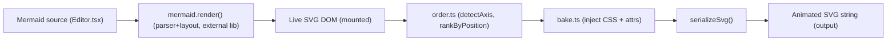
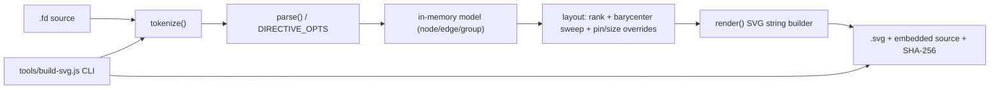
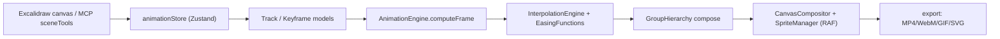
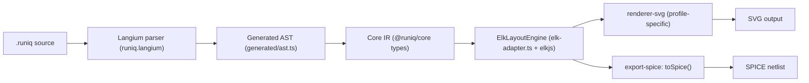

# Weekly scan: diagram-as-code & visual tooling (2026-07-12 → 2026-07-19)

**Executive summary**
- Không có repo nào trong cửa sổ 7 ngày là "kymostudio killer" — phần lớn phát hiện đáng chú ý là các dự án rất non (0 sao, pre-alpha, vài tuần tuổi), nhưng mỗi cái đều mang một ý tưởng kiến trúc cụ thể, hẹp, có thể vay mượn được ngay.
- Kỹ thuật đáng vay mượn nhất tuần này: **bake animation bằng CSS custom properties + `pathLength="1"`** (diagraw) cho `--animate`, và mô hình **track scalar-per-property immutable** (excalimate) như một IR trung gian cho animation thay vì bake CSS trực tiếp.
- Hai ý tưởng thiết kế DSL đáng ghi nhận nhưng chưa nên áp dụng vội: "layout stability" qua rigid/flexible attribute (figdown — cường điệu hơn thực tế, chỉ là pin-based) và Langium-làm-parser-generator (runiq — chỉ giải quyết được nửa bài toán dual-impl Python/TS của kymostudio).

**Mục lục**
1. [barmoshe/diagraw](#1-barmoshediagraw) — Mermaid → self-contained animated SVG (CSS bake)
2. [FigDown/figdown](#2-figdownfigdown) — markdown-native, dual human/AI-readable diagram spec
3. [excalimate/excalimate](#3-excalimateexcalimate) — keyframe timeline + camera cho Excalidraw
4. [quipolabs/runiq](#4-quipolabsrunlq) — Langium + ELK, multi-profile diagram DSL

---

## Phương pháp thu thập

Không có quyền `gh` CLI hay GitHub Search API scoped ngoài `kymostudio/kymostudio`; toàn bộ khảo sát dùng WebSearch + WebFetch trực tiếp vào GitHub REST API công khai (`api.github.com/search/repositories?...pushed:>2026-07-05`, `git/trees`, `raw.githubusercontent.com`) để lấy dữ liệu có timestamp xác thực, thay vì scrape text UI (vốn cho kết quả relative-date sai ở lần thử đầu với mermaid/d2/likec4, đã được sửa bằng cách gọi lại API trực tiếp).

Ứng viên khác đã cân nhắc nhưng không chọn deep-dive: `lazypay/Archscribe` (JSON→rough.js animated architecture diagram, shared-geometry-module pattern giữa renderer tĩnh/động — đáng note riêng, xem dưới), `dinghydev/dinghy` (React-as-IaC-diagram, chưa đủ evidence kiến trúc), `markgrafhq/purescript-layered-layout` (ELK layered algorithm viết lại bằng PureScript, tham khảo thuật toán thuần), `finos/architecture-as-code` (CALM — governance/spec hơn là rendering), `OKHP3/mermaid-diagram-bpmn` (BPMN DSL prototype cho Mermaid, liên quan trực tiếp đến BPMN importer của kymostudio nhưng còn quá sơ khai để deep-dive tuần này). Release đáng chú ý trong ecosystem lớn: `kieler/elkjs` lên v0.12.0 (2026-07-17); `mermaid-js/mermaid` 11.16.0 (2026-06-25, vừa ngoài cửa sổ 14 ngày) thêm layered-orthogonal-layout swimlane — liên quan đến fan-in/trunk-lane staggering của kymostudio, đáng xem riêng ngoài báo cáo này.

---

## 1. barmoshe/diagraw

### §1 — Quick context
Diagraw không tự viết parser/layout mà hậu xử lý SVG do Mermaid.js render ra để bake CSS keyframe animation trực tiếp vào file — khác cách tiếp cận DSL-tự-render của kymostudio. Stack: TypeScript, Next.js 16 + React 19, dependency lõi duy nhất là `mermaid ^11.16`; output là chuỗi SVG self-contained. Repo rất mới (tạo 2026-07-01, push gần nhất 2026-07-12), 0 stars, chưa có release nào (CHANGELOG "Unreleased"). CI chỉ chạy lint + typecheck + build, không unit test. Phân phối: web app tĩnh (GitHub Pages), không phải npm package hay CLI.

### §2 — Architecture deep-dive

**A. Component inventory**
- `render.ts` (`src/lib/diagraw/render.ts`) — orchestration: gọi `mermaid.render()` lấy SVG string, mount vào DOM thật, gọi `bake()`, serialize; định nghĩa theme "blueprint" tùy biến qua `themeVariables`/`themeCSS`.
- `order.ts` (`src/lib/diagraw/order.ts`) — heuristic thứ tự vẽ: `detectAxis()` so spread tọa độ X/Y của node centers, `orderByPosition()`, `rankByPosition()` gom rank theo tolerance 12px.
- `bake.ts` (`src/lib/diagraw/bake.ts`) — engine core: query DOM bằng CSS selector cho edge/node/label, gán class + CSS custom properties, inject `<style>` chứa `@keyframes`, `serializeSvg()`.
- `types.ts` — `AnimateOptions`/`AnimateResult`, `DEFAULT_OPTIONS`.
- `SelfDrawingDiagram.tsx` — React wrapper dùng `IntersectionObserver` để trigger scroll-based playback.
- `Editor.tsx`, `samples.ts`, `persist.ts` — UI biên tập + starter diagrams + lưu trạng thái.

**B. Pipeline**: (1) user paste Mermaid source vào Editor → (2) `mermaid.render()` (parser + layout 100% của Mermaid.js) ra SVG string → (3) mount `innerHTML` vào DOM thật (bắt buộc, cần `getBBox()`) → (4) `bake(svg, opts)`: query selector edge/node/label, `detectAxis()`, rank theo vị trí, set `stroke-dashoffset`/`opacity` qua CSS variables, inject `<style>` → (5) `serializeSvg()` ra chuỗi XML self-contained → (6) render vào DOM hoặc export file `.svg`.

**C. Data model/IR**: không có IR độc lập — "model" chính là DOM `SVGSVGElement` do Mermaid render, bị mutate tại chỗ (`bake()` mutate trực tiếp, có `clearBake()` để re-bake idempotent). `AnimateOptions`/`AnimateResult` chỉ là config/metadata.

**D. Input language**: không có — delegate 100% cho package `mermaid`; lỗi parse propagate nguyên bản từ `mermaid.render()`.

**E. Layout**: không có layout engine riêng — dùng nguyên layout dagre-based của Mermaid; diagraw chỉ đọc lại tọa độ có sẵn để suy ra thứ tự animate. Không crossing minimization, không routing riêng.

**F. Rendering/output**: một backend duy nhất — animated SVG, CSS-only (`@keyframes dg-draw` cho `stroke-dashoffset`, `dg-fade` cho opacity), tôn trọng `prefers-reduced-motion`. Không pluggable emitter. Roadmap có raster export (GIF/MP4) nhưng chưa implement.

**G. Extensibility**: theming qua `themeVariables`/`themeCSS` của mermaid. `EDGE_SELECTOR`/`NODE_SELECTOR` hard-code theo class CSS cụ thể của mermaid 11.16 — dễ vỡ khi mermaid đổi version.

**H. Dev experience**: Editor UI browser-based, demo scroll-trigger, docs/gallery. Không CLI, không watch-mode file-system, không IDE integration.

### §3 — Architecture diagram



### §4 — Verdict
Kỹ thuật đáng học nhất: bake animation hoàn toàn bằng CSS custom properties + `pathLength="1"` để edge tự "vẽ" độc lập với chiều dài path thực (không cần đo runtime), cộng `IntersectionObserver` cho scroll-trigger — `to_svg.py`'s `--animate` có thể áp dụng pattern này thay vì/bổ sung SMIL. Diagraw tự nhận giới hạn cốt tử: CSS-animated SVG không chạy khi nhúng qua ``/README/email/Slack — kymostudio nên document/test constraint tương tự cho `--animate`, và cân nhắc raster fallback (đã có `to_webp.py`). Red flag: 0 unit test cho logic hình học, selectors hard-code theo mermaid 11.16 nên dễ vỡ khi upstream đổi — bài học ngược: vì `to_svg.py` tự sinh SVG (không hậu-xử-lý output người khác), kymostudio không có rủi ro này, nên giữ nguyên kiến trúc "renderer dumb, tự kiểm soát data" là lợi thế cấu trúc thật so với cách "post-process output của người khác" của diagraw. Repo còn quá non (0 sao, ~2 tuần tuổi) để đánh giá độ trưởng thành. **Verdict: glance only** — phần đáng học nằm gọn trong `bake.ts`/`order.ts` đã đọc, không cần đào sâu hơn.

---

## 2. FigDown/figdown

### §1 — Quick context
FigDown là chuẩn "figure-as-markdown" giai đoạn thiết kế/pre-alpha: một file `.fd` text vừa là nguồn AI đọc trực tiếp, vừa build deterministic ra SVG cho người xem — khác Mermaid/D2 ở cam kết **layout stability** (sửa nhỏ → thay đổi cục bộ, không re-layout toàn cục). Stack: 100% vanilla JavaScript, không dependency, không framework. Repo health: 0 stars, ~34 commit, 2 tác giả, commit gần nhất 2026-07-18, không có release/tag, không có CI workflow. Phân phối: chưa có npm package, chỉ `dist/` tự build (ESM+UMD) + Claude Code skill cài bằng `cp -r`.

### §2 — Architecture deep-dive

**A. Component inventory**: toàn bộ engine (tokenizer, parser, layout, renderer, UI) gộp trong một file `editor/figdown.html` (~7.000 dòng, không module hóa). CLI wrapper: `tools/build-svg.js` (validate + render), `tools/layout-lint.js` (linter chất lượng layout), `tools/make-lib.js` (build `dist/`), `tools/make-skill.js` (đóng gói agent-skill). `conformance/cases/*` chứa golden `.model.json`/`.errors.txt`. `integrations/markdown-it-figdown` và `integrations/kroki-service` là điểm nhúng bên ngoài.

**B. Pipeline**: (1) đọc `.fd` text → (2) `tokenize()` tách token, xử lý quote/escape → (3) `parse()`/`parseEdgeLine()` validate theo bảng `DIRECTIVE_OPTS` (closed grammar) → (4) model in-memory (node/edge/group/class/layer) → (5) layout: rank assignment (longest-path DAG layering) → 3-pass barycenter sweep → anti-parallel offset cho edge hai chiều → back-edge channel routing → resolve tọa độ hai cấp (group-local vs canvas), tôn trọng `pin`/`size` như constraint cứng → (6) `render()` sinh SVG bằng string concatenation, gọi renderer riêng cho bitfield/table/wave/plot → (7) nhúng source gốc + SHA-256 vào `<metadata>` của SVG.

**C. Data model/IR**: không có IR chính thức được đặt tên; `parse()` tạo object JS thuần. Điểm đáng chú ý: chính **source text `.fd` đóng vai trò IR bán-persistent** — khi kéo-thả trong editor, tọa độ được "materialize" ngược lại thành dòng `pin` trong text (GUI action = text edit). Không có lower-IR tách biệt.

**D. Input language**: grammar đóng, line-oriented, mọi dòng bắt đầu bằng keyword đã đăng ký (17 top-level + 6 typed-block + 4 reserved); mô tả bằng prose + ví dụ (`spec/syntax-draft.md`), chưa phải EBNF hình thức. Parser viết tay, lỗi báo `Line N: message`, gom lỗi theo batch, fail-closed.

**E. Layout stability — cơ chế cốt lõi**: auto-layout (rank + barycenter sweep) chạy lại toàn bộ mỗi lần dựng, nhưng thuộc tính khai báo tường minh (`pin`, `size`) trở thành constraint bất biến, còn thuộc tính chưa khai báo mới bị auto-layout tính lại; group dùng tọa độ hai cấp để giới hạn phạm vi ảnh hưởng khi kéo. Đây **không phải** incremental diffing/stable-ID re-layout theo nghĩa cổ điển, mà là "deterministic full re-run + escape hatch qua pin" — phần chưa pin về lý thuyết vẫn có thể trôi nếu rank/lane lân cận đổi.

**F. Rendering**: một backend — SVG dựng bằng string template, không animation (roadmap "static first, dynamic later"), không pluggable emitter.

**G. Extensibility**: namespace `x-` cho keyword/option mở rộng (lenient mode); typed block là tập cố định, không cho user định nghĩa shape mới; `class` phục vụ theming. `integrations/` chưa xem sâu — không xác định.

**H. Dev experience**: CLI (`build-svg.js`, `layout-lint.js`), không watch-mode; editor trình duyệt dual-pane live edit, mở/lưu `.fd`, autosave, direct-manipulation. Không VSCode extension riêng; có Claude Code skill cài sẵn.

### §3 — Architecture diagram



### §4 — Verdict
Đáng nghiên cứu về triết lý, không phải để copy code: bài học chính là tách rõ "declared/rigid attribute" (tương đương pin trong DSL, ánh xạ được vào `alignment.py`) khỏi "auto-resolved/flexible" — hiện `alignment.py` resolve toàn bộ mỗi lần, chưa có khái niệm "giữ nguyên phần không đổi" khi user chỉnh sửa cục bộ. Ý tưởng nhúng SHA-256 + source vào `<metadata>` SVG (round-trip, staleness detection) là pattern rẻ, dễ thêm vào `to_svg.py`. Red flags: 0 sao, không CI, không release, engine 7.000 dòng gộp trong 1 file HTML không module hóa, "layout stability" thực chất là pin-based chứ chưa phải incremental diffing thật — cường điệu hơn thực tế. Open question: locality cho phần chưa pin khi rank lân cận đổi chưa được chứng minh. **Verdict: glance only** — đọc `spec/syntax-draft.md` và cơ chế rigid/flexible attribute để lấy cảm hứng thiết kế, chưa đủ chín để tích hợp/port trực tiếp.

---

## 3. excalimate/excalimate

### §1 — Quick context
Excalimate biến bản vẽ tay Excalidraw thành animation keyframe (opacity/position/scale/rotation/draw-progress) với camera pan/zoom, timeline scrubbing, và MCP server 23 tool cho AI-driven authoring. Stack: React 19 + Zustand + Mantine 8 + Tailwind 4 + Vite 7 + TS 5.9; MCP server Node.js/Express. Repo health: 37 stars, 6 forks, MIT, CI (pipeline + CodeQL + MCP benchmarks) xanh, release gần nhất "MCP Server v0.4.2". Phân phối: web SPA (Cloudflare Pages/Workers/R2) + npm package `@excalimate/mcp-server` (chạy trực tiếp qua `npx`). README tự thừa nhận phần lớn code do AI viết, đang dọn bug.

### §2 — Architecture deep-dive

**A. Component inventory**
- Data model: `src/core/models/{Timeline,Track,Keyframe,GroupHierarchy,Project}.ts`
- Interpolation/playback: `src/core/engine/{AnimationEngine,InterpolationEngine,PlaybackController,renderUtils}.ts`
- Easing: `src/core/easing/{CubicBezier,EasingFunctions}.ts`
- State (Zustand): `src/stores/{animationStore,playbackStore,projectStore,uiStore,undoRedoStore,consentStore}.ts`
- Rendering (canvas): `src/rendering/{CanvasCompositor,SpriteManager,ViewportManager}.ts`
- Export: `src/services/export/{exportMP4,exportWebM,exportGIF,exportSVG,cameraMath,renderFrame}.ts` (+ `lottie/`)
- MCP server: `mcp-server/src/{index,server,httpServer,stdioServer,checkpoint-store,state}.ts`, tool layer `mcp-server/src/server/{animationTools,sceneTools,compositeTools,queryTools,checkpointTools,shareTools,geometry,elementNormalizer}.ts`

**B. Pipeline**: (1) user vẽ elements trong Excalidraw canvas (hoặc AI gọi MCP tool `create_scene`/`add_elements`) → (2) thêm keyframe qua UI timeline hoặc tool `add_keyframe`/`add_keyframes_batch`/`create_sequence` → ghi vào `AnimationTrack` trong `animationStore` → (3) `PlaybackController` đẩy thời gian; `AnimationEngine.computeFrame(timeline, time, groupHierarchy)` gọi `InterpolationEngine.interpolate()` cho từng track → `FrameState` (Map targetId → 7 giá trị property) → (4) compose group→element transform (cascade: translate cộng dồn theo scale group, scale nhân, rotation cộng, opacity nhân) → (5) `SpriteManager` cấp sprite bitmap pre-render; `CanvasCompositor.renderFrame()` vẽ mỗi RAF tick bằng affine transform → (6) export: `set_clip_range` → `exportMP4|exportWebM|exportGIF|exportSVG.ts` lặp `renderFrame` qua từng frame, mã hóa qua `mp4-muxer`/`webm-muxer` (WebCodecs) hoặc `gif.js`.

**C. Data model/IR**: `Keyframe = {id, time (ms), value: number, easing: EasingType}`. `AnimationTrack = {id, targetId, targetType: 'element'|'group', property: AnimatableProperty, keyframes: Keyframe[], enabled}`. `AnimatableProperty` chỉ 7 giá trị scalar (opacity/translateX/translateY/scaleX/scaleY/rotation/drawProgress) — mỗi chiều là track riêng, không track vector 2D. `AnimationTimeline = {name, duration, framerate=60, tracks[]}`. Các hàm model đều trả object mới (immutable, spread-based) — store Zustand giữ snapshot immutable. Có `validateKeyframe`/`validateTrack`/`validateTimeline` type-guard runtime; `AnimationEngine` có memoization cache theo time.

**D. Input language**: không có DSL text — thuần GUI-driven + MCP-tool-driven. MCP tool đóng vai trò "ngôn ngữ": gọi hàm với JSON params (`add_keyframes_batch` nhận JSON array keyframe; composite tool `create_animated_scene` gộp scene+animation+camera+clip trong 1 call để giảm round-trip AI).

**E. Layout**: không có auto-layout diagram. `GroupHierarchy.buildGroupHierarchy` chỉ map group→member để cascade transform, không tính vị trí. Vị trí ban đầu do người dùng vẽ tay hoặc AI đặt tọa độ cứng qua `create_scene`.

**F. Rendering/output**: RAF interpolation trên canvas (không CSS), sprite bitmap tái sử dụng + affine transform mỗi frame — không re-vector-render. Export video qua WebCodecs, GIF qua `gif.js`, SVG qua exporter riêng — 4 exporter tách file theo format.

**G. Extensibility**: không xác định plugin API công khai cho easing/theming bên thứ ba; 18 easing built-in nhưng không thấy cơ chế đăng ký easing mới từ ngoài.

**H. Dev experience**: 16 "AI skill" module hướng dẫn AI theo domain (flowchart, sequence-diagram, org-chart...); MCP hỗ trợ HTTP mode (live preview qua SSE) và stdio mode; `npx @excalimate/mcp-server` chạy không cần clone.

### §3 — Architecture diagram



### §4 — Verdict
Ý tưởng đáng học nhất: track scalar-per-property (`{targetId, property, keyframes[]}`) đơn giản, immutable, dễ validate runtime, với interpolation engine tách biệt (binary-search + easing + lerp) độc lập với renderer — kymostudio's `--animate` có thể vay mượn IR này thay vì bake trực tiếp thành CSS, để một track-based IR export ra CSS keyframes, SMIL, hoặc video sau này mà không đổi model. Easing gắn vào keyframe (không phải track) và composeState cascade cho group cũng là pattern gọn, tái dùng được cho `Region`/`Component` lồng nhau. Cần cảnh giác: đây thuần túy là animation layer trên vị trí đã có sẵn (không auto-layout) — không giải quyết bài toán diagram-as-code của kymostudio; README tự nhận phần lớn code do AI viết, đang dọn bug — coi là tham khảo ý tưởng, không phải benchmark chất lượng. **Verdict: study deeper** phần data model (Track/Keyframe/InterpolationEngine) và MCP tool-shape; phần rendering/export/layout không liên quan trực tiếp thì glance-only.

---

## 4. quipolabs/runiq

### §1 — Quick context
Runiq là DSL diagram-as-code "markdown-friendly" compile ra SVG chuẩn, TypeScript 5.9+/pnpm monorepo (18 packages), dùng Langium làm parser framework và ELK (elkjs) làm layout engine, SvelteKit+CodeMirror làm editor web; tác giả tự nhận từng ở team Mermaid. Repo health: 0 sao, 0 fork, default branch `develop` (673 commit, cập nhật gần nhất 2026-06-09 — hơi ngoài cửa sổ 14 ngày, được flag công khai), có CI (typecheck/build/test matrix Node 20/22, coverage Codecov, Playwright visual tests). Phân phối: npm/pnpm workspace (`@runiq/*`), version root 1.1.0 / CLI 1.3.0.

### §2 — Architecture deep-dive

**A. Component inventory** (xác nhận từ nhánh `develop`)
- Parser: `packages/parser-dsl/src/runiq.langium` (grammar Langium thật, entry rule `Document`), `src/generated/{ast.ts, grammar.ts, module.ts}` (code tự sinh), `src/langium-parser.ts`, `src/validator.ts`, `src/value-converter.ts`.
- AST/IR: `packages/core/src/types/{diagram-types.ts, profile-types.ts, container-types.ts, layout-types.ts, data-types.ts, shape-types.ts}`.
- Layout adapter: `packages/layout-base/src/elk-adapter.ts` (class `ElkLayoutEngine`, import `elkjs/lib/elk.bundled.js`) + `circular-layout.ts`.
- Renderer: `packages/renderer-svg/src/` (renderer chuyên biệt: sequence, railroad, gitgraph, treemap, wardley, fault-tree, kanban, pedigree, timeline...); `packages/renderer-schematic` cho mạch điện.
- Profile system: định nghĩa ngay trong grammar (Diagram/Electrical/Control/Digital/Railroad/Wardley/Sequence/Pneumatic/Hydraulic/Hvac/PID/Timeline/FaultTree/GlyphSet/Kanban/GitGraph/Treemap/Pedigree — 18 profile).
- Export riêng: `export-bpmn`, `export-latex`, `export-simulink`, `export-spice`, `export-verilog`. Đã đọc `export-spice/src/index.ts`: hàm `toSpice()` thực sự chuyển `ElectricalProfile` → netlist SPICE (`V1 IN 0 SIN(...)`, `.tran`, `.end`, GND→"0") — **có code thật, không phải claim marketing suông**.
- CLI: `packages/cli` (bin `runiq`, dùng `commander`).

**B. Pipeline**: (1) đọc `.runiq` → (2) Langium parser (grammar `runiq.langium`) sinh typed AST (`generated/ast.ts`) → (3) `validator.ts` chạy diagnostics → (4) AST convert sang IR nội bộ `@runiq/core` → (5) `ElkLayoutEngine` gọi `elkjs` tính vị trí node/container/edge (two-pass: kích thước container trước, rồi global positioning) → (6) renderer theo profile (`renderer-svg` phần lớn, `renderer-schematic` cho electrical/digital) sinh SVG; export package (`export-spice`...) là nhánh song song đọc cùng IR để sinh netlist/HDL/TikZ thay vì SVG.

**C. Data model/IR**: chia theo `types/` (diagram, profile, container, layout, data, shape). Grammar cho thấy mỗi profile có statement-set riêng nhưng đều dưới `Document.profiles+=Profile*` chung — multi-profile trong 1 file, hội tụ tại interface `LaidOutDiagram`/`PositionedContainer`/`PositionedNode`/`RoutedEdge` dùng chung cho mọi profile.

**D. Input language**: grammar Langium thật (EBNF-like, Chevrotain-backed). Ví dụ đọc từ `examples/simple-flowchart.runiq`:
```
diagram "Simple Flowchart Test" {
  shape start as @rounded label:"Start"
  shape decision as @rhombus label:"Valid?"
  start -> input
  decision -yes-> output
  decision -no-> input
}
```
Cú pháp electrical (`net`, `part R1 type:R value:10k pins:(IN,OUT)`, `analysis tran "0 5m"`) cũng có trong grammar. Diagnostics qua `src/diagnostics/` + `validator.ts`, tận dụng cơ chế validation built-in của Langium (chi tiết LSP UX không xác định).

**E. Layout**: ELK thật sự adapt qua `ElkLayoutEngine`, thay Dagre (README layout-base: "ELK replaced Dagre in October 2025"). Hỗ trợ layered/force/stress/radial/mrtree của ELK, cộng `circular-layout.ts` tự viết riêng cho layout radial/circular.

**F. Rendering/export**: SVG renderer chia nhỏ theo loại diagram. Export SPICE xác nhận có code thật; export-verilog/simulink/latex cấu trúc y hệt (chỉ `index.ts`+spec) nhưng chưa đọc nội dung chi tiết — dựa trên pattern nhất quán, khả năng cao cũng có code thật, nhưng độ hoàn thiện/chính xác domain (đặc biệt Simulink .slx, TikZ) **không xác định**.

**G. Extensibility**: thêm profile mới = thêm rule vào `runiq.langium` + statement grammar riêng + converter/validator + renderer/export package mới — kiến trúc package-per-concern cho thấy chủ đích modular hóa.

**H. Dev experience**: CLI thật (`runiq` bin, commander). Editor `apps/editor` (SvelteKit + CodeMirror). Langium thường kèm LSP nhưng **không xác định** có package `language-server` riêng hay chưa.

### §3 — Architecture diagram



### §4 — Verdict
Runiq là bằng chứng cụ thể rằng Langium (grammar-generator + typed-AST + LSP scaffolding) khả thi cho một DSL diagram-as-code phức tạp đa-profile — grammar `.langium` là thật, không phải marketing. Đánh đổi chính với kymostudio: Langium sinh AST/parser tự động từ 1 grammar file (giảm gánh nặng đồng bộ tay `dsl.py`↔`dsl.ts`↔`docs/DSL.md`), nhưng chỉ tồn tại cho TypeScript — Python vẫn phải viết tay hoặc dùng công cụ khác (Lark, ANTLR), nên **không giải quyết được bài toán dual-impl Python/TS**, chỉ giải quyết nửa phía JS, đổi lại thêm dependency nặng + build-step codegen + ràng buộc cú pháp vào Chevrotain-family thay vì parser dòng-lệnh tự do hiện tại. Red flags: 0 sao/0 fork, dường như single-author, "Phase 1 completed" + roadmap dở dang, ESLint tạm tắt trong CI. Exotic export (Verilog/Simulink/TikZ) có code thật nhưng chưa verify độ chính xác domain. Open question: có LSP server thật không, độ ổn định grammar qua version, hiệu năng ELK ở scale lớn. **Verdict: glance only** — đáng đọc grammar Langium làm tham khảo thiết kế multi-profile, nhưng chưa đủ chín để nghiên cứu sâu áp dụng ngay.
