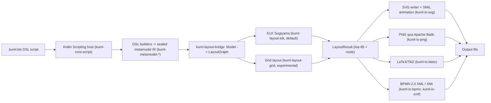
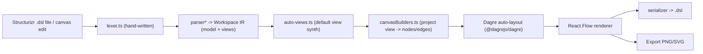
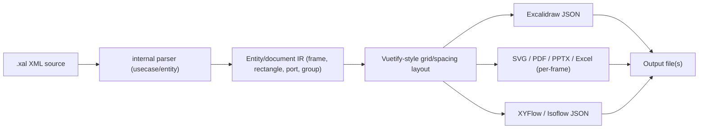
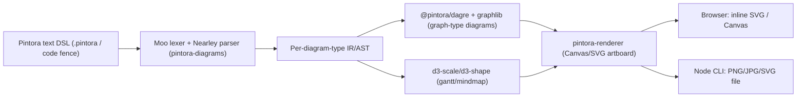

# Weekly Scan: Diagram-as-Code & Visual Tooling — 2026-07-20

Phạm vi: các repo GitHub trong domain diagram-as-code / visual tooling được publish hoặc update đáng kể trong khoảng 2026-07-13 → 2026-07-20, liên quan tới kiến trúc parser/layout/renderer mà **kymostudio** đang theo đuổi.

## Tóm tắt điều hành

- Tuần này nổi bật nhất là **kUML** — một Kotlin DSL "tất cả trong một" cho UML/SysML2/C4/BPMN, dùng **ELK Sugiyama** làm layout engine mặc định và render **SMIL animation thuần SVG** (không JS, không GIF) — đây là repo gần với triết lý "animated SVG" của kymostudio nhất, đáng nghiên cứu sâu nhất tuần này dù độ trưởng thành thực tế (14 stars, module rất rộng) cần được xác minh dần.
- **c4hero** và **xaligo** đại diện cho hướng "round-trip DSL ↔ format khác" (Structurizr DSL ↔ visual canvas; XML DSL → Excalidraw/PPTX/XYFlow) — cả hai đều minh hoạ pattern parser thủ công (hand-written lexer) + auto-layout (Dagre) mà kymostudio có thể tham chiếu cho `alignment.py`/`alignment.ts`.
- Phần lớn kết quả tìm được qua GitHub search API là repo rác/0-star do tài khoản có tên sinh ngẫu nhiên (nhiều khả năng là AI-slop hoặc test repo) — đã lọc bỏ theo tiêu chí loại trừ (skill-pack AI, portfolio, <300 LOC).

## Mục lục

- [Repos khác đáng chú ý (không deep-dive)](#repos-khac-dang-chu-y-khong-deep-dive)
- [1. kUML](#1-kuml)
- [2. c4hero](#2-c4hero)
- [3. xaligo](#3-xaligo)
- [4. Pintora](#4-pintora)

## Repos khác đáng chú ý (không deep-dive)

| Repo | Pitch một dòng | Lý do không deep-dive |
|---|---|---|
| [FigDown/figdown](https://github.com/FigDown/figdown) | Chuẩn Markdown-native cho diagram: AI agent đọc text, người đọc thấy SVG render deterministic | Mới ở giai đoạn spec/design (spec/, design/, conformance/ chủ yếu là Markdown), code parser/renderer thực tế còn rất mỏng (chỉ có `editor/figdown.html`) |
| [IBM/ibmdiagrams](https://github.com/IBM/ibmdiagrams) | Python package sinh kiến trúc diagram theo IBM Design Language, xuất ra draw.io XML | Ý tưởng tương tự `diagrams` (mingrammer) đã có từ lâu, không có layout/parser mới đáng nghiên cứu |
| [dinghydev/dinghy](https://github.com/dinghydev/dinghy) | Dùng React/JSX làm DSL để định nghĩa diagram + infrastructure-as-code | Code thực tế (core/renderer-drawio, renderer-tf, tf-aws) cho thấy trọng tâm là Terraform/draw.io export hơn là SVG/animation, lệch mục tiêu kymostudio |
| [Nimblesite/typeDiagram](https://github.com/Nimblesite/typeDiagram) | DSL nhỏ gọn, ngôn ngữ-trung lập để vẽ diagram cấu trúc data type | Quy mô nhỏ, README không đủ chi tiết kiến trúc để deep-dive có bằng chứng |
| [takasek/pfdsl](https://github.com/takasek/pfdsl) | DSL định nghĩa và visualize Process Flow Diagram dạng code | Repo rất mới (push ngay hôm nay), chưa đủ tài liệu/code để phân tích sâu |
| [regaj/inkling](https://github.com/regaj/inkling) | Editor code-to-diagram: DSL → ER diagram theo 5 notation khác nhau | Ít sao, README ngắn, chưa rõ layout engine dùng gì |
| [kuml-dev... c4hero... xaligo... pintora] | — | Xem 4 mục deep-dive bên dưới |

---

## 1. kUML

### §1 Quick context

Kotlin DSL kiểu-an-toàn hợp nhất UML/SysML2/C4/BPMN/ERM vào một model, khác biệt ở chỗ dùng compile-time type-checking thay vì text DSL lỏng lẻo như PlantUML/Mermaid. Tech stack: Kotlin (98.4%), ELK 0.11.0 (layout), Apache Batik (PNG), Compose Multiplatform (desktop UI). Output: SVG (mặc định, có SMIL animation), PNG, LaTeX/TikZ, BPMN 2.0 XML, XMI, Structurizr DSL, AUTOSAR ARXML. Repo health: 14 stars, Apache-2.0, có CHANGELOG.md (đang ở v0.24.x theo README), cấu trúc ~30 module Gradle — quy mô lớn bất thường so với star count, cần xem là "đang phát triển tích cực, một phần lớn tính năng listed trong README chưa được xác minh runtime". Phân phối: Homebrew/Chocolatey/Docker/jpackage installer, Maven Central cho library, VS Code/JetBrains/Obsidian plugin.

### §2 Architecture deep-dive

**A. Component inventory** (theo tên module Gradle, đường dẫn suy ra từ tên module vì repo không phơi bày qua contents API trong lần scan này):
- `kuml-core-script` — Kotlin Scripting host, evaluate file `.kuml.kts` thành object graph.
- `kuml-core-dsl` — DSL builder functions (`classDiagram{}`, `stateDiagram{}`, `bpmnModel{}` …).
- `kuml-metamodel-{uml,c4,sysml2,bpmn}` — sealed class hierarchy làm IR cho từng ngôn ngữ mô hình.
- `kuml-layout-bridge` — chuyển model sang `LayoutGraph` trung lập-engine.
- `kuml-layout-elk` — adapter gọi ELK Sugiyama (layered/hierarchical).
- `kuml-layout-grid` — layout engine grid thuần Kotlin, multiplatform (chạy được trên WASM).
- `kuml-io-svg` / `kuml-io-png` / `kuml-io-latex` / `kuml-io-bpmn` / `kuml-io-emf` — các emitter output riêng biệt.
- `kuml-cli` — entry point CLI (`kuml render|validate|fmt|generate|transform|reverse|serve|ai …`).

**B. Pipeline** (happy path cho `kuml render order-domain.kuml.kts --format svg`):
1. CLI parse arg, đọc file `.kuml.kts`.
2. `kuml-core-script` (Kotlin Scripting host) evaluate script, thực thi các hàm builder (`classDiagram{}` …) sinh ra object thuộc `kuml-metamodel-*` (IR).
3. `kuml-layout-bridge` convert IR model → `LayoutGraph` (node/edge/label/port trung lập).
4. `kuml-layout-elk` chạy ELK Sugiyama 4 pha (cycle-breaking → layer assignment → crossing minimization → edge routing) → `LayoutResult` (toạ độ + route).
5. `kuml-io-svg` ghi trực tiếp SVG từ `LayoutResult` theo theme đang chọn.
6. File `.svg` xuất hiện; nếu có cờ `--animated`, `SequenceSmilRenderer`/`StmSmilRenderer`/`BpmnSmilRenderer` chèn thẻ `<animateMotion>`/`<animate>` SMIL vào SVG.

**C. Data model/IR**: sealed class hierarchy theo Kotlin (`kuml-metamodel-*`), tách biệt theo domain (UML/C4/SysML2/BPMN/ERM) nhưng cùng đi qua một `LayoutGraph` trung lập ở tầng layout — đây chính là khái niệm "compile xuống IR thấp hơn" giống TALA của D2, chỉ khác là kUML tách LayoutGraph riêng khỏi metamodel thay vì có một IR hình học duy nhất cho mọi ngôn ngữ nguồn.

**D. Input language**: DSL Kotlin nội bộ (internal DSL / type-safe builder), không phải text DSL độc lập — nghĩa là "parser" thực chất là Kotlin compiler + Kotlin Scripting, không có BNF/EBNF riêng. Lỗi cú pháp là lỗi biên dịch Kotlin (báo qua IDE/compiler), không có error-reporting layer riêng do kUML viết — đây là khác biệt lớn nhất so với kymostudio (`.kymo` là external text DSL line-oriented).

**E. Layout**: hierarchical/layered (ELK Sugiyama) làm mặc định — 4 pha kinh điển (cycle-break, layering, crossing-min, routing với spline). Có engine grid thay thế, không rõ có force-directed hay không (không xác định).

**F. Rendering**: pluggable emitter pattern rõ ràng (SVG/PNG/LaTeX/BPMN-XML/XMI đều là module `kuml-io-*` riêng, cùng ăn một `LayoutResult`). Animation dùng SMIL thuần SVG — không cần JS runtime, khác cách kymostudio hiện animate (không xác định cơ chế animate hiện tại của kymostudio để so sánh trực tiếp, nhưng SMIL là hướng đáng cân nhắc để giảm phụ thuộc JS).

**G. Extensibility**: `kuml-plugin-api` dùng ServiceLoader SPI cho Theme/Renderer/Layout/Codegen/Reverse, có "Plugin Registry" với rating/review — cơ chế plugin runtime-discoverable, không phải chỉ compile-time.

**H. DX**: có LSP (`kuml-language-server`, LSP4J), watch mode (`kuml watch`, poll 500ms), web preview (`kuml serve`, CodeMirror 6, refresh 300ms), format/lint (`kuml fmt`), MCP server cho AI agent — DX rất đầy đủ trên giấy tờ.

### §3 Architecture diagram

### §4 Verdict

Đáng học nhất: **SMIL animation thuần SVG** (không JS) cho sequence/state/BPMN token-flow — kymostudio compile ra "animated SVG", nên kỹ thuật `<animateMotion>` theo route đã layout sẵn (thay vì CSS keyframes tính lại toạ độ) đáng thử nghiệm, đặc biệt cho BPMN token animation vốn kymostudio đã có `bpmn_shapes.py`. Ý tưởng tách `LayoutGraph` trung lập-engine (bridge pattern) khỏi metamodel cũng đáng tham chiếu cho `alignment.py` nếu kymostudio muốn hỗ trợ nhiều layout engine sau này. Red flag: quy mô ~30 module cho repo 14 sao là bất thường, README liệt kê rất nhiều tính năng (multi-LLM agent, blockchain adapter, AUTOSAR) khó tin là đã hoàn thiện — cần đọc code thực tế trước khi tin bất kỳ claim nào ngoài các phần có bằng chứng module rõ ràng ở trên. Câu hỏi mở: ELK Sugiyama có thực sự chạy tốt trên JVM/GraalVM Native Image chưa, hay còn ở dạng thử nghiệm? Verdict: **study deeper** (riêng phần SMIL animation + layout bridge pattern), nhưng thận trọng với phần còn lại của README.

---

## 2. c4hero

### §1 Quick context

Visual editor C4 chạy hoàn toàn trong browser, khác biệt ở chỗ lưu trực tiếp ra **Structurizr DSL round-trip hai chiều** thay vì định dạng proprietary — "kéo-thả rồi vẫn ra file text version-control được". Tech stack: TypeScript/React 19, Vite, Zustand, `@xyflow/react` (React Flow) + `@dagrejs/dagre` cho auto-layout. Output: `.dsl`, PNG, SVG. Repo health: 39 stars, 7 forks, release mới nhất v0.3.0 (2026-07-07), có CI rõ ràng qua Vitest + Playwright e2e, có sẵn `ARCHITECTURE.md`/`SECURITY.md`/`PRIVACY.md`. Phân phối: web app (Vercel), không có CLI/package riêng biệt.

### §2 Architecture deep-dive

**A. Component inventory**:
- `src/lib/dsl/lexer.ts` — lexer thủ công cho Structurizr DSL (không dùng regex engine, dùng `peek()/advance()`).
- `src/lib/dsl/parser*` — bộ parser tách theo mảng: model / relationship / styles / views.
- `src/lib/dsl/serializer` — ghi ngược `Workspace` → text DSL.
- `src/store/` — Zustand, 11 slice quản lý model/UI/undo/navigation.
- `src/components/canvas/` — React Flow renderer + node builder theo loại phần tử C4.
- `src/lib/ai/` — AI engine BYOK (bring-your-own-key) cho tính năng trợ lý.
- `auto-views.ts` — tự sinh default view khi DSL không khai báo view tường minh.

**B. Pipeline** (happy path: mở file `.dsl` có sẵn → xem canvas → sửa → export):
1. Người dùng mở/dán nội dung Structurizr DSL vào app.
2. `lexer.ts` tokenize (13 loại token: KEYWORD, IDENTIFIER, STRING, ARROW, LBRACE...).
3. `parser*` build `Workspace` IR (model: people/softwareSystems/containers/components/relationships/groups; views: systemLandscape/systemContext/container/component).
4. Nếu DSL thiếu view, `auto-views.ts` tự sinh view mặc định để canvas không trống.
5. `canvasBuilders.ts` chiếu (project) view đang active thành node/edge cho React Flow, layout tự động qua `@dagrejs/dagre`.
6. React Flow render lên canvas; người dùng chỉnh sửa (trigger store action + undo snapshot) → `canvasBuilders` re-project → cuối cùng `serializer` ghi ngược ra `.dsl`, hoặc export PNG/SVG.

**C. Data model/IR**: `Workspace` — object TypeScript (không rõ dùng class hay plain interface — không xác định), là "single source of truth"; view là "projection" tham chiếu ID vào model, không sao chép dữ liệu — giữ model/view tách biệt rõ ràng, giống khái niệm `Diagram`/`Region` của kymostudio nhưng thêm khái niệm "nhiều view trên cùng một model".

**D. Input language design**: parser thủ công, không dùng ANTLR/PEG — pipeline `lexer → parser* → Workspace` là recursive-descent kiểu thủ công theo bằng chứng cấu trúc token/module (không xác định chi tiết thuật toán parse bên trong `parser*`). Lexer trả về cả token lẫn lỗi lexical kèm dòng/cột chính xác — error reporting có vị trí rõ ràng.

**E. Layout**: hierarchical qua Dagre (Sugiyama-family), không có evidence về orthogonal routing hay crossing-minimization tùy chỉnh ngoài Dagre mặc định. Vị trí layout còn được override thủ công và lưu vào file `.json` sidecar (vì Structurizr DSL text không biểu diễn được toạ độ) — đáng chú ý vì đây là giải pháp cho vấn đề "text DSL không lưu vị trí" mà kymostudio cũng gặp phải với `.kymo`.

**F. Rendering**: single backend là React Flow (DOM/SVG hybrid qua thư viện), không phải renderer tự viết — khác kymostudio (tự viết `to_svg.py`). Export PNG/SVG là bước riêng, không rõ cơ chế cụ thể (không xác định).

**G. Extensibility**: theme/style qua "styles config" trong `Workspace`; thêm shape mới cần thêm node builder trong `components/canvas/nodes/` — không có plugin SPI chính thức (không xác định plugin system ngoài cấu trúc component).

**H. DX**: web app trực tiếp, không CLI; có Playwright e2e, ARIA/keyboard accessibility; AI assistant sinh "EditPlan" (danh sách operation) rồi `applyEditPlan` áp dụng có validate + sort — pattern đáng chú ý cho AI-assisted editing an toàn (áp dụng operation đã validate thay vì để AI ghi đè trực tiếp).

### §3 Architecture diagram

### §4 Verdict

Đáng học: giải pháp "layout sidecar `.json`" cho vấn đề DSL text không biểu diễn toạ độ — kymostudio có thể tham khảo cho trường hợp người dùng kéo-thả chỉnh vị trí trong tương lai (editor tương tác) mà không muốn phá format `.kymo`. Pattern "EditPlan validate rồi mới apply" cho AI-assisted edit cũng đáng cân nhắc nếu kymostudio có hướng tích hợp AI chỉnh sửa diagram. Việc `auto-views.ts` tự sinh view mặc định khi thiếu khai báo tương tự tinh thần "auto-canvas sizing" trong `alignment.py` — cùng triết lý giảm bắt buộc khai báo. Red flag: không có evidence về xử lý crossing-minimization/orthogonal routing ngoài Dagre stock, nên "auto-layout" ở đây khá cơ bản. Câu hỏi mở: file `.json` sidecar lưu ở đâu, đồng bộ với `.dsl` thế nào khi cả hai file lệch nhau (git conflict)? Verdict: **study deeper** phần lexer/parser + layout-sidecar pattern, phần renderer chỉ **glance only** vì dùng thư viện có sẵn (React Flow) không có kỹ thuật render riêng.

---

## 3. xaligo

### §1 Quick context

CLI Go chuyển một DSL XML (`.xal`, tự nhận "Vue-style" nhưng cú pháp thực tế là XML envelope) thành 7 định dạng khác nhau, khác biệt ở khả năng **diff kiến trúc giữa hai version** (`xaligo diff before.xal after.xal`) — điều hiếm gặp ở các tool diagram-as-code khác. Tech stack: Go (97.7%) cho core, có kèm JS/TS phụ trợ (package.json/tsconfig.json ở root, mục đích chưa rõ — không xác định). Output: Excalidraw JSON, SVG, PPTX, PDF, Excel, XYFlow, Isoflow. Repo health: 1 star, còn rất mới, không rõ CI (không xác định do không truy cập được `.github/workflows` trong lần scan). Phân phối: `npm install -g @xaligo/xaligo` (wrapper) + `cargo`/`make build` được nhắc tới trong tài liệu phát sinh (không xác định chắc chắn, có khả năng nhầm lẫn với build tool phụ) — nguồn xác thực nhất là `go.mod` ở root nên coi Go là ngôn ngữ chính.

### §2 Architecture deep-dive

**A. Component inventory**:
- `cmd/` — entry point CLI (subcommand `init`, `render`, `diff`).
- `internal/controller/` — điều phối luồng lệnh CLI.
- `internal/usecase/` — logic nghiệp vụ (parse → build → export).
- `internal/entity/` — định nghĩa struct domain (frame, rectangle, port, group…).
- `internal/repository/` — I/O đọc file `.xal`/ghi output.
- `internal/config/`, `internal/share/` — cấu hình và tiện ích dùng chung.
- `docs/src/xal/overview.md` — đặc tả ngôn ngữ `.xal`.

**B. Pipeline** (happy path cho `xaligo render sample.xal --format svg -o sample.svg`):
1. CLI (`cmd/`) parse flag, gọi `controller`.
2. `usecase` đọc file `.xal` qua `repository`, chuyển cho parser XML nội bộ.
3. Parser dựng cây `entity` (frame → rectangle/port/group, id bắt buộc unique để connector tham chiếu).
4. `usecase` áp layout kiểu Vuetify (hệ spacing/grid) lên các entity trong từng frame.
5. Exporter tương ứng format (`--format svg`) duyệt từng frame, sinh file riêng cho SVG/PPTX/PDF/Excel, hoặc gộp thành một document logic cho Excalidraw/XYFlow/Isoflow (khung frame giữ dạng outline trong suốt).
6. File output ghi ra đường dẫn `-o`.

**C. Data model/IR**: struct Go trong `internal/entity/` (không xác định chi tiết field, nhưng theo spec ngôn ngữ có `data`, `frames→frame(id,width,height)`, `rectangle`, `port`, group tag cho AWS) — hệ toạ độ màn hình chuẩn (gốc top-left, x phải/y xuống), mutable hay immutable qua các pass: không xác định.

**D. Input language design**: XML thực thụ (không phải cú pháp Vue/JSX như tên gọi gợi ý — đây là điểm cần lưu ý khi đọc README, "Vue-style" chỉ ám chỉ hệ spacing/grid kiểu Vuetify chứ không phải cú pháp file). Có versioning tường minh trong ngôn ngữ: root `<xaligo version="1">` (V1) và root mới `<scene version="2">` (V2) để reader V1 chủ động reject nội dung không tương thích — đây là một pattern quản lý breaking-change ngôn ngữ đáng chú ý. Lỗi báo dạng "invalid config → error, không silent fail"; tag lạ trong V1 được coi là điểm mở rộng (extension point) thay vì lỗi cứng.

**E. Layout**: dạng grid/spacing theo quy ước Vuetify (không phải force-directed hay Sugiyama) — người dùng khai toạ độ tường minh nhiều hơn là auto-layout thuật toán; không có bằng chứng về orthogonal routing tự động hay crossing-minimization (không xác định).

**F. Rendering**: pluggable exporter theo format rõ ràng — đa dạng nhất trong 4 repo được deep-dive (7 format). Không có animation.

**G. Extensibility**: mở rộng qua tag lạ ở V1 (extension point trong spec ngôn ngữ) và thêm exporter mới trong tầng usecase/repository — không xác định có plugin SPI chính thức hay không.

**H. DX**: CLI có `init` để scaffold project, `diff` để so sánh hai version kiến trúc — hai lệnh này không phổ biến ở tool cùng loại, đáng chú ý cho DX. Không xác định watch mode/LSP/VS Code extension.

### §3 Architecture diagram

### §4 Verdict

Đáng học nhất: tính năng **`xaligo diff`** — so sánh hai file DSL, highlight phần tử added/removed trực tiếp trên diagram. kymostudio hiện chưa có tính năng diff kiến trúc giữa hai phiên bản `.kymo`, đây là ý tưởng khả thi và rẻ để thêm (so sánh 2 `Diagram` model đã resolve, không cần thay đổi renderer). Pattern **versioning tường minh trong root element** (`<xaligo version="1">` vs `<scene version="2">`) đáng tham chiếu nếu `.kymo` DSL cần một breaking-change trong tương lai — hiện `docs/DSL.md` của kymostudio chưa có cơ chế version. Cách export "nhiều format từ cùng một IR" (SVG/PPTX/PDF/Excel/Excalidraw/XYFlow/Isoflow) khẳng định lại giá trị kiến trúc emitter tách biệt mà kymostudio đã áp dụng (`to_svg.py`/`to_figma.py`/`to_excalidraw.py`/`to_webp.py`). Red flag: nhầm lẫn "Vue-style" trong tên/README dù cú pháp thực là XML — dấu hiệu README có thể viết marketing trước, code sau. Câu hỏi mở: `.xal` version 2 khác biệt gì so với V1 ngoài root tag? Verdict: **study deeper** cho tính năng diff + version scheme, phần còn lại **glance only**.

---

## 4. Pintora

### §1 Quick context

Thư viện JS text-to-diagram theo hướng Mermaid/PlantUML nhưng dùng **parser generator thật** (Nearley + Moo) thay vì regex line-by-line, khác biệt chính là kiến trúc "mỗi loại diagram là một package con có parser/layout/renderer riêng, dùng chung core". Tech stack: TypeScript, `@hikerpig/nearley` (fork của Nearley — Earley parser generator) + `@hikerpig/moo` (lexer), `@pintora/dagre` (fork Dagre) + `@pintora/graphlib`, d3-shape/d3-scale/d3-interpolate cho gantt/mindmap. Output: SVG/Canvas (browser), PNG/JPG/SVG (Node qua CLI). Repo health: 1.285 stars, release gần nhất v0.8.2 (2026-02-13) nhưng có commit push 2026-07-17, dùng pnpm workspace + Turborepo, có test (Nearley `.ne` grammar + Jest theo README). Phân phối: npm (`@pintora/standalone`, `@pintora/cli`…), web editor tại pintorajs.vercel.app, VS Code extension (`pintora-vscode`), Obsidian plugin.

### §2 Architecture deep-dive

**A. Component inventory** (packages trong monorepo `packages/`):
- `pintora-core` — engine dùng chung (event emitter, config, theme).
- `pintora-diagrams` — chứa parser (Nearley/Moo) + logic dựng IR cho từng loại diagram, có subfolder riêng: `sequence/`, `er/`, `class/`, `activity/`, `component/`, `dot/`, `gantt/`, `mindmap/`.
- `pintora-renderer` — tầng vẽ (Canvas/SVG artboard abstraction).
- `pintora-standalone` — bundle browser dùng trực tiếp.
- `pintora-cli` — entry point Node CLI.
- `pintora-harness` — test harness (case-based, thư mục `harness/cases/` ở root).
- `pintora-target-wintercg` — target runtime WinterCG (edge runtime), cho thấy quan tâm tới đa runtime.

**B. Pipeline** (happy path cho `pintora-cli input.pintora -o out.svg`):
1. CLI đọc file text DSL (`.pintora` hoặc code fence markdown).
2. `pintora-diagrams` xác định loại diagram (sequenceDiagram/erDiagram/…) rồi dùng cặp lexer `@hikerpig/moo` + parser `@hikerpig/nearley` (grammar `.ne` biên dịch sẵn) tokenize + parse thành AST/IR riêng cho loại đó.
3. IR được build tiếp thành graph nội bộ qua `@pintora/graphlib`.
4. `@pintora/dagre` (fork Dagre, layout Sugiyama-family) tính toạ độ node/route edge cho các diagram dạng graph (sequence/activity/class/component); gantt/mindmap dùng d3-scale/d3-shape để tính toạ độ theo thời gian/cây thay vì Dagre.
5. `pintora-renderer` vẽ lên artboard abstraction (SVG hoặc Canvas tuỳ target).
6. `pintora-core`/`pintora-cli` xuất chuỗi SVG (browser) hoặc ghi file PNG/JPG/SVG (Node, qua canvas backend).

**C. Data model/IR**: mỗi loại diagram có IR riêng (không có một `Diagram` struct chung cho mọi loại như kymostudio) — kiến trúc "per-diagram-type module" hoàn toàn tách biệt, đánh đổi giữa linh hoạt (mỗi loại tối ưu riêng) và nhất quán (không có mô hình chung); mutable/immutable qua các pass: không xác định.

**D. Input language design**: **parser generator thật sự** — Nearley (Earley parsing, hỗ trợ ambiguous grammar) + Moo (lexer nhanh dựa trên regex biên dịch). Đây là khác biệt kiến trúc lớn nhất so với `dsl.py` của kymostudio (line-oriented, hand-rolled, "parsing thuần khai báo, không validate"). Không xác định được nội dung file `.ne` cụ thể (không fetch được), nhưng sự tồn tại của dependency `@hikerpig/nearley` + ngôn ngữ "Nearley" trong thống kê ngôn ngữ GitHub xác nhận có grammar file thật. Error reporting: không xác định.

**E. Layout**: hierarchical (Dagre/Sugiyama) cho diagram dạng graph; scale-based (d3-scale/d3-shape) cho gantt/mindmap — tức là **layout algorithm khác nhau theo loại diagram**, không có một layout engine chung cho tất cả, khác kymostudio (một `alignment.py` dùng chung cho mọi component).

**F. Rendering**: kiến trúc renderer tách khỏi parser rõ ràng (`pintora-renderer` độc lập với `pintora-diagrams`), hỗ trợ cả Canvas và SVG cùng backend abstraction — pluggable ở mức "artboard" cho phép thêm target mới (đã có `pintora-target-wintercg` cho edge runtime).

**G. Extensibility**: có "plugin system" chính thức theo README (tutorial "Write a custom diagram" được nhắc tới) cho phép dev viết loại diagram mới và phân phối riêng — không xác định API cụ thể do không fetch được tutorial.

**H. DX**: có VS Code extension (`pintora-vscode`, syntax highlight + preview cho `.pintora` và code fence markdown), Gatsby/Observable/Web Components integration, web editor live preview — hệ sinh thái tool xung quanh khá đầy đủ dù core library chậm release (7 tháng từ v0.8.2).

### §3 Architecture diagram

### §4 Verdict

Đáng học nhất: dùng **parser generator thật (Nearley/Earley) thay vì hand-rolled line parser** — đáng cân nhắc nếu `.kymo` DSL của kymostudio (hiện "line-oriented grammar" theo CLAUDE.md) gặp giới hạn khi ngữ pháp phức tạp hơn (ví dụ nested block ambiguous). Tuy nhiên đây là đánh đổi lớn (build step biên dịch `.ne`, thêm dependency, khó debug hơn regex) nên chỉ đáng cân nhắc nếu parser hiện tại thực sự chật vật, không phải thay đổi mặc định. Ý tưởng **layout khác nhau theo loại diagram** (Dagre cho graph, d3-scale cho timeline/tree) đáng tham chiếu cho các trường hợp kymostudio thêm diagram type mới không phải node-edge thuần (ví dụ Gantt). Red flag: core library "ngủ đông" 7 tháng không release dù có commit — có thể là dấu hiệu maintainer bận, cần kiểm tra CI/issue tracker trước khi phụ thuộc. Câu hỏi mở: `@pintora/dagre` fork khác Dagre gốc ở điểm nào? Verdict: **study deeper** phần parser generator choice + per-diagram-type layout, phần ecosystem tool chỉ **glance only**.
