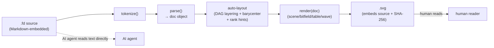
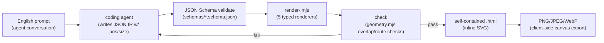
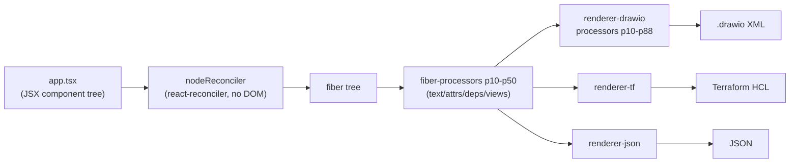

# Weekly scan — diagram-as-code & visual tooling (2026-07-21)

**Nguồn:** GitHub topic pages (`diagram-as-code`, `graph-visualization`,
`layout-algorithm`, `svg-animation`, sort `updated`) + `git clone --depth 1`
để đọc trực tiếp source/README/examples. Không dùng được `gh api search`
(proxy của session này chặn mọi GitHub API call ngoài phạm vi
`kymostudio/kymostudio`), nên danh sách dựa trên GitHub topic listing +
`git log` để xác nhận recency thay vì `search/repositories` structured query.

## Executive summary

- **FigDown** (0★, rất mới) là phát hiện đáng chú ý nhất: một markdown-native
  diagram DSL đang thiết kế conformance suite 100-case + auto-layout v2
  (DAG layering, barycenter, orthogonal back-edge routing) theo đúng tinh
  thần "small edit → small diff" mà kymo's `alignment.py` cũng theo đuổi —
  đáng đọc kỹ discrepancy log của họ.
- **Archify** (6.3k★, tăng +2.1k tuần này) chứng minh một hướng đối lập với
  kymo: bỏ auto-layout, để LLM tự quyết định toạ độ `pos`/`size`, đổi lại
  bằng một validation loop (schema + geometry overlap + SVG sanity check)
  chạy sau mỗi lần render — một pattern "agent-authored layout, machine-verified"
  đáng cân nhắc cho các icon/overlay không auto-layout được.
- **dinghy** và **drawio-mcp-server** là hai case-study cho hai hướng khác
  nhau của "DSL = code có sẵn": JSX + custom React reconciler (dinghy) so với
  YAML + Python builder functions (drawio-mcp-server) — cả hai đều emit ra
  format ngoài (drawio XML / Terraform HCL) thay vì tự vẽ SVG.

## Mục lục

1. [FigDown](#1-figdown) — markdown-native diagram DSL cho AI agents
2. [Archify](#2-archify) — schema-driven diagram skill cho coding agents
3. [dinghy](#3-dinghy) — Diagram + Infrastructure as Code bằng React/JSX
4. [drawio-mcp-server](#4-drawio-mcp-server) — YAML → draw.io qua MCP
5. [Repos khác đã xem xét nhưng không deep-dive](#5-repos-khác-đã-xem-xét)

---

## 1. FigDown

**Repo:** [FigDown/figdown](https://github.com/FigDown/figdown) · commit mới nhất trong tuần: `3c32496` (2026-07-18)

### §1 Quick context

Một chuẩn text-based mới để nhúng diagram vào Markdown sao cho AI agent đọc
được *ý nghĩa* từ text, còn con người xem SVG đi kèm — khác Mermaid ở chỗ
target hẳn vào network/protocol diagrams (bitfield, wave, table) mà Mermaid
không biểu diễn được. Stack: JavaScript thuần (không dependency ngoài),
output SVG, engine đóng gói thành 1 file `dist/figdown.mjs` (~1700 dòng).
Repo 0 sao, không rõ số contributor, chưa có CI workflow, nhưng có 100-case
golden conformance suite chạy thủ công. Distribution: chưa publish package
nào — chỉ có static editor (GitHub Pages) + `skill/` để cài vào Claude Code.

### §2 Architecture deep-dive

**A. Component inventory**
- `tokenize`/`parse` (`dist/figdown.mjs:30-680`) — lexer + line-oriented parser ra một `doc` object.
- `render`/`renderScene`/`renderBitfield`/`renderTable`/`renderWave`/`renderPlot` (cùng file, dòng 732-1552) — emitter theo từng "block type".
- `routeAround`/`clipSegRect`/`segHitsObs`/`borderPoint` (dòng 1337-1406) — edge routing quanh obstacle.
- `tools/layout-lint.js` — linter riêng kiểm tra chất lượng render (không phải test đúng/sai, mà "chất lượng hình học").
- `editor/figdown.html` — nguồn thật của engine; `dist/figdown.mjs` được sinh ra từ file này (`node tools/make-lib.js`), tự ghi rõ "GENERATED FILE, DO NOT EDIT" ở đầu.
- `conformance/cases/*.fd` + `*.model.json`/`*.errors.txt` — 100+ case golden test cho lexer/parser.

**B. Pipeline** — `.fd` text → `tokenize()` từng dòng → `parse()` gom thành `doc` (nodes/edges/groups/layers/blocks) → layout tự động (rank/flow) chèn toạ độ vào `doc` → `render(doc)` phát SVG string → CLI `tools/build-svg.js` ghi file `.svg` cạnh `.fd`. Happy path: user sửa `.fd` → chạy `node tools/build-svg.js file.fd` → SVG embed sẵn source + SHA-256 xuất hiện cạnh source.

**C. Data model** — `doc` là plain JS object (không class), mutable qua các pha parse rồi layout. Không có concept "compile xuống IR thấp hơn" kiểu D2 TALA — parse và layout gộp trong cùng object, khác kymo (vốn tách `Diagram` dataclass ra khỏi resolver).

**D. Input language design** — custom hand-rolled tokenizer theo dòng (không regex-toàn-dòng, không PEG/ANTLR), nhưng **grammar là closed set tường minh**: mọi option key phải nằm trong `OPT_KEYS`, và mỗi directive có `DIRECTIVE_OPTS` riêng — key hợp lệ nhưng sai chỗ vẫn báo lỗi có số dòng cụ thể (không im lặng bỏ qua). Đây là điểm khác biệt lớn nhất so với Mermaid/D2: lỗi cú pháp được thiết kế *cho AI agent tự sửa* (design axiom #6 trong README), không chỉ cho người.

**E. Layout algorithm** — commit `aa198f0` ("Auto-layout v2: DAG layering, barycenter lanes, orthogonal back-edge channels, label-aware pitch") + `f6dd3d9`/`bf28516` ("Obstacle-aware edge routing... concentric back-edge rings, anti-parallel offset") cho thấy: layered/Sugiyama-style ranking + barycentric ordering để giảm crossing, edge routing orthogonal có né obstacle, không dùng thư viện ngoài (tự viết). `rank <ids>` trong DSL là hint thủ công chèn vào giữa auto-layout — giống cơ chế "trunk-lane" của kymo's `alignment.py`.

**F. Rendering** — chỉ SVG, không animation (axiom #8: "static first; dynamic later — không phải timeline animation language"). Single-backend, chưa pluggable.

**G. Extensibility** — thêm construct mới phải qua `spec/PROCESS.md` (RFC-style: đề xuất → `design/requirements-notes.md` ghi R-number → `spec/MIGRATIONS.md` ghi rewrite rule cơ học nếu đổi syntax). Không có plugin runtime.

**H. Dev experience** — có browser editor live (figdown.github.io) với "mọi thao tác GUI đều là một text edit" (kéo node = ghi `at=x,y` vào text). Không có VS Code extension/LSP. Không watch mode built-in.

### §3 Architecture diagram



### §4 Verdict

Đáng học nhất: **closed-grammar-với-line-number-errors** để hỗ trợ AI
write→validate→fix loop — kymo's `dsl.py` hiện parse khá permissive, có thể
tham khảo cách FigDown báo lỗi cụ thể theo dòng cho từng option key sai chỗ
(`DIRECTIVE_OPTS` per-directive). Ý tưởng "SVG tự embed source + SHA-256"
cũng đáng thử cho `to_svg.py` — giúp một file `.svg` đứng độc lập vẫn
round-trip lại được `.kymo`. Layout stability axiom ("local edit → local
diff, never full re-layout") là một constraint mạnh chưa chắc kymo đang giữ
— đáng test xem `alignment.py` có vi phạm không.

Red flag: toàn bộ engine là 1 file JS ~1700 dòng không có module boundary,
không TypeScript, không CI tự động (dù có conformance suite) — dễ rơi vào
tình trạng khó bảo trì nếu project lớn hơn. Open question: "layout
stability" liệu có scale nổi khi diagram lớn (họ mới test corpus 774 tài
liệu, chưa rõ về diagram size). **Verdict: study deeper** — đặc biệt phần
error-reporting-for-agents và layout stability axiom.

---

## 2. Archify

**Repo:** [tt-a1i/archify](https://github.com/tt-a1i/archify) · release `v2.11.0` (2026-07-16), 6.3k★ (+2.1k tuần này, top trending GitHub)

### §1 Quick context

Một agent skill (Claude Code / Codex / opencode) biến mô tả tiếng Anh thành
5 loại diagram (architecture/workflow/sequence/dataflow/lifecycle) xuất ra 1
file HTML tự chứa — khác kymo ở chỗ **không auto-layout**: agent tự chọn
toạ độ, renderer chỉ validate + vẽ. Stack: Node.js (ESM, zero runtime
dependency ngoài Node core), output HTML+SVG (kèm export PNG/JPEG/WebP qua
canvas trong browser). Repo có `test/` (geometry, layout-rules, golden,
animation), CI (`ci.yml`, `release.yml`), MIT license. Distribution: cài qua
`npx skills add tt-a1i/archify` (registry riêng của skill CLI, không phải
npm package thông thường) hoặc zip thủ công.

### §2 Architecture deep-dive

**A. Component inventory**
- `bin/archify.mjs` — CLI: `render|validate|inspect|check|examples|doctor|demo`.
- `renderers/{architecture,workflow,sequence,dataflow,lifecycle}/render-*.mjs` — 5 renderer riêng biệt, mỗi loại diagram một schema + một file render.
- `renderers/shared/{geometry,validator,layout-report,utils,cli}.mjs` — geometry helpers thuần (`rectsOverlap`, `segmentIntersectsRect`...) dùng chung cho validation, không dùng cho auto-layout.
- `schemas/*.schema.json` — JSON Schema cho từng loại IR, có `generated-validators.mjs` sinh từ schema (không cần cài `ajv` runtime — "degraded mode" fallback khi thiếu).
- `test/layout-rules.test.mjs`, `test/geometry.test.mjs`, `test/golden.mjs` — test riêng cho tầng hình học, tách khỏi test render HTML.

**B. Pipeline** — user mô tả kiến trúc bằng tiếng Anh trong chat → **agent** (không phải renderer) tự sinh JSON IR có toạ độ `pos`/`size` tường minh → `archify validate <type> input.json` chạy JSON Schema check → `archify render <type> input.json output.html` phát HTML tự chứa (SVG inline) → `archify check output.html` kiểm tra artifact (toạ độ hữu hạn, SVG hợp lệ, route không cắt qua node khác) → agent lặp lại nếu check fail. Khác kymo ở bước 2: không có layout engine tính toán, con người/agent tự đặt toạ độ.

**C. Data model** — JSON IR thuần (`schema_version`, `diagram_type`, `components[]` có `pos`/`size` tường minh, `connections[]`, `boundaries[]`, `cards[]`). Không có pass "resolve" nào biến đổi model — model đã là final layout ngay từ khi agent viết ra; renderer chỉ đo/vẽ.

**D. Input language design** — không có DSL text — input là JSON IR do agent tự sinh trực tiếp (không qua parser nào). Error reporting nằm ở JSON Schema validation (`archify validate --json`) + `layout-report.mjs` xuất báo cáo toạ độ đã tính để agent tự soát.

**E. Layout algorithm** — **không có auto-layout engine** (README nói thẳng: "Layout judgment over generic auto-layout — the agent chooses hierarchy, spacing, routes"). Duy nhất `renderers/architecture/grid.mjs` hỗ trợ đặt theo `row`/`col` grid tường minh (không phải thuật toán, chỉ snap toạ độ). Routing: geometry.mjs có line-segment/rect intersection để renderer tự né obstacle khi vẽ orthogonal connector, nhưng không phải giải thuật tối ưu hoá crossing.

**F. Rendering** — SVG inline trong HTML tự chứa; animation qua CSS (`meta.animation: "trace"`, tôn trọng `prefers-reduced-motion`) — không phải renderer riêng, chỉ 1 flag opt-in. Export PNG/JPEG/WebP dùng canvas trực tiếp trong trình duyệt lúc user bấm nút (client-side, không phải build-time). 5 renderer độc lập theo từng `diagram_type`, không chia sẻ base class chung ngoài `shared/`.

**G. Extensibility** — thêm loại diagram mới = thêm 1 schema + 1 renderer + đăng ký trong `TYPES` set ở `bin/archify.mjs`; không có plugin runtime, không theme engine ngoài dark/light CSS variables cố định.

**H. Dev experience** — CLI có `doctor`/`demo`/`examples` để self-check môi trường; help text rõ ràng. Không LSP/VS Code extension riêng (chạy qua Claude Code skill). Không watch mode (render one-shot). Browser preview chính là output HTML mở trực tiếp.

### §3 Architecture diagram



### §4 Verdict

Ý tưởng đáng cân nhắc nhất: **agent-authored layout + machine-verified
geometry** — tách bạch "ai quyết định vị trí" (LLM, có ngữ cảnh domain) khỏi
"ai đảm bảo không chồng lấn/route hợp lệ" (code thuần, `rectsOverlap`/
`segmentIntersectsRect`). Kymo hiện dồn hết vào `alignment.py` tính toán
cứng; với các diagram tự do (không phải BPMN/flowchart chuẩn), có thể học
mô hình "generate → validate → targeted re-iterate" này cho một chế độ
"freeform" thay vì auto-layout toàn phần.

Red flag: 5 renderer độc lập không share layout logic ngoài `geometry.mjs`
thuần hình học — dễ trôi (drift) về UX giữa 5 loại diagram theo thời gian
(archify tự thừa nhận trong ROADMAP "not current goals: generic
auto-layout"). Đây là một lựa chọn kiến trúc có chủ đích, không phải thiếu
sót, nhưng đáng theo dõi khi họ scale thêm loại diagram. Open question:
chưa rõ agent (LLM) tính toán `pos`/`size` tốt đến đâu ở diagram lớn (>20
component) — không có evidence trong repo. **Verdict: glance only** cho
kiến trúc renderer, nhưng **study deeper** riêng phần validate-loop pattern.

---

## 3. dinghy

**Repo:** [dinghydev/dinghy](https://github.com/dinghydev/dinghy) · release `v0.1.363` (2026-07-20), 4★, 363 commit

### §1 Quick context

Dùng JSX/React component tree làm DSL để mô tả *đồng thời* diagram kiến
trúc và Terraform infra — build tree một lần, emit ra nhiều backend (draw.io
XML, Terraform HCL, JSON). Khác kymo ở chỗ **DSL không phải text tuyến tính
mà là cây component có state/props/hooks** giống thực sự viết React app.
Stack: TypeScript + Deno monorepo (không phải Node/npm), dùng
`react-reconciler` (custom renderer, không đụng DOM). CI có 5 workflow
(`verification.yml`, `release-*.yml` theo từng package). License Apache-2.0.
Distribution: CLI qua `deno` + tài liệu tại dinghy.dev; các package riêng
biệt release độc lập (`@dinghy/base-components`, `@dinghy/tf-aws`...).

### §2 Architecture deep-dive

**A. Component inventory**
- `core/base-components/src/components/{Shape,Node,Rows,Columns,Dependency,MoveToHere}.tsx` — JSX primitive để mô tả node/layout/dependency.
- `core/base-renderer/src/nodeReconciler.ts` + `renderNode.ts` — **custom React reconciler** dựng bằng `react-reconciler` (`ConcurrentRoot`), build ra fiber tree không chạm DOM.
- `core/base-renderer/src/fiber-processors/{p10HandleTextNodes,p20PopulateCoreAttributes}.tsx` + `processors/{p25ApplyEnabled,p30BindData,p40ResolveDependencies,p50CollectViews}.tsx` — pipeline nhiều pha đánh số thứ tự chạy trên fiber tree đã dựng.
- `core/renderer-drawio/src/processors/p10...p88*.tsx` — pipeline backend riêng cho draw.io: resolve view attribute → collect dependency → generate shape → generate relationship → build `mxGraphModel` (`p88BuildMxfile.ts`) → `toDrawioXml.ts`.
- `core/renderer-drawio/src/attribute-handler/_{x,y,width,height,color,style,arrow,image,direction}.ts` — mỗi thuộc tính JSX (`_x`, `_color`...) có 1 handler resolve riêng.
- `core/tf-aws`, `core/tf-common`, `core/renderer-tf` — cùng cây component đó emit ra Terraform HCL thay vì diagram.

**B. Pipeline** — user viết `app.tsx` với JSX (`<Shape><AwsProvider><Bucket/></AwsProvider></Shape>`) → `renderNode()` tạo `fiberRootNode` qua `nodeReconciler.createContainer` → React tự "render" cây (chạy hook `useAwsS3Bucket` v.v., resolve state) → `applyProcessors()` chạy loạt fiber-processor (p10→p50) để gắn text/attribute/dependency lên từng node đã dựng → renderer đích (`renderer-drawio` hoặc `renderer-tf`) chạy tiếp pipeline riêng (p10→p88) → xuất file (`.drawio` XML hoặc `.tf`). CLI: `dinghy build app.tsx` (qua `cli/src/commands`).

**C. Data model** — không có 1 dataclass/struct trung tâm; IR **là chính cây React fiber** (mutable, đi qua nhiều processor biến đổi tại chỗ theo từng pha p10/p20/.../p88). Có "compile xuống IR thấp hơn" rõ ràng theo layer: JSX props → core attributes (p20) → dependency graph (p40/p16) → shape/relationship cụ thể của backend (p82/p86) → format string cuối (p88). Giống ý tưởng TALA của D2 nhưng thực hiện bằng React fiber thay vì graph riêng.

**D. Input language design** — không phải parser text — "ngôn ngữ" là chính TypeScript/JSX, type-checked bởi `tsc`. Lỗi cú pháp là lỗi TypeScript compiler thông thường (không có error message riêng cho diagram semantics). Không có EBNF nào — grammar chính là JSX + component API surface.

**E. Layout algorithm** — không có auto-layout hình học kiểu Sugiyama; `Rows`/`Columns` component là bố cục tường minh (flex-like), và với backend drawio thì `p32ApplyDistribution.ts`/`p65AlignDependencies.ts` chỉ căn chỉnh theo dependency graph đơn giản (không tối ưu crossing). Layout thực chất do component tree (Rows/Columns lồng nhau) quyết định — giống layout HTML/CSS hơn là graph-layout engine.

**F. Rendering** — pluggable emitter thật sự qua nhiều "renderer package" độc lập (`renderer-drawio`, `renderer-json`, `renderer-tf`) cùng consume 1 fiber tree — đây là **pattern pluggable emitter rõ nhất** trong 4 repo tuần này, gần với kiến trúc `to_svg.py`/`to_figma.py`/`to_excalidraw.py` của kymo nhưng input là component tree thay vì `Diagram` dataclass.

**G. Extensibility** — thêm resource/diagram element mới = viết 1 React component mới compose từ primitive có sẵn (`AwsS3Bucket` compose từ `Node`+hooks) — mô hình "component library" giống React ecosystem thật, không phải icon-key lookup như kymo's `icons.py`.

**H. Dev experience** — có site tài liệu MDX riêng (`sites/www`), `engine/templates/init` để scaffold project mới, nhưng không rõ watch-mode/hot-reload cho riêng phần diagram (không tìm thấy evidence rõ trong thời gian khảo sát) → không xác định.

### §3 Architecture diagram



### §4 Verdict

Điểm đáng học: **pluggable multi-backend từ cùng 1 cây IR** — đúng pattern
kymo đang có (`Diagram` → `to_svg`/`to_figma`/`to_excalidraw`) nhưng dinghy
đẩy xa hơn bằng cách numbered-pipeline hoá luôn từng attribute resolution
(`p10`...`p88`), giúp trace được chính xác pha nào ghi giá trị nào — có thể
tham khảo cho việc đặt tên rõ thứ tự trong `alignment.py` (vốn đã có "5
passes" nhưng không đánh số tường minh trong code). Việc dùng
`react-reconciler` để có state/hooks/composition cho *infra-as-code* là
thú vị nhưng rủi ro: buộc người dùng biết React, và một cú pháp lỗi chỉ báo
qua TypeScript compiler generic, không có domain-specific error message.

Red flag: README gần như trống, tài liệu thật nằm ngoài repo (dinghy.dev)
— khó đánh giá đầy đủ từ riêng repo. Open question: layout thực tế
(`Rows`/`Columns`) có xử lý được diagram lớn/phức tạp hay chỉ hợp với sơ đồ
nhỏ, tuyến tính (infra stack)? Không đủ evidence để kết luận trong lần khảo
sát này. **Verdict: study deeper** — riêng phần numbered fiber-processor
pipeline và pluggable-emitter, không phải để chép JSX-as-DSL.

---

## 4. drawio-mcp-server

**Repo:** [Eswarthemad/drawio-mcp-server](https://github.com/Eswarthemad/drawio-mcp-server) · commit `3414278` "Phase 6 — build_multi_cluster" (2026-07-19)

### §1 Quick context

MCP server cho phép AI agent (Claude Desktop) đọc/sửa/sinh diagram draw.io
bằng 20 tool, chuyên biệt cho network/infra topology (spine-leaf, multi-site
EVPN fabric, multi-cluster K8s/OpenShift) — khác các tool chart-generic ở
chỗ có sẵn semantic role cho từng loại thiết bị mạng (spine/leaf/firewall/
gpu_node...). Stack: Python 3.11+, `mcp.server.fastmcp`, output `.drawio`
XML. Repo có 234-test pytest suite, CI (`ci.yml`) coverage gate ≥80%, MIT
license. Distribution: chỉ qua `git clone` + `pip install -r
requirements.txt` (chưa publish PyPI package), chạy như MCP server đăng ký
trong `claude_desktop_config.json`.

### §2 Architecture deep-dive

**A. Component inventory**
- `server.py` (837 dòng) — chỉ đăng ký 20 MCP tool, mỗi tool là 1 wrapper mỏng gọi `drawio.py` (chủ đích tách "MCP glue" khỏi logic).
- `drawio.py` (2353 dòng) — toàn bộ logic: XML engine (`load_diagram`/`insert_node`/`insert_edge`), layout (`apply_layout`), và các "high-level builder" (`build_spine_leaf_fabric`, `build_multi_site`, `build_multi_cluster`, `build_hub_spoke`, `build_security_stack`).
- `models.py` — dataclass cho YAML topology model (site/device/link/cluster).
- `styles.py` — style-profile resolver (`minimal`/`enterprise`/`dark`/`vendor-neutral`) → mxCell style string.
- `validators.py` — validate YAML model, sinh mã lỗi có cấu trúc `E0xx`/cảnh báo `W0xx`.

**B. Pipeline** — user (hoặc agent) viết YAML topology model → `build_diagram_from_model(path, yaml_path)` load YAML → `validators.py` kiểm tra (site/device/link hợp lệ, không trùng hostname...) → builder tương ứng (`build_spine_leaf_fabric`/`build_multi_site`/...) sinh node theo **layer cố định theo role** (spine=layer 0, leaf=layer 2, compute=layer 3...) rồi wiring full-mesh giữa các layer liền kề → `styles.py` áp style profile → ghi ra `.drawio` XML. Riêng `apply_layout()` là con đường thứ hai: đọc `.drawio` có sẵn, BFS từ node in-degree=0 để gán layer, rồi đặt toạ độ theo `direction`(TB/BT/LR/RL) × `layer_spacing`/`node_spacing`.

**C. Data model** — `models.py` dùng Python dataclass cho YAML-parsed model (immutable-ish, đọc 1 lần); còn diagram output lại là `xml.etree.ElementTree` thao tác trực tiếp trên cây `mxCell` — không có IR trung gian giữa 2 tầng này, YAML model được builder "compile thẳng" ra mxCell, không qua bước resolve riêng.

**D. Input language design** — không phải DSL tự thiết kế — dùng YAML thuần với schema ngầm định (bằng Python dataclass + validator), không có EBNF hay parser riêng. Error reporting là mã lỗi có cấu trúc (`E001`...`E019`, `W001`...`W010`) trả về JSON — khá giống discipline của kymo's alignment validation nhưng ở mức domain network hơn là generic diagram.

**E. Layout algorithm** — 2 chiến lược khác nhau trong cùng repo: (1) builder function gán **layer cố định theo semantic role** (không phải thuật toán, là bảng tra role→layer trong README) rồi full-mesh wiring — hợp với network fabric nhưng không generic; (2) `apply_layout()` là **BFS layered layout thật sự**: tìm root (in-degree=0), BFS gán layer, disconnected/cyclic node rơi vào layer cuối — đơn giản hơn Sugiyama (không có bước barycentric crossing-minimization như FigDown). Routing: đường thẳng theo style (`fabric`/`uplink`/`management`/`wan`), không phải orthogonal routing có né vật cản.

**F. Rendering** — chỉ 1 backend: draw.io XML (`mxGraphModel`), không SVG/PNG trực tiếp (người dùng mở bằng draw.io để xem). Không animation. Không pluggable — thêm builder mới nghĩa là viết thêm 1 hàm Python trong `drawio.py`.

**G. Extensibility** — thêm device role mới = thêm entry vào bảng role→layer/style trong `drawio.py`/`styles.py`; thêm topology mới = thêm 1 `build_*()` function + tool wrapper trong `server.py` + mã lỗi `Exxx` mới trong `validators.py` — pattern lặp lại rõ ràng qua 3 lần (`multi_site` → `multi_cluster` đều theo cùng khuôn: builder + YAML topology key + Exxx/Wxx mới).

**H. Dev experience** — 20 MCP tool có docstring rõ ràng dùng trực tiếp làm tool description cho Claude; test suite 234 case + coverage gate. Không CLI độc lập ngoài MCP (phải chạy qua Claude Desktop/agent nào hỗ trợ MCP). Không watch mode/preview riêng — xem kết quả phải mở draw.io.

### §3 Architecture diagram

```mermaid
flowchart LR
    yaml["YAML topology model\n(sites/devices/links)"] --> validate["validators.py\nE001-E019 / W001-W010"]
    validate --> builder["build_* functions\n(spine_leaf/multi_site/multi_cluster/hub_spoke)"]
    builder --> style["styles.py\n(style profile)"]
    style --> xml["mxCell tree\n(ElementTree)"]
    xml --> drawio_out[".drawio XML"]
    agent["AI agent\n(Claude Desktop)"] -->|MCP tool call| server["server.py\n(20 tools)"]
    server --> builder
```

### §4 Verdict

Đáng học: **mã lỗi có cấu trúc theo prefix Exxx/Wxx tăng dần theo feature**
(mỗi builder mới thêm đúng dải mã riêng) — một convention nhỏ nhưng giúp
agent/người debug tra cứu nhanh, kymo có thể học cho error message của
`dsl.py`/`from_bpmn.py` (hiện chưa có mã lỗi có cấu trúc). Việc tách "layer
cố định theo semantic role" (cho network diagram, đọc hiểu ngay) khỏi "BFS
layout generic" (`apply_layout`, dùng khi không biết role) là một lựa chọn
thực dụng đáng cân nhắc: kymo có thể có một layout "role-aware" nhanh cho
BPMN lane tương tự, tách khỏi `alignment.py` generic.

Red flag: 2 code path layout (role-based builder vs. BFS `apply_layout`)
không chia sẻ logic — dễ lệch nhau khi cả hai cùng phải xử lý mixed-role
diagram. `drawio.py` 2353 dòng trong 1 file — cùng smell với FigDown (thiếu
module boundary khi domain phình ra). Open question: chưa rõ điều gì xảy ra
khi 1 device có role không nằm trong bảng cố định (fallback layer?) — không
thấy evidence rõ trong code đã đọc. **Verdict: glance only** — hữu ích để
tham khảo error-code convention, nhưng domain quá hẹp (network diagram) so
với phạm vi kymo.

---

## 5. Repos khác đã xem xét

| Repo | Vì sao không deep-dive |
|---|---|
| [hikerpig/pintora](https://github.com/hikerpig/pintora) (1.3k★) | Topic page báo "updated Jul 21" nhưng `git log` xác nhận commit thật gần nhất là **2026-06-12** — không thoả điều kiện "significantly updated trong 7 ngày qua". |
| [goadesign/model](https://github.com/goadesign/model) (462★, Go/Structurizr-style C4 DSL) | Toàn bộ commit trong 7 ngày qua chỉ là dependency-bump (Dependabot) — release feature thật gần nhất (`v1.15.0`) đã cũ hơn nhiều so với window. |
| [IBM/ibmdiagrams](https://github.com/IBM/ibmdiagrams) (9★, Python → draw.io) | Cập nhật Jul 18 nhưng quy mô nhỏ, chủ yếu icon/style-standard wrapper quanh draw.io + Terraform state; không có evidence layout algorithm riêng đáng kể. |
| [khollingworth/d2-diagram-skill](https://github.com/khollingworth/d2-diagram-skill) (0★) | Claude Code plugin gọi D2 CLI có sẵn — không có kiến trúc riêng để phân tích. |
| [nosahama/dac](https://github.com/nosahama/dac) (4★) | Docker wrapper đóng gói nhiều tool diagram-as-code có sẵn (playground), không phải engine mới. |
| [plantuml/plantuml](https://github.com/plantuml/plantuml) (13.2k★) | Cập nhật Jul 20 nhưng là commit routine của một project đã rất trưởng thành — dùng làm baseline ecosystem, không phải phát hiện mới trong tuần. |
