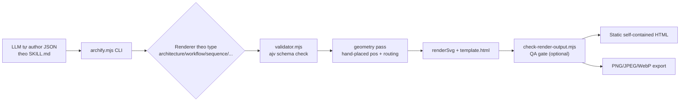
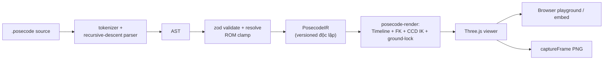
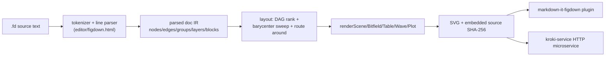

# Weekly scan — diagram-as-code & visual tooling (2026-07-22)

**Executive summary:**
- Không có dự án diagram-as-code "full-fledged" mới bùng nổ tuần này; phát hiện đáng chú ý nhất là **archify** (6.8k sao, mới release v2.11.0) — một triết lý layout **đối lập hẳn** với kymostudio: bỏ hẳn auto-layout (từng thử dagre/elk-js rồi loại bỏ) để LLM tự đặt hand-placed coordinates, coi đó là "aesthetic differentiator".
- Hai case study **adjacent text-to-visual DSL** đáng học về governance: **posecode** (IR versioned riêng biệt với package version, solver dùng chung giữa viewer và eval harness để đảm bảo determinism) và **figdown** (spec-first, conformance suite lock canonical JSON model — rất giống triết lý `test_conformance.py` của kymo).
- **refarch-animator** là ví dụ rõ của một "Claude Code skill" thuần prompt-engineering — không DSL, không IR, không auto-layout thật — nhưng có 2 kỹ thuật animation SVG cụ thể đáng "chôm": path-following dot bằng `getPointAtLength()` và step-state hash routing.

**Mục lục**
1. [tt-a1i/archify](#1-tt-a1iarchify)
2. [posecode-dev/posecode](#2-posecode-devposecode)
3. [FigDown/figdown](#3-figdownfigdown)
4. [naeemarsalan/refarch-animator](#4-naeemarsalanrefarch-animator)
- [Phụ lục: candidates khác đã cân nhắc](#phụ-lục-candidates-khác-đã-cân-nhắc)

---

## 1. tt-a1i/archify

### §1 Quick context
Skill AI-agent sinh architecture diagram "đẹp" bằng cách để LLM tự đặt tọa độ thay vì auto-layout — khác biệt cốt lõi là **chủ động từ chối dagre/elk-js** vì cho rằng auto-layout không thể đạt thẩm mỹ như hand-placed. Stack: Node/ESM (`.mjs`), ajv JSON Schema validation, zero runtime deps trong package đã build. Output: SVG nhúng trong HTML tự chứa (PNG/JPEG/WebP export). Sức khỏe repo: 6.8k sao, 453 fork, release v2.11.0 (16/07/2026), CI 4 job (test, webm-artifact, zip-freshness, package-smoke). Phân phối: không qua npm registry mà qua `npx skills add` (agent-skill package manager), zip cài trực tiếp vào thư mục skill của Claude/Codex/opencode.

### §2 Architecture deep-dive
**A. Component inventory** — `archify/SKILL.md` (prose hướng dẫn LLM tự author JSON, không phải code); `archify/bin/archify.mjs` (CLI, dispatch tới renderer theo type qua `spawnSync`); `archify/renderers/{architecture,workflow,sequence,dataflow,lifecycle}/render-*.mjs` (5 renderer độc lập theo loại diagram); `archify/renderers/shared/validator.mjs` (wrap ajv); `archify/renderers/shared/geometry.mjs` (overlap/crossing check thuần hàm); `archify/schemas/*.schema.json` (JSON Schema, `schema_version: 1`); `archify/scripts/check-render-output.mjs` (QA gate hậu-render); `archify/assets/template.html` (~2500 dòng, shell CSS/JS dùng chung cho mọi renderer).

**B. Pipeline** — (1) Agent đọc `SKILL.md`, tự tay author JSON theo schema (tọa độ `pos`/`size` do LLM chọn, không tính toán); (2) `archify.mjs render file.json` dispatch tới renderer đúng type; (3) `loadDiagram()` + `validateSchema()` (ajv, fail-closed); (4) renderer đo component, dựng boundary, tính path nối (straight/orthogonal-h/orthogonal-v), cache trong `Map`; (5) `renderSvg()` + nhúng vào `template.html` → 1 file HTML tự chứa; (6) (optional/CI) `check-render-output.mjs` re-parse để bắt NaN/Infinity, crossing, route-rhythm theo ngưỡng `standard`/`showcase`.

**C. Data model/IR** — Plain JSON (không class), validate bằng ajv, `schema_version` pin cứng. Single-pass JSON→SVG, không có khái niệm "lower IR" nhiều tầng.

**D. Input language** — **Không có DSL/parser thật.** "Ngôn ngữ" chính là chính JSON schema; Mermaid *không* được parse — ROADMAP xác nhận rõ: thử nghiệm Mermaid-parser+dagre bị loại vì "auto-layout + CSS không tốt hơn Mermaid gốc". LLM chính là "parser" của ngôn ngữ tự nhiên.

**E. Layout** — Chủ yếu **hand-placed coordinates** (chủ đích, ROADMAP: "Hand-placed coordinates ARE the product"); có mode grid phụ (`grid.mjs`, arithmetic thuần). Crossing/overlap chỉ được **lint hậu-render**, không tối ưu placement.

**F. Rendering** — SVG-in-HTML, animation kiểu "trace" dùng CSS `@keyframes` + `stroke-dasharray`/`stroke-dashoffset`, gate bằng `data-motion-capable`. 5 renderer riêng theo type, không phải generic engine.

**G. Extensibility** — Theme qua CSS custom properties + `data-theme`; thêm shape/icon phải sửa trực tiếp `renderSemanticSigil()` (enum cứng), không có plugin API.

**H. Dev experience** — CLI có `doctor`/`demo`/`guide`; không có watch mode; không VS Code extension; CI kỹ (Node 20/22 matrix, zip-freshness, package-smoke không cần `node_modules`).

### §3 Architecture diagram


### §4 Verdict
Đáng học: kỹ thuật `check-render-output.mjs` — lint hậu-render bắt NaN/crossing/route-rhythm như một CI gate — là ý tưởng bổ sung tốt cho golden-SVG test của kymo (kiểm tra *chất lượng hình học*, không chỉ byte-diff). CSS `stroke-dasharray`/`data-motion-capable` + `prefers-reduced-motion` là pattern animation trực tiếp áp dụng được cho `--animate` của kymo. Red flag lớn: từ chối hẳn auto-layout — đối lập triết lý "renderer dumb, layout resolver tính toán" của kymostudio, nên **không nên học theo** phần này. Verdict: **study deeper** (riêng phần QA-gate và CSS animation), phần layout philosophy thì bỏ qua.

---

## 2. posecode-dev/posecode

### §1 Quick context
DSL text mô tả chuyển động người 3D ("jumping jacks", stretch, posture) kèm parser + validator + Three.js renderer — khác biệt với diagram 2D thông thường nhưng là ví dụ chuẩn của "adjacent text-to-visual DSL". Stack: TypeScript monorepo (npm workspaces), Three.js, zod, Vite. 79 sao, 21 release, license kép Apache-2.0 (spec/parser) + AGPL-3.0 (renderer/embed/MCP). CI đầy đủ (build, typecheck, vitest, và "biomechanical eval" riêng). Phân phối: npm packages (`posecode-parser`, `posecode-render`, `posecode-embed`, `posecode-mcp`), VS Code extension, MCP server, web component.

### §2 Architecture deep-dive
**A. Component inventory** — `packages/posecode-parser/src/{tokenizer,parser,schema,protocol,rom,joints}.ts` (DSL→IR); `packages/posecode-render/src/{ik,groundlock,timeline}.ts` (giải pose 3D); `packages/posecode-language` (LSP-adjacent: completion/hover/diagnostics); `packages/posecode-eval` (headless CI gate riêng biệt vitest); `spec/SPEC.md` (EBNF chính thức).

**B. Pipeline** — (1) User viết `.posecode` (indentation-based); (2) tokenizer (regex lexer theo dòng) → `parser.ts` recursive-descent dựng AST nông; (3) `schema.ts` (zod) validate + chuẩn hóa; (4) `resolve()` sinh `PosecodeIR` (renderer-agnostic, có `POSECODE_VERSION` riêng, ROM-clamp góc khớp); (5) `posecode-render` dựng `Timeline` (Hermite spline), chạy forward kinematics → `groundlock.ts` → CCD IK (`ik.ts`) cho reach/pin/grip; (6) Three.js render canvas, `captureFrame()` xuất PNG.

**C. Data model/IR** — 3 tầng rõ rệt: AST (cú pháp thô) → `PosecodeIR` (JSON-like, versioned độc lập với package version) → `Timeline` nội bộ renderer (keyframe interpolation-ready). Đây là ví dụ hiếm có khái niệm "IR version" tách biệt version package.

**D. Input language** — Recursive-descent hand-written, **có EBNF chính thức** trong `spec/SPEC.md` (dual-source như `dsl.py`/`DSL.md` của kymo). Error reporting 2 tầng: zod map lỗi về đúng số dòng (`lineForIssue()`), và `diagnostics.ts` kiểu LSP `Diagnostic{line,severity,message}` còn **dedupe cảnh báo khớp đối xứng** (knee_left/knee_right gộp thành 1).

**E. "Layout"** — Không phải 2D layout mà là pose-solving 3D: forward kinematics cho góc khớp trực tiếp, CCD IK tự viết (không FABRIK/Jacobian) cho reach/pin/grip, ground-lock solver riêng (supine/plank/squat). Điểm hay: **solver dùng chung** giữa viewer trực tiếp và `posecode-eval` headless để đảm bảo determinism.

**F. Rendering** — Chỉ Three.js, không SVG/video khác. Animation: Hermite spline theo Euler (không quaternion slerp, chủ đích để phân biệt xoay có chủ ý). Xuất: web component `<posecode-player>` (IIFE + ESM).

**G. Extensibility** — Vocabulary khớp/xương cố định trong `joints.ts`/`rom.ts`, không có plugin API — thêm khớp mới phải sửa core.

**H. Dev experience** — CLI `posecode-parser validate` (không render); VS Code extension riêng (syntax highlight + diagnostics); MCP server đăng ký trong MCP Registry; playground Vite live tại posecode.org/play.

### §3 Architecture diagram


### §4 Verdict
Đáng học nhất: **versioning IR tách biệt package version** (`POSECODE_VERSION` riêng `0.3` trong khi package đã `0.4.1`) — kymo hiện chưa version hóa model IR rõ ràng, đáng cân nhắc. Pattern **dùng chung solver giữa live viewer và eval headless** để đảm bảo determinism song song với triết lý golden-test của kymo. Dedupe cảnh báo đối xứng (left/right) là UX-lỗi hay, áp dụng được cho warning của `alignment.py`. License kép enforce bằng CI (`check:packages` kiểm tra chiều phụ thuộc một chiều) là governance pattern đáng tham khảo nếu kymo từng cân nhắc tách license. Red flag: bus factor ~1, README có đoạn PR marketing tự quảng bá hơi lạ. Verdict: **study deeper**.

---

## 3. FigDown/figdown

### §1 Quick context
Spec-in-progress cho "Markdown-native diagram standard" — mục tiêu 2 độc giả (AI đọc source text, người xem SVG render). Rất mới (0 sao, giai đoạn "requirements & design", chưa có gì để cài). Stack: 1 file HTML monolithic chứa toàn bộ tokenizer/parser/layout/4 renderer + editor UI, build script Node xuất `dist/figdown.mjs`. Không CI, không release tag, không npm publish. Distribution: repo clone/vendor, editor browser live tại figdown.github.io.

### §2 Architecture deep-dive
**A. Component inventory** — `editor/figdown.html` (engine gốc duy nhất — tokenizer, parser, layout, 4 renderer, UI editor, tất cả trong 1 file); `tools/build-svg.js` (CLI validate+render); `tools/layout-lint.js` (linter crossing/overlap độc lập, cho điểm chất lượng); `spec/syntax-draft.md` (grammar ABNF draft "v0.0"); `conformance/` (100 fixture case, canonical JSON semantic model để test 2 implementation độc lập); `integrations/markdown-it-figdown` + `integrations/kroki-service` (wrapper ngoài, không phải plugin trong engine).

**B. Pipeline** — (1) Viết `.fd` (line-oriented) hoặc fenced ` ```figdown ` block; (2) `build-svg.js` gọi `parse(text)` → `{doc, errs}`; (3) nếu có lỗi, **không render partial gì cả** (all-or-nothing, chủ đích cho vòng lặp AI write→validate→fix); (4) `render(doc)` dispatch `renderScene()` (DAG rank + barycenter sweep + route quanh vật cản) hoặc `renderBitfield/Table/Wave/Plot` cho block đặc biệt; (5) SVG output tự mang metadata — nhúng cả source text + SHA-256 vào `<metadata>`; (6) SVG commit cùng basename với `.fd`, nhúng vào Markdown qua ` ` + footer trỏ về source — người xem SVG, agent đọc `.fd`.

**C. Data model/IR** — Plain object `{nodes, edges, groups, layers, blocks}`, không class hierarchy. Điểm hay: `conformance/` định nghĩa **canonical normalized JSON** riêng (bỏ optional attr khi absent, key order cố định, materialize default) làm IR chuẩn để test interop — tách biệt với object sống trong parser, rất giống golden JSON của `test_conformance.py` bên kymo.

**D. Input language** — Line-oriented, hand-written, **không** PEG/recursive descent đầy đủ — mỗi dòng phải bắt đầu bằng 1 trong ~20 keyword đóng (closed grammar). Có ABNF sketch trong spec, tự nhận "informative until freeze". Error: mọi dòng lỗi báo `Line N: ...`, gom hết lỗi 1 lượt nhưng **không render nếu còn lỗi** (khác `check-render-output.mjs` của archify vốn chỉ warn).

**E. Layout** — Auto-layout mặc định (DAG rank qua longest-path + back-edge classification, rồi barycenter sweep 2 chiều), có override thủ công (`pin`/`size`/`route via=`). Route quanh vật cản dùng Dijkstra-style + Liang-Barsky clipping. Bất biến thiết kế: "sửa nhỏ ở source → thay đổi nhỏ ở hình" (layout stability).

**F. Rendering** — SVG duy nhất, deterministic, không animation (`page`/`step` là keyword *reserved* cho tương lai, chưa implement). "Hai độc giả" = 2 đối tượng đọc cùng 1 artifact (AI đọc `.fd`, người xem SVG), không phải 2 render target.

**G. Extensibility** — Shape enum đóng, mở rộng qua `class` (giống `classDef` của Mermaid) chứ không phải plugin API; namespace `x-` dành riêng cho thử nghiệm; có quy trình thay đổi chính thức (`spec/PROCESS.md`, "R28 gate" yêu cầu bằng chứng corpus).

**H. Dev experience** — Editor browser live (kéo-thả ghi ra dòng `pin`, "mọi thao tác GUI là 1 edit text"); có markdown-it plugin cho VS Code preview; **không** VS Code extension riêng; có Claude Code skill bundle sẵn (`skill/figdown/SKILL.md`).

### §3 Architecture diagram


### §4 Verdict
Đáng học nhất: `conformance/` test **canonical normalized JSON model** (không cần byte-identical rendering, chỉ cần model JSON khớp) — đúng triết lý mà kymo đang áp dụng giữa Python/JS, đáng trích dẫn làm bằng chứng "pattern này chuẩn ngành". Nguyên tắc "sửa nhỏ source → thay đổi nhỏ hình" (layout stability) và namespace `x-` cho extension thử nghiệm là ý hay để tham khảo khi kymo mở rộng DSL. Red flag: kiến trúc monolithic 1-file (ngược hẳn modular của kymo), 0 sao, pre-alpha, không CI — độ tin cậy thấp, "standard" framing vượt trước thực tế formalize. Verdict: **study deeper** riêng phần conformance/governance pattern, còn lại **glance only** vì quá non.

---

## 4. naeemarsalan/refarch-animator

### §1 Quick context
Claude Code skill sinh animated reference-architecture diagram (layered view + "storyboard player"). Không phải engine — 2 file Python thật (`validate.py` lint hình học, `embed_fonts.py` nhúng font) còn lại là prose (`SKILL.md`) + 1 template HTML/JS tái sử dụng. 1 sao, 2 commit (17–21/07/2026), không release, không CI. Phân phối: clone thẳng vào `~/.claude/skills/`.

### §2 Architecture deep-dive
**A. Component inventory** — `SKILL.md` (quy trình prose: gather input → token → build view → geometry discipline → validate — Claude đọc và làm theo, không phải code); `references/template.html` (~430-450 dòng, storyboard player + ví dụ SVG có sẵn, Claude được yêu cầu **copy nguyên văn rồi sửa**); `scripts/validate.py` (linter regex/string, không parse XML/SVG thật, check overflow/collision/viewBox); `scripts/embed_fonts.py` (fetch Google Fonts, base64 nhúng `@font-face`).

**B. Pipeline** — (1) User yêu cầu bằng ngôn ngữ tự nhiên; (2) **LLM tự do** thu thập input theo checklist prose (không có form cấu trúc); (3) **LLM tự do viết HTML/CSS/SVG** — đây là bước sinh markup thật sự, không deterministic; (4) với phần storyboard, Claude được chỉ định copy `template.html` và sửa tại chỗ, giữ nguyên phần JS "player machinery" dưới comment `KEEP:`; (5) chạy `validate.py` để bắt lỗi hình học hậu-render; (6) output là 1 file HTML tĩnh tự chứa.

**C. Data model/IR** — **Không có IR được parse.** Không schema, không JSON/YAML config. Mảng `steps` trong JS chỉ là dữ liệu runtime của chính output, không phải input trung gian cho renderer — LLM đi thẳng từ mô tả tự nhiên sang markup cuối.

**D. Input language** — **Không DSL.** Input hoàn toàn ngôn ngữ tự nhiên; `SKILL.md` chỉ đưa ra câu hỏi gợi ý Claude tự hỏi, không phải schema người dùng điền.

**E. Layout** — Không có auto-layout thật; tọa độ SVG do LLM tự đoán/đặt tay, `validate.py` chỉ lint hậu-render (không tính hay sửa vị trí). `SKILL.md` cho heuristic ước lượng độ rộng text (~0.60em/ký tự) để LLM tự cân đối.

**F. Rendering** — 1 trang HTML tĩnh, "storyboard player" là **state machine JS** (`go(i)` snapshot toàn bộ state mỗi bước — mỗi bước phải render độc lập, không phụ thuộc bước trước, cho phép deep-link `#step-7`). Chấm "flow" di chuyển bằng `requestAnimationFrame` + `getPointAtLength()`/`getTotalLength()` dọc theo path SVG (không CSS transition cho chuyển động). Hỗ trợ `prefers-reduced-motion`. Theme dark/light bằng CSS custom property + `data-theme` — pattern giống hệt kymo dùng cho artifact.

**G. Extensibility** — Không có điểm mở rộng thật; thêm layer/theme = yêu cầu Claude viết tay thêm SVG/HTML theo quy ước prose.

**H. Dev experience** — Cài bằng git clone vào thư mục skill; gọi qua natural language hoặc `/refarch-animator`; không preview builtin ngoài mở file HTML tĩnh trên browser.

### §3 Architecture diagram
**Insufficient evidence** — không tồn tại parser/IR pipeline thật (đã xác nhận: "no IR, no DSL, no auto-layout"); toàn bộ bước sinh diagram là LLM tự do viết markup theo prose, chỉ 2 bước (template-reuse, validate.py) là deterministic. Không đủ ≥3 component có evidence để vẽ pipeline nguồn→output có ý nghĩa.

### §4 Verdict
Đáng học 2 kỹ thuật cụ thể: (1) nguyên tắc **mỗi bước storyboard phải là state độc lập hoàn chỉnh** (không phụ thuộc bước trước) kèm hash-based deep-link — áp dụng tốt cho `--animate` output của kymo nếu muốn step-through; (2) kỹ thuật **chấm di chuyển theo path** bằng `getPointAtLength()`/`getTotalLength()` + `requestAnimationFrame` — portable trực tiếp cho hiệu ứng "flow" trên edge của kymo. Red flag lớn: đây là prompt-engineering artifact, không phải rendering engine — không DSL, không IR, không auto-layout, đối lập hoàn toàn triết lý "renderer dumb + data model tường minh" của kymostudio. Verdict: **glance only** (chỉ lấy 2 kỹ thuật animation, không phải kiến trúc tham khảo).

---

## Phụ lục: candidates khác đã cân nhắc

Được tìm thấy trong vòng lọc topic-based (`diagram-as-code`, `dsl`, `graph-visualization`, `layout-algorithm`, `svg-animation`, pushed trong 7 ngày, stars>50 khi khả dụng) nhưng không đưa vào deep-dive:

- **goadesign/model** (Go, 462 sao) — DSL kiểu Structurizr/C4 cho software architecture, active update. Đáng candidate cho tuần sau nếu cần so sánh DSL Go-based.
- **dinghydev/dinghy** (TypeScript, 4 sao) — "Diagram and Infrastructure as Code with React", quá mới/nhỏ để đánh giá độ trưởng thành.
- **Eswarthemad/drawio-mcp-server** (Python, 0 sao) — cross-format diagram-as-code cho draw.io qua MCP, đáng theo dõi vì hướng "MCP làm cầu nối DSL↔draw.io" tương tự tiềm năng của kymo-mcp.
- **plantuml/plantuml** (Java, 13.2k sao) — cập nhật liên tục nhưng là công cụ đã trưởng thành lâu năm, không phải "mới nổi", giữ làm reference nền chứ không nghiên cứu sâu tuần này.
