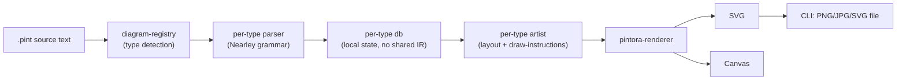
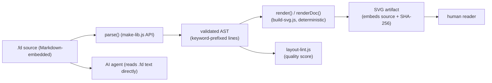
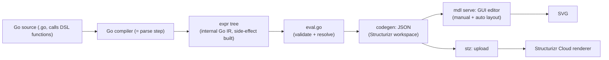
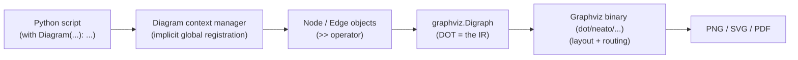

# Weekly Diagram-Tooling Scan — 2026-07-23

**Scope:** GitHub repos trong domain diagram-as-code / visual tooling published hoặc push đáng kể trong 7 ngày qua (2026-07-16 → 2026-07-23), lọc theo mức độ liên quan tới kymostudio.

## Executive summary

- Tìm được **11 candidate repos** khớp filter diagram-as-code (loại bỏ chart libs, agent-skill wrapper rỗng, ontology/agentic-design repos lạc chủ đề); deep-dive 4 repo tốt nhất: **hikerpig/pintora**, **FigDown/figdown**, **goadesign/model**, **mingrammer/diagrams**.
- Phát hiện đáng chú ý nhất: **FigDown** — một DSL mới (đang ở design phase) theo đúng triết lý "text is truth, SVG is artifact" giống kymostudio, và cùng dùng **golden conformance fixture suite** để khoá hành vi renderer — gần như một validation độc lập cho hướng đi hiện tại của kymo.
- **pintora** là đối chiếu kiến trúc gần nhất với kymostudio (TypeScript monorepo, `core`/`renderer`/`diagrams`/`cli` tách package, custom parser mỗi diagram type, pluggable diagram registry) — đáng soi kỹ mô hình `diagram-registry` + `symbol-registry` cho việc mở rộng icon/shape của kymo.

## Mục lục

1. [hikerpig/pintora](#1-hikerpigpintora)
2. [FigDown/figdown](#2-figdownfigdown)
3. [goadesign/model](#3-goadesignmodel)
4. [mingrammer/diagrams](#4-mingrammerdiagrams)
5. [Other candidates noted](#other-candidates-noted)

---

## 1. hikerpig/pintora

### §1 — Quick context

Text-to-diagrams library JS chạy được cả browser lẫn Node, hỗ trợ 8 loại diagram (sequence, ER, component, activity, mindmap, gantt, DOT, class) qua plugin system — khác kymostudio ở chỗ mỗi diagram type có **parser + artist riêng** thay vì một DSL thống nhất một layout engine chung. Tech stack: TypeScript, Nearley (parser generator) cho ít nhất sequence diagram, output SVG/Canvas (browser) hoặc PNG/JPG/SVG (Node qua `canvas` + `jsdom`). Repo health: 1.3k sao, 37 fork, MIT license, monorepo pnpm+turbo với CI (`.github/`), nhưng **release gần nhất là v0.8.2 (không có hoạt động release mới trong nhiều tháng)** dù commit push vẫn ghi nhận trong tuần qua. Distribution: npm (`@pintora/core`, `@pintora/cli`, `@pintora/standalone`), VS Code extension, Obsidian/Gatsby plugin riêng.

### §2 — Architecture deep-dive

Đã đọc: README.md gốc, cây thư mục `packages/` (9 package), `packages/pintora-core/src`, `packages/pintora-diagrams/src` (9 subfolder theo diagram type), `packages/pintora-diagrams/src/sequence` (parser/artist tách biệt), `package.json` của `pintora-cli`.

**A. Component inventory:**
- `Diagram registry` (`packages/pintora-core/src/diagram-registry.ts`) — nơi mỗi diagram type tự đăng ký parser+artist của mình vào core, giống một plugin bus.
- `Symbol registry` (`packages/pintora-core/src/symbol-registry.ts`) — quản lý shape/icon dùng chung giữa các diagram type.
- `Config engine` (`packages/pintora-core/src/config-engine.ts`) — merge config mặc định + config user + `@pre` style block khai báo trong source.
- Mỗi diagram type (vd. `sequence/`) tự chứa `parser/` (Nearley grammar) + `db.ts` (state tích luỹ trong lúc parse) + `artist.ts` (render logic ra SVG/Canvas primitive) + `event-recognizer.ts`.
- `pintora-renderer` (package riêng) — abstraction vẽ ra Canvas hoặc SVG từ cùng một tập lệnh vẽ trung gian.
- `pintora-cli` — Node entry (`lib/index.js`, bin `pintora`), dùng `jsdom` + `canvas` để render headless.

**B. Pipeline:** (1) source text → (2) diagram-registry chọn parser theo header/type detection → (3) parser (Nearley grammar hoặc custom) sinh ra một "db" (state có cấu trúc riêng cho diagram type đó, không có IR chung toàn hệ thống) → (4) artist của diagram type đó duyệt db, phát ra draw-instructions trung gian → (5) `pintora-renderer` dịch draw-instructions sang SVG (browser/CLI) hoặc Canvas (browser) → (6) output string SVG hoặc file PNG/JPG qua CLI.

**C. Data model/IR:** Không có IR thống nhất kiểu `Diagram`/`Component`/`Edge` như kymostudio — mỗi diagram type có "db" riêng (vd. actor list + message list cho sequence), rồi artist của type đó tự biết cách vẽ nó. Đây là khác biệt kiến trúc lớn nhất so với kymostudio's `model.py` dumb-renderer design: pintora **không tách layout khỏi rendering** một cách tổng quát, mà mỗi artist tự lo layout cục bộ cho type của mình.

**D. Input language:** Không phải một grammar thống nhất — mỗi diagram type có cú pháp riêng gần giống Mermaid (`sequenceDiagram`, `classDiagram`...). Sequence diagram dùng Nearley (context-free grammar parser generator) — tức có grammar hình thức, không phải regex line-based thuần. Error reporting: không xác định (không đọc được source parser.ts chi tiết).

**E. Layout algorithm:** Không xác định thuật toán cross-minimization cụ thể (không đọc được artist.ts nội dung), nhưng README ghi nhận "layout adjustments to prevent line overlap in classDiagram" ở changelog — cho thấy layout là heuristic thủ công theo từng diagram type, không phải một layout engine chung kiểu Sugiyama áp dụng toàn cục.

**F. Rendering:** Multi-backend qua `pintora-renderer` — cùng draw-instructions ra được cả SVG và Canvas, đây là điểm đáng học (kymostudio hiện chỉ có to_svg.py/to_figma.py/to_excalidraw.py là các emitter độc lập, không có draw-instruction trung gian dùng chung).

**G. Extensibility:** Plugin system chính thức — "diagram developer" viết package riêng, đăng ký vào `diagram-registry`. Có `pintora-target-wintercg` (package riêng) gợi ý hỗ trợ runtime edge (Cloudflare Workers-like).

**H. DX:** CLI (`pintora-cli`), VS Code extension, live editor web (`demo/live-editor`), Obsidian/Gatsby plugin — hệ sinh thái publishing rộng hơn kymostudio hiện tại.

### §3 — Architecture diagram

### §4 — Verdict

Đáng học nhất: **draw-instruction trung gian dùng chung cho nhiều output backend** (SVG + Canvas từ cùng renderer) — kymostudio có thể cân nhắc tách một "draw op" layer mỏng giữa `alignment.py` và `to_svg.py`/`to_figma.py` để giảm trùng lặp logic vẽ. Ngược lại, kiến trúc "mỗi diagram type tự có parser+db+artist riêng, không IR chung" là smell so với triết lý dumb-renderer của kymo — mỗi lần thêm diagram type là thêm một pipeline con, khó đảm bảo tính nhất quán. Release cadence chững lại (>1 năm không release chính thức dù còn commit) là red flag về momentum. Verdict: **study deeper** riêng phần renderer/registry, phần parser-per-type thì **glance only**.

---

## 2. FigDown/figdown

### §1 — Quick context

Chuẩn (standard) mới, còn ở **design/requirements phase**, định nghĩa `.fd` — text source nhúng trong Markdown vừa AI agent đọc trực tiếp vừa render deterministic ra SVG — khác kymostudio ở chỗ đặt "layout stability" (sửa nhỏ → thay đổi nhỏ, không re-layout toàn bộ) làm axiom thiết kế số 1, và nhắm rõ ràng vào use-case AI-agent-maintained diagrams. Tech stack: JS thuần cho renderer (`tools/build-svg.js`), không phụ thuộc framework, output SVG (dist ESM/UMD lib). Repo health: **0 sao, không có release chính thức**, README tự nhận "Requirements & design phase, nothing to install yet" — nhưng có golden conformance suite (100 fixture cases), spec files chi tiết (`syntax-draft.md`, `MIGRATIONS.md` kiểu schema-migration cho spec), và một "census" thực nghiệm trên 774 document thật để chọn phạm vi v0.1. Distribution: chưa publish package (chỉ web editor tĩnh + `dist/` build từ `make-lib.js`); có installable Claude Code skill (`skill/figdown`).

### §2 — Architecture deep-dive

Đã đọc: README.md (kèm ví dụ `.fd` đầy đủ nhúng ngay trong README), cây thư mục gốc (`conformance/`, `design/`, `editor/`, `examples/`, `figures/`, `integrations/`, `skill/`, `spec/`, `tools/`), nội dung `tools/` (mô tả từng script), ví dụ thực `figures/one-source-two-readers.fd`, `examples/index.md` (gallery mô tả các loại figure: block/architecture, network topology, protocol-header bitfield, bảng/heatmap, hash-table).

**A. Component inventory** (evidence từ mô tả `tools/README.md` — chưa đọc được source JS thực sự bên trong `build-svg.js`):
- `build-svg.js` (`tools/build-svg.js`) — renderer chính: "validates and renders deterministically", CLI `node tools/build-svg.js [--with-title] <file.fd|dir>`.
- `layout-lint.js` (`tools/layout-lint.js`) — linter chấm điểm chất lượng layout ("render-quality linter for scene figures").
- `make-lib.js` (`tools/make-lib.js`) — build `dist/` ESM+UMD, expose API `parse`, `render`, `renderDoc`, `artifact`, `version`.
- `make-skill.js` — đóng gói agent-skill bundle từ engine.
- `editor/figdown.html` — GUI editor "mọi thao tác GUI là một text edit" (kéo node ghi ra `pin x,y` trong source).
- `conformance/` — 100 golden fixture cases cho việc test một implementation thứ hai.

**B. Pipeline (suy ra từ CLI + README, chưa đọc source parse.js):** (1) `.fd` text → (2) `parse` (theo API `make-lib.js` expose) → (3) validate theo "small, closed, token-lean core" grammar (mỗi dòng bắt đầu bằng keyword đã biết, dòng lạ = lỗi kèm số dòng) → (4) `render`/`renderDoc` sinh SVG deterministic → (5) `artifact` nhúng source gốc + SHA-256 vào chính SVG xuất ra → (6) `layout-lint` optionally chấm điểm chất lượng bố cục trước khi commit.

**C. Data model/IR:** Không xác định chi tiết cấu trúc (không đọc được file JS thực), nhưng ví dụ `.fd` cho thấy source có 2 phần rõ rệt: phần **semantic** (`node`, `edge`, `flow`, `rank`) và phần **layout đã resolve** được ghi ngược lại cuối file (`pin src at=20,20`), có comment "auto-generated; strip to reset" — tức file `.fd` sau khi render một lần sẽ tự chứa cache vị trí, và đây chính là cơ chế hiện thực hoá axiom "layout stability" (không phải khái niệm "lower IR" nội bộ ẩn, mà là ghi thẳng ra lại nguồn — public, diffable).

**D. Input language:** Custom line-based DSL, keyword-prefixed từng dòng (`node`, `edge`, `flow`, `rank`, `pin`, `title`) — không phải PEG/ANTLR theo mô tả (README nói rõ "every line starts with a known keyword; unknown lines are errors with line numbers" — line-based với validate theo keyword, gần giống triết lý dsl.py của kymostudio). Formal grammar: có, nhưng ở dạng "syntax draft" tài liệu hoá (`spec/syntax-draft.md`), chưa xác nhận có EBNF chính thức như `DSL.md` của kymo.

**E. Layout:** Hybrid — default là auto-layout ("undeclared adapts automatically"), nhưng bất kỳ thuộc tính khai báo tường minh (position qua `pin`, size, color) thì "rigid" (không đổi qua các lần re-layout). Đây là **constraint-based, partial pinning** — khác kymostudio (auto-layout frames + alignment resolver toàn cục) ở việc field-level "declared vs undeclared" quyết định độ cứng của từng phần tử riêng lẻ, không phải toàn bộ frame.

**F. Rendering:** Single backend (SVG only, "no LLM in the rendering path" — nhấn mạnh rendering phải program-only/deterministic). Không có animation.

**G. Extensibility:** Chưa xác định plugin system chính thức (đang design phase); mở rộng loại figure hiện qua "escalate a gap into a syntax proposal" theo quy trình RFC nội bộ (`AUTHORING.md`, `spec/PROCESS.md`).

**H. DX:** Web editor trực tiếp trong browser (không cần install), autosave, undo/redo, Ctrl+S ghi lại đúng file `.fd`; có "agent skill" cài trực tiếp vào Claude Code (`cp -r skill/figdown ~/.claude/skills/`).

### §3 — Architecture diagram

### §4 — Verdict

Đây là repo đáng nghiền ngẫm nhất trong đợt scan này cho kymostudio — không phải vì code trưởng thành (0 sao, chưa release) mà vì **cùng chung một tập giả định triết lý**: text-as-truth, deterministic render, golden conformance suite để khoá hành vi (giống hệt cơ chế `conformance/` của kymostudio, kể cả cách đặt tên). Điểm cụ thể đáng tham khảo: (1) cơ chế "declared attributes are rigid, undeclared auto-adapt" — kymostudio có thể học để giảm việc một edit nhỏ trong `.kymo` làm re-layout toàn canvas; (2) `layout-lint.js` — ý tưởng một linter chấm điểm chất lượng bố cục (crossing, overlap) độc lập với renderer, kymo chưa có. Red flag: chưa có code thực thi để verify claim "deterministic" — mọi thứ hiện là README + spec draft. Verdict: **study deeper** phần triết lý/spec, nhưng **theo dõi tiếp** vì chưa đủ chín để rút kỹ thuật implementation cụ thể.

---

## 3. goadesign/model

### §1 — Quick context

DSL bằng Go (không phải file text riêng — code Go compile-time) để định nghĩa C4 model kiến trúc phần mềm, kèm GUI editor (`mdl serve`) để pin vị trí thủ công — khác kymostudio ở chỗ DSL **là chính ngôn ngữ host** (Go functions/closures) chứ không phải một cú pháp text độc lập. Tech stack: Go ≥1.23, output JSON (Structurizr workspace format) + SVG qua GUI editor; tích hợp trực tiếp với dịch vụ Structurizr Cloud (`stz` CLI). Repo health: 463 sao, 22 fork, MIT, có CI (`.github/`), release gần nhất v1.15.0 (tháng 6/2024, được mô tả là "maintenance release") — cadence chậm nhưng dự án là fork/kế thừa nghiêm túc từ Structurizr Go DSL gốc, nằm trong hệ sinh thái Goa (`goa.design`). Distribution: `go install goa.design/model/cmd/{mdl,stz}`, dùng như thư viện Go (`import goa.design/model/dsl`).

### §2 — Architecture deep-dive

Đã đọc: README.md, cây thư mục gốc (`dsl/`, `mdl/`, `pkg/`, `codegen/`, `expr/`, `plugin/`, `cmd/`, `stz/`, `examples/`), nội dung thư mục `dsl/` (8 file: `deployment.go`, `design.go`, `elements.go`, `person.go`, `relationship.go`, `styles.go`, `views.go`, `doc.go`) và `mdl/` (`model.go`, `elements.go`, `relationship.go`, `views.go`, `deployment.go`, `eval.go`), `examples/` (7 sub-case: `basic`, `big_bank_plc`, `json`, `nested`, `relationship_style`, `shapes`, `usage`), và tóm tắt nội dung `examples/basic/model/model.go`.

**A. Component inventory:**
- `dsl/` — các hàm builder Go expose ra người dùng cuối (`Design()`, `SoftwareSystem()`, `Person()`, `Uses()`, `Views()`...) — đây chính là "grammar" của ngôn ngữ, định nghĩa bằng Go function signatures, không phải file grammar riêng.
- `expr/` — package biểu diễn expression tree nội bộ mà các hàm DSL ở trên build ra khi Go code chạy (giống pattern "declarative Go DSL" của Goa nói chung, dùng registration side-effect khi hàm DSL execute).
- `eval.go` (trong `mdl/`) — bộ evaluator/validator chạy sau khi toàn bộ DSL functions đã register xong, kiểm tra tính hợp lệ (giống pass "resolve" của kymostudio).
- `codegen/` — sinh JSON output (Structurizr workspace schema) từ expression tree đã eval.
- `cmd/mdl`, `cmd/stz` — hai CLI binary: `mdl` chạy local GUI editor + generate JSON/SVG; `stz` upload lên Structurizr Cloud.
- `plugin/` — cho phép Model hoạt động như plugin của Goa (framework API design chính của cùng tổ chức) — tái sử dụng components giữa API design và architecture diagram.

**B. Pipeline:** (1) Go source (`.go` file gọi các hàm DSL) → (2) Go compiler build + chạy chương trình đó (đây là bước "parse" — parsing chính là Go compilation) → (3) mỗi hàm DSL (`SoftwareSystem`, `Person`...) side-effect register phần tử vào `expr` tree toàn cục → (4) `eval.go` duyệt qua expr tree, validate + resolve relationship → (5) `mdl gen` sinh JSON (Structurizr workspace format) từ expr tree đã resolve → (6a) `mdl serve` mở GUI editor local để người dùng **thủ công** kéo-thả vị trí, áp auto-layout algorithm, xuất SVG; hoặc (6b) `stz` push JSON lên Structurizr Cloud để render ở đó.

**C. Data model/IR:** `expr` package — cây expression Go struct (mutable trong lúc DSL functions chạy, giống một builder pattern), sau đó "compile" xuống JSON (Structurizr workspace schema) làm lower IR/output format thực sự portable. Có khái niệm "compile to lower IR" rõ ràng: Go expr tree (internal, ngôn ngữ-specific) → JSON workspace (external, tool-agnostic, dùng chung với Structurizr Cloud/UI khác).

**D. Input language:** Không phải text DSL độc lập — là **embedded/internal DSL trong Go** (dùng closure + side-effect registration, pattern phổ biến ở Goa/Structurizr-go). Không có formal grammar riêng (grammar = Go type system + function signatures). Error reporting: lỗi cú pháp bắt bởi chính Go compiler (type-safe), lỗi semantic (vd. quan hệ trỏ tới phần tử không tồn tại) bắt ở `eval.go` runtime.

**E. Layout:** README ghi nhận GUI editor có "multiple automatic layout algorithms" nhưng auto-layout chỉ chạy trong GUI tương tác, không phải một layout pass tất định trong pipeline text→output — người dùng vẫn cần mở `mdl serve` và pin vị trí thủ công/tinh chỉnh rồi lưu lại. Không xác định cụ thể thuật toán (Sugiyama/force-directed) vì không đọc được source layout code.

**F. Rendering:** Kép — JSON workspace (chuẩn Structurizr, dùng làm input cho nhiều renderer khác kể cả UI web của Structurizr) + SVG (xuất từ GUI editor cục bộ). Đây là ví dụ rõ về "compile to intermediate exchange format rồi để renderer khác vẽ" thay vì renderer độc quyền.

**G. Extensibility:** Style qua `styles.go` (DSL riêng cho styling, tách khỏi structure DSL); `plugin/` cho phép nhúng vào Goa API DSL để tái dùng components giữa hai domain (API design ⇄ architecture diagram) — cơ chế extensibility khác lạ, dựa trên composition của Go package chứ không phải theme file.

**H. DX:** GUI editor tương tác đầy đủ (pan/zoom, smart selection, alignment tools, routing, undo/redo) chạy local qua `mdl serve` — mạnh hơn nhiều so với bất kỳ preview tool nào kymostudio hiện có; không có VS Code/LSP integration được nhắc tới.

### §3 — Architecture diagram

### §4 — Verdict

Điểm đáng học nhất cho kymostudio: **tách rõ "structure DSL" khỏi "layout"** — ở goadesign/model, layout hoàn toàn không nằm trong text DSL, nó là một hoạt động tương tác riêng ở tầng GUI, ghi đè lên JSON workspace. kymostudio hiện đặt `layout { }` ngay trong `.kymo`; đối chiếu với model cho thấy một hướng thay thế (tách layout thành một "sidecar" tệp/tầng riêng) có thể giảm độ cồng kềnh cú pháp DSL chính, dù đánh đổi mất tính "single source of truth" mà kymo đang ưu tiên — không chắc đáng đổi. `styles.go` tách riêng khỏi structure DSL là pattern nhỏ gọn, kymostudio đã làm tương tự qua theme. Red flag: pipeline phụ thuộc Go compiler làm parser (không portable ra ngôn ngữ khác, khác triết lý "hai impl độc lập cùng semantics" của kymo). Verdict: **glance only** — hữu ích để đối chiếu triết lý layout-vs-structure, không có kỹ thuật implementation cụ thể đáng port.

---

## 4. mingrammer/diagrams

### §1 — Quick context

Thư viện Python vẽ cloud-architecture diagram bằng code Python thuần (context manager + operator overloading), build trên Graphviz — khác kymostudio ở chỗ **DSL chính là Python** (không có cú pháp text riêng), và chỉ nhắm một thể loại diagram (kiến trúc hạ tầng cloud) thay vì generic. Tech stack: Python ≥3.9, phụ thuộc cứng vào Graphviz binary, output là bất kỳ format Graphviz hỗ trợ (thường PNG/SVG). Repo health: 42.5k sao, 2.7k fork — rất trưởng thành, MIT license, nhưng **release gần nhất v0.25.1 (tháng 11/2024)**, gần 1.5 năm không release chính thức dù push gần đây (dependency/CI maintenance). Distribution: PyPI (`pip install diagrams`), được project khác dùng làm dependency (Apache Airflow docs generation, Cloudiscovery).

### §2 — Architecture deep-dive

Đã đọc: README.md, cây thư mục `diagrams/` (package chính: `__init__.py`, `cli.py`, và ~15 provider dir như `aws/`, `azure/`, `gcp/`, `k8s/`, `onprem/`, `c4/`, `generic/`, `custom/`), và nội dung `diagrams/__init__.py` (class `Diagram`, `Node`, `Edge`, cơ chế `>>`).

**A. Component inventory:**
- `Diagram` (`diagrams/__init__.py`) — context manager chính: `__enter__` gọi `setdiagram(self)` (đặt biến context toàn cục qua contextvar-like global), `__exit__` gọi `self.render()` rồi cleanup file `.gv` tạm.
- `Node` (`diagrams/__init__.py` + mỗi provider subclass, vd. `diagrams.aws.compute.EC2`) — mỗi node khi khởi tạo tự lấy diagram/cluster hiện hành qua `getdiagram()`/`getcluster()` (implicit registration, không cần truyền tham chiếu tay).
- `Edge` — object attrs Graphviz (`dir`, `label`...), sinh ra bởi operator `>>`/`<<`/`-` giữa hai Node.
- Provider packages (`aws/`, `azure/`, `gcp/`...) — mỗi package là tập hợp lớn các `Node` subclass tương ứng icon service cụ thể (EC2, S3, Lambda...), icon là SVG/PNG asset bundle kèm theo.
- `cli.py` — CLI phụ trợ nhỏ, chủ yếu để list available nodes, không phải renderer chính (renderer chính do `Diagram.render()` gọi Graphviz).

**B. Pipeline:** (1) Python script import `Diagram` + Node subclasses → (2) `with Diagram(...)` mở context, side-effect set global "current diagram" → (3) mỗi `Node(...)` khởi tạo tự đăng ký vào diagram/cluster hiện hành (không cần API thêm) → (4) toán tử `>>`/`<<` giữa hai node gọi `Node.connect()`, tạo `Edge`, thêm vào Graphviz graph nội bộ (thư viện `graphviz` Python wrapper) → (5) `__exit__` gọi `self.render()`: xuất file `.gv` tạm rồi shell ra Graphviz binary (`dot`) để layout + render → (6) output file ảnh, xoá `.gv` tạm.

**C. Data model/IR:** Không có IR riêng của package — **Graphviz DOT graph chính là IR**, được build tăng dần qua side-effect trong lúc Python script chạy (mutable, dùng chính object `graphviz.Digraph` làm state tích luỹ). Không có bước "resolve" tách biệt: parsing (chính là Python interpreter chạy script), model building, và graph building xảy ra đồng thời trong một pass.

**D. Input language:** DSL nội bộ (internal/embedded DSL) dùng Python thật — không grammar riêng, "parser" = trình thông dịch Python. Cú pháp tự nhiên nhờ operator overloading (`>>` nghĩa là "kết nối tới", đọc gần như câu văn). Error reporting: hoàn toàn dựa vào Python traceback, không có validate riêng.

**E. Layout:** Hoàn toàn giao cho Graphviz — chọn engine (`dot` mặc định = hierarchical/Sugiyama-style, có thể đổi `neato`/`fdp`/`circo` cho force-directed) qua tham số `graph_attr`. Đây là ví dụ "không tự làm layout" — thư viện chỉ build DOT graph, mọi routing/crossing-minimization đều nằm trong Graphviz, không có code layout riêng của repo.

**F. Rendering:** Single backend thực chất (Graphviz), nhưng đa format output nhờ chính Graphviz hỗ trợ nhiều target (PNG, SVG, PDF...) qua cùng một lệnh `dot -T<format>`. Không animation.

**G. Extensibility:** Thêm icon/provider mới = thêm một Node subclass mới + asset ảnh tương ứng trong provider package — quy trình thuần convention, không có plugin registry runtime (khác pintora). Không có theme engine riêng, style set qua `graph_attr`/`node_attr` dict truyền thẳng vào Graphviz.

**H. DX:** Không CLI render chính thức (script Python thường chạy trực tiếp `python diagram.py`), không watch mode, không preview browser, không IDE integration — DX tối giản, dựa hoàn toàn vào việc code là Python nên IDE autocomplete tự nhiên có sẵn.

### §3 — Architecture diagram

### §4 — Verdict

Bài học rõ nhất cho kymostudio: **operator-overloading làm DSL đọc tự nhiên** (`ec2 >> rds`) — kymostudio's `.kymo` đã là text DSL riêng nên không áp dụng trực tiếp, nhưng cách package Python này biến "kết nối" thành một câu gần tiếng Anh là một tham chiếu hay cho việc thiết kế cú pháp edge trong DSL (đã có phần nào ở `.kymo` với `->`). Điểm không nên bắt chước: **không tách model khỏi render** — parsing/build-graph/render chồng lẫn trong một pass, ngược hoàn toàn triết lý "dumb renderer" của kymostudio (đây chính là smell, không phải điểm học). Cũng đáng chú ý: **layout hoàn toàn outsource cho Graphviz** — đơn giản hoá code nhưng đánh đổi mất kiểm soát chi tiết bố cục/animation, hướng ngược với kymostudio (tự viết `alignment.py`). Verdict: **glance only** cho kiến trúc, nhưng cú pháp edge `>>` đáng nhìn khi thiết kế ergonomics DSL.

---

## Other candidates noted

- **plantuml/plantuml** (13.2k sao, Java) — quá lớn/trưởng thành, output PlantUML text→diagram đã research kỹ nhiều nơi khác; không mang tính "mới" trong tuần này ngoài routine commit.
- **tt-a1i/archify** (6.9k sao, HTML) — gắn nhãn "Claude skill" tạo self-contained HTML/SVG diagram với motion; chưa rõ có phải codebase độc lập hay chỉ là prompt/skill definition, cần xác minh thêm trước khi deep-dive.
- **isatimur/excalidraw-skill-pack** (0 sao) — wrapper skill quanh Excalidraw (generic drawing tool), thuộc diện exclusion "generic SVG editor không phải diagram-specific".
- **dinghydev/dinghy** (4 sao, TypeScript) — "Diagram and Infrastructure as Code with React", quá non/ít sao để đánh giá chất lượng kiến trúc.
- **nordstad/PinViz** (5 sao) — domain quá hẹp (GPIO pin diagram), nghi ngờ dưới ngưỡng LOC.
- **Eswarthemad/drawio-mcp-server** (0 sao) — MCP wrapper quanh draw.io, cross-format thú vị nhưng 0 sao/chưa đủ bằng chứng chất lượng.
- **IBM/ibmdiagrams** (9 sao, Python) — cùng mô hình với mingrammer/diagrams (cloud diagram-as-code) nhưng ít trưởng thành hơn, trùng lặp giá trị nghiên cứu với candidate #4 đã chọn.
