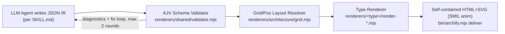
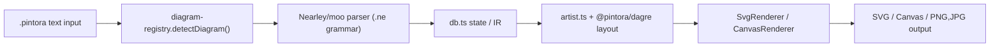
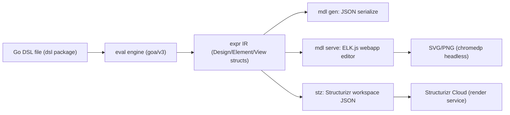
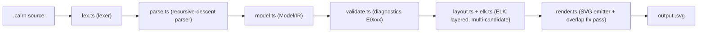

# Weekly Diagram Tooling Scan — 2026-07-24

**Nguồn dữ liệu:** GitHub REST search API (topic-based, fallback level 1 — đủ ≥4 kết quả liên quan nên không cần fallback keyword/ecosystem), cửa sổ `pushed:>2026-07-17` (7 ngày gần nhất).

## Executive summary

- **Bốn hướng đi khác hẳn nhau** cho cùng một bài toán "diagram-as-code": Archify đặt cược vào JSON IR do LLM sinh + validate xác định (không auto-layout), Pintora bám sát cú pháp Mermaid nhưng dùng parser CFG thật (Nearley), goadesign/model biến DSL thành Go code nhúng (embedded DSL, không phải text parser), và cairn (10 ngày tuổi) thử "đo overlap & tự sửa lặp lại" trên nền ELK layout.
- **Không repo nào có animated SVG pipeline tự chủ như kymostudio** — Archify dùng SMIL nhưng qua renderer JSON-IR riêng biệt, Pintora không có animation, goadesign/model giao hẳn render cho trình duyệt/Structurizr Cloud. Đây tiếp tục là điểm khác biệt cạnh tranh của kymostudio.
- **Kỹ thuật đáng mang về nhất:** diagnostics-loop có `code`/`evidence`/`supportedFixes` (Archify) và multi-candidate layout + hậu-layout "đo & dịch nhãn" để giảm overlap (cairn) — cả hai đều là cải tiến rẻ, áp dụng được cho `dsl.py` error reporting và `alignment.py` label placement của kymostudio mà không đụng kiến trúc renderer hiện tại.

## Mục lục

1. [tt-a1i/archify](#1-tt-a1iarchify) — agent-skill sinh diagram HTML/SVG có animation SMIL
2. [hikerpig/pintora](#2-hikerpigpintora) — text-to-diagrams TypeScript, cú pháp gần Mermaid
3. [goadesign/model](#3-goadesignmodel) — C4 model DSL nhúng trong Go
4. [R0kshan/cairn](#4-r0kshancairn) — diagram-as-code CLI mới, nhấn mạnh overlap prevention

---

## 1. tt-a1i/archify

`https://github.com/tt-a1i/archify` — 7.132★ · HTML/Node.js · push cuối 2026-07-23

### §1 — Quick context

Archify là agent skill sinh sơ đồ kiến trúc bằng cách bắt LLM viết JSON IR có schema, rồi renderer Node.js xác định (deterministic) chuyển thành HTML/SVG — không phải LLM tự vẽ HTML/SVG trực tiếp.

Tech stack: Node.js (≥18), ES modules (`.mjs`), AJV cho JSON Schema validation; output là SVG nhúng trong HTML tự chứa (self-contained), animation bằng SMIL; export thêm PNG/WebM/share-card (cơ chế WebM không xác định chi tiết).

Repo health: 7.132 sao, 486 fork, 46 watcher, 5 issue mở, 2 PR mở, version hiện tại 2.12.0, có `.github/workflows/ci.yml` và `release.yml`, có test suite (`npm test` chạy golden test + `node --test`). Số contributor không xác định.

Distribution: Claude skill / Claude Code / Codex CLI / opencode / Cursor, cài qua `npx skills add tt-a1i/archify -g`; không phải PyPI/npm package độc lập theo nghĩa thư viện, mà là skill bundle kèm CLI nội bộ.

### §2 — Architecture deep-dive

**A. Component inventory**
- `SKILL.md` (`archify/SKILL.md`, 72KB) — chỉ dẫn prompt cho agent: quy trình generate/validate/preview/deliver, quy tắc layout thủ công, vòng sửa lỗi.
- `schemas/*.schema.json` (`archify/schemas/`) — 6 JSON Schema (common + architecture/workflow/sequence/dataflow/lifecycle).
- `renderers/<type>/render-*.mjs` (`archify/renderers/architecture|workflow|sequence|dataflow|lifecycle/`) — renderer riêng cho từng loại sơ đồ, sinh SVG.
- `renderers/architecture/grid.mjs` — resolver tọa độ grid (row/col → pixel) và validator đặt-lưới.
- `renderers/shared/validator.mjs` — validator AJV + kiểm tra ngữ nghĩa, sinh diagnostics có `code`/`evidence`/`supportedFixes`.
- `renderers/shared/{geometry,generated-validators,engineering-profiles,layout-report,diagnostics,repository-evidence,cli,utils}.mjs` — hạ tầng dùng chung.
- `bin/archify.mjs` — CLI: render/validate/deliver/preview/compare/check/doctor/demo/examples/guide; `bin/preview.mjs`, `bin/open-artifact.mjs`.
- `assets/template.html` — fallback tĩnh khi không chạy được Node/AJV.

**B. Pipeline/control flow**
1. Agent viết file `<name>.<type>.json` theo schema tương ứng.
2. `archify validate <type> input.json --json` → AJV + kiểm tra ngữ nghĩa (overlap, crossing, label clearance).
3. (tùy chọn) `archify preview` — watch file nguồn, reload khi content digest đổi.
4. `archify deliver <type> input.json output.html --quality <profile>` → gọi renderer tương ứng, sinh SVG + CSS + JS runtime.
5. Checker artifact xác minh chất lượng trước khi ghi đè (staged write → atomic commit).
6. Nếu fail: agent đọc `diagnostics[]`, áp đúng 1 `supportedFixes`, revalidate, tối đa 2 vòng.

**C. Data model / IR:** một tầng JSON IR duy nhất theo schema per-type (`schema_version`, `diagram_type`, `meta`, `components`/`connections`, `layout`, `boundaries`). Không có khái niệm "lower IR" — JSON đi thẳng vào renderer SVG. Mutable/immutable: không xác định.

**D. Input language design:** không phải free-text DSL với parser (regex/PEG/ANTLR) mà là JSON có JSON Schema hình thức (6 file `.schema.json`), việc "viết" JSON do LLM thực hiện theo hướng dẫn prompt trong `SKILL.md` — kết hợp LLM-prompt-driven (sinh nội dung) với deterministic-schema-driven (kiểm chứng). Error reporting có path ngữ cảnh (`/nodes/3 (id:'router')/label`), keyword, evidence, suggested fix, error code, nhưng không có số dòng.

**E. Layout algorithm:** chủ yếu thủ công — agent gán `row/col` hoặc `pos:[x,y]` tuyệt đối; `grid.mjs` chỉ resolve tọa độ. README nói rõ cố ý loại trừ auto-layout tổng quát. Crossing minimization: không tự động, chỉ phát hiện lỗi (`cleanCrossingProblems`, `cleanAmbiguousCorridorProblems`) rồi bắt agent tự sửa. Edge routing: `pathFor()` hỗ trợ straight/orthogonal-h/orthogonal-v/auto (dogleg né overlap).

**F. Rendering/output strategy:** SVG-based, 5 renderer riêng (không phải 1 emitter chung) dùng chung module `shared/`. Animation dùng SMIL (`animateAttr` gắn trực tiếp vào `<rect>`/`<path>`), không phải CSS keyframes.

**G. Extensibility:** thêm loại sơ đồ mới cần schema JSON mới + renderer `.mjs` mới + chạy `generate-validators.mjs`. Theming/plugin chính thức: không xác định.

**H. Dev experience:** CLI nhiều subcommand, `preview` có watch-mode dựa digest (giống browser preview nhẹ). IDE integration: không xác định.

### §3 — Architecture diagram

### §4 — Verdict

Đáng chú ý nhất cho kymostudio: (1) triết lý cố ý bỏ auto-layout tổng quát, thay bằng grid/pos thủ công do agent LLM đặt — ngược hoàn toàn với `alignment.py`'s auto-layout, nhưng cho thấy hướng đi khả dĩ nếu kymostudio từng cân nhắc một "agent-authoring mode" nhẹ hơn. (2) Cơ chế diagnostics có `code`/`evidence`/`supportedFixes` + vòng sửa giới hạn 2 lần là mẫu tốt để tham khảo cho thông báo lỗi DSL của kymo (hiện parser Python "không validate gì"). (3) Animation bằng SMIL nhúng trực tiếp vào SVG đáng so sánh với cơ chế `--animate` của kymostudio.

Red flag: JSON-as-DSL cồng kềnh hơn nhiều so với cú pháp dòng-lệnh `.kymo`; không có crossing minimization thật sự, gánh nặng đổ lên agent; có file `archify.zip` commit thẳng vào repo — mùi vị "đóng gói build" không sạch; số contributor/CI status thực tế không xác định rõ.

**Verdict: study deeper** phần diagnostics-loop và mã hóa SMIL animation; **glance only** phần layout/routing (kymostudio đã có auto-layout mạnh hơn).

---

## 2. hikerpig/pintora

`https://github.com/hikerpig/pintora` — 1.284★ · TypeScript · push cuối 2026-07-23

### §1 — Quick context

Pintora là thư viện text-to-diagrams TypeScript, lấy cảm hứng trực tiếp từ Mermaid.js/PlantUML nhưng nhấn mạnh output SVG "self-contained" (không rò rỉ style global) và kiến trúc plugin mở để thêm diagram type mới.

Tech stack: TypeScript, pnpm workspaces + turborepo; layout dùng fork riêng `@pintora/dagre` + `@pintora/graphlib`; parser dùng `@hikerpig/nearley` (Nearley grammar `.ne`) + `@hikerpig/moo` (lexer). Output: SVG/Canvas (browser), PNG/JPG/SVG (Node qua `node-canvas`+`jsdom`).

Repo health: 1.284 sao, ~8 contributors, tạo năm 2021, push gần nhất 2026-07-23, có CI (`ci-check.yml`, `update-tests.yml`, Jest), license MIT. Phân phối: nhiều gói npm scoped `@pintora/*` (standalone, core, renderer, diagrams, cli — bản mới nhất 0.8.1), CLI `pintora`, VSCode extension, live editor tại pintorajs.vercel.app.

### §2 — Architecture deep-dive

**A. Component inventory**
- `@pintora/core` (`packages/pintora-core/src`) — `diagram-registry.ts` (registry/dispatch diagram type), `config-engine.ts`/`config.ts` (config merge), `diagram-event.ts`, `symbol-registry.ts`, `themes/`.
- `@pintora/diagrams` (`packages/pintora-diagrams/src`) — một thư mục con cho mỗi loại diagram (sequence, class, component, dot, er, gantt, mindmap, activity), mỗi thư mục có `parser/`, `artist/`, `db.ts`, `config.ts` riêng.
- `@pintora/renderer` (`packages/pintora-renderer/src/renderers`) — `SvgRenderer.ts`, `CanvasRenderer.ts`, `base.ts` (backend renderer pluggable).
- `@pintora/cli` (`packages/pintora-cli`) — bin `pintora`, phụ thuộc `canvas`, `jsdom`, `yargs`.
- `@pintora/standalone` — bundle tổng hợp tất cả diagram type cho npm/browser.

**B. Pipeline/control flow** (suy ra từ cấu trúc, chưa đọc runtime code):
1. Người dùng gọi CLI/API với text nguồn.
2. `diagram-registry.detectDiagram()` regex-match `pattern` để chọn diagram type (mặc định sequenceDiagram).
3. Parser riêng của diagram (vd `sequenceDiagram.ne` qua Nearley+moo) parse text thành object trong `db.ts`.
4. `artist.ts` của diagram đó dùng layout (`@pintora/dagre`/`graphlib`) để tính vị trí.
5. `SvgRenderer`/`CanvasRenderer` vẽ ra mark objects.
6. CLI (node-canvas/jsdom) xuất PNG/JPG/SVG.

**C. Data model / IR:** mỗi diagram có `db.ts` riêng (giống Mermaid) tích lũy state khi parse; không xác định rõ có immutable IR chung hay mutable per-diagram store.

**D. Input language design:** custom, dùng Nearley grammar (`.ne` file, context-free grammar generator) + moo lexer — không phải regex thuần hay recursive-descent tay. Có formal grammar viết ra (`sequenceDiagram.ne`). Chiến lược báo lỗi: không xác định.

**E. Layout algorithm:** dùng fork riêng của dagre (`@pintora/dagre`) + `@pintora/graphlib` — layered graph layout giống hệ Mermaid, không tự viết layout engine. Crossing-minimization/edge-routing: kế thừa từ thuật toán dagre, không xác định chi tiết tùy biến.

**F. Rendering/output strategy:** hai backend pluggable (SVG, Canvas) cùng base interface `base.ts`. Không tìm thấy cơ chế animation (SMIL/CSS) trong README hay search — khác kymostudio ở điểm này.

**G. Extensibility:** `diagram-registry.registerDiagram(name, IDiagram)` — mẫu registry mở/đóng, cho phép plugin đăng ký diagram type mới không sửa core; có doc chính thức "Write a custom diagram".

**H. Dev experience:** CLI (`pintora` bin), VSCode extension (syntax highlight + preview), live editor trên web, watch mode không xác định.

### §3 — Architecture diagram

### §4 — Verdict

Đáng chú ý cho kymostudio: (1) Pintora chọn cú pháp gần như trùng Mermaid (`A->>B: msg`, `alt/else/end`) — chiến lược giảm ma sát chuyển đổi người dùng, đáng cân nhắc khi thiết kế `.kymo` DSL cho các pattern phổ biến. (2) Dùng Nearley (CFG generator) + moo lexer thay vì regex tay — nếu `dsl.py`/`dsl.ts` gặp giới hạn với parser line-oriented hiện tại, đây là hướng grammar-based đáng tham khảo, dù kymostudio có triết lý "renderer dumb, model đơn giản" khác. (3) Layout dùng dagre fork riêng — xác nhận dagre vẫn là lựa chọn thực dụng phổ biến cho layered/auto-layout, có thể tham khảo khi mở rộng `layout.py`/`layout.ts`. (4) Registry pattern (`registerDiagram`) cho plugin diagram type là ý hay nếu kymostudio muốn mở rộng ngoài BPMN/DSL hiện tại.

Cờ đỏ: không thấy animation output (dù tên README nhấn "text-to-diagrams" thuần túy) — đây là khoảng trống kymostudio đã có sẵn lợi thế. Câu hỏi mở: chưa xác minh được error-reporting UX của parser, watch mode, và cấu trúc IR/`db.ts` chi tiết.

**Verdict: study deeper** phần parser Nearley + registry pattern; phần còn lại **glance only**.

---

## 3. goadesign/model

`https://github.com/goadesign/model` — 463★ · Go · push cuối 2026-07-20

### §1 — Quick context

Model biến kiến trúc C4 thành Go code thực thi (embedded DSL qua hàm Go lồng nhau), không phải text DSL như kymostudio — đổi lấy IDE autocomplete/type-check miễn phí nhưng mất tính "diagram-as-plain-text".

Core: Go 1.26, dùng `goa/v3` (engine `eval` để chạy DSL), `chromedp` (headless SVG export), `fsnotify`+`lrserver` (watch/live-reload). Output: JSON (Structurizr workspace schema) là định dạng chính; SVG chỉ xuất qua trình duyệt/editor (`mdl serve`) hoặc headless chrome, không phải renderer SVG tự viết.

Repo health: 463 sao, 22 fork, license MIT-style, CI có (`ci.yml`, `test.yml`, `dependency-review.yml`, `.golangci.yml`, `.deepsource.toml`), release gần nhất tìm thấy v1.15.0 (6/2024) dù push gần nhất 2026-07-20 (không tag release mới). Phân phối: Go module (`go install`) — hai binary `mdl` và `stz`.

### §2 — Architecture deep-dive

**A. Component inventory**
- `dsl` (`dsl/design.go`, `elements.go`, `person.go`, `relationship.go`, `styles.go`, `views.go`) — tập hàm Go (`Design()`, `Person()`, `SoftwareSystem()`, `Views()`, `AutoLayout()`...) là mặt tiền DSL, chạy trên hạ tầng `eval` của Goa.
- `expr` (`expr/design.go`, `model.go`, `views.go`, `render.go`, `filtered_views.go`, `registry.go`...) — IR: struct trong bộ nhớ cho Design/Element/View/Relationship; `render.go` thực chất là view-composition logic (gộp quan hệ, thêm/loại phần tử theo tag) chứ không vẽ SVG.
- `cmd/mdl` (`main.go`, `serve.go`, `watch.go`, `webapp/`) — CLI `mdl`: `mdl gen` xuất JSON; `mdl serve` mở HTTP server + webapp JS (editor tương tác).
- `cmd/stz` + `stz` package — CLI `stz`: đóng gói model thành Structurizr workspace JSON, `Put`/`Get` lên dịch vụ Structurizr cloud qua API key/secret.
- `codegen`, `plugin` — tồn tại trong repo nhưng chưa xác minh chi tiết nội dung → không xác định.

**B. Pipeline/control flow**
1. Dev viết package Go import `dsl`, gọi `Design()`, `Person()`, `SoftwareSystem()`, `Views()` ở top-level (side-effect lúc load package).
2. `mdl gen <import-path>` (hoặc `mdl serve`) build/chạy package đó; các closure DSL đăng ký vào engine `eval` của goa.
3. `eval` thực thi các closure đã đăng ký, điền dữ liệu vào struct `expr` (IR trong bộ nhớ).
4. Logic trong `expr/render.go` hoàn thiện từng View (gộp quan hệ trùng, thêm phần tử mặc định/lân cận theo tag).
5. Rẽ nhánh output: (a) `mdl gen` serialize thẳng ra JSON; (b) `mdl serve` nạp JSON vào webapp ELK.js để layout + export SVG/PNG qua `chromedp` headless; (c) `stz` bọc thành Structurizr workspace JSON và upload lên Structurizr Cloud để dịch vụ đó tự render.

**C. Data model / IR:** struct Go thuần trong `expr` (Design, Person, SoftwareSystem, Container, Component, DeploymentNode, Relationship, View) — được `eval` mutate trực tiếp lúc chạy DSL; không có tầng "lower IR" riêng biệt, JSON chính là IR đã serialize. Tính mutable/immutable không xác định rõ ràng từ code đã đọc.

**D. Input language design:** DSL nhúng (embedded DSL) — hàm Go lồng nhau chạy tại runtime qua engine `eval` của Goa, không phải parser văn bản, không có grammar EBNF (README nêu rõ: "complete reference is in dsl package doc", không phải spec hình thức). Validate qua "type checking/compatibility validation" của `eval`; chi tiết cơ chế báo lỗi cụ thể không xác định.

**E. Layout algorithm:** hai cơ chế — (1) `AutoLayout()` trong DSL hỗ trợ `Implementation(Graphviz|Dagre)` tính toán layout lúc gen; (2) editor `mdl serve` dùng ELK.js (nhiều thuật toán: Layered, Force, Tree, Radial) chạy phía trình duyệt. Không tự viết thuật toán layout — đều delegate cho thư viện ngoài (Graphviz/Dagre/ELK.js).

**F. Rendering/output strategy:** đa backend — JSON (Structurizr schema) là output gốc; SVG/PNG chỉ có qua editor trình duyệt + headless chrome (`chromedp`), không phải renderer SVG tự viết trong Go; `stz` giao hẳn việc render cho dịch vụ Structurizr. Có hỗ trợ animation qua `AnimationStep()` trong DSL views, nhưng cơ chế thực thi/render animation không xác định.

**G. Extensibility / H. Dev experience:** thêm element/theme mới, plugin — không xác định chi tiết dù có thư mục `plugin/`. DSL nhúng trong Go cho autocomplete/type-check IDE miễn phí; `mdl serve` có watch mode (fsnotify) + live-reload (lrserver) + preview trình duyệt tại localhost:8080.

### §3 — Architecture diagram

### §4 — Verdict

Bài học cụ thể: (1) embedded-DSL-qua-host-language (Go functions + `eval` engine) đổi IDE autocomplete/type-safety lấy việc bỏ format text thuần — trái ngược có chủ đích với line-oriented grammar của kymostudio; cách họ tách `dsl` (fluent API) khỏi `expr` (IR thuần struct) rất sạch, nhưng kymostudio đã có `dsl.py`/`model.py` tương tự nên không có gì mới để học ở đây. (2) Đáng chú ý: họ không tự viết renderer SVG — SVG chỉ là sản phẩm phụ của editor trình duyệt qua headless Chrome, còn layout hoàn toàn delegate (Graphviz/Dagre/ELK.js) — đây là red flag về kiến trúc so với kymostudio (renderer SVG + layout engine tự chủ, không phụ thuộc trình duyệt/dịch vụ ngoài). (3) `AnimationStep()` trong views đáng xem thêm cách họ mô hình hoá animation trong DSL, dù cơ chế render animation thực tế chưa xác minh được.

Câu hỏi mở: cơ chế báo lỗi DSL khi sai type.

**Verdict: glance only** — mô hình kiến trúc phân mảnh (DSL→JSON→trình duyệt/Structurizr) không đưa ra kỹ thuật layout/routing mới đáng đào sâu cho kymostudio.

---

## 4. R0kshan/cairn

`https://github.com/R0kshan/cairn` — 39★ · TypeScript · tạo 2026-07-14, push cuối 2026-07-23

### §1 — Quick context

Cairn là DSL-to-SVG cho 3-4 kiến trúc view (logical/application/infrastructure, có vẻ cả security), khác biệt chính: layout dựa trên ELK có vòng lặp chọn phương án để đạt 0 label overlap đo được mỗi build, cộng "disposition" (slide/page) tối ưu theo khổ trình bày.

Stack: TypeScript thuần chạy bằng `node --experimental-strip-types` (không cần build để dev), phụ thuộc runtime duy nhất là `elkjs` (Eclipse Layout Kernel). Output: SVG (README nhắc thêm PNG qua playground nhưng `render.ts` chỉ thấy tạo SVG — PNG ở CLI: không xác định).

Repo health: 10 ngày tuổi, 39 sao, đang ở pre-release `v1.0.0-RC07` (7 bản RC trong 5 ngày), có 7 CI workflow (ci, 2×codeql, dependabot, dependency-review, release, security) nhưng vài run CodeQL "startup failure"; có test suite (`node --test`, snapshot/corpus tests). Số contributor không xác định. Phân phối: CLI binary qua `curl` installer / Homebrew tap / Scoop, hoặc chạy từ source; không thấy xác nhận publish lên npm registry.

### §2 — Architecture deep-dive

**A. Component inventory** (tất cả trong `src/`)
- `lex.ts` — lexer/tokenizer cho DSL `.cairn`.
- `parse.ts` — parser, expose `parse(src)` → `{model, diags}`.
- `model.ts` — kiểu dữ liệu IR (`Element`, `Flow`, `BusinessObject`, `Model`, `View`, `Theme`).
- `validate.ts` — kiểm tra schema/completeness, sinh `Diagnostic` có mã lỗi.
- `elk.ts` / `elk-node.ts` — lớp trừu tượng nạp elkjs (factory pattern, hỗ trợ Node/Bun/browser).
- `layout.ts` — cầu nối model → ELK graph, sinh nhiều phương án layout và chọn tốt nhất.
- `render.ts` — emitter duy nhất, xuất SVG, có pass phát hiện/va chạm nhãn (`countOverlaps`, `inter()`).
- `matrix.ts` — xuất flow matrix (CSV/MD/SVG).
- `fold.ts`, `text.ts`, `diag.ts` — không xác định vai trò chi tiết.
- `cli.ts` — CLI (`new`, `validate`, `build`, `matrix`, `watch`, `explain`); `watch.ts` — chế độ watch; `bin/cairn.js` — entrypoint.

**B. Pipeline/control flow**
1. Người dùng viết `.cairn` hoặc chạy `cairn new -L file.cairn` để scaffold.
2. `cairn build file.cairn` gọi `lex.ts`→`parse.ts` dựng `Model` (AST/IR gộp làm một, có `Span` cho mọi node).
3. `validate.ts` kiểm schema theo `View` đang active, sinh diagnostics có mã (`E0xxx`) — lỗi thì dừng, không ghi file.
4. `layout.ts` chuyển `Model` sang ELK graph, thử nhiều candidate (hướng RIGHT/DOWN, label-wrap khác nhau) và chấm điểm bằng fitness function theo tỉ lệ khung slide/page.
5. `render.ts` vẽ SVG, chạy pass repositioning nhãn (dọc trước, rồi dọc+ngang) để triệt overlap, trả về `{svg, overlapsBefore, overlapsAfter}`.
6. File `.svg` được ghi ra.

**C. Data model / IR:** interface dùng `readonly`, coi như immutable-by-convention; không có giai đoạn "lower AST → IR" tách biệt rõ ràng — `Model` vừa là AST vừa là IR, có `index` (flat ID map) để resolve tham chiếu flow, và `themeFor()` resolve style muộn (late-binding).

**D. Input language design:** recursive-descent parser thủ công (`next()`/`peek()`/`at()`), có grammar EBNF-ish viết dưới dạng comment ngay đầu `parse.ts` (`file := nl* header stmt*`, v.v.) — không phải YAML/JSON config mà là DSL thật. Lỗi báo dạng `error[E0210]: ... --> file:8:7` kèm gợi ý sửa (`help:`), có lệnh `cairn explain <code>` tra cứu giải thích đầy đủ.

**E. Layout algorithm (điểm khác biệt cốt lõi):** dùng ELK thuật toán `layered`, không phải constraint-solver hay force-directed tự viết. "Overlap prevention" thực chất = (i) cấu hình spacing/padding ELK theo số dòng label để dành chỗ trước, (ii) sinh nhiều ứng viên layout (đổi hướng, đổi label-wrap) rồi chọn theo fitness so với khung mục tiêu (1280×720 cho slide, 700×1000 cho page), (iii) một pass hậu-layout ở `render.ts` phát hiện chồng lấn bbox (`inter()`) và dịch nhãn (dọc rồi dọc+ngang) đến khi hết — kỹ thuật "đo & sửa lặp lại" (measure-and-nudge), không phải một solver hình học tổng quát. Tự nhận còn hạn chế: cạnh dài vẫn đi đường vòng không tối ưu (issue #26), chưa cho user tự đặt vị trí (issue #8).

**F. Rendering/output strategy:** chỉ SVG, một emitter monolithic (không pluggable), không có animation.

**G. Extensibility:** 9 theme dựng sẵn, override màu theo kind ở `style{}` block hoặc per-element inline; chưa thấy plugin system cho shape/icon mới.

**H. Dev experience:** CLI có `--help`, `validate --format json --strict` cho CI, `watch` tự build lại và hiển thị panel lỗi ngay trong SVG khi biên dịch lỗi (tránh xem preview cũ), playground trình duyệt live-preview.

### §3 — Architecture diagram

### §4 — Verdict

Đáng học nhất cho `alignment.py`: kỹ thuật "sinh nhiều candidate layout (đổi hướng/label-wrap) rồi chấm điểm bằng fitness theo khung đích" và "pass hậu-layout đo overlap bbox rồi dịch nhãn lặp lại" — kymostudio hiện dựa alignment cố định theo pass thứ tự, chưa có bước đo-và-sửa lặp hay multi-candidate scoring; đây là ý tưởng rẻ để áp dụng cho canh nhãn cạnh dày đặc. Tuy nhiên thuật toán lõi chỉ là ELK layered có tinh chỉnh spacing, không phải kỹ thuật mới về mặt lý thuyết — "overlap prevention" là marketing hơi phóng đại so với bản chất (heuristic nudge, không phải solver đảm bảo).

Red flag: repo 10 ngày tuổi, có vẻ 1 tác giả, README tự thừa nhận routing cạnh dài chưa tối ưu và chưa có manual positioning; vài CodeQL run "startup failure"; chưa rõ npm publish thật sự tồn tại. Câu hỏi mở: cơ chế "measure overlaps every build, CI gate at 0" cụ thể chạy trong CI thế nào; performance ở diagram cực lớn.

**Verdict: glance only** — không cần study sâu ngay, nhưng đáng ghi chú kỹ thuật multi-candidate + nudge-pass để tham khảo khi cải tiến `alignment.py`.
