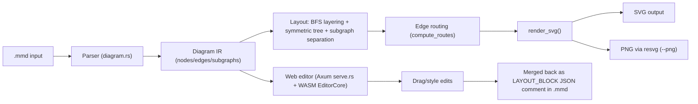
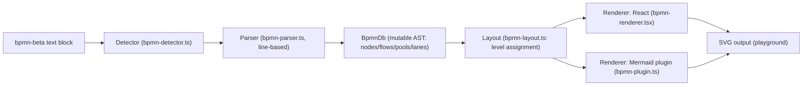
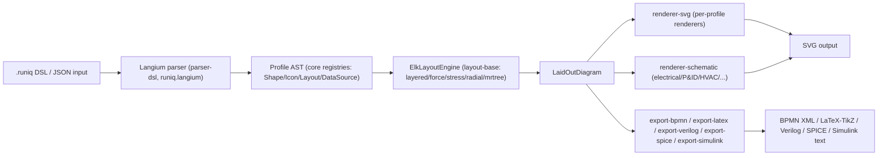
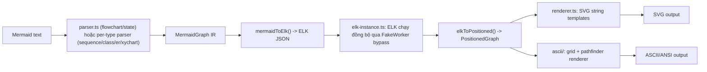

# Weekly scan — diagram-as-code & visual tooling (2026-07-25)

**Executive summary:**
- Session này không có quyền dùng `gh api search/repositories` (GitHub access bị giới hạn phạm vi vào `kymostudio/kymostudio`), nên scan dựa hoàn toàn vào web search + fetch trực tiếp các trang GitHub công khai. Chỉ 2/4 repo chọn thực sự có commit trong 7 ngày qua (**oxdraw**: 18/07; **bpmn-beta**: 24/07); 2 repo còn lại (**Runiq**, **beautiful-mermaid**) đã "nguội" 6–11 tuần nhưng được giữ lại vì độ liên quan kiến trúc rất cao — ghi rõ ràng để không gây hiểu lầm về độ "mới".
- **oxdraw** (Rust, 2.3k sao) đang phát triển tích cực "symmetric tree layout" + "git-like visual diff" cho golden SVG — cả hai map thẳng vào vấn đề kymostudio đang tự giải (`alignment.py` fan-in staggering, golden-SVG byte-for-byte test suite).
- **bpmn-beta** (OKHP3, 3 sao) là dự án nhỏ nhưng giải đúng bài toán kymostudio đang làm: BPMN-as-DSL với SVG renderer tự viết, không phụ thuộc `bpmn-js` — đáng đối chiếu quyết định kiến trúc trực tiếp, dù quality bar (CI, sao) còn thấp.

**Mục lục**
1. [oxdraw](#1-oxdraw)
2. [bpmn-beta (mermaid-diagram-bpmn)](#2-bpmn-beta-mermaid-diagram-bpmn)
3. [Runiq](#3-runiq)
4. [beautiful-mermaid](#4-beautiful-mermaid)

---

## 1. oxdraw

Repo: `RohanAdwankar/oxdraw` · https://github.com/RohanAdwankar/oxdraw

### §1 — Quick context

Diagram-as-code viết bằng Rust, cho phép chỉnh sửa **visual (kéo-thả)** một diagram Mermaid rồi tự động ghi lại các thay đổi đó dưới dạng code khai báo vào chính file `.mmd` gốc — khác các tool Mermaid khác ở chỗ nó là một **round-trip editor**, không chỉ renderer một chiều.

- **Tech stack**: Rust (edition 2024), biên dịch song song ra native binary và WebAssembly (`cdylib`+`rlib`); web server tùy chọn bằng Axum/Tokio; frontend Next.js/TypeScript/React; SVG native tự viết, PNG qua `resvg`+`tiny-skia`.
- **Repo health**: ~2.3k sao, 86 fork, 23 issue mở. Gần như one-person project (RohanAdwankar giữ 181/~207 commit); có CI (`.github/workflows/ci.yml`) và test harness riêng (`libtest-mimic`) với golden fixture SVG.
- **Distribution**: `cargo install oxdraw` (crates.io) + bản web tĩnh (WASM) tại GitHub Pages.

### §2 — Architecture deep-dive

**A. Component inventory**
- `Parser` (`src/diagram.rs`, hàm `Diagram::parse()`) — parse tuần tự từng dòng `.mmd`.
- `Layout engine` (cũng trong `src/diagram.rs`) — `compute_auto_layout()`, `tree_components()`/`align_tree_components()`, `separate_subgraphs()`, `compute_routes()`.
- `Renderer` (`render_svg()` trong `src/diagram.rs`) — sinh SVG string trực tiếp, không qua thư viện SVG ngoài.
- `EditorCore`/`WasmEditorCore` (`src/editor_core.rs`) — view-model cho editor, drag state machine, merge override vào source.
- `HTTP server` (`src/serve.rs`, Axum) — expose `/api/diagram*`, `/api/codemap/*` cho web editor.
- `codemap.rs`/`codedown.rs` — tính năng AI/static-analysis sinh diagram từ codebase, sinh doc.
- `utils/view_visual_diff.rs` — binary riêng để so sánh golden SVG giữa hai git revision.

**B. Pipeline** (`oxdraw --input flow.mmd`): (1) `cli.rs::dispatch()` parse argv → `RenderArgs`; (2) đọc file, gọi `Diagram::parse()`; (3) parse từng dòng thành `Diagram` struct (node/edge/subgraph); (4) layout: BFS topological layering → symmetric-tree alignment (nếu graph là polytree/forest) → tách subgraph chồng lấn → route cạnh orthogonal có tránh va chạm; (5) `render_svg()` sinh SVG (hoặc PNG qua `resvg` nếu `--png`); (6) ghi ra file/stdout.

**C. Data model/IR**: một struct `Diagram` mutable duy nhất (`nodes: HashMap`, `edges: Vec`, `subgraphs: Vec<Subgraph>` lồng đệ quy, `node_membership`), không có "lower IR" tách biệt — layout ghi đè trực tiếp một `positions: HashMap` gắn kèm. Lỗi dùng `anyhow::Result` chung chung, không có `ParseError` enum có span.

**D. Input language**: Mermaid syntax thật (flowchart + Gantt), không phải DSL riêng, không có file grammar hình thức (`.pest`/`.bnf`). Parser viết tay dòng-theo-dòng, dispatch theo prefix mỗi dòng — **không xác định** cơ chế báo lỗi có line/column chính xác hay không (evidence cho thấy chỉ có message string chung).

**E. Layout algorithm** — đây là phần đáng chú ý nhất tuần này. Commit `add symmetric tree layout` (17/07) và `improve compound layout symmetry` (16/07): `tree_components()` phát hiện graph là polytree/forest (kiểm `degree_sum/2+1 == len`), rồi `align_tree_components()` xếp các "slot" đối xứng, canh giữa node cha đa-con bằng `slot_center() = (min+max)/2` của các slot con, xử lý từ layer rộng nhất ra ngoài. Với compound/subgraph, cha nhóm được canh giữa trên các con trong nhóm mà **không dịch chuyển các nhánh không liên quan** — và cạnh backward/cross-group được route vòng quanh frame subgraph không liên quan. Base layering vẫn là BFS topological; edge routing orthogonal có test nhiều hướng (trái/phải/trên/dưới) chọn đường ngắn nhất. Không có force-directed hay barycentric crossing-minimization.

**F. Rendering**: SVG tự sinh, không qua thư viện ngoài (resvg chỉ dùng để rasterize PNG/diff). Round-trip: editor **không sửa lại phần Mermaid gốc** — thay đổi visual được ghi dưới dạng JSON patch (`LayoutUpdateInput`/`StyleUpdateInput`) chèn vào comment block `LAYOUT_BLOCK_START`/`END` trong cùng file `.mmd`, giữ tương thích ngược với tool Mermaid khác. "Visual golden diff" (`view_visual_diff` binary) so sánh SVG golden giữa 2 git revision, rasterize cả hai ra PNG rồi ghép side-by-side thành contact sheet — không phải diff văn bản. Commit "make visual diffs git-like" (18/07) mở rộng để hỗ trợ working-tree/single-commit/range diff kiểu `git diff`.

**G. Extensibility**: **không xác định** — không tìm thấy plugin system, theming API, hay tài liệu quy trình thêm shape/diagram-type mới; `CONTRIBUTING.md` chỉ hướng dẫn thêm test case.

**H. Dev experience**: `--edit` khởi chạy Axum server phục vụ frontend Next.js + REST API; codemap mode có thể mở VS Code/Neovim từ trình duyệt (gần giống "IDE integration" nhưng không phải extension thật). Không tìm thấy flag `--watch` rõ ràng dù có commit "keep browser renderer in sync" (18/07) gợi ý đang làm việc này. Có browser preview qua bản WASM tĩnh, chia sẻ diagram qua URL hash.

### §3 — Architecture diagram



### §4 — Verdict

Điểm đáng học nhất: kỹ thuật **symmetric tree layout** (canh giữa cha đa-con bằng slot-center, không dịch nhánh không liên quan khi có subgraph) có thể áp trực tiếp vào `alignment.py`'s fan-in/trunk-lane staggering pass của kymostudio — cùng một lớp bài toán (canh trục đối xứng khi có cây/rừng con). Ý tưởng **"visual golden diff"** (contact-sheet before/after, git-aware) cũng đáng làm cho kymostudio: hiện `KYMO_UPDATE_GOLDEN=1` chỉ cho biết SVG đổi byte-nào, không cho biết đổi *nhìn* ra sao — một tool tương tự sẽ giúp review PR thay đổi renderer nhanh hơn nhiều. Cơ chế round-trip bằng comment-block JSON (giữ nguyên phần Mermaid gốc) là một pattern gọn để "diagram-as-code + visual editor" cùng tồn tại mà không phá tương thích — đáng tham khảo nếu kymostudio từng làm visual editor.

Red flag: gần như one-person project (bus factor thấp), không có formal grammar, error handling chỉ là string chung, chưa thấy plugin/extensibility system. Open question: cơ chế watch-mode thực tế ra sao (commit "keep browser renderer in sync" chưa xác nhận được nội dung). **Verdict: study deeper** (riêng phần layout algorithm + golden-diff tooling).

---

## 2. bpmn-beta (mermaid-diagram-bpmn)

Repo: `OKHP3/mermaid-diagram-bpmn` · https://github.com/OKHP3/mermaid-diagram-bpmn

### §1 — Quick context

Một DSL text-first cho BPMN process diagram, thiết kế để trở thành một Mermaid diagram-type contribution chính thức — khác các converter BPMN khác ở chỗ nó **không phụ thuộc `bpmn-js`**, tự viết parser + SVG renderer từ đầu, và có sẵn dual rendering path (React component cho playground riêng, imperative-string cho Mermaid plugin adapter).

- **Tech stack**: TypeScript, React+Vite (playground), pnpm monorepo. Output: SVG.
- **Repo health**: chỉ 3 sao, 168 commit trên `main`, 6 PR mở. **Không có CI test gate** — workflow chỉ deploy GitHub Pages + audit dependency version, không chạy `typecheck`/`test` khi push (tự thừa nhận trong `AGENTS.md`: "deployment workflow lacks typecheck gates").
- **Distribution**: chưa publish npm (`@workspace/mermaid-diagram-bpmn` version `0.0.0`, private); chỉ có playground tại GitHub Pages.

### §2 — Architecture deep-dive

**A. Component inventory** (tất cả dưới `app/src/lib/`):
- `bpmn-detector.ts` — nhận diện header `bpmn-beta`.
- `bpmn-parser.ts` — parser dòng-theo-dòng viết tay, entry `parse(source): BpmnDb`.
- `bpmn-db.ts` — `BpmnDb`, AST/model mutable trung tâm.
- `bpmn-layout.ts` — gán level/tọa độ.
- `bpmn-renderer.tsx` — React component render SVG cho playground.
- `bpmn-plugin.ts` — adapter `ExternalDiagramDefinition` cho Mermaid, một **con đường render SVG imperative-string thứ hai**, tách biệt với `bpmn-renderer.tsx`.
- `bpmn-styles.ts` — sinh CSS/theme string.
- 15 thư mục `skills/*` — bộ "BP-SKILL" hướng agent làm process-documentation (SIPOC, RACI...), tách biệt hoàn toàn khỏi rendering pipeline.

**B. Pipeline** (theo `app/docs/architecture.md`/`AGENTS.md`): (1) detector khớp header `bpmn-beta`; (2) parser dòng-theo-dòng (stack-based) ghi thẳng vào `BpmnDb`; (3) `BpmnDb` giữ node/flow/pool/lane + metadata a11y; (4) layout engine gán tọa độ, CSS inject vào `<defs>`; (5) renderer (React trong app, hoặc SVG-string builder trong Mermaid plugin) xuất SVG có class `bpmn-*`.

**C. Data model/IR**: `BpmnDb` **mutable** rõ ràng — cặp `add*()`/`get*()` trên `BpmnNode[]`/`BpmnFlow[]`/`BpmnPool[]`/`BpmnLane[]`. Không có bước compile sang IR bất biến trung gian — parser ghi thẳng vào instance dùng chung, Mermaid plugin expose lại chính instance đó qua `yy` property để renderer đọc mà không parse lại.

**D. Input language**: xác nhận là parser dòng-theo-dòng, regex-driven, **không có formal grammar/EBNF** (`docs/dsl-spec.md` tự ghi rõ điều này; Langium migration chỉ là "proposed future decision" DEC-013, chưa có code). Tokenize: `split('\n')`, trim, bỏ dòng trống/comment `%% `, match regex cố định, ví dụ node pattern `^(start|end|task(?::[a-zA-Z]+)?|xor|or|and)\s+([a-zA-Z0-9_]+)\s+"([^"]*)"$`. Nesting qua `contextStack` với `{`/`}` mở/đóng scope; validate chặn pool-trong-pool. Báo lỗi chỉ là `Error` ném ra kèm số dòng, không có multi-error diagnostics. **Lane chỉ sâu 1 cấp** (`dsl-spec.md`: "Lanes are one level deep only") — hạn chế rõ so với BPMN thật.

**E. Layout**: auto-compute, không phải tọa độ tường minh. `assignLevels()` gán level theo topological order từ flow nguồn→đích; x = `level*(NODE_W+PAD_X)`; pool/lane tự tính width/height theo nội dung + padding tối thiểu. **Edge routing chỉ là đường thẳng 2 điểm** — chưa có orthogonal/elbow/Bézier. Có đề xuất (chưa implement) hybrid `@[row,col]` coordinate-hint trong architecture doc (DEC-001, "Proposed").

**F. Rendering**: xác nhận không phụ thuộc `bpmn-js` (loại trừ rõ trong `AGENTS.md` scope boundary). Shape đã có: start/end event; 6 loại task (`task:user/service/script/receive/send`); 3 gateway (`xor/and/or`); pool/lane (experimental); message flow `~~>` (experimental, dashed, chỉ cross-pool); association `---` mới ở dạng "Planned — not yet rendered".

**G. Extensibility**: thêm shape mới cần sửa 4 chỗ — `bpmn-db.ts` (type/property mới), `bpmn-parser.ts` (regex mới), hàm SVG-emit (`renderNodeSvg`/`taskMarkerSvg`/...), và `bpmn-styles.ts` (CSS class mới) — không có registry pattern tập trung. Theming đã implement thật (không chỉ dự định): `BpmnThemeOptions` 6 thuộc tính, đọc `themeVariables` của Mermaid với fallback theo tầng.

**H. Dev experience**: script pnpm chuẩn (`dev`, `build`, `typecheck`, `test` qua Vitest) nhưng **không có watch-mode test**, và quan trọng nhất — **không được gate trong CI** (chỉ chạy khi dev tự gõ lệnh). CHANGELOG báo 58 test (kể cả 18 corpus test) tính đến v0.0.3. Playground có pan/zoom 15–800%.

### §3 — Architecture diagram



### §4 — Verdict

Repo này đáng chú ý nhất không phải vì chất lượng code (còn rất sơ khai, 3 sao, không CI gate) mà vì nó **đang giải chính xác bài toán kymostudio đã giải xong**: BPMN-as-DSL + SVG renderer tự viết, không phụ thuộc thư viện BPMN ngoài. Điểm đáng học: `app/docs/architecture.md` của họ ghi quyết định kiến trúc dạng "DEC-001, DEC-002..." với trạng thái (Proposed/Accepted) — pattern decision-log này đáng cân nhắc thêm vào `docs/BPMN.md` của kymostudio để ghi lại tại sao một số quyết định (vd. giữ lane chỉ 1 cấp, hay chọn straight-line routing) được chọn, giúp người sau không lặp lại tranh luận. Ngược lại, **kymostudio đã vượt xa** giới hạn hiện tại của họ: routing đường thẳng thuần túy và lane 1-cấp là những hạn chế mà `resolve_alignments()`/BPMN DI-coordinate approach của kymostudio đã xử lý tốt hơn từ lâu — nên đây là dịp so sánh ngược để xác nhận kymostudio đang đi đúng hướng chứ không phải để copy kỹ thuật.

Red flag: không có CI test gate (tự thừa nhận), pool/lane/message-flow còn "experimental", data model không có validate tách biệt khỏi parse. Open question: liệu nhóm BP-SKILL (15 skill hướng agent) có thực sự dùng chung DSL này hay là một sản phẩm marketing riêng gắn kèm. **Verdict: glance only** — theo dõi tiếp vì cùng bài toán, nhưng chưa đủ chín để học kỹ thuật cụ thể.

---

## 3. Runiq

Repo: `quipolabs/runiq` · https://github.com/quipolabs/runiq (website runiq.org)

> ⚠️ **Lưu ý về độ mới**: commit gần nhất tìm được là **09/06/2026** (branch `develop`) — khoảng **6.5 tuần** trước ngày scan, ngoài cửa sổ "7 ngày qua". Vẫn đưa vào báo cáo vì độ liên quan kiến trúc với kymostudio (Langium parser, ELK layout, multi-format export) cao hơn hẳn các repo thật sự mới tìm được trong tuần.

### §1 — Quick context

Diagram DSL "composable", input kép DSL/JSON dùng chung một AST, khác các tool khác ở chỗ xuất được ra rất nhiều định dạng ngoài SVG — LaTeX/TikZ, Verilog HDL, SPICE netlist, Simulink, BPMN XML — nhắm vào cả kỹ sư điện/mạch số chứ không chỉ software architecture.

- **Tech stack**: TypeScript monorepo (pnpm workspaces, 18 package `@runiq/*`), Langium (parser-generator + LSP framework) cho DSL, Eclipse Layout Kernel (ELK) cho layout.
- **Repo health**: 0 sao, 0 fork (dự án rất mới/chưa được biết đến), MIT license, tác giả chính `jgreywolf`. Có CI (`.github/workflows/ci.yml` + changesets release pipeline) và test colocated `*.spec.ts` bằng Vitest trong từng package.
- **Distribution**: npm, scope `@runiq/*` (`@runiq/web`, `@runiq/cli` xác nhận có badge version).

### §2 — Architecture deep-dive

**A. Component inventory**: 18 package dưới `packages/`: `parser-dsl` (Langium grammar `runiq.langium` + validation/diagnostics), `core` (AST types + `registries.ts`: `ShapeRegistry`/`IconRegistry`/`LayoutRegistry`/`DataSourceRegistry`, + `themes/`), `layout-base` (`ElkLayoutEngine`/`elk-adapter.ts` + `circular-layout.ts` viết tay riêng), `renderer-svg` (renderer chung + file renderer riêng cho từng profile: gitgraph/kanban/pedigree/railroad/sequence/timeline/treemap/wardley/fault-tree), `renderer-schematic` (electrical/digital/P&ID/HVAC/hydraulic/pneumatic, có `symbolRegistry.ts` riêng), 5 package `export-*` (bpmn/latex/simulink/spice/verilog) mỗi cái một package, 3 package icon theo nguồn (`icons-brand`/`icons-fontawesome`/`icons-iconify`), `glyphsets`, `io-json`, `data-loader`, `cli`, `web` (SDK: `parseRuniq`/`layoutRuniq`/`renderRuniq`/`renderRuniqToSvg`).

**B. Pipeline** (theo `packages/web/src/index.ts`): (1) `parseRuniqDocument(text)` — Langium parse toàn bộ file thành `RuniqDocument` (nhiều `profiles+=Profile*`, mỗi profile độc lập là Diagram/Electrical/Sequence/Railroad/Wardley/PID/...); (2) `parseRuniq(text)` trích profile diagram đầu tiên thành `DiagramAst`; (3) `layoutRuniq()` gọi `ElkLayoutEngine` (bất đồng bộ, vì ELK layout call là async) ra `LaidOutDiagram`; (4) `renderRuniq()` dispatch theo loại profile tới renderer tương ứng (SVG chung / renderer riêng theo profile / `renderer-schematic`) ra SVG. Với export "lạ" (LaTeX/Verilog): cùng bước parse, nhưng thay vì `renderRuniq`, AST/layout được đưa thẳng cho package `export-*` tương ứng để sinh text output — **không xác định** liệu bước này có đi qua SVG renderer trước hay không (agent không đọc sâu được nội dung `export-latex`).

**C. Data model/IR**: `core/src/registries.ts` + `types/` giữ AST dùng chung cho cả 2 lối vào (DSL và JSON qua `io-json`). **Không tìm thấy** bước "compile sang lower IR" kiểu TALA của D2 — pipeline là AST → `LaidOutDiagram` → SVG, tức layout áp thẳng lên (hoặc bọc quanh) AST gốc chứ không compile sang biểu diễn trung gian riêng. Tính mutable/immutable giữa các pass: **không xác định**.

**D. Input language**: xác nhận có grammar file thật, `packages/parser-dsl/src/runiq.langium`:
```
grammar Runiq
entry Document:
    profiles+=Profile*;
DiagramProfile:
    'diagram' name=STRING '{' statements+=DiagramStatement* '}';
```
cộng `ElectricalProfile` nhận keyword `'electrical'` hoặc `'schematic'`, với `NetStatement`/`PartStatement`/`AnalysisStatement` (`AnalysisKind: 'tran' | 'ac' | 'dc' | 'op' | 'noise'`). File `terminals.langium` định nghĩa terminal riêng cho ký hiệu P&ID (`TAG`, vd. `V-101`), mũi tên có nhãn `-[name]->`, hai chiều `<->`. **Langium** — khác hẳn parser viết tay của kymostudio/bpmn-beta/oxdraw — là một parser-generator + language-server framework (nền Chevrotain): đổi lấy một bước build thêm (`langium-config.json`, code sinh tự động) để có **LSP miễn phí từ cùng một grammar** (autocomplete, hover, go-to-definition, live diagnostics — có bằng chứng qua thư mục `diagnostics/`/`validation/`/`validator.ts`), error-recovery/incremental-reparse có sẵn, và một nguồn-sự-thật-duy-nhất cho cả parser lẫn tooling editor.

**E. Layout**: theo README của `layout-base`, ELK expose 5 thuật toán: layered (mặc định), force-directed, stress-minimization, radial, mrtree — không thấy rectpacking. `circular-layout.ts` là code viết tay riêng, tức **không phải mọi layout đều qua ELK**. Crossing-minimization/edge-routing cụ thể: **không xác định** (agent không đọc sâu vào thân `elk-adapter.ts`), suy ra là hành vi mặc định của ELK theo thuật toán chọn.

**F. Rendering**: 2 package renderer xác nhận kiến trúc pluggable-theo-profile: `renderer-svg` xử lý cả profile chung lẫn nhiều profile chuyên biệt (thêm file renderer riêng trong cùng package, không tách package); `renderer-schematic` mới thật sự tách riêng cho kỹ thuật điện (electrical/digital/P&ID/HVAC/hydraulic/pneumatic), có `symbolRegistry.ts` riêng. BPMN có package export riêng (`export-bpmn`) thay vì một renderer SVG native — gợi ý BPMN được xem như **export target** (BPMN XML) hơn là một profile SVG gốc — **chưa xác nhận chắc chắn**.

**G. Extensibility**: xác nhận registry pattern thật trong `core/src/registries.ts` — class `ShapeRegistry` (`Map<string, ShapeDefinition>` + alias map, `register()`/`get()`/`resolveAlias()`), cùng `IconRegistry`/`LayoutRegistry`/`DataSourceRegistry` riêng — thêm shape/icon/layout/data-source mới là đăng ký vào registry, không cần sửa renderer. **Cảnh báo sai lệch số liệu**: brief ban đầu nói "192 shape/18 category" và "61 glyphset" — agent không xác nhận được con số 192/18 trong code đã fetch, và glyphsets README thực tế chỉ liệt kê **8 pattern kiểu SmartArt** (process, pyramid, matrix, venn, funnel, timeline...), không phải 61. Đây là dấu hiệu tài liệu marketing phóng đại so với repo thật.

**H. Dev experience**: `apps/editor` là SvelteKit app (có `e2e/` Playwright, `components.json` gợi ý dùng shadcn-svelte) — có vẻ là playground web, nhưng **không xác nhận được** phạm vi tính năng do trang README không fetch được. CLI (`@runiq/cli`) tồn tại nhưng **không xác định** tên lệnh `bin` hay flag watch-mode cụ thể. Claim "1111+ test" trong brief **không xác nhận được** — chỉ thấy `layout-base` tự báo "24 passing tests"; test là `*.spec.ts` colocated theo Vitest trong từng package, không có thư mục `tests/` tập trung.

### §3 — Architecture diagram



### §4 — Verdict

Ý tưởng đáng học nhất cho kymostudio: **registry pattern** (`ShapeRegistry`/`IconRegistry` dạng `Map` + alias resolution) là một tổng quát hóa gọn của cách `icons.py` của kymostudio đang làm (hand-coded `ICONS` rồi fallback file-scan) — nếu kymostudio thêm nhiều nguồn icon hơn (brand/fontawesome/iconify như Runiq đang tách 3 package riêng), một registry tường minh sẽ dễ mở rộng hơn cách resolve tuần tự hiện tại. Việc dùng **Langium** thay vì parser viết tay là điểm đáng cân nhắc nghiêm túc nhưng có đánh đổi rõ: kymostudio có mục tiêu tường minh là `packages/js` **dependency-free** — đổi sang Langium sẽ phá mục tiêu đó, nên đây là bài học "biết mà không làm" chứ không phải "nên áp dụng". Việc BPMN được xử lý như **export target** (XML) thay vì profile SVG gốc là một khác biệt kiến trúc đáng ghi nhận — ngược với cách tiếp cận của kymostudio (BPMN là first-class import/export có full round-trip qua `Diagram` model).

Red flag lớn nhất: **tài liệu phóng đại** — số liệu 192 shape/61 glyphset/1111+ test trong README không khớp với những gì agent xác minh được trực tiếp trong code (glyphsets thực tế chỉ 8 pattern). Nên đọc mọi con số kiểu marketing từ dự án này với hoài nghi, và tự verify lại nếu định học theo bất kỳ chi tiết nào chưa tự tay đọc source. Open question: cơ chế nào quyết định BPMN xuất text (XML) thay vì SVG — có promise thêm profile SVG cho BPMN trong tương lai không, không tìm thấy roadmap ghi rõ. **Verdict: study deeper** (riêng phần Langium grammar + registry pattern), nhưng verify từng con số trước khi trích dẫn lại.

---

## 4. beautiful-mermaid

Repo: `lukilabs/beautiful-mermaid` · https://github.com/lukilabs/beautiful-mermaid

> ⚠️ **Lưu ý về độ mới**: commit gần nhất tìm được là **06/05/2026** — khoảng **11 tuần** trước ngày scan, xa ngoài cửa sổ "7 ngày qua". Giữ trong báo cáo vì một kỹ thuật rendering rất cụ thể (mục E/F) đáng học bất kể lịch cập nhật.

### §1 — Quick context

Render Mermaid ra SVG hoặc ASCII art cực nhanh cho ngữ cảnh AI (chat/terminal), khác Mermaid gốc ở chỗ chạy **đồng bộ (sync)** — không cần Promise/await — nhờ một trick "FakeWorker bypass" quanh ELK.js.

- **Tech stack**: TypeScript, build bằng `tsup` (ESM-only), runtime deps chỉ có `elkjs` + `entities` — thực sự nhẹ.
- **Repo health**: 10.7k sao, 368 fork, ~11 contributor (một số gắn brand "Craft Agents"/`agents.craft.do`); có CI (`ci.yml` test/lint + `publish.yml` npm publish). Nhưng: commit gần nhất đã 11 tuần — dấu hiệu chững lại dù được biết đến rộng.
- **Distribution**: npm (`beautiful-mermaid`, hiện v1.1.3), demo/editor deploy Cloudflare Pages.

### §2 — Architecture deep-dive

**A. Component inventory**: `parser.ts` (parser regex viết tay cho flowchart + state diagram); mỗi diagram-type khác (`sequence/`, `class/`, `er/`, `xychart/`) có **parser/renderer/layout riêng của nó**, không đi qua pipeline ELK chung; `elk-instance.ts` — wrapper chạy ELK đồng bộ ("FakeWorker bypass"); `layout-engine.ts` — chuyển `MermaidGraph` → ELK JSON → gọi ELK → chuyển ngược ra `PositionedGraph`; `renderer.ts` — sinh SVG bằng string-template thuần, không thao tác DOM; `theme.ts`/`styles.ts` — theme + CSS variable; `ascii/` — hệ thống render ASCII độc lập hoàn toàn (grid/canvas/pathfinder/ANSI riêng).

**B. Pipeline**: (1) gọi `renderMermaidSVG(text, options)`; (2) `parseMermaid()` — với flowchart/state dùng parser regex chung, các loại khác dispatch sang parser riêng của thư mục chúng; (3) `layoutGraphSync()`: `mermaidToElk()` dựng ELK JSON lồng nhau → `elkLayoutSync()` gọi `elk-instance.ts` → `elkToPositioned()` chuyển ngược ra `PositionedGraph`; (4) `renderer.ts::renderSvg()` duyệt `PositionedGraph`, đẩy từng fragment SVG (rect/path/group) vào mảng string, nối lại; (5) trả về SVG string đồng bộ — an toàn để gọi trong `useMemo()` của React.

**Cơ chế "FakeWorker" (`src/elk-instance.ts`)** — chi tiết kỹ thuật đáng chú ý nhất repo này: bản thân ELK.js có sẵn một shim nội bộ tên "FakeWorker" bọc cả `postMessage` lẫn `onmessage` trong `setTimeout(0)` để giả lập Web Worker mà không cần Worker thật. beautiful-mermaid **đi vòng qua chính shim đó**: gọi thẳng `dispatcher.saveDispatch()` thay vì `postMessage()`, thay `rawWorker.onmessage` bằng handler đồng bộ để bắt kết quả ngay thay vì chờ round-trip giả-async, đồng thời monkey-patch tạm `globalThis.setTimeout` lúc khởi tạo ELK để flush ngay các callback đăng ký thuật toán (ELK cũng queue chúng qua `setTimeout(0)`), rồi khôi phục lại `setTimeout`/`self` sau đó.

**C. Data model/IR**: parser riêng, không dùng lại AST của Mermaid gốc. IR là `MermaidGraph` (node Map id/label/shape, edge array, subgraph, classDef, direction) → dựng thành ELK graph JSON (format riêng của ELK: `children`/`edges`/`layoutOptions`/`ports`) → kết quả ELK (vị trí/kích thước) chuyển thành `PositionedGraph`, IR của renderer.

**D. Input language**: xác nhận là Mermaid syntax thật, không phải DSL mới. 6 loại diagram: flowchart, state diagram (`stateDiagram-v2`), sequence, class, ER, XY chart (bar/line/mix). Parser regex chung chỉ cover flowchart+state; 4 loại còn lại có parser riêng trong thư mục của chúng.

**E. Layout**: chỉ expose thuật toán `layered` của ELK (map hướng TD/LR/BT/RL sang `elk.direction`). Edge routing là **ORTHOGONAL thuần** (chỉ góc 90°), không có lựa chọn spline. Có các pass hậu-ELK: canh layer, **edge bundling** (gộp cạnh fan-in/fan-out) — về mặt khái niệm **giống hệt** trunk-lane staggering pass của `alignment.py` trong kymostudio, cắt endpoint theo shape, và margin-routing cho cạnh xuyên hierarchy.

**F. Rendering**: SVG là string-template thuần (`parts.push(...)`, không đụng DOM — chạy được cả server-side). ASCII là subsystem tách biệt, có pathfinding riêng, **port từ Go sang TypeScript** (ghi rõ trong code: dựa trên `mermaid-ascii` của Alexander Grooff). Theming: chỉ cần 2 màu nền tảng (`bg`/`fg`), còn lại suy ra bằng `color-mix()` trong CSS variable — 15 theme dựng sẵn + hàm `fromShikiTheme()` để import theme VS Code/Shiki. Đổi theme live chỉ cần đổi CSS variable, không cần render lại.

**G. Extensibility**: **không tìm thấy** plugin API hay cơ chế đăng ký shape/icon tùy chỉnh — shape node là tập cố định trong `parser.ts`. Override style chỉ giới hạn trong `style`/`classDef` của Mermaid.

**H. Dev experience**: API là hàm gọi trực tiếp `renderMermaidSVG(text, options) => string` (sync), cộng bản async, `renderMermaidASCII`, `parseMermaid`, `fromShikiTheme` — type TypeScript đầy đủ. Không có CLI riêng trong package; có playground HTML/CSS/JS thuần trong repo (`editor/`), deploy Cloudflare Pages. README là nguồn doc chính, khá đầy đủ ví dụ dùng.

### §3 — Architecture diagram



### §4 — Verdict

Kỹ thuật cụ thể nhất đáng ghi nhớ: **FakeWorker bypass** — nếu kymostudio (hoặc `packages/js`) từng cân nhắc dùng một layout engine bên thứ ba chạy trên Worker/WASM (kể cả chính `kymostudio-core` resvg wasm build) mà vẫn muốn giữ API top-level đồng bộ, đây là một cách làm cụ thể, đã chứng minh hoạt động ở quy mô 10k+ sao. Kỹ thuật **theme 2-màu suy ra qua `color-mix()`** cũng là một ý hay để giảm bề mặt cấu hình theme cho `to_svg.py`/CSS hiện tại của kymostudio — thay vì định nghĩa từng biến màu, chỉ cần 2 màu gốc rồi suy diễn phần còn lại. Và **edge bundling hậu-layout** của họ giải đúng vấn đề mà `alignment.py`'s fan-in/trunk-lane pass của kymostudio đã tự giải độc lập — đáng đối chiếu trực tiếp hai cách tiếp cận xem có ý tưởng nào bổ sung được cho nhau.

Red flag: dự án nổi tiếng (10.7k sao) nhưng đã im lặng phát triển ~11 tuần — rủi ro bảo trì nếu định phụ thuộc vào nó như một thư viện thật; không có cơ chế shape/icon tùy biến. Open question: vì sao chỉ flowchart/state đi qua pipeline ELK chung còn 4 loại diagram khác lại có pipeline riêng biệt hoàn toàn — có phải ELK không phù hợp với sequence/class/ER hay chỉ là chưa kịp hợp nhất. **Verdict: glance only** cho kiến trúc tổng thể, nhưng **study deeper riêng phần FakeWorker + theme color-mix** vì đó là kỹ thuật độc lập, tách rời được khỏi phần còn lại của repo.
