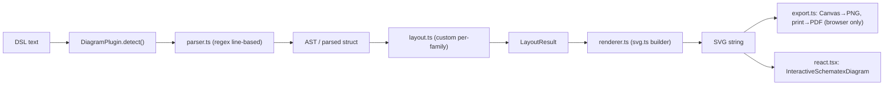
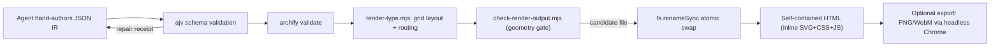
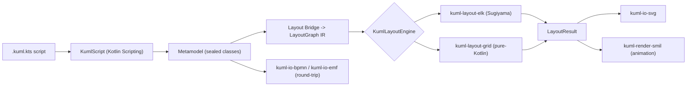
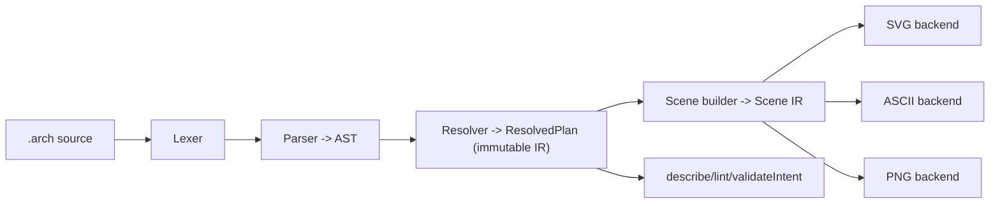

# Weekly Scan: Diagram-as-Code & Visual Tooling — 2026-07-26

**Phương pháp**: search qua `api.github.com/search/repositories` (topic-based, single-qualifier queries do compound `OR` bị 422/403) cho repos `pushed:>2026-07-19`, loại các chart library / dashboard / icon-pack / portfolio theo exclusion list. Từ 10 candidate tìm được, chọn 4 repo có novelty cao nhất để deep-dive (đọc README, directory tree, entry point, core modules, ít nhất 1 example file cho mỗi repo). Ghi rõ "không xác định" ở bất kỳ dimension nào thiếu evidence trực tiếp từ code.

## Executive summary

- **SchemaTex** và **archlang** là hai case study rõ nét nhất cho kymostudio: cả hai đều là hand-written parser + custom layout + SVG renderer zero-dependency, nhưng đi theo hai hướng ngược nhau — SchemaTex nhân rộng ra 60 diagram family với layout riêng từng cái (không animation), còn archlang giữ một compiler pipeline gọn với "error-as-data" `compile()` không bao giờ throw và IR dùng chung giữa render/lint/describe — pattern này đáng học nhất cho `dsl.py`/`alignment.py`.
- **Archify** chứng minh một pattern rất cụ thể và tái dùng được ngay: atomic "deliver" gate (render ra file candidate → chạy full geometry/composition check → SHA-256 → `fs.renameSync`) chỉ commit artifact khi mọi check pass — một cách rẻ để mở rộng kỷ luật golden-SVG-test của kymostudio sang layer authoring, không chỉ layer CI.
- **kUML** có phạm vi tính năng trùng lặp nhiều nhất với kymostudio (DSL → ELK layout → SVG/PNG/TikZ/SMIL animation → BPMN/XMI/Structurizr round-trip) nhưng repo mới 8 tuần tuổi, 17 sao, 0 fork, và phần lớn claim không verify được từ source thật (README/`.adoc` docs only) — nghi ngờ cao là scaffold do AI-agent sinh nhanh hơn là implementation đã chạy thật; theo dõi thêm chứ chưa nên coi là reference.

## Mục lục

1. [SchemaTex](#1-schematexschematex)
2. [Archify](#2-tt-a1iarchify)
3. [kUML](#3-kuml-devkuml)
4. [archlang](#4-chanmeng666archlang)

---

## 1. SchemaTex/SchemaTex

### §1 — Quick context

Engine TypeScript zero-dependency render 50 diagram family "chuyên ngành" (genogram, ladder logic, PERT/CPM, fault tree...) từ text DSL ra SVG chuẩn — khác Mermaid ở chỗ mỗi family có parser + layout + renderer riêng thay vì một layout engine dùng chung. Stack: TypeScript strict, `tsup`/`vitest`/`eslint`, optional peer React 19 + Vercel AI SDK. Repo health: 51 sao, **1 contributor duy nhất** (339 commit trong ~3 tháng), 24 release, CI đầy đủ (typecheck→test→lint→build→gallery-drift-check). Phân phối: npm `schematex` + npm package MCP server riêng `@schematex/mcp`.

### §2 — Architecture deep-dive

**A. Component inventory**: `core/types.ts` (IR contracts), `core/svg.ts` (SVG builder), `core/theme.ts` (theme token), `core/diagnostics.ts` (`SchematexDiagnostic`), và quan trọng nhất — mỗi family có bộ `src/diagrams/{type}/{parser,layout,renderer,index}.ts` riêng (60 thư mục).

**B. Pipeline**: đúng như `CLAUDE.md` mô tả — "Text → Parser → AST → Layout → LayoutResult → Renderer → SVG". `render(dsl)` gọi `DiagramPlugin.detect()` để chọn family theo dòng đầu, rồi `parse → layout → render` nội bộ family đó, trả về string SVG.

**C. Data model/IR**: interface thuần TypeScript (`LayoutResult { width, height, nodes, edges }`), mutable qua các pass (không có readonly discipline), không có "lower IR" chung giữa các family.

**D. Input language**: hand-written, line-based, regex-driven — KHÔNG PEG/ANTLR/combinator, không có grammar EBNF committed (khác `docs/DSL.md` của kymostudio). Error dùng `ParseError` (line/col/source) + `SchematexDiagnostic` (`severity/code/hint/fatal`) — một contract nhỏ, gọn, LLM-legible.

**E. Layout**: tự viết riêng từng family, không dùng graph-layout library nào (đúng tinh thần "zero deps"). Ví dụ genogram: BFS generation assignment → sibling ordering → multi-pass constraint solving có comment kiểu "so cousins don't interleave". Không có crossing-minimization dùng chung giữa các family.

**F. Rendering**: chỉ SVG string ở core; PNG/PDF export nằm ở `export.ts` riêng, **chỉ chạy trong browser** (Canvas API / print dialog), README ghi rõ "for Node.js PNG, dùng sharp/puppeteer externally" — không có raster path server-side như `kymostudio-core`. **Không có animation** — gap rõ so với `--animate` của kymostudio.

**G. Extensibility**: thêm family mới KHÔNG self-service — `CONTRIBUTING.md` yêu cầu mở issue trước, playbook thật nằm ở doc private. Theme: 1 token palette × 3 preset dùng chung toàn bộ.

**H. Dev experience**: **không có CLI thật** trong package chính (`bin` field trống) — chỉ có `schematex-mcp` binary. Consume qua npm import hoặc React component. Playground web tại `schematex.js.org/playground`. AI-tooling layer rất đầy đủ: 8 tool function (`listDiagrams`, `validateDsl`, `applyDiagramEdits`...) + MCP package riêng.

### §3 — Architecture diagram

### §4 — Verdict

Đáng học nhất: `SchematexDiagnostic` shape (`code`/`severity`/`hint`/`fatal`) — nếu `dsl.py`/`dsl.ts` chưa có field `hint`/`fatal` đồng nhất, đây là chỗ rẻ, đáng thêm, nhất là khi audience của kymostudio cũng là LLM/agent. Kiến trúc "mỗi family một layout riêng" cũng gián tiếp validate lựa chọn ngược lại của kymostudio (một `alignment.py` chung) là scale tốt hơn ở quy mô hiện tại — SchemaTex trả giá bằng 60 file `layout.ts` riêng biệt. Red flag: bus-factor 1 người, repo 3 tháng tuổi, AGPL + license thương mại song song, không CLI thật, không animation, không raster server-side. Open question: `core/layered/` (rỗng trong listing) có phải shared layout primitive không dùng, hay dead code — chưa xác định được. **Verdict: study deeper** (riêng phần diagnostics contract + AI-tooling layer), phần layout/rendering thì glance-only vì không có gì kymostudio chưa làm tốt hơn.

---

## 2. tt-a1i/archify

### §1 — Quick context

Agent skill biến plain-language requirement / repo evidence / Mermaid dán vào thành animated self-contained HTML (architecture/workflow/sequence/dataflow/lifecycle diagram) — khác Mermaid/kymostudio ở chỗ **không có DSL text nào cả**, agent tự hand-author JSON IR theo JSON Schema rồi validate. Stack: pure Node.js ≥18, chỉ 1 devDependency (`ajv`, compile offline, zero runtime dep). Repo health: **7.292 sao**, 522 fork, release gần như hàng tuần (v2.2.1→v2.12.0 trong 3 tháng), CI có (`ci.yml`, `release.yml`), test suite 68 file `node:test` + golden check + WebM smoke test qua headless Chrome. Phân phối: `npx skills add tt-a1i/archify -g` cho Claude Code/Cursor/Codex/opencode.

### §2 — Architecture deep-dive

**A. Component inventory**: `bin/archify.mjs` (CLI, chứa cả pipeline validate→render→check→atomic-rename), `bin/preview.mjs` (dev server + SSE live reload), `schemas/*.schema.json` (JSON Schema draft 2020-12, 5 loại diagram), `renderers/shared/generated-validators.mjs` (ajv compiled sẵn, 285KB commit thẳng vào repo), `renderers/shared/geometry.mjs` (post-layout lint: crossing/clearance/corridor/rhythm), `renderers/{type}/render-{type}.mjs` (5 renderer riêng biệt, không phải registry pluggable), `scripts/check-render-output.mjs` (gate trước khi deliver), `delta/architecture-delta.mjs` (diff 2 IR theo stable ID).

**B. Pipeline**: agent tự viết JSON IR theo `examples/*.json` pattern (không có auto-extractor từ code) → `archify validate --json` lặp tới khi sạch → `archify deliver` render ra file candidate cùng thư mục → chạy full geometry checker → tính SHA-256 → chỉ `fs.renameSync` khi pass toàn bộ → output là 1 file HTML self-contained (inline SVG+CSS+JS).

**C. Data model/IR**: JSON Schema-enforced, `additionalProperties:false` ở mọi level, `schema_version: const 1` — breaking change bắt buộc phải bump version. IR coi như immutable, layout/geometry tính riêng downstream không ghi ngược vào JSON gốc. Validate 2 tầng: schema shape (ajv) + geometry/composition (post-render lint, tách bạch rõ ràng theo README).

**D. Input language**: **không có parser text nào** — input là JSON do LLM agent tự viết, `SKILL.md` dặn agent không được cố parse Mermaid dán vào một cách máy móc mà phải "đọc để hiểu cấu trúc rồi layout lại từ đầu". Error format là "repair receipt" (`code`/`subject`/`evidence`/`supportedFixes`) — thiết kế rõ ràng cho agent tiêu thụ, không phải stack trace cho người.

**E. Layout**: grid-based thủ công (`pos:[x,y]` hoặc `row`/`col` resolve theo grid config) — KHÔNG force-directed/Sugiyama tự động. Routing 4 kiểu (straight/orthogonal-h/orthogonal-v/auto) với port-spread cho fan-out. Crossing minimization **chỉ là lint phát hiện sau khi render**, agent phải tự sửa `route`/`via`/`fromSide` trong IR — không có solver tự reposition.

**F. Rendering**: SVG dựng bằng string template (không DOM lib), output cuối là HTML self-contained. Animation là CSS-only, opt-in qua `meta.animation:"trace"`, encode bằng `data-animate` + `--step:N` (N≤12, giới hạn để fit đúng 6 giây capture WebM) — không phải SMIL. Atomic-swap pattern (candidate file → check → SHA-256 → rename) là điểm mạnh nhất về kỹ thuật.

**G. Extensibility**: KHÔNG có plugin API cho diagram type mới — 5 type hardcode trong `TYPES` set. Theme chỉ 4 preset đóng (`classic`/`signal-flow`/`blueprint`/`editorial`), không đổi geometry. Cơ chế pluggable duy nhất thật sự là `engineering_profile` (hiện chỉ có 1 profile: `deployment-ownership`).

**H. Dev experience**: CLI nhiều subcommand (`render/compare/deliver/preview/validate/inspect/check/guide/demo`), có `--json` mode xuyên suốt — rõ ràng thiết kế cho agent lái, không phải người gõ tay. `archify preview` có watch mode + SSE live push. Docs cực nhiều (86KB CHANGELOG, ~48 file research log gần như mỗi ngày trong tháng 7) — dấu hiệu dev loop agent-driven tốc độ cao.

### §3 — Architecture diagram

### §4 — Verdict

Điểm đáng học cụ thể nhất cho kymostudio: **candidate-file + SHA-256 + atomic-rename gate** — kymostudio đã có văn hóa golden-SVG byte-for-byte, nhưng archify áp dụng cùng nguyên lý ở layer *authoring* (mỗi lần deliver), không chỉ ở layer *test*; đáng cân nhắc cho quy trình `KYMO_UPDATE_GOLDEN`. Thứ hai: tách bạch rõ ràng "schema lint" vs "geometry lint" với severity profile tunable — kymostudio's `alignment.py` chưa có standing composition-lint pass kiểu này. Red flag: `writeDiagram()` bản thân không atomic, an toàn chỉ nhờ 1 call site (`deliver`) wrap đúng cách — `archify render` gọi trực tiếp thì mất guarantee. Không có auto-extractor code→IR thật (marketing nói "biến codebase thành diagram" nhưng thực chất là agent tự đọc rồi viết tay). **Verdict: study deeper** riêng phần atomic-delivery pattern + repair-receipt error format; phần layout thì ignore vì kymostudio's `alignment.py` đã tự động hoá nhiều hơn.

---

## 3. kuml-dev/kUML

### §1 — Quick context

Kotlin embedded DSL type-safe compile ra UML 2.x/SysML 2/C4/BPMN 2.0/ERM, layout qua Eclipse ELK, output SVG/PNG/LaTeX-TikZ/SMIL animation + round-trip BPMN/XMI/Structurizr — khác kymostudio ở chỗ DSL **là chính ngôn ngữ host** (Kotlin builder function) chứ không phải text grammar riêng. Stack: Kotlin Multiplatform, Gradle multi-module (~40 submodule), Ktor/Compose cho web/desktop UI, kotlinx.serialization. Repo health: chỉ **17 sao, 0 fork, 0 issue mở**, nhưng 537 commit và 41+ release trong **8 tuần** — tốc độ release bất thường cho quy mô nhỏ. CI đầy đủ (`ci.yml`, `codeql.yml`, nhiều release workflow). Phân phối: Maven Central, Homebrew/Chocolatey/Docker, JetBrains Marketplace, VS Code extension (đã tách repo riêng).

### §2 — Architecture deep-dive

**A. Component inventory**: `kuml-core-dsl` (DSL builder infra), `kuml-core-script` (Kotlin Scripting host chạy `.kuml.kts`), `kuml-metamodel-{uml,c4,bpmn,sysml2,erm,kerml}` (sealed-class metamodel riêng từng ngôn ngữ), `kuml-layout-bridge`/`kuml-layout-elk`/`kuml-layout-grid` (layout adapter), `kuml-io-{svg,png,latex,bpmn,emf,anim}` + `kuml-render-smil` (emitter theo format), `kuml-mcp` (MCP server), `kuml-cli`/`kuml-jetbrains`/`kuml-language-server`/`kuml-web`.

**B. Pipeline**: script `.kuml.kts` → `KumlScript` compile/evaluate (Kotlin Scripting) → `DiagramExtractor` lấy metamodel instance → `kuml-layout-bridge` convert sang `LayoutGraph` IR trung lập → `KumlLayoutEngine` (ELK hoặc grid) tính `LayoutResult` → `KumlSvgRenderer.toSvg()` kết hợp `KumlDiagram+LayoutResult+KumlTheme` ra SVG. Doc tự mô tả "each stage is a pure function — the entire pipeline is reproducible and cacheable" — cùng hình dạng với pipeline `parse→layout→resolve_alignments→render` của kymostudio.

**C. Data model/IR**: sealed-class hierarchy (`UmlElement`→`UmlNamedElement`/`UmlRelationship`), `@Serializable` kotlinx, ID xác định qua qualified path (`domain::Order::id`). `LayoutGraph` là IR trung gian trước layout; ELK's own graph type là IR nội bộ thứ hai, **không rò ra ngoài module** ("ELK types never leave this module") — pattern đáng học để giữ layout engine thay thế được.

**D. Input language**: KHÔNG phải text grammar — DSL nhúng trong Kotlin (`classDiagram { classOf(...) { attribute(...) } }`), dùng `@KumlDsl` scope marker để tránh nhầm scope. Error 2 tầng: lỗi cấu trúc/type bắt ở **compile time** (nhờ Kotlin compiler), lỗi OCL invariant bắt ở **runtime** qua `kuml validate` riêng. Không tìm thấy EBNF grammar document (khác `docs/DSL.md` của kymostudio) vì bản thân "grammar" chính là Kotlin.

**E. Layout**: ELK `elk.layered` (Sugiyama) làm default, engine thứ hai `kuml-layout-grid` (pure-Kotlin, <10ms/100 node, không cần ELK). Layout hint qua DSL (`col`/`row`/`pinned`/`above()`/`rightOf()`...) dịch thành `NodeHints`. 4 kiểu route (Direct/OrthogonalRounded/TreeRounded/Bezier). Crossing-minimization không expose control riêng, phó mặc ELK nội bộ.

**F. Rendering**: SVG writer riêng (`kuml-io-svg`, không phụ thuộc Skiko/Compose/AWT, GraalVM-native-compatible), PNG qua Batik, LaTeX/TikZ, và **SMIL animation** (`kuml-render-smil`) — nhưng README của module này **không load được**, nên cơ chế SMIL cụ thể (`<animate>` nào, timing model nào) **không xác định được** từ source thật, chỉ có tuyên bố 1 dòng ở root README ("pure SMIL, no JavaScript").

**G. Extensibility**: codegen plugin qua `ServiceLoader` SPI (`kuml-codegen-api`), layout engine cũng theo pattern registry ("system selects the first registered engine"). Có cả "plugin marketplace" (`kuml-plugin-registry`) với rating/review UI nhưng **không verify được có backend thật hay chỉ CLI scaffold**.

**H. Dev experience**: CLI 18 subcommand, exit code ổn định cho CI, `kuml diagnostics` xuất line/column cho editor. JetBrains plugin dùng autocomplete Kotlin có sẵn "miễn phí" (không cần completion engine riêng) nhưng yêu cầu CLI `kuml` cài ngoài để preview/validate — plugin không tự chứa. MCP server (`kuml-mcp`) expose `kuml.render`/`kuml.describe`/`kuml.run.*` (headless behavior-runtime simulation) — tính năng khá riêng biệt so với các tool khác trong danh sách này.

### §3 — Architecture diagram

### §4 — Verdict

Đáng học nhất: nguyên tắc "ELK types never leave this module" — pattern rất đáng copy nếu kymostudio từng muốn wrap thêm layout engine thứ 3 vào `alignment.py`/`layout.py` mà không rò rỉ dependency ra API công khai. Ngoài ra, tradeoff embedded-DSL vs text-DSL là bài học gián tiếp có giá trị: kUML được autocomplete/type-check "miễn phí" nhờ Kotlin, nhưng đánh đổi mất khả năng portable-across-host-language mà `.kymo` (text, có 2 impl Python+JS cùng grammar) đang có — củng cố lý do kymostudio giữ text DSL. Red flag lớn nhất: **breadth-to-substance ratio đáng ngờ** — 40 submodule tuyên bố cả UML/SysML2/C4/BPMN/ERM/OCL/XMI/AUTOSAR/plugin marketplace/AI multi-provider trong repo 8 tuần tuổi, 17 sao, 0 fork, 0 issue; có `.claude/`, `.junie/`, `CLAUDE.md` 3.500 dòng ở root — dấu hiệu mạnh của một solo dev dùng AI agent sinh code/docs tốc độ rất cao, phần lớn evidence chỉ đến từ `README.adoc` chứ chưa đọc được `.kt` source thật (rate-limit + trang directory lỗi). `kuml-examples/src` từng thấy rỗng dù README quảng cáo examples phong phú. **Verdict: theo dõi (watch), chưa study deeper** — quá sớm để tin tưởng breadth claims, cần quay lại đọc source thật khi repo ổn định hơn.

---

## 4. ChanMeng666/archlang

### §1 — Quick context

DSL khai báo compile ra bản vẽ mặt bằng (floor plan) SVG chính xác, "text in, precise architectural drawing out" — khác các floor-plan tool khác ở chỗ có `compile()` "error-as-data", không bao giờ throw, và IR dùng chung giữa render lẫn lint/describe để agent verify plan mà không cần render pixel. Stack: TypeScript, zero required runtime dep (optional: resvg cho PNG, clipper2-wasm cho geometry, pdfkit). Repo health: chỉ 3 sao nhưng **rất trẻ** (tạo 2026-06-24, push cùng ngày research 2026-07-26), 7 GitHub Actions workflow gồm cả `arch-render-selftest.yml`/`eval-*.yml`. Phân phối: npm `@chanmeng666/archlang` v1.21.0, CLI `arch`, package MCP riêng, playground web tại `playground.archlang.uk`.

### §2 — Architecture deep-dive

**A. Component inventory**: `lexer.ts` (tokenizer char-by-char, FNV-1a cache), `parser.ts` (recursive-descent, registry-driven dispatch), `ir.ts` (immutable `ResolvedPlan`), `layout.ts` (relational placement `right-of`/`below`...), `scene-build.ts`/`scene.ts` (Scene IR trung lập backend), `backends/{svg,ascii,png,error-svg}.ts`, `registry.ts` (điểm mở rộng duy nhất: `registerElement`/`registerTheme`/`registerHatch`/`registerBackend`), `diagnostics.ts`+`fix-producers.ts`+`fix-apply.ts` (error-as-data + machine-applicable fix), `analyze.ts`/`describe.ts`/`lint.ts`/`intent.ts` (fact extraction xây trên resolved IR), `lsp.ts`.

**B. Pipeline**: `.arch` source → Lexer → Parser (luôn trả về `PlanNode`, kể cả khi có lỗi, không bao giờ null/throw) → Resolver (`resolvePlan`: expand `for`/`if`/`while`, relational placement, grid-snap, host door/window lên wall) → **`ResolvedPlan` immutable** → Scene builder → backend serializer (SVG/ASCII/PNG). Nếu có diagnostic lỗi, `compile()` trả `svg: undefined` thay vì throw; CLI chỉ ghi file khi thành công, exit code xác định (2 = user error, đừng retry).

**C. Data model/IR**: 2 tầng IR rõ ràng — `ResolvedPlan` (semantic layer, plain interface, **immutable theo doc comment trong file**: "input AST is never mutated") và `Scene` (flat `SceneNode[]` backend-neutral, "computed exactly once, then serialized by different backends"). Về claim "IR dùng chung giữa lint/render": **verify có nhưng cần làm rõ** — mỗi entry point (`compile`/`describe`/`lint`/`validateIntent`) tự gọi lại `resolvePlan()` từ source string, không truyền chung một object instance — sharing ở mức *code path*, không phải *object reuse*.

**D. Input language**: hand-written recursive-descent, xác nhận qua ADR riêng (`docs/adr/0001-handwritten-parser-vs-lezer.md`) từ chối Lezer/tree-sitter để giữ zero-dep + byte-accurate span cho LSP + error resilience. Có file GBNF (`grammars/archlang.gbnf`, generate từ token table) dùng cho **constrained LLM generation**, không phải parser spec truyền thống. `compile()` **verify trực tiếp**: never throws trên lỗi user-source, dùng exception nội bộ (`ParseError`) chỉ như control-flow, catch rồi convert sang `Diagnostic[]`, có `synchronize()` resync về statement-start kế tiếp — recovery loop thật, không chỉ try/catch bọc ngoài.

**E. Layout**: 2 mode — absolute (`at (x,y) size WxH`) và relational (`right-of`/`below`+`align`/`gap`). ADR 0004 nói rõ đây **không phải constraint solver/optimizer** mà là topological-sort fixpoint tính vị trí bằng công thức đóng theo thứ tự khai báo — chủ động framing "a layout seam, not a layout engine". **Không có** collision detection cho room-overlap (chỉ có cho door-swing arc), overlap phòng là trách nhiệm người dùng.

**F. Rendering**: pattern pluggable serializer thật sự qua `registerBackend()` — kiến trúc gần nhất với `to_svg.py`/`to_figma.py`/`to_excalidraw.py` sibling-emitter của kymostudio trong 4 repo này. **Không có animation** — SVG output tĩnh, xác định byte-stable có chủ đích để phục vụ regression test (giống triết lý golden-SVG của kymostudio). DXF/PDF export tồn tại theo tên export ở `index.ts` nhưng chưa verify được file backend cụ thể.

**G. Extensibility**: `registerElement(def: ElementDef)` (parse/idPrefix/resolve/bounds/render) — 1 interface cho mọi loại element mới, override-by-kind. `registerTheme`/`registerHatch`/`registerBackend` cùng pattern. Registry expose 3 view (`byKeyword`/`byKind`/`order`) để parse/resolve-order/render đều đọc từ 1 nguồn — chủ đích tránh switch-statement rải rác.

**H. Dev experience**: help CLI generate từ 1 manifest chung (`src/manifest.ts`) — cùng lúc phục vụ `--help`, `arch manifest --json`, và docs site, tránh help/behavior drift. LSP đầy đủ (hover/completion/go-to-def/rename). Có `watch` subcommand, playground web client-side, và package MCP riêng (8 tool: compile/describe/lint/validate/repair/fix/suggest/complete) + `llms.txt`/`llms-full.txt` cho agent cold-start.

### §3 — Architecture diagram

### §4 — Verdict

Đáng học nhất cho kymostudio: cặp đôi "error-as-data `compile()`" + parser-level recovery (`synchronize()` resync theo statement) là một contract mạnh hơn "wrap cả pipeline trong try/catch" — đáng đối chiếu trực tiếp với cách `dsl.py:parse()` hiện tại "collects elements, validates nothing" rồi đẩy hết validation sang pass sau; archlang validate-with-recovery ngay trong parse step, kèm machine-applicable fix (`fix-producers.ts`/`fix-apply.ts`) — phù hợp với audience LLM-authored DSL mà kymostudio cũng nhắm tới. Thứ hai, ADR 0004 ("a layout seam, not a layout engine", có ghi rõ limitation) là hình mẫu tốt cho cách `alignment.py`'s 5-pass resolver có thể tự document boundary của chính nó — hiện `CLAUDE.md` chưa framing theo hướng này. Red flag: repo rất trẻ (tạo tháng 6/2026, 3 sao, không xác định được số contributor vì API 403), lượng ADR/eval-workflow/MCP package dày đặc cho tuổi đời này gợi ý AI-assisted solo build tương tự Archify/kUML — battle-testing thực tế (nhiều contributor, issue resolved) chưa có. `describe()`/`lint()` re-run resolver từ source string mỗi lần thay vì tái dùng 1 resolved-IR instance — có thể tốn compute nếu agent gọi compile→describe→validate liên tục trong 1 loop (dù có memoize theo source+options). **Verdict: study deeper** riêng phần error-as-data/registry pattern, phần layout thì glance-only vì kymostudio's `alignment.py` đã tự động hoá nhiều hơn (auto-bounds, fan-in staggering) so với archlang's closed-form-only relational placement.
