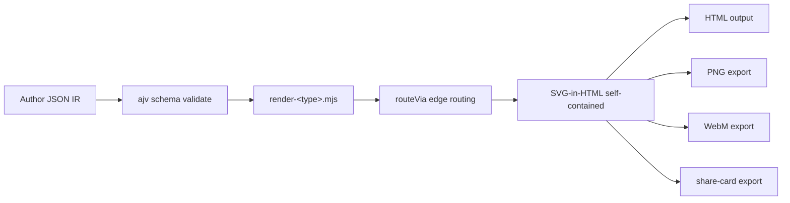
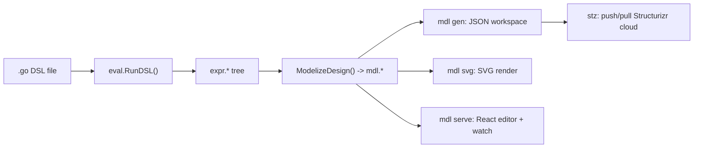
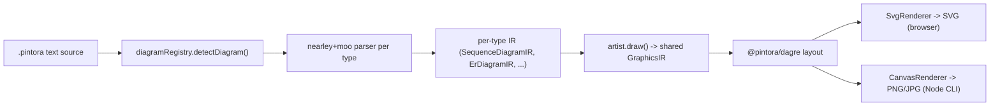
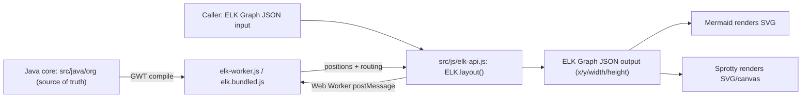

# Weekly scan: diagram-as-code & visual tooling (2026-07-28)

**Executive summary:**
- `tt-a1i/archify` là repo đáng chú ý nhất tuần này: một "agent skill" (không phải thư viện/CLI truyền thống) sinh diagram HTML self-contained có motion trực tiếp từ JSON IR — mô hình phân phối này (agent-skill-only, không publish npm/PyPI) là một hướng đi mới cho category "diagram tooling for LLM agents" mà kymostudio nên theo dõi.
- `kieler/elkjs` (ELK layout algorithms, dùng bởi Mermaid/Sprotty) và `goadesign/model` (Go DSL cho C4 diagrams) đều là project trưởng thành, đang ở chế độ maintenance nhưng vẫn active — giá trị nghiên cứu nằm ở layout algorithm (Sugiyama/`layered`) và ở builder-pattern DSL bằng ngôn ngữ host (Go) thay vì text grammar riêng.
- `hikerpig/pintora` là ứng viên gần nhất về kiến trúc với kymo (text-to-diagram, per-type parser/renderer, chạy cả browser lẫn Node) — đáng học về plugin-per-diagram-type registration.

**Mục lục**
1. [tt-a1i/archify](#1-tt-a1iarchify)
2. [goadesign/model](#2-goadesignmodel)
3. [hikerpig/pintora](#3-hikerpigpintora)
4. [kieler/elkjs](#4-kielerelkjs)

**Nguồn dữ liệu**: GitHub search API, topic-based (`topic:diagram-as-code`, `topic:svg-animation`, `topic:graph-visualization`, `topic:layout-algorithm`, `pushed:>2026-07-21 stars:>50`) — đủ ≥4 kết quả hợp lệ ở fallback level 1, không cần rơi xuống keyword-based hay ecosystem-activity fallback. Loại khỏi danh sách: `plantuml/plantuml` và `mingrammer/diagrams` (đã quá well-known, tuần này chỉ có routine commit, không mang lại insight mới); mọi kết quả graph-visualization/svg-animation không phải diagram-as-code (chart/data-explorer/desktop-pet/network-analysis libs) theo đúng exclusion rules.

---

## 1. tt-a1i/archify

### §1 — Quick context
Agent skill (không phải thư viện hay CLI độc lập) biến JSON IR thành diagram HTML self-contained có motion — khác biệt so với Mermaid/D2 ở chỗ nó được thiết kế để **LLM agent tự validate rồi "deliver" artifact**, không phải người dùng gõ DSL. Tech stack: Node ≥18, `ajv` cho schema validation, zero runtime dep khác. Output: SVG-in-HTML, PNG/WebM/share-card. Repo health: 7,552 stars, 561 forks, 7 open issues, release mới nhất v2.12.0 (2026-07-22), CI qua `.github/workflows/ci.yml` + `release.yml`, MIT license, tạo mới 2026-04-15 (rất trẻ). Distribution: **agent-skill only** — cài qua `npx skills add tt-a1i/archify -g`, không publish npm/PyPI.

### §2 — Architecture deep-dive
**A. Component inventory**: CLI (`archify/bin/archify.mjs`, `preview.mjs`, `open-artifact.mjs`); schemas per diagram type (`archify/schemas/{architecture,workflow,sequence,dataflow,lifecycle}.schema.json`) + generated validators (`archify/renderers/shared/generated-validators.mjs`); renderer per type (`archify/renderers/<type>/render-<type>.mjs`, cộng `architecture/grid.mjs`); shared utils (`archify/renderers/shared/{geometry,layout-report,validator,...}.mjs`); delta feature `archify/delta/architecture-delta.mjs`; skill manifest `archify/SKILL.md` hướng dẫn agent cách dùng.

**B. Pipeline**: (1) agent xác định diagram type, đọc schema + example tương ứng → (2) viết JSON IR (tay hoặc từ Mermaid/plain-language input) → (3) `archify validate <type> <file.json>` — ajv schema check + composition rules → (4) lặp tới khi pass toàn bộ 9 artifact checks → (5) `archify deliver <type> <file.json> <output.html>` — render, re-validate, ghi receipt JSON (checksum + evidence) → (6) tuỳ chọn `archify compare` sinh before/after delta HTML.

**C. Data model / IR**: JSON phẳng, immutable sau khi "deliver" (SKILL.md gọi là "freeze specification — no post-delivery edits"). Gồm `components[]` (`id,type,label,pos,size`), `boundaries[]`, `connections[]`, `cards[]`. Không có lower-IR compile step — renderer đọc thẳng JSON này.

**D. Input language design**: Không phải text grammar — JSON-schema-driven, agent hoặc người điền, tuỳ chọn seed từ cú pháp Mermaid flowchart/sequence. Error reporting là structured JSON diagnostics kèm rule code, severity, repair suggestion.

**E. Layout algorithm**: Chủ yếu **user/agent-specified position** (`pos`/`size` per component) — `grid.mjs` header ghi rõ "Not auto-layout — fixed cell math only". Edge routing tự động qua `routeVia()` (straight/orthogonal-h/orthogonal-v/auto), validator phát hiện crossing/label collision nhưng KHÔNG tự resolve — không có force-directed hay crossing-minimization thật sự.

**F. Rendering/output**: Mỗi diagram-type có emitter riêng sinh SVG-in-HTML tự chứa (inline CSS class, inline defs/marker), có `animateAttr()` để tiêm motion. Xuất thêm PNG/WebM/share-card.

**G. Extensibility**: Thêm diagram type mới = thêm schema + `render-<type>.mjs` theo convention 5 loại hiện có; theming qua CSS class taxonomy cố định (7 màu semantic, monospace-only, theo `DESIGN.md`). Không có plugin loader.

**H. Dev experience**: `archify preview` (live-reload), `archify doctor` (env check), `archify guide`, `archify inspect` (dump layout JSON). Không có IDE extension/editor riêng — tích hợp hoàn toàn qua agent-skill install.

### §3 — Architecture diagram

### §4 — Verdict
Đáng học nhất: **mô hình "agent-deliverable artifact"** — validate-loop bắt agent tự sửa lỗi tới khi pass mọi check trước khi ghi file, kèm receipt JSON có checksum. Kymo có thể tham khảo ý tưởng "receipt" này cho MCP tool (`packages/mcp`) khi agent sinh `.kymo` — trả về diagnostics có rule code thay vì lỗi text tự do. Red flag: layout thực chất là manual positioning dán nhãn "grid", không phải auto-layout thật; test suite phình to bất thường so với tuổi repo (66 file test cho repo 3 tháng tuổi) — nghi ngờ code accretion nhanh, có thể AI-generated hàng loạt, độ ổn định chưa rõ. Câu hỏi mở: engineering-profile/architecture-delta có được validate ngoài unit test không. **Verdict: study deeper** (riêng phần validate-loop + receipt pattern), phần layout thì glance only.

---

## 2. goadesign/model

### §1 — Quick context
DSL C4-model cho kiến trúc phần mềm viết bằng **Go thuần** (builder-pattern function calls, không phải text grammar) — khác Structurizr DSL hay PlantUML C4 ở chỗ design file chính là Go code, được IDE Go support (autocomplete, refactor) miễn phí. Tech stack: Go module `goa.design/model` (Go 1.26), editor bundle React/webpack riêng dưới `cmd/mdl/webapp`. Output: Structurizr JSON workspace, SVG (`mdl svg`), live browser editor (`mdl serve`). Repo health: 463 stars, MIT license, CI (GitHub Actions + golangci-lint + DeepSource), tạo 2020-07-02 — trưởng thành nhưng tuần qua chỉ có Dependabot bump, không feature mới. Distribution: `go install` cho 2 CLI (`mdl`, `stz`).

### §2 — Architecture deep-dive
**A. Component inventory**: `dsl/` — public DSL surface (`design.go`, `views.go` 71KB lớn nhất, `styles.go`...); `expr/` — internal expression tree do Goa's shared `eval` engine build khi thực thi DSL (12 file có test tương ứng — well-tested); `mdl/` — lớp "model" đơn giản hoá, JSON-serializable, tách biệt với `expr` (`eval.go` cầu nối qua `RunDSL()`/`ModelizeDesign()`); `codegen/json.go` — JSON codegen; `stz/` — Structurizr service client; `cmd/mdl/` — CLI entry (`main.go` subcommand `gen/svg/serve/version`, `serve.go`, `watch.go` dùng fsnotify); `plugin/generate.go` — Goa plugin hook.

**B. Pipeline**: (1) user viết `.go` file gọi `dsl.*` builder (vd `examples/basic/model/model.go`) → (2) `cmd/mdl/main.go` load package, gọi `mdl/eval.go:RunDSL()` → (3) Goa's `eval` engine thực thi DSL closures, populate `expr.Root` tree → (4) `ModelizeDesign(expr.Root)` convert sang `mdl.*` struct đơn giản → (5) tuỳ subcommand: `gen` serialize JSON, `svg` auto-layout + render trực tiếp, `serve` mở HTTP server React editor với watch-mode reload → (6) `stz` riêng để push/pull workspace JSON lên Structurizr cloud.

**C. Data model / IR**: Hai lớp IR — `expr.*` (mutable trong lúc DSL chạy, dùng validate/finalize, mirror kiến trúc design/expr của chính Goa) rồi convert một lần sang `mdl.*` (pure-data, JSON-serializable, "lower IR" tương tự khái niệm TALA của D2).

**D. Input language design**: Không phải text grammar — Go builder-pattern DSL bằng nested closures (`Design("...", func(){ SoftwareSystem(...); Views(func(){...}) })`), chạy qua engine `eval` dùng chung với Goa (validate uniqueness constraint tên person/system toàn cục).

**E. Layout algorithm**: Cả hai — `AutoLayout(RankLeftRight)` và explicit `Coord(X,Y)` đều là DSL option; routing `Direct`/`Curved`/`Orthogonal`. `mdl svg` tự render SVG trực tiếp (không chỉ emit JSON cho Structurizr Lite) — theo release note dùng ELK-based spacing.

**F. Rendering/output**: Một emitter chính (`mdl svg` + browser SVG editor) — không tìm thấy pluggable multi-backend (không có PlantUML/Mermaid export). Editor hỗ trợ export/auto-arrange/undo-redo.

**G. Extensibility**: `ElementStyle`/`RelationshipStyle`, tags, Filtered/Dynamic views cho custom perspective; `plugin/generate.go` cho phép Model hook vào codegen pipeline của Goa. Không có general user-plugin API.

**H. Dev experience**: `mdl serve` = live-reload graphical editor (fsnotify watch); vì design là Go thuần nên IDE support (autocomplete/refactor) có sẵn miễn phí — không cần extension riêng.

### §3 — Architecture diagram

### §4 — Verdict
Điểm đáng học: dùng **ngôn ngữ host (Go) làm DSL thay vì tự viết parser** loại bỏ hoàn toàn nhu cầu grammar/EBNF và cho IDE support miễn phí — đối lập trực tiếp với triết lý `.kymo` (text DSL riêng, có `docs/DSL.md` formal). Đây không phải hướng kymo nên đổi (dual-implementation Python/JS của kymo phụ thuộc vào một text format trung lập ngôn ngữ), nhưng đáng ghi nhận làm đối trọng khi cân nhắc feature mới có nên "thêm cú pháp DSL" hay "để user viết code trực tiếp" (kymo đã có đường `.py` DIAGRAM module tương tự). Layer tách `expr` (mutable, validate-time) → `mdl` (immutable, serializable) là pattern gần giống `alignment.py` resolve rồi mới render của kymo — xác nhận đây là pattern phổ biến, không phải phát minh riêng. Red flag: hai tech stack rời rạc (Go core + React/webpack editor) tăng maintenance burden; project ở chế độ bảo trì (chỉ Dependabot commit tuần này). **Verdict: glance only** — không có insight mới về layout/rendering, nhưng đáng ghi chú về DSL-vs-host-language tradeoff.

---

## 3. hikerpig/pintora

### §1 — Quick context
Thư viện text-to-diagram mở rộng được, chạy cả browser lẫn Node.js — điểm khác biệt so với Mermaid là kiến trúc **plugin-per-diagram-type** tường minh ngay từ đầu (Mermaid thêm plugin API muộn hơn nhiều so với launch), với contract rõ ràng (`IDiagram`/`IDiagramParser`/`IDiagramArtist`). Tech stack: TypeScript monorepo (pnpm workspaces + Turborepo), grammar viết tay bằng **nearley** + lexer **moo** (bản fork riêng `@hikerpig/nearley`/`@hikerpig/moo`), layout qua **`@pintora/dagre`** (fork của dagre). Output: SVG (browser) hoặc PNG/JPG/SVG (Node qua CLI). Repo health: 1,284 stars, 37 forks, 40 open issues, MIT license, CI qua `.github/workflows/ci-check.yml`; tuy `pushed_at` là 2026-07-24 nhưng không có commit nào trên `master` từ 2026-06-12 — nghi vấn activity nằm ở branch khác (changesets/dependabot) chứ không phải mainline. Distribution: 6 npm scoped package (`@pintora/core`, `@pintora/diagrams`, `@pintora/renderer`, `@pintora/standalone`, `@pintora/cli`, `@pintora/target-wintercg`).

### §2 — Architecture deep-dive
**A. Component inventory**: `pintora-core/src/` — `diagram-registry.ts` (plugin registry, `DiagramRegistry.registerDiagram(name, diagram)`), `type.ts` (contract `IDiagram`/`IDiagramParser`/`IDiagramArtist`), `config-engine.ts`, `themes/`, `pre.ts` (preprocessor cho `@config`/`@pre`/`@style` directive). `pintora-diagrams/src/` — một thư mục con mỗi diagram type (`sequence/`, `er/`, `component/`, `activity/`, `mindmap/`, `gantt/`, `dot/`, `class/`), mỗi type theo đúng "three-piece pattern" (`parser.ts` + `parser/*.ne`, `db.ts`, `artist.ts`, `config.ts`, `index.ts` — pattern này được document tường minh tại `.ai/docs/patterns/diagram-three-piece.md`). `pintora-renderer/src/` — `index.ts` (`render()`), `renderers/{base.ts, SvgRenderer.ts, CanvasRenderer.ts}`. `pintora-cli/` — CLI bin. `pintora-standalone` — bundle browser (UMD/ESM qua rolldown). `pintora-target-wintercg` — build target cho WinterCG runtime.

**B. Pipeline** (`pintora-core/src/index.ts:parseAndDraw()`): (1) `parseAndDraw(text, opts)` strip/extract preprocessing directive qua `pre.ts` → (2) `diagramRegistry.detectDiagram(text)` match `text` với regex `pattern` của từng `IDiagram` (fallback mặc định: sequence diagram) → (3) `parser.parse(text)` (nearley grammar đã compile) sinh IR riêng cho type đó → (4) `artist.draw(diagramIR, config)` convert IR-riêng thành `GraphicsIR` dùng chung ("Mark tree" primitive vẽ) → (5) `pintora-renderer/src/index.ts:render(ir, opts)` chọn `SvgRenderer` hoặc `CanvasRenderer` → (6) CLI hoặc standalone wrap để xuất SVG/PNG/JPG.

**C. Data model / IR**: Hai tầng **per-type rồi mới shared**. Mỗi diagram type có IR riêng (`SequenceDiagramIR`, `ErDiagramIR`, `ClassIR`, `DotIR`...) kế thừa `BaseDiagramIR` (`util/ir.ts`); artist lower từng IR-riêng xuống MỘT `GraphicsIR` chung mà renderer layer tiêu thụ đồng nhất — không có AST chung ở bước parse, chỉ có ở bước graphics.

**D. Input language design**: Grammar viết tay bằng **nearley** (file `.ne`, vd `sequence/parser/sequenceDiagram.ne`), tokenize bằng **moo** lexer, cả hai qua bản fork riêng (`@hikerpig/nearley`, `@hikerpig/moo`) — không phải regex/PEG/chevrotain. Compile qua `pnpm --filter @pintora/diagrams gen-parser`. Không có evidence trực tiếp về error-reporting UX.

**E. Layout algorithm**: Phụ thuộc **`@pintora/dagre`** (fork dagre `^0.10.10`) + `@pintora/graphlib` — xác nhận layered/hierarchical layout họ dagre, KHÔNG phải elkjs hay d3-hierarchy. Có thêm `d3-shape`/`d3-interpolate`/`d3-scale`/`d3-time` cho Gantt/curve/edge-path geometry. Không có evidence cụ thể về crossing-minimization ngoài phần dagre tự cung cấp.

**F. Rendering/output**: `SvgRenderer.ts`/`CanvasRenderer.ts` cùng kế thừa `base.ts` — dual-backend pluggable renderer pattern rõ ràng. Không tìm thấy animation API tích hợp sẵn.

**G. Extensibility**: Document tường minh tại `.ai/skills/add-new-diagram/SKILL.md`: thêm diagram type mới = tạo thư mục `packages/pintora-diagrams/src/<type>/` với `parser.ne` → compiled parser, `artist.ts` (bắt buộc đọc màu từ `getConfig().themeConfig`, không hardcode hex; emit relative coordinate), `config.ts`, `index.ts` gọi `pintora.registerDiagram()`. Theming token-based qua `themes/` trong `pintora-core`.

**H. Dev experience**: CLI (`pintora render -i file.pintora -o out.png`), live browser playground `demo/live-editor` (Vite + Tailwind + Cypress), docs site Docusaurus tại `website/`. VS Code extension và Obsidian/Gatsby integration tồn tại nhưng là repo ngoài monorepo này (chưa verify độc lập).

### §3 — Architecture diagram

### §4 — Verdict
Đáng học nhất cho kymo: **contract `IDiagram`/`IDiagramParser`/`IDiagramArtist` + "three-piece pattern" per diagram type** — đây là câu trả lời rõ ràng cho câu hỏi "nếu kymo muốn thêm diagram type ngoài architecture/BPMN thì tổ chức code thế nào". Kymo hiện có kiến trúc renderer "dumb" dùng chung một `Diagram` dataclass cho mọi loại; pintora ngược lại — mỗi type có IR riêng, chỉ hội tụ ở tầng `GraphicsIR` trước khi render. Đáng cân nhắc: quy tắc bắt buộc "artist đọc màu từ theme config, không hardcode hex, emit relative coordinate" là một convention kỷ luật tốt có thể áp cho `to_svg.py`/`renderSVG` nếu kymo mở rộng theming. Red flag: dependency fork riêng (`@hikerpig/nearley`, `@hikerpig/moo`, `@pintora/dagre`, `@pintora/graphlib`) cho thấy project phải vendor/patch cả parser lẫn layout lib thay vì dùng upstream trực tiếp — rủi ro bảo trì dài hạn; và discrepancy giữa `pushed_at` với commit log trên `master` cần làm rõ trước khi coi là "active trong 7 ngày qua". Câu hỏi mở: vì sao phải fork nearley/moo/dagre thay vì dùng bản gốc. **Verdict: study deeper** — riêng phần plugin-per-type contract, không phải toàn bộ parser/layout.

---

## 4. kieler/elkjs

### §1 — Quick context
Bản build JS của Eclipse Layout Kernel (ELK) — chỉ tính toán vị trí node/edge, KHÔNG tự render gì cả; khác biệt then chốt so với các layout lib khác là core algorithm viết bằng Java, cross-compile sang JS qua GWT. Tech stack: Java core (`src/java/org`) + JS wrapper mỏng (`src/js/*`); output là ELK Graph JSON đã có toạ độ. Repo health: 2,674 stars, 120 forks, 104 open issues, release mới nhất **0.12.0** (2026-07-17), license dual EPL-2.0/GPL-3.0. Distribution: npm package `elkjs`, được dùng bởi Mermaid, Sprotty, ReactFlow, netlistsvg, Cytoscape.

### §2 — Architecture deep-dive
**A. Component inventory**: `src/java/org/**` — thuật toán ELK gốc, **source of truth thật sự**; `src/java-additional/org/**` — GWT-compatibility shim; `src/js/elk-api.js` — wrapper JS (class `ELK`, `PromisedWorker` bọc Web Worker postMessage thành Promise, `layout()`/`knownLayoutAlgorithms()`/`knownLayoutOptions()`); `src/js/main-api.js`/`main-node.js` — entry point variant (Node fallback dùng package `web-worker` cho real worker thread); build artifact không commit (`elk-worker(.min).js`, `elk.bundled.js`) sinh bởi `build.gradle` (task `gwtc`→babel→browserify); `test/examples`, `test/mocha`.

**B. Pipeline**: (1) caller build ELK Graph JSON (`id`, `children[]` có `width/height`, `edges[]`, `layoutOptions`) → (2) `new ELK({...}).layout(graph)` → (3) `ELK` post graph sang Web Worker chạy `elk-worker.js` (GWT-compiled), `PromisedWorker` map message ID → Promise → (4) Java core (transpile) chạy thuật toán, mutate geometry → (5) trả JSON đã có `x/y/width/height` + routing points → (6) caller (Mermaid/Sprotty/...) tự render SVG/canvas.

**C. Data model / IR**: ELK Graph JSON — node lồng nhau (`children` = hierarchical/compound graph), `ports`, `labels`, `edges` dùng `sources`/`targets` array (hỗ trợ hyperedge), `layoutOptions` là flat map key dạng dotted-string (`elk.algorithm`). Đây chính là schema công khai (docs ở eclipse.dev/elk), không phải "ngôn ngữ" nội bộ.

**D. Input language design**: Không có text grammar/parser — elkjs là library nhận JSON API thuần, không phải DSL.

**E. Layout algorithm**: Điểm giá trị cốt lõi — README liệt kê `layered` (Sugiyama-style, chuyên cho data-flow diagram/port-heavy graph), `stress`, `mrtree`, `radial`, `force`, `disco`, cộng utility `box`/`fixed`/`random`, `sporeOverlap`/`sporeCompaction`/`rectpacking`. Chi tiết cơ chế `layered` (layer assignment, crossing minimization, node placement, edge routing) không nằm trong repo này — tài liệu ở eclipse.dev/elk reference guide bên ngoài.

**F. Rendering/output**: Explicit non-rendering theo README ("elkjs is not a diagramming framework itself"). Downstream tool tự vẽ.

**G. Extensibility**: Plugin architecture cho thuật toán nằm trong Java core (`src/java/org`), không introspect sâu được trong phiên này; JS side chỉ expose qua introspection call + flat `layoutOptions` config, không có JS-side plugin API.

**H. Dev experience**: `npm run build` = Gradle (GWT compile) → babel → browserify, yêu cầu clone song song repo Java riêng `kieler/elk` (rào cản thật cho contributor). Test qua `npm test` → Mocha. `.gitpod.yml` gợi ý có cloud dev-container.

### §3 — Architecture diagram

### §4 — Verdict
Đáng học nhất: kiến trúc **"layout-only, render-nothing" tách bạch hoàn toàn giữa positioning và drawing** qua một schema JSON trung lập (ELK Graph JSON) — kymo hiện gộp layout (`alignment.py`/`alignment.ts`) và model trong cùng pipeline nội bộ, nhưng ý tưởng expose một "positioning API" độc lập (nhận component/edge list trần, trả về toạ độ) có thể hữu ích nếu kymo muốn cho phép renderer bên thứ ba tái sử dụng layout engine mà không kéo theo toàn bộ `to_svg.py`. Đáng chú ý thứ hai: tập thuật toán `layered`/`stress`/`mrtree`/`force` cho thấy "auto-layout" không phải one-size-fits-all — kymo mới có auto-layout frame đơn giản, có thể tham khảo thêm chế độ `mrtree` (radial tree) cho diagram phân cấp sâu. Red flag: nghiên cứu elkjs qua repo JS gần như vô ích để hiểu thuật toán thật — logic nằm ở `kieler/elk` (Java monorepo riêng), phải sang đó mới học được cách `layered` làm crossing minimization/node placement. Câu hỏi mở: elkjs có overhead Web Worker đáng kể cho diagram nhỏ không, và license dual EPL/GPL3 có tương thích với license hiện tại của kymo không nếu muốn vendor thuật toán. **Verdict: study deeper** — nhưng target đọc tiếp phải là repo `kieler/elk` (Java), không phải `elkjs`.
