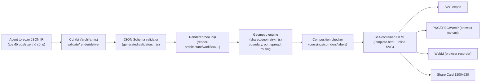
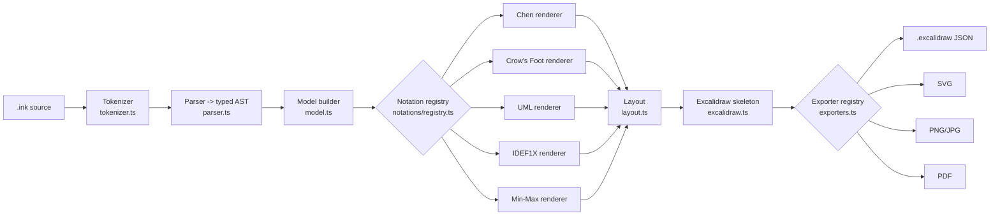

```mermaid
flowchart LR
    Input[".mmd Mermaid input"] --> Parser["Diagram::parse (diagram.rs)"]
    Parser --> IR["Diagram model (nodes/edges/subgraphs)"]
    IR --> Layout["layout() + orthogonal router (diagram.rs)"]
    Layout --> Renderer["render_svg / resvg PNG"]
    Renderer --> Output["SVG / PNG file"]

    subgraph WASM["WASM boundary (WasmEditorCore)"]
        Parser
        IR
        Layout
        Renderer
    end

    UI["WasmDiagramCanvas.tsx (drag events)"] -->|beginDrag/updateDrag/endDrag| EditorCore["EditorCore (editor_core.rs)"]
    EditorCore --> Layout
    EditorCore -->|LayoutOverrides JSON| Merge["merge_source_and_overrides (utils.rs)"]
    Merge -->|"%% OXDRAW LAYOUT block"| Input
```

# Weekly Scan — Diagram-as-Code & Visual Tooling (2026-07-29)

**Phạm vi:** repos trong domain diagram-as-code / DSL / SVG animation / graph-visualization /
layout-algorithm, published hoặc pushed đáng kể trong ~7 ngày qua (2026-07-22 → 2026-07-29).
Nguồn: GitHub REST search API (topic + keyword), không dùng `gh` CLI (không có quyền truy cập
ngoài `kymostudio/kymostudio`).

## Executive summary

- **"Agent-native diagram generation" đang nổi lên như một trường phái riêng** (archify, 7.9k sao,
  cập nhật vài ngày trước): thay vì auto-layout, một AI agent tự soạn tọa độ trong JSON IR, renderer
  chỉ validate + vẽ. Đặt cược này đi ngược layout-algorithm truyền thống mà kymostudio đang dùng —
  đáng theo dõi nhưng bằng chứng ủng hộ (1 blind-test nhỏ) còn yếu.
- **Nhiều tool nhỏ mới (inkling, oxdraw) tái phát minh độc lập các pattern mà kymostudio đã có**
  (registry cho renderer/exporter, dumb-renderer-over-explicit-model, round-trip override tách khỏi
  auto-layout) — xác nhận các quyết định kiến trúc hiện tại của kymostudio đi đúng hướng chung của
  ngành, đồng thời gợi vài cải tiến cụ thể (Automatic Port Spread, block override kiểu `%% ... %%`).
- **d2-little (Rust port của D2, vừa bị archive 28/07/2026) có phương pháp test parity 3 tầng**
  (unit snapshot theo pipeline stage / e2e corpus byte-for-byte / cross-validate thuật toán con độc
  lập) so sánh trực tiếp được với bài toán Python↔JS conformance của kymostudio — nhưng cũng lộ một
  red flag kỷ luật test đáng tránh: dashboard "parity" không thực sự gate CI.

## Mục lục

1. [tt-a1i/archify](#1-tt-a1iarchify)
2. [regaj/inkling](#2-regajinkling)
3. [RohanAdwankar/oxdraw](#3-rohanadwankaroxdraw)
4. [kookyleo/d2-little](#4-kookyleod2-little)
5. [Danh sách 10 repo ứng viên đã khảo sát](#5-danh-sách-10-repo-ứng-viên-đã-khảo-sát)

---

## 1. tt-a1i/archify

### §1 — Quick context

Archify không phải một DSL/compiler độc lập mà là một **"agent skill"**: AI agent (Claude Code /
Cursor / Codex / OpenCode) tự soạn JSON IR có tọa độ (`pos`, `size`) theo phán đoán bố cục của
chính nó, một renderer Node.js thuần túy (zero runtime dependency) chỉ validate + vẽ SVG nhúng
trong 1 file HTML tự chứa — khác biệt với Mermaid/PlantUML ở chỗ **không hề auto-layout**. Stack:
Node.js ≥18, JS thuần (không TypeScript/framework), `ajv` được precompile thành validator độc lập.
Sức khỏe: v2.12.0, MIT, CI (node 20/22 matrix + golden-file test + WebM smoke qua Chrome headless),
badge Trendshift, 7.9k sao / 578 fork / 122 commit. Phân phối: `npx skills add tt-a1i/archify`
(skill installer) + zip tải lên Claude.ai + GitHub Pages gallery.

### §2 — Architecture deep-dive

**A. Component inventory**
- `CLI` (`archify/bin/archify.mjs`) — router cho subcommand `render/compare/deliver/preview/
  validate/inspect/check/guide/examples/doctor/demo`.
- `Renderer theo loại` (`archify/renderers/{architecture,workflow,sequence,dataflow,lifecycle}/
  render-*.mjs`) — đọc IR, tính geometry dẫn xuất, render SVG string, ghi HTML.
- `Shared runtime` (`archify/renderers/shared/{geometry,utils,diagnostics,validator,
  engineering-profiles,repository-evidence}.mjs`) — pipeline load/write dùng chung, helper
  geometry/routing, hệ diagnostic có cấu trúc.
- `Schemas` (`archify/schemas/*.schema.json`) — nguồn sự thật cho hình dạng IR mỗi loại diagram.
- `Generated validators` (`generated-validators.mjs`, sinh bởi `scripts/generate-validators.mjs`)
  — ajv precompile thành JS độc lập.
- `Viewer template` (`archify/assets/template.html`, ~4000 dòng CSS/JS thuần) — toàn bộ UI tương
  tác (theme, pan/zoom, search, Route Probe, Export…) nhúng vào mỗi HTML xuất ra.
- `Architecture Delta` (`archify/delta/architecture-delta.mjs`) — so 2 snapshot theo ID ổn định,
  sinh HTML Before/Delta/After.

**B. Pipeline (happy path)**
1. Agent tự soạn JSON (`schema_version`, `diagram_type`, `components/connections`) với tọa độ
   tự chọn — không sinh tự động.
2. `archify validate <type> <file.json> --quality showcase --json` chạy JSON-Schema (ajv
   precompiled) rồi các check xuyên-collection (relationship-id, engineering-profile, repo-evidence).
3. Renderer tính geometry dẫn xuất (boundary rect, polyline vuông góc, "Automatic Port Spread"),
   rồi chạy pass composition thứ hai (crossing, hành lang mơ hồ, khoảng cách label/route).
4. Sinh chuỗi SVG, điền vào `template.html`, ghi 1 file HTML ứng viên.
5. `archify deliver` re-render vào staging, chạy `check` cuối trên byte SVG thật, rename nguyên
   tử đè lên output thật — chỉ khi mọi gate pass.
6. `archify preview` (tùy chọn) theo dõi file JSON, lặp lại bước 2-5 mỗi lần lưu.

**C. Data model/IR** — JSON object thuần (không class), validate bằng JSON Schema; sau khi pass
bị "đóng băng" (không sửa lại). Không có "lower IR" — renderer tính geometry trong bộ nhớ rồi
build SVG string trực tiếp trong cùng một pass.

**D. Input language design** — Không có DSL text/parser: "ngôn ngữ nguồn" là JSON được validate
bằng schema, do agent LLM soạn theo hợp đồng Markdown (`SKILL.md`). Mermaid text **không được
parse** (thử nghiệm P1/P3/P4 bị "KILLED" trong ROADMAP) — xử lý bằng prompt engineering, agent tự
đọc rồi soạn lại JSON mới. Lỗi chuẩn hóa về `{code, severity, subject, evidence, supportedFixes}`.

**E. Layout algorithm** — Chủ động **không** auto-layout (không dagre/elk/force-directed): ROADMAP
ghi một blind-test nhỏ kết luận auto-layout không đẹp hơn đáng kể so với Mermaid thô. Định tuyến
cạnh: polyline vuông góc (Manhattan) + **Automatic Port Spread** (dàn đều cạnh song song chung 1
cạnh hộp, sort theo tọa độ đối tác rồi id/label để tất định). Không giảm giao cắt bằng thuật toán —
thay vào đó các gate validation từ chối giao cắt/hành lang mơ hồ, buộc agent tự route lại.

**F. Rendering/output** — 1 renderer/loại sinh SVG nhúng vào HTML tự chứa. Xuất: HTML (canonical),
PNG/JPEG/WebP/SVG (rasterize phía browser), WebM (ghi hình), Share Card 1200×630. Animation: CSS
`@keyframes` + biến `--step`, "Motion Governor" Live/Still, tôn trọng `prefers-reduced-motion`;
mọi export canonical đều strip trạng thái viewer để tất định.

**G. Extensibility** — Thêm loại diagram = thêm schema + `render-<type>.mjs`, không có API
plugin/registry. Icon giới hạn cố định 7 kind, chủ động từ chối vendor-icon catalogue (DESIGN.md
ghi rõ). Theming: 3-4 preset CSS cố định × dark/light.

**H. Dev experience** — CLI là toàn bộ bề mặt sản phẩm (`doctor`, `demo`, `guide "<câu hỏi>"`,
`validate --json`, `preview` dev-server chỉ bind loopback). Không tích hợp IDE riêng — phân phối
chính là "agent skill" cài vào coding agent, nên "IDE" chính là chat của agent đó.

### §3 — Architecture diagram



### §4 — Verdict

Đáng học: (1) **Automatic Port Spread** — dàn đều cạnh song song chung 1 cạnh hộp theo thứ tự tất
định, rẻ hơn crossing-minimization mà vẫn giải đúng bài toán fan-in/fan-out mà `alignment.py` của
kymostudio cũng xử lý; (2) diagnostic chuẩn hóa `{code, subject, evidence, supportedFixes}` cho
mọi lớp lỗi — đáng cân nhắc cho CLI/`resolve_alignments` của kymostudio; (3) `validate → deliver`
với rename nguyên tử + giữ artifact cũ khi fail là kỷ luật release tốt. Red flag: (a) kết luận "bỏ
auto-layout" dựa trên 1 blind-test nhỏ (5 mẫu, 1 người chấm) — bằng chứng yếu, không nên coi là
luận cứ để kymostudio bỏ auto-layout; (b) không có parser/grammar để so sánh với `dsl.py`/`dsl.ts`
— phần "thông minh" nằm trong prompt, không trong code; (c) template HTML ~4000 dòng nhúng full
viewer JS vào mọi output, ngược hướng renderer "dumb" của kymostudio. Verdict: **glance only** — lấy
ý tưởng port-spread + diagnostic protocol, không cần nghiên cứu sâu parser/layout.

---

## 2. regaj/inkling

### §1 — Quick context

Inkling là editor desktop nơi một DSL text nhỏ, gọn compile ra sơ đồ ER vẽ tay bằng Excalidraw,
điểm khác biệt là **một model logic duy nhất render được ở 5 notation ER khác nhau** (Chen/Crow's
Foot/UML/IDEF1X/Min-Max) chọn live, không sửa text — khác các tool ER truyền thống (mỗi tool khoá
cứng 1 notation). Stack: TypeScript, pnpm monorepo, Tauri v2 + React + CodeMirror 6 (desktop),
Playwright headless Chromium (CLI), `@excalidraw/excalidraw` làm renderer/exporter. Repo rất mới
(clone chỉ thấy 1 tác giả, chưa có release tag); CI GitHub Actions build/test/lint trên
macOS+Windows+Ubuntu. Phân phối: build từ source (`pnpm tauri build` → .dmg/.msi/.deb/.AppImage),
CLI qua `pnpm --filter @inkling/cli start`; chưa publish npm.

### §2 — Architecture deep-dive

**A. Component inventory**
- `Tokenizer` (`packages/core/src/tokenizer.ts`) — lexer quote-aware theo dòng.
- `Parser` (`packages/core/src/parser.ts`) — dispatch theo keyword đầu dòng → `Statement[]`
  (typed AST) + `Diagnostic[]`.
- `Model builder` (`packages/core/src/model.ts`) — gấp AST thành `Model` (ER graph resolve).
- `Layout` (`packages/core/src/layout.ts`) — BFS layered auto-layout + `satellites()` cho
  attribute Chen, deterministic, 0 dependency.
- `Notation registry` (`packages/core/src/notations/registry.ts`) — `Map<NotationName,
  NotationRenderer>`, 5 renderer built-in (`chen.ts`, `crowsfoot.ts`, `uml.ts`, `idef1x.ts`,
  `minmax.ts`) dùng chung helper (`boxbase.ts`, `cardinality.ts`, …).
- `Excalidraw skeleton adapter` (`packages/core/src/excalidraw.ts`) — `Scene` → `SkeletonElement[]`.
- `Compile entrypoint` (`packages/core/src/compile.ts`) — nối parse → buildModel → chọn notation
  → renderScene.
- `Exporter registry` (`packages/core/src/exporters.ts`) — `Map<ExportFormatId, Exporter>`.
- `CLI` (`packages/cli/src/cli.ts`, `render.ts` cầu nối Playwright headless).
- `Desktop app` (`apps/desktop/src`) — CodeMirror 6 editor + live preview qua Excalidraw.

**B. Pipeline (happy path, 6 bước)**
1. User chạy `inkling diagram.ink -o out.svg --notation chen` hoặc gõ trong editor desktop.
2. `tokenize()` tách text thành `Token[][]` theo dòng.
3. `parse()` dịch token thành `Statement[]` + diagnostics cú pháp.
4. `buildModel()` gấp AST thành `Model` (ER graph notation-độc-lập) + diagnostics ngữ nghĩa.
5. `renderScene()` tra notation registry, chạy `layout()`/`satellites()`, trả `Scene` (tọa độ) →
   `toExcalidrawSkeleton()`.
6. Host (CLI qua Playwright headless Chromium chạy `convertToExcalidrawElements` + exporter
   registry; desktop qua browser thật) xuất `.excalidraw`/SVG/PNG/JPG/PDF.

**C. Data model/IR** — 4 tầng IR tường minh, mỗi tầng type TS riêng, immutable-theo-pass:
`Token[]` → `Statement[]` (typed discriminated-union AST, có `pos`) → `Model` (semantic ER,
notation-agnostic) → `Scene` (positioned nodes/edges theo notation) → Excalidraw skeleton
elements. Đúng khái niệm "compile xuống IR thấp hơn".

**D. Input language design** — custom hand-rolled lexer + parser dispatch theo dòng (không PEG/
combinator/lib ngoài), grammar "one-statement-per-line". Không có grammar hình thức (EBNF) — chỉ
prose docs (khác `docs/DSL.md` EBNF chuẩn hoá của kymostudio). `Diagnostic` gắn line/col/length/
code/severity, parse độc lập theo dòng nên 1 lỗi không hỏng dòng khác; CLI format kiểu GCC/TSC.

**E. Layout algorithm** — auto-layout BFS layering/hierarchical thuần thủ công (không
force-directed, không constraint-solver), không có edge-crossing minimization tường minh (chỉ giữ
thứ tự khai báo trong layer). Attribute vệ tinh (Chen) dùng công thức toả góc quanh tâm entity.

**F. Rendering/output** — backend renderer duy nhất là Excalidraw's `convertToExcalidrawElements`,
fan-out ra 5 format qua exporter registry: `.excalidraw`, SVG, PNG/JPG, PDF. Không có animation cho
diagram (chỉ animate UI pan/zoom) — khác `--animate` của kymostudio.

**G. Extensibility** — 3 registry tường minh (notation-renderer, exporter, node-kind ở compiler).
Thêm mới = 1 file + 1 lời gọi `register`, không đụng code khác. Theming: palette sáng/tối độc lập
theme editor vs theme export.

**H. Dev experience** — CLI dùng Node `parseArgs` built-in, hỗ trợ `--notation/--theme/--scale`,
lỗi rõ ràng khi thiếu Chromium. Desktop: CodeMirror 6 full-featured (autocomplete, lint, search),
live preview mỗi keystroke; CLI là one-shot render, không có watch mode riêng.

### §3 — Architecture diagram



### §4 — Verdict

Đáng học: (1) registry pattern tách rõ 3 trục mở rộng độc lập (notation / exporter / node-kind),
trong khi kymostudio gộp notation+export vào "sibling emitter" (`to_svg`/`to_figma`/
`to_excalidraw`) — kymostudio có thể tách riêng "notation/style registry" nếu muốn hỗ trợ nhiều
biến thể ký hiệu trên cùng model, thay vì mỗi biến thể là một emitter mới. (2) Excalidraw skeleton
là "chuẩn hoá" duy nhất nuôi cả preview lẫn mọi exporter — WYSIWYG, tương tự triết lý "renderer
dumb" của kymostudio nhưng đẩy xuống một tầng thấp hơn (Excalidraw elements). Red flag: DSL không
có grammar hình thức; layout chỉ BFS-layering đơn giản, không giải crossing; exporter thật (SVG/
PNG/PDF) phụ thuộc Playwright + Chromium headless — nặng hơn nhiều so với `kymostudio-core`
(resvg wasm). Verdict: **glance only** — đáng đọc phần registry/notation-model tách bạch, nhưng
layout/parsing không có gì kymostudio cần học sâu hơn.

---

## 3. RohanAdwankar/oxdraw

### §1 — Quick context

Oxdraw giữ cú pháp Mermaid quen thuộc để sinh diagram từ code, nhưng thêm một trình biên tập trực
quan (kéo-thả) mà mọi chỉnh sửa được ghi ngược lại thành **comment JSON trong chính file `.mmd`
nguồn** — khác Mermaid/Lucidchart ở chỗ "edit visual" và "source of truth" là một. Stack: Rust
(core parser/layout/render, biên dịch cả sang WASM) + React/Next.js (frontend), CLI qua `clap`,
SVG rasterize qua `resvg`/`tiny-skia`. Repo: 1 contributor, 2.3k sao, không release tag, CI
(fmt/test/wasm-pack build mỗi push). Phân phối: `cargo install oxdraw` + GitHub Pages (WASM tĩnh).

### §2 — Architecture deep-dive

**A. Component inventory**
- `Diagram` model + parser (`src/diagram.rs`, ~6469 dòng) — struct `Diagram` (nodes/edges/
  subgraphs/order), `Diagram::parse()` đọc Mermaid text theo dòng; **cùng file** chứa luôn layout,
  routing và SVG render (không tách module).
- `EditorCore`/round-trip state (`src/editor_core.rs`) — struct `EditorCore { definition,
  overrides, background, drag_state }`, hàm `begin/update/end*Drag`, `view_model()`, `source()`.
- Override persistence (`src/utils.rs::split_source_and_overrides`/`merge_source_and_overrides`)
  — tách/gộp block comment `%% OXDRAW LAYOUT START…END` chứa `LayoutOverrides` JSON, nhúng ngay
  trong file `.mmd`.
- WASM binding (`src/lib.rs`, `wasm-bindgen`) — expose `WasmEditorCore` cho JS.
- HTTP dev server (`src/serve.rs`, axum) — dùng khi CLI `--edit` cục bộ.
- CLI (`src/cli.rs`, clap) — `--edit`, `--code-map`, `--codedown`.
- Frontend canvas (`frontend/components/WasmDiagramCanvas.tsx`) + `frontend/lib/wasmEditor.ts` —
  pointer-event handlers gọi trực tiếp method trên `WasmEditorCore`.

**B. Pipeline (happy path)**
1. Mở file `.mmd` → `EditorCore::from_source()` tách phần Mermaid gốc khỏi block JSON override.
2. `Diagram::parse()` dựng model từ text thuần theo dòng.
3. `diagram.layout(overrides)` tính `auto_positions`/`auto_routes` rồi áp `overrides` đè lên →
   `final_positions`/`final_routes`.
4. `align_geometry()` dựng bounds subgraph, canvas size từ vị trí final.
5. `EditorCore::view_model()` đóng gói thành `DiagramViewModel` gửi React qua WASM; song song
   `render_svg()` xuất SVG.
6. Vòng lặp ngược: kéo node trên canvas → `beginNodeDrag/updateNodeDrag/endNodeDrag()` (chạy
   trong WASM) → patch gộp vào `LayoutOverrides` → `merge_source_and_overrides()` ghi đè block
   `%% OXDRAW LAYOUT…` vào text nguồn → auto-save sau thời gian rảnh ngắn.

**C. Data model/IR** — Rust struct thuần: `Diagram { nodes: HashMap<String,Node>, edges: Vec<Edge>,
subgraphs, order }`. `NodeShape`/`EdgeKind` là enum bất biến sau parse. Trạng thái layout tách biệt
hoàn toàn model: `LayoutComputation { auto_positions, auto_routes, final_positions, final_routes }`
— mỗi pass sinh map mới, override giữ riêng trong `LayoutOverrides`, chỉ hợp nhất ở bước render/
serialize. Giống triết lý "renderer dumb, data explicit" của kymostudio nhưng gộp parse+layout+
render trong một file thay vì tách module.

**D. Input language design** — không có grammar hình thức (không EBNF/PEG/nom); parser thủ công
theo dòng khớp token cố định (`-->`, `-.->`, `<-->`, `---`, `subgraph`, `end`) qua mảng
`EDGE_PATTERNS`. Là subset thực dụng của cú pháp Mermaid flowchart+gantt. Error: `anyhow`/
`thiserror`, thông báo string kèm nội dung dòng lỗi, không có số dòng/cột chuẩn hoá hay recovery —
lỗi đầu tiên dừng parse toàn bộ.

**E. Layout/"strong edges" & orthogonal routing** — `generate_orthogonal_routes()` sinh 2 biến
thể (vertical-first/horizontal-first) tuỳ hướng graph, với stub cố định (`EDGE_ORTHO_MIN_STUB =
28.0`) tạo đoạn thẳng trước khi rẽ góc. `generate_axis_detours()` sinh route vòng khi 2 route giao
nhau. Chọn route qua `evaluate_candidate_route()`: metric tuple `(node_collision, label_collision,
intersection_count)` — **local greedy heuristic theo thứ tự ưu tiên cứng**, KHÔNG phải global
crossing-minimization (không Sugiyama/barycenter/ILP). Deterministic (không random/annealing).

**F. Rendering/output** — Rust là renderer/rasterizer duy nhất: SVG dựng thủ công bằng `format!`/
`write!`, PNG qua `resvg`+`tiny-skia` (giống nguyên lý resvg-core của kymostudio nhưng dùng crate
trực tiếp). WASM boundary: toàn bộ pipeline (parse→layout→route→serialize) chạy trong WASM ở chế
độ web-editor; JS/React chỉ làm UI thuần. Single emitter mỗi format, không có kiến trúc
pluggable-emitter kiểu `to_figma`/`to_excalidraw`.

**G. Extensibility** — Thêm shape mới đòi sửa trực tiếp enum `NodeShape` (13 biến thể cứng) + nhánh
match — không registry/plugin. Theming giới hạn override màu per-node/per-edge trong cùng block
JSON, không có theme file/token hệ thống.

**H. Dev experience** — CLI `oxdraw --input flow.mmd [--edit|--png|--code-map|--codedown]`. `--edit`
mở server cục bộ (axum) watch-and-edit; không có watch-mode tự render ngoài editor. Không IDE/LSP
integration. UX editor: kéo node grid-snap + alignment guides, Shift+Arrow nudge, kéo waypoint
chỉnh route thủ công, kéo cả subgraph container, auto-save sau rảnh ngắn.

### §3 — Architecture diagram



### §4 — Verdict

Đáng học: (1) round-trip GUI↔source cực đơn giản — nhúng override (position/style/route) dưới
dạng JSON trong 1 comment block riêng (`%% OXDRAW LAYOUT START…END`) ngay trong file nguồn, giữ
file vẫn tương thích công cụ khác; kymostudio có thể áp dụng cho một "live-edit" mode của `.kymo`
(tách rõ auto-layout vs override như `LayoutComputation{auto_*, final_*}`). (2) Heuristic chọn
route bằng metric tuple ưu tiên cứng `(node_collision, label_collision, crossings)` — rẻ, dễ hiểu,
dễ port sang `alignment.py`, dù không tối ưu toàn cục. Red flag: toàn bộ parser+layout+render dồn
vào 1 file 6469 dòng, thiếu grammar/error location, 1 contributor, chưa có release tag. Câu hỏi
mở: routing có xử lý đồ thị dày đặc tốt hơn brute-force candidate hay không. Verdict: **glance
only** (đáng đọc phần round-trip override + orthogonal stub logic).

---

## 4. kookyleo/d2-little

### §1 — Quick context

d2-little là bản port thuần Rust của d2lang (Terrastruct), nhắm byte-exact SVG parity với Go d2
gốc (cấu hình dagre+sketch) — khác các tool khác ở chỗ tự viết lại toàn bộ layout engine (dagre)
và sketch renderer (rough.js) bằng Rust thay vì bind sang engine JS/Go. Stack: Rust 2024 edition,
biên dịch native lẫn wasm32. Repo chỉ 1 contributor, CI đầy đủ (fmt/clippy/unit/integration/wasm)
nhưng **đã archived 28/07/2026**, kế thừa bởi Actrium/supramark (merge qua git subtree). Phân
phối: crates.io (`d2-little`) + npm (`@kookyleo/d2-little-web`, qua wasm-bindgen).

### §2 — Architecture deep-dive

**A. Component inventory** (dưới `src/`, 1 crate duy nhất — "24-crate" cũ đã flatten thành
sub-module):
- `ast.rs` — kiểu AST (Map, Position/Range…), port từ Go `d2ast`.
- `parser.rs` (2343 dòng) — lexer + recursive-descent parser, port từ `d2parser/parse.go`.
- `ir.rs` — Intermediate Representation, port từ `d2ir`.
- `compiler.rs` — biên dịch AST/IR thành `Graph`, expose `compile_with_config`.
- `graph/mod.rs` (2340 dòng) — data model đồ thị đã resolve (Object/Edge/Graph), port `d2graph`.
- `dagre_layout.rs` — cầu nối `Graph` ↔ layout engine, port `d2layouts/d2dagrelayout`.
- `dagre/` — vendor port riêng của dagre.js (acyclic, nesting_graph, normalize, coordinate_system…),
  `#[doc(hidden)]`, chỉ public để test cross-validate.
- `sketch/mod.rs` + `sketch/rough.rs` (1688 dòng) — port rough.js cho render sketch/hand-drawn.
- `svg_render/mod.rs` (5416 dòng, module lớn nhất) — port `d2renderers/d2svg`.
- `exporter.rs`, `target.rs` (2834 dòng) — xuất `Diagram` (định dạng đích trung gian trước SVG).
- Phụ trợ: `shape.rs`, `label.rs`, `textmeasure.rs` (ttf-parser), `themes.rs`, `sequence.rs`
  (grid/sequence-diagram layout riêng), `flate/`+`font/` (tự viết deflate + WOFF subsetting).

**B. Pipeline** — entry point `d2_to_svg(source: &str) -> Result<Vec<u8>, String>`:
1. `parser::parse` → AST.
2. `compiler::compile_with_config` → AST/IR → `Graph` đã resolve (+ config theme/sketch/pad).
3. Áp theme, đo dimensions bằng `Ruler`, rồi `layout_nested`/`dagre_layout::layout` chạy dagre-rs
   (đệ quy cho container lồng nhau: sequence/grid trước, dagre chính sau).
4. `exporter::export` → `target::Diagram` (đệ quy cho layers/scenarios/steps — multi-board).
5. `svg_render::render_multiboard` → SVG bytes mỗi board; nhiều board thì `svg_render::wrap` gộp
   lại kiểu animation (giống d2animate.Wrap của Go).

**C. Data model/IR** — 3 tầng lowering rõ rệt: AST → IR → Graph (resolve, có vị trí/style/cha-con)
→ `target::Diagram` (gần SVG). `Graph` bị mutate nhiều lần qua các pass (theme, dimensions,
layout); container lồng được copy sang sub-graph tạm, layout độc lập rồi ghi ngược lại — kỹ thuật
mô phỏng đúng ngữ nghĩa "nested graph re-layout" của Go gốc.

**D. Input language design** — Grammar port trực tiếp file-by-file từ Go `d2parser`/`d2ast`, độ
phủ D2 gần đầy đủ (grid, sequence, sql_table, class shape, legend, markdown/latex block…) nhưng
README tự thừa nhận còn bug (case `sql_table`/`shape: class` gây stack overflow, bị skip thẳng
trong dashboard test). Error: `ParseError` gom `Vec<Error>`, collect nhiều lỗi giống Go, không
dừng ở lỗi đầu tiên.

**E. Layout algorithm** — `src/dagre/` là port đầy đủ dagre.js: pipeline 27 bước, 4 rank direction
(TB/BT/LR/RL), compound/subgraph, network simplex cho rank assignment, barycenter cho crossing
minimization, Brandes-Koepf cho coordinate assignment, tự cài Dijkstra/Bellman-Ford/Floyd-Warshall/
Tarjan/Prim. Container lồng: loại trừ descendant khỏi dagre, layout con trước rồi áp lại.

**F. Rendering/output** — Chỉ xuất SVG (không Figma/Excalidraw/WebP như kymostudio). Sketch/
hand-drawn qua port subset rough.js. WASM: crate con `packages/web` (`wasm-pack --target
bundler`), expose `convert(source) -> string`, publish npm.

**G. Extensibility** — Module tách bạch (parser/ir/compiler/graph/dagre_layout/svg_render đều có
API public), nhưng `layout_engine` trong `CompileOptions` chỉ có giá trị mặc định `"dagre"` —
không có điểm cắm layout engine khác (test-data còn giữ thư mục `elk/` từ Go, ám chỉ Go hỗ trợ ELK
nhưng Rust chưa port). Không có hệ plugin; thêm shape/renderer phải sửa trực tiếp module.

**H. Dev experience / phương pháp test parity (quan trọng nhất)** — Không CLI riêng trong crate
chính (chỉ lib + example `dump_*.rs` debug từng phase), không watch mode. Test parity 3 tầng:
1. `tests/e2e.rs`+`e2e_cases.json` (110 case) và `e2e_runner.rs`+`e2e_dagre_svg_cases.json` (312
   case, mỗi case spawn **subprocess riêng** cô lập crash/timeout, so `sketch.exp.svg` byte-for-byte
   + so cả message lỗi compile/dagre với string kỳ vọng).
2. `tests/unit_testdata/` (d2parser/d2ir/d2compiler/d2exporter/d2oracle) — snapshot đơn vị theo
   từng giai đoạn pipeline, vendor từ Go test corpus (MPL-2.0).
3. `tests/dagre_cross_validate.rs` — so dagre-rs với dagre.js gốc trên 20 graph tham chiếu, khớp
   tuyệt đối coordinates/ranks/orders/dimensions.

**Điểm mấu chốt**: `e2e_dashboard` **không hề `assert!` trên kết quả byte-so-sánh** — code ghi rõ
"Don't assert — this is a dashboard, not a gate." Chỉ assert điều kiện phụ (fixture tồn tại, số
case ≥300…). Claim "byte-exact parity" được đo/báo cáo (pass rate %) nhưng **không phải CI gate
cứng** như golden test của kymostudio (lệch byte fail build ngay). `SVG_E2E_MIGRATION_CHECKLIST.md`
cho thấy tại thời điểm viết, "main gate" chỉ cover 110/322 case dagre-applicable.

### §3 — Architecture diagram

```mermaid
flowchart LR
    input[".d2 source"] --> parser["parser.rs (AST)"]
    parser --> ir["ir.rs (IR)"]
    ir --> compiler["compiler.rs"]
    compiler --> graph["graph/mod.rs (Graph)"]
    graph --> dagre_layout["dagre_layout.rs + dagre/ (Sugiyama layout)"]
    dagre_layout --> exporter["exporter.rs -> target.rs (Diagram)"]
    exporter --> svg_render["svg_render/mod.rs (+ sketch/rough.rs)"]
    svg_render --> output["SVG output"]
    output --> wasm["packages/web (wasm-bindgen) -> npm @kookyleo/d2-little-web"]
```

### §4 — Verdict

Đáng học nhất: (1) tách bạch test thành 3 tầng — unit snapshot theo từng giai đoạn (parser/ir/
compiler/exporter — kymostudio có thể snapshot AST/Diagram model ở từng bước thay vì chỉ so SVG
cuối), corpus e2e byte-for-byte quy mô lớn, và cross-validate thuật toán con (dagre-rs vs
dagre.js) độc lập với toàn pipeline — cách kiểm chứng "port sang ngôn ngữ khác" nên chia nhỏ theo
module thay vì chỉ tin 1 test end-to-end. (2) Chạy mỗi case e2e trong subprocess riêng để cô lập
crash/timeout — áp dụng được cho corpus BPMN của kymostudio. Red flag quan trọng: dashboard test
**không assert** trên byte-mismatch — claim "byte-exact parity" dựa trên % pass-rate tự báo cáo,
không phải gate cứng; đây là điểm yếu kỷ luật test mà kymostudio (golden test thực sự fail CI) làm
tốt hơn. Repo bị archive do tác giả chuyển hướng gộp code vào dự án lớn hơn, không phải thất bại kỹ
thuật. Red flag khác: 1 contributor, bug đệ quy vô hạn đã biết bị skip thay vì fix, không có ELK dù
Go gốc có. Verdict: **study deeper** (riêng phần kiến trúc test 3 tầng + cross-validate dagre-rs vs
dagre.js) — đọc kỹ để tránh sao chép nhược điểm "dashboard không gate".

---

## 5. Danh sách 10 repo ứng viên đã khảo sát

Ngoài 4 repo phân tích sâu ở trên, các ứng viên sau cũng khớp bộ lọc relevance nhưng bị loại khỏi
vòng deep-dive (giới hạn 4 repo/tuần) vì trùng lặp góc nhìn kiến trúc hoặc bằng chứng còn mỏng:

1. **hikerpig/pintora** (1.28k★, TS) — text-to-diagram lib browser+node, plugin system, 8 loại
   diagram (sequence/ER/component/activity/mindmap/gantt/dot/class), monorepo Turbo+pnpm, VSCode
   ext + Obsidian plugin. Analog trực tiếp gần nhất với kiến trúc kymostudio (parser→layout→
   render→pluggable emitter) nhưng là dự án đã ổn định từ lâu, không có thay đổi kiến trúc mới
   đáng nghiên cứu tuần này.
2. **kuml-dev/kUML** (17★, Kotlin) — "Architecture that compiles": Kotlin DSL cho UML 2.x, SysML 2
   và C4 diagrams-as-code, có CLI + plugin + reverse engineering. Đáng theo dõi cho hướng "code-first
   UML", còn quá mới để đánh giá kiến trúc.
3. **c4hero/c4hero** (40★, TS) — C4 architecture diagrams local-first trong browser, edit trực
   quan, lưu ra file `.dsl` thuần — cùng ý tưởng round-trip GUI↔text như oxdraw nhưng cho C4/
   Structurizr thay vì Mermaid.
4. **R0kshan/cairn** (41★, JS, tạo 2026-07-14) — CLI diagram-as-code cho logical/application/
   infrastructure views kèm "disposition management" — hướng C4/Structurizr, mới hơn 2 tuần.
5. **Nimblesite/typeDiagram** (59★, Rust+TS+Python) — DSL tối giản cho data type (`type`/`union`/
   `alias`) sinh SVG **orthogonal auto-layout** + codegen đa ngôn ngữ (TS/Python/Rust/Go/C#/F#/
   Dart/PHP/Protobuf); ý tưởng "1 DSL type → nhiều target" đáng so sánh với cách kymostudio dùng 1
   `Diagram` model cho nhiều emitter.
6. **kieler/elkjs** (2.68k★, JS) — bản port JS của ELK (Eclipse Layout Kernel), thư viện layout
   phân lớp/orthogonal nền tảng cho Mermaid/nhiều tool khác; pushed gần đây nhưng là core layout
   engine đã trưởng thành, không phải "khám phá mới".
7. **goadesign/model** (463★, Go) — sinh software architecture model/diagram bằng Go, hướng
   C4-như-code, trùng use-case với c4hero/kUML nhưng ngôn ngữ chủ (Go struct/API) thay vì DSL text.
8. **Nimblesite/typeDiagram**, **kuml-dev/kUML**, **c4hero/c4hero**, **R0kshan/cairn** đều thuộc
   nhóm "C4/type-system diagram-as-code" nổi lên tuần này — tín hiệu đáng chú ý cho tuần sau: theo
   dõi xem nhóm nào sống sót và có traffic thật.

*(archify, inkling, oxdraw, d2-little — xem phân tích sâu ở mục 1-4.)*
