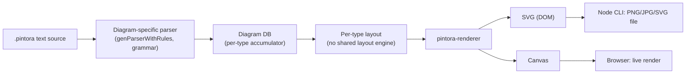
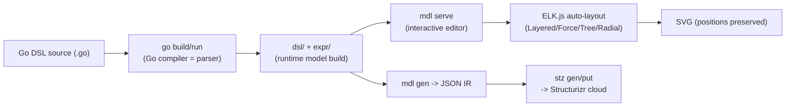
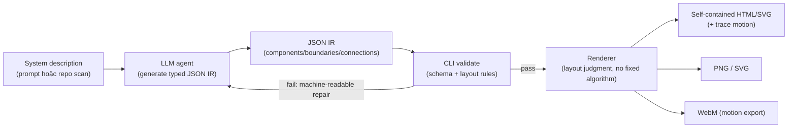
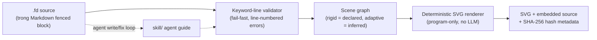

# Weekly scan — diagram-as-code & visual tooling (2026-07-30)

**Nguồn dữ liệu**: GitHub topic pages (`diagram-as-code`, `svg-animation`, `graph-visualization`,
`layout-algorithm`), sắp xếp theo `updated`, cửa sổ 7 ngày (23–30/7/2026). GitHub Search API
không khả dụng trong phiên này (session bị giới hạn scope repo `kymostudio/kymostudio`), nên
scan dùng web fetch trực tiếp vào topic pages + README/tree của từng repo thay vì `gh api
search/repositories`.

## Executive summary

- **`hikerpig/pintora`** (1.3k★, TypeScript monorepo) là repo gần nhất về mặt kiến trúc với
  kymostudio: cùng dùng emitter pattern cho nhiều diagram type + plugin system, nhưng parser dựa
  trên grammar generator (JISON-style) thay vì hand-rolled — đáng đọc kỹ package boundary
  (`pintora-core` / `pintora-diagrams` / `pintora-renderer`) để so với `dsl.py`/`to_svg.py`.
- **`goadesign/model`** (Go, C4 model, 464★) là ví dụ tốt nhất tuần này về "code-as-DSL" (Go
  functions thay vì text DSL) kết hợp editor tương tác dùng **ELK.js** cho auto-layout — đối
  lập thú vị với cách kymo tách `layout.py`/`alignment.py` khỏi front-end `.kymo`.
- Hai repo agent-skill mới (**`tt-a1i/archify`**, 8k★ tăng rất nhanh; **`FigDown/figdown`**,
  giai đoạn spec v0.1) đại diện cho một hướng đi khác hẳn: DSL/IR thiết kế **cho AI agent viết**
  (validate → repair loop, error theo dòng, "small closed token-lean grammar") — liên quan trực
  tiếp tới cách kymo có thể làm DSL dễ hơn cho LLM sinh `.kymo`.

## Mục lục

1. [pintora](#1-hikerpigpintora)
2. [goadesign/model](#2-goadesignmodel)
3. [archify](#3-tt-a1iarchify)
4. [FigDown](#4-figdownfigdown)
5. [Repos khác đã xét nhưng không deep-dive](#5-repos-khác-đã-xét-nhưng-không-deep-dive)

---

## 1. `hikerpig/pintora`

### §1 — Quick context

Text-to-diagram library JS/TS chạy được cả browser lẫn Node, lấy cảm hứng trực tiếp từ
Mermaid.js và PlantUML nhưng tách kiến trúc thành nhiều package độc lập thay vì một bundle
đơn khối — điểm khác biệt chính so với Mermaid.

- **Stack**: TypeScript, Turborepo + pnpm monorepo, Jest, ESLint/Prettier.
- **Output**: SVG/Canvas (browser), PNG/JPG/SVG (Node CLI).
- **Health**: 1.3k★, 37 forks, 725 commit trên `master`, MIT, có VSCode extension/Obsidian
  plugin/Gatsby-remark plugin đi kèm → hệ sinh thái đang sống.
- **Distribution**: npm (`@pintora/*` scoped packages) + CLI `pintora-cli`.

### §2 — Architecture deep-dive

**A. Component inventory** (`packages/`):
- `pintora-core` — model/type layer + utility (deep-clone, color, matrix); không có
  parser-generator hay layout lib trong dependency (`@antv/matrix-util`, `tinycolor2`,
  `deepmerge` — thuần utility).
- `pintora-diagrams` (`packages/pintora-diagrams/src/`) — một thư mục con cho mỗi diagram type
  (`sequence/`, `class/`, `er/`, `activity/`, `mindmap/`, `gantt/`, `dot/`, `component/`), mỗi
  thư mục tự chứa parser + layout riêng cho loại đó.
- `pintora-renderer` — SVG/Canvas backend dùng chung.
- `pintora-cli` — Node CLI entry.
- `pintora-standalone` — bundle độc lập cho browser.
- `pintora-target-wintercg` — build target cho WinterCG runtime (Cloudflare Workers-class edge
  runtime) — điểm lạ, cho thấy mục tiêu chạy trên edge, không chỉ Node/browser.

**B. Pipeline** (happy path, ví dụ sequence diagram):
1. User gọi `pintora.renderTo(source, {type: 'sequence'}, container)` (browser) hoặc
   `pintora-cli render foo.pintora`.
2. `pintora-diagrams/sequence/parser.ts` build parser bằng `genParserWithRules(grammar)` từ
   `./parser/sequenceDiagram` (grammar generator kiểu JISON) → parse text thành AST/DB context
   (`setYY`).
3. Diagram-specific "db" object tích lũy statement (actor, message, note...) qua các callback
   parser.
4. Diagram module tự làm layout nội bộ (không có layout engine dùng chung giữa các loại) →
   sinh ra IR hình học (vị trí actor/lifeline, toạ độ message arrow…).
5. `pintora-renderer` nhận IR, vẽ ra SVG (DOM) hoặc Canvas.
6. CLI (Node) hoặc DOM API (browser) xuất file/attach vào trang.

**C. Data model / IR**: Không có một IR thống nhất toàn hệ thống kiểu `Diagram` dataclass như
kymo — mỗi diagram type có "db" + layout result riêng, chỉ thống nhất ở tầng renderer input
interface. Đây là khác biệt kiến trúc lớn nhất so với kymo's `model.py` (`Component`/`Region`/
`Edge`/`Diagram` dùng chung cho mọi emitter).

**D. Input language**: Parser generator theo kiểu grammar-file (không xác định chắc là JISON
hay biến thể tự chế — file `./parser/sequenceDiagram` là generated code, không đọc được grammar
gốc từ tree listing). Không có EBNF/BNF public trong README. Error reporting: không xác định
(không thấy tài liệu riêng).

**E. Layout**: Layout tự viết riêng theo từng diagram type (sequence lifeline layout khác hẳn
Gantt/ER layout) — không dùng dagre/elkjs/d3 (đã xác nhận qua `package.json`, hoàn toàn không
có graph-layout dependency). Đây là điểm khác kymo: kymo tách layout thành 1 pass dùng chung
(`layout.py`) + `alignment.py` cho auto-canvas/anchoring, còn pintora để mỗi diagram type tự
quyết định hình học của nó.

**F. Rendering**: 2 backend — SVG (DOM-based) và Canvas — dùng chung `pintora-renderer`, tách
biệt output "sạch" (self-contained style, không rò rỉ global CSS) theo README. Không có
animation mechanism được nhắc tới.

**G. Extensibility**: Có plugin system chính thức cho phép viết + phân phối diagram type mới
(README có tutorial riêng) — mỗi plugin registers một entry mới vào `pintora-diagrams`-style
module.

**H. Dev experience**: VSCode extension, Obsidian plugin, Observable notebook integration, Gatsby
remark plugin — bề rộng tích hợp editor/ecosystem tốt hơn hẳn kymo hiện tại. Không xác định có
watch mode/hot reload native trong CLI hay không.

### §3 — Architecture diagram

### §4 — Verdict

- **Đáng học**: package-boundary rõ ràng (`core`/`diagrams`/`renderer`/`cli`) là mô hình sạch
  để kymo cân nhắc nếu JS package lớn dần — hiện `packages/js` gộp DSL+layout+alignment+render
  trong 1 lib duy nhất, pintora cho thấy tách renderer thành package riêng vẫn giữ được API gọn.
- **Red flag**: layout không share giữa các diagram type nghĩa là mỗi type phải tự implement
  lại spacing/anchoring logic — kymo's shared `alignment.py` (5-pass) là thiết kế tốt hơn cho
  việc thêm diagram type mới mà không phải viết lại layout từ đầu.
- **Open question**: không đọc được grammar file gốc (generated code) nên chưa rõ đây có phải
  JISON thật hay chevrotain/custom — cần audit sâu hơn nếu muốn học cách viết error message
  theo dòng.
- **Verdict: glance only** — kiến trúc gần với kymo nhưng không có kỹ thuật mới đột phá; giá
  trị chính là tham khảo package-split, không phải học layout/parser approach.

---

## 2. `goadesign/model`

### §1 — Quick context

DSL viết bằng **Go function calls** (không phải text DSL riêng) để mô tả kiến trúc phần mềm
theo chuẩn C4 Model, kèm editor đồ hoạ tương tác dùng ELK.js cho auto-layout — khác kymo ở chỗ
DSL "là code Go thật", biên dịch bằng `go build` chứ không parse text.

- **Stack**: Go 1.23+, ELK.js (qua editor webview) cho layout, output SVG + JSON.
- **Health**: 464★, 22 forks, MIT, tích hợp với Structurizr cloud service (`stz` tool) và Goa
  framework (API design tool cùng hệ sinh thái).
- **Distribution**: Go module (`go install`), 2 CLI binary (`mdl`, `stz`).

### §2 — Architecture deep-dive

**A. Component inventory**:
- `dsl/` — implementation của DSL (Go functions: `Design()`, `SoftwareSystem()`, `Person()`,
  `Container()`, `Component()`, `Views()`…).
- `expr/` — expression/AST evaluation layer đứng giữa DSL calls và model cuối cùng.
- `mdl/` — package render: sinh SVG + JSON, chứa server cho `mdl serve` (editor đồ hoạ tại
  `localhost:8080`).
- `stz/` — tích hợp Structurizr: convert sang Structurizr JSON, client API để push/pull
  workspace lên Structurizr cloud.
- `codegen/` — sinh code (không xác định rõ mục đích cụ thể từ tree listing — có thể sinh
  boilerplate DSL từ model có sẵn).
- `plugin/` — Goa framework plugin, cho phép mô tả API (Goa) và kiến trúc (Model) chung 1 file.
- `cmd/` — chứa 2 CLI: `mdl`, `stz`.
- `DSL.md` — spec ngôn ngữ đầy đủ (tương tự vai trò `docs/DSL.md` của kymo).

**B. Pipeline**:
1. User viết file `.go` chứa `var _ = Design("Title", "...", func() { ... })`.
2. `go run` file đó → Go compiler tự parse/type-check (không có parser riêng — DSL là Go code
   thật, "compile" bằng `go build`).
3. `dsl/` package chạy các closure lúc runtime, tích luỹ model qua `expr/` layer.
4. `mdl gen <import-path>` → xuất JSON representation của design.
5. `mdl serve <import-path>` → mở editor web tương tác, dùng ELK.js (Layered/Force/Tree/Radial)
   để auto-layout, cho phép chỉnh tay (drag, snap-to-grid) rồi export SVG — vị trí lưu lại để
   tái tạo (reproducible).
6. (Tùy chọn) `stz gen` → Structurizr JSON → `stz put` đẩy lên Structurizr cloud service.

**C. Data model / IR**: Model được build runtime bằng Go struct thực (không phải text AST) —
đây là điểm khác biệt triết học lớn nhất so với kymo: DSL "nhúng" trong ngôn ngữ chủ (Go) thay
vì ngôn ngữ text riêng. JSON là IR trung gian xuất ra để render/tương tác với Structurizr.

**D. Input language design**: Không có parser text — cú pháp là Go syntax thật (closures lồng
nhau). Ưu điểm: có type-checking, autocomplete, refactoring free từ Go tooling; nhược điểm: đòi
hỏi biết Go, không phải "diagram-as-text" thuần. Error reporting = Go compiler errors (rất tốt
về vị trí/message, nhưng message nói về Go semantics chứ không phải domain semantics).

**E. Layout**: Auto-layout **multi-algorithm** (Layered/Force/Tree/Radial) qua **ELK.js**, chạy
trong editor tương tác (không phải batch CLI) — user có thể trigger lại bằng `Ctrl+L`. Đây là
lần thứ 2 trong scan tuần này thấy ELK.js được dùng làm layout backend (cùng lý do kiến trúc:
ELK có nhiều algorithm sẵn, port sang JS/WASM dễ nhúng vào web editor).

**F. Rendering**: SVG output giữ nguyên vị trí đã layout (để re-render không đổi hình dạng) +
JSON. Không có animation.

**G. Extensibility**: Component/style reuse qua Go import (chia sẻ package Go chứa style
definitions) — tận dụng module system của Go thay vì cơ chế plugin riêng.

**H. Dev experience**: Interactive editor (pan/zoom, multi-select, alt-click vertex editing,
keyboard shortcuts) khá đầy đủ cho một tool chưa tới 500★. Không có VSCode extension riêng được
nhắc tới trong scan này.

### §3 — Architecture diagram

### §4 — Verdict

- **Đáng học**: "DSL = host language function calls" là hướng ngược hẳn với `.kymo` text DSL —
  không áp dụng trực tiếp cho kymo (vốn cam kết text DSL + `docs/DSL.md` EBNF), nhưng
  `packages/python` "`.py` source → module exposing `DIAGRAM`" đã có sẵn hướng này như một
  front-end phụ; đáng xem lại xem front-end đó có tận dụng đủ Go-model's ưu điểm (composability
  qua import) hay không.
  - **Layout đáng chú ý**: dùng ELK.js multi-algorithm cho phép user chọn Layered vs Force vs
    Tree vs Radial theo use-case — kymo hiện chỉ có 1 auto-layout strategy trong `layout.py`;
    cân nhắc học ý tưởng "algorithm switch theo declaration" nếu có nhu cầu layout phi-hierarchical.
- **Red flag**: DSL gắn chặt với Go — không portable sang ngôn ngữ khác, ngược hẳn triết lý
  "hai impl độc lập song song" (Python/JS) của kymo.
- **Open question**: chưa đọc được source `codegen/` nên không rõ cơ chế "static analysis
  detect drift between model và code thật" hoạt động thế nào — có thể đáng điều tra riêng.
- **Verdict: glance only** — DSL philosophy không chuyển giao trực tiếp, nhưng multi-algorithm
  ELK.js layout switch là ý tưởng đáng ghi chú.

---

## 3. `tt-a1i/archify`

### §1 — Quick context

Agent skill (không phải library truyền thống) biến mô tả hệ thống hoặc codebase thành diagram
HTML/SVG tương tác có "motion" — khác các tool khác ở chỗ **agent tự sinh JSON IR rồi tool
validate/repair**, không phải người viết text DSL trực tiếp.

- **Stack**: Node.js (CLI `archify/bin/archify.mjs`), JSON Schema làm IR, HTML/SVG renderer.
- **Health**: claim 8k★/608 forks, 124 commit — tăng trưởng rất nhanh (agent-skill phân phối
  qua Claude Code/Cursor/Codex CLI/OpenCode, không qua npm registry truyền thống) → cần theo
  dõi thêm, số liệu star tăng bất thường nhanh so với công sức code (không phải red flag chắc
  chắn, nhưng đáng dè dặt).
- **Distribution**: `npx skills add tt-a1i/archify -g` (agent-skill marketplace), MIT.

### §2 — Architecture deep-dive

**A. Component inventory**:
- `archify/bin/archify.mjs` — CLI chính (`validate`/`preview`/`deliver`/`guide`).
- `archify/` — chứa "typed JSON IR" schema, validators, renderers (README gọi là core skill
  implementation).
- `benchmarks/` — dataset benchmark ("ordinary-model-floor" — có vẻ để đo baseline chất lượng
  agent-generated diagram).
- `docs/` — gallery proof + `DESIGN.md`/`PRODUCT.md`/`ROADMAP.md`.
- `examples/` — cặp `.architecture.json` (IR) + `.html` (rendered output), ví dụ
  `maka-architecture.architecture.json`.

**B. Pipeline** (theo README, 5 bước — khác hẳn pipeline "1 người viết source" truyền thống):
1. **Generate** — agent (LLM) tự sinh typed JSON IR từ system description hoặc từ đọc repo thật.
2. **Validate** — CLI check schema + layout rules; lỗi trả về dạng machine-readable để agent
   tự sửa (repair loop, không phải human đọc lỗi).
3. **Preview** (optional) — desktop session watch file JSON, reload khi có bản đã verify.
4. **Deliver** — render candidate, check lại, nếu pass thì thay thế file output cũ.
5. **Iterate** — agent update JSON source tiếp, giữ nguyên phần cấu trúc ổn định.

**C. Data model / IR**: "typed JSON IR" xác nhận qua ví dụ `maka-architecture.architecture.json`
— object có `schema_version`, `diagram_type`, `meta`, `components[]` (mỗi component có
`id`/`type`/`label`/`sublabel`/`tag`), `boundaries[]`, `connections[]`, `cards[]`. Đây là JSON
Schema-validated, không phải dataclass Python/TS — tương tự vai trò `Diagram`/`Component` của
kymo nhưng serialize trực tiếp ra JSON làm nguồn thay vì object nội bộ.

**D. Input "language" design**: Không có text grammar — input là JSON đã đúng schema (agent tự
sinh). Đây là điểm khác biệt lớn với mọi tool khác trong scan: "ngôn ngữ" thực chất là JSON
Schema + validation rule, được thiết kế để LLM sinh ra chính xác qua vài lần repair, không phải
để người gõ tay.

**E. Layout**: README nói rõ "layout judgment over generic auto-layout" — nghĩa là agent
(LLM) tự quyết định hierarchy/spacing/route emphasis mỗi lần generate, không chạy 1 thuật toán
auto-layout cố định (không dagre/elk/force-directed). "Shared automatic endpoints distribute
deterministically" gợi ý có 1 layer xử lý collision cho các route trùng điểm neo, nhưng chi tiết
thuật toán không xác định (không có source cho phần này trong tài liệu đọc được).

**F. Rendering**: HTML self-contained (embed SVG + CSS) là output chính; xuất thêm được PNG,
SVG, WebM (cho phần motion), và ảnh share-card 1200×630. Animation: "trace" preset (route
highlight theo thời gian), tôn trọng `prefers-reduced-motion`.

**G. Extensibility**: 5 diagram type cố định (architecture/workflow/sequence/data-flow/
lifecycle) qua schema riêng cho mỗi loại — không thấy cơ chế "user tự thêm diagram type mới"
như plugin system của pintora.

**H. Dev experience**: Interactive keyboard trong output HTML (`/` search, `R` route probe, `L`
compare semantic role, `P` guided story playback, `F` presentation mode) — trải nghiệm xem
diagram phong phú hơn hẳn SVG tĩnh, nhưng đây là tính năng của **output artifact** (HTML+JS),
không phải của editor tác giả.

### §3 — Architecture diagram

### §4 — Verdict

- **Đáng học**: "validate → machine-readable repair loop" là kỹ thuật trực tiếp áp dụng được
  cho kymo nếu muốn tối ưu DSL cho LLM sinh `.kymo` tự động (ví dụ agent viết `.kymo` sai, cần
  lỗi có format agent tự sửa được thay vì free-text error) — đáng đối chiếu với error reporting
  hiện tại của `dsl.py`.
  - IR JSON schema-first (thay vì "text DSL trước, IR sau") là hướng có thể tham khảo cho một
    entry point "kymo từ JSON" dành riêng cho agent, tách khỏi `.kymo` dành cho người.
- **Red flag**: growth 8k★/124 commit trong thời gian ngắn là bất thường — cần verify độc lập
  (không dùng số liệu này để đánh giá "chất lượng kỹ thuật", chỉ ghi nhận signal thị trường).
  Không có layout algorithm cụ thể (chỉ "agent judgment") nghĩa là **không reproducible**:
  cùng 1 mô tả có thể ra layout khác nhau giữa các lần generate — ngược hẳn nguyên tắc
  deterministic rendering mà kymo/FigDown theo đuổi.
- **Open question**: "shared automatic endpoints distribute deterministically" — cơ chế chống
  route-overlap cụ thể là gì? Không đọc được source thật (`archify/` core code không được mở
  trong lần fetch này).
- **Verdict: study deeper** — riêng phần validate/repair-loop pattern cho agent-generated
  diagram source đáng đọc source code thật (không chỉ README) ở phiên sau.

---

## 4. `FigDown/figdown`

### §1 — Quick context

Chuẩn/spec (giai đoạn v0.1, chưa phải implementation hoàn chỉnh) để nhúng diagram-as-text vào
Markdown, tối ưu để **cùng lúc AI agent đọc được structured knowledge và human xem SVG** —
khác Mermaid ở việc mở rộng ra network topology/bitfield/packet-walk thay vì chỉ flowchart, và
cam kết "deterministic, bit-level reproducible rendering, không có LLM trong render path".

- **Stack**: browser editor (HTML/JS), Python tooling + agent skill, bilingual docs
  (English + Traditional Chinese).
- **Health**: 0★ (dự án mới, đang giai đoạn spec), nhưng có 774-document corpus analysis,
  100-case golden conformance fixture, migration log — bằng chứng đầu tư nghiêm túc dù chưa
  có cộng đồng.
- **Distribution**: chưa có (spec-stage); có `skill/` cho agent install.

### §2 — Architecture deep-dive

**A. Component inventory**:
- `spec/` — syntax draft, genre definitions, migration log (vai trò tương tự `docs/DSL.md`
  của kymo, nhưng đang ở dạng "requirements log" hơn là spec chốt).
- `conformance/` — 100 golden parser test case (tương tự triết lý `conformance/` của kymo,
  dù kymo dùng để so Python↔JS, còn FigDown dùng để khoá hành vi 1 impl chuẩn).
- `editor/` — browser-based editor, live SVG rendering cho file `.fd`.
- `examples/` — cặp `.fd` + `.svg` output, chủ đề chủ yếu là network/protocol diagram (ARP,
  BGP, DHCP, DNS, GRE, ICMP, IPv4/6, MPLS, QUIC, TCP/UDP, VXLAN…).
- `skill/` — agent skill để LLM tự maintain file `.fd`.
- `design/` — "prior-art survey" + "empirical figure-type census" (nghiên cứu loại diagram nào
  thực sự cần trước khi thiết kế cú pháp — cách tiếp cận data-driven khá hiếm thấy).
- `AGENT-GUIDE.md`, `LAYOUT-GUIDE.md`, `EXPRESSING.md`, `AUTHORING.md` — tài liệu tách riêng
  theo persona (agent vs human author).

**B. Pipeline**:
1. Author (người hoặc agent) viết block `.fd` (có thể nhúng trong fenced code block Markdown).
2. Validate cú pháp — mỗi dòng bắt đầu bằng keyword đã biết; dòng không nhận diện được → lỗi
   kèm số dòng (fail-fast, không "đoán" ý).
3. Build scene graph: gộp thuộc tính khai báo tường minh (position/size/color…) với thuộc tính
   suy ra tự động cho phần chưa khai báo.
4. Generate SVG xác định (deterministic) — cùng input luôn ra cùng SVG ở mức byte.
5. Nhúng lại source gốc + SHA-256 hash vào metadata của SVG (để trace ngược / verify).

**C. Data model / IR**: Scene graph với 2 loại thuộc tính — "rigid" (đã khai báo tường minh,
không đổi khi layout re-run) và "adaptive" (chưa khai báo, tự tính, có thể đổi khi sửa phần
khác). Đây là cơ chế **incremental layout stability** khá đặc biệt: "local edit → local change"
— sửa 1 node không làm xê dịch toàn bộ diagram, nhờ "rank declaration" cho cấu trúc layout ngữ
nghĩa tường minh sống sót qua các lần edit.

**D. Input language design**: Explicit keyword-prefixed line syntax ("mọi dòng bắt đầu bằng
keyword đã biết; dòng lạ là lỗi kèm số dòng") — triết lý ngược với parser khoan dung
(permissive) của nhiều DSL khác; ưu tiên "closed, token-lean grammar" để nhồi vừa vào prompt
ngắn cho LLM, hỗ trợ vòng lặp "write → validate → fix" mà không cần LLM tham gia lúc render.
Có support cho `class`, `edge` (`-[label]-`), `layer` (z-index), `table` (nhúng GFM table), và
đặc biệt `bitfield` — DSL con riêng cho network bit-field diagram (ví dụ DNS header trong
`examples/dns.fd`: khai báo `bitfield dns unit=16 numbering=msb0` rồi liệt kê `field` với độ
rộng bit + note, `wrap` để xử lý phần variable-length).

**E. Layout**: Không dùng auto-layout tổng quát (force-directed/hierarchical) — layout được
suy ra từ "rank declaration" (cấu trúc thứ bậc khai báo tường minh) + rule "declared = rigid,
undeclared = adaptive". Không thấy đề cập crossing minimization; phù hợp vì domain chính
(network/protocol diagram) thường có cấu trúc tuyến tính/phân lớp rõ ràng hơn general graph.

**F. Rendering**: SVG duy nhất, deterministic, không animation. Rendering "program-only" —
điểm nhấn triết lý quan trọng nhất của repo: không có LLM trong render path (LLM chỉ tham gia
lúc *viết* `.fd`, không tham gia lúc *render ra* SVG) — khác hẳn archify (nơi "layout judgment"
do agent quyết định mỗi lần).

**G. Extensibility**: Genre-based — mỗi "figure genre" (network topology, bitfield, packet-walk,
partition-map…) có construct riêng thay vì 1 core primitive set tổng quát; `design/` folder ghi
lại quá trình khảo sát 774 document để quyết định thêm genre nào.

**H. Dev experience**: Browser editor với live SVG preview cho `.fd`; agent skill riêng
(`skill/`) dạy LLM cách maintain file mà không phá layout stability. Tài liệu tách theo persona
(`AGENT-GUIDE.md` cho agent, `AUTHORING.md` cho người) là điểm dev-experience đáng chú ý.

### §3 — Architecture diagram

### §4 — Verdict

- **Đáng học nhất tuần này cho kymo**:
  - **"rigid vs adaptive attribute" + rank declaration** giải quyết đúng vấn đề mà bất kỳ
    auto-layout engine nào (kể cả `alignment.py`) cũng gặp: sửa 1 phần diagram làm xê dịch toàn
    bộ phần còn lại. Kymo's golden-SVG test hiện phải regenerate hàng loạt khi renderer đổi —
    một cơ chế "declared attribute rigid, spillover tối thiểu" tương tự có thể giảm churn khi
    thêm feature mới, đáng nghiên cứu tiếp có áp dụng được vào `alignment.py`'s 5-pass không.
  - **DSL genre-per-domain** (bitfield diagram riêng cho network protocol) là mô hình đáng tham
    khảo cho các domain đặc thù của kymo nếu muốn mở rộng — thay vì cố nhồi mọi thứ vào 1 core
    primitive set.
  - **Explicit keyword-line grammar + line-numbered fail-fast error** khớp với hướng
    "small, closed, token-lean core" — đáng so sánh với error reporting hiện tại của `dsl.py`
    xem có đang đủ tốt cho agent tự sửa lỗi `.kymo` hay chưa.
- **Red flag**: 0★, chưa có implementation hoàn chỉnh (v0.1, "requirements phase") — rủi ro dự
  án chết yểu trước khi ra bản ổn định; theo dõi thêm 2-3 tuần trước khi đầu tư thời gian đọc
  sâu hơn.
- **Open question**: cơ chế "rank declaration" cụ thể hoạt động thế nào ở mức thuật toán
  (không có source implementation để đọc, chỉ có spec doc) — cần chờ code thật xuất hiện.
- **Verdict: study deeper** (theo dõi + đọc lại khi có implementation), nhưng **đọc spec ngay**
  vì phần triết lý layout-stability + genre-based DSL design đã đủ chín để tham khảo dù chưa có
  code.

---

## 5. Repos khác đã xét nhưng không deep-dive

Đủ điều kiện relevance filter (novel DSL / layout / rendering / cross-format / adjacent
text-to-visual) nhưng không đọc sâu tuần này — liệt kê để theo dõi tiếp:

| Repo | Pitch ngắn | Vì sao chưa deep-dive |
|---|---|---|
| [`Northwestern-caddo190/dashmotion`](https://github.com/Northwestern-caddo190/dashmotion) | Claude AI skill convert text/Mermaid → animated HTML/SVG (dashed connector + traveling dot theo `stroke-dashoffset`/`animateMotion`) | Rất sát domain animation của kymo, nhưng là "skill" mỏng (chủ yếu prompt + vài file), ít code kiến trúc để phân tích; 0★, cần chờ trưởng thành hơn |
| [`goadesign/model`](#2-goadesignmodel) | *(đã deep-dive ở trên)* | — |
| [`nordstad/PinViz`](https://github.com/nordstad/PinViz) | Sinh sơ đồ đấu nối GPIO dạng SVG từ mô tả text | Domain quá hẹp (electronics pinout), nhưng là ví dụ "adjacent text-to-visual DSL" tốt nếu cần tham khảo diagram kỹ thuật ngoài software architecture |
| [`dinghydev/dinghy`](https://github.com/dinghydev/dinghy) | Diagram + Infrastructure-as-Code dùng React làm DSL layer | Cross-format/IaC angle thú vị (React component = diagram node), cần đọc source để biết render backend thật là gì |
| [`cduck/drawsvg`](https://github.com/cduck/drawsvg) | Thư viện Python sinh SVG có animation + Jupyter widget tương tác | Không phải "diagram tool" theo nghĩa chặt (là SVG builder tổng quát), nhưng đáng xem cho kỹ thuật animation/interactive-widget nếu kymo mở rộng notebook integration |
| [`mingrammer/diagrams`](https://github.com/mingrammer/diagrams) | Python DSL vẽ cloud architecture diagram (42.5k★, đã rất nổi tiếng) | Không phải "mới" tuần này, chỉ cập nhật thường xuyên — giữ lại làm baseline so sánh Python DSL ergonomics, không cần deep-dive lại |
| [`IBM/ibmdiagrams`](https://github.com/IBM/ibmdiagrams) | Sinh architecture diagram theo chuẩn IBM Diagram Standard | Đáng xem về mặt "beautiful technical output"/style system chuẩn hoá doanh nghiệp, nhưng chỉ 9★ và chưa rõ có DSL hay chỉ template |

---

*Ghi chú phương pháp*: scan này dùng web fetch công khai (GitHub topic pages + README + file
tree qua `github.com`/`raw.githubusercontent.com`), không dùng `gh api search/repositories` vì
session bị giới hạn scope tới repo `kymostudio/kymostudio`. Một số chi tiết implementation sâu
(ví dụ grammar file gốc của pintora, `codegen/` của goadesign/model, core renderer source của
archify) không đọc được trong lần fetch này — đánh dấu "không xác định" thay vì suy đoán.
