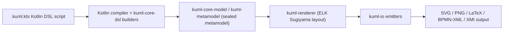
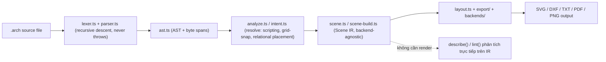
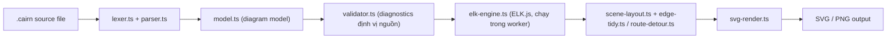
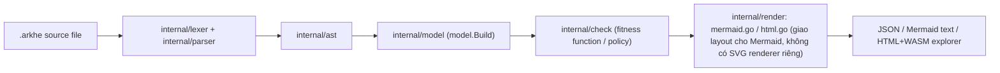

# Weekly Scan — Diagram Tooling (2026-07-31)

**Executive summary:**
- Tuần này nổi bật nhất là cụm 4 project "diagrams-as-code" mới/rất trẻ (đa số <400 commit, <50 sao) đều được cập nhật trong 3-4 ngày gần nhất: `kuml-dev/kUML` (Kotlin, typed embedded DSL cho UML/C4/BPMN), `ChanMeng666/archlang` (TS, DSL cho floor-plan với kiến trúc IR gần giống kymostudio nhất), `R0kshan/cairn` (TS, ELK.js + "zero-overlap" layout guarantee cho C4/infra view), và `vynazevedo/ARKHE` (Go, "architecture governance as code" nhưng lại **không** có renderer SVG riêng — chỉ xuất Mermaid text).
- Pattern lặp lại đáng chú ý: 3/4 repo dùng **Scene/backend-agnostic IR tách biệt khỏi AST** (archlang gọi rõ là "Scene IR", cairn có `model.ts` trung gian trước layout, kUML có "sealed metamodel") — xác nhận lại hướng đi "renderer dumb, data model explicit" mà kymostudio đã chọn từ đầu, chứ không phải ý tưởng lạ cần học thêm.
- Điểm học được cụ thể nhất cho kymostudio: cách archlang thiết kế diagnostics (byte-span + "fix" catalog máy áp được), và cách cairn biến "0 overlap" thành một **build-time measured guarantee** thay vì chỉ golden-test byte-exact như kymo hiện tại — cả hai đều là kỹ thuật DX có thể mượn trực tiếp.

**Mục lục**
1. [kuml-dev/kUML](#1-kuml-devkuml)
2. [ChanMeng666/archlang](#2-chanmeng666archlang)
3. [R0kshan/cairn](#3-r0kshancairn)
4. [vynazevedo/ARKHE](#4-vynazevedoarkhe)
5. [Danh sách rút gọn — 6 repo còn lại đã xét](#5-danh-sách-rút-gọn--6-repo-còn-lại-đã-xét)

Phương pháp: không có quyền dùng `gh` CLI / GitHub API search có xác thực trong phiên này, nên toàn bộ dữ liệu lấy qua web search + GitHub topic pages (`github.com/topics/diagrams-as-code?o=desc&s=updated`, `topic:text-to-diagram`) và fetch trực tiếp README/`package.json`/cây thư mục qua `raw.githubusercontent.com` và `github.com/<owner>/<repo>/tree/...`. Chỗ nào không mở được file nguồn thực sự thì ghi rõ "không xác định" thay vì suy đoán.

---

## 1. kuml-dev/kUML

**§1 — Quick context**
kUML là DSL Kotlin **nhúng** (type-safe embedded DSL, không phải file text riêng) để mô hình hoá UML 2.x, SysML 2, C4, BPMN 2.0 và ERM như các ngôn ngữ ngang hàng — khác kymo/PlantUML/Mermaid ở chỗ *bản thân trình biên dịch Kotlin làm luôn việc validate cú pháp*. Stack: Kotlin/JVM, Gradle multi-module (~40 module), Compose Multiplatform (desktop), Ktor (web). Repo health: 17 sao, v0.43.0 (pre-1.0), cập nhật 30/7/2026, phân phối qua Maven Central + Homebrew/Chocolatey/DEB/RPM/Docker.

**§2 — Architecture deep-dive**

A. Component inventory (theo README + cây thư mục top-level, KHÔNG đọc được source `.kt` thực sự bên trong `kuml-renderer`/`kuml-io` do 404 khi mở sâu):
- `kuml-core-dsl` — DSL builder layer
- `kuml-core-model` / `kuml-metamodel` — "sealed Kotlin metamodel", không dùng EMF
- `kuml-renderer` — layout bridge + ELK adapter + theme system
- `kuml-io` — emitter SVG/PNG/LaTeX/XMI/BPMN-XML/ARXML
- `kuml-runtime` — behavior simulation
- `kuml-codegen` — 5 M2M transformer có sẵn (uml-to-jpa, uml-to-k8s...)
- `kuml-mcp` — MCP server cho LLM agent (README: 11 tool)
- `kuml-plugin-api`/`kuml-plugin-loader` — plugin qua Java `ServiceLoader`
- `kuml-cli`, `kuml-web`, `kuml-desktop`, `kuml-language-server`, `kuml-jetbrains` — front-end/IDE

B. Pipeline (README-stated): (1) viết script `.kuml.kts` gọi DSL builder như `classDiagram(name=...) { classOf(...) { attribute(...) } }` → (2) chạy `kuml render x.kuml.kts --format svg` → (3) Kotlin compiler tự type-check khi evaluate script, dựng sealed metamodel → (4) `kuml-renderer` chạy ELK (Sugiyama layered layout, có thêm grid layout thử nghiệm) → (5) `kuml-io` serialize ra SVG/PNG/LaTeX/BPMN-XML/XMI → (6) file output.

C. Data model/IR: sealed class hierarchy Kotlin thuần (không EMF) — README nhấn mạnh đây là khác biệt cố ý so với các tool UML dựa trên EMF. Mutable/immutable giữa pass: không xác định.

D. Input language design: **không phải parser text tự viết** — là embedded DSL, "parser" chính là trình biên dịch Kotlin; lỗi cú pháp hiện ra như lỗi compile Kotlin (type error), không phải diagnostic tự chế. Đây là điểm khác biệt lớn nhất so với kymo (`.kymo` là external DSL line-oriented tự parse).

E. Layout: ELK Sugiyama layered layout (claim từ README, chưa verify qua source `kuml-renderer`).

F. Rendering: đa backend qua `kuml-io` (SVG/PNG/LaTeX/XMI/BPMN-XML/ARXML); README còn claim **SMIL animation** cho sequence diagram/state machine/BPMN process — trực tiếp so sánh được với animated-SVG của kymo, nhưng chưa đọc code emit SMIL thực sự.

G. Extensibility: `ServiceLoader`-based plugin, 5 code-gen transformer sẵn, theme system trong `kuml-renderer`.

H. Dev experience: CLI nhiều subcommand (render/validate/simulate/transform/reverse/serve/ai bench/fmt), `kuml serve` live-preview, VS Code + JetBrains plugin, language server, GraalVM native build đa nền tảng.

**§3 — Architecture diagram**


**§4 — Verdict**
Đáng học: claim SMIL-animation cho sequence/state/BPMN đáng để dò lại khi có bằng chứng code thật, vì đây đúng use-case kymo đang làm (animated SVG cho BPMN). Ý tưởng "embedded typed DSL" thú vị về mặt triết lý nhưng **không áp dụng được** cho kymo — kymo cố tình chọn external DSL độc lập ngôn ngữ host để tối ưu cho người không phải dev. Red flag: bề mặt tính năng cực lớn (40+ module: AI agent, MCP, LSP, JetBrains, desktop app, 5 họ diagram, OCL, XMI...) trên repo chỉ 17 sao và không xác nhận được nội dung `kuml-renderer`/`kuml-io` — rủi ro scope-creep của một maintainer đơn lẻ, các claim SVG/SMIL/ELK cần verify lại trước khi tin. Open question: cấu hình ELK cụ thể ra sao, animation timing khai báo thế nào trong DSL. **Verdict: glance only** — theo dõi tiếp đến khi thấy source `kuml-renderer` thật, không đầu tư sâu ngay.

---

## 2. ChanMeng666/archlang

**§1 — Quick context**
archlang biên dịch một DSL khai báo nhỏ thành SVG floor-plan chuyên nghiệp — định vị như "Typst/LaTeX nhưng cho bản vẽ kiến trúc nhà", thiết kế ưu tiên cho AI agent (parser không bao giờ throw, mọi lỗi kèm patch tự sửa). Stack: TypeScript, Node ≥18, ESM, gói `@chanmeng666/archlang` v1.24.0, CLI `arch`. Repo health: chỉ 3 sao nhưng 380 commit, cập nhật 27/7/2026, MIT, có LSP + VS Code extension + GitHub Action + MCP server phụ.

**§2 — Architecture deep-dive**

A. Component inventory (đọc trực tiếp cây `src/`):
- `src/lexer.ts`, `src/parser.ts` — recursive-descent parser, README nói rõ "never throws, recovers from errors"
- `src/ast.ts` — AST có byte-span cho từng node
- `src/analyze.ts`/`src/intent.ts`/`src/types.ts`/`src/registry.ts` — pha "resolve": expand scripting, grid-snap, relational placement
- `src/scene.ts`/`src/scene-build.ts` — **Scene IR**, gọi rõ là "backend-agnostic" trong README
- `src/layout.ts`, `src/geometry/` — tính toán hình học
- `src/export/`, `src/backends/` — serialize SVG/DXF/TXT/PDF/PNG
- `src/lint/` — kiểm tra tính hợp lý kiến trúc (nhà vệ sinh có lối vào không, khoảng hở cửa...)
- `src/cli.ts` (21 subcommand), `src/lsp.ts`

B. Pipeline (đọc file ví dụ đầy đủ `examples/studio.arch`): (1) viết `.arch` với cú pháp `plan { units mm; grid 50; wall …; room id=r_bed at (4000,0) size 3000x3000; door …; furniture wc in r_bath anchor bottom flush size 400x700 }` → (2) chạy `arch compile studio.arch` → (3) lexer→parser→`ast.ts` (AST kèm byte-span để báo lỗi chính xác) → (4) pha resolve mở rộng scripting/grid-snap/relational placement → (5) build **Scene IR** backend-agnostic → (6a) render: `layout.ts` + `export/`/`backends/` → SVG/DXF/TXT/PDF/PNG, hoặc (6b) đường phân tích: `describe()`/`lint()` chạy trực tiếp trên IR **không cần render ảnh** — thiết kế rõ ràng cho vòng lặp agent "compile → check → fix → describe → validate → render".

C. Data model/IR: hai tầng rõ rệt — AST (parse tree, có byte-span) → Scene IR (backend-agnostic, tách biệt khỏi cú pháp nguồn). Đây là kiến trúc **gần nhất với kymo trong cả 4 repo** — Scene IR đóng đúng vai trò `Diagram`/`Component`/`Region`/`Edge` trong `model.py` của kymo, nuôi nhiều emitter khác nhau.

D. Input language design: recursive-descent, cố tình never-throw để hỗ trợ agent tự sửa lỗi lặp lại; diagnostics là JSON có byte-span + "fix" catalog (mỗi lỗi có thể kèm patch máy áp được). Exit code xác định: 0 thành công, 1 lỗi nội bộ, 2 lỗi người dùng, 3 sai cách dùng.

E. Layout: **không auto-layout** — vị trí do người dùng khai `at (x,y)` tuyệt đối, cộng thêm hệ "relational placement" qua anchor (`anchor bottom flush`) mà README gọi là "topological arithmetic, không phải optimizer" — tức xử lý theo thứ tự tô-pô cố định, không phải constraint-solver hay force-directed.

F. Rendering: 5 định dạng (SVG/DXF/TXT/PDF/PNG) cùng serialize từ một Scene IR — mô hình multi-emitter y hệt bộ `to_svg.py`/`to_figma.py`/`to_excalidraw.py`/`to_webp.py` của kymo. Không có animation (floor plan tĩnh).

G. Extensibility: MCP server riêng (`@chanmeng666/archlang-mcp`), GitHub Action render fence ```` ```arch ```` trong Markdown, thư mục `grammars/`/`schemas/` (không xác định là Tree-sitter hay EBNF thuần).

H. Dev experience: 21 CLI command chia 4 nhóm (Rendering/Analysis/Authoring/Metadata), LSP + VS Code extension, playground trình duyệt thuần client-side (source mã hoá trong URL hash). Repo gốc có cả `AGENTS.md`/`SKILL.md`/`llms.txt` — đầu tư tài liệu hướng agent rất kỹ.

**§3 — Architecture diagram**


**§4 — Verdict**
Đáng học nhất trong 4 repo tuần này. Hai kỹ thuật áp dụng trực tiếp được vào kymo: (1) diagnostics dạng byte-span + "fix" catalog máy áp được — kymo hiện parse lỗi kiểu gì chưa rõ nhưng đây là chuẩn tốt cho UX agent-facing; (2) tách hẳn một pha "describe()/lint() không cần render" — kymo có thể thêm chế độ tương tự để validate `.kymo` nhanh mà không cần chạy hết pipeline SVG. Ý tưởng "never-throw parser, always recover" cũng đáng cân nhắc cho `dsl.py`/`dsl.ts` nếu kymo muốn tối ưu hơn cho luồng agent tự sửa lỗi. Layout "relational anchor, topological arithmetic không phải solver" gần giống cách kymo dùng parent/child anchoring trong `alignment.py` — xác nhận lại hướng đi, không phải phát hiện mới. Red flag: 3 sao trên hệ sinh thái CLI/LSP/MCP đồ sộ — dự án còn quá mới để đánh giá độ ổn định API. Open question: "topological arithmetic" xử lý ra sao khi hai ràng buộc anchor xung đột — README không nói rõ. **Verdict: study deeper** — đọc kỹ `scene.ts`/`analyze.ts` và cơ chế diagnostics khi có thời gian.

---

## 3. R0kshan/cairn

**§1 — Quick context**
cairn sinh diagram kiến trúc dạng C4 (logical/application/infra view) từ DSL `.cairn`, với cam kết "zero label overlap" đo lại mỗi lần build. Stack: TypeScript, `elkjs ^0.12.0`, CLI `cairn` (bin `bin/cairn.js`). Repo health: 41 sao, 7 issue mở, v1.0.0-RC09, commit hàng ngày suốt 25-30/7/2026 (bao gồm "Bump elkjs 0.11.1→0.12.0", "Optimize flow routing and positioning"), phân phối qua Homebrew/Scoop/curl.

**§2 — Architecture deep-dive**

A. Component inventory (tên file suy từ cây `src/` + README, **không đọc được nội dung file** — chỉ xác nhận sự tồn tại và tên):
- `src/lexer.ts`, `src/parser.ts` — tokenize/parse (recursive-descent hay khác: không xác định)
- `src/model.ts` — model diagram
- `src/validator.ts`, `src/diagnostics.ts` — diagnostic có định vị nguồn
- `src/elk-engine.ts`, `src/elk-worker.ts` — tích hợp ELK.js, chạy trong worker riêng
- `src/scene-layout.ts` — lắp scene sau ELK
- `src/edge-tidy.ts`, `src/route-detour.ts` — hậu xử lý routing cạnh
- `src/svg-render.ts` — emit SVG
- `src/flow-matrix.ts` — xuất CSV/Markdown/SVG ma trận luồng hạ tầng
- `src/themes.ts` (9+ theme), `src/localization.ts` (song ngữ Anh/Pháp, keyword giữ tiếng Anh)
- `src/watch.ts`, `src/playground.ts`

B. Pipeline (suy từ tên file + `package.json` xác nhận `bin: cairn.js` và dep `elkjs`): (1) `cairn <file>.cairn` → (2) lexer→parser→model → (3) `validator.ts` chạy check kiểu, báo lỗi định vị nguồn → (4) `elk-engine.ts` (ELK.js, offload qua `elk-worker.ts`) tính layout → (5) `scene-layout.ts` + `edge-tidy.ts`/`route-detour.ts` tinh chỉnh vị trí/routing, chừa sẵn không gian cho label để đạt "0 overlap" → (6) `svg-render.ts` xuất SVG/PNG → (7) tuỳ chọn xuất thêm flow-matrix CSV/Markdown.

C. Data model/IR: `model.ts` tồn tại làm tầng trung gian giữa parser và layout — cấu trúc cụ thể (class/interface, mutable hay không) không xác định vì chưa đọc được nội dung file.

D. Input language design: lexer+parser tự viết, cách tiếp cận cụ thể không xác định. README nhấn: diagnostics có kiểu (typed) và định vị nguồn; từ khoá giữ tiếng Anh dù output có thể localize tiếng Pháp.

E. Layout: **ELK.js** — cùng họ Eclipse Layout Kernel mà kUML cũng dùng, đáng để kymo so sánh cho layout phân lớp/hierarchical. Đặc điểm nổi bật nhất: "label space được dành sẵn lúc layout; overlap được đo lại mỗi lần build và luôn ra 0" (trích README) — tức đây là một **test đo lường liên tục về chất lượng layout**, khác hẳn kiểu golden-test byte-exact của kymo. Routing cạnh còn được README tự nhận là hạn chế đang mở ("routing optimization" nằm trong known limitations).

F. Rendering: một emitter SVG (`svg-render.ts`) + PNG, cộng xuất phi-diagram (CSV/Markdown flow-matrix). Không có bằng chứng kiến trúc multi-backend hình thức như archlang/kymo.

G. Extensibility: không tìm thấy bằng chứng plugin system; theming qua `themes.ts` (9+ scheme, override theo phần tử — theo README).

H. Dev experience: CLI có watch mode (`watch.ts`), playground trình duyệt (`src/playground.ts` + `playground/`), thư mục `documentation/` chứa "DSL spec, diagnostics reference".

**§3 — Architecture diagram**


**§4 — Verdict**
Điểm học được cụ thể nhất: biến "layout không bị chồng lấn" thành một **guarantee đo được ở build-time**, không chỉ dựa vào golden SVG tĩnh — kymo có thể thêm một test tương tự (đo overlap thực tế trên tập sample lớn) song song với golden test hiện có, để bắt regression về *chất lượng* layout mà byte-diff không phát hiện được (hai layout khác byte nhau vẫn có thể đều "đẹp", nhưng byte-diff coi là fail như nhau). ELK.js cũng đáng thử nghiệm làm backend layout thay thế/bổ sung cho các trường hợp hierarchical phức tạp mà `alignment.py` hiện chưa xử lý tốt. Red flag: README tự giới hạn phạm vi ("cho flowchart/sequence/ER thì Mermaid hay D2 vẫn hợp hơn") — trung thực nhưng xác nhận đây là tool ngách C4/infra, không phải đối thủ trực tiếp của kymo. Open question: `route-detour.ts` làm gì cụ thể (orthogonal routing hay detour thủ công) — chưa đọc được source. **Verdict: study deeper** cho riêng phần đo-lường-overlap và cấu hình ELK.js, phần còn lại glance only.

---

## 4. vynazevedo/ARKHE

**§1 — Quick context**
ARKHE là DSL Go cho "architecture as executable model" — không chỉ vẽ diagram mà còn chạy fitness function chặn CI, tính SLO từ số đo thực tế, và phát hiện model-vs-code drift (OpenAPI/GraphQL/gRPC/Terraform/Go imports/AsyncAPI). Stack: Go, binary đơn, branch mặc định lạ là `production`. Repo health: chỉ 6 sao, 0 fork, 324 commit, MIT, cập nhật 27/7/2026, commit message tiếng Bồ Đào Nha (chủ repo tên Vinicius Azevedo).

**§2 — Architecture deep-dive**

A. Component inventory (đọc cây `internal/` + tóm tắt `cmd/arkhe/main.go`):
- `internal/lexer`, `internal/parser`, `internal/ast`, `internal/dsl` — front-end (ranh giới `dsl` vs `parser` không xác định rõ)
- `internal/model` — `model.Build()` dựng model ngữ nghĩa
- `internal/check` — `check.Run()`, fitness function/policy
- `internal/slo` — phân tích SLO/critical-path
- `internal/drift` — so khớp model với code thật (6 định dạng ngoài)
- `internal/render` — **chỉ chứa** `mermaid.go`, `html.go`, `report.go`, `view.go`, `playground.go`, cùng `arkhe.wasm`/`engine.js`/`explorer.html` — **không thấy `svg.go` hay renderer SVG riêng nào**
- `internal/lsp`, `internal/mcp`, `internal/federate`, `internal/importer` (Backstage), `internal/scaffold`

B. Pipeline (dòng comment trong `cmd/arkhe/main.go` nói thẳng "Load → Parse → Build Model → Validate → Render"): (1) `arkhe check|json|mermaid|html|sync` trên file/thư mục `.arkhe` → (2) `loader.Load()` → (3) lexer/parser → `internal/ast` → (4) `model.Build()` → (5) `check.Run()` chạy fitness function/policy (ví dụ đọc trực tiếp từ `examples/ecommerce.arkhe`: `policy "borda nunca acessa dados de PII direto" { forbid borda -> tag:pii }`) → (6) xuất theo lệnh: `json` (model), `mermaid` (text Mermaid qua `mermaid.go`), `html` (explorer tương tác qua WASM), hoặc `sync` (báo cáo drift).

C. Data model/IR: `model.Build()` trong `internal/model` — cấu trúc struct cụ thể không xác định (chưa đọc source). Ví dụ file thật cho thấy ngôn ngữ có: `contract` (schema event/message có kiểu), `decision` (ADR-as-code: title/status/affects), `policy` (require/forbid theo edge/tag), `flow { budget 900ms; availability 99.5 }` (SLO gắn vào flow), `deployment { place borda.bff on useast { replicas 40 } }`.

D. Input language design: lexer/parser tự viết, cách tiếp cận cụ thể không xác định (khác archlang, ARKHE không tự nhận rõ trong README). Điểm ngôn ngữ đáng chú ý nhất: **contract, decision, policy, budget** là các khối ngôn ngữ độc đáo không thấy ở 3 tool còn lại — biến diagram thành "architecture governance as code" thay vì chỉ trực quan hoá.

E. Layout: **không có layout engine SVG riêng.** `internal/render` chỉ có `mermaid.go`/`html.go` + bundle WASM cho explorer — nghĩa là việc *vẽ* được giao hẳn cho Mermaid.js phía client, ARKHE không tự tính vị trí node. Bằng chứng củng cố: commit 27/7/2026 "chore(web): remove dependência dagre não utilizada do bundle" — cho thấy portal React (`web/`) từng có (rồi bỏ) dependency `dagre`, có thể là layout tự viết bị bỏ dở hoặc chỉ là dọn rác.

F. Rendering: JSON (model thô), Mermaid text, HTML explorer (React + WASM), báo cáo governance/compliance (`internal/report`). Khác hẳn 3 tool kia: diagram ở đây là **sản phẩm phụ** của một DSL governance, không phải mục tiêu chính.

G. Extensibility: `internal/importer` (nhập từ Backstage `catalog-info.yaml`), `internal/scaffold` (tự sinh `.arkhe` từ tín hiệu repo GitHub/GitLab/Bitbucket, tự mở PR theo README), `internal/drift` hỗ trợ 6 format ngoài như plugin-checker.

H. Dev experience: 1 binary Go duy nhất; CLI `check/fmt/json/mermaid/html/sync/init/import/scan/server/playground`; `internal/lsp` + `internal/mcp`; README claim "cùng một compiler chạy trong CI, editor (LSP) và browser (WASM) — preview không bao giờ lệch khỏi `arkhe check`" (chưa verify độc lập ngoài bằng chứng file `arkhe.wasm` tồn tại thật).

**§3 — Architecture diagram**


**§4 — Verdict**
Bài học chính KHÔNG nằm ở layout/rendering (ARKHE không tự làm phần này) mà ở hai chỗ khác: (1) mô hình "compiler chạy giống hệt ở CI/editor/browser qua cùng một WASM build" — đây đúng là vấn đề parity mà kymostudio đang tự giải quyết bằng golden conformance suite giữa Python và JS; đáng xem ARKHE có patterns nào về cách đóng gói WASM dùng chung cho LSP + browser mà kymo (đã có `kymostudio-core` wasm) có thể tham khảo cho phần LSP/preview trong tương lai. (2) khối ngôn ngữ `policy`/`budget`/`decision` — không liên quan trực tiếp đến kymo (DSL vẽ diagram, không phải governance), nên chỉ mang tính tham khảo xa. Red flag quan trọng nhất: dù nằm trong topic "diagrams-as-code", ARKHE **không có renderer SVG của riêng mình** — nó vẽ bằng cách generate text Mermaid rồi để mermaid.js client-side lo phần còn lại; đây là khác biệt kiến trúc nền tảng cần nêu rõ chứ không nên giả định giống 3 tool kia. Quy mô tính năng (LSP+MCP+WASM+drift 6 định dạng+multi-org federation) trên repo 6 sao, khả năng do một người làm, là dấu hiệu scope lớn hơn độ chín của dự án. **Verdict: glance only** — không liên quan trực tiếp đến layout/rendering mà kymo cần, giá trị chủ yếu nằm ở ý tưởng WASM-parity.

---

## 5. Danh sách rút gọn — 6 repo còn lại đã xét

| Repo | Stack | Bằng chứng hoạt động | Lý do không vào top-4 |
|---|---|---|---|
| [FigDown/figdown](https://github.com/FigDown/figdown) | Spec Markdown, chưa có impl code | Cập nhật 31/7/2026 (topic `text-to-diagram`) | 0 sao, không tìm thấy file JS/TS impl nào trong cây thư mục — mới ở giai đoạn thiết kế spec, chưa đủ bằng chứng để deep-dive mà không bịa |
| [codedstructure/svgdx](https://github.com/codedstructure/svgdx) | Rust | Cập nhật 30/7/2026, 762 commit, 20 sao | Không phải auto-layout — là SVG superset với positioning tường minh; gần triết lý kymo ("renderer dumb") nhưng README tự nhận "input format chưa ổn định, pre-v1.0"; giữ làm tham khảo triết lý, không deep-dive |
| [konoe-akitoshi/shumoku](https://github.com/konoe-akitoshi/shumoku) | TS/Bun/SvelteKit | Cập nhật 28/7/2026, 147 sao, 1821 commit | DSL thực chất là YAML cấu trúc + plugin live-data (Zabbix/Prometheus/NetBox), gần một ops platform hơn là ngôn ngữ diagram mới; kho icon (900+) đáng tham khảo riêng cho phần icon catalogue của kymo |
| [shand001/geometry-dsl](https://github.com/shand001/geometry-dsl) | TypeScript | Cập nhật 30/7/2026, "1 commit visible" — gần như mới sinh | Domain quá hẹp (chứng minh hình học), repo mới ~1 ngày tuổi, không đủ độ chín để deep-dive trung thực |
| [plantuml/plantuml](https://github.com/plantuml/plantuml) | Java | 13.2k sao, snapshot v1.2026.7beta11 (28/7/2026) | Hoạt động thường kỳ (continuous snapshot), không phải sự kiện mới đáng chú ý tuần này |
| [CodeBoarding/CodeBoarding](https://github.com/CodeBoarding/CodeBoarding) | Python | 2.4k sao, cập nhật 31/7/2026 | Là tool phân tích codebase xuất ra Mermaid, không phải ngôn ngữ/renderer diagram-as-code tự thân — loại theo tiêu chí loại trừ |
