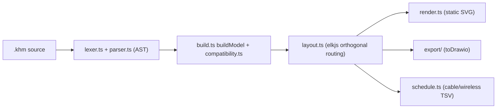
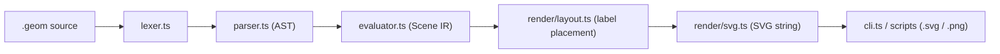
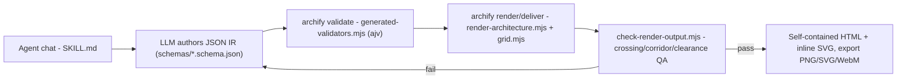
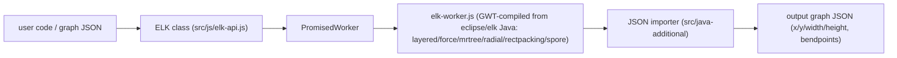

# Weekly Scan: Diagram-as-Code & Visual Tooling — 2026-08-01

**Executive summary:**
- Một làn sóng mới các "diagram-as-code" repo được thiết kế **cho AI agent**, không phải cho người: `tt-a1i/archify`, `shand001/geometry-dsl` để LLM tự sinh IR (JSON hoặc DSL text) rồi chạy qua vòng validate → render → QA hậu-render → tự sửa — một pattern kymostudio nên cân nhắc bổ sung cho tích hợp MCP/agent-skill của mình.
- `kieler/elkjs` xác nhận layered/Sugiyama layout (cycle-breaking → layer assignment → crossing-minimization → node placement → edge routing) là chuẩn công nghiệp cho auto-layout phân tầng — `alignment.py` của kymostudio hiện **chưa có bước crossing-minimization**, đây là gap cụ thể đáng lấp.
- `Love-Rox/kumihimo` (DSL cho sơ đồ tín hiệu AV, port-aware) cho một ý tưởng validate ngữ nghĩa kết nối (signal-type compatibility) đáng tham khảo cho `icons.py`/`dsl.py`, dù bản thân repo còn quá non (0 sao, phát hành cùng ngày, 1 tác giả) để học sâu kiến trúc.

**Mục lục**
1. [Love-Rox/kumihimo](#love-roxkumihimo)
2. [shand001/geometry-dsl](#shand001geometry-dsl)
3. [tt-a1i/archify](#tt-a1iarchify)
4. [kieler/elkjs](#kielerelkjs)
5. [Candidate list đầy đủ (10 repos) & lý do chọn/loại](#candidate-list-đầy-đủ-10-repos--lý-do-chọnloại)

---

## Love-Rox/kumihimo

### §1 — Quick Context (≤80 từ)
Kumihimo là DSL mô tả sơ đồ tín hiệu AV ở cấp **port** (không phải node chung chung), validate signal type/impedance/connector — khác Mermaid ở chỗ hiểu ngữ nghĩa dây cáp thay vì chỉ vẽ hình. Stack: TypeScript monorepo (pnpm), core dùng `elkjs` cho layout, output là **SVG tĩnh** (+ draw.io export). Repo rất mới: 0 sao, toàn bộ release (core/cli/react/vue/rehype/vscode) đều publish trong cùng một ngày (2026‑08‑01), 1 tác giả (SASAGAWA Kiyoshi), CI có (`ci.yml`, `release.yml`). Phân phối: npm (`@love-rox/kumihimo-core` v0.8.0) + VS Code Marketplace.

### §2 — Architecture Deep-Dive
**A. Component inventory** — tất cả trong `packages/core/src/`: `lexer.ts` (tokenizer), `parser.ts` (recursive-descent → AST, dùng private `#`-methods làm combinator), `ast.ts` (kiểu AST), `loader.ts` (`loadDocument`, resolve `use`-import qua resolver do caller cung cấp — core không đụng filesystem), `build.ts` (`buildModel`, dựng model đã resolve từ AST), `compatibility.ts` (validator port/signal), `signals.ts` (registry 38 signal type), `layout.ts` (`layoutDiagram`, dùng thư viện `elkjs`), `render.ts` (`renderSvg`), `schedule.ts` (cable/equipment/wireless schedule), `theme.ts`, `diagnostics.ts`/`messages.ts` (i18n en/ja), `export/` (drawio exporter), và điểm nối tất cả: `compile.ts`.

**B. Pipeline (từ `compile.ts`)**: 1) CLI (`packages/cli`, lệnh `kumihimo build`) hoặc integration package gọi `compile(source, options)` → 2) `loadDocument()` (`loader.ts`) chạy lexer+parser, trả AST + diagnostics, resolve `use` qua resolver ngoài → 3) `buildModel()` (`build.ts`) build model đã resolve, chạy `checkCompatibility()` (`compatibility.ts`) đối chiếu `signals.ts` → 4) `layoutDiagram()` (`layout.ts`): tự tính vị trí device/port theo grid (`headerHeight`, `portPitch`…), giao **chỉ phần edge routing** cho `elkjs` (`elk.algorithm: layered`, `edgeRouting: ORTHOGONAL`) → 5) `renderSvg()` (`render.ts`) stringify model+layout thành SVG tĩnh tự chứa → 6) CLI ghi file, hoặc rẽ nhánh `export/` (drawio) / `schedule.ts` (TSV cable/wireless).

**C. Data model/IR**: hai tầng rõ rệt — AST thô (`ast.ts`) từ parser, và "model" đã resolve (`build.ts`) sau validate — gần giống kymo's parse→Diagram nhưng validate được gộp thẳng vào bước build thay vì tách riêng như `alignment.py`. Mutable/immutable: không xác định.

**D. Input language**: recursive-descent, không có file grammar EBNF riêng (chỉ có `docs/SPEC.md`/`SPEC.ja.md` dạng prose). Error recovery **theo từng statement** — lỗi parse tại 1 dòng chỉ bỏ qua dòng đó (skip tới separator kế tiếp) rồi tiếp tục, nhờ đó editor sống vẫn render khi gõ dở dòng. Diagnostic có span + key i18n.

**E. Layout**: hybrid — vị trí device/port tính thủ công theo lưới cố định, còn **routing cạnh orthogonal giao cho elkjs** (`layered`, `hierarchyHandling: INCLUDE_CHILDREN` cho group, `portConstraints: FIXED_POS`). Crossing-minimization là hành vi mặc định của thuật toán `layered` trong ELK, không thấy bằng chứng custom-tune riêng.

**F. Rendering**: SVG tĩnh string-concatenation trong `render.ts`, **không animation** (không CSS/SMIL/JS), không pluggable — thêm emitter PNG/PDF sẽ cần viết lại gần hết `render.ts` (monolithic).

**G. Extensibility**: thêm signal type = mở rộng `signals.ts`; theme mới = thêm entry `theme.ts`; quy tắc tương thích mở rộng qua các bảng trong `compatibility.ts` (`INTERCHANGEABLE_GROUPS`, `CONNECTOR_CONFUSIONS`, `PASSIVE_ADAPTERS`, `LOSSY_PAIRS`). Không có plugin system chính thức; các framework integration (react/vue/astro/rehype) là package riêng bọc quanh `compile()`.

**H. Dev experience**: CLI `kumihimo`/`khm` với `build`, `check`, `build --watch`, `export drawio`, `export cable --stdout`, `export wireless --stdout`; diagnostics in ra kèm underline span. Có VS Code extension (real-time diagnostics) và package `editor` (live preview trình duyệt). LSP thực sự (protocol): không xác định.

### §3 — Architecture Diagram

### §4 — Verdict (≤140 từ)
Đáng học nhất: (1) `compatibility.ts` — mô hình validate port-to-port nhiều tầng (override tác giả → identical → generic → wireless/wired → connector-confusion → passive-adapter → lossy-pair → interchangeable-group) là ý hay để bổ sung cho `icons.py`/`dsl.py` nếu kymo muốn validate kết nối theo semantic type, không chỉ vẽ; (2) recovery per-statement trong parser (thay vì fail-fast) đáng cân nhắc cho `dsl.py` để editor trực tiếp vẫn render khi có lỗi cú pháp cục bộ; (3) chiến lược layout hybrid (custom position + elkjs chỉ cho edge routing) là tham khảo tốt cho `alignment.py` nếu cần orthogonal routing phức tạp hơn thay vì tự viết staggering. Red flag: `render.ts` monolithic, không animation, không pluggable emitter — yếu hơn kymo (`to_svg.py`/`to_figma.py`/`to_excalidraw.py`/`to_webp.py`). Repo cực mới, 0 sao, mọi release cùng 1 ngày, 1 tác giả — chưa qua thử thách thực tế. **Verdict: glance only.**

---

## shand001/geometry-dsl

### §1 — Quick Context (≤80 từ)
Geometry DSL không phải công cụ diagram/flowchart mà là DSL dựng **hình học toán học chính xác** (point/line/circle/intersect) cho agent AI, khác kymostudio ở domain (math construction, không phải box-and-arrow). Stack: TypeScript thuần, zero runtime dependency; output SVG (native) + PNG (qua `@resvg/resvg-js` optional). Repo health: 2 stars, 0 forks, không có release/tag, không thấy `.github/workflows` (404 → không có CI công khai). Distribution: không publish rõ ràng lên npm registry — cài qua `git clone` làm Agent Skill (`~/.claude/skills/geometry-dsl`), package tên `@geometry-dsl/renderer` với `bin: geometry-dsl`.

### §2 — Architecture Deep-Dive
**A. Component inventory**
- `src/language/lexer.ts` — tokenizer (number/string/identifier/punctuation, xử lý comment `#`, nesting depth cho newline).
- `src/language/parser.ts` — recursive-descent parser, class `Parser` (private) + hàm `parse(source): Program`, ném `GeometryDslError`.
- `src/runtime/evaluator.ts` — walk AST, type-check runtime (`typename()`), overload resolution (vd. `line()` có 3 overload), sinh `Scene`.
- `src/runtime/styles.ts` — style inheritance qua `styled()`.
- `src/geometry/kernel.ts`, `curves.ts`, `math.ts`, `regions.ts`, `index.ts` — kernel hình học thuần hàm (immutable), `intersections()`, `projectPoint()`, `circumcircle()`.
- `src/render/layout.ts` — engine đặt nhãn/collision-avoidance (`layoutLabels()`).
- `src/render/svg.ts` — `renderSvg(scene, options): string`.
- `src/cli.ts` — CLI adapter Node.
- `scripts/validate_geometry.mjs`, `render_geometry.mjs`, `check_docs.mjs` — driver cho agent loop.

**B. Pipeline**: (1) `cli.ts` đọc file `.geom` → (2) `lexer.ts` tokenize → (3) `parser.ts` dựng `Program` AST, lỗi cú pháp ném `GeometryDslError("E_PARSE", …, token)` có line/col → (4) `evaluator.ts` duyệt AST, resolve overload, sinh `Scene { values: Map, objects: GeometryValue[] }` → (5) `render/layout.ts` tính vị trí nhãn (collision avoidance) trong vòng lặp tính bounds của `render/svg.ts` → (6) `render/svg.ts` xuất chuỗi SVG; PNG convert riêng ở `scripts/render_geometry.mjs` qua `@resvg/resvg-js`.

**C. Data model/IR**: `Scene` là IR duy nhất (`values: Map<string, RuntimeValue>`, `objects: GeometryValue[]`, mỗi object có `type`, geometry data, `objectId`, `created`, `style`) — bất biến (immutable), không có khái niệm "lower IR" tách biệt như kymo's layout→alignment 2 giai đoạn.

**D. Input language**: recursive descent thủ công, có formal EBNF grammar riêng ở `docs/spec.md` (24 section, mục 3.8 "EBNF skeleton"). Lỗi có mã ổn định (`E_PARSE`, `E_LAYOUT`) + line/column — thiết kế rõ ràng cho agent self-repair.

**E. "Layout"**: không phải auto-layout khung diagram — người dùng chỉ định toạ độ tuyệt đối qua DSL (`point(-3,-2)`), phần dẫn xuất (`intersect`/`project`/`along`) do `kernel.ts` tính. Engine layout duy nhất là đặt nhãn (`render/layout.ts`): `explicitPlacement`/`regionPlacement` + `placementScore`, 6 vòng refine. Không có khái niệm edge/connector nên không có edge routing.

**F. Rendering**: một backend duy nhất `render/svg.ts` → chuỗi SVG tĩnh, **không animation**. PNG là lớp ngoài (script + optional dep), không phải sibling emitter tích hợp như kymo's `to_figma.py`/`to_excalidraw.py`/`to_webp.py`.

**G. Extensibility**: không thấy plugin/registry system; thêm primitive mới đòi hỏi sửa đồng thời lexer, parser, evaluator, kernel, và svg.ts — coupling chặt.

**H. Dev experience**: CLI có `--help`, `--width/--height/--background`, không có watch mode. Điểm nổi bật nhất là **agent loop**: `SKILL.md` + `scripts/validate_geometry.mjs`/`render_geometry.mjs` định nghĩa vòng validate → render → inspect (agent phải "nhìn" ảnh) → repair, và `scripts/check_docs.mjs` compile mọi ví dụ nhúng trong docs skill.

### §3 — Architecture Diagram

### §4 — Verdict (≤140 từ)
Đáng học nhất: cặp `SKILL.md` + `scripts/validate_geometry.mjs`/`render_geometry.mjs` định hình vòng validate→render→inspect→repair với mã lỗi ổn định + line/col (`GeometryDslError`) — kymostudio có thể áp dụng ý tưởng này cho `dsl.py`'s CLI để hỗ trợ agent tự sửa lỗi tốt hơn. `render/layout.ts`'s clearance-scoring cho label placement cũng đáng đối chiếu với `alignment.py`'s edge-staggering pass, dù domain khác. Red flags: dự án rất non trẻ (2 stars, 0 fork, không release/tag, không CI công khai), domain hẹp (không có edge/connector/BPMN), không animation, coupling chặt giữa các module khi thêm primitive (kém linh hoạt hơn `icons.py`'s resolver). **Verdict: glance only** — domain không trùng kymo, nhưng SKILL.md agent-loop pattern đáng xem lại riêng lẻ.

---

## tt-a1i/archify

### §1 — Quick Context (≤80 từ)
Archify là **agent skill** (không phải standalone app/DSL) biến mô tả hệ thống bằng ngôn ngữ tự nhiên thành HTML diagram tương tác — LLM tự viết JSON IR và tự quyết định layout ("layout judgment over generic auto-layout"), thay vì một layout engine thuần thuật toán. Stack: Node.js ≥18, ESM, zero runtime deps (chỉ `ajv` làm devDependency sinh validator). Output: self-contained HTML + inline SVG, export PNG/JPEG/WebP/SVG/WebM. Repo: 8.3k sao, 631 forks, MIT, version 2.12.0. CI/last-release chi tiết: không xác định. Phân phối: `npx skills add tt-a1i/archify -g`, tích hợp Claude Code/Cursor/Raven/Codex CLI/OpenCode.

### §2 — Architecture Deep-Dive
**A. Component inventory**
- `archify/SKILL.md` — prompt/spec điều khiển toàn bộ workflow cho agent (5 bước: identify type → reference schema/examples → tạo JSON IR → validate → deliver).
- `archify/bin/archify.mjs` — CLI entry, subcommand `render|compare|deliver|preview|validate|inspect|check|guide|examples|doctor|demo`.
- `archify/schemas/{architecture,workflow,sequence,dataflow,lifecycle,common}.schema.json` — JSON Schema per diagram type.
- `archify/scripts/generate-validators.mjs` → biên dịch schema thành `archify/renderers/shared/generated-validators.mjs` (ajv-based).
- `archify/renderers/architecture/render-architecture.mjs` + `grid.mjs` — renderer + grid-layout riêng cho type "architecture"; tương tự cho `renderers/{workflow,sequence,dataflow,lifecycle}/`.
- `archify/renderers/shared/{geometry,validator,diagnostics,layout-report,engineering-profiles,repository-evidence,cli,utils}.mjs` — hạ tầng dùng chung.
- `archify/scripts/check-render-output.mjs` — QA hậu-render (edge crossing, corridor, clearance, route rhythm), gate cho lệnh `deliver`.
- `archify/bin/{preview,open-artifact}.mjs` — live-preview và mở artifact trong browser.

**B. Pipeline (6 bước)**: 1) Agent (chat) đọc `SKILL.md`, xác định `diagram_type`. 2) Agent **tự tay viết** file JSON IR (pos/size hoặc row/col do LLM chọn), tham chiếu `schemas/`+`examples/`. 3) `archify validate` chạy `generated-validators.mjs` (ajv) đối chiếu `schemas/*.schema.json`. 4) `archify render`/`deliver` spawn renderer đúng type, resolve toạ độ qua `grid.mjs` nếu dùng row/col. 5) `scripts/check-render-output.mjs` chạy QA hình học trên SVG (ngưỡng theo `quality_profile: showcase|standard`). 6) Pass → output HTML cuối; fail → trả diagnostic JSON có cấu trúc cho agent tự sửa IR và render lại.

**C. Data model/IR**: JSON tĩnh theo file, required top-level `schema_version, diagram_type, meta, components`. Component: `id/type/label` bắt buộc, optional `row/col` (grid) **hoặc** `pos/size` tuyệt đối cùng tồn tại. Connection: `from/to` bắt buộc, optional `route/via/fromSide/toSide/labelDy`. Không có API mutation runtime — mỗi lần render agent ghi lại toàn bộ file.

**D. Input language**: **không phải DSL text** — JSON do LLM sinh theo hợp đồng JSON Schema. Validation hai lớp: ajv schema check + composition QA riêng, trả diagnostic có category (`crossing/corridor/clearance/segment length`) để agent tự sửa.

**E. Layout algorithm**: Hybrid — phần lớn vị trí do LLM tự đặt (`pos/size` tường minh), hoặc fallback grid cố định trong `grid.mjs` (`stepX = cellW+gapX`, mặc định 4 cột, có `validateGridPlacement` chống chồng ô). Routing dùng hint `fromSide/toSide/route/via`, crossing/corridor phát hiện **hậu kỳ** bằng cross-product trong `check-render-output.mjs`, không phải constraint-solver upfront như `alignment.py`.

**F. Rendering/output**: mỗi type có renderer riêng xuất inline SVG nhúng vào HTML tự chứa (theme dark/light, pan/zoom, search, focus). Export PNG/JPEG/WebP/SVG/WebM — WebM có smoke test riêng, cho thấy pipeline animation/capture thật.

**G. Extensibility**: Thêm diagram type mới = thêm schema + thư mục `renderers/<type>/` + `npm run generate:validators`; theme là toggle runtime trong HTML. Không có SDK/interface plugin chính thức quan sát được.

**H. Dev experience**: CLI đầy đủ vòng đời (`validate/render/deliver/compare/preview/check/guide/doctor/demo`), `preview` = live-reload. Phân phối như agent skill, thiết kế để LLM lái toàn bộ vòng lặp, CLI đóng vai trò guardrail.

### §3 — Architecture Diagram

### §4 — Verdict (≤140 từ)
Đáng học: (1) `check-render-output.mjs` — QA hình học hậu-render (edge crossing, corridor, label clearance, route rhythm) mà kymo chưa có; có thể thêm gate tương tự trước golden test của `to_svg.py`. (2) Hybrid placement: cho phép `pos/size` tường minh song song grid/auto-layout trong cùng schema — đáng xem cho `alignment.py`. (3) Diagnostic JSON có category thay vì raw stack — mô hình tốt cho CLI error UX của `kymo`. Red flag: đây là LLM-authored JSON + validator + renderer đơn giản, **không** có bộ giải constraint layout thật như `alignment.py` 5-pass; "layout" chủ yếu do LLM quyết định thủ công. 8.3k sao rất nhanh cho một agent-skill 1 PR mở/631 fork là bất thường — nghi tăng trưởng do viral hoá cài đặt (`npx skills add`) hơn độ chín kỹ thuật. **Verdict: study deeper** (QA hậu-render + schema hybrid-placement); **glance only** phần "layout algorithm".

---

## kieler/elkjs

### §1 — Quick Context (≤80 từ)
elkjs đưa Eclipse Layout Kernel (Java) sang JS bằng cross-compile GWT, chuyên layered/Sugiyama layout cho dataflow diagram có port — khác kymostudio ở chỗ nó chỉ tính toạ độ, không vẽ SVG. Tech stack lõi: Java/Xtend/GWT compile-to-JS, output là JSON graph (x/y/width/height). Repo health: ~2.7k sao, 120 fork, license EPL-2.0/GPL-3.0, npm mới nhất `0.13.0` (25 bản đã publish, CI GitHub Actions). Distribution: npm (`elkjs`), dùng trong React Flow, sprotty, Cytoscape.

### §2 — Architecture Deep-Dive
**A. Component inventory**
- `src/java/org/eclipse/elk/...` — code Java/GWT viết riêng cho elkjs, `gwtModule = org.eclipse.elk.js.ElkJs` (điểm vào GWT compiler).
- `src/java-additional/org/eclipse/elk/...` — lớp "emulation" thay các phần Java không tương thích GWT (vd `ElkGraphJson.java`), triển khai import JSON→ElkGraph bằng GWT JSON.
- `src/js/elk-api.js`, `main-api.js`, `main-node.js` — 3 file JS **viết tay duy nhất** ở runtime: class `ELK`, `PromisedWorker`, `convertGwtStyleError()`.
- `build.gradle` — kéo Java source từ checkout **sibling `../elk`**: `org.eclipse.elk.core`, `.graph`, `.graph.json`, `.alg.common`, `.alg.force`, `.alg.layered`, `.alg.mrtree`, `.alg.rectpacking`, `.alg.radial`, `.alg.spore` — rồi GWT-compile (`task gwtc`) ra `build/js/elk-worker*.js`.
- `typings/*.d.ts` — TypeScript declarations viết tay.
- `lib/` (artifact build) — `elk-api.js`, `elk.bundled.js`, `elk-worker.js`, `main.js`, phần lớn **compiled-from-Java**, không phải source hand-written.

**B. Pipeline**: (1) user gọi `new ELK({...})` (`src/js/elk-api.js`) → (2) `elk.layout(graph)` giao cho `PromisedWorker` → (3) worker post-message graph JSON sang `elk-worker.js` (GWT-compiled từ Java ELK) chạy trong Web Worker (browser) hoặc cùng process (Node) → (4) bộ import JSON dựng object model ELK graph nội bộ → (5) thuật toán được chọn (`layered`/`force`/`mrtree`/...) chạy layout → (6) graph JSON kết quả (cùng shape, có thêm x/y/width/height, bendpoints) serialize ngược, Promise resolve.

**C. Data model/IR**: một cây JSON duy nhất — `nodes`(`children`)/`edges`/`ports`/`labels` + `layoutOptions` (key-value string). Input graph và output graph **cùng shape**, output chỉ là input được bổ sung toạ độ; mutate in-place hay trả bản copy: không xác định.

**D. Input language design**: không phải text DSL — JSON graph object đưa thẳng vào `layout()`, khác hẳn `.kymo` của kymostudio.

**E. Layout algorithm**: `build.gradle` xác nhận các thuật toán compile vào: `alg.layered` (Sugiyama/layered — mặc định), `alg.force`, `alg.mrtree`, `alg.radial`, `alg.rectpacking`, `alg.spore`; `alg.disco` hiện **bị tắt** trong CI ("DisCo breaks Github Actions for unknown reasons, #291"). Chi tiết heuristic crossing-minimization cụ thể (barycenter/median/network-simplex): không xác định trong repo elkjs này — nằm trong Java source của `eclipse/elk` upstream.

**F. Rendering**: README nói thẳng "elkjs itself is a graph layout engine _only_ ... no rendering, styling, etc. is provided" — chỉ xuất toạ độ, người dùng tự vẽ.

**G. Extensibility**: constructor `ELK({algorithms: [...]})` chỉ chọn *subset* thuật toán đã compile sẵn, không nạp thuật toán mới lúc runtime — thuật toán bị "bake" vào bundle GWT lúc build Java. `layoutOptions` là cơ chế cấu hình per-node/edge/graph nhưng danh sách option đầy đủ không nằm trong repo.

**H. Dev experience**: API Promise-based sạch, hỗ trợ Web Worker + Node, có `.d.ts`, có API introspect (`knownLayoutOptions()`, `knownLayoutAlgorithms()`). Build từ source đòi hỏi toolchain nặng: Gradle + Xtext/Xtend + GWT + Java pinned + checkout riêng monorepo `eclipse/elk`.

### §3 — Architecture Diagram

### §4 — Verdict (≤140 từ)
Đáng học nhất là **mô hình pha của layered/Sugiyama** (`alg.layered`): cycle-breaking → layer assignment → crossing-minimization sweep giữa layer kề nhau → node placement trong layer → edge routing. kymostudio nên thêm một auto-layout mode "layered" tùy chọn trong `layout.py` triển khai đúng 4 bước này, vì `alignment.py` hiện chưa có bước crossing-minimization nào. **Không nên** đưa elkjs làm dependency: nó chỉ là ~3 file JS wrapper quanh blob GWT-compiled từ Java monorepo, nặng, không có Python binding, và JS lib của kymostudio chủ trương dependency-free. Red flag: toolchain Java→GWT dễ vỡ (disco bị tắt vì lỗi CI không rõ nguyên nhân), thuật toán không pluggable runtime. Open question: chi tiết crossing-min heuristic nằm ở `eclipse/elk` Java source, chưa kiểm chứng trong nghiên cứu này. **Verdict: study deeper (ý tưởng thuật toán), không dùng làm dependency.**

---

## Candidate list đầy đủ (10 repos) & lý do chọn/loại

Nguồn: topic search (`diagram-as-code`, `dsl`, `svg-animation`, `graph-visualization`, `layout-algorithm`) qua GitHub Search API, lọc `pushed:>2026-07-25`, loại trừ chart libs / icon packs / awesome-lists / fork-only theo tiêu chí đã cho.

| # | Repo | Vì sao vào shortlist | Deep-dive? |
|---|------|----------------------|------------|
| 1 | `Love-Rox/kumihimo` | Novel DSL, port-aware signal-flow, mermaid-alternative, brand new | ✅ §1 |
| 2 | `shand001/geometry-dsl` | Novel DSL cho AI agent, zero-dep compiler, formal EBNF | ✅ §2 |
| 3 | `tt-a1i/archify` | Agent-skill diagram tool, tăng trưởng 8.3k sao bất thường, QA hậu-render đáng chú ý | ✅ §3 |
| 4 | `kieler/elkjs` | Layout algorithm nghiêm túc (layered/Sugiyama), trực tiếp liên quan `alignment.py` | ✅ §4 |
| 5 | `goadesign/model` | Structurizr-style Model DSL (Go) cho C4 architecture diagrams, 465 sao, có push tuần này | Không — deprioritize vì layout dựa vào Structurizr/Graphviz bên ngoài, ít novelty layout/parser hơn 4 repo trên |
| 6 | `nordstad/PinViz` | GPIO wiring diagram generator (Python→SVG), smart routing, MCP server riêng | Không — domain hẹp (hardware pinout), 5 sao, chưa đủ tín hiệu trưởng thành |
| 7 | `justdeko/kuiver` | Compose Multiplatform library visualize directed graph (Kotlin) | Không — thiên về UI component hơn compiler/DSL, ít liên quan trực tiếp pipeline kymo |
| 8 | `plantuml/plantuml` | Established DSL, có push trong tuần nhưng là routine maintenance, không phải "significant update" | Không — đã quá quen thuộc, không phải phát hiện mới |
| 9 | `FigDown/figdown` | 0 sao, xuất hiện trong topic `diagram-as-code`, push hôm nay | Không — chưa đủ nội dung để verify (không có README/code rõ ràng khi kiểm tra nhanh) |
| 10 | `uulab-official/drawio-skills` | Agent skill pack cho draw.io, cùng pattern với archify | Không — trùng lặp finding với archify (LLM-authored IR + skill wrapper), 0 sao |

---

*Báo cáo tự động, dữ liệu từ GitHub Search API + `raw.githubusercontent.com` fetch ngày 2026-08-01. Các nhận định "không xác định" nghĩa là agent nghiên cứu không tìm được evidence trực tiếp trong repo tại thời điểm fetch.*
