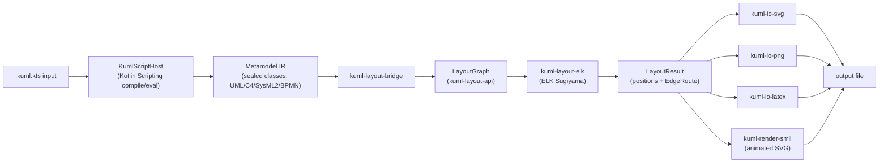
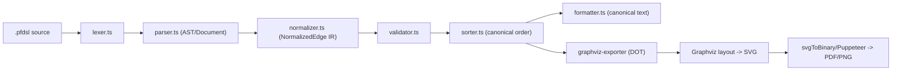
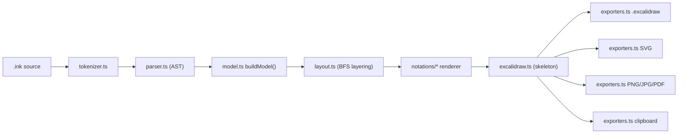
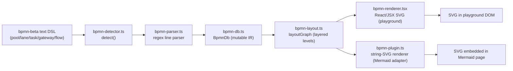

# Weekly Scan: Diagram Tooling — 2026-08-02

**Tuần khảo sát:** 2026-07-26 → 2026-08-02

## Executive Summary

- Tuần này chỉ tìm được **6 candidate** đủ tiêu chuẩn recency + relevance (dưới mục tiêu 8-10) — domain diagram-as-code không có nhiều repo mới/active trong khung 7 ngày; đã ghi lại các repo bị loại và lý do ở cuối file.
- Điểm nổi bật nhất tuần này là **kUML** (Kotlin-DSL-as-compiler, không viết parser riêng, tách `LayoutGraph`/`LayoutResult` engine-agnostic khỏi renderer) và **OKHP3/mermaid-diagram-bpmn** (một BPMN-text-DSL khác đang giải cùng bài toán với `.kymo`'s BPMN importer) — đáng đối chiếu trực tiếp với kiến trúc kymostudio.
- Không có repo nào tuần này đủ chín để "copy kiến trúc" nguyên khối; giá trị chủ yếu nằm ở các **ý tưởng cục bộ** (layout-IR contract, canonical-sort/formatter, math-in-DSL, operator design cho edge) chứ không phải toàn bộ pipeline.

## Table of Contents

1. [kuml-dev/kUML](#1-kuml-devkuml)
2. [takasek/pfdsl](#2-takasekpfdsl)
3. [regaj/inkling](#3-regajinkling)
4. [OKHP3/mermaid-diagram-bpmn](#4-okhp3mermaid-diagram-bpmn)
5. [Candidate khác (chỉ liệt kê, không deep-dive)](#5-candidate-khác-chỉ-liệt-kê-không-deep-dive)
6. [Loại trừ sau xác minh](#6-loại-trừ-sau-xác-minh)

---

## 1. kuml-dev/kUML

<https://github.com/kuml-dev/kUML>

### §1 Quick Context

kUML là DSL Kotlin type-safe cho UML 2.x/SysML 2/C4/BPMN 2.0/ERM, compile bằng chính Kotlin Scripting host thay vì parser tự viết — khác biệt cốt lõi so với kymostudio (text DSL + parser riêng). Tech stack: Kotlin/JVM, Gradle multi-module (~40 module), ELK 0.11.0 (layout), Apache Batik (PNG), kotlinx.serialization; output SVG/PNG/SMIL-animated-SVG/APNG/WebP/MP4/LaTeX-TikZ/XMI/ARXML/SQL. Repo health: 18 stars, 0 forks, 555 commits, release gần nhất v0.46.0 (2026-08-01), CI (ci.yml + codeql.yml) chạy `./gradlew build` có test; contributor chủ yếu là "betschwa" và "claude" (commit qua Claude Code). Phân phối: CLI, Homebrew/Chocolatey/Docker/DEB/RPM/DMG/MSI, Maven Central, JetBrains plugin, VS Code (repo riêng) + LSP.

### §2 Architecture Deep-Dive

**A. Component inventory:** `kuml-core-script` (`kuml-core/kuml-core-script/src/main/kotlin/.../script/KumlScriptHost.kt`) — bọc `BasicJvmScriptingHost` để compile/eval `.kuml.kts`, có sandbox (bwrap/Windows Job Object). `kuml-metamodel-uml/-c4/-bpmn/-sysml2/-kerml` (`kuml-metamodel/...`) — sealed-class metamodel Kotlin thuần. `kuml-layout-api` (`kuml-renderer/kuml-layout-api`) — contract `LayoutGraph`/`LayoutResult`/`EdgeRoute`. `kuml-layout-bridge`, `kuml-layout-elk` (ELK Sugiyama), `kuml-layout-grid` (engine grid tự viết, opt-in). `kuml-io-svg/-png/-latex/-bpmn/-emf/-json`, `kuml-render-smil` (animation). `kuml-cli` — CLI entry point.

**B. Pipeline/control flow:**
1. User viết `order-domain.kuml.kts` dùng DSL builder (`classDiagram{}`, `c4{}`...).
2. Chạy `kuml render order-domain.kuml.kts --format svg`.
3. CLI gọi `KumlScriptHost` compile+eval script (in-process hoặc sandbox worker) → sinh instance metamodel sealed-class, `DiagramExtractor` trích diagram.
4. `kuml-layout-bridge` chuyển model → `LayoutGraph`.
5. `kuml-layout-elk` (mặc định) hoặc `-grid` tính `LayoutResult` (vị trí + `EdgeRoute`).
6. `kuml-io-svg` (hay -png/-latex/-smil) render ra file output.

**C. Data model/IR:** Hai tầng IR rõ rệt — (a) metamodel domain: sealed Kotlin class + data class, bất biến (immutable), serialize qua kotlinx.serialization, ID xác định (namespace path + `::`); (b) IR thấp hơn, engine-agnostic: `LayoutGraph`→`LayoutResult` trong `kuml-layout-api`, tách khỏi mọi renderer/engine cụ thể — đúng khái niệm "compile xuống IR thấp hơn" trước khi vẽ.

**D. Input language design:** Không có parser tự viết/BNF nào — DSL "chính là Kotlin" (type-safe builder, lambda-with-receiver), được compile bởi chính Kotlin compiler qua Kotlin Scripting API. Không có EBNF vì ngữ pháp = ngữ pháp Kotlin. Báo lỗi: `ResultWithDiagnostics<EvaluationResult>` (diagnostics chuẩn của compiler), lộ ra CLI qua `kuml diagnostics` dạng TSV (`severity⇥startLine⇥startCol⇥endLine⇥endCol⇥message`) cho IDE/LSP.

**E. Layout algorithm:** ELK Sugiyama layered (hierarchical, mặc định), engine "grid" pure-Kotlin opt-in qua `--layout=grid|elk|auto`. Edge routing: sealed type 4 kiểu — Direct, OrthogonalRounded, TreeRounded, Bezier. Chi tiết thuật toán giảm crossing bên trong ELK: không xác định.

**F. Rendering/output strategy:** Pluggable emitter theo module — mỗi backend (`kuml-io-svg/-png/-latex/-bpmn/-emf`) là 1 gói riêng cùng tiêu thụ `LayoutResult`+model; animation qua `kuml-render-smil` (SMIL thuần, không JS), mỗi loại diagram có renderer riêng (`SequenceSmilRenderer`, `StmSmilRenderer`, `BpmnSmilRenderer`).

**G. Extensibility:** ServiceLoader SPI khắp nơi — `KumlCodeGenerator`, `KumlTransformer` (M2M), `KumlProfile`, `KumlLlmProviderSpi`, `KumlPlugin`/`KumlPluginDescriptor` (`kuml plugin init/search/update`); theme qua `kuml-themes-core`+`kuml-themes` (4 theme có sẵn).

**H. Dev experience:** CLI Clikt (`render/watch/validate/fmt/diagnostics/serve/run`, completion bash/zsh/fish), `kuml watch` polling 500ms, `kuml serve` (Ktor/Netty + CodeMirror6, live preview 300ms), JetBrains plugin (annotator, live SVG pan/zoom), VS Code (repo riêng) dùng `kuml-language-server` (LSP4J).

### §3 Architecture Diagram

### §4 Verdict

Đáng học nhất: (1) tách `kuml-layout-api` (contract engine-agnostic `LayoutGraph`/`LayoutResult`/`EdgeRoute`) khỏi renderer — kymo nên cân nhắc tách hẳn IR hình học này khỏi `alignment.py`/`to_svg.py` để dễ thử engine layout khác. (2) `EdgeRoute` sealed 4 kiểu (Direct/OrthogonalRounded/TreeRounded/Bezier) là vocabulary đáng tham khảo khi đặt tên các kiểu routing trong fan-in/trunk-lane của kymo. (3) `kuml diagnostics` TSV (severity+vị trí) là format gọn cho tích hợp editor, đáng so với cách kymo báo lỗi hiện tại. Quyết định DSL đáng lưu ý (nhưng không nên bắt chước): kUML bỏ hẳn parser, dùng chính Kotlin làm DSL — được IDE support miễn phí nhưng khóa cứng vào JVM, trái ngược triết lý dual-impl Python/JS độc lập, portable của kymo. Red flag: 18 sao/0 fork/555 commit nhưng README liệt kê khối lượng tính năng khổng lồ (blockchain adapters, AI multi-agent, vault, plugin marketplace), release gần như mỗi ngày (v0.37→v0.46 trong <2 tuần); contributor thực chất 1 người + "claude" — dấu hiệu vibe-coded, độ tin cậy chưa kiểm chứng ngoài phạm vi đã đọc. Open question: chất lượng layout ELK thực tế trên diagram phức tạp — không xác định. **Verdict: glance only tổng thể, study deeper riêng phần layout-contract và SMIL-renderer split.**

---

## 2. takasek/pfdsl

<https://github.com/takasek/pfdsl>

### §1 Quick Context

PFDSL là DSL văn bản thuần cho process-flow diagram, biên dịch qua pipeline lexer→parser→normalizer→validator→sorter rồi xuất DOT/SVG qua Graphviz — khác kymostudio ở chỗ không tự viết layout engine, không render animation, và ưu tiên canonical form để diff/format thay vì styling phong phú. Tech stack: TypeScript monorepo (pnpm workspaces), phụ thuộc chính là `yaml` (frontmatter) và Puppeteer (SVG→PDF/PNG); layout/render backend duy nhất là Graphviz (`dot`). Output: DOT, SVG, PDF, PNG. Repo health: 0 sao, 0 fork, chưa có release nào published, ~27 issue mở/2 PR mở, 2 tác giả chính (takasek + agent "claude" — phần lớn commit do Claude Code tạo), có CI (test.yml + nhiều check workflow) nhưng chưa release nên độ ổn định chưa rõ. Distribution: các gói npm `@pfdsl/*` (core, cli, graphviz-exporter, preview-engine, metadata-exporter) + VSCode extension.

### §2 Architecture Deep-Dive

**A. Component inventory:** `lexer.ts` (`packages/core/src/lexer.ts`) — lexer thủ công char-by-char, tokenize `>>`/`->`/`>>?`/ID/comment/bracket. `parser.ts` (`packages/core/src/parser.ts`) — recursive-descent, sinh AST `Document` (statement: node-decl/input-edge/feedback-edge/output-edge/chain). `types/edge.ts` — định nghĩa `NormalizedEdge` (union input/feedback/output). `normalizer.ts` — hạ AST xuống `NormalizedEdge[]`, suy luận kind node, khử trùng lặp, phát hiện xung đột (vd lỗi N002). `validator.ts` — kiểm tra ràng buộc topology (vd V001). `sorter.ts` — canonical sort ổn định (connected component, rank, edge type, lexicographic). `formatter.ts` — in lại nguồn dạng canonical. `graph.ts`/`graph-analysis.ts` — cấu trúc & phân tích graph. `graphviz-exporter/src/index.ts` — `exportDot`, `exportDiffDot`, `svgToBinary` (qua Puppeteer). `packages/cli` — lệnh check/fmt/render/diff/reindex. `packages/vscode-extension` — preview/format/diff/jump-to-definition.

**B. Pipeline/control flow:**
1. User chạy `pfdsl render foo.pfdsl`.
2. `lexer.ts` tokenize source.
3. `parser.ts` recursive-descent dựng AST `Document`.
4. `normalizer.ts` hạ AST → `NormalizedEdge[]` + suy node kind + khử trùng lặp.
5. `validator.ts`+`sorter.ts` kiểm tra ràng buộc và sắp canonical order.
6. `graphviz-exporter` sinh DOT, gọi Graphviz layout ra SVG, rồi `svgToBinary` (Puppeteer) rasterize PNG/PDF nếu cần.

**C. Data model/IR:** Hai tầng lowering — AST (plain TS object: IdNode/ArtifactExpr/ChainSegment/Statement) → `NormalizedEdge[]` (IR ngữ nghĩa canonical, discriminated union; không thấy `readonly` nên về bản chất mutable, mỗi pass trả object mới theo convention chứ không enforce ở type level). Không dùng class/OOP. Đơn giản hơn Diagram (component/region tree) của kymo: PFDSL chỉ là flat edge list.

**D. Input language design:** Lexer + parser tự viết (manual state machine + recursive descent), không regex-line/PEG/ANTLR. Có EBNF chính thức tại `docs/spec/spec.md` §8: `<chain> ::= <artifact-expr> <input-op> <process-id> '->' <artifact-expr> (...)*`, `<input-op> ::= '>>' | '>>?'`. Error reporting: mã lỗi họ FM/P/V/W/N/L, >30 mã (L001 unclosed string, N002 node vừa artifact vừa process, V001 single generation source), severity error/warning + chế độ `--strict`.

**E. Layout algorithm:** Không tự cài thuật toán — giao hoàn toàn cho Graphviz (hierarchical/rank-based), `rankdir` cấu hình qua frontmatter (mặc định LR). Edge routing dùng spline mặc định Graphviz. Feedback edge (`>>?`) gắn `constraint=false` để loại khỏi ranking — không tự làm crossing-minimization, đó là việc của Graphviz.

**F. Rendering/output strategy:** Một backend chính (DOT→SVG qua Graphviz) + rasterize qua Puppeteer (`svgToBinary`). Không thấy cơ chế animation. Không rõ có common emitter interface giữa graphviz-exporter/metadata-exporter/preview-engine — không xác định.

**G. Extensibility:** Theme qua frontmatter YAML map tag/status → thuộc tính DOT (fillcolor, color, fontcolor, style, penwidth) — cấp tác giả DSL, không phải plugin runtime. Không có bằng chứng plugin system để thêm renderer/icon mới.

**H. Dev experience:** CLI `check/fmt/render/diff` + nhóm lệnh graph-query/metadata, `reindex` tự gán index topological. VSCode extension: TextMate grammar nhúng YAML, preview side-by-side, format, export, normalize view, diff/clear-diff, jump-to-definition (Alt+F12) — nhưng không thấy activation events/diagnostics/hover/completion rõ, nên không rõ có LSP thật hay chỉ command-based.

### §3 Architecture Diagram

### §4 Verdict

Đáng học kỹ phần ngôn ngữ, không phải layout. Operator design `>>`/`->`/`>>?` cho phép chain nhiều segment 1 dòng và tách feedback edge để loại khỏi ranking (`constraint=false`) — kymo có thể vay ý tưởng "edge phi cấu trúc không ảnh hưởng auto-layout" cho DSL riêng. Cặp sorter+formatter tạo canonical form ổn định cho diff — kymo hiện chưa có formatter/canonical-order riêng cho `.kymo`, đáng cân nhắc bổ sung phục vụ golden-test/diff. Taxonomy mã lỗi theo họ (FM/P/V/W/N/L + severity + `--strict`) là mẫu tốt cho diagnostics của `dsl.py`/`dsl.ts`. Layout thì không có gì để "steal" — PFDSL giao hết cho Graphviz, ngược hẳn triết lý tự viết `alignment.py`/`layout.ts` của kymo. Red flags: 0 sao, chưa release, phần lớn commit do agent tạo, chưa production-proven, phụ thuộc Puppeteer nặng cho raster. Câu hỏi mở: có thật sự có LSP hay chỉ command-based. **Verdict: glance only cho kiến trúc tổng thể, study deeper riêng phần grammar/operator + canonical-sort design.**

---

## 3. regaj/inkling

<https://github.com/regaj/inkling>

### §1 Quick Context

Inkling là desktop app biên dịch DSL dòng-lệnh thành ER diagram Excalidraw ở 5 notation (Chen/Crow's Foot/UML/IDEF1X/Min-Max) — khác kymostudio ở chỗ output là Excalidraw-editable, không phải SVG tĩnh, và chuyên biệt cho ER + data structures + math-in-DSL. Stack: TypeScript + Rust/Tauri v2, React, CodeMirror 6, `@excalidraw/excalidraw`; core engine gần như zero-dependency, Playwright cho CLI export. Output: `.excalidraw`, SVG, PNG (@1x/2x/3x), JPG, PDF, clipboard. Repo rất mới: 0 stars, 0 forks, tạo 2026-07-16, push gần nhất 2026-08-01 (~2 tuần tuổi), có `ci.yml` và thư mục `test/` (vitest) ở cả `core`/`cli` — số contributor và release: không xác định. Phân phối: Tauri desktop binary (macOS/Windows/Linux) + headless CLI.

### §2 Architecture Deep-Dive

**A. Component inventory:** `tokenizer.ts` (`packages/core/src/tokenizer.ts`) — lexer theo dòng, gọi `detexLine()` xử lý math trước khi tách token. `parser.ts` — dispatch theo từ khoá đầu dòng, sinh AST + diagnostics. `model.ts` — `buildModel()` 2-pass biến AST thành `Model` ngữ nghĩa (entities/relationships/attributes/structures/trees). `layout.ts` — BFS layering + xếp "satellite" attribute quanh entity. `notations/` (`chen.ts`, `crowsfoot.ts`, `uml.ts`, `idef1x.ts`, `minmax.ts`, `registry.ts`, `shared.ts`, `structures.ts`, `tree.ts`, ...) — renderer per-notation, đăng ký qua registry. `excalidraw.ts` — Scene → Excalidraw element skeletons. `exporters.ts` — registry format xuất file. `latex.ts` — typeset `$...$`. `steps.ts` — tách multi-tree doc thành các step để export từng giai đoạn. `compile.ts` — orchestrator. `apps/desktop/src-tauri` — vỏ Rust/Tauri. `packages/cli` — exporter headless dùng Playwright.

**B. Pipeline/control flow:**
1. Người dùng gõ `.ink` trong CodeMirror editor (hoặc chạy CLI trên file).
2. `tokenize()` chạy `detexLine()` xử lý math rồi tách token từng dòng.
3. `parse()` sinh AST + diagnostics, mỗi dòng độc lập.
4. `buildModel()` 2-pass ra `Model`.
5. `layout()` (BFS layering) gán toạ độ, notation renderer tương ứng sinh `Scene`.
6. `excalidraw.ts` + exporter tương ứng ghi `.excalidraw`/SVG/PNG/... ra file hoặc canvas Tauri.

**C. Data model/IR:** Plain TS interface/object, mutable qua các pass (`entities.set()`, `struct.values.push()`...), không immutable. Có 3 tầng biểu diễn kế tiếp: AST → `Model` → `Scene` (positioned) → Excalidraw skeleton — gần giống "compile xuống IR thấp hơn" nhưng không gọi tên chính thức là IR.

**D. Input language design:** Custom hand-rolled, line-based, "one-statement-per-line", không phải PEG/ANTLR/combinator. Không có EBNF/BNF hình thức nào viết ra trong repo (`SPEC.md` và `docs/DSL.md` trỏ lẫn nhau, không bên nào chứa grammar thật). Error reporting: lỗi từng dòng không cascade, diagnostic có severity/message/line/col/length + mã lỗi cụ thể (`unknown-command`, `bad-coordinate`, `bad-cardinality`...).

**E. Layout algorithm:** Hierarchical BFS layering (không force-directed, không constraint-based): layer theo khoảng cách BFS, cross-axis center-stack; satellite attributes xếp cung tròn quanh owner. Không có edge routing/crossing-minimization tường minh — dựa vào thứ tự khai báo.

**F. Rendering/output strategy:** Renderer duy nhất là Excalidraw scene graph (rect/ellipse/diamond/text/line/arrow), rồi re-encode qua exporter registry ra nhiều format. Không animation kiểu SVG animate; "live" = recompute toàn pipeline mỗi keystroke. `steps.ts` cho export từng bước rời rạc (storyboard-style), không phải animation thật. Pluggable emitter pattern rõ ràng (exporter registry).

**G. Extensibility:** 3 registry đồng dạng (notation, exporter, DSL statement/shape) theo pattern `register(key, impl)`; thêm notation mới = 1 file renderer + register(), tokenizer/parser/model không đổi. Theme: `palette.ts` tham số hoá, không xác định cơ chế plugin theme riêng.

**H. Dev experience:** CLI headless (`packages/cli`, dùng Playwright) render `.ink` ngoài desktop. Không xác định IDE/LSP integration. Live-compile mỗi keystroke trong app desktop. Preview chỉ desktop (Tauri), không có browser playground công khai.

### §3 Architecture Diagram

### §4 Verdict

Kỹ thuật đáng học: (1) math-in-DSL của `latex.ts` — detect `$...$`, map sang Unicode/sub-superscript glyph thay vì render LaTeX thật, zero-dependency, đáng tham khảo cho label toán trong kymo `.kymo` DSL/`to_excalidraw.py` vì giữ measuring/RTL/export nguyên vẹn. (2) 3-registry pattern (notation/exporter/shape) rất gọn — kymostudio có thể áp dụng tương tự cho việc thêm BPMN notation hoặc export backend mới mà không đụng core. (3) BFS layering đơn giản, dễ đọc hơn `alignment.py` 5-pass của kymo nhưng thiếu crossing-minimization — không nên bê nguyên cho case phức tạp. Cờ đỏ: repo 2 tuần tuổi, 0 sao, không release, không EBNF hình thức dù tài liệu tự nhận có SPEC — độ trưởng thành thấp, chưa kiểm chứng qua production. Câu hỏi mở: mutable model qua nhiều pass có gây bug thứ-tự-phụ-thuộc không; performance re-compile-toàn-bộ mỗi keystroke với diagram lớn. **Verdict: glance only cho kiến trúc tổng thể, nhưng đáng đọc kỹ riêng `latex.ts` và notation-registry pattern.**

---

## 4. OKHP3/mermaid-diagram-bpmn

<https://github.com/OKHP3/mermaid-diagram-bpmn>

### §1 Quick Context

bpmn-beta là một Mermaid diagram-type đề xuất: viết BPMN bằng text thuần trong code fence, tự vẽ SVG (không phụ thuộc bpmn-js), khác bpmn-js (không cần XML/editor runtime) và khác Mermaid generic (thêm cú pháp pool/lane/gateway/task-subtype chuyên biệt cho BPMN). Tech stack: TypeScript + React/Vite, pnpm monorepo; output duy nhất là SVG (qua playground React và qua adapter Mermaid). Repo health: 4 stars, 0 fork, không có release nào, không thấy CI badge; commit gần nhất tính đến 2026-08-02 là 1/8/2026, hoạt động khá đều nhưng phần lớn commit gần đây là về agent-skills chứ không phải core parser/renderer. Phân phối: chưa publish npm ("pending"), chỉ có playground live tại okhp3.github.io/mermaid-diagram-bpmn. **Đây là repo relevant nhất tuần này với kymostudio** vì giải cùng bài toán: text DSL cho BPMN, kymo có sẵn BPMN importer/exporter (`from_bpmn.py`/`from-bpmn.ts`).

### §2 Architecture Deep-Dive

**A. Component inventory (tất cả trong `app/src/lib/`):** `bpmn-detector.ts` — nhận diện diagram type bằng dòng đầu `bpmn-beta`. `bpmn-parser.ts` — hand-written line/regex parser, sinh ra `BpmnDb`. `bpmn-db.ts` — class IR tuân theo Mermaid `DiagramDB` interface, lưu nodes/flows/pools/lanes. `bpmn-layout.ts` — thuật toán layout (`layoutGraph`, `layoutFlat`, `layoutWithPools`, `assignLevels`). `bpmn-renderer.tsx` — renderer SVG dạng React/JSX cho playground. `bpmn-plugin.ts` — adapter implement `ExternalDiagramDefinition` của Mermaid, renderer sinh SVG string riêng để nhúng vào Mermaid core. `bpmn-styles.ts` — `getStyles()`/CSS class theo theme. `bpmn-examples.ts` — corpus ví dụ DSL.

**B. Pipeline/control flow:**
1. User viết block `bpmn-beta ... pool { lane { task/gateway/flow } }` trong playground hoặc Markdown fence.
2. `detect()` kiểm tra dòng non-empty đầu tiên == `bpmn-beta`.
3. `parse()` chạy các regex NODE/POOL/LANE/FLOW pattern, dùng context-stack cho pool/lane lồng nhau, ghi vào `BpmnDb` (mutate in-place, giống pattern `parser.yy` của Mermaid/JISON).
4. `layoutGraph(db)` tính `levels` bằng relaxation lặp (longest-path leveling) rồi gán x/y — rẽ nhánh `layoutFlat` (không pool) hoặc `layoutWithPools` (mỗi lane layout độc lập rồi xếp chồng dọc).
5. Renderer (React component cho playground, hoặc string-SVG builder trong `bpmn-plugin.ts` khi nhúng Mermaid) vẽ shape theo layout + CSS class/theme.
6. SVG xuất hiện trong DOM.

**C. Data model/IR:** `BpmnDb` là một **class mutable**, không immutable/functional — parser mutate trực tiếp qua `addNode/addFlow/addPool/addLane`, renderer/layout đọc thẳng instance đó (không deep-clone). Không có khái niệm "lower IR" tách biệt rõ ràng, nhưng object `BpmnLayout` (nodes/edges/pools/lanes + width/height, do `bpmn-layout.ts` trả về) đóng vai trò IR bậc hai chỉ dùng cho renderer.

**D. Input language design:** Parser **hand-written, regex line-based** (7 pattern cứng: NODE/POOL/LANE/COND_FLOW/SEQ_FLOW/DEF_FLOW/MSG_FLOW), không có PEG/ANTLR/parser-combinator. Chưa có BNF/EBNF chính thức — `dsl-spec.md` mô tả rule bằng văn xuôi, grammar Langium chỉ là "roadmap", chưa triển khai. So với BPMN XML: pool/lane thành block `{ }` thay vì `<laneSet>`, gateway dùng keyword+subtype (`xor`/`and`/`or`) thay vì phần tử `exclusiveGateway`/..., task dùng hậu tố `:subtype` (`task:user`) thay vì `<userTask>`, flow dùng ký hiệu ASCII (`-->`, `==>`, `~~>`) thay cho `<sequenceFlow>`/`<messageFlow>` — súc tích hơn nhiều nhưng **chưa hỗ trợ import/export XML** (README: "not BPMN XML import or export").

**E. Layout algorithm:** **Hierarchical/layered** kiểu Sugiyama đơn giản — `assignLevels` là relaxation lặp gán level theo longest-path, không có bước crossing-minimization (không barycenter/median ordering). Edge routing chỉ là **đường thẳng 2 điểm** (from-center → to-center), không orthogonal, không bend point. Pool/lane: mỗi lane layout độc lập rồi cộng dồn theo trục Y, hằng số cố định — không phải constraint-solver.

**F. Rendering/output strategy:** Chỉ một output format (SVG), nhưng **hai renderer song song** — React/JSX cho playground và string-builder trong `bpmn-plugin.ts` cho nhúng Mermaid — không thấy cơ chế pluggable-emitter chung. Glyph BPMN vẽ tay: gateway = polygon hình thoi + marker (X/+/vòng tròn+dấu cộng); event = 2 vòng tròn đồng tâm; task = rounded-rect + icon overlay theo subtype; pool/lane = `<rect>`. Không có animation.

**G. Extensibility:** Thêm element mới đòi hỏi sửa tay ở ≥4 chỗ — regex pattern, union type `BpmnNode.kind/subtype`, nhánh render trong renderer, class CSS trong `bpmn-styles.ts` — không có plugin/registry API. Theme qua CSS class + đọc `themeVariables` từ `window.mermaid.mermaidAPI.getConfig()`.

**H. Dev experience:** pnpm monorepo + Vite dev server, `tsc --build` typecheck, test bằng `node --test`, playground browser live (kèm trang DSL reference/architecture/roadmap). Không có CLI riêng, không IDE extension, không watch-mode CLI nào ngoài Vite HMR ngầm định.

### §3 Architecture Diagram

### §4 Verdict

DSL của bpmn-beta gọn hơn `.kymo` ở phần BPMN (keyword+subtype, arrow ASCII cho flow-kind) nhưng thô hơn: parser regex/line-based không có validate ngữ nghĩa và chưa có grammar hình thức — kymostudio's `dsl.py` + `docs/DSL.md` (EBNF dual-sourced) đã kỷ luật hơn nhiều. Điểm đáng học: cú pháp `task:user`/`task:service` súc tích, và tách flow-kind bằng ký hiệu riêng (`-->`, `==>`, `~~>`) là ý hay để cân nhắc cho `.kymo`'s edge syntax. Layout của họ (longest-path leveling, không crossing-minimization, edge = đường thẳng) thô sơ hơn `alignment.py`'s 5-pass resolver của kymostudio — không có gì để "steal" ở đây, ngược lại. Red flag lớn nhất: `BpmnDb` mutable global/module-level (giống JISON legacy), không round-trip XML, chưa test corpus quy mô lớn kiểu MIWG (kymo đã có `tests/test_bpmn_corpus.py` ~120 file), chưa publish npm, 0 release. Câu hỏi mở: liệu Langium grammar (roadmap) có bao giờ triển khai, và pool/lane message-flow "experimental" có ổn định trước khi PR lên Mermaid core không. **Verdict: glance only — theo dõi định kỳ vì cùng bài toán, nhưng chưa đủ chín để nghiên cứu sâu ngay.**

---

## 5. Candidate khác (chỉ liệt kê, không deep-dive)

| Repo | Sao | Vì sao relevant tuần này | Vì sao không deep-dive |
|---|---|---|---|
| [c4hero/c4hero](https://github.com/c4hero/c4hero) | 41 | Local-first editor cho C4, round-trip với Structurizr DSL; commit 2026-08-02 sửa DSL cho hierarchical/dotted identifier | Chủ yếu là visual editor, không phải compiler/renderer pipeline mới |
| [kieler/elkjs](https://github.com/kieler/elkjs) | (established) | JS/WASM port của Eclipse Layout Kernel, dùng bởi `@mermaid-js/layout-elk`; v0.12.0 publish gần biên 7 ngày | Không phải repo mới/DSL mới — chỉ liên quan layout-algorithm; ngày publish nằm sát/ngoài ranh giới window |

## 6. Loại trừ sau xác minh

Các repo sau được tìm thấy nhưng loại bỏ vì không đạt ngưỡng recency/relevance sau khi kiểm chứng — ghi lại để tránh trùng lặp công sức các tuần sau:

- `tyrchen/excalidraw-dsl` — tham vọng ELK/A*/GNN-layout nhưng commit gần nhất từ 2025, đã stale.
- `com-pot-93/bpmn-converter` — chỉ 4 commit, không có timestamp hoạt động gần đây kiểm chứng được.
- `DaanV2/isometric-diagrams` — commit cuối 2026-06-26, ngoài window 7 ngày.
- `Agents365-ai/drawio-skill` — 7k sao, có release v2.0.0, nhưng commit cuối 2026-07-25 (ngoài window đúng 1 ngày).
- `yizhiyanhua-ai/fireworks-tech-graph` — 9.6k sao nhưng commit cuối 2026-07-17, stale so với window.
- `docToolchain/diag-agent` — không xác minh được timestamp hoạt động gần đây.
- Một kết quả tên "Grayhaven Nerve" từ search summary hoá ra là agent-harness tool, không liên quan diagram — false lead, loại bỏ.

---

*Nguồn: WebSearch/WebFetch (không có quyền truy cập `gh` CLI/GitHub API xác thực trong session này — cross-repo search bị giới hạn theo scope của session). Ghi chú độ tin cậy: các con số sao/fork/ngày commit lấy tại thời điểm quét 2026-08-02, có thể lệch nhẹ do cache.*
