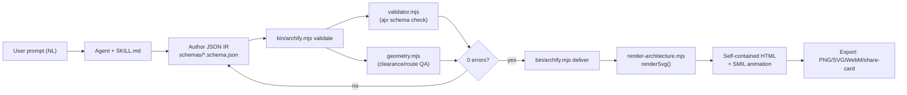
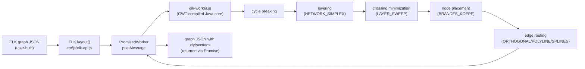
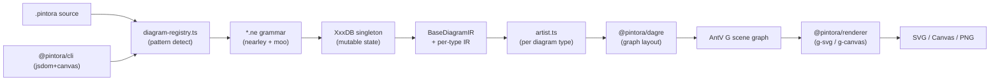
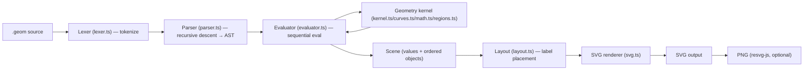

# Weekly scan — diagram-as-code & visual tooling (2026-08-03)

**Executive summary:**
- Agent-skill diagrams (JSON IR + validation-gate + agent self-repair loop, không phải DSL truyền thống) là làn sóng rõ rệt nhất tuần này — `archify` (8.5k stars, ~4 tháng tuổi) là ví dụ mạnh nhất và có kỹ thuật đáng học ngay (validator/diagnostic pattern, delta before/after).
- `elkjs` không mới nhưng đáng nghiên cứu lại: mô hình 5-pha layered-layout (cycle breaking → layering → crossing minimization → node placement → edge routing) là khung tham chiếu tốt để tổng quát hoá 5-pass `alignment.py`/`.ts` của kymo, dù bản thân elkjs (GWT-compiled) không nên trở thành dependency trực tiếp.
- `pintora` là "sibling" gần nhất về vấn đề (multi-diagram-type text-to-SVG, TS, browser+node) — pattern `diagram-registry` + `IDiagram{pattern,parser,artist}` là tham khảo tốt nếu kymo từng mở rộng khỏi 1 DSL duy nhất, nhưng bản thân dự án đã chững lại (release ~18 tháng, downloads thấp).

## Mục lục
1. [tt-a1i/archify](#1-tt-a1iarchify)
2. [kieler/elkjs](#2-kielerelkjs)
3. [hikerpig/pintora](#3-hikerpigpintora)
4. [shand001/geometry-dsl](#4-shand001geometry-dsl)
5. [Candidates khác đã sàng lọc (không deep-dive)](#5-candidates-khác-đã-sàng-lọc-không-deep-dive)

---

## 1. tt-a1i/archify

§1 — QUICK CONTEXT

Archify là agent-skill sinh diagram từ JSON IR có schema validate sẵn, khác kymo ở chỗ layout do agent quyết định thủ công (pos/row/col) chứ không có bộ auto-layout engine. Tech stack: Node.js >=18, pure ESM (`.mjs`), chỉ 1 devDependency (`ajv` cho JSON Schema draft 2020-12). Repo mới (tạo 2026-04-15, ~4 tháng tuổi), 8551 stars/665 forks, MIT, release cadence nhanh (v2.12.0 stable, v2.13.0-dev đang phát triển), CI qua `.github/workflows/ci.yml` + `release.yml`; số contributor cụ thể không xác định (trang GitHub contributors không tải được data). Phân phối qua `npx skills add tt-a1i/archify -g` — cài như agent skill cho Claude Code/Cursor/Codex/OpenCode/Raven, không phải thư viện npm thông thường.

§2 — ARCHITECTURE DEEP-DIVE

**A. Component inventory** (dưới `archify/archify/`):
- `SKILL.md` — hợp đồng prompt cho agent, mô tả toàn bộ pipeline + quality gate
- `bin/archify.mjs`, `bin/preview.mjs`, `bin/open-artifact.mjs` — CLI entrypoint (`validate/deliver/preview/guide/doctor/demo`) và local preview loop
- `schemas/{common,architecture,workflow,sequence,dataflow,lifecycle}.schema.json` — JSON Schema per diagram-type định nghĩa IR
- `renderers/shared/validator.mjs` — `validateSchema()`, sinh diagnostic object có `path/keyword/identity/supportedFixes/code/severity`
- `renderers/shared/geometry.mjs` — thư viện hình học thuần (overlap, clearance, route-quality) — tự mô tả rõ "does NOT perform automatic layout or position calculation… validates existing routes"
- `renderers/shared/generated-validators.mjs`, `diagnostics.mjs`, `layout-report.mjs`, `legend.mjs`, `repository-evidence.mjs`, `engineering-profiles.mjs` — hạ tầng dùng chung
- `renderers/architecture/{render-architecture.mjs,grid.mjs}` (+ 4 thư mục renderer song song cho workflow/sequence/dataflow/lifecycle) — `renderSvg()`, `pathFor()`, `validateArchitecture()`
- `delta/architecture-delta.mjs` — engine diff Before/Delta/After
- `examples/*.json` (13 spec) + `.html` render kèm — dữ liệu few-shot cho agent
- `references/{authoring-contract,delivery-contract,viewer-runtime}.md` — hợp đồng văn xuôi, không phải code

**B. Pipeline** (happy path): (1) user mô tả hệ thống bằng ngôn ngữ tự nhiên cho coding agent có cài skill; (2) agent chọn diagram type, có thể gọi `archify guide`; (3) agent đọc `schemas/<type>.schema.json` + 1 example JSON cùng loại; (4) agent tự viết JSON spec mới (id ổn định, ~12 node chính, `pos`/`row`/`col`/`edges` tường minh); (5) `archify validate <type> <file> --json` chạy ajv-schema-check + geometry QA, trả diagnostic có `supportedFixes`; (6) agent sửa lặp đến khi 0 lỗi/đạt showcase (9 check); (7) `archify deliver` render SVG → bọc HTML tự chứa → re-validate snapshot HTML/SVG → đóng băng bytes + SHA-256 checksum; output file HTML xuất hiện kèm pan/zoom, theme toggle, trace animation, export.

**C. Data model/IR**: JSON điển hình theo schema (draft 2020-12), `schema_version: 1`. Tách rõ IR canonical (authored, đóng băng khi deliver) khỏi "viewer state" (focus/glow) — loại trừ khỏi export. Không có bằng chứng về bước "compile xuống IR thấp hơn" — một JSON là vừa artifact tác giả vừa input trực tiếp cho renderer (không có giai đoạn resolved/lowered riêng như `alignment.py` của kymo). Geometry (`pos`/`size`) nằm ngay trong object component, là dữ liệu do agent gán chứ không suy ra.

**D. Input language**: Không có DSL văn bản riêng — chỉ JSON được validate bởi JSON Schema/ajv; "ngôn ngữ" thực chất là schema + authoring-contract đọc bởi LLM, không có parser/grammar hình thức. Báo lỗi có cấu trúc, thiết kế cho vòng lặp agent tự sửa (`path/keyword/expected/identity/supportedFixes/code=schema/<keyword>`).

**E. Layout**: Rõ ràng agent/user-specified, không auto-layout — `layout: {mode:"grid", origin, cols, gapX/gapY}` chỉ hỗ trợ đặt lưới, không tối ưu vị trí. `route` enum (`auto|straight|orthogonal-h|orthogonal-v`) + `via` waypoints là auto-*routing* hình dạng cạnh giữa 2 điểm cố định, không phải auto-*placement* node. Không có graph crossing-minimization; thay vào đó chạy các gate QA hậu kỳ (`cleanCrossingProblems`, `collectAmbiguousCorridors`, `automaticPortSpread`) để phát hiện/khắc phục chồng lấn sau khi agent đặt vị trí.

**F. Rendering/output**: `renderSvg()` dựng chuỗi SVG (+ `renderDefinitions()` cho marker/pattern), `writeDiagram()` bọc thành HTML tự chứa. Animation dùng **SMIL** (`animateAttr()` gắn thuộc tính `<animate>` gốc SVG vào path/rect), không phải CSS transition hay JS loop; phải tôn trọng `prefers-reduced-motion`. Kiến trúc renderer chia theo diagram-type (mỗi loại 1 module dùng chung `renderers/shared/`) — ngược hướng với kymo (nhiều emitter theo output-format: SVG/Figma/Excalidraw/WebP cho cùng 1 model).

**G. Extensibility**: Thêm diagram type mới cần: schema mới, module renderer mới, wiring vào `bin/archify.mjs`, regenerate validators — mở rộng ở mức code, không có plugin API khai báo. Theming qua `visual_preset` enum (data-driven). Không thấy hệ thống icon/shape plugin cho người dùng cuối — `type` component là enum đóng 7 giá trị, kém mở hơn `icons/` file-backed của kymo.

**H. Dev experience**: CLI-first, thiết kế để LLM agent điều khiển hơn là con người gõ tay. `preview` = live-reload; `doctor` kiểm tra môi trường; `demo` sinh ví dụ. Không có VSCode extension riêng (khác `packages/vscode-extension` của kymo) — phân phối thuần qua agent-skill package. Có rule chống "gian lận" đáng chú ý trong SKILL.md: nếu 2 vòng liên tiếp không cải thiện số lỗi, phải báo cáo trung thực thay vì tuyên bố thành công.

§3 — ARCHITECTURE DIAGRAM

§4 — VERDICT

Đáng học nhất: tách `geometry.mjs` thành lớp QA thuần (overlap/clearance/crossing/route-rhythm) độc lập với việc position đến từ auto-layout hay tay đặt — kymo có thể thêm lint-pass tương tự trên `Diagram` đã resolve, bất kể nguồn gốc tọa độ. Thứ hai, format diagnostic `path/keyword/identity/supportedFixes/code` là mẫu tốt cho lỗi parser `.kymo`, nhất là khi kymo cũng ngày càng được agent dùng. Đáng lưu ý: Archify dùng SMIL cho animation trong khi kymo dùng CSS (`ANIM_STYLE`) — nên kiểm chứng lại độ tương thích/robustness SMIL trước khi cân nhắc. Red flag: enum `type` đóng (7 giá trị) kém mở hơn icon library file-backed của kymo — không nên copy. Câu hỏi mở: repo còn quá non (4 tháng), tăng trưởng sao có thể do làn sóng phân phối "agent skill" (`npx skills add`) hơn là chiều sâu kỹ thuật. Verdict: **study deeper** phần validation-gate/diagnostic pattern và tính năng delta before/after; glance only phần còn lại.

---

## 2. kieler/elkjs

§1 — QUICK CONTEXT

elkjs không phải công cụ diagram-as-code mới mà là **layout engine thuần túy**: nó chỉ tính toán tọa độ (x/y, bend points) cho một ELK graph JSON, không parse DSL, không render — khác hẳn kymo ở chỗ tách hoàn toàn "input language" khỏi renderer. Tech stack: lõi Java (Eclipse Layout Kernel) được biên dịch sang JS bằng **GWT (Google Web Toolkit)**, đóng gói qua Browserify/Babel thành `lib/elk-worker.js` + `elk-api.js`. Sức khỏe repo: 2686 stars, license kép EPL-2.0/GPL-3.0, CI qua `.github/workflows/ci.yml` + `publish.yml`, hoạt động đều (merge PR gần nhất 30/7/2026, đang chuẩn bị bản 0.13.0). Phân phối qua **npm** (`elkjs`, `elkjs@next`).

§2 — ARCHITECTURE DEEP-DIVE

**A. Component inventory**
- `ELK` class (`src/js/elk-api.js`) — public API: `layout()`, `knownLayoutAlgorithms()`, `knownLayoutOptions()`, `knownLayoutCategories()`, `terminateWorker()`.
- `PromisedWorker` (trong `elk-api.js`) — bọc Web Worker bằng Promise, gán ID cho từng message, giữ dict `resolvers` để resolve/reject khi worker trả kết quả qua `onmessage`.
- `main-api.js`, `main-node.js` (`src/js/`) — entry point khác nhau cho browser (worker thật) vs Node.js (gọi trực tiếp không cần worker thread).
- `elk-worker.js` (`lib/`, sinh ra từ GWT) — bản dịch Java→JS của lõi ELK: cycle breaking, layering, crossing minimization, node placement, edge routing.
- `elk.bundled.js` (`lib/`) — bundle Browserify gộp API + worker cho dùng trực tiếp trong `<script>`.
- `typings/` (`elk-api.d.ts`, `elk-worker.d.ts`, `elk.bundled.d.ts`, `main.d.ts`) — định nghĩa TypeScript cho `ElkNode`, `ElkPort`, `ElkExtendedEdge`, `LayoutOptions`.
- Java source layer đứng sau (`src/java/org/eclipse/elk/...`, `src/java-additional/...`) — chỉ tồn tại để build, không ship trực tiếp trong npm package.

**B. Pipeline/control flow**
1. User dựng object ELK graph JSON (`{id, children, edges, layoutOptions}`) thuần JS/TS, không cần parser riêng.
2. Gọi `elk.layout(graph, {layoutOptions, logging, measureExecutionTime})`.
3. `ELK.layout()` gửi message (kèm ID duy nhất) tới `elk-worker.js` qua `postMessage` (Web Worker ở browser) hoặc gọi hàm trực tiếp (Node, không cần thread thật).
4. Lõi GWT-compiled chạy 5 pha thuật toán layered: cycle breaking → layering → crossing minimization → node placement → edge routing.
5. Worker trả về cùng graph JSON đã có `x/y/width/height` cho mọi node, `sections` (bend points) cho mọi edge, qua `onmessage`.
6. `PromisedWorker` resolve Promise tương ứng ID; `convertGwtStyleError()` làm phẳng exception Java lồng nhau nếu lỗi.
7. Caller nhận lại đúng graph JSON đã "layouted", tự render bằng renderer riêng (SVG/Canvas/D3...).

**C. Data model/IR**: ELK graph JSON — cây `ElkNode` (id, x/y/width/height tùy chọn, `children` lồng nhau, `ports`, `edges`), `ElkExtendedEdge` dùng `sources`/`targets` (mảng, hỗ trợ hyperedge) + `sections` cho routing path chi tiết; `layoutOptions` là map string→string gắn ở từng node/edge/graph. Input là mutable — output ghi đè/bổ sung field vào chính graph object đưa vào (không có IR trung gian tách biệt).

**D. Input language design** — Không phải grammar text mà là JSON schema thuần (giống kymo's `Diagram` dataclass nhưng serialize JSON). Option key hỗ trợ dạng đầy đủ (`org.eclipse.elk.layered.algorithm`) hoặc rút gọn (`algorithm`). Không có error reporting kiểu DSL parser (dòng/cột) — lỗi là exception GWT được flatten lại thành message JS.

**E. Layout algorithm (core)** — Họ thuật toán **layered/Sugiyama-style** (`org.eclipse.elk.layered`), 5 pha: cycle breaking (mặc định GREEDY) → layering (mặc định NETWORK_SIMPLEX, có Coffman-Graham) → **crossing minimization** (mặc định LAYER_SWEEP, có Greedy Switch TWO_SIDED/OFF) → node placement (mặc định BRANDES_KOEPF, có linear-segments/network-simplex) → **edge routing** (mặc định ORTHOGONAL, còn POLYLINE và SPLINES với SplineRoutingMode.SLOPPY). Ngoài layered còn có algorithm khác chọn được: `stress`, `mrtree`, `radial`, `force`, `disco`, `rectpacking`, `sporeOverlap/sporeCompaction`.

**F. Rendering/output strategy** — elkjs **không render gì cả**, chỉ layout-only: trả graph JSON với tọa độ đã tính, caller tự vẽ (nhiều dự án dùng D3/SVG/Sprotty để render output này).

**G. Extensibility** — Chọn algorithm qua `elk.algorithm`, hàng trăm layout option (spacing, port constraints, direction...) tra cứu qua `knownLayoutOptions()`; không có plugin API để viết algorithm mới từ JS (phải patch phía Java/GWT).

**H. Dev experience** — API rất gọn (`new ELK().layout(graph).then(...)`), có `.d.ts` đầy đủ, docs tham chiếu tới eclipse.dev/elk (chi tiết, nhiều option) nhưng build process phức tạp (cần checkout ELK Java repo song song, Gradle + Browserify), nhiều issue mở về GWT artifact ("g is not defined"), tương thích webpack/worker.

§3 — ARCHITECTURE DIAGRAM

§4 — VERDICT

kymo's `alignment.py`/`.ts` hiện làm 5 pass thủ công cho auto-layout; elkjs's tách biệt rõ ràng **layering → crossing minimization → node placement → edge routing** là mô hình đáng học để tổng quát hóa fan-in/trunk-lane staggering hiện tại thành một crossing-minimization pass thật sự (LAYER_SWEEP) thay vì heuristic đặc thù. Không nên nhúng elkjs trực tiếp: GWT-compiled bundle nặng, build phụ thuộc Gradle+Java checkout song song — lệch hẳn triết lý "renderer dumb, pipeline nhẹ" của kymo, và Python side không có tương đương (parity Python/JS sẽ vỡ). Câu hỏi mở: elkjs có tách được phần crossing-minimization core ra dùng độc lập (không qua worker) để tham khảo thuật toán mà không kéo cả runtime? Verdict: **study deeper** phần thuật toán (đặc biệt layered + BRANDES_KOEPF node placement) để tái hiện bằng Python/TS thuần, nhưng **ignore** việc dùng elkjs làm dependency trực tiếp.

---

## 3. hikerpig/pintora

§1 — QUICK CONTEXT

Pintora là thư viện text-to-diagrams đa loại (sequence, ER, component, activity, mindmap, gantt, DOT, class), khác Mermaid ở kiến trúc "artist" plugin tách biệt hoàn toàn parser/IR/renderer cho từng loại diagram thay vì một khối monolith. Stack: TypeScript, monorepo pnpm+turbo; parser dùng **nearley** (parser generator, grammar `.ne`) + **moo** (lexer, cả hai fork riêng `@hikerpig/nearley`/`@hikerpig/moo`); renderer dựa trên **AntV G** (`@antv/g-svg`, `@antv/g-canvas`) và layout dùng fork **dagre** (`@pintora/dagre`). ~1.3k stars, MIT, release gần nhất v0.8.2 (13/02/2025, đã ~18 tháng), CI có `ci-check.yml`. Phân phối qua npm (`@pintora/cli`, `@pintora/core`, `@pintora/standalone`...), nhưng lượt tải rất thấp (`@pintora/cli` ~54/tuần).

§2 — ARCHITECTURE DEEP-DIVE

**A. Component inventory**
- `@pintora/core` (`packages/pintora-core/src`) — `diagram-registry.ts` (đăng ký/định danh diagram type qua regex `pattern`), `config-engine.ts`, `diagram-event.ts`, `symbol-registry.ts`, `themes/` — hạt nhân dùng chung, không chứa logic vẽ.
- `@pintora/diagrams` (`packages/pintora-diagrams/src`) — 8 thư mục theo loại diagram (`sequence/`, `er/`, `component/`, `activity/`, `mindmap/`, `gantt/`, `dot/`, `class/`), mỗi thư mục tự chứa `parser/*.ne`, `db.ts`, `artist.ts`, `config.ts`, `event-recognizer.ts`, `index.ts`. Có `util/ir.ts` (IR base dùng chung) và `util/style-engine/` (parser cho `@style`/`@bindClass`).
- `@pintora/renderer` (`packages/pintora-renderer`) — renderer mặc định, phụ thuộc `@antv/g-svg` + `@antv/g-canvas`.
- `@pintora/cli` (`packages/pintora-cli`) — CLI Node.js dùng `jsdom` + `canvas` để render ra file (SVG/PNG/JPG), bin `pintora`.
- `@pintora/standalone` — bundle trình duyệt tự chứa mà CLI cũng dùng.
- `pintora-target-wintercg` — build target cho môi trường WinterCG (Workers/Deno-like).
- `pintora-harness` — hạ tầng test/snapshot dùng chung.

**B. Pipeline** (happy-path):
1. Người dùng gọi `pintora.renderTo(source, options)` (browser) hoặc `pintora` CLI (Node).
2. `diagramRegistry.detectDiagram(text)` chạy regex `pattern` của từng diagram đã đăng ký để chọn đúng module (mặc định fallback `sequenceDiagram`).
3. `IDiagramParser` của module đó parse text bằng grammar `.ne` (nearley) + lexer moo → ghi trực tiếp vào một singleton `db` (class mutable, ví dụ `SequenceDB` với `messages[]`, `actors{}`…) — đây chính là bước sinh IR.
4. `db.getDiagramIR()` (kiểu) trả về IR kế thừa `BaseDiagramIR` (title, configParams, styleRules, bindRules) + phần riêng của diagram type.
5. `IDiagramArtist.draw(ir, canvasElement, config)` — artist của diagram đó dịch IR sang lệnh vẽ (dùng AntV G scene graph, có gọi layout algorithm riêng như dagre cho component/class).
6. `IRenderer` (từ `@pintora/renderer`) tuần tự hoá scene graph AntV G thành SVG (hoặc vẽ Canvas) và trả về chuỗi/DOM.

**C. Data model/IR**: mutable, per-diagram-type — mỗi diagram có `XxxDB` class riêng (singleton instance), kế thừa `BaseDb`, và IR type riêng mở rộng `BaseDiagramIR` dùng chung (title/config/style/bind). Không có IR hợp nhất giữa các loại diagram — giống mô hình Mermaid's `*Db.ts`.

**D. Input language design**: parser generator thật sự — **nearley** (PEG-style, LL/Earley) với lexer **moo**, mỗi diagram type có file `.ne` riêng (`sequenceDiagram.ne`) import các grammar phụ dùng chung (whitespace, config, comment, binding). Có `@preprocessor typescript`, state machine trong lexer (`line`, `configStatement`, `noteState`). Báo lỗi cụ thể: không xác định (không thấy bằng chứng về error-recovery/thông báo lỗi chi tiết).

**E. Layout**: dùng fork riêng của dagre (`@pintora/dagre`, `@pintora/graphlib`) cho các diagram dạng graph (component, class, activity...); các diagram tuyến tính (sequence, gantt) tự tính vị trí trong `artist.ts`. Edge routing/crossing-minimization: kế thừa thuật toán dagre (Sugiyama-style layered layout), không có logic riêng ngoài dagre — không xác định chi tiết tối ưu hoá thêm.

**F. Rendering**: kiến trúc scene-graph qua AntV G (`@antv/g-svg`, `@antv/g-canvas`) — cùng một scene graph render được cả SVG lẫn Canvas tuỳ backend chọn. Animation: không xác định (không thấy bằng chứng animate SVG như kymostudio).

**G. Extensibility**: điểm mạnh rõ ràng — `diagramRegistry.registerDiagram(name, diagram: IDiagram)` với `IDiagram = { pattern, parser, artist, eventRecognizer?, configKey?, clear() }`. Thêm diagram type mới = viết grammar `.ne` + `db.ts` + `artist.ts` + đăng ký, hoàn toàn độc lập, không đụng core. Theming qua `themes/` trong core + `@style`/`@bindClass` style-engine (CSS-like binding, thêm ở v0.8.0).

**H. Dev experience**: CLI (`@pintora/cli`), live playground trình duyệt (`pintorajs.vercel.app/demo/live-editor`), VS Code extension riêng (`pintora-vscode`, syntax highlight + preview cho `.pintora` và code-fence markdown), watch mode (`turbo run watch`), plus Gatsby/Obsidian/Observable integrations.

§3 — ARCHITECTURE DIAGRAM

§4 — VERDICT

Bài học lớn nhất: pattern `IDiagram { pattern, parser, artist, clear() }` + `diagramRegistry.registerDiagram()` là mô hình "nhiều artist trên một registry" rất sạch cho multi-diagram-type — nếu kymostudio từng cân nhắc mở rộng ngoài `.kymo` (ví dụ hỗ trợ cú pháp Mermaid-like song song), đây là tham khảo tốt hơn cách nhồi thêm cú pháp vào `dsl.ts`. Ngược lại, việc pintora dùng nearley+moo (grammar `.ne` riêng, phải compile-time generate) tạo chi phí build/toolchain mà kymo's hand-rolled line-oriented parser tránh được — đánh đổi hợp lý cho DSL đơn giản, ổn định của kymo. Red flag: release cách đây ~18 tháng, npm downloads rất thấp (~54/tuần), không thấy animation support — cho thấy dự án ít động lực phát triển. Không có evidence về BPMN import hay Figma/Excalidraw export tương đương kymo. Verdict: **glance only** — đáng học kiến trúc "artist registry" nhưng không cần theo dõi sát dự án này.

---

## 4. shand001/geometry-dsl

§1 — QUICK CONTEXT

geometry-dsl là DSL sinh hình học chính xác (điểm/đường/vòng tròn/giao điểm) bằng closed-form math, khác Mermaid (graph layout) và TikZ (LaTeX macro, không agent-native) ở chỗ nhắm thẳng vào agent loop "validate → render → inspect → repair". Core: TypeScript, zero runtime dependency, Node ≥22.18. Repo cực non trẻ: tạo 2026-07-29, đúng 1 commit duy nhất ("v0.4.0"), 1 tác giả, 2 stars, không release/tag, không thấy CI. Phân phối: git clone + npm scripts, đóng gói như Claude/Codex Agent Skill (`SKILL.md`) chứ chưa publish npm registry.

§2 — ARCHITECTURE DEEP-DIVE

**A. Component inventory** (bằng chứng thực từ file tree + nội dung đọc được):
- `Lexer/Parser` (`src/language/lexer.ts`, `src/language/parser.ts`) — tokenize rồi recursive-descent parse `.geom` thành AST/`Program`.
- `Evaluator` (`src/runtime/evaluator.ts`) — duyệt tuần tự statements, thực thi trực tiếp (không constraint solver), sinh `Scene`.
- `Styles` (`src/runtime/styles.ts`) — xử lý thuộc tính style (color, width, fill, dashed…).
- `Geometry kernel` (`src/geometry/kernel.ts`, `curves.ts`, `math.ts`, `regions.ts`, `index.ts`) — closed-form intersection/projection cho line/circle/arc/path, Boolean region ops (union/intersection/difference).
- `Layout` (`src/render/layout.ts`) — text layout (đặt label không chồng lấn).
- `SVG renderer` (`src/render/svg.ts`, hàm `renderSvg`) — Scene → SVG string.
- `CLI` (`src/cli.ts`) — entrypoint `geometry-dsl <input.geom> [-o out.svg] [--width] [--height] [--background]`.
- `index.ts` — public API: `evaluate()`, `compileToSvg()`, re-export `tokenize`/`parse`/`Evaluator`/`renderSvg`/`types`.
- `Agent skill scripts` (`scripts/validate_geometry.mjs`, `scripts/render_geometry.mjs`, `scripts/compiler_runtime.mjs`, `scripts/check_docs.mjs`) — chạy trực tiếp bằng Node, không cần build step riêng.

**B. Pipeline** (đường happy-path):
1. Agent/user viết source `.geom` (text).
2. `tokenize()` (lexer.ts) → token stream.
3. `parse()` (parser.ts, recursive descent) → AST `Program`, báo lỗi cú pháp qua `GeometryDslError` (mã như `E_PARSE`, kèm line/column).
4. `Evaluator.evaluate()` chạy tuần tự từng statement, gọi trực tiếp các hàm kernel (`point`, `line`, `circle`, `intersect`, `project`…) → tích luỹ `Scene { values, objects }`, mỗi object có `objectId` + `created` (thứ tự tạo).
5. `render/layout.ts` tính vị trí label/text không chồng lấn.
6. `render/svg.ts` → chuỗi SVG (`renderSvg`).
7. (tuỳ chọn) rasterize SVG → PNG qua `@resvg/resvg-js` (optional dependency) hoặc system tool.
8. CLI ghi ra file `-o` hoặc stdout; script `render_geometry.mjs`/`validate_geometry.mjs` dùng trong agent-skill workflow để agent tự "nhìn" kết quả trước khi trả cho user.

**C. Data model/IR**: `Scene` = map tên biến + mảng object hình học có thứ tự tạo. Object **immutable sau khi tạo** — transform không sửa tại chỗ mà trả instance mới. Không có constraint graph/solver deferred; mọi kết quả hình học được tính "eager" ngay khi statement chạy — nên IR gần giống một dãy lệnh dựng hình (construction log) hơn là scene-graph khai báo có thể re-solve.

**D. Input language design**: Cú pháp gán `name = constructor(args, key=val, ...)`, hỗ trợ positional + named args (named phải theo sau positional), biểu thức số học với precedence chuẩn (`additive → multiplicative → unary → postfix (.attr) → primary`), truy cập thuộc tính đọc-only như `P.x`, `C.radius`. 15 constructor lõi: `point, along, line, circle, arc, path, project, intersect, transform, mark, text, inside, union, intersection, difference`. Điểm khác biệt ngôn ngữ đáng chú ý: **segment / ray / infinite line là ba kiểu đối tượng riêng biệt, không phải display option của cùng một type** — ép người viết (hoặc agent) phải định rõ ý định hình học ngay từ constructor. Named-vs-positional bị enforce chặt, biến không được gán lại (immutable binding), reserved word không được dùng làm tên. Lỗi có mã ổn định (`E_PARSE`, `AMBIGUOUS_PROJECTION`...) kèm line/column — thiết kế rõ ràng cho agent tự sửa lỗi theo vòng lặp, không phải cho người đọc traceback.

**E. Layout algorithm**: Không phải graph/force-directed layout như Mermaid — tọa độ hình học do người viết chỉ định trực tiếp (point(x,y)) hoặc suy ra bằng closed-form (intersect, project, along). `render/layout.ts` chỉ lo phần phụ: đặt text/label sao cho không chồng đối tượng. Với path/curve không có nghiệm giải tích, kernel dùng golden-section search (numerical) để project điểm lên path.

**F. Rendering/output**: Single backend — SVG (`render/svg.ts`) là nguồn sự thật; PNG là bước rasterize SVG phía sau (resvg-js optional, hoặc system tool), không phải renderer độc lập thứ hai. Không thấy backend khác (không Figma/Excalidraw).

**G. Extensibility**: không xác định — không có bằng chứng về plugin system hay cách đăng ký constructor/primitive mới ngoài sửa trực tiếp `kernel.ts`/`parser.ts`. `regions.ts` cho thấy Boolean ops được thêm như module riêng, gợi ý kiến trúc theo module-per-capability nhưng không có API mở chính thức.

**H. Dev experience**: CLI đơn giản, một lệnh, flag tối thiểu. Không thấy watch mode. Đóng gói dưới dạng Agent Skill: `SKILL.md` mô tả rõ ràng hợp đồng giao hàng ("phải trả file ảnh đã render, không phải chỉ source/prose"), quy trình bắt buộc validate → render → (với diagram phức tạp) tự xem lại ảnh → sửa lỗi trước khi đưa cho user — thiết kế "self-correction loop" khá tường minh cho agent, khác hẳn README/CLI hướng người.

§3 — ARCHITECTURE DIAGRAM

§4 — VERDICT

Đáng học nhất: (1) phân biệt segment/ray/line như type riêng — kymo DSL nên xét pattern tương tự cho edge kinds thay vì flag hiển thị; (2) error contract có mã ổn định + line/column tối ưu cho agent tự sửa, đáng đối chiếu với error reporting hiện tại của `dsl.ts`/`parser.ts` kymo; (3) SKILL.md "validate → render → inspect → repair" là mẫu đóng gói agent-skill rõ ràng, kymo có thể tham khảo nếu định ship skill tương tự. Zero-dependency discipline khớp tinh thần "library phụ thuộc-tối-giản" của `packages/js`. Cờ đỏ: 1 commit, 1 tác giả, 2 star, không CI/release — bằng chứng parity/test coverage gần như không thể kiểm chứng từ ngoài. Câu hỏi mở: coverage test thực tế, có golden/regression suite không. Khuyến nghị: **glance only** — ghi chú lại 2-3 ý tưởng ngôn ngữ/error-code, chưa cần đầu tư nghiên cứu sâu vì repo quá non.

---

## 5. Candidates khác đã sàng lọc (không deep-dive)

Sàng lọc từ `topic:diagram-as-code`/`topic:layout-algorithm`/`topic:graph-visualization`/`topic:svg-animation` (pushed trong 7-30 ngày qua), loại các repo không đạt relevance filter (thin/early-stage, hoặc trùng lặp mục tiêu nghiên cứu tuần này):

- **uulab-official/drawio-skills** — "Deterministic, IR-first draw.io architecture diagram skill for AI coding agents". Ý tưởng trùng hướng với archify (agent-skill + IR-first) nhưng repo quá thin (590KB, tạo 28/7, 0 star) — chưa đủ bằng chứng để deep-dive; đáng theo dõi lại sau vài tuần.
- **FigDown/figdown** — "Markdown-native standard for diagrams that AI agents read as text and humans see as deterministically rendered SVG". Concept cross-format thú vị (Markdown ⇄ SVG) nhưng cũng quá non (tạo 2/7, 0 star, 1.4MB) — chưa đủ code để phân tích kiến trúc thật.
- **kieler/elkjs** → đã deep-dive ở mục 2.
- **goadesign/model** — Go DSL cho C4 architecture model/diagram (giống Structurizr), 465 stars, cập nhật 27/7. Novel DSL trong Go, đáng xem cú pháp nhưng không phải SVG-animation/renderer-craft trọng tâm tuần này — để dành cho scan sau.
- **justdeko/kuiver** — Compose Multiplatform library vẽ/tương tác directed graph (Kotlin, Android/iOS), 79 stars. Graph-visualization nhưng thiên UI component hơn diagram-as-code; chưa rõ layout algorithm — cần thêm bằng chứng trước khi deep-dive.
- **isatimur/excalidraw-skill-pack** — skill pack cho Excalidraw qua nhiều agent host. Loại vì giống "Excalidraw plugin cá nhân" hơn là kiến trúc diagram engine mới (đúng mục loại trừ trong đề bài).
- **awslabs/diagram-as-code** — Go, AWS-architecture-specific diagram-as-code, 1549 stars, hoạt động ổn định lâu dài. Không phải cập nhật mới đáng chú ý tuần này (cập nhật đều đặn nhưng không có tín hiệu thay đổi kiến trúc lớn); bỏ qua đợt này.
