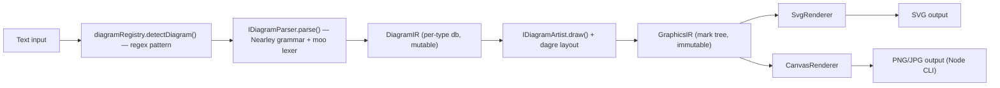
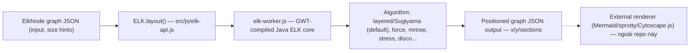
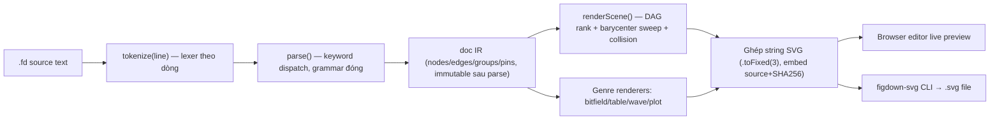
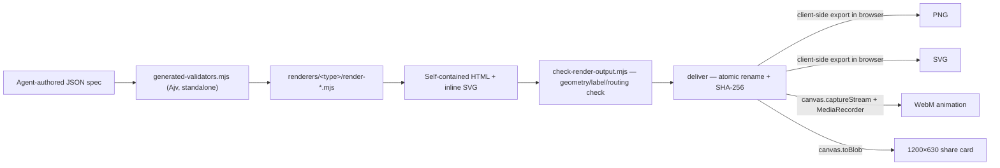

# Weekly scan — Diagram tooling & visual DSL (2026-08-04)

Quét GitHub cho các repo trong domain diagram-as-code / DSL / SVG animation / layout
algorithm được publish hoặc update đáng kể trong 7 ngày qua (28/07 → 04/08/2026),
đối chiếu với kiến trúc hiện tại của kymostudio.

**Tóm tắt điều hành:**

- Ranh giới mới trong domain: **FigDown** và **archify** đều đặt cược vào một **IR
  tường minh làm nguồn sự thật** (Markdown-embedded text và JSON schema tương ứng)
  được *AI agent* viết trực tiếp, khác hẳn cách kymo dùng `.kymo` — một DSL do
  **người** viết rồi mới đi qua `dsl.py:parse()`. Đáng theo dõi vì đây có thể là
  hướng đi kế tiếp của cả domain, không chỉ của kymo.
- **elkjs** (~2.7k sao, npm `elkjs@0.12.0` phát hành 17/07) là case study layout
  algorithm production-grade tốt nhất tuần này — layered/Sugiyama layout đã được
  Eclipse ELK kiểm chứng qua Mermaid, Cytoscape.js, sprotty — trong khi kymo hiện
  **không có** general graph auto-layout (chỉ auto-layout frames khai báo +
  parent/child anchoring trong `alignment.py`).
- **pintora** (1.3k sao, TypeScript) là repo có kiến trúc gần kymo nhất: parser
  (Nearley grammar) → **DiagramIR** → layout (dagre fork) → **GraphicsIR** →
  renderer pluggable (SVG/Canvas) — đáng học về IR hai tầng tường minh và cách
  đăng ký diagram type mới qua contract cố định.

## Mục lục

- [Danh sách ứng viên đã khảo sát](#danh-sách-ứng-viên-đã-khảo-sát)
- [1. pintora](#1-hikerpigpintora)
- [2. elkjs](#2-kielerelkjs)
- [3. FigDown](#3-figdownfigdown)
- [4. archify](#4-tt-a1iarchify)
- [Ghi chú phương pháp](#ghi-chú-phương-pháp)

## Danh sách ứng viên đã khảo sát

Nguồn: GitHub search API, `topic:diagram-as-code` / `topic:svg-animation` /
`topic:graph-visualization` / `topic:layout-algorithm`, `pushed:>2026-07-28`.
10 repo qua được relevance filter (loại chart libraries, dashboard, icon pack,
generic drawing app, portfolio "built with X"); **4 repo được chọn deep-dive**
theo tiêu chí liên quan trực tiếp nhất đến kiến trúc kymo (DSL/IR, layout
algorithm, rendering craft):

| Repo | Vì sao vào shortlist | Deep-dive? |
|---|---|---|
| [hikerpig/pintora](https://github.com/hikerpig/pintora) | Text-to-diagram library, IR hai tầng, renderer pluggable | ✅ §1 |
| [kieler/elkjs](https://github.com/kieler/elkjs) | Layout algorithm engine (Sugiyama/layered), core của cả hệ Mermaid | ✅ §2 |
| [FigDown/figdown](https://github.com/FigDown/figdown) | DSL mới, markdown-native, conformance suite 136 case | ✅ §3 |
| [tt-a1i/archify](https://github.com/tt-a1i/archify) | 8.9k sao, JSON IR + deterministic check cho agent-authored diagram | ✅ §4 |
| [awslabs/diagram-as-code](https://github.com/awslabs/diagram-as-code) | YAML DSL → AWS architecture diagram, Go, 1.5k sao — mature nhưng scope hẹp (AWS-only) | Không |
| [cduck/drawsvg](https://github.com/cduck/drawsvg) | Programmatic SVG animation library (Python) — rendering craft liên quan nhưng không phải diagram tool | Không |
| [plantuml/plantuml](https://github.com/plantuml/plantuml) | 13.2k sao, ecosystem baseline, không có thay đổi kiến trúc mới tuần này | Không |
| [nordstad/PinViz](https://github.com/nordstad/PinViz) | GPIO diagram DSL niche, quá nhỏ để có kiến trúc đáng học | Không |
| [shand001/geometry-dsl](https://github.com/shand001/geometry-dsl) | DSL hình học cho AI agent, novel nhưng 2 sao, còn quá sớm | Không |
| [uulab-official/drawio-skills](https://github.com/uulab-official/drawio-skills) | IR-first draw.io skill, cùng hướng đi với archify nhưng 0 sao/chưa đủ trưởng thành | Không |

---

## 1. hikerpig/pintora

### §1 — Quick context

Text-to-diagram library mở rộng được, khác Mermaid ở chỗ tách rõ **DiagramIR**
(logic) khỏi **GraphicsIR** (mark tree hình học) và cho renderer thay thế được
(SVG/Canvas) thay vì string-template thẳng ra SVG. Stack: TypeScript, pnpm +
Turborepo monorepo, Nearley (Earley parser) + moo lexer, dagre fork cho layout,
AntV/G cho graphics primitives. 1.3k sao, 37 fork, CI (`ci-check.yml`), bản
stable gần nhất v0.8.2 (02/2025). Phân phối: npm (`@pintora/standalone`,
`@pintora/cli`, `@pintora/core`, `@pintora/diagrams`, `@pintora/renderer`) +
VS Code extension.

### §2 — Architecture deep-dive

**A. Component inventory**
- `packages/pintora-core/src/type.ts` — contract lõi: `IDiagram`,
  `IDiagramParser`, `IDiagramArtist`, `IRenderer`.
- `packages/pintora-core/src/diagram-registry.ts` — registry: mỗi diagram type
  đăng ký một regex `pattern` để tự nhận diện input.
- `packages/pintora-diagrams/src/{sequence,class,er,activity,component,gantt,mindmap,dot}/`
  — mỗi diagram type có `parser.ts` (+ file grammar `.ne`), `db.ts` (state
  builder mutable), `artist.ts` (vẽ + layout).
- `packages/pintora-renderer/src/renderers/{SvgRenderer.ts,CanvasRenderer.ts}`
  — hai backend tiêu thụ cùng một GraphicsIR.
- `packages/pintora-cli/` — CLI `pintora render`.

**B. Pipeline** — 1) input text khớp regex `pattern` → `diagramRegistry.detectDiagram()`
chọn `IDiagram`; 2) `IDiagramParser.parse()` dùng grammar Nearley (`.ne`, tokenize
bằng moo) build `DiagramIR` qua `db.apply(results)`; 3) `IDiagramArtist.draw()`
chạy layout riêng theo type (dagre cho diagram dạng graph, custom lane logic cho
sequence) rồi emit `GraphicsIR` (cây mark: Group/Rect/Circle/Text/Line/Path);
4) `IRenderer` (`SvgRenderer`/`CanvasRenderer`) vẽ GraphicsIR ra target; 5) CLI/
browser wrapper serialize SVG hoặc rasterize PNG/JPG (Node, qua canvas+jsdom).

**C. Data model / IR** — IR hai tầng tường minh, xác nhận trong
`pintora-core/src/type.ts` và `technical-brief.md`: **DiagramIR** (struct logic
riêng từng type, build mutable lúc parse) → lower xuống **GraphicsIR** (mark
tree, generic, backend-agnostic, immutable khi vào renderer). Không có multi-pass
refine — mỗi tầng build một lần.

**D. Input language** — Grammar riêng mỗi diagram type bằng fork Nearley
(`@hikerpig/nearley`) + moo lexer, file `.ne` compile qua `scripts/build-grammar.js`.
Docs (`write-a-custom-diagram.md`) nói rõ đây chỉ là lựa chọn mặc định — custom
diagram có thể dùng regex line-matching thay vì grammar engine. Không có BNF/EBNF
formal riêng ngoài chính file `.ne`. Không tìm thấy subsystem báo lỗi parse có
cấu trúc (location + message rõ ràng).

**E. Layout** — Diagram dạng graph (class/ER/component/dot) dùng
**`@pintora/dagre`** (fork dagre, layered/Sugiyama layout với crossing-reduction
heuristic barycentric/median có sẵn). Sequence diagram dùng logic lane/lifeline
riêng trong `artist.ts`, không qua dagre. Không có evidence về force-directed hay
constraint-based layout.

**F. Rendering** — Pluggable emitter: `IRenderer` với `SvgRenderer`/
`CanvasRenderer`, cả hai cùng đọc GraphicsIR qua AntV/G. CLI Node xuất thêm
PNG/JPG. Không tìm thấy cơ chế animation nào trong renderer.

**G. Extensibility** — Quy trình chuẩn hoá: định nghĩa IR type → viết parser
(grammar hoặc regex) → viết `artist.draw()` → `diagramRegistry.registerDiagram()`.
Theming qua `PintoraConfig`/`themeConfig.theme`, cộng thêm cú pháp `@pre`/
`@bindClass` (v0.8) cho phép override style per-node ngay trong DSL.

**H. Dev experience** — CLI `pintora render`, VS Code extension riêng
(pintora-vscode), live editor browser (pintorajs.vercel.app/demo/live-editor).
Không có evidence về LSP hay watch-mode flag.

### §3 — Architecture diagram

### §4 — Verdict

Đáng học nhất: **IR hai tầng tường minh** (DiagramIR logic → GraphicsIR hình học)
— kymo hiện chỉ có một tầng `Diagram` dataclass rồi `alignment.py` resolve trực
tiếp lên chính nó; tách một tầng "mark tree" trung gian trước `to_svg.py` có thể
giúp renderer thực sự "dumb" hơn nữa và làm `to_figma.py`/`to_excalidraw.py` bớt
phải hiểu semantic. Contract `IDiagram`/`IDiagramParser`/`IDiagramArtist` +
diagram-registry là pattern tốt nếu kymo mở rộng sang nhiều "diagram genre" hơn
BPMN. `@pintora/dagre` (layered layout) là lựa chọn thực dụng nếu kymo cần
auto-layout cho graph tự do (ngoài `layout{}` khai báo và BPMN DI). Red flag: không
có conformance suite dual-impl, không animation, không error-diagnostics có cấu
trúc — không có gì kymo cần lo bị vượt mặt ở đây. Open question: chưa rõ vì sao
project fork riêng cả nearley/moo/dagre thay vì dùng upstream — có thể do yêu cầu
dual-target browser+Node. **Verdict: study deeper** phần IR hai tầng + diagram-
registry pattern.

---

## 2. kieler/elkjs

### §1 — Quick context

Port JS/WASM của Eclipse Layout Kernel (ELK) — **thuần layout engine**, không có
parser hay renderer, chỉ nhận vào một graph JSON và trả về graph JSON đã có toạ
độ. Đây là lõi layout đứng sau Mermaid, Cytoscape.js, sprotty, React Flow. Stack:
lớp JS/TS mỏng (`src/js/`, `typings/`) bọc quanh **`elk-worker.js`** — một blob
sinh tự động (GWT-compiled) từ Java core (`src/java/org/eclipse/elk/...`) vendor
theo repo. ~2.7k sao, npm `elkjs@0.12.0` (phát hành 17/07/2026, nhịp release ~quý
1 lần), test bằng mocha/chai, license kép EPL-2.0/GPL-3.0. Phân phối: npm `elkjs`.

### §2 — Architecture deep-dive

**A. Component inventory** — `src/js/elk-api.js`/`main-api.js`/`main-node.js`
(API JS viết tay); `src/java*/org/eclipse/elk/...` (Java core vendor từ upstream
Eclipse ELK); build output `elk-worker.js` (tự nhận là "generated from ELK's Java
code base using GWT") và `elk.bundled.js` (bundle browserify cho `<script>`);
`typings/*.d.ts` theo từng artifact; `build.gradle` — build Java→JS qua Gradle+GWT.
Phần lớn "lõi" của repo không phải JS hand-written mà là Java transpile.

**B. Pipeline** — 1) caller build object graph `ElkNode` (JSON); 2) gọi
`new ELK(opts).layout(graph, layoutOptions)` → trả `Promise`; 3) `elk-api.js`
chuyển graph JSON cho **worker** (Web Worker trên browser, in-process trên Node)
chạy `elk-worker.js` (Java core compiled); 4) bên trong core (opaque với JS):
chọn algorithm (`elk.algorithm`) → resolve layout option per-node → thuật toán
tính toạ độ + route edge + (với layered) crossing minimization; 5) worker
serialize graph đã annotate, trả ngược qua worker boundary; 6) Promise resolve
với **cùng object graph**, đã có `x`/`y`/`width`/`height` trên node và
`sections`/bend point trên edge.

**C. Data model** — ELK JSON graph, phân cấp, root là một `ElkNode`: `id`,
`x`/`y`/`width`/`height` (input = size hint, output = vị trí tính được),
`children: ElkNode[]` (nesting = compound/hierarchical layout), `ports:
ElkPort[]`, `edges: ElkExtendedEdge[]`, `labels: ElkLabel[]`, `layoutOptions`.
`ElkExtendedEdge` cho phép `sources`/`targets` là mảng (hyperedge-capable), có
`sections` (điểm đầu/cuối + bend point) sau khi route (`typings/elk-api.d.ts`).

**D. Input language** — N/A, xác nhận: không có text DSL, chỉ có JSON graph
object truyền vào `layout()`.

**E. Layout algorithm (mục quan trọng nhất)** — Mô tả trong `package.json`:
"Automatic graph layout based on Sugiyama's algorithm. Specialized for data flow
diagrams and ports." Algorithm chọn qua option `elk.algorithm`: **layered**
(flagship, Sugiyama-style: rank assignment → crossing minimization → coordinate
assignment), **stress**, **mrtree**, **radial**, **force**, **disco**, cộng
utility layouter **box**/**fixed**/**random**. Chi tiết cơ chế routing/crossing-
minimization nằm hoàn toàn trong Java core, README chỉ trỏ ra tài liệu upstream
(`eclipse.dev/elk/reference.html`) chứ không document lại — không tìm thêm được
evidence xa hơn điểm này.

**F. Rendering** — Xác nhận: elkjs **không render**. `layout()` chỉ trả graph
JSON đã có toạ độ; không có SVG/canvas code trong `src/js` hay typings. Các
consumer (Mermaid, sprotty, Cytoscape.js...) tự vẽ từ `x`/`y`/`sections`.

**G. Extensibility** — Cấu hình hoàn toàn qua `layoutOptions` dictionary, có
thể set ở 3 tầng: root graph, `new ELK({defaultLayoutOptions})`, hoặc per-node
(override cục bộ trong graph phân cấp). `knownLayoutAlgorithms()`/
`knownLayoutOptions()` cho phép introspect runtime.

**H. Dev experience** — TypeScript defs đầy đủ theo từng artifact build, README
có ví dụ Node copy-paste được và trỏ ra doc Eclipse ELK canonical thay vì lặp lại.
Build nặng cho contributor: cần Gradle + checkout song song repo Eclipse ELK Java
gốc — rào cản thật so với một repo thuần JS.

### §3 — Architecture diagram

> elkjs không có parser/renderer trong chính repo (chỉ nhận/trả JSON, phần
> render do consumer khác đảm nhiệm) — diagram dưới đây phản ánh đúng scope thực
> tế của repo, không vẽ thêm "renderer" hư cấu.

### §4 — Verdict

Đáng học nhất: đây là **thuật toán layered/Sugiyama đã kiểm chứng ở scale lớn**
(rank → crossing minimization → coordinate assignment) — đúng lớp bài toán mà
`alignment.py`'s fan-in/trunk-lane edge staggering đang giải quyết thủ công/cục
bộ cho một số pattern cụ thể. Đáng làm một so sánh trực tiếp: nếu kymo cần
auto-layout cho graph tự do (không phải `layout{}` khai báo hay BPMN DI đã có sẵn
toạ độ), elkjs (qua WASM/worker) là con đường đã có nhiều tool dùng thật (Mermaid
chọn nó), nhưng cần cân đối với chi phí: build Java/Gradle, license EPL/GPL nếu
vendor code, và việc elkjs không tự render (vẫn phải viết `to_svg.py` phía sau).
Red flag: toàn bộ chi tiết thuật toán "opaque" trong Java blob, không đọc được
trực tiếp từ JS side. Open question: elkjs's option `elk.direction`/`hierarchyHandling`
có match được với "trunk lane" concept mà kymo đang có không — cần review riêng
tài liệu ELK layered algorithm (ngoài scope tuần này). **Verdict: glance only**
tuần này (không action ngay), nhưng đáng đọc sâu ELK layered docs ở weekly scan
sau nếu kymo quyết định làm general auto-layout.

---

## 3. FigDown/figdown

### §1 — Quick context

Chuẩn diagram nhúng trong Markdown — cùng một nguồn text vừa đọc được trực tiếp
bởi AI agent (không cần render), vừa render ra SVG xác định (byte-deterministic)
cho người xem. Stack: một file JS thuần duy nhất (`editor/figdown.html`, ~4.200
dòng) chứa cả parser/layout/renderer/editor UI, không dependency, spec dạng ABNF.
0 sao (repo mới, v0.1.0-rc.1 phát hành 01/08/2026, 163 commit), **không có CI
chạy conformance suite** (chỉ deploy GH Pages), 136 conformance test case. Phân
phối: npm `figdown@0.1.0-rc.1` + gói Claude Agent Skill (`skill/`).

### §2 — Architecture deep-dive

**A. Component inventory** — `editor/figdown.html`: file self-contained duy nhất
(parser + layout + renderer + editor UI, vanilla JS, không dep) — đây là nguồn
canonical, mọi thứ khác là derivative sinh ra từ nó. `skill/figdown/{figdown.html,
build-svg.js,SKILL.md}` — bản copy engine + CLI wrapper + hướng dẫn cho agent,
build tự động bởi `tools/make-skill.js`. `dist/figdown.{js,mjs}` — build thư viện
npm, sinh bởi `tools/make-lib.js`. `spec/syntax-draft.md` (+`spec/genres/`) — spec
chuẩn hoá. `conformance/cases/` — 136 bộ ba `.fd`/`.model.json`/`.errors.txt` +
`run.js`/`normalize.js`. `tools/*-check.js` — các linter (boundary/fence/layout/
shape/stability/page/r25-check). Không có `src/`/`packages/` riêng — kiến trúc cố
tình single-file.

**B. Pipeline** — 1) text `.fd` → `tokenize(line)` (lexer theo dòng: quoted
string, escape, strip comment); 2) `parse(text)` duyệt từng dòng, dispatch theo
keyword, build object `doc` (grammar đóng — keyword lạ = lỗi ngay dòng đó); 3)
`render(doc, ropts)` resolve class/layer default, dispatch theo block type; 4)
với scene diagram: `renderScene()` clone immutable `doc.nodes`, chạy rank
assignment (DAG longest-path) rồi 3 pass barycenter sweep (down/up/down) để sắp
cross-axis order, `place()` giải collision, `pins` override toạ độ tính được; 5)
block genre riêng (bitfield/table/wave/plot) render độc lập qua hàm riêng; 6)
geometry helper (`borderPoint`, `roundPath`, `routeAround`) tính path cạnh/outline
shape; 7) ghép string SVG cuối, toạ độ `.toFixed(3)` + trim số 0 để byte-
deterministic, nhúng kèm source gốc + SHA-256 để round-trip.

**C. Data model / IR** — Object JS phẳng `doc` (`{title, nodes, groups, edges,
layers, ranks, pins, sizes, blocks, trunks, glines, fills, classes, routes,
boundaries}`), build một pass duy nhất lúc parse, **không mutate** khi render —
`renderScene()` clone node (`{...n}`) trước khi mutate bản sao qua các pass layout
(tách immutable-parse / mutable-layout-copy rõ ràng).

**D. Input language** — Tokenizer theo dòng + dispatch theo keyword (regex-based,
không phải PEG engine hay recursive-descent formal). Grammar hoá thành **ABNF
sketch** trong `spec/syntax-draft.md` §11, tự caveat rằng "điểm chuẩn hoá không
phải ABNF chính xác này mà là grammar phải implement được máy móc mà không cần
tham chiếu PoC". Lỗi: grammar đóng, mọi dòng lỗi được gom lại `Line N: <message>`,
và **có lỗi = không output gì cả** — "determinism hơn convenience" là nguyên tắc
tuyên bố rõ trong spec.

**E. Layout** — Auto layout (DAG rank + barycenter sweep + collision resolve),
có override `pin`/`size` tuỳ chọn — không phải x/y thủ công mặc định. "Layout là
một phần của semantic knowledge" được cụ thể hoá bằng 2 invariant có tên trong
spec: **R25 (semantic-completeness)** — bỏ hết dòng `pin`/`size`/`route` vẫn phải
parse và render đúng cấu trúc/quan hệ dưới auto-layout; và invariant
"presentation-ignorable" — bỏ thuộc tính trình bày-only không được đổi cấu trúc
semantic. Nói cách khác: topology (node/edge) là lõi semantic, vị trí tường minh
chỉ là lớp phủ tùy chọn có thể strip được, chứ không phải một khái niệm "styling"
tách biệt như ở engine kiểu Mermaid.

**F. Rendering** — Chỉ SVG. Không animation (`page`/`step` keyword được reserve
nhưng cố tình để ngoài scope v0.1: "static first, dynamic reserves keyword
nhưng out of scope"). Không có abstraction renderer pluggable — một renderer, một
output format.

**G. Extensibility** — Không có plugin/registry mechanism. Thêm genre mới cần
"corpus evidence AND semantic impossibility" (rule R28) — governance gate trên
chính engine tham chiếu duy nhất, không phải code extension point. 5 genre có sẵn
ở v0.1 (scene/flowchart lõi, bitfield, table, wave, plot-thử nghiệm), biện minh
bằng census corpus cho thấy bao phủ 78%.

**H. Dev experience** — `editor/figdown.html` là live-preview editor browser
thật (dual-pane text+SVG, "mọi thao tác GUI là một sửa text", click/drag trên DOM
sửa source rồi parse lại). CLI `figdown-svg` (npm bin → `skill/figdown/build-svg.js`).
Tích hợp agent: `skill/` là bundle kiểu Claude Code Skill (`SKILL.md` + CLI +
engine), cài ở `~/.claude/skills/figdown`, sinh tự động bởi `tools/make-skill.js`;
có thêm `AGENT-GUIDE.md` cho agent framework khác.

### §3 — Architecture diagram

### §4 — Verdict

Đáng học nhất: invariant **R25 semantic-completeness** — "bỏ hết `pin`/`size`/
`route` vẫn phải render đúng cấu trúc dưới auto-layout" — đây là một test có thể
formal hoá ngay cho kymo: đảm bảo mọi `.kymo` bỏ khối `layout{}` vẫn resolve được
qua `alignment.py` (hiện có một phần nhờ auto-canvas sizing, nhưng chưa có test
riêng khẳng định invariant này). Nguyên tắc "closed-grammar, có lỗi = zero output"
đáng cân nhắc cho `dsl.py`: hiện chưa rõ `.kymo` parse error có block toàn bộ
render hay chỉ report từng phần — đáng review riêng. Conformance suite 136-case
triplet (source/model/errors) xác nhận giá trị của cách tiếp cận mà kymo đã dùng
(`conformance/corpus/*.kymo` + golden JSON), dù FigDown chỉ single-impl trong khi
kymo dual-impl Python↔JS. Red flag: 0 sao, **không có CI job chạy conformance
suite** dù có 136 case — rủi ro regression cao dù bộ test tốt; kiến trúc single-
file 4.200 dòng khó scale khi thêm genre. Open question: repo quá mới (rc.1,
4 ngày tuổi) để đánh giá độ ổn định của spec — cần theo dõi lại ở scan sau xem
ABNF §11 có đổi không. **Verdict: study deeper** riêng phần R25 invariant + cấu
trúc ABNF spec.

---

## 4. tt-a1i/archify

### §1 — Quick context

Agent skill sinh diagram (architecture/workflow/sequence/data-flow/lifecycle) từ
JSON IR có validate (Ajv, strict schema) + check hình học xác định (crossing,
label clearance, overlap), xuất HTML self-contained + PNG/SVG/WebM/share-card —
thiết kế cho **LLM viết spec**, không phải người viết DSL. Stack: Node.js ESM,
Ajv standalone-compiled validator, canvas + `MediaRecorder` cho export, không
headless-browser/ffmpeg dependency. 8.9k sao, 720 fork, v2.13.0 (127 commit), có
test suite (golden/animation/share-card-export). Phân phối: `npx skills add
tt-a1i/archify -g` — cài như Agent Skill cho Claude Code, Cursor, Codex CLI,
opencode, Raven.

### §2 — Architecture deep-dive

**A. Component inventory** — `archify/SKILL.md` — skill contract (frontmatter
`name`/`description`/`license`/`metadata`). `archify/bin/archify.mjs` — CLI
(`validate`/`preview`/`deliver`/`compare`/`guide`/`doctor`). `archify/schemas/
*.schema.json` — JSON Schema riêng từng diagram type (Ajv draft 2020-12, strict,
`additionalProperties:false` mọi tầng). `archify/renderers/{architecture,
workflow,sequence,dataflow,lifecycle}/` — renderer module riêng từng genre.
`archify/renderers/shared/` — `validator.mjs`, `generated-validators.mjs` (383KB,
Ajv compiled standalone, không cần network/npm runtime), `diagnostics.mjs`,
`geometry.mjs` (52KB — toán routing/collision/label-clearance). `archify/scripts/
check-render-output.mjs` (30KB) — checker chạy sau khi render. `archify/delta/
architecture-delta.mjs` — so sánh before/after canvas cho PR. `archify/test/` —
golden/regression suite.

**B. Pipeline** — 1) agent đọc `SKILL.md` + `schemas/*.schema.json` + `examples/`
(không tự "lên toạ độ" trong prose); 2) agent viết file JSON theo schema; 3)
`archify validate`/`deliver` chạy qua `generated-validators.mjs` (Ajv compiled
sẵn, không phụ thuộc runtime); 4) renderer module (`renderers/<type>/render-
*.mjs`) biến JSON đã validate thành inline SVG + HTML string; 5)
`scripts/check-render-output.mjs` chạy check hình học xác định (geometry/label/
routing) trên HTML vừa render; 6) `deliver`: đóng băng byte của spec thành
snapshot riêng, render+check lại snapshot đó, rồi `fs.renameSync()` atomically
commit HTML (artifact cũ giữ nguyên nếu fail), in SHA-256 + byte count; 7)
PNG/SVG/WebM/share-card **không** sinh ở CLI — chúng được tạo **client-side, on
demand**, ngay trong HTML self-contained đã deliver (xem mục F).

**C. Data model / IR** — Field bắt buộc ở top-level: `schema_version` (const
`1`), `diagram_type`, `meta` (`title` bắt buộc, cộng `animation`, `visual_preset`,
`quality_profile`, `engineering_profile`, `repository`, `views`), cộng mảng
riêng từng type (Architecture: `components`/`boundaries`/`connections`;
Workflow: `lanes`/`phases`/`nodes`/`edges`; Sequence: `participants`/`messages`;
Dataflow: `stages`/`nodes`/`flows`; Lifecycle: `lanes`/`states`/`transitions`).
Không có bước "compile xuống IR thấp hơn" — JSON IR được renderer tiêu thụ trực
tiếp để emit SVG/HTML; schema là representation duy nhất. `schema_version` được
mô tả là immutable xuyên suốt 2.x (chỉ additive).

**D. Input language** — Không phải text DSL — một **JSON Schema**. LLM học shape
qua hướng dẫn trong `SKILL.md` ("đọc schema + example liên quan") cộng
`examples/*.json` committed sẵn — schema không nhúng trong prompt mà là file
agent được chỉ đường đọc. Lỗi: mã lỗi phân cấp dạng slash (`input/json-parse`,
`layout/constraint`, cộng mã riêng từng check như `single_svg`,
`orthogonal_arrows`, `relationship_crossings`, `label_route_clearance`), mỗi mã
kèm `severity`/`message`/`subject`/`evidence`/`supportedFixes` (mảng hành động
sửa cụ thể).

**E. Layout** — **Template/cố định theo từng genre, không phải auto-layout kiểu
force-directed hay crossing-minimization tổng quát.** Architecture dùng
`grid.mjs`: hoặc `pos:[x,y]` tường minh, hoặc `row`/`col` snap theo công thức cell
cố định (`x = origin.x + col*(cellW+gapX)`) — README nói rõ "không có packing
thông minh hay repositioning động". `geometry.mjs` chỉ **validate** (phát hiện
overlap, `cleanCrossingProblems`, `automaticPortSpread` cho fan-out, đo label
clearance) — sửa/gắn cờ, không tối ưu toàn cục. General-purpose auto-layout được
nêu rõ là ngoài scope.

**F. Rendering/output** — Xác nhận đủ 5 format: HTML (self-contained, inline
SVG, có search/focus/trace), PNG, SVG, WebM, share-card 1200×630 — **một pipeline
duy nhất, không headless browser** (search code không ra kết quả nào cho
puppeteer/playwright/sharp/ffmpeg). SVG = `serializeSvg()` trên DOM sống. PNG/
share-card = SVG → `Image` → `canvas.drawImage()` → `canvas.toBlob()`. WebM =
`canvas.captureStream()` + `MediaRecorder` chuẩn browser, redraw canvas theo thời
gian trong 6 giây theo geometry path/line/polyline đã author, node pulse theo thứ
tự author — có xử lý final-flush và receipt máy đọc được nếu encoder trả rỗng.
Browser không hỗ trợ thì disable menu export thay vì fail âm thầm.

**G. Extensibility** — Không có doc "thêm type mới" trực tiếp; suy luận từ cấu
trúc đối xứng: cần schema mới + renderer module mới + wiring vào CLI +
`npm run generate:validators`. Visual preset (`classic`/`signal-flow`/`blueprint`/
`editorial`) là enum `meta.visual_preset` cố định, không phải theming API mở.

**H. Dev experience** — CLI đầy đủ: `validate`, `preview` (watch file, giữ output
verified gần nhất), `deliver`, `compare` (Architecture Delta before/after),
`guide` (gợi ý scenario), `doctor` (check môi trường: Node ≥18, template/renderer/
schema có mặt). Cài đặt qua `npx skills add` cho nhiều agent framework khác nhau —
`SKILL.md` đúng convention Claude Agent Skill chuẩn, không phải format tự chế.

### §3 — Architecture diagram

### §4 — Verdict

Đáng học nhất hai điểm cụ thể: (1) **WebM export qua `canvas.captureStream()` +
`MediaRecorder`** — toàn bộ client-side, không cần ffmpeg/headless browser; kymo
hiện có `to_webp.py` qua `kymostudio-core` (resvg) nhưng chưa có nhánh video —
đáng đánh giá cơ chế này như một alternative nhẹ cho demo animated thay vì
rasterize từng frame ở backend. (2) **Error code có cấu trúc** (`layer/kind` +
`severity`/`subject`/`evidence`/`supportedFixes`) — kymo's `.kymo` parse/validate
error hiện là message tự do; format có `supportedFixes` cụ thể sẽ giúp Claude Code
tự sửa `.kymo` file thay vì đoán. Red flag: layout hoàn toàn template/grid cố
định, không có gì mới về thuật toán layout để học ở đây; toàn bộ mô hình "LLM viết
JSON spec, đọc schema từ file" chỉ hợp khi model đã được train/instructed đọc
schema — không áp dụng trực tiếp cho triết lý `.kymo` (DSL người viết, cú pháp
ngắn). Open question: `geometry.mjs` chỉ validate/flag chứ không auto-fix — có
đáng thêm một bước check tương tự (`check-render-output.mjs`) vào sau
`to_svg.py`/golden test của kymo, hay golden SVG byte-for-byte hiện tại đã đủ
strict? **Verdict: study deeper** phần error-code schema + WebM export mechanism;
phần layout thì **ignore** (không có gì mới so với kymo).

---

## Ghi chú phương pháp

- Nguồn: GitHub REST search API (`topic:` qualifiers, `pushed:>2026-07-28`),
  không dùng `gh` CLI (không có quyền truy cập GitHub API rộng trong session
  này — chỉ scoped tới `kymostudio/kymostudio`); dữ liệu deep-dive lấy qua
  `raw.githubusercontent.com` + trang GitHub công khai, không qua GitHub API xác
  thực nên một số field (contributor count chính xác của elkjs) không lấy được
  và được ghi rõ "không xác định" thay vì đoán.
- 4 sub-agent riêng biệt (mỗi agent một repo) đọc README, cấu trúc thư mục, entry
  point, module lõi, config, và ít nhất một example trước khi trả evidence có
  citation file path — theo đúng yêu cầu §2 của brief.
- File này là **snapshot một-lần** cho tuần 28/07–04/08/2026; không tự động
  update — scan tuần sau sẽ tạo file mới cùng thư mục
  `docs/research/weekly-scans/`.
