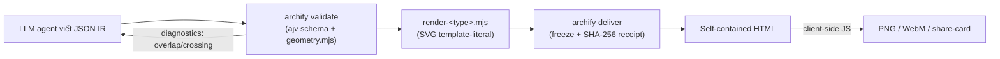
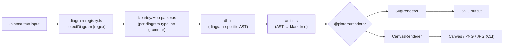
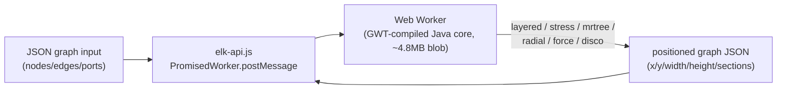
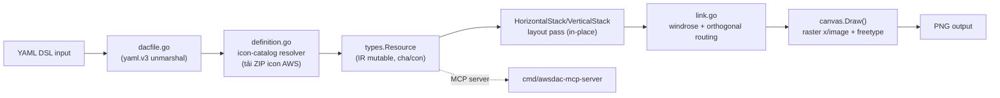

# Weekly Scan — Diagram Tooling (2026-08-05)

**Executive summary:**
- `tt-a1i/archify` (9.2k★, agent-skill JSON IR → self-contained HTML/SVG) là tín hiệu mạnh nhất tuần này: bỏ hẳn auto-layout, đặt cược vào validation-diagnostics (overlap/crossing/clearance) để bù lại — hướng ngược với triết lý auto-layout của kymostudio, đáng đọc để học cách viết diagnostics tốt hơn là để copy kiến trúc.
- `hikerpig/pintora` (1.3k★) là đối trọng gần nhất với kymo-js về mặt kiến trúc: Nearley/Moo grammar-per-diagram-type + forked-dagre layout + Mark-tree IR chung cho renderer — nhưng xác nhận **không có animation**, nên vùng "animated SVG" của kymostudio vẫn trống ở đối thủ trực tiếp gần nhất.
- `kieler/elkjs` (2.7k★, vừa update) nhắc một sự thật khó chịu: core layout thật của ELK là Java compile qua GWT ra một blob JS ~4.8MB không đọc/patch được từ phía JS — bài học phản diện cho việc kymostudio giữ `layout.py`/`alignment.ts` là code thuần, tự viết, đọc được.

## Mục lục
1. [Danh sách 10 repo được xác định](#danh-sách-10-repo-được-xác-định)
2. [tt-a1i/archify](#1-tt-a1iarchify)
3. [hikerpig/pintora](#2-hikerpigpintora)
4. [kieler/elkjs](#3-kielerelkjs)
5. [awslabs/diagram-as-code](#4-awslabsdiagram-as-code)

---

## Danh sách 10 repo được xác định

Quét theo `topic:diagram-as-code`, `topic:dsl`, `topic:graph-visualization`, `topic:layout-algorithm`, `topic:svg-animation` với `pushed:>2026-07-29` (fallback ecosystem-activity cho `elkjs`). Đã loại các GitHub-profile-README generator, contribution-graph animation, và chart/dashboard tool (nhiễu chiếm phần lớn kết quả `graph-visualization`/`svg-animation`).

| # | Repo | Vì sao đáng chú ý | Xử lý |
|---|---|---|---|
| 1 | [`tt-a1i/archify`](https://github.com/tt-a1i/archify) | 9.2k★, JSON IR → animated self-contained HTML, agent-first | **Deep-dive** |
| 2 | [`hikerpig/pintora`](https://github.com/hikerpig/pintora) | 1.3k★, extensible text-to-diagram (Mermaid-adjacent), Nearley grammar | **Deep-dive** |
| 3 | [`kieler/elkjs`](https://github.com/kieler/elkjs) | 2.7k★, layout algorithm engine (Sugiyama/layered), vừa push | **Deep-dive** |
| 4 | [`awslabs/diagram-as-code`](https://github.com/awslabs/diagram-as-code) | 1.6k★, YAML DSL → PNG cho AWS architecture, icon-catalog resolver | **Deep-dive** |
| 5 | [`FigDown/figdown`](https://github.com/FigDown/figdown) | 0★ nhưng syntax mới: "Markdown-native diagram standard" để AI agent đọc như text | Glance only |
| 6 | [`shand001/geometry-dsl`](https://github.com/shand001/geometry-dsl) | 2★, DSL hình học xác định (deterministic) cho AI agent, adjacent text-to-visual | Glance only |
| 7 | [`R0kshan/cairn`](https://github.com/R0kshan/cairn) | Diagram-as-code CLI với disposition management + overlap prevention cho large diagram | Glance only |
| 8 | [`nosahama/diagrams-as-code`](https://github.com/nosahama/diagrams-as-code) | Docker playground gộp PlantUML/Mermaid/Graphviz/D2 | Loại — chỉ là wrapper, không có kiến trúc riêng |
| 9 | [`nordstad/PinViz`](https://github.com/nordstad/PinViz) | Sinh sơ đồ đấu nối GPIO ra SVG | Glance only — quá niche (hardware-specific) |
| 10 | [`plantuml/plantuml`](https://github.com/plantuml/plantuml) | 13.2k★, vẫn active mỗi ngày | Baseline tham chiếu — đã trưởng thành, không phải "mới" tuần này |

---

## 1. tt-a1i/archify

### §1 — Quick context
Agent skill (không phải app độc lập) biến JSON IR do LLM agent tự viết thành diagram HTML self-contained có animation — khác các tool truyền thống ở chỗ **bỏ hẳn auto-layout**, đặt cược vào validation/diagnostics (overlap, crossing, clearance) để LLM tự sửa vị trí thay vì solver tự động. Stack: Node.js ESM, **zero runtime dependency** (chỉ `ajv` làm devDependency), output SVG-trong-HTML + PNG/WebM/share-card xuất phía client. 9,163★, 734 forks, MIT, release mới nhất v2.13.0 (2026-08-03), CI (`ci.yml`/`release.yml`) + 72 file test. Phân phối qua `npx skills add tt-a1i/archify -g` (skill marketplace).

### §2 — Architecture deep-dive

**A. Component inventory**
- `bin/archify.mjs` (~1.200 dòng) — CLI dispatcher cho 10 subcommand (`render`, `validate`, `preview`, `deliver`, `compare`, `check`, `inspect`, `guide`, `doctor`, `examples`).
- `bin/preview.mjs` — dev server: `fs.watch()` + Server-Sent Events để hot-reload trình duyệt.
- `schemas/*.schema.json` — JSON Schema (draft 2020-12) theo từng diagram type, share `common.schema.json`.
- `renderers/<architecture|workflow|sequence|dataflow|lifecycle>/render-*.mjs` — mỗi diagram type một renderer, SVG build bằng template-literal string, không dùng DOM library.
- `renderers/shared/geometry.mjs` — ~35 hàm thuần: overlap rect, segment/rect clearance, `automaticPortSpread`, phát hiện crossing/corridor/label-clearance.
- `renderers/shared/{diagnostics,validator,legend,layout-report}.mjs` — tầng chẩn đoán, không phải tầng layout.
- `delta/architecture-delta.mjs` — diff Before/After giữa hai snapshot IR.

**B. Pipeline** — 1) Agent đọc schema + example JSON của diagram type; 2) Agent tự viết JSON IR với `pos`/`size` hoặc `row`/`col` tường minh (không tính toán vị trí tự động); 3) `archify validate` chạy ajv + geometry diagnostics, bắt buộc 0 lỗi; 4) `archify preview` render ra HTML để lặp lại cục bộ; 5) `archify deliver --quality showcase` đóng băng JSON, render lại, phát receipt SHA-256; 6) Trình duyệt mở file HTML self-contained, JS phía client lo theme/search/trace/export.

**C. Data model / IR** — Plain JSON, typed bằng ajv schema theo từng diagram type, dùng chung `common.schema.json`. Bị người dùng (agent) chỉnh sửa giữa các vòng, **không phải** tool mutate qua nhiều pass — sau khi `deliver` thành công, SKILL.md ghi rõ "never edit it afterward" (artifact đông cứng). Không có khái niệm "lower IR" nào khác được tìm thấy.

**D. Input language design** — Không phải grammar hình thức, cũng không phải free-form NL: là JSON IR có kiểu, LLM agent viết trực tiếp theo `SKILL.md` + schema + example ("prompt dialect"). Error reporting là object có cấu trúc (`code, severity, message, subject, evidence, supportedFixes`), không phải exception/stack trace.

**E. Layout algorithm** — **Không có auto-layout engine.** Vị trí do agent cung cấp (`pos:[x,y]`) hoặc theo grid-index, quy đổi ra pixel bằng phép tính đơn giản (`grid.mjs`). Bù lại bằng validation hậu-kỳ chi tiết (overlap/crossing/corridor-ambiguity/label-clearance) — đúng với triết lý README nêu: "layout judgment over generic auto-layout."

**F. Rendering / output** — Một backend cố định mỗi diagram type (SVG qua template string), không có registry plugin/emitter động. Animation dùng CSS + data-attribute (`data-animation`, biến `--step`), không dùng JS keyframe library. Xuất PNG/WebM/share-card diễn ra **trong** file HTML đã export (browser MediaRecorder/canvas), không phải phía server Node.

**G. Extensibility** — Thêm diagram type mới cần: 1 schema file + 1 renderer module + đăng ký vào tập `TYPES` trong `bin/archify.mjs` — không có dynamic plugin loader. 4 "visual preset" (Signal Flow, Blueprint, Classic, Editorial) gợi ý theming qua CSS class, không phải themeable-renderer API.

**H. Dev experience** — Chỉ CLI, không có editor/IDE integration ngoài việc được dùng như agent skill trong Claude Code/Cursor/Codex/OpenCode/Raven. Có watch mode + hot-reload qua SSE (`bin/preview.mjs`); không có GUI mở trực tiếp ngoài chính artifact được sinh ra.

### §3 — Architecture diagram

### §4 — Verdict
Điểm học được cụ thể cho kymostudio: (1) tầng `geometry.mjs`/`diagnostics.mjs` — validation post-hoc (overlap, crossing, corridor-ambiguity, label-clearance) là thứ kymo's `alignment.py` chưa có tường minh dưới dạng diagnostic object có structure, đáng tham khảo cho các warning khi auto-layout ra kết quả xấu; (2) mô hình "frozen artifact + SHA-256 receipt" sau `deliver` là một ý hay cho reproducibility mà kymo chưa làm. Red flag: `bin/archify.mjs` ~1.200 dòng dispatch 10 subcommand trong 1 file, `render-architecture.mjs` ~650 dòng trộn validation+routing+rendering — maintainability smell dù zero-dependency là điểm cộng. Câu hỏi mở: các renderer khác (workflow/sequence/dataflow/lifecycle) có cùng cách tiếp cận "no auto-layout, chỉ validate" hay không thì chưa xác nhận được. **Verdict: study deeper** — riêng phần diagnostics, không phải phần layout (vì archify chủ động không làm layout).

---

## 2. hikerpig/pintora

### §1 — Quick context
Thư viện text-to-diagram mở rộng được, chạy cả browser lẫn Node.js, tự nhận cảm hứng từ Mermaid.js/PlantUML — khác biệt nằm ở chỗ dùng **grammar hình thức (Nearley) cho mỗi diagram type** thay vì regex/hand-rolled parser như Mermaid. Stack: TypeScript, pnpm workspaces + Turbo (monorepo `@pintora/core`, `-diagrams`, `-renderer`, `-standalone`, `-cli`), output SVG/Canvas/PNG/JPG. 1,284★, 37 forks, MIT, release mới nhất v0.8.2 (2026-02-13), CI (`ci-check.yml`) + jest + Percy visual-regression. Phân phối qua npm packages.

### §2 — Architecture deep-dive

**A. Component inventory**
- `packages/pintora-core/src/diagram-registry.ts` — registry + `detectDiagram()` (regex pattern matching để chọn parser).
- `packages/pintora-core/src/type.ts` — interface `IDiagram`, `IDiagramParser`, `IDiagramArtist`, `IRenderer`.
- `packages/pintora-diagrams/src/{sequence,er,component,activity,dot,class,gantt,mindmap}/` — mỗi diagram type có `parser/*.ne` (Nearley grammar), `db.ts` (model ngữ nghĩa), `artist.ts` (IR → Mark tree).
- `packages/pintora-diagrams/src/shared-grammars/` — fragment Nearley dùng chung (`bind.ne`, `comment.ne`, `config.ne`, `style.ne`, `whitespace.ne`).
- `packages/pintora-renderer/src/renderers/{SvgRenderer,CanvasRenderer}.ts` — tiêu thụ Mark tree chung.
- `packages/pintora-cli/` — bin `pintora`, re-export từ `@pintora/standalone`.

**B. Pipeline** — 1) CLI/standalone gọi `render`/`renderToSvg`; 2) `diagramRegistry.detectDiagram()` dùng RegExp pattern chọn diagram type (sequence là fallback mặc định); 3) grammar Nearley đã compile (`parser.ts`) parse text thành AST riêng của diagram type (`db.ts`); 4) `artist.draw()` chuyển AST → **"Mark tree"** — IR trung gian dùng chung cho mọi renderer; 5) `SvgRenderer`/`CanvasRenderer` duyệt Mark tree, sinh SVG DOM hoặc lệnh Canvas; 6) CLI ghi file hoặc standalone trả DOM/string cho trình duyệt.

**C. Data model / IR** — Hai tầng: (1) AST parse-result riêng theo từng diagram type (`db.ts`, không share cấu trúc giữa các loại); (2) **Mark tree** chung, renderer-agnostic, do mỗi `artist.ts` sinh ra — đây là "lower IR" tương tự khái niệm D2's TALA mà spec đề cập. Không có bằng chứng về tính mutable/immutable được tài liệu hoá rõ ràng.

**D. Input language design** — Parser generator thật: **Nearley** (fork riêng `@hikerpig/nearley`) + **Moo** lexer (`@hikerpig/moo`) — tức grammar hình thức (BNF-style `.ne` file), không phải regex hay recursive-descent tay viết. Mỗi diagram type sở hữu file `.ne` riêng, chia sẻ fragment qua `shared-grammars/` — nghĩa là "N grammar chia sẻ sub-rule chung", không phải một grammar chung. Chiến lược báo lỗi cụ thể: không tìm thấy bằng chứng tài liệu hoá.

**E. Layout algorithm** — Xác nhận dependency **`@pintora/dagre`** (fork riêng) + `@pintora/graphlib` — layout dùng dagre (hierarchical/Sugiyama-family) cho các diagram dạng đồ thị (class/ER/component/activity), không tự viết from-scratch. Chưa xác nhận được sequence/gantt (vốn thường theo lane/timeline) có dùng dagre hay không.

**F. Rendering / output** — Kiến trúc N artist (mỗi diagram type) → 1 Mark-tree IR chung → 2 renderer backend (SVG, Canvas) — không phải N×M emitter riêng lẻ. **Không tìm thấy bằng chứng về animation** — `SvgRenderer.ts` chỉ escape HTML và gắn CSS class, không có CSS transition/SMIL/temporal code. Đây là khác biệt quan trọng với kymostudio: pintora nhắm tới static diagram thuần.

**G. Extensibility** — Diagram type mới đăng ký qua `pintora.registerDiagram(name, diagram)` với `IDiagram` gồm `pattern` (RegExp), `parser`, `artist`, `configKey`. Quy trình 9 bước được viết thành skill doc nội bộ (`.ai/skills/add-new-diagram/SKILL.md`). Theming theo token (`themes/{base,palette,theme-default,theme-dark,theme-lark-*}.ts`), có biến thể light/dark + "lark".

**H. Dev experience** — CLI (`yargs`), Live Editor trên trình duyệt (`pintorajs.vercel.app/demo/live-editor/`), VS Code extension `pintora-vscode` (syntax highlight + preview cho `.pintora` và markdown fence), tích hợp Observable notebook. Không tìm thấy watch-mode tài liệu hoá rõ.

### §3 — Architecture diagram

### §4 — Verdict
Điểm học được cụ thể: (1) mô hình "N grammar riêng + shared-grammars fragment" giải quyết đúng vấn đề mà `docs/DSL.md` của kymo đang gặp — mỗi diagram construct có cú pháp hơi khác nhưng share phần comment/whitespace/style; đáng tham khảo cách pintora tách fragment dùng chung thay vì một grammar khổng lồ. (2) Mark-tree IR trung gian giữa parser và renderer là mô hình sạch hơn so với việc `to_svg.py` render trực tiếp từ `Diagram` — nhưng đây cũng là điều kymo cố tình tránh (renderer "dumb" theo CLAUDE.md), nên đây là trade-off đáng cân nhắc chứ không nên copy máy móc. Red flag: `@hikerpig/nearley`, `@hikerpig/moo`, `@pintora/dagre` đều là **fork riêng của một maintainer** — rủi ro bus-factor và gánh nặng duy trì fork lâu dài. Câu hỏi mở: diagram type nào thực sự dùng dagre vs custom lane-layout chưa xác nhận được. **Verdict: study deeper**, đặc biệt phần grammar-sharing và Mark-tree IR.

---

## 3. kieler/elkjs

### §1 — Quick context
Không phải diagram tool mà là **layout engine thuần**: nhận JSON graph (node/edge/port), trả về toạ độ x/y đã layout — không render gì cả. Điểm khác biệt: đây là bản build JS/GWT của ELK (Eclipse Layout Kernel), core thuật toán viết bằng **Java**, cross-compile qua GWT thành blob JS ~4.8MB chạy trong Web Worker — không phải JS viết tay. 2,690★, 120 forks, license kép EPL-2.0/GPL-3.0 (vừa đổi), release GitHub gần nhất là 0.12.0 (2024-07-17) dù `package.json` đã ghi 0.13.0 (có vẻ sắp release). CI + test mocha có tồn tại. Phân phối qua npm `elkjs`.

### §2 — Architecture deep-dive

**A. Component inventory**
- `src/js/elk-api.js` (~10KB) — class `ELK`, `PromisedWorker` (map message-id → Promise resolver), `convertGwtStyleError` (làm phẳng chuỗi exception từ GWT).
- `src/js/main-api.js`, `main-node.js` — shim chọn cách khởi tạo worker cho browser vs Node.
- `src/java/org/eclipse/elk/...` — mã Java gốc của ELK, copy từ upstream repo, đây là nơi thuật toán layout thật sự nằm.
- `lib/elk-worker.js` (build output, **không nằm trong git**, bị `.gitignore`) — blob GWT-compiled ~4.79MB unminified/1.6MB minified — xác nhận core không đọc/patch được từ phía JS.
- `typings/*.d.ts` — `ElkNode`, `ElkPort`, `ElkLabel`, `ElkExtendedEdge`.

**B. Pipeline** — 1) `new ELK({...})` khởi tạo Web Worker chạy blob GWT-compiled; 2) `elk.layout(graphJSON, {layoutOptions})` — `PromisedWorker` gán message ID, `postMessage` cho worker; 3) Worker (Java đã compile) chạy thuật toán layout đồng bộ trong thread riêng; 4) `onmessage` trả về, resolver theo ID resolve Promise với graph JSON đã điền `x/y/width/height` và `sections` (bendpoint) cho edge.

**C. Data model** — Cây JSON lồng nhau: `{id, x, y, width, height, layoutOptions, children, edges, ports, labels}`. Edge dùng mảng `sources`/`targets` (hỗ trợ hyperedge), không phải cặp source/target đơn. Option set theo dotted-key (`elk.algorithm`, `elk.direction`) — tài liệu ở ngoài repo (eclipse.org/elk), không có trong chính repo này.

**D. Input language** — Không áp dụng: elkjs nhận JSON graph object trực tiếp, không parse text. README dẫn chiếu tool ngoài (Sprotty, ở demo elklive) là "tầng DSL→JSON" phía trước elkjs.

**E. Layout algorithm** — Các thuật toán được đăng ký: `layered` (Sugiyama-style), `stress`, `mrtree`, `radial`, `force`, `disco`, cùng `box`/`fixed`/`random`. Chi tiết edge-routing (orthogonal/polyline/spline) và crossing-minimization không được tài liệu hoá trong chính repo — README trỏ hẳn ra tài liệu eclipse.org.

**F. Rendering** — **Không render** — xác nhận rõ, elkjs chỉ trả toạ độ.

**G. Extensibility** — Thuật toán mới chỉ có thể thêm ở phía **Java/GWT** (`src/java*`), cần rebuild Gradle+GWT toàn bộ — không có cơ chế plugin phía JS. `knownLayoutAlgorithms()`/`knownLayoutOptions()` chỉ *truy vấn* những gì đã compile sẵn, không mở rộng được từ JS.

**H. Dev experience** — API dạng Promise, `.d.ts` đầy đủ, hỗ trợ Worker-thread sẵn cả browser lẫn Node (`web-worker` package), có bundle `elk.bundled.js` dùng ngay trên browser không cần config.

### §3 — Architecture diagram

*Ghi chú: không có node "renderer"/"output" — elkjs kết thúc ở JSON đã layout, việc vẽ SVG/canvas là trách nhiệm của tool gọi nó (Sprotty, mermaid, v.v.), nằm ngoài phạm vi repo này.*

### §4 — Verdict
Bài học chính không phải kỹ thuật thuật toán (Sugiyama layered layout kymostudio đã có bản tương đương trong `alignment.py`) mà là **cấu trúc dự án**: ELK chọn giữ core layout bằng Java rồi cross-compile, kết quả là một blob 4.8MB không ai đọc/patch được từ phía JS, và bản thân JS-side chỉ là 10KB wrapper mỏng. Đây là phản-ví-dụ rõ ràng cho lý do kymostudio nên tiếp tục giữ `layout.py`/`alignment.ts` là code thuần, tự viết, đọc được ở cả hai impl — đúng với nguyên tắc parity hiện tại của repo. Điểm đáng ghi nhận khác: JSON graph schema của ELK (`layoutOptions` dotted-key trên từng node, hyperedge qua mảng `sources`/`targets`) là một thiết kế option-passing gọn, có thể tham khảo nếu kymo cần expose nhiều layout knob hơn qua DSL. Red flag: license vừa đổi thành dual EPL-2.0/GPL-3.0 (2026-07), và GitHub Release cách đây hơn 1 năm dù vẫn có commit — cadence release không phản ánh đúng mức độ active. Câu hỏi mở: chi tiết edge-routing/crossing-minimization nằm ngoài repo, chưa đọc được. **Verdict: glance only** cho việc học thuật toán (đã biết), nhưng **study deeper** cho bài học kiến trúc "đừng để core layout thành blob không đọc được".

---

## 4. awslabs/diagram-as-code

### §1 — Quick context
CLI Go vẽ AWS architecture diagram từ YAML ra PNG, tuân theo AWS architecture icon guideline — khác các tool generic ở chỗ **resolver icon-catalog gắn trực tiếp với bộ icon PowerPoint chính thức của AWS** (tải/giải nén runtime), không phải icon vendor sẵn. Stack: Go 1.25, deps `cobra`/`pflag` (CLI), `yaml.v3`, `golang.org/x/image` + `freetype` (raster/font), có cả MCP server đi kèm. Output: **chỉ PNG**, không SVG, không animation. 1,553★, 100 forks, Apache-2.0, release gần nhất v0.23 (tháng 4/2026) sau khoảng trống >16 tháng kể từ v0.22.4. CI (`fmt-check`, `unit_test`, `func_test` với golden-PNG pixel-diff, `get-aws-icons` tự động). Phân phối qua `go install`/`brew install awsdac`.

### §2 — Architecture deep-dive

**A. Component inventory**
- `cmd/awsdac/main.go` — CLI entry (cobra/pflag).
- `cmd/awsdac-mcp-server/main.go` — binary riêng bọc engine thành MCP server (`generateDiagram`, `generateDiagramToFile`, `getDiagramAsCodeFormat`).
- `internal/ctl/dacfile.go` — load YAML (local/URL), tiền xử lý Go-template, unmarshal vào `TemplateStruct`.
- `internal/ctl/create.go` — orchestrator chính (`CreateDiagramFromDacFile`).
- `internal/definition/{definition.go,definition_structure.go}` — resolver icon-catalog: `Definition{Type,Icon,Label,Fill,Border,Directory,ZipFile,CFn,Parent}`.
- `internal/types/resource.go` — node IR trung tâm (`Resource`).
- `internal/types/{link.go,horizontal_stack.go,vertical_stack.go}` — link, auto-layout stack, enum vị trí "windrose" 16 hướng.
- `definitions/definition-for-aws-icons-light.yaml` — manifest icon (~600+ entry), nguồn từ file ZIP PowerPoint chính thức của AWS, tự refresh qua `get-aws-icons.yml`.

**B. Pipeline** — 1) `main.go` parse flag, chọn nhánh DAC-YAML hay CloudFormation (`-c`); 2) `dacfile.go` fetch + render Go-template tuỳ chọn → `yaml.v3.Unmarshal` vào `TemplateStruct`; 3) `create.go` gọi `loadDefinitionFiles()` để tải/giải nén bộ icon AWS (qua `internal/cache`); 4) `loadResources()` khởi tạo `types.Resource` theo từng `Type` YAML, merge với `Definition` khớp (icon/fill/border/label), nối quan hệ cha/con; 5) `loadLinks()` build `Link` (điểm neo windrose, mũi tên, orthogonal routing); pass layout `canvas.Scale()`/`ZeroAdjust()` tính `bindings` đệ quy; 6) `canvas.Draw()` raster hoá đệ quy khung/icon/label rồi overlay link, encode PNG.

**C. Data model / IR** — Không tách bạch parse-result và render-ready structure: `types.Resource` **chính là** IR — một cây con trỏ mutable (`parent`/`children`/`borderChildren`/`spanTargets`), cả thuộc tính YAML lẫn state hậu-layout (`bindings image.Rectangle`) đều nằm chung trên struct này. Layout và render là các pass mutate-in-place tiếp theo trên cùng struct, không phải transform sang cây render bất biến — khác hẳn cách kymo tách `model.py` dataclass khỏi renderer.

**D. Input language / icon / error** — YAML DSL, không có JSON Schema hình thức — validate bằng Go struct tag + lỗi unmarshal của `yaml.v3`. Icon được tham chiếu gián tiếp: `Type`/`Preset` string tra trong map `Definitions` đã merge, ra `Icon{Source,Path}` bên trong asset PPTX đã giải nén — không bao giờ là path inline trong file diagram. Báo lỗi tối giản: gợi ý cú pháp template ở `dacfile.go`, còn lại là lỗi dòng thô từ `yaml.v3`.

**E. Layout & routing** — Kiểu "flexbox tối giản": `HorizontalStack`/`VerticalStack` + `Direction`/`Align`/`Margin`/`Padding` tự tính kích thước con đệ quy; `BorderChildren` ghim resource vào cạnh (vị trí windrose); `SpanTargets`/`SpanOverlays` (mới ở v0.23) cho một resource overlay qua nhiều parent. Không có toạ độ x/y tuyệt đối trong DSL — vị trí luôn được suy ra. `link.go` cài routing thẳng và orthogonal (1-2 khúc gấp) giữa 16 điểm neo la bàn, có `GroupingOffset` để tán các link song song chồng nhau.

**F. Rendering** — Raster thuần, không dùng thư viện vector/SVG nào: `x/image/draw` (scale CatmullRom), `x/image/font` + `freetype/truetype` cho chữ, set pixel trực tiếp cho fill/khung. Xác nhận không có animation ở bất kỳ đâu trong deps/docs.

**G. Extensibility** — Mở rộng qua `definitions/*.yaml`; manifest hiện có được **sinh máy** từ bộ icon chính thức AWS (`get-aws-icons.yml`), nên icon mới tự động xuất hiện thay vì cần PR tay — nhưng `doc/resource-types.md` không có quy trình rõ ràng để thêm icon/type custom. Chỉ tìm thấy theme "light", chưa có theme dark.

**H. Dev experience** — Flags cobra/pflag đầy đủ trên giấy tờ, nhưng chưa lấy được `--help` output thật (cần chạy binary). Không có VS Code extension, không có watch mode. Điểm DX đáng chú ý: MCP server đi kèm (`cmd/awsdac-mcp-server`) cho phép LLM (Claude Desktop) tạo diagram qua hội thoại.

### §3 — Architecture diagram

### §4 — Verdict
Điểm học được cụ thể cho kymostudio: (1) mô hình icon-catalog **sinh máy từ nguồn chính thức** (`get-aws-icons.yml` tự tải lại bộ icon AWS mỗi kỳ) là ý hay để giữ icon library luôn đồng bộ upstream — đáng cân nhắc so với `icons/` hiện tại của kymo đang là thư mục tĩnh commit tay; nhưng cũng là red flag runtime dependency (xem dưới). (2) `SpanTargets`/`SpanOverlays` — một resource overlay qua nhiều parent — là một use-case layout mà kymo's alignment resolver chưa chắc đã cover, đáng xem xét nếu có nhu cầu diagram tương tự (network diagram cross-cutting overlay). Red flag lớn nhất: `types.Resource` vừa là IR vừa bị mutate qua layout lẫn render trên cùng struct — vi phạm chính nguyên tắc "renderer dumb, data-only" mà CLAUDE.md của kymo đang giữ; và việc tải icon qua network runtime (ZIP PPTX của AWS) là điểm fragility kiến trúc rõ ràng so với icon vendor sẵn của kymo. Câu hỏi mở: `--allow-untrusted-definitions` có phải security boundary thật hay chỉ là cảnh báo. **Verdict: glance only** — hữu ích để so sánh nhưng kiến trúc IR/mutation không đáng học theo.
