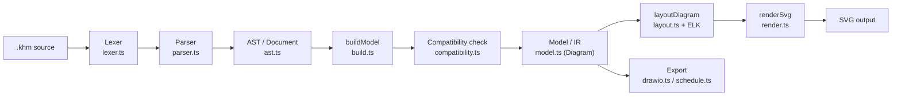
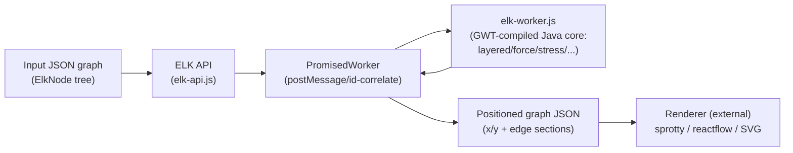
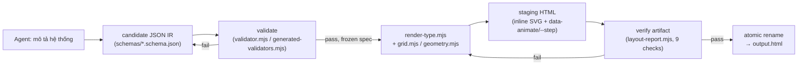
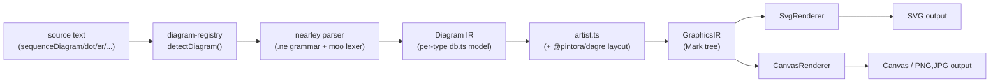

# Weekly Diagram-Tooling Scan — 2026-08-06

**Executive summary:**
- **Tách IR/renderer là chủ đề chung của tuần này.** Cả `pintora` (Mark-tree trung gian giữa artist và SVG/Canvas renderer) lẫn `elkjs` (JSON graph boundary tách layout khỏi render qua Worker) đều tách bạch layer rõ hơn kymostudio's 4 emitter độc lập (`to_svg`/`to_figma`/`to_excalidraw`/`to_webp`) — đáng cân nhắc một IR trung gian dùng chung.
- **CSS-only animation stagger đáng học nhất tuần này**: `archify`'s `data-animate` + `--step` custom-property pattern (kèm `[data-motion='still']` kill-switch cho accessibility) áp dụng thẳng được vào `kymo --animate` mà không cần JS/SMIL.
- **Cảnh báo dữ liệu**: `archify` có 9.5k sao trên repo ~4 tháng tuổi — tỉ lệ bất thường, nghi sao ảo/bot; đánh giá kiến trúc độc lập với con số này. `kumihimo` là dự án gần như một tác giả (bus factor thấp), nên các pattern học được cần tự kiểm chứng thêm.

## Mục lục
1. [Danh sách 10 repo được khảo sát](#danh-sách-10-repo-được-khảo-sát)
2. [Love-Rox/kumihimo](#love-roxkumihimo) — deep dive
3. [kieler/elkjs](#kielerelkjs) — deep dive
4. [tt-a1i/archify](#tt-a1iarchify) — deep dive
5. [hikerpig/pintora](#hikerpigpintora) — deep dive

---

## Danh sách 10 repo được khảo sát

Tìm qua GitHub topic/keyword search (`diagram-as-code`, `dsl`, `svg-animation`, `graph-visualization`, `layout-algorithm`), lọc theo hoạt động trong ~7 ngày qua (một số nới lên ~30 ngày khi không đủ ứng viên "fresh publish" — ghi chú riêng).

| # | Repo | Pitch | Sao | Push/publish gần nhất | Tiêu chí hit | Deep dive? |
|---|------|-------|-----|------------------------|--------------|------------|
| 1 | [Love-Rox/kumihimo](https://github.com/Love-Rox/kumihimo) | DSL cho signal-flow diagram AV/broadcast, port-typed + validate tương thích cáp | 0 | tạo 2026-07-30, push 2026-08-04 | Novel DSL design | ✅ |
| 2 | [tt-a1i/archify](https://github.com/tt-a1i/archify) | Claude-skill biến mô tả hệ thống thành animated HTML/SVG qua typed-JSON-IR pipeline | 9,467 | push 2026-08-05 | Rendering craft, agent-driven IR | ✅ |
| 3 | [hikerpig/pintora](https://github.com/hikerpig/pintora) | Text-to-diagrams engine mở rộng được, Mermaid-adjacent | 1,284 | push 2026-08-05 | Cross-format, full parser/layout/render stack | ✅ |
| 4 | [terrastruct/text-to-diagram-site](https://github.com/terrastruct/text-to-diagram-site) | Site so sánh syntax/layout/output giữa Mermaid/D2/PlantUML/... | 553 | push 2026-08-02 | Cross-format (tài liệu tham khảo cạnh tranh) | — |
| 5 | [kieler/elkjs](https://github.com/kieler/elkjs) | JS port của Eclipse Layout Kernel — layered/force/tree layout engine | 2,692 | push 2026-08-05 | Layout algorithm research | ✅ |
| 6 | [synergycodes/ng-diagram](https://github.com/synergycodes/ng-diagram) | Angular library cho interactive diagramming/node-editor UI | 563 | push 2026-08-05 | Rendering/interaction craft | — |
| 7 | [awslabs/diagram-as-code](https://github.com/awslabs/diagram-as-code) | YAML-driven diagram-as-code cho kiến trúc AWS | 1,553 | push 2026-08-02 | Architecture-as-code DSL | — |
| 8 | [alejofernandez/authprint](https://github.com/alejofernandez/authprint) | Canvas editor mô hình hóa auth flow thành typed state machine, YAML DSL + elkjs auto-layout | 0 | tạo 2026-06-21, push 2026-08-04 | Narrow-domain DSL + layout-lib integration | — |
| 9 | [alireza-hq/glyph](https://github.com/alireza-hq/glyph) | Infinite-canvas app biến sketch thô thành diagram có thể sửa | 0 | tạo 2026-08-05 (true last-7-days) | Adjacent sketch-to-visual pipeline | — |
| 10 | [akulkarni9/GemDraw](https://github.com/akulkarni9/GemDraw) | Mô tả hệ thống bằng tiếng Anh, LLM (Gemma/Ollama local) vẽ HLD/UML lên tldraw canvas | 1 | tạo 2026-07-29, push 2026-08-05 | Text-to-diagram pipeline | — |

4 repo được chọn deep-dive (ưu tiên đa dạng góc nhìn: DSL thuần, layout-algorithm thuần, rendering/animation craft, và kiến trúc tổng thể gần nhất với kymostudio) là #1, #2, #3, #5. Runner-up nếu muốn mở rộng: `authprint` (#8), cho pattern narrow-domain DSL + elkjs integration.

---

## Love-Rox/kumihimo

### §1 — Quick Context (≤80 từ)
- Điểm khác biệt: giống Mermaid cho flowchart, nhưng đơn vị kết nối là **port** (không phải node), và **loại tín hiệu** (SDI/XLR/Dante...) trên mỗi cáp được tool hiểu và validate, không chỉ là trang trí.
- Tech stack: TypeScript (monorepo pnpm), dep chính `elkjs` (ELK graph layout) cho core; output SVG (+ draw.io export, TSV cable schedule).
- Sức khỏe repo: 0 sao/0 fork, gần như một tác giả (SASAGAWA Kiyoshi ~64/93 commit, phần còn lại là release-bot), 93 commit, phiên bản mới nhất `0.12.0` (release tự động qua Changesets), có CI (lint, format, build, typecheck, test) trên mỗi push/PR.
- Phân phối: npm (`@love-rox/kumihimo-*`), VS Code Marketplace extension, Obsidian plugin, web playground (`kumihimo.love-rox.cc`).

### §2 — Architecture Deep-Dive

**A. Component inventory**
- `Lexer` (`packages/core/src/lexer.ts`) — tokenizer thủ công, không throw, biến ký tự lạ thành token `invalid`.
- `Parser` (`packages/core/src/parser.ts`) — recursive-descent, class `Parser` nội bộ, xuất `Document` (AST) + `Diagnostic[]`.
- `AST` (`packages/core/src/ast.ts`) — kiểu dữ liệu cây cú pháp.
- `Model / IR` (`packages/core/src/model.ts`) — `Diagram`, `Device`, `Port`, `Link`, `Group` — cấu trúc đã resolve, phẳng hoá port range, gán `SignalType` thực.
- `Loader` (`packages/core/src/loader.ts`) — xử lý `use "..."` (import file thư viện thiết bị).
- `Build` (`packages/core/src/build.ts`) — biến AST → model (`buildModel`), gọi compatibility check.
- `Compatibility` (`packages/core/src/compatibility.ts`) — engine luật tương thích port-to-port (4 bảng: `INTERCHANGEABLE_GROUPS`, `CONNECTOR_CONFUSIONS`, `PASSIVE_ADAPTERS`, `LOSSY_PAIRS`).
- `Signals` (`packages/core/src/signals.ts`) — registry 38 signal type built-in.
- `Layout` (`packages/core/src/layout.ts`) — tự đo kích thước box/port, giao routing cạnh cho **ELK** (`elkjs`, thuật toán `layered`, `elk.edgeRouting: ORTHOGONAL`).
- `Render` (`packages/core/src/render.ts`) — `renderSvg`/`renderDiagram`, sinh SVG string thuần, không phụ thuộc DOM.
- `Compile` (`packages/core/src/compile.ts`) — pipeline một-hàm `compile()`: load → build → render.
- `Export` (`packages/core/src/export/drawio.ts`, `schedule.ts`) — draw.io export, cable/equipment schedule TSV.
- `CLI` (`packages/cli/src/cli.ts`, `commands.ts`) — `build`/`check`/`export --watch`.
- Integration packages: `react`, `vue`, `astro`, `rehype`, `editor`, `vscode`, `obsidian` — đều mỏng, gọi `@love-rox/kumihimo-core`.

**B. Pipeline / control flow**
1. User chạy `kumihimo build studio.khm -o studio.svg` (hoặc gọi `compile()` từ core).
2. `loadDocument()` đọc file, xử lý `use` import (thư viện thiết bị `.khm`), gọi `parse()`.
3. `tokenize()` → `Parser.parse()` sinh `Document` (AST) + diagnostics; lỗi cú pháp không throw, chỉ skip statement lỗi (recovery theo từng dòng).
4. `buildModel()` (`build.ts`) mở rộng port range, tạo device/port ngầm định, chạy `checkCompatibility()` cho mỗi `Link` → gắn verdict `ok/lossy/incompatible`.
5. `layoutDiagram()` tự tính vị trí box/port (kích thước dựa trên ước lượng độ rộng chữ), rồi giao ELK định vị các node và route cạnh trực giao (orthogonal).
6. `renderSvg()` vẽ ra chuỗi SVG (kèm legend, nhãn cáp, halo cảnh báo cho link lỗi) → ghi file `.svg` (hoặc export sang draw.io/TSV).

**C. Data model / IR**
Hai tầng IR rõ rệt: AST (`ast.ts`, giữ nguyên cú pháp gốc, có `span` để báo lỗi) và Model đã resolve (`model.ts`, plain TypeScript interface — không phải class — immutable-by-convention, "AST giữ những gì tác giả viết; model giữ ý nghĩa của nó"). Có khái niệm "compile xuống IR thấp hơn" rõ ràng qua `build.ts`.

**D. Input language design**
Lexer tay (không regex-per-line, không parser combinator) + parser recursive-descent tay, không có EBNF/BNF hình thức (grep `docs/SPEC.md` — không thấy grammar formal, spec viết dạng prose + ví dụ). Error reporting: mỗi lỗi có `span` (dòng/cột), recovery theo từng statement (một dòng hỏng không làm hỏng cả file) — thiết kế rõ ràng để phục vụ live-editing.

**E. Layout algorithm**
Hybrid: vị trí port bên trong box do code tự tính (giữ thứ tự khai báo có ý nghĩa, vd `IN 1` phải trên `IN 2`), còn việc sắp xếp box và route cạnh giao cho ELK (`elk.algorithm: layered`, `elk.edgeRouting: ORTHOGONAL`), hỗ trợ cả `crossingMinimization: INTERACTIVE` khi diagram khai `ordered: true` để giữ thứ tự tác giả viết thay vì tối ưu số điểm giao cắt.

**F. Rendering/output strategy**
Single primary backend: SVG string builder tay (không dùng thư viện DOM/canvas). Không có animation. Không pluggable-emitter rõ ràng ở core, nhưng có exporter phụ (`export/drawio.ts`, `schedule.ts` cho TSV) — kiến trúc gần giống "sibling emitters" nhưng ít hơn kymostudio.

**G. Extensibility**
Signal type mới: thêm vào `signals.ts` hoặc khai `signal` trong DSL; luật tương thích override qua `compat` trong file nguồn (không cần sửa code core). Theme: named theme (`light/dark/blueprint/mono`) trong `theme.ts`, chọn qua `diagram { theme: … }`.

**H. Dev experience**
CLI có `build/check/export --watch`; VS Code extension riêng (`packages/vscode`) với `diagnostics.ts`, `completion.ts`, `formatting.ts`, `preview.ts` — tức có ngôn ngữ hỗ trợ dạng LSP-lite (không xác định có dùng chuẩn LSP protocol hay tự viết trực tiếp trên VS Code API). Có live web editor (`packages/editor`) share link qua URL fragment (không server-side).

### §3 — Architecture Diagram

### §4 — Verdict (≤140 từ)

Điểm đáng học nhất: **hybrid layout** — tự tính vị trí port trong box (giữ ngữ nghĩa thứ tự `IN 1`/`IN 2`) nhưng giao ELK làm crossing-minimization + orthogonal edge routing, thay vì tự viết Sugiyama từ đầu; kymostudio có thể cân nhắc thay layout tự chế bằng ELK cho các trường hợp phức tạp. Đáng học thứ hai: **compatibility engine 4 bảng** (`INTERCHANGEABLE_GROUPS`/`CONNECTOR_CONFUSIONS`/`PASSIVE_ADAPTERS`/`LOSSY_PAIRS`) với override qua DSL (`compat` statement) — một mô hình validate ngữ nghĩa domain-specific hay, khác hẳn kiểu "chỉ vẽ" của kymostudio/BPMN.

Red flag: gần như một tác giả (bus factor thấp), 0 sao/fork — dự án còn non trẻ, chưa được cộng đồng kiểm chứng. Không có formal grammar (EBNF) cho DSL — khác biệt hẳn với kymostudio nơi `docs/DSL.md` là normative.

Verdict: **study deeper** riêng phần compatibility-rule-engine và cách kết hợp layout tay + ELK; phần còn lại glance-only.

---

## kieler/elkjs

### §1 — Quick Context (≤80 từ)
- elkjs là graph-layout engine thuần túy (không render), port GWT-compiled từ Java Eclipse Layout Kernel sang JS, chuyên layered/Sugiyama cho data-flow diagram có ports.
- Tech stack: Java core → GWT transpile → Babel + Browserify; build cần Gradle + checkout song song repo `eclipse/elk`; output: JSON graph (chỉ positions, không SVG).
- Repo health: ~2.7k sao, 120 fork, 90 issue mở, license EPL-2.0/GPL-3.0; npm `elkjs@0.12.0` publish 2026-07-17 (~3 tuần trước), có mocha test suite; CI workflow chi tiết không xác định (chỉ thấy `.github/` tồn tại).
- Distribution: npm (`elkjs`, kèm TS types), browser bundle (`elk.bundled.js`), Node module (`main.js`).

### §2 — Architecture Deep-Dive

**A. Component inventory**
- `ELK` (`src/js/elk-api.js`) — public API: constructor, `layout()`, `knownLayoutAlgorithms/Options/Categories()`, `terminateWorker()`.
- `PromisedWorker` (`src/js/elk-api.js`) — bọc Worker `postMessage`/`onmessage` thành Promise, correlate request/response bằng `id` tăng dần trong map `resolvers`.
- `ELKNode` (`src/js/main-node.js`) — subclass Node.js, tự chọn `web-worker` polyfill hoặc fallback non-worker `elk-worker.min.js`.
- `elk-worker.js` (sinh ra khi build, compile từ `src/java*` qua GWT) — engine layout thật, hộp đen từ góc nhìn JS.
- `typings/elk-api.d.ts` — schema TS (`ElkNode`/`ElkPort`/`ElkLabel`/`ElkExtendedEdge`/`ElkEdgeSection`, `LayoutOptions`).

**B. Pipeline / control flow**
1. App gọi `new ELK({algorithms, workerUrl|workerFactory})` → constructor validate, tạo Worker, gửi `{cmd:'register', algorithms}`.
2. App gọi `elk.layout(graph, {layoutOptions, logging, measureExecutionTime})` → đóng gói message `{cmd:'layout', graph, ...}`.
3. `PromisedWorker.postMessage()` gán `id`, lưu resolver, `worker.postMessage(msg)` gửi sang thread khác (structured-clone).
4. `elk-worker.js` (Java-compiled) chạy algorithm pipeline (layered/force/...), sinh graph JSON đã điền x/y/width/height + edge sections.
5. `onmessage` → `receive()` tra `id`, resolve/reject Promise; lỗi Java lồng nhau được làm phẳng qua `convertGwtStyleError`.
6. Promise trả graph JSON đã layout cho app; app tự render — elkjs không vẽ gì.

**C. Data model / IR**
Cây `ElkNode {id, layoutOptions, children[], ports[], edges[]}`, `ElkShape` có x/y/width/height, `ElkExtendedEdge{sources[], targets[], sections[]}` hỗ trợ hyperedge nhiều nguồn/đích, `ElkEdgeSection{startPoint, endPoint, bendPoints, incomingShape/outgoingShape, incoming/outgoingSections}` cho routing đa đoạn qua compound node. Vì graph truyền qua Worker `postMessage` (structured clone), input gốc không bị mutate tại chỗ — output là bản mới đã điền toạ độ.

**D. Input language design**
Không phải text DSL — JSON schema thuần. Validation duy nhất thấy được ở tầng JS: `layout()` reject nếu thiếu `graph`. Lỗi cấu trúc sâu hơn ném ra từ core Java-compiled, elkjs chỉ flatten stack trace qua `convertGwtStyleError`; chi tiết format lỗi core không xác định.

**E. Layout algorithm (đào sâu)**
Danh sách algorithm mặc định trong constructor: `layered` (flagship, Sugiyama), `stress` (stress-majorization), `mrtree`, `radial`, `force`, `disco`, cộng thêm `sporeOverlap`, `sporeCompaction`, `rectpacking` (bản dev 0.13.0); `box`/`fixed`/`random` luôn built-in. Crossing-minimization heuristic cụ thể (barycenter/median/...) không xác định — logic nằm trong Java ELK core đã compile, không đọc được từ elkjs repo. Tuy nhiên ví dụ `logging` trong README hé lộ pipeline nội bộ layered algorithm: liệt kê 17 "Slot" module gồm `GreedyCycleBreaker` (slot 1) và `ReversedEdgeRestorer` (slot 16) — xác nhận kiến trúc nhiều pha kiểu Sugiyama chuẩn (cycle-breaking → layering → crossing-min → placement → routing) dù chi tiết từng pha không xác định thêm. Edge routing hỗ trợ multi-section (`ElkEdgeSection`) cho routing qua nhiều container; style cụ thể (orthogonal/polyline/spline) điều khiển qua `layoutOptions` (flat k/v dict, khuyến nghị prefix `elk.` để tránh ambiguity) — catalog option đầy đủ nằm ở doc ngoài (ELK reference site), elkjs chỉ expose `knownLayoutOptions()` để query metadata runtime. Performance: mặc định chạy trên Web Worker (browser) / `web-worker` polyfill (Node `worker_threads`) để không block UI; fallback same-thread nếu không cấu hình worker; toàn bộ API là Promise-based dù sync hay async; có `measureExecutionTime` để đo thời gian layout.

**F. Rendering/output strategy**
Chỉ tính layout, không render — README nói thẳng "elkjs itself is a graph layout engine only... no rendering, styling" (issue #85). Output là JSON graph đã có tọa độ; downstream (sprotty, reaflow, reactflow, netlistsvg...) tự vẽ.

**G. Extensibility**
Không xác định plugin API JS-side để thêm algorithm mới tại runtime — thêm algorithm/option đòi hỏi sửa Java metadata layer rồi rebuild qua GWT; JS chỉ gửi list algorithm id để "register" chứ không định nghĩa logic mới.

**H. Dev experience**
API gọn (1 class, 5 method), TypeScript types đầy đủ đóng gói sẵn, README có ví dụ Node/browser/TS/debug rõ ràng, hỗ trợ cả browser lẫn Node. Docs option catalog đầy đủ nằm ngoài repo (site ELK riêng) — không self-contained.

### §3 — Architecture Diagram

### §4 — Verdict (≤140 từ)
Đáng học nhất: elkjs tách layout khỏi render triệt để hơn kymostudio hiện tại — input/output là 1 JSON schema chuẩn hóa (`ElkNode`/`ElkEdgeSection`) hoàn toàn độc lập renderer qua ranh giới Worker; `alignment.py`/`layout.py` có thể học pattern multi-section edge (`incomingShape`/`outgoingSections`) cho routing qua container lồng nhau, thay vì polyline đơn hiện tại. Không nên embed nguyên khối elkjs vào Python kymostudio (runtime JS + toolchain GWT/Gradle nặng, `convertGwtStyleError` cho thấy stack trace khó debug); nếu cần, `packages/js` wrap elkjs khả thi hơn port sang Python. Red flag: kích thước bundle `elk-worker.js` không xác định, crossing-minimization heuristic thật sự (nằm ở Java core) chưa đọc được. Open question: hiệu năng trên graph rất lớn. Verdict: **study deeper** phần data-model/API-boundary design, không port thuật toán trực tiếp.

---

## tt-a1i/archify

### §1 — Quick Context (≤80 từ)
Agent skill (không phải CLI độc lập) biến mô tả hệ thống thành HTML/SVG animated tự chứa qua pipeline generate→validate→render→verify→atomic-replace, khác biệt ở chỗ IR được validate và "chốt" (freeze) trước khi render chứ không render trực tiếp từ prompt. Stack: Node.js ≥18, **zero runtime deps** (chỉ `ajv` là devDep để precompile validator), output HTML self-contained + inline SVG, export PNG/SVG/WebM/share-card. Repo health: 9.5k sao, 751 fork, 70 watcher, MIT, release đầu ghi nhận v2.3.0 (15/4/2026) → v2.13.0 (3/8/2026, cadence gần-hàng-tuần) — **tỉ lệ sao/tuổi repo rất bất thường** (đáng ngờ). Số contributor: không xác định (trang graphs chưa tải). Có `npm test` (validators + golden tests) nhưng nội dung CI workflow cụ thể: không xác định. Phân phối: `npx skills add tt-a1i/archify -g`, dùng được với Claude Code/Cursor/Codex CLI/opencode/Raven.

### §2 — Architecture Deep-Dive

**A. Component inventory** — `archify/SKILL.md` (hướng dẫn agent, quy trình bounded); `archify/bin/archify.mjs` (CLI: validate/deliver/render/preview/compare/inspect/check/guide/demo/doctor); `archify/schemas/{common,architecture,workflow,sequence,dataflow,lifecycle}.schema.json` (JSON Schema IR); `archify/renderers/<type>/render-<type>.mjs` + `grid.mjs` (renderer riêng từng loại); `archify/renderers/shared/{validator.mjs, layout-report.mjs, geometry.mjs, cli.mjs, diagnostics.mjs, generated-validators.mjs, legend.mjs, ...}` (hạ tầng dùng chung); `archify/delta/` (tính năng "Architecture Delta" so sánh base/head, có ví dụ `checkout-platform.{base,head}.architecture.json`).

**B. Pipeline** — (1) Agent đọc mô tả hệ thống + chọn diagram type, chỉ đọc schema/example khớp; (2) Agent viết candidate JSON IR (`meta.quality_profile: showcase`); (3) `archify.mjs validate` chạy ajv-schema + composition checks (9 artifact checks phải pass); (4) `archify.mjs deliver` re-validate, freeze spec, spawn renderer subprocess ra file staging; (5) check lại chính artifact HTML/SVG vừa render (layout/route/label-clearance); (6) chỉ khi mọi check pass mới rename candidate → file output cuối ("render/check failure never touches an existing trusted output"); tùy chọn `preview.mjs` watch-loop reload output khi source đổi và verified.

**C. Data model/IR** — JSON Schema draft 2020-12, mỗi diagram type một file, `common.schema.json` chứa `$defs` dùng chung (id pattern, point tuple, componentType enum, variant, legend, guidedViews, cards). `architecture.schema.json`: `meta{title, repository{url, sha1}, legend, viewBox}`, `components[]{id,type,label,row/col|pos,size}`, `layout{mode:"grid",cols,origin,gapX,gapY,cellW,cellH}`, `connections[]{from,to,label,variant,route,via,labelAt/Dx/Dy}`, `boundaries[]`. Validator được **precompile lúc build** (`generate-validators.mjs` dùng ajv) thành `generated-validators.mjs` thuần JS → runtime zero-dep. IR có tính **immutable sau khi validate**: SKILL.md nói thẳng "never edit a candidate after passing final validation", deliver "freezes the specification" trước khi render. Không thấy khái niệm compile-xuống-lower-IR — renderer đọc trực tiếp JSON đã validate và tính geometry tại chỗ (`grid.mjs`, `geometry.mjs`).

**D. Input language** — Không có DSL/NL parser bên trong archify: mô tả tự nhiên được **agent (LLM) tự tay chuyển** thành JSON theo schema, archify chỉ nhận input đã là JSON. Validation = ajv schema + composition rules; lỗi trả về JSON có cấu trúc `{code, severity, message, subject, evidence, supportedFixes}`, map trực tiếp từ ajv keyword (required/type/enum/pattern/additionalProperties) sang gợi ý sửa cụ thể.

**E. Layout** — Grid-based, không phải LLM sinh pixel trực tiếp: agent cung cấp `row/col` (hoặc `pos` override), `grid.mjs` tính x/y/width/height cụ thể. Edge routing tự động là mặc định (`roundedPath(points, 8)`), `via`/`channelX`/`channelY` chỉ là escape hatch cuối cùng theo SKILL.md.

**F. Rendering/output** — Backend: inline SVG nhúng trong HTML self-contained qua template (`writeDiagram`/`applyTemplate`). **Animation là thuần CSS**: `meta.animation:"trace"` chỉ stamp `data-animate="node"/"edge"` + `style="--step:N"` (hàm `animateAttr`, step cap 0-12) lên phần tử SVG và `data-animation="trace"` lên `<svg>` root; các `@keyframes` thật (`archify-chapter-anchor`, `archify-radar-live`, `archify-signal-scan`, `archify-lens-in`...) nằm trong CSS bundle, bind qua `[data-animate]`+`--step` để stagger thứ tự. Tắt animation toàn cục qua `html[data-motion='still'] ... { animation:none!important }` — cơ chế accessibility kill-switch gọn. Theme: `[data-theme='dark'|'light']` + fallback `matchMedia('(prefers-color-scheme)')`. Không có SMIL, không JS RAF loop cho animation. Verify→atomic-replace: render ra file staging, re-check chính artifact đã render (schema+layout+HTML/SVG+route+label clearance = 9 check), chỉ rename đè lên output cuối khi pass toàn bộ; dùng SHA-256 của spec và artifact để đảm bảo idempotent/provenance.

**G. Extensibility** — Suy luận từ cấu trúc song song (không có doc tường minh): thêm loại diagram mới = thêm `schemas/<type>.schema.json` + `renderers/<type>/render-<type>.mjs`. Theme/preset (`visual_preset`: Signal Flow/Blueprint/Classic/Editorial) — cơ chế nội bộ chính xác: không xác định.

**H. Dev experience** — Gọi qua skill (`npx skills add tt-a1i/archify -g`, agent tự đọc SKILL.md) hoặc trực tiếp `node bin/archify.mjs <cmd>`. Có preview/watch (`bin/preview.mjs`) và `open-artifact.mjs` tự mở output; `demo`/`doctor`/`guide` hỗ trợ onboarding.

### §3 — Architecture Diagram

### §4 — Verdict (≤140 từ)
Đáng học: (1) animation thuần CSS keyed bằng `data-animate` + `--step` custom-property stagger, có kill-switch `[data-motion='still']` cho accessibility — áp dụng thẳng được vào `kymo --animate` thay vì JS/SMIL; (2) pattern verify-rồi-atomic-rename (render ra file tạm, re-check chính output đã render, mới ghi đè) rất hợp với triết lý golden-SVG byte-for-byte của kymostudio, đáng cân nhắc cho một `kymo watch`/CI guard; (3) JSON Schema per-diagram-type + `common.schema.json` dùng `$defs` chung, cộng lỗi có `code/severity/subject/evidence/supportedFixes` — đáng tham khảo cho lỗi DSL của kymo. Red flag bắt buộc nêu: **9.5k sao trên repo ~4 tháng tuổi là tỉ lệ bất thường**, nghi sao ảo/bot, cần dè dặt khi trích dẫn "độ phổ biến". Thêm: cấu trúc lạ (`archify.zip` ở root, thư mục `.impeccable/`, `benchmarks/ordinary-model-floor/` không rõ mục đích), release cadence rất nhanh (gần hàng tuần) — không xác định độ ổn định. Verdict: **study deeper** phần IR/CSS-animation, nhưng nghi ngờ mạnh star count khi đánh giá độ trưởng thành cộng đồng.

---

## hikerpig/pintora

### §1 — Quick Context (≤80 từ)
- Text-to-diagrams engine chạy cả browser lẫn Node, lấy cảm hứng trực tiếp từ Mermaid.js/PlantUML nhưng kiến trúc plugin-hóa rõ ràng hơn (mỗi diagram type là một "three-piece" độc lập: parser/artist/config).
- Tech stack: TypeScript monorepo (pnpm + Turbo), lexer `@hikerpig/moo` + parser `@hikerpig/nearley` (formal grammar `.ne`), layout qua fork riêng `@pintora/dagre` + `@pintora/graphlib`, vẽ qua `@antv/g-base` (SVG/Canvas), output SVG/Canvas (browser), PNG/JPG/SVG (CLI, qua subprocess render).
- Repo health: 1,284 sao, 37 fork, 41 issue mở, push gần nhất 2026-08-05, MIT license, có CI (`ci-check.yml`, `update-tests.yml`) + Jest snapshot tests + Codecov.
- Distribution: npm (`@pintora/standalone`, `@pintora/cli`, ...), live editor web, VS Code extension, Obsidian/Gatsby/Observable plugin.

### §2 — Architecture Deep-Dive

**A. Component inventory** (monorepo pnpm, 9 package):
- `@pintora/core` (`packages/pintora-core/src/`) — `diagram-registry.ts` (đăng ký/detect diagram theo `pattern` regex), `type.ts` (interface `IDiagram<D,Config>`), `config-engine.ts`, `themes/` (base/palette/theme-default/theme-dark/theme-lark) — nền tảng registry + theme + config.
- `@pintora/diagrams` (`packages/pintora-diagrams/src/`) — 9 diagram type, mỗi cái tự chứa `parser.ne` + `parser.ts` (compiled) + `db.ts` + `artist.ts` + `config.ts` + `index.ts` (register); shared grammar fragment (`shared-grammars/{bind,comment,config,style,whitespace}.ne`).
- `@pintora/renderer` (`packages/pintora-renderer/src/renderers/`) — `base.ts` (`BaseRenderer` abstract, duyệt Mark tree qua `@antv/g-base`), `SvgRenderer.ts`, `CanvasRenderer.ts` — hai backend cùng logic, khác `getCanvasClass()`.
- `@pintora/cli` (`packages/pintora-cli/src/`) — `render.ts`/`render-impl.ts`/`sameprocess-render.ts`/`subprocess-render/` — CLI xuất PNG/JPG/SVG, mặc định chạy render trong subprocess (trừ môi trường Jest).
- `@pintora/development-kit` (`compie-grammar.ts`) — tool build grammar `.ne` → parser.
- `@pintora/standalone`, `@pintora/target-wintercg` — bundle tích hợp cho browser / WinterCG runtime.
- `pintora-harness` — bộ test case layout (`harness/cases/er`, `sequence`) dùng để chống regression layout (tương tự golden-SVG test của kymostudio nhưng đặt tên "harness").

**B. Pipeline** (theo `.ai/docs/architecture/overview.md` + `pintora-core/src/index.ts`):
1. User gọi `pintora.renderTo(code, ...)` hoặc `pintora-cli render()`.
2. `preprocessExtractor.parse(text)` tiền xử lý text (config block, comment...).
3. `diagramRegistry.detectDiagram()` test regex `pattern` của từng diagram đã đăng ký để chọn loại (mặc định `sequenceDiagram` nếu không khớp).
4. Diagram được chọn: `parser` (nearley-generated, dùng `db.ts` làm mutable "yy" context) parse text → Diagram IR.
5. `artist` của diagram đó nhận Diagram IR + config/theme → build ra `GraphicsIR` (cây Mark, layout tọa độ tuyệt đối, có thể gọi `@pintora/dagre` để auto-layout).
6. `SvgRenderer`/`CanvasRenderer` (kế thừa `BaseRenderer`) duyệt Mark tree, tạo shape trên canvas `@antv/g-base` → xuất SVG string hoặc canvas/PNG.

**C. Data model / IR** — Hai tầng IR riêng biệt: (1) **Diagram IR** — plain object domain-specific cho từng loại (vd `SequenceDiagramIR`), do `db.ts` tích lũy qua các lệnh grammar action, mutable trong lúc parse rồi "đóng băng" khi trả về; (2) **GraphicsIR** — cây "Mark" (graphics primitive: rect/text/path/group...) độc lập diagram-type, do `artist` sinh ra, renderer chỉ biết Mark chứ không biết gì về sequence/er/dot. Đây chính là khái niệm "compile to lower IR" — tương đồng rõ với kymostudio's `Diagram` nhưng kymostudio chỉ có MỘT model chung (`Component`/`Region`/`Edge`) dùng chung cho mọi loại diagram, còn pintora có **N model IR khác nhau** (một per diagram type) hội tụ về một Mark-tree chung ở tầng dưới trước khi render.

**D. Input language design** — Parser dùng **nearley** (Earley parser generator, hỗ trợ ambiguous grammar) kết hợp lexer `moo` (multi-state lexer: state `main`/`line`/`configStatement`/`noteState` trong `sequenceDiagram.ne`), có **grammar hình thức thật sự** (`.ne` file, compile thành `.ts` commit sẵn — cả nguồn lẫn compiled đều review được). Mỗi diagram type một grammar riêng, dùng chung fragment (`bind.ne`, `config.ne`, `style.ne`, `whitespace.ne`) — khác hẳn kymostudio's line-oriented hand-rolled parser dùng chung một `dsl.py`/`dsl.ts` cho mọi construct. Error reporting: không xác định (không đọc được code xử lý lỗi cụ thể trong lần khảo sát này).

**E. Layout algorithm** — Dot/component/activity/class dùng **`@pintora/dagre`** (fork riêng của dagre) qua wrapper `createLayoutGraph` với option `rankdir`/`nodesep`/`edgesep`/`ranksep`/`splines` (curved vs linear) — tức layered/Sugiyama DAG layout có edge routing chọn được spline cong hoặc thẳng, cộng `@pintora/graphlib` làm cấu trúc đồ thị nền. Sequence/ER/mindmap/gantt nhiều khả năng dùng thuật toán bespoke trong `artist.ts` riêng (không xác định chi tiết — chưa đọc source layout của các loại này). Crossing minimization: kế thừa từ dagre (built-in), không có evidence về custom minimization thêm.

**F. Rendering/output strategy** — Kiến trúc **pluggable renderer thật sự**: `BaseRenderer` abstract class + `SvgRenderer`/`CanvasRenderer` cùng duyệt một Mark-tree chung qua `@antv/g-base`, subclass chỉ khai báo `getCanvasClass()`. Đây là điểm khác biệt lớn với kymostudio, nơi mỗi target (`to_svg.py`/`to_figma.py`/`to_excalidraw.py`/`to_webp.py`) là một emitter độc lập đọc trực tiếp `Diagram` model — pintora tách bạch hẳn layer Mark-tree trung gian giữa artist và renderer. Animation support: **không xác định / không tìm thấy evidence** (không có file/keyword "animat*" nào trong tree hay code đã đọc) — khác biệt rõ với kymostudio vốn animated-SVG là mục tiêu chính.

**G. Extensibility** — Có **plugin system chính thức và tài liệu hóa rất kỹ**: `pintora.registerDiagram()` + convention "diagram three-piece" (parser/artist/config, ghi trong `.ai/docs/patterns/diagram-three-piece.md`) + skill guide từng bước `.ai/skills/add-new-diagram/SKILL.md` (8 bước: viết grammar → build → artist đọc theme → config → register → test snapshot → viết doc MDX → verify trong live editor). Theme: `getConfig().themeConfig` — token-based, artist bị cấm hard-code màu hex, đây là rule được enforce rõ trong docs.

**H. Dev experience** — CLI (`pintora-cli`, render subprocess mặc định để cô lập crash), live editor web (`demo:dev`, deployed tại pintorajs.vercel.app/demo/live-editor), VS Code extension (`pintora-vscode`), watch mode (`turbo watch`). LSP: không xác định.

### §3 — Architecture Diagram

### §4 — Verdict (≤140 từ)
**Đáng học**: (1) Grammar hình thức (nearley + moo) với states — kymostudio's DSL parser line-oriented có thể học cách tách lexer-state để xử lý construct lồng nhau (note/loop) sạch hơn. (2) Plugin pattern "three-piece" + skill-guide từng bước cực kỳ rõ ràng — kymostudio nên viết một tài liệu tương tự để chuẩn hóa cách thêm diagram type mới thay vì chỉ mở rộng `dsl.py`. (3) Tách Mark-tree trung gian giữa artist và renderer giúp SVG/Canvas share 100% logic duyệt cây — kymostudio's 4 emitter độc lập (`to_svg`/`to_figma`/`to_excalidraw`/`to_webp`) có thể cân nhắc một IR trung gian tương tự để giảm trùng lặp. (4) Dagre layered layout với `splines` option (cong/thẳng) đáng tham khảo cho `to_svg.py` edge routing.

**Red flags**: không tìm thấy animation support nào — nếu đúng, đây là gap lớn so với kymostudio's animated-SVG focus, kymostudio vẫn giữ lợi thế. N-model-IR-per-diagram-type (thay vì 1 model chung) có thể tăng chi phí bảo trì khi thêm diagram type mới.

**Open questions**: error-reporting UX của nearley parser, layout algorithm cụ thể cho sequence/mindmap/gantt, có animation ở tầng nào khác không (chưa loại trừ hoàn toàn).

**Verdict**: **study deeper** — đặc biệt phần plugin pattern + Mark-tree renderer abstraction, vì đây là repo gần kiến trúc kymostudio nhất trong tuần này.
