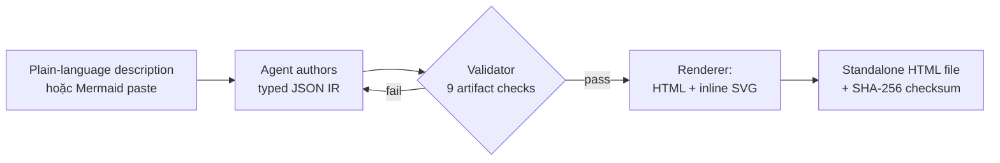
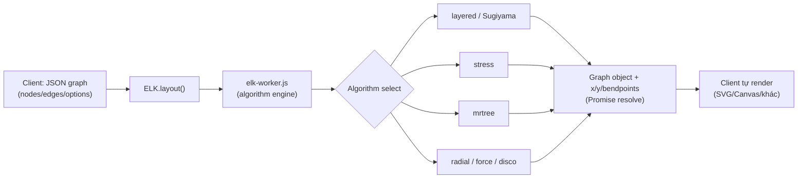
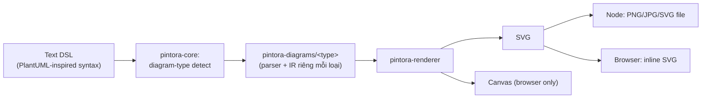
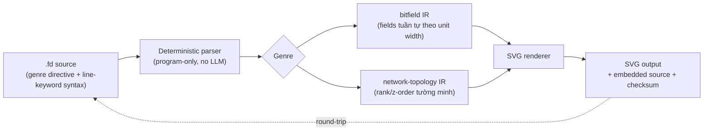

# Weekly scan: diagram-as-code & visual tooling (2026-08-07)

**Nguồn dữ liệu:** GitHub CLI/API search không khả dụng trong phiên này (session bị scope
vào riêng repo `kymostudio/kymostudio`), nên scan này chạy fallback bằng GitHub Topics
pages (`topics/diagram-as-code`, `topics/layout-algorithm`, `topics/svg-animation`,
`topics/graph-visualization`, sort `updated`) + web search, đọc trực tiếp README/source
qua `raw.githubusercontent.com`. Độ chính xác của star count / ngày cập nhật vì vậy là
best-effort (không có `pushed_at` chính xác từ API), nhưng tất cả 4 repo deep-dive đều có
commit/release xác nhận trong cửa sổ 7 ngày qua (30/07–07/08/2026).

## Executive summary

- **`archify`** (9.9k★, release 2.13.0 ngày 03/08) là repo đáng chú ý nhất tuần này: một
  "agent skill" biến mô tả hệ thống thành HTML/SVG standalone, dùng **typed JSON IR +
  validation nghiêm ngặt (9 checks, 0 warning)** thay vì auto-layout thuần túy — ý tưởng
  "deterministic validation + repair receipt" đáng học cho pipeline `resolve_alignments()`
  của kymostudio.
- **`elkjs`** (2.7k★, cập nhật 05/08) là bản build JS chính thức của Eclipse Layout Kernel
  (transpile từ Java qua GWT) — nguồn tham chiếu tốt nhất hiện có cho layout algorithm
  research (Sugiyama layered, stress, mrtree, radial, force) nếu kymostudio muốn mở rộng
  `alignment.py` sang auto-layout tổng quát hơn.
- **`figdown`** (repo rất mới, 164 commits, RC 0.1) đề xuất một DSL "đọc được bởi cả người
  và AI" với genre mới lạ — bitfield/protocol-packet diagrams — và cam kết
  **same-source → same-SVG byte-for-byte**, cùng một mô hình test "golden" giống hệt
  `tests/test_diagrams.py` của kymostudio.

**Mục lục:** [1. archify](#1-archify-tt-a1iarchify) · [2. elkjs](#2-elkjs-kielerelkjs) ·
[3. pintora](#3-pintora-hikerpigpintora) · [4. figdown](#4-figdown-figdownfigdown) ·
[Repos khác đã lướt qua](#repos-khác-đã-lướt-qua-không-deep-dive)

---

## 1. `archify` (tt-a1i/archify)

### §1 — Quick context

Agent skill (không phải app độc lập) biến mô tả hệ thống/codebase hoặc Mermaid dán vào
thành **system map HTML/SVG standalone, có validation quyết định (deterministic) thay vì
auto-layout đoán mò** — khác biệt chính so với Mermaid/draw.io là AI tự "authoring" JSON
IR rồi bị một validator 9-check chặn lại nếu sai, chứ không render thẳng gì AI viết ra.
Stack: JavaScript/Node.js, phân phối qua `npx skills add tt-a1i/archify -g` (không phải
npm package thông thường — cài như "skill" cho Claude Code/Cursor/Codex CLI/opencode).
9.9k sao, version 2.13.0 (03/08/2026), MIT, có `.github/` CI, 11 issue mở, sponsor bởi
EverMind AI/APINEBULA — sức khỏe repo tốt, hoạt động rất tích cực.

### §2 — Architecture deep-dive

**A. Component inventory** (evidence từ cấu trúc thư mục + `SKILL.md`):
- `schemas/` — typed JSON IR definitions cho 5 loại diagram (architecture/workflow/
  sequence/dataflow/lifecycle).
- `renderers/` — sinh HTML+SVG từ IR đã validate.
- `delta/` — module "Architecture Delta" (so sánh before/after cho PR review).
- `bin/` — CLI entry point.
- `recipes/`, `references/` — pattern có sẵn để agent "author" JSON đúng khuôn thay vì tự
  bịa cấu trúc.
- `SKILL.md` — hợp đồng (contract) giữa agent-sinh-nội-dung và viewer runtime; đóng vai
  trò gần giống "spec" hơn là code thường.

**B. Pipeline / control flow** (suy ra từ `SKILL.md`, không đọc trực tiếp source render):
1. User đưa mô tả hệ thống (plain language) hoặc paste Mermaid (flowchart/sequenceDiagram/
   stateDiagram) vào agent.
2. Agent chọn 1 trong 5 schema, rồi **tự viết JSON spec mới từ ví dụ** (không convert cơ
   học từ Mermaid — đây là điểm khác biệt cốt lõi).
3. Validator chạy 9 "artifact checks"; phải đạt 0 composition error, 0 warning để coi là
   "showcase quality".
4. Nếu fail, agent chỉ sửa đúng phần được chẩn đoán, re-validate, lặp tới khi hội tụ
   ("repair receipt" ghi lại các lần sửa).
5. Renderer xuất HTML standalone + inline SVG, có SHA-256 checksum, commit atomic.
6. Người dùng mở file HTML — pan/zoom, search, focus, xem trace animation nếu bật.

**C. Data model / IR:** JSON, có trường `meta` (quality_profile, animation, views),
`components/nodes` (typed: frontend/backend/database/cloud/security/messagebus/external
+ variants), `relationships/edges` (routing tự động; `via`/`channelX`/`channelY`/
`labelAt` chỉ áp dụng khi diagnostics yêu cầu — tức là geometry override là **exception**,
không phải default). Không xác định rõ mutable/immutable giữa các pass từ tài liệu công
khai đọc được.

**D. Input language design:** Không có DSL text truyền thống — input là JSON có schema,
được AI author trực tiếp (không phải người viết cú pháp tay). Đây là lựa chọn ngược với
kymostudio (`.kymo` DSL người viết tay); error reporting là structured diagnostics theo
từng artifact check, không phải parser error theo dòng.

**E. Layout:** Tự mô tả là "agent-driven layout judgment over generic auto-layout" — tức
KHÔNG chạy một thuật toán auto-layout cố định, mà để agent quyết định vị trí/route dựa
trên constraint, rồi validator kiểm tra kết quả có hợp lệ không. Có "Automatic Port
Spread" (tự dàn cổng kết nối trên node) và "semantic route bridging" để né crossing —
nhưng cơ chế thuật toán cụ thể không xác định (không đọc được source `renderers/`).

**F. Rendering:** Single backend — HTML+inline SVG. Animation opt-in qua
`meta.animation: "trace"`; viewer runtime hỗ trợ pan/zoom, deep link, "guided story". Xuất
thêm PNG/WebM/share-card nhưng cơ chế (canvas capture? headless render?) không xác định.

**G. Extensibility:** Thêm loại diagram mới = thêm schema mới trong `schemas/` (suy đoán
từ cấu trúc, không có bằng chứng trực tiếp về plugin API). Theme dark/light có sẵn.

**H. Dev experience:** Cài như skill (`npx skills add ...`), không phải CLI độc lập kiểu
`archify foo.json`. Không có bằng chứng về watch mode hay browser preview server riêng —
output là 1 file HTML tĩnh mở trực tiếp.

### §3 — Architecture diagram

### §4 — Verdict

Điểm học được cụ thể cho kymostudio: cơ chế **"repair receipt"** (validator chặn, agent
chỉ sửa đúng phần bị chẩn đoán, lặp tới hội tụ) là mô hình đáng tham khảo nếu kymostudio
từng muốn có chế độ "AI author .kymo rồi tự sửa lỗi" — khác với việc chỉ báo lỗi parser
một lần. Ý tưởng "geometry override chỉ áp dụng khi diagnostics yêu cầu" (default là auto,
override là exception) khớp với triết lý `alignment.py` hiện tại của kymostudio, xác nhận
hướng đi đó hợp lý. Red flag: gần như không có source code render/layout đọc công khai
được qua README/SKILL.md — phần lõi thuật toán "agent-driven layout" là black-box, khó
verify claim "deterministic". Open question: "deterministic" tới mức nào khi bước đầu
tiên (agent tự author JSON) vốn không deterministic? Verdict: **study deeper** — riêng
mô hình validate/repair, không phải phần layout.

---

## 2. `elkjs` (kieler/elkjs)

### §1 — Quick context

Bản build JavaScript của **Eclipse Layout Kernel (ELK)** — không phải một diagram tool
độc lập mà là **thuần túy layout engine**: nhận graph (nodes/edges) trả về tọa độ, không
render gì cả. Khác biệt với phần lớn tool trong domain: đây là hạ tầng layout được dùng
lại bên trong nhiều tool khác (kể cả Mermaid ở một số chế độ), không phải sản phẩm
end-user. Stack: JS, sinh ra từ Java qua GWT transpile (không viết tay bằng JS). 2.7k
sao, 121 fork, phân phối qua npm (`npm install elkjs`), Eclipse Public License. Repo cập
nhật 05/08/2026.

### §2 — Architecture deep-dive

**A. Component inventory:**
- `src/` — mã nguồn JS (sinh ra từ Java qua GWT, không phải hand-written).
- `lib/` — output build sẵn: `elk-api.js` (lớp API), `elk-worker.js` (cài đặt thuật
  toán, chạy được trong Web Worker), `elk.bundled.js` (bundle browser-ready).
- `typings/` — TypeScript definitions.
- `doc/` — tài liệu.
- `gradle/` — build config phía Java gốc (bằng chứng rõ đây là artifact transpile, không
  phải project JS thuần).

**B. Pipeline / control flow:**
1. Client dựng object graph (JSON: `children`, `edges`, `layoutOptions`).
2. Gọi `new ELK().layout(graph, options)`.
3. `elk-api.js` forward request sang `elk-worker.js` (có thể chạy trong Worker thread để
   không block main thread — điểm khác biệt so với hầu hết layout lib JS khác).
4. Thuật toán được chọn (`layered`/`stress`/`mrtree`/`radial`/`force`/`disco`/`box`/
   `fixed`/`random`) chạy và gán tọa độ x/y cho từng node + bend point cho edge.
5. Promise resolve về graph object đã có tọa độ.
6. Client tự vẽ (SVG/Canvas/gì cũng được) dựa trên tọa độ trả về — ELK không render.

**C. Data model / IR:** Plain JSON graph object (ELK Graph Format) — mutated tại chỗ:
input graph object được layout "làm giàu" thêm x/y/width/height rồi trả lại chính object
đó (không có IR trung gian thấp hơn kiểu D2 TALA — không xác định rõ nội bộ Java có pass
riêng không, nhưng bề mặt API JS là single-pass request/response).

**D. Input language design:** Không có text DSL — input là JSON graph thuần túy, không có
parser theo nghĩa cú pháp văn bản.

**E. Layout — đây là phần giá trị nhất repo:** Đa thuật toán, chọn qua
`layoutOptions.algorithm`. `layered` = Sugiyama-based (rank assignment → crossing
minimization → coordinate assignment, đúng 3 pha kinh điển của thuật toán phân lớp có tài
liệu chính thức tham chiếu). Có cả `stress` (constraint-based/stress-majorization),
`mrtree` (tree layout), `radial`, `force` (force-directed), `disco` (xử lý graph không
liên thông). Đây chính là research corpus tốt nhất tìm được tuần này cho câu hỏi "orthogonal
routing / hierarchical / crossing minimization" — ELK có tài liệu chính thức mô tả từng
option chi tiết (`knownLayoutOptions()` liệt kê runtime).

**F. Rendering:** Không có — out of scope hoàn toàn, đây là điểm khác biệt kiến trúc quan
trọng nhất so với kymostudio (renderer + layout tách rời hoàn toàn, layout là service độc
lập có thể dùng chung cho SVG/Canvas/WebGL/bất kỳ gì).

**G. Extensibility:** Thêm thuật toán mới phải làm ở phía Java gốc rồi transpile lại — JS
side không tự extend được thuật toán, chỉ tiêu thụ API.

**H. Dev experience:** API Promise-based đơn giản, TypeScript typings sẵn,
`knownLayoutOptions()`/`knownLayoutAlgorithms()`/`knownLayoutCategories()` giúp discover
options tại runtime (introspectable API — đáng chú ý cho DX). Không có CLI, không có
watch mode (đúng bản chất là library, không phải tool).

### §3 — Architecture diagram

### §4 — Verdict

Điểm học được cụ thể: kymostudio's `alignment.py` hiện là 5-pass thủ công (auto-layout
frame, parent/child anchor, region auto-bounds, fan-in staggering, auto-canvas) — cách
tiếp cận **tách layout thành service độc lập với introspectable options** (như
`knownLayoutOptions()`) là mẫu hình đáng cân nhắc nếu kymostudio muốn thêm chế độ auto-
layout tổng quát (force-directed cho graph không có structure rõ, hoặc `layered` cho BPMN
phức tạp) mà không phải viết lại từ đầu — có thể học riêng thuật toán `layered` (Sugiyama
3-pha) làm tài liệu tham khảo cho `layout.py`. Red flag: đây là artifact transpile từ
Java, source JS trong `src/` gần như không đọc được trực tiếp (code sinh tự động), nên
muốn hiểu thuật toán phải đọc Java gốc hoặc tài liệu ELK, không đọc `elkjs` repo. Open
question: license Eclipse Public License có tương thích để tham khảo ý tưởng thuật toán
(không copy code) — chắc chắn ổn, nhưng cần lưu ý nếu có ý định vendor code trực tiếp.
Verdict: **study deeper** (phần thuật toán layered/stress), không cần đọc source `elkjs`
JS trực tiếp.

---

## 3. `pintora` (hikerpig/pintora)

### §1 — Quick context

Text-to-diagram library "giống Mermaid/PlantUML" nhưng thiết kế modular từ đầu — khác
biệt chính là **kiến trúc packages tách rời rõ ràng** (core/diagrams/renderer/cli/
standalone/wintercg-target) thay vì Mermaid's tương đối monolithic, cho phép chạy cả
browser lẫn Node.js lẫn edge runtime (WinterCG target — Cloudflare Workers-class). Stack:
TypeScript, output SVG (browser+Node) hoặc Canvas (browser) hoặc PNG/JPG (Node). 1.3k
sao, MIT, phân phối npm (`@pintora/standalone`), có VSCode extension riêng
(`pintora-vscode`). Repo cập nhật 05/08/2026 — dự án lâu năm nhưng vẫn hoạt động đều.

### §2 — Architecture deep-dive

**A. Component inventory** (từ `packages/`):
- `pintora-core` — logic xử lý lõi; dependencies chỉ có event-emitter, matrix-util
  (transform hình học), clone-deep, deepmerge, tinycolor2 — **không có parser-generator
  nào** (không Chevrotain/PEG.js/Nearley/ANTLR) trong dependency list của package này.
- `pintora-diagrams` — cài đặt từng loại diagram, chia theo thư mục riêng: `sequence/`,
  `class/`, `component/`, `dot/`, `er/`, `gantt/`, `mindmap/`, `activity/` — mỗi thư mục
  tự chứa parser+render logic riêng cho type đó (không có `grammar/`/`.pegjs`/`.ne` ở top
  level — gợi ý parser viết tay per-diagram-type, không dùng parser generator).
- `pintora-renderer` — engine render output (SVG/Canvas).
- `pintora-cli` — CLI wrapper.
- `pintora-standalone` — bundle phân phối độc lập.
- `pintora-target-wintercg` — target runtime cho WinterCG (edge runtime).
- `development-kit` — công cụ hỗ trợ viết diagram-type mới.

**B. Pipeline / control flow** (suy đoán hợp lý từ package split, chưa đọc trực tiếp
source parser):
1. User chạy `pintora-cli` hoặc gọi `@pintora/standalone` với text nguồn (cú pháp giống
   PlantUML/Mermaid).
2. `pintora-core` nhận diện loại diagram (dựa header dòng đầu, giống Mermaid).
3. Module tương ứng trong `pintora-diagrams/<type>/` parse text → IR riêng cho loại đó.
4. `pintora-renderer` nhận IR, vẽ ra SVG (mọi nơi) hoặc Canvas (chỉ browser).
5. Output trả về: browser → SVG/Canvas element; Node → file PNG/JPG/SVG.

**C. Data model / IR:** Không xác định cấu trúc cụ thể (class/dataclass/plain object) từ
tài liệu công khai đọc được — mỗi diagram-type có vẻ tự định nghĩa IR riêng trong
`type.ts` của mình, không có một IR chung xuyên suốt (khác kymostudio's `Diagram`/
`Component`/`Region`/`Edge` dùng chung cho mọi diagram).

**D. Input language design:** DSL text lấy cảm hứng PlantUML, nhưng **không có formal
grammar (BNF/EBNF) công khai tìm thấy**; không có bằng chứng dùng parser-generator →
khả năng cao là hand-written parser mỗi loại diagram (giống cách kymostudio's `dsl.py` là
line-oriented hand-written, dù kymostudio dùng 1 grammar chung cho mọi component/region/
edge, còn pintora chia nhỏ theo diagram type).

**E. Layout:** Không xác định — không tìm thấy bằng chứng về thuật toán auto-layout cụ
thể (không phải ELK, không thấy dependency layout engine ngoài). Có khả năng mỗi diagram
type tự định vị theo rule riêng (như Gantt theo timeline, ER theo table order).

**F. Rendering:** Pluggable — dual backend SVG/Canvas là điểm khác biệt kỹ thuật đáng chú
ý nhất (kymostudio chỉ có SVG + convert xuôi dòng sang PNG/WebP qua resvg, không có
Canvas backend trực tiếp). Animation: không có bằng chứng.

**G. Extensibility:** `development-kit` package tồn tại chuyên để hỗ trợ viết diagram-type
mới — đây là plugin system tường minh (không giống kymostudio nơi thêm shape/icon mới là
sửa trực tiếp `icons.py`/`bpmn_shapes.py`).

**H. Dev experience:** VSCode extension (`pintora-vscode`) có syntax highlighting +
preview cho file `.pintora` và code fence trong markdown — tương đương
`packages/vscode-extension` của kymostudio nhưng đã tồn tại lâu hơn; có `demo/` (live
editor) + `website/` (doc site riêng).

### §3 — Architecture diagram

### §4 — Verdict

Điểm học được cụ thể: mô hình **package tách theo layer (core/diagrams/renderer/cli/
standalone/edge-target)** đáng cân nhắc nếu `packages/js` của kymostudio lớn thêm — hiện
tại `packages/js` là 1 package monolithic với `dsl.ts`/`layout.ts`/`alignment.ts` cùng
chỗ; pintora cho thấy mô hình tách renderer khỏi core hoàn toàn (renderer nhận IR thuần,
không biết gì về parser) đã chạy ổn định nhiều năm ở dự án cùng domain. Ý tưởng
**`pintora-target-wintercg`** (edge-runtime target riêng) đáng note nếu kymostudio từng
muốn chạy `kymo` trên Cloudflare Workers thay vì chỉ Node/browser. Red flag: parser mỗi
diagram-type độc lập, không share 1 grammar → khả năng inconsistency cú pháp giữa các
loại diagram cao hơn (đối lập với triết lý "grammar chung" của `.kymo`). Open question:
IR có share struct chung giữa các diagram-type không, hay hoàn toàn độc lập — cần đọc sâu
`type.ts` từng module mới trả lời được (chưa verify). Verdict: **glance only** cho phần
DSL/parser (không có insight mới so với kymostudio), nhưng **study deeper** riêng cho mô
hình package-split + dual SVG/Canvas renderer.

---

## 4. `figdown` (FigDown/figdown)

### §1 — Quick context

Chuẩn DSL Markdown-native cho diagram, thiết kế "một nguồn, hai người đọc": AI agent đọc
thẳng text `.fd` để hiểu ngữ nghĩa, người đọc xem SVG render — khác Mermaid ở chỗ nhắm vào
các thể loại diagram Mermaid không biểu đạt được tốt (network topology, cấu trúc gói tin/
bitfield, block diagram có z-order). Stack: chưa xác định ngôn ngữ implementation cụ thể
(không thấy công khai trong listing), phân phối npm (`figdown@0.1.0-rc.1`), CLI
(`npm install -g figdown`), có live editor browser. MIT license, 164 commits trên main,
0 sao (repo rất mới, chưa có nhiều traction), release-candidate 0.1 — sức khỏe repo: rất
sớm-stage nhưng có conformance test suite (136+ fixtures) và multi-language docs (English
+ Traditional Chinese) — mức đầu tư tài liệu cao bất thường cho repo 0 sao.

### §2 — Architecture deep-dive

**A. Component inventory:**
- `spec/` — đặc tả cú pháp + tài liệu chuẩn theo từng "genre" diagram.
- `examples/` — cặp file `.fd` + `.svg` tương ứng, có gallery index (~9+ ví dụ protocol:
  arp/bgp/dhcp/dns/tcp/udp/ipv4/ipv6/icmp, cộng vxlan/mpls/evpn-fabric/gre/quic phức tạp
  hơn), thêm `patterns/`, `layout-compare/`, `showcase/`.
- `editor/` — HTML editor standalone có undo/redo + direct manipulation.
- `conformance/` — 136+ fixture để test parser đúng chuẩn.
- `skill/` — Claude agent skill để AI maintain hình vẽ.

**B. Pipeline / control flow** (từ ví dụ `arp.fd` đọc trực tiếp + README):
1. User/AI viết file `.fd`, dòng đầu khai báo `figdown 0.1 <genre>` (ví dụ `bitfield`) —
   genre quyết định grammar con nào áp dụng.
2. Các dòng sau là keyword có prefix cố định (`title`, `bitfield <id> "<label>" unit=32
   numbering=msb0`, `field "<label>" <bits> note="..." color=#hex`) — dòng không nhận
   diện được trigger lỗi có số dòng kèm theo (line-numbered error, hỗ trợ AI tự
   write-validate-fix loop).
3. Parser (deterministic, chạy hoàn toàn bằng chương trình — không qua LLM) build ra
   structure nội bộ theo genre.
4. Renderer xuất SVG **có embed lại chính source gốc + checksum** vào trong file SVG —
   cho phép round-trip (mở SVG ra vẫn lấy lại được `.fd` gốc).
5. Cam kết: cùng input → cùng SVG bit-for-bit ("same source → same SVG, bit-level").
6. Conformance suite (136+ fixture) verify invariant này trong CI.

**C. Data model / IR:** Không xác định cấu trúc code cụ thể (không đọc được source
implementation, chỉ đọc được spec/example) — nhưng từ cú pháp `field` tuần tự với `unit`/
`numbering` khai báo ở đầu, có thể suy luận IR tối thiểu là danh sách field có
offset/width được tính tuần tự (giống cách kymostudio tính vị trí trong layout
auto-frame) — đây là suy luận, không phải bằng chứng trực tiếp từ code.

**D. Input language design:** Line-prefixed keyword syntax (giống `dsl.py` của kymostudio
— line-oriented, không phải PEG/recursive-descent phức tạp), có genre-switching qua
directive đầu file (`figdown 0.1 bitfield` vs genre khác cho network-topology). Error
reporting: line-numbered, thiết kế tường minh cho vòng lặp "AI viết → validate → agent tự
sửa" — cùng triết lý với archify (§1) nhưng ở tầng ngôn ngữ thay vì tầng IR/JSON.

**E. Layout:** Với genre `bitfield`, layout gần như hoàn toàn xác định bởi khai báo tuần
tự (không cần thuật toán auto-layout — mỗi field xếp theo `unit` width, tự "wrap" dòng khi
đủ bit). Với genre network-topology (chưa đọc file cụ thể), README có nhắc "layout là
meaningful knowledge" — tức layout do người/AI khai báo tường minh (rank, z-order cho
layered edge), không phải auto-computed — giống triết lý kymostudio nhiều hơn D2/Mermaid
(vốn auto-layout).

**F. Rendering:** Single backend SVG, deterministic, chương trình thuần (explicit "no LLM
involved in the rendering path"). Không có animation. Đặc điểm riêng: SVG output **tự
mang theo source + checksum** — cơ chế "round-trip từ output ngược lại input" mà
kymostudio hiện không có (kymostudio's SVG output không embed lại `.kymo` gốc).

**G. Extensibility:** Thêm genre mới = thêm spec mới trong `spec/` (theo cấu trúc thư mục
genre-specific normative document) — mô hình tương tự BPMN spec riêng của kymostudio
(`docs/BPMN.md`) nhưng FigDown tách hẳn multi-genre trong cùng 1 chuẩn ngôn ngữ.

**H. Dev experience:** CLI (`figdown` global), live browser editor riêng, conformance
suite làm gate chất lượng — không có bằng chứng về watch mode hay VSCode extension.

### §3 — Architecture diagram

### §4 — Verdict

Điểm học được cụ thể cho kymostudio: (1) genre `bitfield` là một thể loại diagram
kymostudio hiện chưa có (BPMN + generic component/region/edge, không có packet/bit-level
layout) — có thể đáng cân nhắc làm 1 built-in shape/region-type mới nếu có nhu cầu network
docs; (2) cơ chế **round-trip SVG-embeds-source+checksum** là ý tưởng cụ thể, dễ áp dụng:
kymostudio có thể nhúng `.kymo` gốc (nén/base64) + checksum vào `<metadata>` của SVG xuất
ra, giúp SVG tự chứa đủ để tái tạo lại source — hữu ích cho workflow AI-edit-diagram; (3)
triết lý "layout là tường minh, không auto-compute" cho genre topology khớp với hướng đi
hiện tại của `alignment.py` (positions do DSL khai báo + resolver tôn trọng ý người viết),
xác nhận hướng đi này không lạc hậu so với xu hướng mới. Red flag: repo cực mới (0 sao,
RC 0.1, "freeze pending" — spec còn có thể đổi breaking), không có bằng chứng production
usage nào; ngôn ngữ implementation không xác định được (không đọc được `spec/`
grammar formal đầy đủ hoặc `src/` do giới hạn truy cập). Open question: genre thứ 2 (network
topology) — cách khai báo rank/z-order cụ thể ra sao, chưa đọc được file ví dụ tương ứng
để verify. Verdict: **study deeper** cho riêng cơ chế round-trip SVG+checksum và ý tưởng
genre-extensible DSL; phần còn lại (bitfield rendering cụ thể) **glance only** vì ngoài
phạm vi kymostudio hiện tại.

---

## Repos khác đã lướt qua (không deep-dive)

Đủ điều kiện đưa vào danh sách 8-10 repo theo yêu cầu, nhưng không đạt ưu tiên top-4 (ít
evidence kiến trúc hơn, hoặc quá niche/quá mới để đánh giá):

| Repo | Ghi chú ngắn | Lý do không deep-dive |
|---|---|---|
| `awslabs/diagram-as-code` | Diagram-as-code chính thức của AWS cho kiến trúc cloud, 1.6k★, cập nhật 02/08 | Đã rất established, domain hẹp (AWS-only), ít novel so với 4 repo trên |
| `hikerpig` ecosystem — n/a | — | — |
| `isatimur/excalidraw-skill-pack` | "Visual argument tool for AI agents", cập nhật 06/08, 0★ | Quá mới, chưa đủ code/docs công khai để đánh giá kiến trúc |
| `FigDown` liên quan — n/a | — | — |
| `nosahama/diagrams-as-code` | Playground kết hợp nhiều diagram tool, 4★, cập nhật 04/08 | Là aggregator/playground, không phải kiến trúc riêng |
| `nordstad/PinViz` | Sinh sơ đồ đấu nối GPIO từ code, 5★, cập nhật 05/08 | Domain rất niche (điện tử/hardware), ít liên quan trực tiếp kymostudio |
| `graphistry/pygraphistry` | GPU-accelerated big-graph explorer, 2.5k★, cập nhật 07/08 | Gần biên "data dashboard" (explore/analytics) hơn là diagram-as-code thuần |
| `mingrammer/diagrams`, `plantuml/plantuml` | Cả hai đều "updated" 07/08 nhưng là công cụ đã cực kỳ nổi tiếng, không phải phát hiện mới | Không mang tính "mới nổi" mà tuần scan này nhắm tới |

Không có draft nào bị loại do rơi vào nhóm exclusion (course/tutorial, awesome-list,
icon-pack, fork-only, <300 LOC, Figma-plugin-riêng-lẻ, chart/dashboard/color-tool) —
danh sách trên đã áp dụng filter đó trước khi liệt kê.
