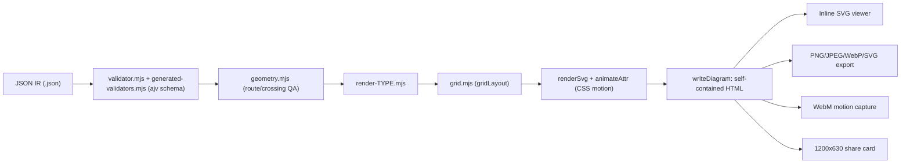
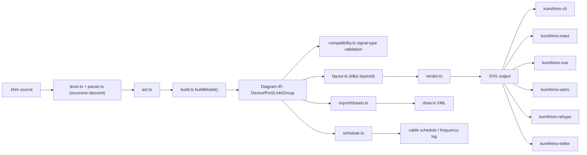
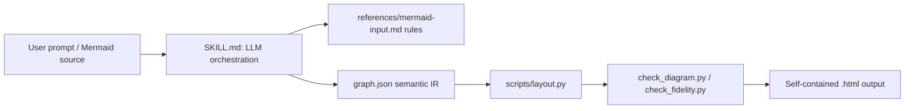
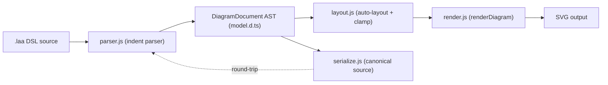

# Weekly Diagram Tooling Scan — 2026-08-08

**Tóm tắt (executive summary):**

- Tuần này nổi lên xu hướng "diagram tool như agent skill" thay vì thư viện độc lập: `archify` (10.2k★, agent skill cho Claude Code/Cursor/Codex, JSON IR → validated HTML/SVG/WebM) và `dashmotion` (Claude skill dùng chính LLM làm "parser" Mermaid) đều đặt Claude/agent làm front-end thay vì viết parser DSL truyền thống — đáng chú ý vì kymostudio đi hướng ngược lại (DSL văn bản tường minh + parser deterministic).
- Hai repo nhỏ, mới, một tác giả (`kumihimo`, `lines-and-arrows`) mang lại ý tưởng kỹ thuật cụ thể hơn là kiến trúc tổng thể: `kumihimo` bake port/signal-type validation thẳng vào IR (Link.signal + Link.compatibility là field first-class), `lines-and-arrows` có kỹ thuật clamp layout `Math.max(MINIMUMS, override)` và AST round-trip về canonical source.
- Kỹ thuật animation/accessibility đáng học nhất nằm ở `dashmotion`: ràng buộc "offset delta = đúng 1 chu kỳ dasharray" để dash-flow không giật khi loop, và xử lý `prefers-reduced-motion` hai lớp (CSS media query cho CSS animation + JS xoá node cho SMIL `animateMotion` vì SMIL không đọc media query) — kymostudio hiện dùng CSS animation cho edge, nên đây là gap accessibility cụ thể có thể vá.

**Mục lục:**
1. [tt-a1i/archify](#1-tt-a1iarchify)
2. [Love-Rox/kumihimo](#2-love-roxkumihimo)
3. [Northwestern-caddo190/dashmotion](#3-northwestern-caddo190dashmotion)
4. [apurin/lines-and-arrows](#4-apurinlines-and-arrows)

---

## 1. tt-a1i/archify

**Agent skill Node.js validate JSON IR (schema + hình học) rồi render HTML/SVG tự chứa; khác biệt: gate "chỉ ship khi pass" và Architecture Delta có bằng chứng git.**

### §1 Quick Context

Node.js >=18, ESM (`type: module`), phụ thuộc runtime gần như bằng 0 — chỉ `ajv ^8.17.1` (devDependency) để sinh validator từ JSON Schema. Input là JSON IR thuần (5 loại: architecture/workflow/sequence/dataflow/lifecycle); output: HTML tự chứa (inline SVG), PNG/JPEG/WebP/SVG/WebM, share card 1200×630. Repo khá lớn: 10.2k sao, 793 fork, MIT, bản mới nhất v2.13.0 (03/08/2026), có CI workflow chạy pass (153 run). Phân phối qua **agent-skill** (`npx skills add tt-a1i/archify -g`, dùng trong Claude Code/Cursor/Codex/OpenCode), không publish npm/PyPI (`package.json` có `"private": true`).

### §2 Architecture Deep-Dive

**A. Component inventory**
- CLI entry `archify.mjs` (`archify/bin/archify.mjs`) — dispatch subcommand (render/compare/deliver/preview/validate/inspect/check/guide/examples/doctor/demo).
- Schema set (`archify/schemas/*.schema.json` + `common.schema.json`) — JSON Schema per loại diagram.
- `generated-validators.mjs` (`archify/renderers/shared/generated-validators.mjs`) — validator ajv được **biên dịch sẵn** bằng `scripts/generate-validators.mjs` (codegen ahead-of-time, không compile ajv lúc runtime).
- `validator.mjs` (`archify/renderers/shared/validator.mjs`) — bọc lỗi ajv thành diagnostic có cấu trúc.
- `geometry.mjs` (`archify/renderers/shared/geometry.mjs`) — hàm thuần kiểm tra va chạm/route rhythm/crossing (QA sau layout, không phải sinh layout).
- `grid.mjs` (`archify/renderers/architecture/grid.mjs`) — layout dạng lưới thủ công.
- `render-architecture.mjs` (`archify/renderers/architecture/render-architecture.mjs`) — build chuỗi SVG + nhúng HTML.
- `preview.mjs` (`archify/bin/preview.mjs`) — watch mode, hot-reload atomic.
- `architecture-delta.mjs` (`archify/delta/architecture-delta.mjs`) — diff before/after.
- `repository-evidence.mjs` — pin node vào git commit.

**B. Pipeline / control flow**
1. Agent/user viết JSON IR theo `schemas/`+`examples/` (không có DSL văn bản — input là JSON có cấu trúc sẵn).
2. `node bin/archify.mjs validate <type> <source.json>` → `validator.mjs` chạy validator ajv sinh sẵn (pass schema), rồi `geometry.mjs` kiểm route/crossing/label-clearance.
3. `deliver`/`preview` load `renderers/<type>/render-<type>.mjs`; renderer gọi module layout riêng theo type (vd `gridLayout()`) để resolve tọa độ pixel từ `pos`/`row`/`col` trong IR.
4. Renderer build SVG (`renderSvg()`), gắn thuộc tính CSS keyframe (`animateAttr`) cho motion hữu hạn, `writeDiagram()` nhúng SVG vào template HTML tự chứa.
5. CLI chỉ **atomically replace** file output khi candidate pass validate — không có output hỏng dở dang.
6. `preview` giữ vòng watch atomic-swap; export PNG/SVG/WebM/share-card thực hiện ngay trong HTML đã deliver (browser-native capture theo README), không thấy script headless-render riêng trong repo.

**C. Data model/IR**: JSON thuần (`schema_version`, `diagram_type`, `meta`, `components`, `boundaries`, `connections`, `cards`), validate bằng JSON Schema per-type + `common.schema.json`. Có một bước "lower" nhẹ: IR → object layout đã resolve tọa độ (`gridLayout(arch)`) — tương tự alignment resolver của kymostudio nhưng chỉ 1 bước, tiêu thụ ngay trong cùng hàm render, không có nhiều pass IR→IR.

**D. Input language design**: không có grammar tùy biến — input là JSON viết tay (SKILL.md gợi ý agent có thể dịch ngôn ngữ tự nhiên/Mermaid sang JSON này, nhưng phần dịch đó không nằm trong repo). Validate = JSON Schema (ajv) compile trước. Báo lỗi có cấu trúc: rule code `schema/{keyword}`, `subject` (type/path/id), `evidence` (keyword+param), `supportedFixes` — giống linter hơn parser.

**E. Layout algorithm**: toán lưới cố định (`DEFAULT_GRID`: origin [40,80], 4 cột, cell 130×64, gap 30/40), `pos:[x,y]` tường minh ưu tiên hơn `row`/`col` — tức **user-specified trước, grid hỗ trợ sau**, không phải force-directed/auto thật. Routing edge: `geometry.mjs` chỉ **phát hiện và từ chối** (crossing, border-run, clearance) chứ không tối ưu hoá crossing-minimization thực sự.

**F. Rendering/output**: một emitter SVG/type, nhúng vào HTML tự chứa; motion là CSS keyframe (`animateAttr`/`renderDefinitions`), không phải JS/GIF. Export raster/WebM/share-card làm trong chính HTML viewer (theo README), không có backend pluggable rõ ràng — dispatch theo type qua `renderers/{type}/render-{type}.mjs`.

**G. Extensibility**: thêm loại diagram mới = thêm schema + validator sinh sẵn + module `renderers/<type>/` — không có hệ plugin/hook chính thức. Theme: dark/light + 4 preset thị giác (Signal Flow, Blueprint, Classic, Editorial) code cứng trong `legend.mjs`/`engineering-profiles.mjs`, không phải file theme cho người dùng tự viết.

**H. Dev experience**: CLI đầy đủ subcommand, `--json` cho diagnostic máy đọc, `preview` watch-mode atomic-swap, tích hợp hàng đầu như **agent skill** cho Claude Code/Cursor/Codex/OpenCode chứ không phải plugin IDE cho người.

### §3 Architecture Diagram

### §4 Verdict

Đáng học: (1) validator sinh sẵn từ schema (ajv codegen ahead-of-time) thay vì compile runtime; (2) diagnostic có cấu trúc `subject/evidence/supportedFixes` — kymostudio có thể áp dụng cho lỗi alignment resolver; (3) quy tắc "pos tường minh > grid index" khi resolve layout; (4) ghi file output chỉ khi pass validate (atomic replace) tránh SVG hỏng; (5) Architecture Delta (diff added/removed/moved/rerouted) là ý hay cho việc so sánh hai bản `.kymo`.

Red flag: "layout" thực chất chỉ là toán lưới thủ công cố định, không auto-layout/force-directed thật; `geometry.mjs` chỉ phát hiện lỗi route chứ không tự tối ưu crossing — tuyên bố "crisp export" hơi phóng đại so với cơ chế thật. Input là JSON thô, không có DSL cô đọng như `.kymo`, viết tay khó hơn. Câu hỏi mở: cơ chế capture WebM chạy trong trình duyệt hay có script headless riêng — không xác nhận được từ mã đọc được.

**Kết luận: study deeper** (đáng đào sâu phần validator diagnostics + Architecture Delta, nhưng layout/routing yếu hơn alignment resolver của kymostudio).

---

## 2. Love-Rox/kumihimo

**DSL vẽ sơ đồ tín hiệu AV (系統図) nối theo PORT thay vì NODE, tự validate tương thích signal-type giữa các cổng, khác biệt hẳn Mermaid.**

### §1 Quick Context

Monorepo TypeScript (pnpm + changesets), phụ thuộc chính `elkjs` (ELK graph-layout engine) và `commander` (CLI). Output: SVG (chính), draw.io XML, cable-schedule, wireless-frequency-log; VS Code extension riêng. Repo rất mới: 0 stars/forks, 93 commits, tác giả đơn (SASAGAWA Kiyoshi), nhưng nhịp release rất dày (nhiều tag trong ngày 04/08/2026, ví dụ `@love-rox/kumihimo-core@0.12.0`). Có CI (GitHub Actions) và test (`vitest`). Phân phối qua npm scope `@love-rox/kumihimo-*` + VS Code Marketplace.

### §2 Architecture Deep-Dive

**A. Component inventory**
- `Lexer/Parser` (`packages/core/src/lexer.ts`, `parser.ts`) — tokenizer + recursive-descent parser sinh AST.
- `AST` (`packages/core/src/ast.ts`) — cây cú pháp thô.
- `Loader` (`packages/core/src/loader.ts`) — resolve include/library thành Document.
- `Model builder` (`packages/core/src/build.ts`, `compile.ts`) — dựng `Diagram` model (Device/Port/Link/Group) từ AST.
- `Signal registry` (`packages/core/src/signals.ts`) — 38 signal type builtin + override tuỳ chỉnh.
- `Compatibility checker` (`packages/core/src/compatibility.ts`) — bảng luật `INTERCHANGEABLE_GROUPS`/`CONNECTOR_CONFUSIONS`/`PASSIVE_ADAPTERS`/`LOSSY_PAIRS`.
- `Layout engine` (`packages/core/src/layout.ts`) — bọc `elkjs` (thuật toán "layered").
- `Renderer` (`packages/core/src/render.ts`, `theme.ts`) — emitter SVG, 4 theme.
- `Export` (`packages/core/src/export/drawio.ts`, `schedule.ts`) — draw.io XML, cable schedule/frequency log.
- `Diagnostics` (`diagnostics.ts`, `messages.ts`) — `DiagnosticBag` có `SourceSpan`.
- `CLI` (`packages/cli`, bin `khm`/`kumihimo`) — commander wrapper quanh `compile()`.
- Adapter framework: `packages/react`, `vue`, `astro`, `rehype` — export component/hook mỏng.
- `packages/editor` — split-pane live editor nhúng được; `packages/vscode` — diagnostics + lệnh preview, không có LSP chính danh.

**B. Pipeline (happy path)**: (1) người dùng chạy `khm build studio.khm` hoặc gõ trong editor; (2) `loadDocument()` resolve source + thư viện include; (3) `lexer.ts`/`parser.ts` parse thành AST, lỗi cú pháp được ghi vào `DiagnosticBag` nhưng parser recovery ở cấp statement (skip tới separator kế tiếp) chứ không dừng hẳn; (4) `buildModel()` biến AST thành `Diagram` IR đã resolve (Device/Port/Link/Group), đồng thời chạy `checkCompatibility()` cho từng Link; (5) `renderDiagram()` gọi `layout.ts` (ELK layered, edge routing ORTHOGONAL) để tính toạ độ box/cáp rồi `render.ts` emit SVG tự chứa (không font/script ngoài); (6) CLI/editor ghi file SVG (hoặc draw.io/schedule) ra đĩa/DOM, diagnostics hiển thị song song — triết lý "never throws, always produces a drawing".

**C. Data model/IR**: interface TypeScript thuần (không phải class), coi là "resolved diagram model" bất biến theo quy ước — build lại mỗi lần compile, không thấy pass mutate giữa các bước. Có hai tầng IR rõ ràng: AST thô → Diagram model đã resolve, đúng khái niệm "compile xuống IR thấp hơn". Đáng chú ý: validation port/signal-type được bake thẳng vào IR — mỗi `Link` mang field `signal: SignalType` đã resolve và field `compatibility` (kết quả OK/lossy/incompatible) ngay trên object, không phải artifact phụ.

**D. Input language**: parser recursive-descent viết tay (tự ghi chú trong code), không thấy file grammar hình thức (không có `.g4`/EBNF trong các file đã đọc). Diagnostics mang `SourceSpan` (line/col); error-recovery ở mức statement để "một dòng sai chỉ tốn một statement" — thiết kế cố ý cho live editor không bị đứng hình khi gõ dở.

**E. Layout**: giao hẳn cho `elkjs` (ELK "layered" algorithm, có sẵn crossing minimization) — direction map từ `LR`/`TB` sang `RIGHT`/`DOWN`, `edgeRouting: ORTHOGONAL`. Box/port geometry tính cục bộ trong kumihimo, ELK chỉ đặt box và route cáp. Option `ordered: true` gán rank-coordinate để ép thứ tự khai báo (`INTERACTIVE` crossing strategy) — lai giữa full-auto và bán thủ công.

**F. Rendering/output**: SVG là backend duy nhất của `render.ts`, không có emitter registry pluggable; "multi-format" đạt được qua các exporter riêng biệt (`export/drawio.ts`, `schedule.ts`) đọc thẳng từ Diagram model. Không có animation (không CSS animation/SMIL) — output tĩnh, tự chứa hoàn toàn. 4 theme qua `theme.ts`.

**G. Extensibility**: signal type dùng registry-merge — `createSignalRegistry(custom) = {...BUILTIN_SIGNALS, ...custom}`, DSL cho khai báo `signal` để override/thêm không cần fork core. `Device.kind` là enum cố định (camera/switcher/mixer/.../generic) — không thấy cơ chế user-defined shape/icon. Bảng luật compatibility là static table trong code, chưa thấy override ở cấp DSL.

**H. Dev experience**: CLI `khm`/`kumihimo` (commander) build một lần; VS Code extension có diagnostics realtime + lệnh `kumihimo.showPreview` (ctrl+k v) nhưng không khai báo LSP; `packages/editor` là split-pane preview nhúng được, diagnostics click-to-navigate, share-link qua URL fragment; `packages/rehype` nhúng `.khm` fenced block vào Markdown/MDX (Astro). Không thấy flag watch-mode trong script CLI.

### §3 Architecture Diagram

### §4 Verdict

Điểm đáng học nhất là port/signal-type validation nằm ngay trong IR — `Link.signal` + `Link.compatibility` là field first-class, không phải bước kiểm tra rời. kymostudio's `model.py` Component/Edge hiện chỉ có hình học, không có khái niệm port có kiểu; có thể mượn ý tưởng "signal registry" (merge builtin + custom qua dict, cho phép override theo tên) áp cho icon/shape hoặc edge-type semantics. Việc giao layout cho `elkjs`/ELK thay vì tự viết constraint solver là lựa chọn thực dụng đáng cân nhắc nếu alignment.py cần crossing minimization thật sự. Parser recursive-descent + error-recovery cấp statement (không abort cả file) là pattern tốt cho live-preview editor, kymostudio có thể so sánh với `dsl.py`. Red flag: 0 stars, tác giả đơn, DSL grammar không có đặc tả hình thức (khác với `docs/DSL.md` normative của kymostudio), render chỉ có SVG tĩnh (không animation) — yếu hơn kymostudio ở mảng animated SVG. Câu hỏi mở: có formal grammar/EBNF ở `docs/` không, và compatibility rule table có mở rộng được từ DSL không.

**Kết luận: study deeper** (riêng phần IR port/signal-type validation và cách dùng elkjs).

---

## 3. Northwestern-caddo190/dashmotion

**Claude Agent Skill (không phải CLI độc lập) dùng chính LLM để "parse" Mermaid/mô tả tự nhiên, rồi gọi script Python tính layout và animation.**

### §1 Quick Context

Đây thực chất là một **Claude Agent Skill** (cài qua `npx skills add`, hoặc upload zip vào claude.ai), không phải một package. Stack: Python stdlib thuần (`scripts/layout.py`) + Markdown "prompt rules" (`references/*.md`) + SVG/CSS tay viết. Không dependency ngoài, output là 1 file `.html` tự chứa (SVG inline + CSS + ~15 dòng JS). Repo health: 0 star/0 fork, MIT license, commit gần nhất 2026-08-07, có đồng tác giả "Claude" (AI) và "csthink" (vẻ là bản gốc/upstream) — không thấy `.github/workflows` (không có CI tự động), chỉ có thư mục `eval/` (prompts.json + check scripts) để đánh giá thủ công/bán tự động. Phân phối qua skill-installer của Claude Code, không phải npm/PyPI.

### §2 Architecture Deep-Dive

**A. Component inventory**
- `SKILL.md` (`skills/dashmotion/SKILL.md`) — file điều phối trung tâm; là **prompt**, không phải code, dạy LLM cách chọn mode, đọc reference nào, gọi script nào.
- `references/mermaid-input.md` — quy tắc (dạng văn xuôi) để LLM "parse" Mermaid: bảng ánh xạ shape/edge, không phải grammar hình thức.
- `references/flow-mode.md`, `references/architecture-mode.md` — token thiết kế + luật bố cục theo từng mode.
- `scripts/layout.py` — engine layout + renderer duy nhất bằng code thật (class `Layout`, hàm `place`, `_route_edge`, `to_d`, `geometry`, `main`).
- `scripts/check_diagram.py`, `scripts/check_fidelity.py` — validator hậu kiểm (overlap, dash-loop seam, label fidelity so với Mermaid gốc).

**B. Pipeline (happy path, 5 bước)**: (1) User gọi Claude với prompt tự nhiên hoặc dán Mermaid → (2) Claude đọc `SKILL.md` + reference tương ứng, **tự diễn giải** input thành JSON ngữ nghĩa (`nodes/edges/groups/journeys`) theo schema quy định → (3) Claude ghi `graph.json` và chạy `python layout.py graph.json --render out.html` → (4) `layout.py` tính hình học (row packing, orthogonal routing) và render trực tiếp ra SVG/CSS animation → (5) Claude chạy `check_diagram.py`/`check_fidelity.py` để tự sửa lỗi trước khi trả file `.html` cuối.

**C. Data model/IR**: một JSON phẳng, gần giống dataclass (`Node{id,label,shape,type,tier,group,...}`, `Edge{src,dst,kind,label}`, `Group{id,label,kind,parent}`). Đây là **input bất biến, một lần lowering duy nhất**: JSON ngữ nghĩa → `geometry()` (dict tọa độ + path `d`) → chuỗi HTML. Không có multi-pass resolver như kymostudio (`alignment.py`) — mọi thứ tính trong một lượt của class `Layout`.

**D. Input language design**: Mermaid **không được parse bằng parser code** — LLM đọc bảng quy tắc trong markdown rồi tự trích xuất cấu trúc; tương tự, mô tả tự nhiên được chính model nền (Claude) diễn giải trực tiếp, không có lệnh gọi LLM riêng biệt hay heuristic tách rời — skill *là* LLM call. Diagram type không hỗ trợ (sequence/class/ER/Gantt) bị "reject" bằng hướng dẫn prompt, không phải exception có mã lỗi.

**E. Layout**: hoàn toàn auto-layout, top-down theo layer, routing orthogonal (L-route/rail), gộp fan-out qua "trunk lane"; không có thuật toán giảm crossing kiểu Sugiyama, chỉ là arithmetic xác định (deterministic).

**F. Rendering/animation** (trọng tâm liên quan kymostudio): dash chảy bằng CSS `stroke-dasharray:5 5; animation:dashmove .75s linear infinite` + `@keyframes dashmove{to{stroke-dashoffset:-10}}`, với ràng buộc cứng "offset delta phải bằng đúng 1 chu kỳ dasharray" để tránh giật khi loop. Dot chạy bằng `<animateMotion>` tái dùng `d` của connector, `begin` so le, `dur` tỉ lệ theo độ dài path (150 px/s, clamp 0.6–4s). Reduced-motion: CSS animation bọc trong `@media (prefers-reduced-motion:no-preference)`; vì SMIL `animateMotion` không tôn trọng media query, script JS nhỏ tự xóa `.dot` khi user bật reduced-motion, cộng thêm nút pause/play nối `animation-play-state` + `svg.pauseAnimations()`.

**G. Extensibility**: không có plugin system thật — thêm mode/theme = sửa tay `references/*.md` + hàm style-layer trong `layout.py`; token màu/font hardcode (nền `#020617`, JetBrains Mono).

**H. Dev experience**: chỉ là CLI Python một lệnh (`layout.py graph.json --render out.html`), không watch mode, không browser preview server; validation là bước script riêng do LLM tự gọi, không tích hợp vào toolchain người dùng thông thường.

### §3 Architecture Diagram

### §4 Verdict

Kỹ thuật đáng học nhất là ràng buộc animation rất kỷ luật: offset delta = đúng 1 chu kỳ dasharray (tránh giật loop), `dur` của `animateMotion` tỉ lệ theo độ dài path thay vì hằng số, và đặc biệt là xử lý reduced-motion "hai lớp" (CSS media query cho dash-flow + JS xóa `.dot` cho SMIL vì SMIL không đọc media query) — kymostudio nên áp dụng nguyên cả 2 lớp này khi thêm accessibility cho edge animation. Ý tưởng "Mermaid interop" hấp dẫn nhưng cách họ làm là **rủi ro**: không có parser thật, việc "đọc" Mermaid hoàn toàn dựa vào LLM diễn giải một file markdown hướng dẫn — không deterministic, không thể unit-test, không phù hợp triết lý "renderer dumb, dữ liệu là nguồn sự thật" của kymostudio. Red flag khác: 0 CI, 0 star, phụ thuộc hoàn toàn vào việc chạy trong một phiên Claude (không dùng được như thư viện độc lập). Câu hỏi mở: `resources/` chứa gì (chưa xác định); cơ chế chống edge/node chồng lấn trong `check_diagram.py` chi tiết ra sao.

**Kết luận: glance only** — đáng ghi chú kỹ thuật animation/accessibility, nhưng kiến trúc tổng thể (LLM-làm-parser) không phải mô hình để học theo.

---

## 4. apurin/lines-and-arrows

**Sequence-diagram DSL indentation-based, chạy dependency-free trong browser lẫn Node, khác biệt nhờ DOM-free validation API và AST round-trip về canonical source.**

### §1 Quick Context

Dependency-free JavaScript (ES2022), 0 runtime dependency, chỉ có `esbuild` + `typescript` làm devDependency để build/type-check (`.d.ts` viết tay, không cần build step cho type). Output: SVG (view/edit mode), web component `<lines-and-arrows>`, CLI validate. Repo health: 0 stars/0 forks lúc khảo sát, pre-1.0 (semver "minor có thể breaking"), có `.github/workflows/release.yml` nhưng không thấy badge CI công khai — có vẻ là side-project một tác giả, chưa được cộng đồng kiểm chứng rộng. Phân phối: npm + jsDelivr/unpkg CDN + web component + CLI (`bin/lines-and-arrows.js`).

### §2 Architecture Deep-Dive

**A. Component inventory**
- `parser.js` (`src/parser.js`) — parser dựa indentation, dựng AST `DiagramDocument`, ném `LinesAndArrowsSyntaxError`.
- `grammar.js` (`src/grammar.js`) — regex/token constants (`GROUP_TYPE_PATTERN`, `MAX_NESTING_DEPTH = 128`).
- `model.d.ts` (`src/model.d.ts`) — type definitions AST + `Immutable<T>` mapped type, `DiagramDocumentSnapshot`.
- `serialize.js` (`src/serialize.js`) — serialize AST → canonical source, tự round-trip qua `parse()`.
- `layout.js` (`src/layout.js`) — auto-layout: `layoutDiagram`, `layoutItems`, `collectMessageWidths`, `resolveOptions`.
- `render.js` (`src/render.js`) — backend SVG duy nhất: `renderDiagram`/`renderDiagramForEditor` → `renderDiagramSurface`.
- `editor.js` (`src/editor.js`) — class `DiagramEditor`, undo/redo bằng snapshot đóng băng.
- `syntax.js` (`src/syntax.js`) — façade DOM-free: `parse`/`serialize`/`validate`.
- `element.js` (`src/element.js`) — custom element `<lines-and-arrows>` (`defineLinesAndArrows()`), phát event `la-error`.
- `icons.js` (`src/icons.js`) — `phosphorIconResolver`, `withDefaultIconOptions`.
- `theme.js` (`src/theme.js`) — resolve CSS custom-property tokens (`--la-canvas`, `--la-selection`…).

**B. Pipeline**
1. Người dùng viết DSL indentation (`@Actor`, `icon`, arrow `->`/`-->`/`->x`, group `alt/loop/par`, section `|`).
2. `parser.js` tokenize theo 2-space indent, `resolveActors()` xác định actor tường minh/ngầm định, dựng `DiagramDocument` — lỗi ném `LinesAndArrowsSyntaxError` kèm số dòng.
3. (tùy chọn) `syntax.js`/`editor.js` bọc parse thành `validate()` không cần DOM, hoặc `DiagramEditor` commit từng thay đổi thành snapshot đóng băng cho undo/redo.
4. `layout.js` tính `actorX` tuần tự và các hàng Y cho message/gap/group qua `layoutDiagram()`, clamp override theo `MINIMUMS`.
5. `render.js` resolve theme token + icon URL rồi emit SVG qua `renderDiagram()`.
6. SVG được mount trực tiếp hoặc qua `<lines-and-arrows>`; có thể serialize ngược AST → source canonical bằng `serialize.js`.

**C. Data model/IR**: Root `DiagramDocument {actors[], items[]: Message|Gap|Group, leadingComments, trailingComments, explicitActors}`. `model.d.ts` khai báo `Immutable<T>` (recursive readonly) và `DiagramDocumentSnapshot = Immutable<DiagramDocument>` — xác nhận claim "immutable snapshot" ở mức type. Ở runtime, `DiagramEditor#commit()` tạo "frozen clone" trước khi mutate, đẩy vào `#undo`/`#redo` — immutability được enforce cả bằng TS type lẫn pattern runtime, không chỉ là tài liệu suông.

**D. Input language design**: Indent bắt buộc đúng 2 space/level, tab bị từ chối thẳng (không auto-convert). Ambiguity actor xử lý bằng rule cứng: không có `@Actor` nào → suy ra actor từ endpoint message (implicit); có ít nhất một `@Actor` → mọi endpoint phải khai báo trước, sai thì fail(). Arrow token resolve "longest-first" theo `syntax.md`. Error: một exception class duy nhất, luôn kèm `Line ${n}: message`. Có grammar hình thức (EBNF) trong `syntax.md` mục "Compact grammar", tự nhận là "descriptive" — tức không chạy trực tiếp được, implementation vẫn phải tự xử lý độ ưu tiên token.

**E. Layout algorithm**: Hoàn toàn auto — DSL không có cú pháp tọa độ x/y. `resolveOptions()` thực hiện đúng claim "preferences not guarantees": `options[key] = Math.max(MINIMUMS[key], override)` — override của user bị clamp về sàn an toàn (vd actorGap ưu tiên 70 nhưng sàn tối thiểu 8), ngăn overlap chứ không đảm bảo giữ nguyên spacing yêu cầu.

**F. Rendering/output**: Một backend SVG duy nhất, không pluggable. Animation chỉ có CSS `transition` (fill/stroke/opacity 120ms) cho hover/selection, tôn trọng `prefers-reduced-motion`; không SMIL, không keyframe timeline — khác kymostudio (animated SVG thực sự).

**G. Extensibility**: Icon resolver pluggable (`iconResolver`/`iconCatalog`), mặc định Phosphor Icons v2.1.1 qua CDN. Theme qua CSS custom properties + class hook (`.la-selectable`). Không có API đăng ký group-type mới — group type chỉ là string được validate bằng regex.

**H. Dev experience**: `DiagramEditor` không tự phát CustomEvent (chỉ callback nội bộ `onActorSelect`/`onChange`); web component `<lines-and-arrows>` chỉ phát `la-error`. Không tìm thấy watch mode, dev-server hay VS Code extension trong repo.

### §3 Architecture Diagram

### §4 Verdict

Kymostudio có thể tham khảo: (1) rule ambiguity cứng cho actor implicit/explicit — đơn giản hơn cách `dsl.py` hiện xử lý; (2) `resolveOptions()` clamp theo `Math.max(MINIMUMS, override)` là kỹ thuật cụ thể, dễ áp cho `alignment.py` auto-bounds để tránh spacing 0/âm; (3) serialize round-trip tự gọi lại `parse()` để verify — kymostudio's `dsl.py` hiện chưa rõ có hỗ trợ round-trip serialize AST→source, nên kiểm tra và cân nhắc thêm test tương tự. Red flag: 0 stars, chưa CI badge công khai, chưa có animation thật (chỉ CSS transition) — không phải đối thủ trực tiếp về animated SVG. Câu hỏi mở: `theme.js` và `auto.js` chưa đọc sâu; chưa rõ hiệu năng layout với diagram lớn.

**Kết luận: glance only** (kỹ thuật clamp + round-trip đáng note ngắn, nhưng dự án còn non và phạm vi hẹp hơn kymostudio).
