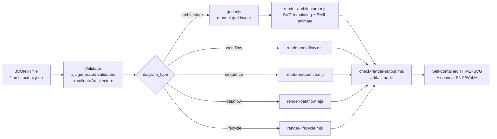
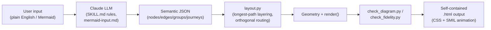
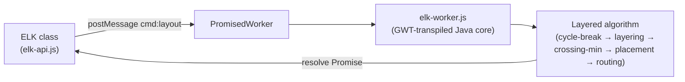

# Weekly Scan — Diagram-as-Code & Visual Tooling (2026-08-02 → 2026-08-09)

Nghiên cứu định kỳ hàng tuần phục vụ kymostudio: rà soát GitHub cho repo mới/được cập nhật đáng kể trong domain diagram-as-code, animation, layout, phân tích kiến trúc để rút bài học áp dụng.

**Tóm tắt 3 điểm chính:**
- Tuần này tương đối "im ắng" ở các dự án lớn (không xác nhận được release mới nào từ Mermaid/D2/Structurizr trong cửa sổ 7 ngày do rate-limit của GitHub API), nhưng nổi bật 3 dự án nhỏ/mới rất sát chuyên môn kymostudio: **archify** (10.7k sao, IR JSON có validate + "evidence" gắn commit SHA), **kumihimo** (DSL AV signal-flow với port-compatibility validator — ý tưởng đáng học nhất tuần này), và **dashmotion** (Claude skill compile Mermaid/plain-English → animated SVG, đối thủ trực tiếp gần nhất với value-prop "DSL → animated SVG" của kymo).
- Bài học kỹ thuật cụ thể nhất: mô hình 4-bảng ưu tiên của kumihimo (`compatibility.ts`) cho việc kiểm tra port/signal type tương thích là pattern áp dụng được thẳng vào `Edge`/`Component` của kymo nếu muốn thêm validate loại kết nối; dashmotion cho thấy nguyên tắc "invariant timing" (dashoffset delta = đúng 1 chu kỳ dash) đáng tham khảo cho `to_svg.py`/`renderSVG`.
- Đưa thêm **elkjs** (layout library, không phải diagram tool) làm điểm đối chiếu duy nhất về thuật toán layout đồ thị tổng quát (Sugiyama 5-phase) — hữu ích để cân nhắc ranh giới giữa frame-based resolver hiện tại của `alignment.py` và một escape-hatch layout-đồ-thị-tổng-quát trong tương lai.

## Mục lục
1. [tt-a1i/archify](#1-tt-a1iarchify)
2. [Love-Rox/kumihimo](#2-love-roxkumihimo)
3. [Northwestern-caddo190/dashmotion](#3-northwestern-caddo190dashmotion)
4. [kieler/elkjs](#4-kielerelkjs)
5. [Phương pháp & phạm vi tìm kiếm](#5-phương-pháp--phạm-vi-tìm-kiếm)

---

## 1. tt-a1i/archify

*Agent skill biến mô tả hệ thống thành kiến trúc diagram HTML+SVG có "bằng chứng" gắn với git commit thật*

### §1 Quick Context

- Archify là agent-skill (Claude Code/Cursor/Codex CLI) sinh diagram từ JSON IR có schema, khác biệt cốt lõi: layout là **grid thủ công do tác giả khai báo** (không auto-layout), và mỗi component/connection có thể gắn `sources` trỏ tới file+dòng tại một commit SHA cụ thể để "xác thực" — ưu tiên intent người viết hơn tự động hoá thẩm mỹ.
- Tech stack: Node.js (ESM, `.mjs`), ajv (JSON Schema draft 2020-12) để validate; output HTML+SVG tự chứa, animation qua SMIL.
- Repo health: ~10.7k stars, v2.13.0 (03/08/2026), 131 commit trên main, có `.github/workflows` (CI) + `test/` (golden test theo README pipeline).
- Distribution: npm-style qua `npx skills add tt-a1i/archify -g`, không thấy publish PyPI/cargo; chạy như CLI + skill nạp vào agent.

### §2 Architecture Deep-Dive

**A. Component inventory**
- `archify/bin/archify.mjs` — CLI entry, điều phối 11 subcommand (render/validate/compare/deliver/preview/check/guide/examples/doctor/demo/inspect).
- `archify/schemas/*.schema.json` + `common.schema.json` — JSON Schema (draft 2020-12) riêng cho từng loại diagram, định nghĩa `id`, `point`, `componentType`, `variant`, `guidedViews`...
- `archify/renderers/shared/generated-validators.mjs` — validator ajv được compile sẵn từ schema (bởi `scripts/generate-validators.mjs`).
- `archify/renderers/architecture/grid.mjs` — bộ giải vị trí grid (`gridLayout`, `resolveComponentPos`, `validateGridPlacement`).
- `archify/renderers/architecture/render-architecture.mjs` — dựng SVG bằng template string (`renderSvg`, `renderComponent`, `renderBoundary`, `pathFor`, `routeVia`, `animateAttr`), có `validateArchitecture()` kiểm tra hình học (overlap, boundary wrap, clearance).
- `archify/renderers/{workflow,sequence,dataflow,lifecycle}/` — mỗi loại có thư mục renderer riêng (không xác định layout của các loại này có dùng lại `grid.mjs` hay không).
- `archify/renderers/shared/repository-evidence.mjs` — xác thực `meta.repository` (URL + SHA đầy đủ 40 ký tự) và `components[].sources` (file/line) khớp với git checkout thật.
- `archify/delta/architecture-delta.mjs`, `archify/bin/preview.mjs`, `archify/scripts/check-render-output.mjs`.

**B. Pipeline / control flow** (happy path):
1. Agent viết/sinh file JSON IR (`*.architecture.json`...) theo schema tương ứng.
2. `archify validate` chạy validator ajv sinh sẵn + `validateArchitecture()` (semantic/hình học).
3. `archify render` dispatch theo `diagram_type` sang `renderers/{type}/render-{type}.mjs`; với architecture, `grid.mjs` resolve `pos`/`row-col` → pixel trước khi `renderSvg()` dựng SVG string, nhúng vào HTML shell.
4. `check-render-output.mjs` audit artifact HTML/SVG vừa sinh.
5. `archify deliver` đóng băng spec, render lại, hash (crypto), rename atomic vào đích, xuất receipt.
6. `archify preview` (tuỳ chọn) watch file JSON, re-render + hot-reload trình duyệt.

**C. Data model / IR**: JSON phẳng thuần tuý (không class/dataclass) — `{schema_version, diagram_type, meta, components[], boundaries[], connections[], cards[]}`. Không có khái niệm "lower IR" — cùng một JSON IR đi thẳng từ validate sang render, không có pass alignment/resolve nhiều tầng như kymostudio; chỉ `compare` có bước canonicalize thứ tự để diff ổn định.

**D. Input language design**: không có DSL văn bản — "ngôn ngữ" chính là JSON Schema (ajv-compiled), do agent LLM viết theo hợp đồng `SKILL.md`, không phải parser tự nhiên ngôn ngữ nằm trong tool. Không có file grammar (BNF/PEG) — schema đóng vai trò grammar. Báo lỗi qua object "diagnostic problem" có cấu trúc (`code, severity, message, subject, evidence, supportedFixes`), fail-closed, không lộ stack trace thô.

**E. Layout**: thủ công, không auto-layout đồ thị — `grid.mjs` là hệ toạ độ grid cố định (origin + cellW/cellH + gap), component khai `pos:[x,y]` trực tiếp hoặc `row/col`. Không có force-directed, không Sugiyama, không crossing minimization; `validateGridPlacement` chỉ kiểm biên và trùng ô. Routing cạnh qua `routeVia()`/`pathFor()` hỗ trợ straight/orthogonal/via-waypoint do tác giả cung cấp `via`, có cache.

**F. Rendering / output**: một backend templating string SVG (không headless browser trong quá trình render chính), animation bằng **SMIL** (`animateAttr()` chèn thuộc tính `<animate>` gốc SVG, không CSS/JS). Output: HTML tự chứa là chính, còn PNG/SVG/WebM/share-card (cơ chế WebM không xác định rõ từ mã đọc được). Kiến trúc pluggable theo loại diagram: 5 thư mục renderer độc lập dùng chung `renderers/shared/*`.

**G. Extensibility**: thêm loại diagram mới = thêm schema + thư mục renderer mới theo quy ước `render-{type}.mjs` (suy luận từ cấu trúc, không thấy tài liệu plugin API tường minh). Theming qua `--quality standard|showcase` và "4 visual preset" + dark/light (không xác định cơ chế theme cụ thể trong code).

**H. Dev experience**: CLI đầy đủ vòng đời (validate/render/preview/compare/deliver/check/doctor/demo/guide/examples), `doctor` chẩn đoán cài đặt, `preview.mjs` watch+hot-reload, `recipes/scenarios.mjs` là cookbook built-in. Phân phối như agent skill (`npx skills add`) cho Claude Code/Cursor/Codex/Raven thay vì IDE extension truyền thống.

### §3 Architecture Diagram



### §4 Verdict

Đáng tham khảo cụ thể: (1) object "diagnostic problem" có `code/severity/evidence/supportedFixes` — hình mẫu tốt hơn exception thô cho lỗi validate của kymo; (2) `repository-evidence.mjs` — ý tưởng gắn component/edge với file+dòng tại một commit SHA để "diagram không bịa" có thể áp dụng cho BPMN importer của kymo (link ngược về XML gốc); (3) API `pos` hoặc `row/col` cùng tồn tại trên một field là mẫu hybrid explicit/grid layout gọn, khác cách kymo tách `layout{}` DSL riêng. Red flag: tự nhận "deterministic layout engine" nhưng thực chất không có auto-layout/crossing-minimization nào — chỉ đặt ô grid thủ công, kém xa `alignment.py` của kymo. Câu hỏi mở: 4 renderer còn lại (workflow/sequence/dataflow/lifecycle) dùng thuật toán vị trí gì — không xác định; cơ chế WebM export cũng không xác định. Kết luận: chỉ nên **glance qua** (không phải đối thủ layout-engine thực sự), nhưng đáng đọc thêm phần diagnostic-object và evidence-linking.

---

## 2. Love-Rox/kumihimo

*DSL văn bản cho sơ đồ luồng tín hiệu AV có kiểm tra tương thích cổng/loại tín hiệu*

### §1 Quick Context

- Kumihimo là DSL kiểu Mermaid cho sơ đồ hệ thống AV, nhưng đơn vị kết nối là **port** chứ không phải node, và validator hiểu **loại tín hiệu điện** để bắt lỗi "cắm vừa nhưng không chạy" (ví dụ HDBaseT vào switch Ethernet qua RJ45).
- Tech stack core: TypeScript (monorepo pnpm, 9 package), lexer/parser tự viết, layout dùng thư viện **ELK** (Eclipse Layout Kernel), output SVG tự chứa, thêm draw.io + cable-schedule.
- Repo health: 0 sao, 95 commit trên main, có CI (`ci.yml`), test bằng Vitest, lint/format bằng oxlint/oxfmt, release qua Changesets, CLI đã publish npm ở version 0.12.1 — dự án thật (core có 17 module TS + thư mục `export/`), không phải scaffold rỗng.
- Distribution: npm (`@love-rox/kumihimo-core`, `-cli`, `-react`, `-vue`, `-astro`, `-rehype`, `-editor`), VS Code extension, Obsidian plugin; CLI hai tên lệnh `khm`/`kumihimo`.

### §2 Architecture Deep-Dive

**A. Component inventory** (tất cả trong `packages/core/src/`): `lexer.ts` — tokenizer; `parser.ts` — recursive-descent parser tạo AST, phục hồi lỗi theo từng statement; `ast.ts` — kiểu AST; `compile.ts` — pipeline tổng (`compile()`: load → build → render, "never throws"); `loader.ts`/`build.ts` — dựng model từ AST (`buildModel`); `model.ts` — kiểu `Device`/`Port`/`Link`/`Diagram`; `signals.ts` — registry 44 loại tín hiệu builtin (7 category: video/audio/control/network/power/sync/generic); `compatibility.ts` — 4 bảng luật tương thích cổng; `layout.ts` — định vị port thủ công + gọi ELK; `render.ts` — sinh SVG; `diagnostics.ts` — `Diagnostic`/`DiagnosticBag`; `messages.ts` — i18n en/ja; `schedule.ts`, `export/` — xuất cable schedule/draw.io. Ngoài core: `packages/cli` (Commander.js), `packages/{react,vue,astro,rehype}` (binding framework), `packages/editor` (live editor), `packages/vscode`, `packages/obsidian`.

**B. Pipeline**: 1) người dùng viết file `.khm` (hoặc CLI `khm build x.khm`); 2) `loadDocument` gọi `tokenize` rồi `parse` → AST + diagnostics (lỗi cú pháp không chặn phần còn lại của file); 3) `buildModel` biến AST thành `Diagram` model, resolve signal type cho từng port và chạy `checkCompatibility(from, to)` cho mỗi link → verdict `ok`/`lossy`/`incompatible` kèm diagnostic; 4) `layout()` tự tính vị trí device/port (giữ đúng thứ tự khai báo), giao việc định tuyến cạnh cho ELK (`layered`, `ORTHOGONAL`); 5) `renderSvg`/`renderDiagram` vẽ theo lớp (group nền → edge/link → device → legend) ra SVG tự chứa; 6) CLI ghi `.svg` (hoặc `.drawio`, cable schedule) ra đĩa.

**C. Data model / IR**: có comment kiến trúc rõ ràng — *"the AST keeps what the author wrote; the model keeps what it means"* — tức có bước lowering AST → model tường minh (không có thêm tầng IR thấp hơn nữa). Mutable/immutable của model: không xác định. Điểm đáng chú ý nhất: `compatibility.ts` mã hoá tri thức miền bằng 4 bảng có thứ tự ưu tiên — `INTERCHANGEABLE_GROUPS` (nhóm tương đương, đối xứng/bắc cầu), `CONNECTOR_CONFUSIONS` (cùng connector khác tín hiệu — case "cắm vừa nhưng sai điện" chủ lực), `PASSIVE_ADAPTERS` (cần cáp chuyển đổi, khai báo bằng `via`), `LOSSY_PAIRS` (kết nối được nhưng mất mát, có hướng). Override của tác giả qua khai báo `compat` trong DSL được ưu tiên trước mọi bảng builtin. Trường hợp không dây/có dây khác nhau (`wireless` flag) luôn `incompatible` — bắt buộc mô hình hoá bộ phát/thu như một `device` riêng, không coi là thuộc tính cáp.

**D. Input language**: lexer + parser recursive-descent tự viết (không PEG/ANTLR/regex-line). Phục hồi lỗi theo từng statement (`parse-error` diagnostic, nhảy tới statement kế) để editor sống vẫn vẽ được diagram cũ trong lúc gõ dở. Không có EBNF hình thức; `docs/SPEC.md` mô tả cú pháp bằng văn xuôi + ví dụ + bảng (16 mã diagnostic có severity cấu hình được). Lỗi "cắm vừa nhưng sai điện" đi qua `CONNECTOR_CONFUSIONS` → verdict `incompatible` kèm lý do song ngữ (en/ja), gắn `SourceSpan` để editor trỏ đúng vị trí.

**E. Layout**: lai — vị trí box/port tính thủ công trong code (giữ ngữ nghĩa thứ tự cổng, "IN 1 luôn trên IN 2"), định tuyến cạnh giao cho ELK (`layered`, `ORTHOGONAL`, `hierarchyHandling: INCLUDE_CHILDREN`) — tức layout DAG phân lớp kiểu Sugiyama có sẵn giảm giao cắt của ELK, không tự viết. Tùy chọn `order: fixed` giữ thứ tự khai báo làm toạ độ thay vì để ELK sắp lại.

**F. Rendering**: renderer chính sinh SVG tự chứa (không animation). Có bằng chứng thêm ít nhất một backend khác (draw.io) cộng cable-schedule (`schedule.ts`) — kiến trúc nhiều emitter chứ không chỉ một. Theme dữ liệu hoá (light/dark/blueprint/mono), ghi đè được bởi caller.

**G. Extensibility**: thêm signal type mới qua khai báo `signal` trong DSL hoặc mở rộng registry `signals.ts`; thêm luật tương thích qua `compat` override ở cấp file thay vì fork code; tái dùng thiết bị qua `model`/`use`/`device … from`. Không xác định có cơ chế plugin runtime ngoài các điểm mở rộng DSL kể trên.

**H. Dev experience**: CLI `khm`/`kumihimo` (build/check/export/watch), VS Code extension quảng cáo diagnostics + live preview thời gian thực, package `kumihimo-editor` nhúng được kèm diagnostics, binding React/Vue/Astro + rehype (nhúng `.khm` vào Markdown/MDX lúc build), plugin Obsidian. Toàn bộ dựa trên `compile()` "never throws" — thiết kế riêng cho trải nghiệm editor sống.

### §3 Architecture Diagram

```mermaid
flowchart LR
  src[".khm source"] --> lex["lexer.ts<br/>(tokenize)"]
  lex --> par["parser.ts<br/>(recursive-descent → AST)"]
  par --> build["build.ts / loader.ts<br/>(buildModel + compatibility.ts)"]
  build --> model["model.ts<br/>Diagram (devices/ports/links)"]
  model --> layout["layout.ts<br/>(manual ports + ELK layered/orthogonal)"]
  layout --> render["render.ts<br/>(SVG emitter)"]
  render --> svg["output.svg"]
  build --> exp["export/<br/>+ schedule.ts"]
  exp --> drawio["*.drawio"]
  exp --> csched["cable schedule"]
  build -.compile.mjs.-> cli["CLI (khm/kumihimo)"]
  build -.-> bindings["react / vue / astro / rehype"]
  build -.-> editor["editor / vscode / obsidian<br/>(live preview)"]
```

### §4 Verdict

Ý đáng học nhất: mô hình tương thích cổng của kumihimo — 4 bảng có thứ tự ưu tiên (equivalence groups → connector confusions → passive adapters → lossy pairs) cộng override `compat` ở cấp file — là một mẫu rất cụ thể để kymostudio cân nhắc nếu muốn thêm "kiểm tra loại kết nối" cho `Edge`/`Component`: gắn `signal`/`kind` cho port và chạy một hàm `checkCompatibility` thuần dữ liệu tương tự, tách khỏi renderer (đúng tinh thần "dumb renderer" mà kymostudio đã theo). Cú pháp `via <adapter>` biến một warning thành dòng trong bảng vật tư cũng là ý hay cho xuất BOM/cable schedule. Về pipeline, việc AST và model tách biệt tường minh gần giống ranh giới `dsl.py` → `alignment.py` của kymostudio (không phải bài học mới), nhưng cách dùng ELK có sẵn cho layered/orthogonal thay vì tự viết thuật toán layout là điểm khác biệt đáng ghi nhận. Red flag: chưa xác minh được test coverage sâu, chưa có bằng chứng animation — không so sánh trực tiếp được với nhánh "animated SVG" của kymostudio. Câu hỏi mở: độ trưởng thành thực tế của ELK integration (hiệu năng, licensing) và cách ELK tương tác với `order: fixed`. Kết luận: đáng đọc sâu riêng phần `compatibility.ts` như tài liệu tham khảo thiết kế cho tính năng validate cổng/tín hiệu, phần còn lại chỉ cần lướt.

---

## 3. Northwestern-caddo190/dashmotion

*Claude Skill biến mô tả tiếng Anh/Mermaid thành animated SVG với "dòng request" chạy dọc connector (fork của csthink/dashmotion)*

### §1 Quick Context

- Đây là một **Claude Skill** (không phải một CLI/library độc lập) chuyển mô tả plain-English hoặc Mermaid `flowchart`/`stateDiagram-v2` thành file HTML+SVG animated tự chứa, khác biệt ở chỗ animation do một layout engine Python xác định thay vì LLM tự đoán tọa độ.
- Stack: Python stdlib thuần (không dependency) cho phần generator; output là HTML/SVG/CSS/SMIL thuần, không thư viện JS.
- Repo health: 0 sao (fork của upstream `csthink/dashmotion`), ~51 commit trên main, có CHANGELOG theo semver, không thấy badge CI công khai, kiểm thử (`test/run_checks.py`) bị gitignore (local-only).
- Phân phối: qua `npx skills add` (Claude Code) hoặc file ZIP trên GitHub Releases — không phải PyPI/npm/cargo.

### §2 Architecture Deep-Dive

**A. Component inventory**
- `SKILL.md` (`skills/dashmotion/SKILL.md`) — file điều phối chính: định nghĩa 6 bước workflow, animation contract, design token.
- `references/flow-mode.md`, `references/architecture-mode.md` — quy tắc layout arithmetic và semantic palette theo từng mode (LLM đọc, không phải code chạy).
- `references/mermaid-input.md` — bảng ánh xạ cú pháp Mermaid → JSON semantic + "fidelity contract".
- `references/layout-script.md` — hợp đồng input/output của `layout.py` (ghi rõ "do NOT read its source" — script dùng như black-box qua contract).
- `scripts/layout.py` (~1100 dòng) — layout engine xác định, Python thuần: class `Node`, `Edge`, `Group`, `Layout`; hàm `longest_path_layers`, `find_back_edges`, `wrap`, `render`, `geometry`.
- `scripts/check_diagram.py` (604 dòng) — checker cấu trúc, 9 rule C1–C9 (overlap, connector xuyên node, dash-offset sai chu kỳ, tọa độ ngoài viewBox, dot lạc khỏi path, thiếu `fill="none"`, endpoint cắm sâu vào node, `begin` SMIL trỏ ID không tồn tại, node lọt group sai).
- `scripts/check_fidelity.py` — checker riêng cho input Mermaid, đối chiếu label/edge verbatim.
- `resources/template-flow.html`, `resources/template-architecture.html` — ví dụ hoạt động đầy đủ, dùng làm tài liệu tham chiếu kiêm smoke-test thủ công.

**B. Pipeline / control flow** (6 bước theo SKILL.md):
1. Người dùng đưa mô tả tiếng Anh hoặc Mermaid source cho Claude trong phiên chat có skill này.
2. LLM (Claude) chọn mode (Flow/Architecture) và tự tay biên dịch input thành JSON semantic (nodes/edges/groups/journeys) theo bảng quy tắc trong `mermaid-input.md`/`flow-mode.md`.
3. JSON ghi ra file tạm, rồi gọi `python3 layout.py <temp.json> --render <topic>.html`.
4. `layout.py` tính toàn bộ hình học (layer, tọa độ, routing, boundary, animation timing) và render ra file HTML hoàn chỉnh.
5. Claude chạy `check_diagram.py` (và `check_fidelity.py` nếu input là Mermaid) để tự kiểm tra kết quả, sửa nếu phát hiện lỗi cấu trúc.
6. Chỉ file `.html` cuối cùng được giao cho người dùng (JSON là artifact trung gian, bị vứt bỏ).

**C. Data model / IR**: IR là JSON semantic graph (nodes/edges/groups/journeys) — plain dict/JSON, không có class hình thức ở tầng input. Bên trong `layout.py`, JSON được nạp vào các class Python (`Node`, `Edge`, `Group`) rồi một class `Layout` orchestrator biến đổi chúng qua nhiều pass (layering → sizing → placement → routing) — có khái niệm "hạ cấp" từ semantic → geometry rõ ràng, nhưng không xác định được objects có immutable hay không giữa các pass.

**D. Input language design**: điểm khác biệt lớn nhất — **không có grammar hình thức nào cho plain-English**, việc "parse" hoàn toàn được route qua LLM (chính Claude, theo prompt trong SKILL.md), LLM tự quyết định semantics rồi viết JSON tay. Với Mermaid cũng **không có parser thực thụ bằng code** — `mermaid-input.md` là bảng quy tắc ánh xạ cú pháp (docs, không phải EBNF/BNF) mà LLM được hướng dẫn áp dụng thủ công. Error reporting dựa vào "fidelity contract" — `check_fidelity.py` đối chiếu machine-readable label/edge count sau khi LLM tự dịch, không có lỗi cú pháp kiểu compiler.

**E. Layout algorithm**: Flow mode dùng layering bằng longest-path trên DAG, back-edge phát hiện bằng DFS trước. Routing: cạnh giữa layer liền kề dùng orthogonal "L route" đặt trong khe hở giữa layer; cạnh nhảy >1 layer hoặc đi ngược/ngang dùng "vertical lane" đặt ngoài mọi box (margin) để không cắt qua node; ưu tiên "straight column drop" nếu cột nguồn trống. Fan-out/fan-in gom nhiều nhánh về chung một "trunk"/rail. Boundary tính bottom-up (innermost trước), bbox + padding. Tự nhận hạn chế rõ trong comment: "within-layer ordering is group-contiguous + input order, **not crossing-minimized** (no barycenter sweep)".

**F. Rendering / output strategy**: hai kỹ thuật animation kết hợp — **Dashed flow**: `stroke-dasharray: 5 5` + CSS `@keyframes` animate `stroke-dashoffset` đúng bằng một chu kỳ dash (offset delta = tổng dash+gap) để loop liền mạch không giật. **Traveling dots**: `<circle>` chứa `<animateMotion>` tái sử dụng chính path data của connector; ở Architecture mode, nhiều dot nối chuỗi qua SMIL event timing (`begin="j1.end+0.3s"`) mô phỏng request nhảy qua từng tier. Mọi animation duration chia hết cho 3s để screen-record loop mượt. Chỉ một backend (HTML+inline SVG), không phải kiến trúc pluggable emitter. `prefers-reduced-motion` xử lý kép: CSS animation bọc trong `@media (prefers-reduced-motion: no-preference)`, dot SMIL (không CSS-controllable) bị gỡ bằng inline `<script>` runtime.

**G. Extensibility**: thêm loại diagram/shape mới = sửa file Markdown quy tắc (`flow-mode.md`/`architecture-mode.md`) + có thể sửa `layout.py` phần sizing/shape-mapping; không có plugin API hình thức. Theming: design token cố định trong SKILL.md (nền `#020617`, tối đa 1 màu phụ ngoài màu chính để giữ "circuitry aesthetic") — mang tính quy ước hard-code hơn hệ thống token cấu hình được.

**H. Dev experience**: không CLI độc lập, không watch mode, không browser preview tool riêng — trải nghiệm hoàn toàn nằm trong hội thoại Claude. Có eval harness (`eval/`) và release gate rõ ràng trong CLAUDE.md (test b1–b4+m1–m7 phải xanh, diagram 30+ node phải generate ≤8 phút ở effort "medium") — kỷ luật CI nội bộ dù không công khai trên GitHub Actions.

### §3 Architecture Diagram



### §4 Verdict

Bài học cụ thể nhất cho kymostudio: dashmotion tách rất rạch ròi "animation contract" khỏi layout — timing được ràng buộc toán học (`dashoffset` delta = đúng 1 chu kỳ dash, mọi duration chia hết 3s) để loop không giật và dễ screen-record; `to_svg.py`/`renderSVG` của kymo có thể áp dụng nguyên tắc "invariant timing" tương tự khi generate `animateMotion` cho flowing dot. Kỹ thuật `begin="j1.end+0.3s"` chain nhiều dot qua SMIL event timing là ý hay để mô phỏng request đa chặng mà không cần JS.

Red flag: đây về bản chất là **prompt-engineering system có script phụ trợ**, không phải trình biên dịch độc lập — "parser" cho cả plain-English lẫn Mermaid đều là LLM làm thủ công theo bảng quy tắc, không có grammar hình thức; crossing-minimization bị bỏ ngỏ (tự nhận trong code). Câu hỏi mở: độ ổn định/determinism thực tế phụ thuộc bao nhiêu vào LLM tuân thủ đúng contract JSON. Verdict: **study deeper** phần animation-timing/SMIL-chaining và routing của `layout.py`, nhưng không nên coi là kiến trúc "diagram-as-code" ngang hàng kymostudio vì thiếu grammar/parser thực sự.

---

## 4. kieler/elkjs

*JS port (qua GWT transpile) của Eclipse Layout Kernel — thư viện layout đồ thị, không phải diagram tool trọn vẹn*

### §1 Quick Context

- elkjs là **thư viện tính toán layout đồ thị**, không phải công cụ vẽ diagram trọn vẹn — nó nhận graph JSON, trả về tọa độ đã layout, không render/style gì cả (khác căn bản với kymostudio, vốn compile DSL ra SVG hoàn chỉnh).
- Tech stack: JS (build output) transpile từ Java/Xtend qua GWT; không dependency runtime; output là "ELK JSON" graph (tọa độ, không phải diagram render).
- Sức khỏe repo: ~2.7k sao, 121 fork, release gần nhất công khai qua npm 0.13.0 — trang Releases GitHub hiển thị đến 0.12.0 (7/2024), có CI (`ci.yml`) và `publish.yml`, test mocha.
- Phân phối: npm (`elkjs`, bản `@next` theo master ELK), kèm bundle browser (`elk.bundled.js`) và Docker image cho live demo.

### §2 Architecture Deep-Dive

**A. Component inventory**
- `src/js/elk-api.js` — public API: class `ELK`, `PromisedWorker` (bọc Web Worker thành Promise-based messaging).
- `src/js/main-api.js`, `src/js/main-node.js` — entry point riêng cho môi trường Node vs bundler.
- `src/java/org/eclipse/elk/...` — mã Java gốc của ELK core + các thuật toán (layered, force, mrtree, radial, disco, rectpacking, spore) kéo vào từ repo `../elk` khi build.
- `src/java-additional/org/eclipse/elk/{alg/common/utils, graph/json}` — lớp Java bổ sung riêng cho elkjs (không có trong ELK gốc), gồm bộ đọc/ghi "ELK JSON" và tiện ích tương thích GWT.
- `build.gradle` — pipeline build: copy source có chọn lọc → Xtext/Xtend generate → Java compile → GWT compile (task `gwtc`/`gwtcMinified`, module `org.eclipse.elk.js.ElkJs`) → xuất `lib/elk-worker.js`.
- `typings/*.d.ts` — định nghĩa TypeScript (`ElkNode`, `ElkExtendedEdge`, `ElkPort`, `ElkLabel`, API `ELK`).

**B. Pipeline / control flow** (happy path):
1. Client tạo `new ELK({...})` → khởi tạo `PromisedWorker` bọc quanh `elk-worker.js` (Web Worker hoặc worker giả lập trong cùng thread nếu không có `workerUrl`).
2. Gọi `elk.layout(graph, {layoutOptions, logging, measureExecutionTime})`.
3. `ELK` gửi message `{cmd: 'layout', graph, options}` qua `postMessage` tới worker.
4. Worker (mã JS transpile từ Java qua GWT) parse ELK JSON → dựng đồ thị nội bộ Java, đọc `layoutOptions` (namespace `org.eclipse.elk.*`) → chọn thuật toán (mặc định `layered`) → chạy các phase thuật toán.
5. Worker trả kết quả (tọa độ x/y, width/height mỗi node, `sections` cho từng edge) ngược qua `postMessage`, `PromisedWorker` resolve Promise theo id message.
6. `elk.layout()` trả về đúng object graph gốc đã được gán thêm tọa độ.

**C. Data model / IR**: "ELK JSON" — `ElkNode{id, x,y,width,height, children[], ports[], edges[], labels[]}`, `ElkExtendedEdge{sources[], targets[], sections[]}`, `layoutOptions` là map string→string phẳng đính kèm trên node/edge bất kỳ (kế thừa/override theo cây). Phía JS gần như immutable-in/mutable-out. Bên trong (phía Java, không expose ra JS), `layoutOptions` được biên dịch thành các đối tượng `IProperty`/enum (vd `CycleBreakingStrategy.GREEDY`, `CrossingMinimizationStrategy.LAYER_SWEEP`) — có một lớp IR thấp hơn chuyên biệt cho từng thuật toán mà JS-side hoàn toàn không thấy.

**D. Input language design**: không áp dụng dạng DSL văn bản — đây là API JSON thuần, không có tokenizer/parser riêng như `.kymo`. "Ngôn ngữ" duy nhất là namespace chuỗi của `layoutOptions` (vd `elk.algorithm`, `elk.direction`, `elk.layered.edgeRouting`, `elk.portConstraints`), có dạng rút gọn hoặc đầy đủ.

**E. Layout algorithm (trọng tâm)**: mặc định `layered` — kiểu Sugiyama cổ điển, 5 phase tuần tự: (1) cycle breaking (mặc định GREEDY); (2) layering — mặc định network-simplex; (3) crossing minimization — mặc định `LAYER_SWEEP` (heuristic barycenter/median); (4) node placement — mặc định Brandes-Köpf; (5) edge routing — mặc định orthogonal, tùy chọn polyline/splines. Ngoài `layered` còn có `force`, `mrtree`, `radial`, `disco` (layout từng thành phần liên thông rời rạc riêng rồi gộp), `rectpacking`, `stress`, `box`, `fixed`, cùng binding Graphviz (`dot/neato/fdp/circo/twopi`). Hỗ trợ port constraints, cross-hierarchy edges trong compound graph, self-loop, edge label.

**F. Rendering / output**: không áp dụng — elkjs chỉ trả tọa độ (x/y/width/height + edge `sections` là điểm gấp khúc), không vẽ SVG/Canvas. Consumer (Sprotty, Cytoscape, React Flow, netlistsvg, Vega Editor...) tự map tọa độ vào renderer riêng.

**G. Extensibility**: `layoutOptions` là cơ chế mở rộng chính. Không thấy bằng chứng rõ về plugin/algorithm registration API công khai phía JS — thuật toán compile cứng vào worker bundle qua GWT tại build-time, không load động runtime.

**H. Dev experience**: `.d.ts` đầy đủ (TypeScript-first), API Promise-based gọn, tài liệu tách bạch (README + eclipse.dev/elk). Hỗ trợ cả Node (`main-node.js`) và browser (`elk.bundled.js`) với Web Worker off-main-thread mặc định — nhưng build cần Java/Gradle/GWT toolchain đầy đủ (ELK gốc phải nằm cạnh checkout), không phải build JS thuần túy.

### §3 Architecture Diagram



### §4 Verdict

Bài học cụ thể: `alignment.py` của kymostudio hiện xử lý auto-layout theo frame/cha-con thuần cấu trúc — ổn cho sơ đồ có bố cục tường minh (frame lồng nhau), nhưng không giải quyết bài toán tổng quát "layout đồ thị có hướng bất kỳ, tối thiểu giao cắt cạnh" như 5-phase Sugiyama của ELK. Ranh giới hợp lý: giữ frame-based resolver cho region/anchor đã khai báo tường minh trong DSL, nhưng cân nhắc **delegate tùy chọn** (escape hatch kiểu `layout: auto-graph` trong `.kymo`) sang thuật toán layered khi người dùng không chỉ định cấu trúc — tương tự cách Mermaid/Sprotty gọi ELK làm backend layout thay vì tự viết crossing-minimization.

Điểm cần lưu ý: toolchain build phụ thuộc Java/Gradle/GWT khá nặng (không build được bằng JS thuần), bundle nặng tương ứng số thuật toán compile sẵn; API sync-vs-worker qua postMessage thêm độ trễ/độ phức tạp cho use-case đơn giản.

Câu hỏi mở: chưa xác định rõ cơ chế extensibility/plugin thuật toán runtime; chưa rõ chi phí hiệu năng thực tế khi nhúng elkjs (kích thước bundle, thời gian layout đồ thị lớn).

Verdict: **study deeper** — riêng phần thiết kế 5-phase của thuật toán `layered` (không phải toàn bộ mã nguồn) đáng đọc kỹ làm tham chiếu khi mở rộng `alignment.py`.

---

## 5. Phương pháp & phạm vi tìm kiếm

- **Nguồn dữ liệu**: GitHub REST search API (`search/repositories`, topic + keyword) qua fallback không xác thực (không có `gh` CLI trong phiên này), kiểm chứng lại số liệu sao/ngày push bằng cách fetch trực tiếp trang GitHub cho từng repo trước khi đưa vào báo cáo.
- **Cửa sổ thời gian**: pushed/created trong khoảng 2026-08-02 → 2026-08-09.
- **Kết quả thưa ở tầng "big name"**: không xác nhận được release mới nào từ mermaid-js/mermaid, terrastruct/d2, hoặc structurizr trong cửa sổ 7 ngày (API bị rate-limit trước khi kiểm tra hết `/releases`, WebSearch cũng không tìm thấy bằng chứng độc lập) — không đưa vào báo cáo để tránh suy diễn.
- **Truy vấn thưa/nhiễu**: `topic:layout-algorithm` và `topic:graph-visualization` trả về gần như toàn bộ là thư viện phân tích đồ thị mạng (networkx, pygraphviz…) chứ không phải layout engine cho diagram-as-code; `topic:svg-animation` bị chi phối bởi các generator ảnh nghệ thuật cho GitHub profile README (contribution snake, desktop pet…) — loại khỏi phạm vi theo tiêu chí loại trừ.
- **Ứng viên đã cân nhắc nhưng không chọn deep-dive**: `isatimur/excalidraw-skill-pack` (skill pack tạo diagram Excalidraw, nặng về methodology/prompting hơn kiến trúc rendering); `d2lang/text-to-diagram-site` (trang so sánh cú pháp D2/Mermaid/PlantUML/Graphviz, không phải một implementation); `mingrammer/diagrams` và `plantuml/plantuml` (có commit trong tuần nhưng là nhịp bảo trì thường lệ của dự án đã trưởng thành, không phải cập nhật đáng chú ý).
