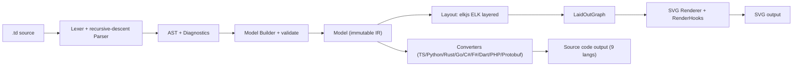
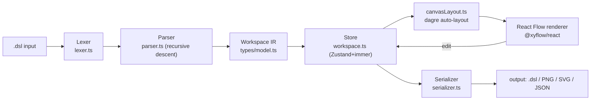
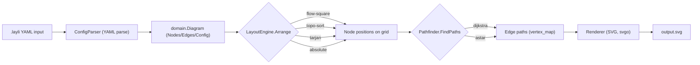
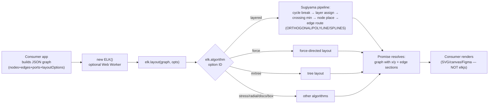

# Weekly Scan: Diagram Tooling & Visual Design — 2026-08-10

**Tóm tắt (3 gạch đầu dòng):**
- Tuần này không có "novel diagram-as-code DSL" nào bùng nổ hẳn về sao/traction, nhưng nổi lên 3 tool nhỏ-mà-chất về kiến trúc đáng đọc: **typeDiagram** (DSL → SVG + codegen 9 ngôn ngữ, dùng ELK layout), **c4hero** (visual editor round-trip Structurizr DSL, dagre layout), **layli** (Go, routing bằng pathfinding grid thực thụ — dijkstra/astar).
- Điểm chung đáng chú ý: cả 3 tool mới đều **không tự viết layout engine** — dựa vào thư viện ngoài (ELK, dagre) — nên bài scan tuần này bổ sung **elkjs** (thư viện layout nền tảng đứng sau rất nhiều tool diagram hiện nay, bao gồm cả Mermaid) làm tài liệu tham chiếu cho phần layout algorithm.
- Bài học rõ nhất cho kymostudio: (1) ELK's 5-phase Sugiyama pipeline (cycle-break → layer → crossing-min → place → route) là mô hình staging sạch hơn 5-pass hiện tại của `alignment.py`; (2) `RenderHooks` phase-based override của typeDiagram và `ParseError`-array (không throw) của c4hero là 2 pattern nhỏ, rẻ, đáng vay mượn ngay.

## Mục lục
1. [typeDiagram](#1-nimblesitetypediagram) — DSL → SVG + codegen 9 ngôn ngữ
2. [c4hero](#2-c4heroc4hero) — Visual editor round-trip Structurizr DSL
3. [layli](#3-dnnrlylayli) — Go, layout + pathfinding-based edge routing
4. [elkjs](#4-kielerelkjs) — Layout engine nền tảng (ELK, Sugiyama-style)

---

## 1. Nimblesite/typeDiagram

### §1 Quick Context
typeDiagram khác biệt ở chỗ coi file `.td` là nguồn chân lý duy nhất: vừa sinh SVG orthogonal-layout, vừa codegen sang 9 ngôn ngữ (TS, Python, Rust, Go, C#, F#, Dart, PHP, Protobuf/Typeshed), vừa round-trip code có sẵn ngược về DSL. Stack: TypeScript monorepo (npm workspaces), `elkjs` (ELK) cho layout, `@lezer/python` để parse Python, cộng một Rust workspace còn sơ khai (`crates/`, 1 crate `tdbin`). Repo: 59 stars, 4 forks, MIT, gần như một tác giả (MelbourneDeveloper) + vài contributor phụ, có CI + CodeQL, ~13 release tới v0.13.0. Phân phối: npm (`typediagram` CLI, `typediagram-core` lib), VS Code Marketplace, playground online typediagram.dev.

### §2 Architecture Deep-Dive

**A. Component inventory** — `Lexer/Parser` (`src/parser/lexer.ts`, `parser.ts`, `ast.ts`, `diagnostics.ts`): tokenize + recursive-descent → AST. `Model builder` (`src/model/build.ts`, `builder.ts`, `types.ts`, `validate.ts`): AST → Model đã resolve. `Layout` (`src/layout/elk.ts`, `measure.ts`, `types.ts`): Model → ELK graph → `LaidOutGraph`. `SVG renderer` (`src/render-svg/render.ts`, `svg-tag.ts`, `theme.ts`, `hooks.ts`): `LaidOutGraph` → SVG string. `Converters` (`src/converters/*.ts`, 28 file, ví dụ `typescript.ts`, `python.ts`, `rust.ts`, `go.ts`, `csharp.ts`, `fsharp.ts`, `dart.ts`, `php.ts`, `protobuf.ts`, `typeshed.ts`) + họ file `*-tdbin*.ts` cho một binary wire-format riêng. Ba app: `packages/cli`, `packages/vscode`, `packages/web`.

**B. Pipeline (happy path)**: 1) người dùng viết `.td`, chạy `typediagram` CLI (hoặc VS Code/typediagram.dev). 2) `lexer.ts` tokenize, `parser.ts` (recursive-descent, `Cursor` wrap token stream) dựng AST, lỗi gom vào `DiagnosticBag`. 3) `model/build.ts` resolve AST → `Model` (records/unions/aliases/functions + `Edge[]`), `validate.ts` kiểm tra. 4) `layout/elk.ts`: `measure.ts` đo kích thước text/node → dựng ELK graph (port FIXED_SIDE, header trái/row phải) → chạy thuật toán `layered` → `projectResult` ra `LaidOutGraph`. 5) `render-svg/render.ts` duyệt `LaidOutGraph`, áp `RenderHooks` từng phase, emit SVG (song song, `converters/*.ts` emit source code target language từ cùng `Model`). 6) File output (`.svg`/`.ts`/`.py`/…) được CLI ghi ra, hoặc trả `SVGElement` cho webview/browser.

**C. Data model/IR**: interface TS thuần, discriminated union theo `kind`, **immutable/readonly** xuyên suốt (`ReadonlySet`, `readonly T[]`) — mỗi pass tạo object mới, không mutate tại chỗ. `Model` là IR duy nhất dùng chung cho cả layout lẫn codegen (không có bước "lower" riêng cho từng backend); `LaidOutGraph` là IR thứ hai, chỉ dùng cho renderer sau layout.

**D. Input language**: lexer + recursive-descent parser tự viết tay, không dùng parser generator (không ANTLR/PEG). Không xác định có file EBNF chính thức trong nội dung đã đọc (có file `docs/specs/language-reference.md` nhưng chưa đọc được nội dung). Lỗi báo qua `DiagnosticBag` (line/col/length), `errorAndRecover` panic-mode recovery, `parse()` trả `Result<Diagram, Diagnostic[]>`.

**E. Layout**: hierarchical/layered graph layout qua **elkjs (ELK)** — Sugiyama-style, `NETWORK_SIMPLEX` node placement, direction `RIGHT`, edge routing `ORTHOGONAL`, spacing cố định (40/60/20px). Không phải force-directed, không manual. Không xác định chi tiết crossing-minimization (nằm trong nội bộ ELK, không thấy config riêng).

**F. Rendering/output**: SVG là backend chính, mở rộng qua `RenderHooks` — 6 phase (`defs/background/node/row/edge/post`) intercept-and-override, lỗi hook bị nuốt và fallback default (không phải plugin-registry đầy đủ). Không xác định có animation SVG. Codegen 9 ngôn ngữ là converter riêng, không qua chung pipeline hook. PDF export chỉ có ở VS Code extension (bọc SVG→PDF).

**G. Extensibility**: thêm ngôn ngữ codegen = thêm `converters/<lang>.ts`; thêm render behavior = implement `RenderHooks`. Không thấy hệ plugin-registration hình thức. Theming qua `theme.ts`. Không có hệ icon/shape (record/union chỉ vẽ box).

**H. DX**: CLI one-shot, VS Code extension có live preview khi sửa `.td` ("edit DSL, see diagram update instantly") + preview code block trong markdown + PDF export; playground typediagram.dev không cần cài. Không xác định LSP (chỉ thấy `language-configuration.json`, không có bằng chứng textDocument/*).

### §3 Architecture Diagram

### §4 Verdict
Đáng học: (1) `RenderHooks` — 6 phase typed override (`defs/background/node/row/edge/post`, lỗi bị nuốt, fallback default) là pattern nhẹ, an toàn cho việc mở custom rendering mà `to_svg.py`/`renderSVG` của kymostudio có thể tham khảo thay vì fork renderer. (2) Layout dùng `elkjs` (ELK layered + ORTHOGONAL routing) đáng nghiên cứu như tài liệu tham chiếu cho chất lượng edge-routing, dù kymostudio JS cố tình dependency-free nên khó adopt trực tiếp. (3) Kỷ luật immutable IR (Model, LaidOutGraph tách biệt theo từng pass) xác nhận đúng triết lý "renderer dumb, data thuần" mà kymostudio đang theo. Red flag: 28 file trong `converters/` gồm cả một họ format binary `tdbin` riêng — scope creep vượt xa "diagram tool", bus-factor thấp (gần như 1 tác giả). Câu hỏi mở: chưa xác nhận animation SVG (kymostudio đã có, đi trước ở điểm này); chưa xác nhận có formal grammar/EBNF công khai dù tên file `language-reference.md` gợi ý có. Verdict: **study deeper** phần `layout/elk.ts` và `render-svg/hooks.ts`; **ignore** phần `tdbin`/9-language codegen vì ngoài phạm vi kymostudio.

---

## 2. c4hero/c4hero

### §1 Quick Context
c4hero là một GUI trực quan (drag-drop-connect) để thiết kế C4 diagrams, khác biệt ở chỗ nó đọc/ghi **Structurizr DSL round-trip** — chỉnh sửa trên canvas rồi serialize ngược lại thành DSL text sạch, diffable, thay vì lưu một format binary/JSON riêng. Tech stack: TypeScript, React 19, Vite, Zustand (+immer), **@xyflow/react** (React Flow) cho canvas, **@dagrejs/dagre** cho auto-layout, xuất PNG/SVG/JSON qua `html-to-image`. Repo health: 43 stars, 7 forks, một người maintain, Apache-2.0, GitHub Actions CI đang chạy (badge passing), Vitest + Playwright e2e. Phân phối: source-available static web app (không phải npm package), hosted tại app.c4hero.com, tự host được.

### §2 Architecture Deep-Dive

**A. Component inventory**
- `Lexer` (`src/lib/dsl/lexer.ts`) — tokenizer character-by-character cho Structurizr DSL.
- `Parser` (`src/lib/dsl/parser.ts`, `parser-model.ts`, `parser-relationship.ts`, `parser-views.ts`, `parser-styles.ts`) — recursive-descent parser (class `ContextAwareParser`).
- `Serializer` (`src/lib/dsl/serializer.ts`) — ghi Workspace IR ngược lại thành DSL text (round-trip).
- `Model/IR` (`src/types/model.ts`) — plain TS interfaces: `Workspace` → `Model` (people/softwareSystems/relationships/groups) + `Views` + styling.
- `Store` (`src/store/workspace.ts` + `slices/`) — Zustand + immer, single source of truth trong bộ nhớ.
- `canvasLayout` (`src/lib/canvasLayout.ts`) — cầu nối tới dagre, tính toán vị trí node.
- Renderer — `src/components/canvas/` dùng `@xyflow/react` (React Flow), không phải custom SVG/canvas emitter.
- `exportUtils.ts` — xuất PNG/SVG/JSON.

**B. Pipeline** — 1) User mở app / import file `.dsl` hoặc chọn template → 2) `fileIO`/`folderIO` đọc text, `dsl/index.ts:parse()` chạy lexer→parser, sinh `Workspace` IR + mảng `ParseError` → 3) IR nạp vào Zustand store, `canvasLayout.ts` gọi dagre auto-layout (chỉ cho node "unfrozen", giữ nguyên vị trí đã lưu) → 4) React Flow render node/edge từ store; user kéo-thả, chỉnh sửa trực quan → 5) Thay đổi mutate store qua immer, `serializer.ts` convert Workspace IR ngược lại thành DSL text → 6) User export PNG/SVG (chụp DOM) hoặc JSON hoặc tải `.dsl`.

**C. Data model/IR**: plain TS interfaces (không phải class), mutable qua immer producers trong Zustand. Không có khái niệm "lower IR" riêng — cùng một `Workspace`/`View` model được tái sử dụng xuyên suốt parse→render→serialize (thiết kế round-trip, không phân tầng IR).

**D. Input language**: lexer + recursive-descent parser tự viết tay, không dùng PEG/ANTLR/parser-combinator lib. Không tìm thấy grammar hình thức (EBNF/BNF) công khai — không xác định. Error reporting: `ParseError{message,line,column}` gom vào mảng, không throw ngay, gộp lỗi lexer+parser.

**E. Layout**: dagre — layered/hierarchical, `rankdir` cấu hình được (TB/BT/LR/RL), `ranksep=300`, `nodesep=250` cố định. Dùng compound-graph feature của dagre để nhóm boundary/group parent (lồng nhau theo C4 hierarchy). Không cấu hình routing/crossing-minimization tuỳ chỉnh (dùng default dagre). Có pass hậu-layout riêng `separateOverlayClusters()` giải overlap giữa các khung group/boundary (tối đa 24 vòng lặp, gap 72 units).

**F. Rendering/output**: một backend chính duy nhất — React Flow (DOM/HTML+SVG hybrid), không phải pluggable emitter pattern. Export: PNG (raster qua `html-to-image`), SVG (serialize DOM qua `XMLSerializer` — nhúng HTML content, không phải vector re-render thật sự), JSON, DSL text. Không tìm thấy animation support cho diagram.

**G. Extensibility**: không xác định — không có plugin system rõ ràng; thêm element type mới đòi hỏi sửa nhiều nơi thủ công (`model.ts`, `parser-model.ts`, `elementMeta.tsx`, `canvasLayout.ts`).

**H. Dev experience**: keyboard shortcuts + ARIA labels, command-palette component, local-first (không server/account/telemetry mặc định). Browser hỗ trợ bất đối xứng: đầy đủ tính năng trên Chromium, chỉ single-file editing trên Firefox/Safari. Autosave: không xác định cụ thể (có `safeStorage.ts`/`viewportStorage.ts` gợi ý localStorage persistence).

### §3 Architecture Diagram

### §4 Verdict
Đáng học sâu ở hai chỗ cụ thể: (1) **DSL round-trip serializer** (`serializer.ts`) — kymostudio chưa có visual editor, nếu xây thì nên tham khảo cách giữ diff sạch khi ghi IR ngược thành text; (2) **dagre compound-graph grouping** (boundary/group parent nodes) cho C4 hierarchy — đáng so sánh với cơ chế nesting region/frame trong `alignment.py`. Pattern `ParseError` không-throw, gom mảng lỗi kèm line/column cũng đáng áp dụng cho `dsl.py`/`dsl.ts`. Red flag: "SVG export" thực chất là serialize DOM (`XMLSerializer`/`html-to-image`), không phải vector renderer thật — renderer SVG trực tiếp của kymostudio (`to_svg.py`) kiến trúc tốt hơn, không nên bắt chước shortcut này. Câu hỏi mở: serializer có bảo toàn comment/format gốc không; không có grammar hình thức công khai (khác `docs/DSL.md` của kymostudio). Verdict: **study deeper** phần DSL round-trip + dagre grouping; phần React Flow rendering chỉ **glance only** vì không liên quan stack SVG-emitter của kymostudio.

---

## 3. dnnrly/layli

### §1 Quick Context
Layli là tool Go biến YAML thành SVG diagram, điểm khác biệt là coi edge routing như bài toán **pathfinding trên grid rời rạc** (dijkstra/astar/bidirectional, heuristic euclidean/manhattan) thay vì routing heuristic đơn giản, và tách kiến trúc theo **hexagonal/ports-adapters** rõ rệt (domain/usecases/adapters). Stack: Go 1.21, Cobra CLI, `ajstarks/svgo`, `gopkg.in/yaml.v3`, godog (BDD). Repo health: 22 stars, latest release v0.0.16, có `fuzz_test.go` (native Go fuzzing) + acceptance tests (godog); số contributor không xác định (trang GitHub không tải được data). Distribution: `go install github.com/dnnrly/layli/cmd/layli`.

### §2 Architecture Deep-Dive

**A. Component inventory** — `main.go` (Cobra CLI: root cmd, `to-absolute`, `config`); `internal/domain/{diagram,node,edge,types}.go` (model + `Validate()`); `internal/usecases/{generate_diagram.go,ports.go}` (orchestrator + 6 interface "ports": ConfigParser, LayoutEngine, Pathfinder, Renderer, FileReader, FileWriter); `internal/adapters/config` (YAML mapper); `internal/adapters/layout/engine.go` (LayoutEngine impl, bọc package `layout/`); `internal/adapters/pathfinding/dijkstra_pathfinder.go` (Pathfinder impl); `internal/adapters/rendering/svg_renderer.go` (Renderer impl); `internal/composition` (dependency wiring); `layout/{layout.go,arrangements.go,path.go,position.go,vertex_map.go,config.go}` (grid model + arrangement/path logic thực sự); `algorithms/{tarjan,topological}` (thuật toán đồ thị thuần dùng bởi arrangement); `pathfinder/dijkstra/{dijkstra.go,astar.go}` (package pathfinding generic, độc lập); `examples/*.layli` (mẫu cho từng layout).

**B. Pipeline** (từ `generate_diagram.go`): 1) user chạy `layli foo.layli` → Cobra root cmd; 2) `ConfigParser.Parse()` đọc YAML → `domain.Diagram{Nodes,Edges,Config}`; 3) `diagram.Validate()` (≥1 node, edge phải trỏ node tồn tại, margin 0-10, attempts 1-10000...); 4) `LayoutEngine.Arrange()` định vị node trên grid theo layout đã chọn; 5) `Pathfinder.FindPaths()` tính path cho mọi edge trên "path grid"; 6) `Renderer.Render()` xuất SVG (đổi `.layli`→`.svg` nếu không chỉ định output).

**C. Data model/IR** — một struct `Diagram` duy nhất được truyền xuyên suốt 4 bước và bị mutate tại chỗ (Arrange gán position cho Node, FindPaths gán Path cho Edge) — không có bản sao bất biến giữa các pass theo bằng chứng đọc được.

**D. Input language** — YAML thuần (`yaml.v3`), không có grammar hình thức riêng; parser = `yaml.Unmarshal` qua adapter. Error reporting qua `Validate()` với message cụ thể, cộng `mapError()` ở `main.go` remap lỗi nội bộ thành message CLI thân thiện.

**E. Layout & routing (trọng tâm)** — 4 arrangement: flow-square (rows/columns), topo-sort (1 hàng theo thứ tự cạnh, dùng `algorithms/topological`), tarjan (dùng `algorithms/tarjan` SCC để sắp "pleasing"), absolute (toạ độ user tự khai). Grid model: node chiếm ô nguyên trên "path grid"; **port** là các điểm rời rạc dọc biên node (không chỉ 4 góc), tự chọn mặc định nếu không khai báo. Routing: `layout/path.go` dựng `vertex_map` (đồ thị các điểm grid trừ phần bên trong node) rồi gọi `Pathfinder` (mặc định dijkstra, đổi sang astar bằng cách sửa `FindPath`) với heuristic euclidean/manhattan. Cơ chế chống crossing tuyệt đối/triệt để **không xác định rõ** — README liệt kê "edges must not cross" như nguyên tắc thiết kế (#8/12) và có `LayoutAttempts`/`PathAttempts` (retry tới 10000 lần) gợi ý cơ chế thử-lại-ngẫu-nhiên hơn là một thuật toán crossing-minimization tường minh.

**F. Rendering** — chỉ SVG (`ajstarks/svgo`), không có animation.

**G. Extensibility** — kiến trúc ports/interfaces (`ports.go`) là điểm cắm; có file `CONTRIBUTING_LAYOUTS.md` hướng dẫn thêm layout mới; lệnh `layli config` liệt kê layout/pathfinding/heuristic bằng tên → gợi ý registry theo string-key.

**H. Dev experience** — CLI đơn giản, `--show-grid` debug overlay, `layli config` để khám phá option; Makefile (`test`, `acceptance-test`, `coverage-report`, `lint`, `ci-test`); godog BDD test map Given/When/Then vào usecase. Không có watch mode.

### §3 Architecture Diagram

### §4 Verdict
Layli đáng nghiên cứu kỹ ở đúng một điểm: routing dựa trên **grid + pathfinding thực thụ** (dijkstra/astar trên `vertex_map`) là cách tiếp cận khác hẳn `alignment.py`/`layout.ts` của kymostudio (staggering theo heuristic, không phải search trên đồ thị grid) — đáng thử nghiệm cho trường hợp orthogonal routing dày đặc/nhiều crossing. Kiến trúc ports-adapters với `layli config` liệt kê layout/pathfinding theo tên cũng là mẫu registry sạch, dễ mirror khi kymostudio muốn expose danh sách layout algorithm qua CLI. Red flag: cơ chế chống-crossing không tường minh (dựa vào retry `LayoutAttempts`/`PathAttempts` thay vì thuật toán đảm bảo) — cần đọc `layout/path.go` và `vertex_map.go` thật (không chỉ tóm tắt) trước khi copy ý tưởng. Open question: mutable single-Diagram-object xuyên pipeline có rủi ro side-effect như kymostudio đã né bằng dataclass "dumb renderer" không. Verdict: **study deeper** phần `pathfinder/` + `layout/path.go`, phần còn lại chỉ glance.

---

## 4. kieler/elkjs

*Bổ sung ngoài quy trình tìm kiếm chuẩn (fallback #3 — ecosystem activity): cả 3 tool ở trên đều dựa vào layout engine ngoài (ELK hoặc dagre) thay vì tự viết, nên đưa elkjs vào scan tuần này làm tài liệu tham chiếu cho phần layout algorithm.*

### §1 Quick Context
**elkjs** là JS/Web Worker port (qua GWT transpile) của Eclipse Layout Kernel (ELK, Java) — một **layout engine** trưởng thành chuyên tính toán vị trí node/edge cho diagram, KHÔNG phải một diagram tool có DSL riêng như kymostudio; nhiều tool "mới nổi" (Mermaid, reactflow, sprotty, Cytoscape, netlistsvg, VS Code extensions) thực chất build layer render lên trên nó. Repo: 2.7k stars, 121 forks, 220 commits, ~90 open issues, npm `elkjs` (bản mới nhất trên npm registry: 0.12.0, phát hành 17/07/2026; `package.json` trên `master` đã lên 0.13.0-dev — 31 version kể từ 2017, hoạt động đều đặn 2025-2026).

### §2 Architecture Deep-Dive

**A. Component inventory.** Repo `kieler/elkjs` chỉ chứa lớp **wrapper JS + build pipeline**: `src/`, `test/`, `typings/`, `doc/`, cùng `build.gradle`/`gradlew` để build phần Java. Script `build` trong `package.json` chạy Gradle trước rồi mới Babel/browserify JS — nghĩa là **các thuật toán layout thực sự (layered, force, mrtree...) sống trong repo Java thượng nguồn `eclipse-elk/elk`**, được biên dịch qua GWT thành blob `lib/elk-api.js` / `elk-worker.js` / `elk.bundled.js`. Ranh giới transpilation rất rõ: elkjs = API shim (Promise, Web Worker) bọc quanh một bundle Java-compiled-to-JS mà con người không đọc trực tiếp được.

**B. Pipeline (input → coordinates).** (1) Consumer tự dựng object JSON graph (`{id, layoutOptions, children, edges}`) trong code. (2) `new ELK()` khởi tạo, tuỳ chọn spawn Web Worker để không block UI thread. (3) Gọi `elk.layout(graph, opts?)`. (4) Hàm dispatch vào bundle GWT-compiled tương ứng thuật toán được chọn. (5) Trả về `Promise` resolve ra graph đã có `x/y`, `width/height`, và edge `sections` (bend points).

**C. Data model / IR.** ELK JSON graph: node có `width/height` (+`x/y` sau layout) và có thể chứa `children` (cây bao hàm/inclusion tree, gốc duy nhất là canvas); edge có `sources[]`/`targets[]` (hỗ trợ hyperedge — nhiều nguồn/đích); port là điểm gắn tường minh trên node; label gắn được vào bất kỳ phần tử nào. IR khá tốt cho layout thuần hình học (hierarchical, ports, hyperedges, options theo cây), nhưng thiếu ngữ nghĩa diagram (icon, style, loại shape) — chỉ là container hình học, không thay thế được IR diagram đầy đủ như `Diagram`/`Component` của kymostudio.

**D. Input language design.** Không có DSL văn bản — API nhận thẳng object JSON dựng từ code. Trái ngược hoàn toàn với `.kymo` của kymostudio (con người viết source, `dsl.py`/`dsl.ts` parse ra IR); elkjs giả định app đã có graph structure sẵn.

**E. Layout algorithm (elk.layered).** Tài liệu eclipse.dev xác nhận pipeline Sugiyama-style 5 bước: **cycle breaking → layer assignment → crossing minimization → node placement → edge routing**. Có hệ OPTIONS key phân cấp dấu chấm (`elk.algorithm`, `elk.direction`, `elk.spacing.nodeNode`, `elk.layered.nodePlacement.strategy`...), gán được ở cấp global/node/edge. Edge routing styles xác nhận: **ORTHOGONAL** (mặc định), **POLYLINE**, **SPLINES**. README liệt kê các thuật toán: layered, stress, mrtree, radial, force, disco, box, fixed, random (rectpacking/sporeCompaction — không xác định).

**F. Rendering.** elkjs **không render** — README nói rõ nó "computes positions... without providing rendering capabilities". Việc vẽ SVG/canvas hoàn toàn do consumer (sprotty, reactflow...) đảm nhiệm — tách biệt layout/render triệt để hơn kymostudio (vốn gộp layout + emitter SVG/Figma/Excalidraw trong cùng pipeline).

**G. Extensibility.** Chọn thuật toán bằng string ID (`elk.algorithm: 'layered'`), mở rộng behaviour qua options-key thay vì code — mô hình cấu hình khai báo thuần dữ liệu.

**H. Dev experience.** API Promise-based, có Web Worker để tránh freeze UI. Có playground tương tác: ELK live demo (rtsys.informatik.uni-kiel.de/elklive) dùng sprotty. Docs eclipse.dev khá chi tiết (graph-data-structure, algorithm reference) nhưng không đồng nhất — một số URL tài liệu 404 khi fetch trực tiếp.

### §3 Architecture Diagram

### §4 Verdict
Pipeline 5-pha Sugiyama của `elk.layered` (cycle-break → layer → minimize-crossings → place → route) là mô hình staging **rõ ràng hơn** 5-pass hiện tại của `alignment.py`/`alignment.ts` (vốn trộn auto-layout, anchoring, region bounds, edge staggering, canvas sizing thành một chuỗi mục đích hỗn hợp) — đáng tham khảo cách tách "assign structure" khỏi "resolve geometry" khỏi "route edges" thành 3 giai đoạn độc lập, dễ test/độc lập golden hơn. Hệ OPTIONS-key phân cấp (per-node/per-edge string key) là ý hay để bổ sung cho `layout{}` block cấp DSL của kymostudio — nhưng đừng sao chép nguyên xi: kymostudio ưu tiên DSL đọc được bởi người, còn OPTIONS của ELK là API-first, không có cú pháp nguồn. Red flag lớn nhất: **bản thân elkjs không chứa thuật toán** — logic thật nằm ở Java `eclipse-elk/elk`, blob JS gần như black-box, khó debug/patch trực tiếp. Câu hỏi mở: hiệu năng/độ ổn định của `elk.layered` so với resolver hand-rolled của kymostudio trên diagram lớn — không xác định (chưa benchmark). **Verdict: study deeper** (riêng phần staging 5-phase + options-key design), không cần vendor hay thay thế alignment.py.

---

## Ghi chú phương pháp

- **Nguồn dữ liệu**: GitHub search API (topic-based, đa số kết quả bị noise bởi các repo AI-agent/MCP không liên quan diagram — đã lọc thủ công), WebSearch, và đọc trực tiếp README/source qua WebFetch cho từng repo được chọn.
- **Giới hạn đã biết**: GitHub search API ẩn danh (không xác thực) bị rate-limit sau vài request; một số truy vấn topic-based trả về 0 kết quả hoặc dữ liệu nghi ngờ (số sao bất thường) — các repo đó đã bị loại khỏi báo cáo thay vì đưa vào không kiểm chứng được.
- **4/4 repo** đáp ứng "significantly updated" trong khung ~7-14 ngày qua (elkjs: release 0.12.0 ngày 17/07/2026 + `master` đã lên 0.13.0-dev; typeDiagram, c4hero, layli: hoạt động commit gần đây theo dữ liệu WebFetch, ngày commit chính xác không xác định do giới hạn công cụ — cần xác minh lại qua `git log` nếu cần độ chính xác cao hơn).
