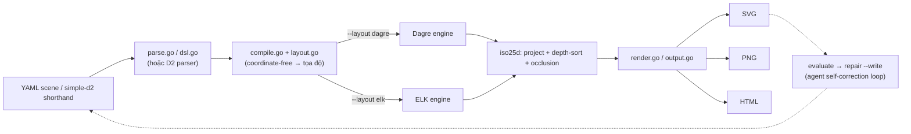
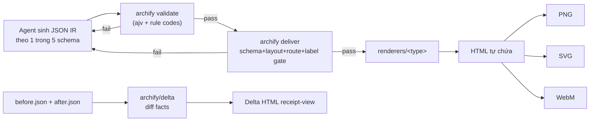
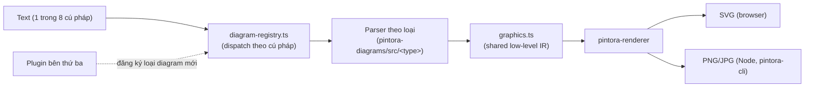

# Weekly scan: diagram-as-code & visual tooling (2026-08-11)

Nguồn: GitHub topic search (`diagram-as-code`, `dsl`, `svg-animation`,
`graph-visualization`, `layout-algorithm`) + theo dõi release của
mermaid.js/D2/PlantUML/Excalidraw/Graphviz/Structurizr/elkjs/dagre trong
14 ngày qua. Nghiên cứu dùng WebSearch/WebFetch (không dùng GitHub API/`gh`
authenticated cho search ngoài phạm vi repo này).

**Lưu ý về recency**: chỉ **archify** (release v2.13.0, 2026-08-03) nằm gọn
trong cửa sổ 7–14 ngày. Ba repo còn lại (iso-topology, hiearch, pintora) có
hoạt động gần đây hơn (vài tuần đến ~2-3 tháng) nhưng được giữ lại vì độ mới
lạ kiến trúc — được đánh dấu rõ trong từng mục §1.

## Executive summary

- **archify** (11.2k ⭐, release 8 ngày trước) là tín hiệu rõ nhất về xu hướng
  hiện tại: "diagram-as-code" đang dịch chuyển sang **agent-skill-as-product**
  — JSON IR do LLM sinh ra, validate bằng JSON Schema, chỉ artifact pass mới
  được ghi đè output. Cùng triết lý với golden-SVG gate của kymostudio nhưng
  áp dụng per-render thay vì per-commit.
- **iso-topology** và **hiearch** đều giải quyết vấn đề layout mà kymo hiện
  chưa có: iso-topology có occlusion detection cho isometric/2.5D, hiearch có
  **edge promotion khi collapse view** (nhiều edge gộp thành 1 edge có nhãn
  đếm) — hướng ngược với fan-in/trunk-lane staggering của `alignment.py`.
- **pintora** không đạt ngưỡng recency (feature cuối ~giữa tháng 5/2026) nhưng
  đáng nghiên cứu vì kiến trúc **plugin registry cho diagram type**
  (`diagram-registry.ts`) — ý tưởng khác hẳn model "1 DSL, nhiều emitter" của
  kymo, đáng cân nhắc nếu kymo muốn mở rộng loại diagram do bên thứ ba đóng góp.

## Mục lục

1. [iso-topology (MishaBear94/iso-topology)](#1-iso-topology-mishabear94iso-topology)
2. [archify (tt-a1i/archify)](#2-archify-tt-a1iarchify)
3. [pintora (hikerpig/pintora)](#3-pintora-hikerpigpintora)
4. [hiearch (asherikov/hiearch)](#4-hiearch-asherikovhiearch)
5. [Candidates khác đã xét nhưng không deep-dive](#5-candidates-khác-đã-xét-nhưng-không-deep-dive)

---

## 1. iso-topology (MishaBear94/iso-topology)

### §1 — Quick context

Diagram-as-code cho **kiến trúc isometric/2.5D** (không phải 2D box-and-line
thông thường), với vòng lặp `validate → evaluate → repair` được thiết kế để
LLM tự sửa output của chính nó. Stack: **Go 1.25**, phụ thuộc trực tiếp vào
package Go của **D2** (`oss.terrastruct.com/d2 v0.7.1`) cho chế độ input
"simple d2 graph" thay vì tự viết parser cho cú pháp đó. Output: SVG (chính),
PNG, HTML. Repo health: 56 ⭐, 1 fork, gần như single-author (README tự cảnh
báo "moving fast, pin tags for stability"), commit gần nhất 2026-07-04, chưa
thấy tagged release. Phân phối: `go install .../cmd/isotopo@latest` — binary
tĩnh, không phụ thuộc runtime; không có npm/PyPI. Có `isotopo-mcp` — MCP
server riêng cho Claude Code/Cursor.

### §2 — Architecture deep-dive

**A. Component inventory**
- `iso25d/iso.go`, `geometry.go`, `surface.go`, `composite.go` — engine
  render isometric lõi; mỗi primitive (prism, cylinder, sphere, wedge, cloud,
  person, rack, array, custom-path, text) có file riêng.
- `cmd/isotopo/main.go` — CLI entry, dispatch thủ công theo `os.Args[1]`
  (không dùng cobra/flag package).
- `cmd/isotopo-mcp/` — MCP server binary riêng.
- `dsl.go`, `parse.go`, `compile.go`, `layout.go`, `render.go`,
  `aesthetics.go`, `output.go` (root-level, nội dung suy ra từ tên file +
  cây thư mục, chưa xác nhận chi tiết từng dòng).
- `yamledit/` — thao tác YAML, có thể phục vụ auto-fix mutation của
  `repair --write`.
- `textmetrics/` — đo label cho layout. `themes/` — preset design system.
- `studio/` — web UI phục vụ `isotopo serve` (localhost:8731).

**B. Pipeline** (`isotopo render scene.yaml ./out`):
1. Người dùng viết YAML scene (hoặc cú pháp rút gọn "simple d2 graph":
   `user -> api -> db`).
2. `isotopo validate` (khuyến nghị trong vòng lặp agent) — lint có JSONPath,
   kèm gợi ý sửa.
3. `parse.go`/`dsl.go` parse YAML thành model nội bộ (hoặc ủy quyền cho
   parser của D2 với cú pháp rút gọn).
4. `compile.go` + `layout.go` giải các quan hệ "coordinate-free"
   (`place: {rightOf|behind|above, gap}`, `layout: {mode: row|column|grid}`)
   thành tọa độ cụ thể — có thể ủy quyền auto-layout composite cho **Dagre
   hoặc ELK** qua flag `--layout dagre|elk` (thêm ngày 2026-07-04).
5. `iso25d` chiếu isometric, depth-sort các shape, phát hiện/xử lý occlusion
   giữa các khối 3D (thêm cùng đợt 2026-07-04).
6. `render.go`/`output.go` xuất SVG/PNG/HTML.
7. (Vòng lặp agent) `evaluate` chấm điểm bố cục (crossing, overlap, cân
   bằng) → `repair --compose --write` tự sửa YAML nguồn → render lại.

**C. Data model / IR**: không xác nhận trực tiếp từ source (chỉ suy từ tên
file `compile.go`/`layout.go`). README khẳng định pipeline "coordinate-free"
ở tầng DSL, compile xuống tọa độ isometric tuyệt đối — có bước hạ cấp
tương tự tinh thần `layout.py` → `alignment.py` của kymo.

**D. Input language design**: hai front-end — YAML DSL gốc
(`nodes`/`layout`/`connectors`/`theme`) và cú pháp rút gọn tái dùng parser
gốc của D2. Không có EBNF chính thức. Error reporting: `isotopo validate`
trả lỗi có JSONPath + gợi ý sửa — thiết kế cho LLM tiêu thụ, không phải cho
người đọc terminal.

**E. Layout algorithm**: pluggable, chọn Dagre hoặc ELK cho composite
auto-layout qua flag CLI. Ngoài ra có hệ thống đặt vị trí quan hệ riêng
(`place: rightOf/behind/above`) cho bố cục isometric, cộng một pass phát
hiện/sửa occlusion 3D (body-vs-body) — vấn đề layout đặc thù của isometric
mà công cụ 2D không cần.

**F. Rendering/output**: SVG là chính, PNG qua `snapshot`, HTML độc lập.
Có 2 chế độ chiếu: isometric (mặc định) và top-down 2D "documentation view"
— cùng một model render được cả hai kiểu. Styling hỗ trợ gradient theo mặt,
hiệu ứng "glass", grain thủ tục, ánh sáng mô phỏng (`faceSplit`), shadow,
backglow — đầu tư rendering craft cao hơn hẳn diagram tool box-and-line
thông thường. Không có animation (chỉ SVG/PNG tĩnh).

**G. Extensibility**: 18 iso primitive dựng sẵn + 200+ icon brand
(`icon: "iso://si/langchain/8FBEEF"` — icon-key kèm cú pháp recolor). Theme
là preset đặt tên, áp dụng khai báo. Không thấy plugin API chính thức cho
third-party shape.

**H. Dev experience**: `isotopo serve` mở Studio web tương tác tại
localhost:8731 với kéo-thả, marquee-select (thêm 2026-07-04), phản chiếu
live. `isotopo-mcp` là MCP server hạng nhất cho tích hợp agent/IDE.
`isotopo capabilities` xuất bản mô tả DSL máy đọc được để LLM client tự
khám phá grammar mà không cần tài liệu.

### §3 — Architecture diagram



### §4 — Verdict

Đáng học nhất: **occlusion detection cho 3D/isometric** (body-vs-body overlap
pass) — kymo hiện chỉ xử lý 2D, nếu tương lai muốn thêm primitive isometric
(kymo đã có `bpmn_shapes.py` tách riêng cho glyph phức tạp, mô hình tương tự
có thể áp dụng cho iso-shapes). Cách `isotopo validate` trả lỗi có JSONPath +
gợi ý sửa, thiết kế riêng cho agent tự sửa, là pattern đáng tham khảo nếu kymo
muốn hỗ trợ agent-authored `.kymo`. Red flag: single-author, không tagged
release, README tự cảnh báo về stability — không nên phụ thuộc production
vào API của nó. Câu hỏi mở: liệu compile.go/layout.go có tách bạch rõ như
kymo's `layout.py`/`alignment.py` hay không — chưa đọc được source thực tế.
**Verdict: study deeper** phần occlusion + validate/repair loop, phần còn
lại glance only.

---

## 2. archify (tt-a1i/archify)

### §1 — Quick context

Không phải library/CLI độc lập mà là **agent-skill package** (Claude
Code/Cursor/Codex-CLI) biến mô tả hệ thống/codebase thành diagram HTML/SVG
tương tác, tự chứa. Điểm khác biệt: JSON IR có schema riêng cho từng loại
diagram, validate gate bằng JSON Schema, và nguyên tắc "chỉ artifact pass
mới được ghi đè output" — gần với triết lý golden-SVG test của kymo nhưng áp
dụng mỗi lần render thay vì mỗi commit. Stack: Node.js (>=18), **zero runtime
dependency** (chỉ `ajv` ở devDependency để sinh validator lúc build). Output:
HTML tự chứa (chính), export PNG/SVG/WebM/share-card. Repo health: **11.2k
⭐**, 858 fork, release **v2.13.0 ngày 2026-08-03** (8 ngày trước lúc scan —
mới nhất trong 4 repo), có CHANGELOG/DESIGN/PRODUCT/ROADMAP docs +
`benchmarks/`. Phân phối: `npx skills add tt-a1i/archify -g` (agent-skill
installer), không publish npm như library thường.

### §2 — Architecture deep-dive

**A. Component inventory**
- `archify/schemas/` — một JSON Schema mỗi loại diagram
  (`architecture.schema.json`, `workflow.schema.json`, `sequence.schema.json`,
  `dataflow.schema.json`, `lifecycle.schema.json`, `common.schema.json` cho
  định nghĩa dùng chung). Đây chính là IR contract.
- `archify/renderers/{architecture,workflow,sequence,dataflow,lifecycle,
  shared}/` — renderer theo từng loại.
- `archify/bin/archify.mjs` — CLI, subcommand `validate`/`preview`/`deliver`/
  `guide`/`compare`.
- `archify/delta/` — "Architecture Delta": diff 2 snapshot đã validate,
  render diagram highlight thay đổi.
- `archify/examples/` — 18 file, cặp `*.json` (IR nguồn) +
  `*-rendered.html` (output), bao gồm cặp before/after cho delta.

**B. Pipeline** (agent-driven, không phải người gõ file tay):
1. Agent (Claude Code…) sinh JSON IR đúng 1 trong 5 schema, từ mô tả tiếng
   Anh hoặc từ đọc codebase.
2. `archify validate <type> <source.json>` — validate theo JSON Schema; lỗi
   trả về "rule code ổn định, subject cụ thể, evidence đo được, chỉ những
   repair control được hỗ trợ" (structured error cho LLM tự sửa, cùng triết
   lý với `validate` của iso-topology).
3. `archify preview` (tùy chọn) — desktop session watch mode, chỉ refresh khi
   revision đã verify.
4. `archify deliver <type> <source.json> <output.html>` — chạy gate
   schema + layout + HTML/SVG + route + label-clearance; chỉ candidate pass
   toàn bộ mới ghi đè output hiện có (atomic, không có artifact half-broken).
5. Output là 1 file HTML tự chứa; export riêng sang PNG/SVG/WebM/share-card.
6. `archify compare architecture before.json after.json output-delta.html`
   — pipeline Delta: diff fact (added/removed/changed/moved/rerouted), render
   view kiểu "receipt" so sánh.

**C. Data model / IR**: JSON IR có typed schema, **5 schema riêng biệt**
theo loại diagram (không phải 1 graph schema chung), chia sẻ primitive qua
`common.schema.json`. Bất biến theo kiểu "immutable-by-validation": mỗi
revision phải tự pass gate schema+layout+route trước khi được thay output —
tương tự golden-SVG regression gate của kymo nhưng chạy per-render.

**D. Input language design**: không phải textual DSL — "ngôn ngữ nguồn" là
JSON theo JSON Schema (do agent sinh), không có parser theo nghĩa truyền
thống. Error reporting dựa trên validator sinh bởi ajv, có thêm "rule code"
tùy biến để hướng dẫn sửa. Không có EBNF (schema chính là grammar).

**E. Layout algorithm**: chủ trương **từ chối generic auto-layout** —
nguyên văn "layout judgment over generic auto-layout": JSON IR tự mang
quyết định hierarchy/spacing/route/emphasis (do agent tác giả quyết định),
archify chỉ validate + render, không tự tính vị trí. Kỹ thuật đáng chú ý:
"shared automatic endpoints spread deterministically instead of piling
arrows on one midpoint" — quy tắc fan-out xác định cho nhiều edge hội tụ 1
điểm, gần giống tinh thần fan-in/trunk-lane staggering trong `alignment.py`
của kymo. Route/label-clearance là **gate được validate**, không phải bài
toán layout được auto-fix — route sai làm fail bước `deliver`.

**F. Rendering/output**: HTML/SVG tự chứa, có **animation**: transition
140–200ms, tôn trọng `prefers-reduced-motion`, "bounded và authored, không
bao giờ mang ý nghĩa biến mất ở static frame" (animation là trang trí/định
hướng, không mang thông tin — ràng buộc thiết kế có chủ đích). 4 preset thị
giác (Signal Flow, Blueprint, Classic, Editorial), dark/light toggle. "Viewer
state nằm ngoài canonical export" — trạng thái UI tương tác (zoom, focus,
trace) bị strip khỏi artifact export để SVG/PNG luôn deterministic và
diffable. Vocabulary màu semantic 7 màu ánh xạ đúng nghĩa
node/relationship (frontend/backend/database/security/cloud/messagebus/
external) — không bao giờ dùng màu trang trí.

**G. Extensibility**: thêm loại diagram mới = thêm schema + renderer
directory mới (theo pattern 5 loại hiện có) — không có plugin API chính
thức nhưng kiến trúc rõ ràng hỗ trợ việc này. Styling theo preset (4 preset
đặt tên), không phải theming API tổng quát.

**H. Dev experience**: CLI hướng agent (thường agent chạy, không phải người
gõ tay), nhưng `validate`/`preview`/`deliver`/`compare` đều script hóa
được. `preview` có desktop watch session. Không thấy tích hợp IDE/LSP ngoài
skill installer.

### §3 — Architecture diagram



### §4 — Verdict

Đáng học nhất cho kymo: **"Architecture Delta"** — diff 2 IR snapshot đã
validate rồi render view highlight thay đổi — kymo chưa có tính năng này,
và với model `Diagram` sẵn có (dataclass phẳng), việc diff 2 `Diagram` rồi
render highlighted-diff là khả thi kỹ thuật. Nguyên tắc "chỉ pass toàn bộ
gate mới ghi đè output" đáng đối chiếu với golden-SVG test hiện tại của kymo
— archify áp dụng per-render (atomic write), kymo áp dụng per-commit (CI
gate); có thể học cách archify tách rule code ổn định khỏi message tự do để
agent tự sửa lỗi dễ hơn. Red flag: không có DSL text thực sự — nếu tương lai
kymo muốn hướng agent-authored, có thể cân nhắc thêm 1 chế độ input JSON IR
song song với `.kymo` DSL, theo mô hình này. Câu hỏi mở: gate "route +
label-clearance" cụ thể dùng thuật toán gì (không xác nhận được từ tài liệu
fetch). **Verdict: study deeper** — repo có 11.2k sao và release mới nhất
trong nhóm, tín hiệu thị trường mạnh cho hướng agent-skill-as-product.

---

## 3. pintora (hikerpig/pintora)

**Lưu ý recency**: đây là project đã ổn định, không phải mới. Feature commit
gần nhất ~giữa tháng 5/2026 (migrate compiler sang "rolldown"), chỉ có
dependency-bump chores tới tháng 6/2026, tagged release gần nhất v0.8.2
(khoảng đầu 2025). Không đạt ngưỡng "hoạt động 7-14 ngày" nhưng giữ lại vì
kiến trúc plugin-registry đáng học, theo đúng chỉ dẫn ưu tiên novelty.

### §1 — Quick context

"Extensible JavaScript text-to-diagrams library", lấy cảm hứng rõ từ
Mermaid.js/PlantUML nhưng xây **plugin-first từ đầu** để bên thứ ba đăng ký
hẳn 1 loại diagram mới thay vì hardcode. Stack: TypeScript, pnpm monorepo
(turbo.json). Output: SVG/Canvas trong browser; PNG/JPG/SVG file ở Node.
Repo health: 1.3k ⭐, 37 fork, release cuối v0.8.2 (~đầu 2025, hơn 1 năm
trước lúc scan), có husky + changesets cho release engineering dù không có
tag mới. Phân phối: npm `@pintora/standalone`; còn có VSCode extension,
Gatsby plugin, Observable integration, Stencil Web Component, Obsidian
plugin.

### §2 — Architecture deep-dive

**A. Component inventory**
- `pintora-core/src/diagram-registry.ts` — plugin registry cho loại diagram.
- `pintora-core/src/symbol-registry.ts` — registry cho icon/symbol tái dùng.
- `pintora-core/src/config-engine.ts` + `config.ts` — hệ thống cấu hình.
- `pintora-diagrams/src/{activity,class,component,dot,er,gantt,mindmap,
  sequence}/` — 8 loại diagram, mỗi loại 1 thư mục.
- `pintora-renderer/` — engine render (backend SVG/Canvas).
- `pintora-cli/`, `pintora-standalone/` — CLI Node và bundle browser.
- `pintora-target-wintercg/` — build target cho runtime tương thích WinterCG
  (vd Cloudflare Workers) — đáng chú ý về portability ngoài browser/Node.

**B. Pipeline** (vd render sequence diagram):
1. Người dùng viết text theo 1 trong 8 cú pháp diagram được hỗ trợ.
2. `diagram-registry` của `pintora-core` dispatch tới module tương ứng trong
   `pintora-diagrams` dựa trên cú pháp phát hiện được.
3. Parser của module đó convert text thành model graphics/artist nội bộ
   (type định nghĩa ở `pintora-core/src/types/graphics.ts`).
4. `pintora-renderer` duyệt model, xuất SVG (browser) hoặc raster PNG/JPG
   (Node, qua `pintora-cli`).
5. Output tự chứa — chủ ý không leak global CSS ra trang host.

**C. Data model / IR**: mỗi loại diagram có parser/model riêng nhưng đều đổ
về 1 graphics type system chung (`graphics.ts`) trước khi render — tinh
thần gần với "dumb renderer trên plain dataclass" của kymo, nhưng pintora
chia theo hướng per-diagram-parser → shared-low-level-IR, khác với kymo là
1 DSL → 1 `Diagram` model → renderer chung.

**D. Input language design**: không xác nhận chi tiết từng parser (chưa đọc
source `pintora-diagrams/src/sequence/` ở mức code) — README nói cú pháp
lấy cảm hứng Mermaid/PlantUML. Không thấy EBNF chính thức.

**E. Layout algorithm**: không xác nhận thuật toán named cụ thể từ tài
liệu fetch được — changelog v0.8.2 có nhắc "classDiagram layout
improvements" như bugfix, gợi ý layout là per-diagram-type chứ không phải 1
engine chung.

**F. Rendering/output**: dual backend SVG/Canvas trong browser, file output
ở Node. Không thấy cơ chế animation.

**G. Extensibility**: đây là tính năng đầu bảng — `diagram-registry.ts` cho
phép bên thứ ba "viết và phân phối diagram type riêng" như package tách
biệt, không cần sửa parser/renderer monolithic. Đây là ý tưởng kiến trúc
liên quan nhất tới kymo trong 4 repo, nếu kymo muốn cho phép loại diagram do
bên thứ ba đóng góp ngoài BPMN.

**H. Dev experience**: VSCode extension có syntax highlight + live preview
cho file `.pintora` và code fence markdown; tích hợp Gatsby/Observable/
Obsidian mở rộng bề mặt sử dụng.

### §3 — Architecture diagram



### §4 — Verdict

Đáng học nhất: **plugin registry cho diagram type**
(`diagram-registry.ts`/`symbol-registry.ts`) — nếu kymo muốn mở rộng ngoài
BPMN sang loại diagram khác do cộng đồng đóng góp, mô hình "đăng ký loại
diagram + shared low-level IR" của pintora là tham khảo cụ thể hơn nhiều so
với việc thêm hardcode branch mới trong `dsl.py`. Ý tưởng phụ: build target
riêng cho WinterCG-compatible runtime (Cloudflare Workers) — đáng cân nhắc
nếu kymo-js muốn chạy trên edge runtime. Red flag: cadence release đã chững
hơn 1 năm dù vẫn có commit chore — dự án ở trạng thái maintenance thấp, không
nên coi là "đang phát triển tích cực". Câu hỏi mở: cơ chế crossing
minimization/layout cụ thể của từng diagram type chưa xác nhận được.
**Verdict: study deeper** phần plugin-registry architecture, phần còn lại
glance only do recency thấp.

---

## 4. hiearch (asherikov/hiearch)

### §1 — Quick context

CLI Python sinh **nhiều view diagram từ 1 mô tả hierarchical dùng chung**,
định vị "trừu tượng hơn UML/C4/SysML" — cốt lõi là decomposition +
connectivity + render theo scope của từng view, dùng Graphviz làm backend vẽ
thật sự. Stack: Python, package `hiearch` v0.12.1, deps `pydot`/`pyyaml`/
`importlib-resources`. Output: SVG mặc định (qua Graphviz), format khác của
Graphviz qua `-f`. Repo health: 3 ⭐, 0 fork, single-author, commit gần nhất
2026-06-21 (thêm generator đồng hành `hiearch_dinit`), có CI + PyPI token
riêng cho tool con. Phân phối: PyPI, entry point console script `hiearch`.

### §2 — Architecture deep-dive

**A. Component inventory**
- `src/hiearch/hiearch.py` — module chính / CLI entry (`main()`).
- `hh_node.py`, `hh_edge.py`, `hh_view.py` — 3 kiểu object lõi (node, edge,
  view) tạo nên data model.
- `graphviz_input.py` / `graphviz_output.py` — interop 2 chiều với
  Graphviz: có thể *nhập* file `.dot`/`.gv` sẵn có và merge vào mô tả
  hiearch, và xuất Graphviz làm backend render.
- `output.py`, `util.py` — ghi output và tiện ích dùng chung.
- `data/` — style template dựng sẵn (state-machine, use-case, activity
  diagram, icon cloud mượn từ package `diagrams` của Python).
- `generators/hiearch_dinit/` — tool đồng hành parse file dịch vụ dinit
  (init/service manager) và xuất YAML hiearch mô tả dependency graph — pipeline
  cụ thể "config hệ thống thật → diagram".

**B. Pipeline** (`hiearch -o out -f svg diagram.yaml`):
1. Người dùng viết 1 file YAML với 3 khóa cấp cao: `nodes` (mỗi
   `id: [Label, unique_id]`, tùy chọn `scope`/`tags`/`style`/override
   attribute Graphviz trực tiếp), `edges` (`link: [from, to]`), `views`
   (cấu hình view đặt tên với rule chọn node).
2. (Tùy chọn) merge thêm file `.dot`/`.gv` Graphviz có sẵn qua
   `graphviz_input.py`.
3. Với mỗi view khai báo, hiearch resolve tập node/edge bằng 1 trong các
   **chế độ chọn tự động**: `direct` (node tường minh + kết nối trực tiếp),
   `recursive_out` (mọi kết nối đi ra, đệ quy), `parent` (gộp lên scope cha
   cấp cao nhất), hoặc `neighbours: explicit`.
4. **Edge promotion**: khi 1 view hiển thị node cha mà không mở rộng con,
   mọi edge giữa các cháu của node đó tự động gộp thành 1 edge cha-cha, có
   nhãn đếm số lượng — kỹ thuật cụ thể để giữ view đã collapse dễ đọc.
5. **Style inheritance**: node/edge có thể kế thừa thuộc tính hiển thị qua
   `style: <id_node_khác>`, tự sinh tag cấu trúc (`hh:scope:parent_id`,
   `hh:style:style_id`) để filter.
6. Graph theo từng view sau khi resolve được đưa cho Graphviz
   (`graphviz_output.py`) — Graphviz tự làm layout và render SVG; hiearch
   không tự cài thuật toán layout, nó là lớp decomposition/selection/
   pre-processing đứng trước engine dot/neato.
7. Xuất 1 file SVG (hoặc format Graphviz khác) mỗi view khai báo.

**C. Data model / IR**: plain Python object — `hh_node.py`/`hh_edge.py`/
`hh_view.py` — 1 mô tả graph dùng chung được compile ra N input Graphviz
riêng theo từng view. "Hierarchy" biểu diễn bằng con trỏ scope-cha trên
node (hỗ trợ **multiscoping** — nhiều cha cùng lúc), không phải nesting vật
lý trong file nguồn — cùng 1 node có thể xuất hiện dưới nhiều hierarchy
logic (vd 1 service scope theo cả "team ownership" lẫn "deployment region")
mà không cần định nghĩa lại.

**D. Input language design**: schema YAML tùy biến theo key/line (không
phải custom grammar — không parser combinator/PEG, chỉ parse YAML thuần qua
`pyyaml`) — "YAML làm cú pháp, semantics của hiearch làm schema". Không có
EBNF chính thức. Error reporting: không xác nhận được từ tài liệu fetch.

**E. Layout algorithm**: giao hoàn toàn cho Graphviz (dot/neato — layout
hierarchical/spring của Graphviz), chọn ngầm qua block attribute
`graphviz:` truyền qua mỗi view (vd `rankdir: LR`, `compound: true`). Đóng
góp mới của hiearch nằm ở **trước** bước layout: logic view-decomposition,
multiscoping, và edge-promotion quyết định *subgraph nào* được layout, chứ
không phải *layout như thế nào*.

**F. Rendering/output**: SVG mặc định, format Graphviz khác qua `-f`. Label
template hỗ trợ placeholder `{id}`/`{label}` với icon SVG/table nhúng;
"tự sinh màu" qua `auto` (hash deterministic theo node). Không có animation
— chỉ SVG tĩnh.

**G. Extensibility**: thư viện style template dựng sẵn trong `data/` —
state machine, use-case UML, activity diagram (swimlane/decision/time-event),
icon set cloud-architecture (mượn từ package `diagrams` Python). Style mới
chỉ là block YAML tham chiếu qua `style:` — data-driven, không cần sửa code.
`hiearch_dinit` là ví dụ minh họa pattern mở rộng dự kiến: front-end "import
config hệ thống thật".

**H. Dev experience**: CLI đơn giản
(`hiearch [-o OUTPUT] [-f FORMAT] [-s STYLES] [-r RESOURCE_DIRS] <filename>`),
`-l` liệt kê style dựng sẵn. Không có watch mode, browser preview, hay
LSP/IDE integration. 50+ test case đánh số (`01_basic` đến `53_autotag`)
trong `test/` — kỷ luật test khá cao so với quy mô 3 sao của repo.

### §3 — Architecture diagram

```mermaid
flowchart LR
    A["diagram.yaml<br/>(nodes/edges/views)"] --> B["hiearch.py<br/>parse YAML → hh_node/hh_edge/hh_view"]
    Z["file .dot/.gv có sẵn"] -.merge qua graphviz_input.py.-> B
    B --> C["View resolver<br/>(direct/recursive_out/parent/neighbours)"]
    C --> D["Edge promotion<br/>(gộp edge cháu → cha, nhãn đếm)"]
    D --> E["graphviz_output.py"]
    E --> F["Graphviz dot/neato<br/>(layout thật sự)"]
    F --> G["SVG mỗi view"]
```

### §4 — Verdict

Đáng học nhất: **edge promotion khi collapse view** — bài toán layout
"nhiều→một" (gộp N edge thành 1 edge có nhãn đếm, deterministic) là hướng
ngược với fan-in/trunk-lane staggering ("một→nhiều") trong `alignment.py`
của kymo; nếu kymo từng cần hiển thị region đã collapse (nhiều `Component`
con ẩn trong 1 `Region`), kỹ thuật gộp-edge-có-đếm này áp dụng trực tiếp
được. Ý tưởng **multiscoping** (1 node thuộc nhiều parent scope cùng lúc,
mỗi view chọn 1 hierarchy khác nhau) là khác biệt lớn nhất so với model của
kymo — `Diagram` của kymo render 1 lần cho 1 file nguồn, còn hiearch đảo
ngược thành "1 nguồn, N view", mỗi view là 1 projection lossy khác nhau của
cùng đồ thị. Red flag: 3 sao, single-author, project rất nhỏ — rủi ro
abandon cao, không nên phụ thuộc trực tiếp. Câu hỏi mở: error reporting khi
YAML sai schema chưa xác nhận được. **Verdict: study deeper** riêng phần
edge-promotion-on-collapse + multiscoping model; phần còn lại (chỉ là
wrapper mỏng quanh Graphviz) glance only.

---

## 5. Candidates khác đã xét nhưng không deep-dive

- **terrastruct/TALA** — layout engine orthogonal chuyên cho diagram kiến
  trúc, container là first-class citizen, dùng làm backend layout cao cấp
  của D2. Loại khỏi deep-dive vì **closed-source** (repo chỉ có hướng dẫn
  cài đặt) — vẫn đáng biết như chuẩn mực state-of-the-art thương mại cho
  orthogonal layout.
- **codedstructure/svgdx** — Rust CLI, "gõ diagram" ở mức thấp hơn
  Mermaid/Graphviz, có escape hatch raw-SVG khắp nơi (triết lý kiểu
  Markdown-inline-HTML áp cho cú pháp diagram). Có hệ sinh thái liên quan
  (`svgdx-pandoc`, `mdbook-svgdx`), release ~17 ngày trước lúc kiểm tra. Bị
  hạ ưu tiên vì README tự nhận cú pháp input "chưa ổn định" — candidate đáng
  theo dõi tương lai, chưa đủ trưởng thành để deep-dive.
- **DaanV2/isometric-diagrams** — viewer isometric interactive bằng Svelte
  5/SvelteKit, YAML-in/SVG-out, editor live trong browser. Hạ ưu tiên vì có
  vẻ là browser-app/viewer hơn là tool CLI/library có tách bạch
  parser+layout+renderer, và tín hiệu sao/hoạt động không mạnh bằng
  iso-topology (cùng phạm vi isometric-from-YAML).
- **hyakuhei/ltm** — DSL + parser + generator cho architecture modeling
  kiểu "scene-based" (từng transaction scene tự động gộp thành context
  diagram cấp cao). Hạ ưu tiên do thiếu tín hiệu hoạt động gần đây, nhưng về
  ý tưởng gần với "1 nguồn, nhiều view" của hiearch — đáng xem lại kỳ sau.
- **isaacrowntree/linework** — TypeScript, core ~180 dòng, renderer 3D
  thật→SVG (rotate/project/depth-sort/emit) cho bản vẽ kỹ thuật có annotation,
  import glTF/OBJ/STL cộng 1 "sketch DSL" tự viết. Hạ ưu tiên vì 0 sao,
  pre-1.0, và thiên về utility render-3D-sang-SVG hơn là diagram-as-code DSL
  đúng nghĩa — nhưng kỹ thuật depth-sort/painter's-algorithm để emit SVG là
  reference implementation gọn, đáng xem nếu kymo muốn primitive
  isometric/3D riêng.
- **tt-a1i/archify-webui** và **csthink/dashmotion** — cùng nhóm "plain-
  English/Mermaid → HTML/SVG animated tự chứa" dạng Claude-skill như
  archify. Loại khỏi deep-dive vì archify đã bao phủ pattern này với evidence
  mạnh hơn nhiều (schema thật, example, release mới) — chọn cả hai sẽ trùng
  lặp.
- **hikerpig/pintora ecosystem plugin** (VSCode/Gatsby/Obsidian),
  **MerrimanInd/drawpyo**, **csgoh/processmapper (ProcessPiper)** — bộ sinh
  file draw.io bằng Python / DSL cho business process. Loại theo tiêu chí
  loại trừ "wrapper quanh format có sẵn" — các tool này target định dạng XML
  của draw.io thay vì tự render, gần với utility import/export hơn là
  DSL+layout+renderer độc lập.
- Vài **repo Claude-skill wrapper quanh Mermaid**
  (`WH-2099/mermaid-skill`, `Agents365-ai/mermaid-skill`,
  `Agents365-ai/drawio-skill`) — loại theo filter tường minh của task: đây
  là đóng gói prompt/skill quanh renderer có sẵn (Mermaid/draw.io), không
  phải implementation DSL/layout/renderer độc lập.

**Ghi chú phụ**: trong lúc search, chính **kymostudio** cũng xuất hiện trong
GitHub topic `diagram-as-code` (8 ⭐, tagline "Bring your Diagrams to Life")
— xác nhận topic tag hiện tại đang hoạt động đúng.
