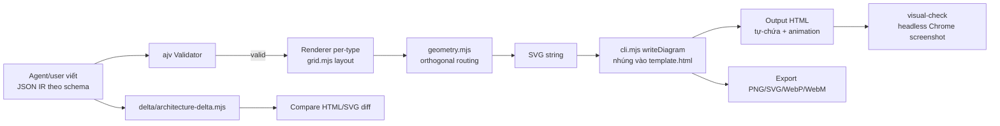
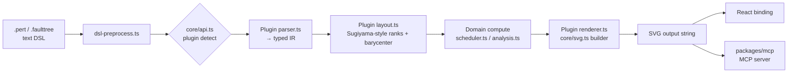
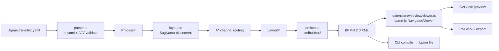
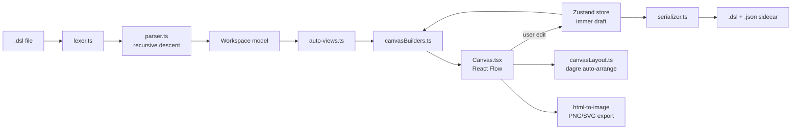

# Weekly Scan — Diagram Tooling (2026-08-12)

**Executive summary:**
- Tuần này nổi bật nhất là **archify** (11.5k⭐, cập nhật 2026-08-11): không phải DSL parser mà là một "agent skill" — LLM tự viết JSON IR theo schema, code chỉ lo layout-quality-gate + rendering + export, một mô hình input rất khác kymo đáng cân nhắc cho tương lai (agent-authored IR thay vì text DSL do người viết).
- **SchemaTex** là đối thủ trực tiếp gần nhất với kymo về mặt kiến trúc: text DSL → pure SVG zero-dep, nhưng đi xa hơn kymo ở chỗ một số diagram type *tính toán* ra kết quả (PERT critical path, fault-tree minimal cut sets) thay vì chỉ vẽ lại structure được cho sẵn.
- **transitrix-studio** đáng chú ý nhất về layout: họ vừa **bỏ elkjs** (v2.9.0, 2026-07-03) để tự viết Sugiyama + A* routing riêng cho BPMN, và log lại con số cải thiện cụ thể (155→139 bends) — một case study thực tế về khi nào nên tự viết layout engine thay vì dùng thư viện có sẵn.

**Mục lục:**
1. [archify (tt-a1i/archify)](#1-archify-tt-a1iarchify)
2. [SchemaTex (SchemaTex/SchemaTex)](#2-schematex-schematexschematex)
3. [transitrix-studio (transitrix/transitrix-studio)](#3-transitrix-studio-transitrixtransitrix-studio)
4. [c4hero (c4hero/c4hero)](#4-c4hero-c4heroc4hero)

---

## 1. archify (tt-a1i/archify)

### §1 — Quick context
Agent skill biến JSON IR (do LLM tự soạn) thành diagram HTML/SVG tự-chứa có animation, chứ không parse DSL text như kymo. Stack: Node ESM (zero-build), 1 dependency (`ajv@^8`). Output: HTML tự-chứa + PNG/SVG/WebP/WebM + share-card 1200×630. Repo health: 11.5k⭐/871 fork, MIT, v2.14.0 (2026-08-11), ~74 file test + golden regression suite. Phân phối qua `npx skills add tt-a1i/archify -g` (agent-skill marketplace, không phải npm library truyền thống).

### §2 — Architecture deep-dive

**A. Component inventory**
- CLI: `archify/archify/bin/archify.mjs` — dispatcher cho 12 subcommand (`render`, `deliver`, `validate`, `compare`, `visual-check`, `preview`...).
- Renderer per-type: `renderers/{architecture,workflow,sequence,dataflow,lifecycle}/render-<type>.mjs`.
- Shared runtime: `renderers/shared/{geometry.mjs, validator.mjs, cli.mjs, generated-validators.mjs}` — routing thuần túy, validation, template injection.
- Schema: `schemas/<type>.schema.json` (JSON Schema, ajv-compiled).
- Delta engine: `delta/architecture-delta.mjs` — so sánh hai spec, sinh HTML/SVG diff annotated.

**B. Pipeline** (không có bước parse — input đã là JSON IR):
1. Agent/user viết JSON IR tay theo `schemas/<type>.schema.json` + `references/authoring-contract.md`.
2. `archify validate <type> <file.json>` → ajv validator → diagnostics có structured error code.
3. `archify deliver` → renderer đọc spec → `grid.mjs` (layout) + `geometry.mjs` (routing) → SVG string → `cli.mjs:writeDiagram()` nhúng vào `assets/template.html`.
4. `scripts/check-render-output.mjs` chạy quality gate lên output.
5. Pass → freeze spec snapshot, ghi SHA-256 receipt (delivery-contract).
6. (optional) `visual-check` — headless Chrome chụp 4 viewport × 2 theme, PNG sidecar.
7. (optional) `compare` hai spec → delta HTML/SVG.

**C. Data model / IR**: JSON IR thuần (không phải class), `components[]{id,type,label,pos:[x,y],size:[w,h]}` + `connections[]{from,to,variant}`. Coi là immutable input — renderer sinh artifact mới, không mutate IR. Không có "lower IR" — một tầng JSON IR duy nhất đi thẳng ra SVG.

**D. Input language design**: **Không có parser/grammar**. `SKILL.md` nói thẳng: *"SKILL.md teaches layout judgment, not auto-layout"* và *"Mermaid is an input dialect via prompt, not a parser"* — tức LLM agent tự dịch tự nhiên ngữ/Mermaid sang JSON IR theo hướng dẫn trong skill, không có BNF/EBNF nào trong repo. Error reporting là post-hoc qua ajv, map ra code kiểu `schema/{keyword}` kèm gợi ý fix.

**E. Layout algorithm**: Position được **author trực tiếp trong JSON** (không force-directed, không auto-place toàn cục); `grid.mjs` chỉ snap/validate theo lưới. Routing là **orthogonal có validate chất lượng**: `geometry.mjs` có `routeVia`, `automaticPortSpread`, và các quality-gate thuần túy (`cleanCrossingProblems`, `cleanRouteRhythmProblems` — floor 8px/16px cho micro-segment). Module tự document rõ đây là "pure helpers", không phải layout algorithm thật sự.

**F. Rendering/output**: Mỗi diagram type có 1 renderer cứng (không phải pluggable emitter pattern) → SVG string → HTML tự-chứa. Animation qua `animateAttr()` set `data-animate + style="--step:n"` — **CSS-variable-driven**, không dùng SMIL. Export: PNG/JPEG/WebP/SVG/HTML/WebM (recorded trace) + share card.

**G. Extensibility**: Thêm diagram type mới = viết schema mới + renderer mới + chạy `generate-validators.mjs`. Preset (`signal-flow`, `blueprint`, `editorial`) là switch theo `meta`, không phải plugin API runtime.

**H. Dev experience**: CLI rộng (12 subcommand) có `doctor` + `preview` (watch mode, tự nhận không hợp CI/mobile). Test suite golden-file giống hướng tiếp cận của kymo (`test/golden.mjs`). Không tích hợp IDE riêng — phân phối như agent skill cho Cursor/Claude Code/Codex/Raven.

### §3 — Architecture diagram



### §4 — Verdict
**Đáng học**: (1) quality-gate thuần túy tách khỏi layout — `cleanCrossingProblems`/`cleanRouteRhythmProblems` là hàm validate độc lập, kymo có thể áp dụng pattern tương tự cho `alignment.py` để bắt regression về crossing/spacing mà không cần golden SVG byte-for-byte; (2) delivery receipt (SHA-256 snapshot) cho mỗi lần render — ý tưởng hay cho reproducibility khi kymo sinh output cho CI. **Red flag**: 5 renderer hard-code riêng biệt, không có emitter pattern chung — sẽ khó scale nếu thêm nhiều diagram type; do input là JSON IR viết tay (bởi LLM) nên **không so sánh trực tiếp được với DSL text-based của kymo** — đây là một hướng đi khác hẳn (agent-authored structured input) chứ không phải cùng một bài toán. **Open question**: quality-gate ("crossing/route-rhythm") có threshold cứng hay tunable? Không xác định từ evidence hiện có. **Verdict: glance only** — pattern quality-gate đáng note lại, nhưng kiến trúc tổng thể (no-parser, no-real-layout-algorithm) không map trực tiếp vào roadmap kymo.

---

## 2. SchemaTex (SchemaTex/SchemaTex)

### §1 — Quick context
DSL text → pure SVG zero-dependency, khác kymo ở chỗ một số diagram type (PERT, fault tree) **tự tính toán kết quả** (critical path, minimal cut sets) chứ không chỉ vẽ lại structure có sẵn. Stack: TypeScript, `tsup` build, không runtime dep. Output: SVG (string), React binding, MCP server. Repo health: 59⭐/3 fork, AGPL-3.0 (+ license thương mại), tag mới nhất v1.0.9 (2026-08-11), test 59 thư mục khớp 50 diagram type + core/fixtures/e2e/regression. Phân phối: npm, package.json `exports` có ~20 subpath tree-shakable (`schematex/pert`, `schematex/faulttree`...).

### §2 — Architecture deep-dive

**A. Component inventory**
- `src/core/api.ts` — plugin registry (~50 entry) + `parse()`/`render()` dispatch qua `detect(text)`.
- `src/core/types.ts` — `DiagramPlugin` interface, hợp đồng chung cho mọi plugin.
- `src/core/layered/bk.ts` — Brandes–Köpf-style layered-layout helper dùng chung cho các DAG diagram.
- `src/diagrams/<50 dirs>/` — mỗi diagram type tự chứa `parser.ts`, `layout.ts`, `renderer.ts`, `types.ts`; PERT còn có `scheduler.ts`/`aoa.ts`/`gantt.ts`, fault-tree có `analysis.ts`.
- `docs/reference/32-PERT-STANDARD.md` — spec chuẩn hóa dạng prose cho từng diagram type.
- `packages/mcp/` — MCP server cho AI-agent/IDE integration.

**B. Pipeline**:
1. Text → `core/dsl-preprocess.ts` (strip frontmatter/comment, normalize quote).
2. `core/api.ts` dò `detect(text)` chọn plugin đúng → gọi `parse()`.
3. Plugin's `parser.ts` biến dòng text thành typed IR riêng của diagram đó.
4. `layout.ts` tính geometry (`assignRanks`, `orderLayers`, `routeEdge`), tái dùng `core/layered/bk.ts` nếu cần.
5. Domain computation chạy và merge vào IR (`pert/scheduler.ts` forward/backward pass; `faulttree/analysis.ts` MOCUS cut-set expansion).
6. `renderer.ts` build SVG string qua `core/svg.ts` + `core/theme.ts`.
7. `api.ts` trả SVG + diagnostics (`SchematexDiagnostic`).

**C. Data model / IR**: Không có IR chung toàn hệ thống — mỗi plugin sở hữu `types.ts` riêng (PERT: `Task`/`Dependency`; fault-tree: `Node`/`Gate`). `core/types.ts` chỉ giữ shape cross-cutting (`RenderConfig`, `SchematexDiagnostic`). Không xác định IR có bị freeze/immutable hay không — không tìm thấy evidence.

**D. Input language design**: Parser **hand-written line-based regex + string-slice**, không phải PEG/recursive-descent cổ điển hay parser-combinator. Ví dụ PERT: header regex `^([a-zA-Z-]+)\s*:\s*(.+)$` + `KEY_RE` để bắt attribute marker (`duration:`, `after:`). Grammar chính thức tồn tại dưới dạng **prose trong docs**, không phải file grammar machine-readable. Error reporting qua `SchematexDiagnostic` + `lint()` hook mỗi plugin, phân biệt blocking/non-blocking, map lại về source offset qua `source-range.ts`.

**E. Layout algorithm**: **Auto-layout thật sự**, không phải user-position. PERT: longest-path rank assignment + barycenter-heuristic ordering có critical-path bias (4-pass sweep) — kiểu Sugiyama layered DAG, không phải exact crossing minimization. Routing orthogonal đơn giản, 1 bend giữa (`M sx sy L mid sy L mid ty L tx ty`). PERT có 3 layout mode: network/swimlane/timescaled.

**F. Rendering / plugin architecture**: Mỗi plugin string-build SVG trực tiếp qua `core/svg.ts`, không dùng DOM lib. Plugin contract rõ ràng:
```ts
interface DiagramPlugin {
  type: DiagramType; detect: (text) => boolean;
  render: (text, config?) => string; parse?: (text) => unknown;
  lint?: (text, config?) => SchematexDiagnostic[];
  capabilities?: { scene?: boolean; editablePosition?: boolean };
}
```
`exports` map trong `package.json` cho tree-shaking thật (import `schematex/pert` không kéo theo 49 type còn lại). Không tìm thấy evidence về animation support.

**G. Extensibility** (đã verify từ code): tạo `src/diagrams/<name>/{parser,layout,renderer,types,index}.ts` implement `DiagramPlugin` → thêm vào mảng `plugins` trong `core/api.ts` → thêm subpath vào `package.json` exports → (optional) thêm doc chuẩn + test dir.

**H. Dev experience**: scripts `dev` (tsup --watch), `test`/`test:watch` (vitest), `validate:examples`, `gallery`/`gallery:check` (regenerate + diff SVG mẫu — giống golden test của kymo). Có `interactive.ts` cho SDK edit-position trong browser. Không tìm thấy `bin` field — không xác định có CLI standalone hay không. CI: `.github/workflows/{ci.yml,publish.yml}`.

### §3 — Architecture diagram



### §4 — Verdict
**Đáng học nhất**: domain computation gắn thẳng vào IR (PERT critical-path, fault-tree MOCUS cut-set) là hướng đi kymo hiện chưa có — kymo chỉ vẽ lại structure cho sẵn. Với BPMN importer sẵn có, kymo có thể cân nhắc thêm "computed annotation" tương tự (vd. critical-path highlight cho process flow) như một feature differentiator. Plugin contract (`detect`/`parse`/`render`/`lint` tách rời) + `exports` map tree-shakable là pattern sạch cho JS package — kymo JS hiện chưa tree-shake theo icon/diagram-type, đáng xem xét khi icon library phình to. **Red flag**: parser hand-rolled regex per-plugin (50 lần) — dễ drift chất lượng giữa các plugin, không có grammar máy-đọc-được để đối chiếu (giống rủi ro mà `docs/DSL.md` của kymo đang tránh bằng cách giữ EBNF chính thức). **Open question**: license AGPL-3.0 — có ảnh hưởng gì nếu kymo tham khảo code cụ thể (MOCUS algorithm) hay không, cần review license trước khi "học" quá sát code. **Verdict: study deeper** — riêng phần domain-computation-in-IR và plugin/tree-shaking pattern.

---

## 3. transitrix-studio (transitrix/transitrix-studio)

### §1 — Quick context
YAML DSL → BPMN 2.0 XML chuẩn (không phải format riêng) + live preview trong VS Code/IntelliJ, khác kymo ở layout engine tự viết (Sugiyama+A*) thay vì dùng elkjs có sẵn. Stack: TypeScript monorepo (`src/` core BPMN + `packages/diagrams/` 13 notation khác + `extension/` VS Code + `intellij/` Kotlin/Gradle), `xmlbuilder2`, `bpmn-js` cho preview, AJV cho schema validate. Repo health: 6⭐/0 fork, MIT, v3.2.0, nhiều CI workflow publish (npm/OpenVSX/VSCode Marketplace/JetBrains) nhưng không tìm thấy `test.yml` riêng. Phân phối: VS Code Marketplace + Open VSX + JetBrains Marketplace + `@transitrix/cli` trên npm.

### §2 — Architecture deep-dive

**A. Component inventory**
- `src/` — core BPMN pipeline: `parser.ts` (YAML→IR + AJV), `layout.ts`/`layout-placement.ts`/`layout-routing.ts`, `emitter.ts` (IR→XML qua `xmlbuilder2`), `ir.ts`, `cli.ts`.
- `packages/diagrams/` — mỗi notation khác (Goals, FGCA, capability-map, process-blueprint...) là 1 module riêng với `types.ts`/`validate.ts`/`layout.ts`.
- `extension/` — entry `extension/src/extension.ts`, ~20 file `*-preview.ts` theo notation; `extension/webview/viewer.ts` render BPMN qua `bpmn-js`.
- `intellij/` — plugin Kotlin/Gradle riêng, dùng chung webview HTML.
- `schemas/bpmn-dsl.schema.json` — AJV schema cho YAML.

**B. Pipeline**:
1. User sửa `*.bpmn.transitrix.yaml` trong VS Code, **save** trigger `onDidSaveTextDocument` (không phải mỗi keystroke).
2. `resolveNotationPreview()` route theo filename tới BPMN preview.
3. `parseYamlToIr()`: `js-yaml` load → AJV validate theo `bpmn-dsl.schema.json` → `collectElements` dựng `ProcessIr`.
4. `layout.ts` tính `LayoutIr` (xem mục E).
5. `emitBpmnXml(layout)` serialize ra BPMN 2.0 XML qua `xmlbuilder2`.
6. Extension host `postMessage({type:'update', xml})` sang webview.
7. `viewer.ts` gọi `bpmn-js NavigatedViewer.importXML(xml)` render SVG trong panel.

**C. Data model / IR**: `ProcessIr { id, poolId, lanes: {id, elements: FlowElement[]}[], flows }` → `LayoutIr { elements: Map<id,Bounds>, laneBounds, poolBounds, flows: PositionedSequenceFlow[] }`. `emitBpmnXml(layout)` chỉ đọc, không mutate — immutable-by-convention giữa các pass.

**D. Input language design**: YAML validate bằng AJV-compiled JSON Schema, lỗi format `` `${instancePath||'/'} ${message}` `` và throw `DSL validation failed`. Docs mô tả rõ 3 lớp validate: L1 AJV type safety, L2 structural rules (`src/validator.ts`), L3 semantic BPMN rules — **non-blocking** (findings hiển thị nhưng không chặn compile), có severity `error`/`warning`/`info` và rule-ID prefix (`SE-*`, `EE-*`, `GW-*`...). Không tìm thấy bằng chứng trực tiếp về squiggle/Diagnostics trong VS Code — docs nói findings tới "API, CLI, web UI" nhưng không rõ wiring `vscode.Diagnostic`.

**E. Layout algorithm — điểm đáng chú ý nhất**: **elkjs đã bị bỏ** khỏi BPMN layout path từ v2.9.0 (2026-07-03, ghi rõ trong CHANGELOG), thay bằng pipeline tự viết: **lane-aware Sugiyama placement** (cycle-break DFS → longest-path columns → barycenter sweep 2 chiều → PAVA isotonic-regression cho Y-assignment → column centering) + **channel-based orthogonal A* routing** (grid theo lane corridor, cost = length + 40/bend + 32/congestion-reuse + 45/crossing, có nudging tách parallel segment). Team log số liệu cải thiện cụ thể: 155→139 bend, 353→297px spine deviation trên corpus test. `elkjs` vẫn còn trong `package.json` dependencies nhưng không xác định có dùng ở đâu khác (vd. `packages/diagrams`) hay là dead weight.

**F. Rendering/output**: BPMN preview qua `bpmn-js NavigatedViewer` (SVG, webview). Export PNG (`png-export.ts`/`raster.ts`) + SVG save. CLI `compile` xuất thẳng `.bpmn` XML. Các notation khác (Goals, capability-map...) render qua **React `.tsx` component** riêng — khác hẳn render path của BPMN.

**G. Extensibility**: theo `docs/repo-layout.md` — thêm notation mới = module `packages/diagrams/src/<notation>/` + preview `extension/src/<notation>-preview.ts` + wire vào `extension.ts`/`package.json` + fixture corpus. Verify được: mỗi notation có `validate.ts`/`layout.ts`/`resolver.ts` độc lập.

**H. Dev experience**: VS Code có 30+ command, auto-open preview theo config, re-render khi đổi spacing/curvature/theme, nhưng **chỉ refresh khi save** (README tự nêu rõ hạn chế này). CLI (`@transitrix/cli`): `compile`/`validate`/`serve`/`metrics`/`new`/`export-compliance`/`impact`; `transitrix serve` host UI local ở `:8765`.

### §3 — Architecture diagram



### §4 — Verdict
**Đáng học nhất**: đây là case study thực tế cho câu hỏi kymo cũng phải trả lời — "tự viết layout engine hay dùng lib có sẵn?" — họ bỏ elkjs sau khi đã dùng, có số liệu cụ thể để biện minh (bend count, spine deviation), và decouple layout khỏi interchange format (đổi thuật toán layout mà không đổi BPMN XML contract). Đáng đọc kỹ `docs/internal/bpmn-routing.md` để lấy ý tưởng cho `alignment.py`'s edge staggering nếu cần orthogonal routing tinh vi hơn. Việc validate **non-blocking** (findings hiển thị nhưng không chặn compile) là UX pattern đáng cân nhắc cho `kymo` CLI thay vì fail cứng. **Red flag**: `elkjs` vẫn nằm trong dependencies dù không còn dùng cho BPMN — có thể là dead weight hoặc dùng ở chỗ khác chưa audit; chỉ 6⭐/0 fork nên chưa có nhiều production battle-testing để tin tưởng số liệu benchmark. **Open question**: 13 notation dùng 2 render path khác nhau (bpmn-js cho BPMN, React component cho phần còn lại) — có drift về visual consistency không? Không xác định. **Verdict: study deeper** — riêng phần layout/routing rationale, vì đây là quyết định kiến trúc cùng loại kymo sẽ phải đối mặt khi mở rộng BPMN routing.

---

## 4. c4hero (c4hero/c4hero)

### §1 — Quick context
GUI local-first vẽ C4 diagram, lưu ra plain-text Structurizr DSL làm source-of-truth (không phải proprietary save format) — khác kymo ở chỗ DSL chỉ là *export format* của canvas, không phải input chính. Stack: React 19 + TypeScript strict, Zustand+immer, `@xyflow/react` (React Flow), `@dagrejs/dagre` cho auto-layout. Repo health: 43⭐/6 fork, Apache-2.0, solo-maintainer, CI đầy đủ (lint/typecheck/Vitest ~1300 test/Playwright e2e/CodeQL/dependency-review). Phân phối: web app tĩnh (`app.c4hero.com`, Vercel), không server backend.

### §2 — Architecture deep-dive

**A. Component inventory**
- `src/types/model.ts` — domain type (`Workspace`, `Model`, `Person/SoftwareSystem/Container/Component`, `Relationship`, `View`).
- `src/lib/dsl/` — `lexer.ts`, `parser.ts` (+ `parser-model/relationship/styles/views.ts`), `serializer.ts`, `auto-views.ts`.
- `src/store/workspace.ts` — Zustand store chia 11 slice (`store/slices/`: element, relationship, group, view, navigation, selection, filter, tag-style, ui, undo, lifecycle).
- `src/components/canvas/{Canvas.tsx, canvasBuilders.ts, handleSlots.ts}` + `nodes/`, `edges/`.
- `src/lib/canvasLayout.ts` — dagre wrapper (`applyAutoLayout`, `spaceOverlayClusters`).
- `src/lib/{fileIO,folderIO}.ts` — File System Access API; `safeStorage.ts`/`viewportStorage.ts` — localStorage.
- `src/lib/ai/` — BYOK AI: `providers/{anthropic,openai,gemini}.ts`, `operations.ts` (`applyEditPlan`).

**B. Pipeline** (2 chiều):
- **DSL → canvas**: `fileIO.openDSLFile()` → `lexer.lex()` → `parser.parse()` (recursive descent) → `Workspace` → `auto-views.ts` (điền view mặc định nếu thiếu) → `canvasBuilders.ts` chiếu view thành node/edge React Flow → `Canvas.tsx` render.
- **Canvas edit → DSL**: user thao tác → store action mutate immer draft (snapshot undo trước) → `canvasBuilders.ts` tính lại → save → `serializer.serialize(workspace)` → ghi `.dsl` (+ `.json` sidecar cho layout data mà DSL không biểu diễn được) qua `fileIO`/`folderIO`.

**C. Data model / IR**: `Workspace { model: Model, views }`; `Model { people, softwareSystems→containers→components, relationships, groups }`. `Relationship { id, sourceId, destinationId, technology?, tags, properties }`. View là projection riêng (danh sách id + layout per-node), không derive tự động từ model tree. **Mutable** qua Zustand+immer; undo dạng snapshot, không phải persistent structure.

**D. Input language design**: Tokenizer + recursive-descent parser thật (không regex-scrape). `lexer.ts` → token stream → `ContextAwareParser` trong `parser.ts` dùng `peek/advance/match/expect`, đệ quy tương hỗ (`parseModelBody`, `parseViewsBody`), giới hạn depth 50 tránh stack overflow. `parse(input): ParseResult = { workspace, errors: ParseError[] }` — lỗi **tích lũy thay vì throw ngay**, cho phép report nhiều lỗi 1 lần (`{message, line, column}`). Có bộ test conformance riêng với Structurizr DSL gốc (`structurizr-conformance.test.ts`, `wildcard-expansion.test.ts`, `include-expression.test.ts`).

**E. Layout algorithm**: Hybrid — drag-and-drop thủ công là chính, có nút **auto-arrange** dùng dagre ở compound-graph mode (group/boundary → dagre compound parent), hướng TB/BT/LR/RL. Node đã có tọa độ lưu sẵn bị "frozen" (loại khỏi re-layout), có bước translate coordinate-frame để khớp output dagre mới với anchor cũ. Riêng có pass 24-iteration collision-separation (`spaceOverlayClusters`) chống chồng group/boundary. Manual mode snap lưới 32px. Routing cạnh: `handleSlots.ts` chỉ quản lý slot điểm nối tránh chồng lấn, không có auto-routing cong/orthogonal thật sự.

**F. Rendering/output**: React Flow (DOM/SVG, không phải raw Canvas API). Export qua `html-to-image`: PNG/SVG (có padding option) + DSL text export **serialize→parse→serialize byte-identical** (theo comment trong code) — ordering property không phụ thuộc vị trí, ID giữ nguyên làm DSL variable name để sidecar roundtrip ổn định.

**G. Extensibility**: Không xác định chính xác (không có CONTRIBUTING.md fetch được) — suy luận từ cấu trúc: thêm element type mới sẽ chạm `model.ts` (BaseElement variant), 1 slice mới, nhánh parser/serializer, node renderer mới — chưa verify trực tiếp.

**H. Dev experience**: Local-first xác nhận qua `ARCHITECTURE.md` — không backend server. Persist: File System Access API (Chromium-only cho folder collection) + localStorage cho autosave/recents/viewport. AI: BYOK cho Anthropic/OpenAI/Gemini, gọi thẳng browser→provider (key không qua server c4hero). Accessibility (theo docs, chưa verify hết code): ARIA labels, keyboard shortcut đầy đủ qua command palette, tôn trọng `prefers-reduced-motion`, focus-trap cho dialog.

### §3 — Architecture diagram



### §4 — Verdict
**Đáng học nhất**: cách xử lý tension kinh điển giữa "DSL-driven layout" và "hand-placed layout" — node có tọa độ lưu sẵn bị freeze khỏi auto-layout, chỉ node mới/chưa định vị mới được dagre sắp xếp, kèm coordinate-frame translation để không "giật" các node cũ. Kymo hiện dùng `layout.py` auto-layout toàn cục cho frame; nếu tương lai kymo thêm chế độ edit thủ công trên canvas, pattern "frozen node" này đáng tham khảo trực tiếp. Serializer đảm bảo **byte-identical roundtrip** (serialize→parse→serialize) là kỷ luật engineering hiếm gặp ở tool GUI-first — tương tự triết lý golden-SVG byte-for-byte của kymo, dù áp dụng cho input DSL thay vì output render. **Red flag**: state mutable qua Zustand+immer nên khó audit side-effect so với model dataclass thuần của kymo; phần AI/BYOK gọi thẳng browser→provider là điểm cần soi kỹ nếu tham khảo (trust boundary khác hẳn server-side). **Open question**: extensibility (thêm element type mới) chưa verify được từ code, chỉ suy luận. **Verdict: glance only** cho kiến trúc tổng thể, nhưng **study deeper** riêng phần "frozen-node auto-layout" nếu kymo làm visual editor.
