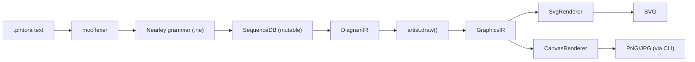
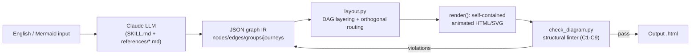
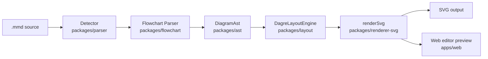
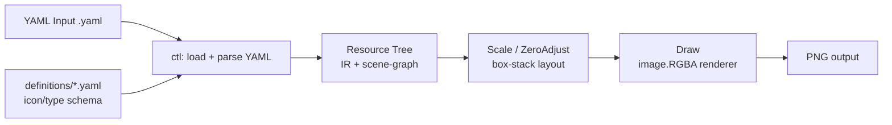

# Weekly scan: Diagram tooling (2026-08-13)

**Phương pháp**: phiên GitHub MCP của session này bị giới hạn scope vào riêng
`kymostudio/kymostudio`, không thể gọi `gh api search/repositories` hay
GitHub MCP search trên toàn GitHub như task gốc yêu cầu. Data source thực tế
dùng thay thế: WebSearch + GitHub Topics pages (`github.com/topics/<topic>?s=updated`)
để tìm repo mới/active trong 7 ngày qua, sau đó xác minh + đọc sâu từng repo
qua WebFetch (README, cấu trúc thư mục, entry point, package manifest, sample).

## Executive summary

- **pintora** (hikerpig/pintora) là phát hiện đáng chú ý nhất: kiến trúc
  `DiagramIR → GraphicsIR` tách lớp ngữ nghĩa khỏi primitive đồ hoạ, cho phép
  nhiều renderer (SVG/Canvas) dùng chung logic vẽ — kymostudio hiện render
  thẳng `Diagram → SVG` trong `to_svg.py`, đáng cân nhắc lớp trung gian tương
  tự khi mở rộng thêm backend/animation.
- **dashmotion** (Northwestern-caddo190/dashmotion) tuy là Claude Skill non-CI,
  0 sao, nhưng có kỹ thuật animation SVG cụ thể (CSS `stroke-dashoffset`
  keyframe + SMIL `animateMotion` bám path + stagger nhiều luồng) có thể
  port gần như trực tiếp vào `to_svg.py --animate`.
- **sculpt** và **awslabs/diagram-as-code** chỉ đáng glance: sculpt còn quá
  sớm (0 sao, không CI) dù có ý tưởng hay về tách manual-override khỏi
  source; awslabs dùng YAML-schema thuần + raster-only (không SVG/animation),
  ít liên quan tới thiết kế `.kymo`, nhưng compass position codes (N/S/NNE…)
  và mô hình external definition file đáng ghi chú.

## Mục lục

1. [pintora (hikerpig/pintora)](#pintora-hikerpigpintora)
2. [dashmotion (Northwestern-caddo190/dashmotion)](#dashmotion-northwestern-caddo190dashmotion)
3. [sculpt (S1naps1s/sculpt)](#sculpt-s1naps1ssculpt)
4. [diagram-as-code (awslabs/diagram-as-code)](#diagram-as-code-awslabsdiagram-as-code)

---

## pintora (hikerpig/pintora)

**§1 — Quick Context**

Pintora là thư viện text-to-diagrams JS/TS, lấy cảm hứng trực tiếp từ Mermaid.js/PlantUML nhưng khác biệt ở kiến trúc plugin tách bạch parser/db/artist cho từng loại diagram và một lớp GraphicsIR trung gian trước khi render. Tech stack: TypeScript, monorepo pnpm+turbo, lexer/parser dùng fork riêng của `moo` + `nearley` (`@hikerpig/moo`, `@hikerpig/nearley`), layout dùng `@pintora/dagre` + `@pintora/graphlib` (fork riêng), styling dùng d3-scale/d3-shape/d3-interpolate. Output: SVG/Canvas (browser), PNG/JPG/SVG (Node qua CLI). Repo health: ~1.3k sao, 725 commit, phiên bản mới nhất trong CHANGELOG là 0.8.2, có CI (`ci-check.yml`, `update-tests.yml`), jest + codecov + Percy (visual regression) badge, dùng changesets để release. Phân phối: npm (`@pintora/standalone`, `@pintora/cli`, …), có VS Code extension, Obsidian plugin, live editor web.

**§2 — Architecture Deep-Dive**

**A. Component inventory**
- `DiagramRegistry` (`packages/pintora-core/src/diagram-registry.ts`) — đăng ký diagram type qua `registerDiagram(name, diagram: IDiagram)`, tự phát hiện loại diagram bằng `pattern: RegExp` khớp text đầu vào.
- Grammar `sequenceDiagram.ne` (`packages/pintora-diagrams/src/sequence/parser/sequenceDiagram.ne`) — grammar Nearley cho sequence diagram.
- `SequenceDB` (`packages/pintora-diagrams/src/sequence/db.ts`) — class mutable kiểu Mermaid, tích luỹ actor/message/note qua `apply()`, xuất `getDiagramIR()`.
- `artist.ts` (`packages/pintora-diagrams/src/sequence/artist.ts`) — implement `IDiagramArtist.draw(diagramIR) → GraphicsIR`.
- `SvgRenderer.ts` / `CanvasRenderer.ts` / `base.ts` (`packages/pintora-renderer/src/renderers/`) — hai backend render từ cùng `GraphicsIR`.
- Themes (`packages/pintora-core/src/themes/{base,palette,theme-default,theme-dark,theme-lark-*}.ts`) — hệ theme phân lớp base/palette/variant.
- `pintora-cli` — CLI `pintora render -i input -o output.png`.

**B. Pipeline**: (1) user chạy `pintora render -i file.pintora -o out.svg`; (2) `DiagramRegistry` khớp `pattern` để chọn diagram module; (3) text → lexer `moo` → grammar `.ne` (Nearley) → chuỗi action đối tượng (`addActor`, `addSignal`, …) nạp vào `SequenceDB` (mutable, tích luỹ theo dòng); (4) `db.getDiagramIR()` xuất DiagramIR bất biến (dữ liệu ngữ nghĩa thuần); (5) `artist.draw(diagramIR, config)` tính toán vị trí (dùng dagre cho các diagram dạng đồ thị) và sinh `GraphicsIR` (các primitive đồ hoạ: rect/path/text…); (6) `SvgRenderer`/`CanvasRenderer` duyệt `GraphicsIR` để xuất SVG string hoặc vẽ Canvas, CLI ghi ra PNG/JPG/SVG.

**C. Data model/IR**: hai lớp IR rõ rệt — DiagramIR (ngữ nghĩa, per-diagram-type, ví dụ `SequenceDiagramIR`) sinh ra từ DB mutable, sau đó "compile xuống" GraphicsIR (thấp hơn, chung cho mọi diagram, chỉ còn primitive đồ hoạ) để hai renderer SVG/Canvas dùng chung logic vẽ. Đây là điểm khác biệt lớn nhất so với kymostudio (chỉ có một `Diagram` model, không có lớp GraphicsIR trung gian).

**D. Input language**: parser combinator hai tầng — lexer `moo` (tokenizer regex-based) + grammar Nearley (`.ne`, dạng EBNF-như, hỗ trợ ambiguity/GLR) với semantic actions `` map token thành action object (`addActor`, `addSignal`...). Có file `.ne` viết tường minh dạng BNF. Chiến lược báo lỗi: không xác định rõ (không thấy bằng chứng cụ thể về error message thân thiện).

**E. Layout**: hierarchical/graph layout qua fork `@pintora/dagre` (Sugiyama-style) cho các diagram dạng đồ thị (class/component/er/dot); sequence diagram dùng thuật toán riêng theo vị trí actor tuần tự. Edge routing/crossing-minimization cụ thể: không xác định (kế thừa từ dagre nhưng không đọc được source dagre fork).

**F. Rendering/output**: pluggable renderer pattern rõ ràng qua `base.ts` + `SvgRenderer`/`CanvasRenderer` cùng implement `IRenderer`. Không tìm thấy bằng chứng animation nào trong CHANGELOG hay README — đây là khoảng trống so với kymostudio.

**G. Extensibility**: plugin qua `registerDiagram(name, {pattern, parser, artist, eventRecognizer?, configKey?, clear()})`; theme qua palette/base/variant layering.

**H. Dev experience**: CLI (`pintora render`, flags `-i -o -p -t -w -b`), VS Code extension (syntax highlight + preview cho `.pintora` và markdown fence), live editor web, Obsidian plugin; watch mode không thấy bằng chứng.

**§3 — Architecture Diagram**

**§4 — Verdict**

Đáng học nhất: lớp **GraphicsIR trung gian** (DiagramIR ngữ nghĩa → GraphicsIR primitives dùng chung cho nhiều backend) — kymostudio hiện render thẳng từ `Diagram` sang SVG string trong `to_svg.py`; nếu tách một GraphicsIR ở giữa, việc thêm backend Canvas/PDF hoặc animation frame-by-frame sẽ dễ hơn nhiều so với sửa từng emitter riêng lẻ. Cách đăng ký plugin `registerDiagram(pattern, parser, artist)` cũng gọn hơn cách kymostudio phân biệt `.kymo`/`.bpmn`/`.py` cứng trong `cli.py:load()` — đáng cân nhắc một registry tương tự khi thêm front-end mới. Dùng `moo`+`nearley` (lexer+PEG có ambiguity resolution) là lựa chọn mạnh hơn parser dòng-lệnh custom của `dsl.py`, nhưng đổi lại thêm dependency nặng — kymostudio có thể không cần đánh đổi này vì grammar đơn giản hơn. Red flag: **không có animation output** dù đây đúng là mảng kymostudio đang dẫn trước; và tài liệu/README thiếu ví dụ DSL cụ thể, error-reporting không rõ ràng. Câu hỏi mở: thuật toán routing cạnh cụ thể trong dagre fork, và tại sao phải fork riêng `moo`/`nearley`/`dagre`/`graphlib` thay vì dùng bản gốc. Kết luận: **study deeper** riêng phần kiến trúc DiagramIR→GraphicsIR và registry plugin; phần còn lại chỉ cần glance.

---

## dashmotion (Northwestern-caddo190/dashmotion)

**§1 — Quick Context**

Claude AI Skill dịch mô tả tiếng Anh hoặc Mermaid thành file HTML/SVG hoạt hình tự chứa — khác biệt vì pipeline output nằm trong tay LLM, không phải renderer CLI độc lập. Stack: Python (layout.py) + Markdown/JSON prompt files, output HTML/SVG inline (CSS + SMIL), MIT license. Repo health yếu: 0 stars, 0 forks, 51 commits, không thấy `.github/workflows` (không CI), không có `package.json` gốc — không phải npm library thật sự. Phân phối qua Claude Skill (`npx skills add csthink/dashmotion -a claude-code -g`) hoặc upload zip thủ công vào claude.ai.

**§2 — Architecture Deep-Dive**

**A. Component inventory**: `skills/dashmotion/SKILL.md` (prompt điều phối chính cho agent); `references/{architecture-mode,flow-mode,mermaid-input,layout-script}.md` (tài liệu hướng dẫn LLM dịch ngữ nghĩa và schema JSON); `scripts/layout.py` (engine Python thật: class `Node/Edge/Group/Layout`, hàm `geometry()`/`render()`); `scripts/check_diagram.py` (linter cấu trúc xác định 9 lớp lỗi C1–C9: overlap, connector cắt node, lệch seam dash-offset, ra ngoài viewBox, dot lệch path, thiếu `fill="none"`, đâm xuyên node, SMIL hỏng, group chứa sai node); `scripts/check_fidelity.py`; `resources/template-{flow,architecture}.html`; `eval/` (prompts.json + runs/, harness đánh giá nội bộ, không phải CI).

**B. Pipeline**: (1) user gọi skill trong Claude Code/claude.ai với mô tả tự nhiên hoặc Mermaid; (2) Claude đọc SKILL.md + references, **tự do diễn giải** input thành JSON graph IR (nodes/edges/groups/journeys) theo schema tài liệu hóa; (3) Claude gọi `layout.py graph.json --render out.html` — Python tính layering, routing, sinh HTML/SVG hoạt hình tự chứa; (4) chạy `check_diagram.py` để kiểm tra cấu trúc; (5) nếu lỗi, LLM sửa JSON và lặp lại bước 3; (6) file HTML cuối cùng được giao cho user.

**C. Data model/IR**: có IR JSON tường minh (mode, title, nodes[id/label/shape/type/tier/group/semStroke/semDash], edges[from/to/kind/label], groups[id/label/kind/parent], journeys) — LLM không đi thẳng từ mô tả sang SVG.

**D. Input language**: cả free-English và tập con Mermaid (`flowchart`/`graph`, `stateDiagram-v2`; sequence/class/ER/gantt bị từ chối rõ ràng). Không có parser xác định — `mermaid-input.md` là hướng dẫn cho LLM "dịch trung thực" bằng tay, tức diễn giải bằng LLM, không phải tokenizer/grammar.

**E. Layout algorithm**: **có thuật toán xác định thật** trong `layout.py` — layering kiểu longest-path trên DAG (dò back-edge bằng DFS) cho flow mode, tier cố định cho architecture mode; đặt vị trí top-down theo hàng; routing orthogonal (chuỗi M/V/H/L), ưu tiên đường thẳng theo cột trống, nếu không thì dùng "lane" dọc bên ngoài dùng chung cho fan-out.

**F. Rendering**: một định dạng output (HTML tự chứa inline SVG+CSS+JS nhỏ). Cơ chế hoạt hình lai: CSS `@keyframes` chạy `stroke-dashoffset` trên nét đứt (dashmove 0.75s/dashasync 0.9s/dashauth 1.2s theo loại edge) tạo cảm giác "chảy", cộng với SMIL `<animateMotion>` trên `<circle class="dot">` bám đúng chuỗi `d` của path, thời lượng = độ dài path/tốc độ (clamp min/max), và nhiều "journey" đồng thời được so le bằng `begin` nối chuỗi (dot 2 bắt đầu khi dot 1 tới). JS dùng API SVG gốc `pauseAnimations()`/`unpauseAnimations()`; có `prefers-reduced-motion` để tắt dot/control.

**G. Extensibility**: thêm loại diagram = viết thêm file reference .md hướng dẫn LLM map sang schema có sẵn (không cần sửa code); thêm kiểu edge/animation mới cần sửa bảng CSS/`TYPE_STYLE` trong `layout.py` — là thay đổi code thật.

**H. Dev experience**: chạy qua Claude Skill, không phải CLI sản phẩm độc lập (dù `layout.py` gọi trực tiếp được). `eval/` có prompts.json + runs/ nhưng không phải CI test suite.

**§3 — Architecture Diagram**

**§4 — Verdict**

Đáng "steal": kỹ thuật animation cụ thể — kết hợp CSS `stroke-dashoffset` keyframe (rẻ, mượt cho cảm giác "chảy" liên tục) với SMIL `animateMotion` bám đúng `d` path cho dot di chuyển rời rạc, thời lượng tính từ độ dài path/tốc độ (clamp), và stagger nhiều luồng bằng `begin` nối chuỗi — port thẳng được vào `to_svg.py --animate` vì kymostudio đã có path `d` sẵn từ alignment.py. Cũng nên học: `prefers-reduced-motion` + `pauseAnimations()` JS toggle, và ý tưởng linter cấu trúc hậu-layout (C1–C9) như bổ sung cho golden SVG test. Red flag: 0 stars/forks, không CI, không package.json gốc, tên install (`csthink/dashmotion`) không khớp org repo (`Northwestern-caddo190`) — nghi là fork/mirror chưa rõ nguồn gốc; Mermaid ingestion phụ thuộc LLM diễn giải tay nên không tái lập được. Câu hỏi mở: độ trưởng thành của `check_fidelity.py`, xử lý đồ thị phức tạp/chu trình. Verdict: glance only cho kiến trúc tổng thể, nhưng study deeper riêng đoạn animation CSS/SMIL trong `render()`.

---

## sculpt (S1naps1s/sculpt)

**§1 — Quick Context**

SCULPT là engine text-to-diagram tương thích cú pháp Mermaid, khác biệt ở chỗ tách "vị trí thủ công/manual layout" ra khỏi source thành workspace metadata riêng, thay vì nhúng vào DSL. Stack: TypeScript/React, Vite, Dagre (layout), Playwright (visual test), IndexedDB (persistence); chỉ xuất SVG. Repo rất sớm: 0 stars, 2 contributors, commit gần nhất 11/8/2026 (2 ngày trước), không thấy CI workflow dù có script test/test:visual. MIT license. Phân phối: web editor browser-first (chưa publish npm rõ ràng, CLI chạy trực tiếp từ source qua ts-node-kiểu bin).

**§2 — Architecture Deep-Dive**

**A. Component inventory** (npm workspaces monorepo `packages/*`): `Detector` (`packages/parser/src/index.ts`) — nhận diện diagram type bằng 1 regex trên dòng đầu. `Flowchart Parser` (`packages/flowchart/src/index.ts`) — parse thực sự node/edge theo regex từng dòng, build ra AST. `AST types` (`packages/ast/src/index.ts`) — interface `DiagramAst`/`DiagramNode`/`DiagramEdge`/`DiagramError`. `Layout` (`packages/layout/src/index.ts`) — `DagreLayoutEngine` bọc thư viện Dagre. `Renderer` (`packages/renderer-svg/src/index.ts`) — `renderSvg()` xuất chuỗi SVG. `CLI` (`packages/cli/src/index.ts`) — `sculpt in.mmd [out.svg]`. `apps/web` — editor React/Vite. `packages/core`, `packages/workspace`, `packages/themes` tồn tại nhưng nội dung không đọc được đầy đủ — không xác định chi tiết.

**B. Pipeline**: 1) User viết `.mmd` (hoặc gõ trong web editor) → 2) `detectType()` xác nhận là `flowchart`/`graph` → 3) `packages/flowchart` regex-parse từng dòng thành `DiagramAst` → 4) `DagreLayoutEngine.layout()` tính vị trí, merge override thủ công qua `resolveLayout()` → 5) `renderSvg(ast, layout, theme)` xuất SVG string → 6) CLI ghi file `.svg`, hoặc web app render trực tiếp vào DOM.

**C. Data model/IR**: `DiagramAst` là interface TS phẳng, cây lồng nhau (nodes/edges/groups/styles), bất biến theo quy ước (không có method mutate). Có 2 tầng IR tách biệt: AST (cấu trúc) và `LayoutResult`/`PositionedNode` (hình học) — vị trí thủ công nằm ở tầng "workspace metadata" thứ ba, hoàn toàn ngoài AST.

**D. Input language**: parser regex/line-based 2 giai đoạn (detect rồi parse), không tokenizer, không recursive descent/PEG/ANTLR, không có EBNF/BNF hình thức nào được viết ra. Lỗi báo dạng `DiagramError` bọc `Diagnostic{code, message, stage, severity, SourceRange}` — có cấu trúc tốt dù bản thân parser đơn giản.

**E. Layout**: hierarchical qua Dagre (không tự viết thuật toán), có override thủ công. Edge routing 3 chế độ: auto (điểm của Dagre), straight, orthogonal (validate loại bỏ đoạn chéo). Crossing minimization dựa hoàn toàn vào Dagre nội bộ, SCULPT không bổ sung.

**F. Rendering**: chỉ một backend SVG, không animation, không Canvas/PNG/PDF, không kiến trúc emitter pluggable rõ ràng. Theme qua interface `DiagramTheme` (fill/stroke/edge/background/text/font).

**G. Extensibility**: không thấy plugin system; thêm shape mới đòi sửa cả regex parser lẫn switch-case renderer — không xác định API mở rộng chính thức.

**H. Dev experience**: CLI tối giản, không flag. Web editor giàu tính năng (drag, multi-select, align, undo/redo, zoom 20-800%, nhiều view mode, đồng bộ đa tab qua IndexedDB). Không có VS Code extension/LSP, không watch-mode CLI.

**§3 — Architecture Diagram**

**§4 — Verdict**

Đáng cân nhắc: tách "manual position override" khỏi source thành lớp workspace metadata riêng (merge vào layout result, không đụng AST) — kymo hiện có `layout{}` trong DSL, nhưng nếu editor.kymo.studio phát triển kéo-thả, mô hình "override side-channel" của sculpt tránh việc ghi đè lại `.kymo` source là ý hay. `Diagnostic{code, stage, severity, range}` structured error cũng đáng đối chiếu với báo lỗi của `dsl.py`. Cờ đỏ: parser regex per-line không có grammar hình thức (rủi ro edge-case, thua xa `docs/DSL.md` của kymo); layout hoàn toàn dựa Dagre, không có gì mới về thuật toán để học; chỉ 1 backend SVG, không animation — kém đa dạng hơn kymo. Repo cực sớm (0 sao, 2 người, không CI dù có test script) — rủi ro bỏ ngang cao. Câu hỏi mở: `packages/core` orchestrate ra sao, animation có nằm trong roadmap không, có định publish npm không. **Kết luận: chỉ glance qua**, không cần nghiên cứu sâu — trừ khi cần tham khảo riêng mô hình "manual-override tách khỏi source" cho editor.

---

## diagram-as-code (awslabs/diagram-as-code)

**§1 — Quick Context**

Công cụ CLI của AWS chính thức: biên dịch YAML mô tả kiến trúc AWS thành ảnh **PNG raster** (không phải SVG) tuân thủ chuẩn icon AWS, khác kymo ở việc dùng schema YAML gắn chặt với AWS thay vì DSL tự do. Stack: Go 1.25, `gopkg.in/yaml.v3`, `golang/freetype` + `golang.org/x/image` (vẽ raster trực tiếp), `spf13/cobra` (CLI), `mark3labs/mcp-go` (MCP server). Output: chỉ PNG (không SVG/PDF/animation). Repo: ~1.6k sao, 323 commit, Apache-2.0, CI đầy đủ (Unit test, Functional test, CodeQL, Go Format Check, "Get AWS Icons" auto-sync) — health tốt. Phân phối: `go install` hoặc `brew install awsdac`, không có bản web/playground.

**§2 — Architecture Deep-Dive**

**A. Component inventory:**
- `cmd/awsdac/main.go` — CLI entrypoint, định nghĩa cobra flags, dispatch vào `ctl`.
- `internal/ctl/dacfile.go`, `create.go` — orchestrator chính: load definitions, load resources, layout, render, save.
- `internal/ctl/cfntemplate.go` — converter CloudFormation → DAC YAML (không xác định chi tiết thuật toán).
- `internal/types/types.go`, `resource.go` — data model lõi (`Resource` struct).
- `internal/types/horizontal_stack.go`, `vertical_stack.go` — các loại container auto-layout (`AWS::Diagram::HorizontalStack`/`VerticalStack`).
- `internal/types/link.go` — model cạnh nối (Link) với `SourcePosition`/`TargetPosition`/`ArrowHead`.
- `internal/definition` — parser cho file định nghĩa icon/type (`definitions/*.yaml`).
- `internal/font` — render text bằng freetype.
- `internal/vector` — phép toán hình học/tọa độ.
- `internal/cache` — cache tải definition files từ URL.

**B. Pipeline (happy path):**
1. User chạy `awsdac diagram.yaml`.
2. `main.go` parse flags, gọi `ctl.CreateDiagramFromDacFile()`.
3. Load `DefinitionFiles` (URL hoặc local YAML) → parse YAML gốc → dựng cây `Resource` (parent/children/BorderChildren) qua `loadResources`/`associateChildren`.
4. Layout: gọi đệ quy `canvas.Scale()` (tính kích thước/vị trí từ lá lên gốc) rồi `canvas.ZeroAdjust()` (dịch gốc tọa độ về 0).
5. Resolve `Links` (vị trí N/S/E/W/NNW…) → `canvas.Draw()` vẽ trực tiếp lên `image.RGBA`, sau đó `DrawOverlay()` cho span/link.
6. Resize (tùy chọn) → encode PNG → ghi file output.

**C. Data model/IR:** `Resource` struct (Go struct, con trỏ, **mutable**, không immutable-pass) — một cây duy nhất mang cả dữ liệu ngữ nghĩa (Type, Label, styling) lẫn trạng thái hình học (bindings `image.Rectangle`, iconImage) trong cùng object; không có khái niệm "IR trung gian tách biệt" — resource tree đóng vai trò vừa AST vừa scene-graph, tự biến đổi qua các pass (`Scale`, `Translation`, `ZeroAdjust`, `Draw`) bằng method trên chính struct.

**D. Input language design:** Không phải custom grammar — là **YAML-schema-driven**, ánh xạ trực tiếp vào Go structs qua `yaml.v3` unmarshal. Không có BNF/EBNF. Type hệ thống (`AWS::Diagram::Canvas`, `AWS::EC2::VPC`…) mô phỏng CloudFormation resource type namespace. Error reporting: không xác định chi tiết (không thấy bằng chứng về vị trí lỗi dòng/cột).

**E. Layout algorithm:** Không phải force-directed hay constraint-solver — là **auto-layout dạng box-stacking phân cấp** (`HorizontalStack`/`VerticalStack` + `Direction: vertical/horizontal` trên container, cộng `BorderChildren` để ghim icon lên viền — vd. IGW ở vị trí `S` của VPC). Edge routing: **thẳng (straight line)**, điểm neo chọn thủ công qua compass position codes rất chi tiết (N, S, NNE, NNW, SSE, SSW…) trên cả Source lẫn Target — không có orthogonal routing hay crossing minimization tự động.

**F. Rendering/output strategy:** Renderer đơn nhất, **raster-only**: vẽ trực tiếp lên `image.RGBA` bằng Go image/draw + freetype cho text, encode PNG. Không phải pluggable multi-backend emitter (không SVG, không animation, không Figma/Excalidraw).

**G. Extensibility:** Thêm icon/service mới = thêm entry vào file `definitions/*.yaml` (Type/Icon.Path trỏ PNG được auto-extract từ bộ AWS Architecture Icons PowerPoint chính thức, đồng bộ qua CI workflow "Get AWS Icons") — data-driven, không phải plugin code. Styling qua Border/Fill/Label color trực tiếp trong definition YAML, không có theme engine tách biệt.

**H. Dev experience:** CLI cobra chuẩn (`--help`, `-v` verbose, `--version`); có MCP server (`awsdac-mcp-server`) tích hợp AI agent. Không có watch mode hay browser preview (không xác định).

**§3 — Architecture Diagram**

**§4 — Verdict**

Đáng học ở hai điểm cụ thể: (1) **compass position codes** (N/S/E/W/NNE/NNW/SSE/SSW…) cho neo cạnh — rõ ràng, dễ đọc, đáng cân nhắc cho `alignment.py` khi user cần neo cạnh thủ công chính xác thay vì auto-routing; (2) mô hình **definition file tách biệt** (icon catalog nạp qua URL/LocalFile, tách khỏi diagram source) — kymo có thể tham khảo cho việc load icon set tùy biến qua manifest thay vì chỉ scan thư mục cứng. Điểm KHÔNG nên bắt chước: gộp IR và scene-graph vào một struct mutable duy nhất (`Resource` tự `Scale`/`Draw` chính nó) — đi ngược triết lý "renderer dumb" của kymo, khó test/debug pass riêng lẻ; và output **chỉ PNG raster**, không SVG/animation — không có gì để học ở phần rendering. DSL là YAML thuần (không có custom parser) nên không liên quan đến thiết kế `.kymo` grammar của kymo. Câu hỏi mở: thuật toán chính xác trong `Scale()` (box-stack tính kích thước cha từ con) chưa đọc được source code chi tiết. Verdict: **glance only** — có 1-2 ý tưởng nhỏ (position codes, external definition file) đáng ghi chú, nhưng kiến trúc tổng thể (raster-only, YAML-schema thuần, IR/scene-graph gộp) không phù hợp để nghiên cứu sâu cho kymostudio.
