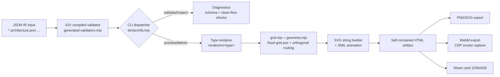
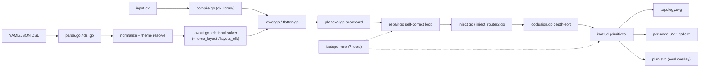
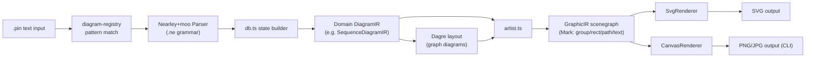
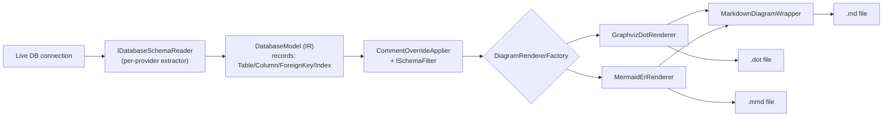

# Weekly Scan: Diagram Tooling — 2026-08-14

Phạm vi: repo mới publish hoặc update đáng chú ý trong 7 ngày qua (2026-08-07 → 2026-08-14) trong domain diagram-as-code / DSL / SVG rendering / graph layout, đối chiếu với kiến trúc kymostudio (`source → parse → IR → layout → render → output`).

**Executive summary:**
- **Agent-native diagram tooling đang thành trend rõ rệt**: cả `archify` và `iso-topology` xây hẳn vòng lặp *validate → repair → render* cùng capability/diagnostic contract dạng JSON cho LLM tự sửa lỗi — một bề mặt mà kymostudio hiện chưa có tương đương.
- **Layout algorithm không ai tự phát minh, đều tái dùng**: `pintora` giao layout dạng cây/đồ thị cho Dagre có sẵn, `iso-topology` bọc thẳng thư viện D2 thật cho input `.d2` rồi cộng thêm relational solver + scorecard riêng ở trên — không repo nào tự viết force-directed từ đầu.
- **Không repo nào có animation thật** — animated SVG vẫn là điểm khác biệt riêng của kymostudio. Kỹ thuật đáng "steal" nhất lại nằm ở **layout quality control**: `archify` lint layout thay vì auto-optimize (reject route xấu), `iso-topology` dùng scorecard (crossings/tunnelling/overlap) làm cả cost function cho router lẫn điều kiện dừng cho repair loop — `alignment.py` của kymostudio hiện chưa có metric khách quan kiểu này.

## Mục lục

1. [archify (tt-a1i/archify)](#archify-tt-a1iarchify)
2. [iso-topology (MishaBear94/iso-topology)](#iso-topology-mishabear94iso-topology)
3. [pintora (hikerpig/pintora)](#pintora-hikerpigpintora)
4. [DbSketch (DimonSmart/DbSketch)](#dbsketch-dimonsmartdbsketch)

---

## archify (tt-a1i/archify)

### §1 — Quick context

Archify là một **agent skill** (không phải CLI/thư viện độc lập) biến JSON IR đã validate thành HTML tương tác self-contained, khác biệt bằng thiết kế cho vòng lặp sửa lỗi của LLM chứ không phải người dùng trực tiếp gõ DSL. Stack: Node.js ≥18, ESM, **zero runtime dependency** (ajv chỉ là devDependency, được compile sẵn thành validator độc lập). Output: HTML tương tác + export PNG/SVG/WebM/share-card 1200×630. Repo health: 12.1k sao, MIT, v2.14.0 (2026-08-11), có CI (`ci.yml`, `release.yml`) và `npm test` (golden tests + validator check). Phân phối: `npx skills add tt-a1i/archify -g` — cài như skill cho Claude Code/Cursor/Codex CLI/OpenCode, `package.json` đánh dấu `"private": true` nên **không publish lên npm registry công khai**.

### §2 — Architecture deep-dive

**A. Component inventory**
- `bin/archify.mjs` — CLI dispatcher (switch-case, không dùng thư viện argparse ngoài).
- `renderers/shared/validator.mjs` + `generated-validators.mjs` — AJV compile-time codegen, validator chạy runtime không cần import `ajv`.
- `renderers/shared/geometry.mjs` — routing chính (bounding-box collision, "clean flow" quality check).
- `renderers/architecture/grid.mjs` — grid placement + collision detection (per loại diagram).
- `renderers/<type>/render-architecture.mjs` (…workflow, sequence, dataflow, lifecycle) — 5 renderer riêng biệt, build SVG bằng string template.
- `schemas/*.schema.json` — JSON Schema (draft 2020-12) cho từng loại + `common.schema.json` dùng chung.
- `bin/visual-check.mjs` — regression test qua Chrome DevTools Protocol trực tiếp (không Playwright/Puppeteer).
- `renderers/shared/repository-evidence.mjs` — gắn node với file/line Git đã verify (tính năng "source evidence").

**B. Pipeline (happy path)**
1. Người dùng/agent viết file `*.architecture.json` (hoặc chuyển từ Mermaid) tuân theo schema.
2. `archify validate` → AJV compiled validator + semantic check (grid collision, clean-flow routing) → trả diagnostics có `code`/`evidence`/`supportedFixes`.
3. `archify preview` mở watch-mode server, chỉ reload khi bản mới pass validate (giữ bản "last-known-good").
4. `archify deliver` — renderer đúng loại (`renderers/<type>`) tính pos (grid hoặc `pos` tuyệt đối) → dựng SVG string + gắn SMIL animation.
5. Ghi file HTML self-contained bằng atomic write (chỉ replace khi mọi check pass).
6. (tuỳ chọn) export PNG/SVG/WebM hoặc `compare` để sinh delta HTML giữa hai snapshot.

**C. Data model / IR** — JSON thuần theo JSON Schema per loại diagram (không phải class/dataclass). Về cơ bản bất biến qua các pass: `grid.mjs` chỉ **resolve** toạ độ pixel bổ sung vào object, không hạ cấp (lower) sang một IR khác — một tầng IR duy nhất từ input đến render.

**D. Input language design** — Không có custom grammar/parser: input **là JSON** (đọc bằng `JSON.parse`), cấu trúc do JSON Schema định nghĩa. Có tính năng chuyển đổi Mermaid (flowchart/sequence/state) sang JSON IR nhưng chưa đọc được source converter — không xác định implementation. Error reporting là điểm mạnh nhất: diagnostics có path đã annotate (`/nodes/3 (id: router) /label`), severity, evidence, supportedFixes — thiết kế rõ ràng cho LLM tự sửa, có cả output JSON lẫn human-readable.

**E. Layout algorithm** — Không auto-layout kiểu force-directed/hierarchical. `grid.mjs` là **fixed-cell grid** (mặc định 4 cột) + `pos` tuyệt đối do người/agent chỉ định, ưu tiên `pos` > grid. Routing orthogonal, waypoint qua field `via` được author thủ công; `fromSide`/`toSide` ép hướng vuông góc. Không có crossing-minimization thuật toán — thay vào đó **validate reject** các route xấu (X-crossing giữa path không liên quan, corridor mơ hồ, border chạy song song) buộc tác giả sửa lại — layout quality được lint chứ không được optimize tự động.

**F. Rendering/output** — SVG dựng bằng string builder, renderer **tách riêng theo từng loại diagram** (không phải một emitter tổng quát dùng chung code path). Animation bằng **SMIL** (khai báo trong SVG) chứ không CSS/JS. Đầu ra fan-out: HTML tương tác, PNG/SVG, WebM (qua CDP screen capture tự viết), share card.

**G. Extensibility** — Thêm loại diagram mới = thêm schema JSON + renderer module mới dùng chung `renderers/shared/*`. Styling qua 4 "quality profile" cố định (classic/editorial/signal-flow/blueprint) và design-token system trong `DESIGN.md` — không phải plugin API mở.

**H. Dev experience** — CLI có `validate/preview/deliver/compare/guide/inspect/check/visual-check/doctor`; watch-mode giữ artifact hợp lệ cuối cùng khi edit lỗi. IDE integration bản chất chính là "agent skill" — tích hợp thẳng vào Claude Code/Cursor/Codex CLI, không phải extension riêng. `--help` text chưa đọc trực tiếp — không xác định chất lượng.

### §3 — Architecture diagram

### §4 — Verdict

Đáng học nhất: (1) **compile schema → standalone validator lúc build** (ajv codegen, không kéo `ajv` vào runtime) — kymostudio JS đã dependency-free, có thể áp dụng kỹ thuật này nếu thêm JSON-Schema validation cho `.kymo`/model. (2) **Diagnostics thiết kế cho LLM tự sửa** (annotated path, `supportedFixes`, JSON output) — đáng tham khảo cho error message của `dsl.py`/`dsl.ts`. (3) **Lint layout thay vì optimize layout** (reject bad crossing/corridor thay vì auto-fix) — triết lý khác hẳn `alignment.py`, đáng cân nhắc thêm như một lớp "clean-flow" QA sau khi `resolve_alignments()` chạy. (4) Atomic "chỉ replace file khi mọi check pass" khi `deliver` — gần giống golden-SVG discipline của kymostudio nhưng áp cho runtime output, không chỉ test.

Red flag: không có auto-layout thật (positions chủ yếu do agent/người author tay qua grid/pos tuyệt đối) — không phải nguồn tham khảo cho thuật toán layout. Câu hỏi mở: chưa đọc được Mermaid→IR converter và `--help`/CLI UX thật.

**Verdict: study deeper** phần validator-codegen + diagnostics design + clean-flow lint; phần còn lại chỉ **glance**.

---

## iso-topology (MishaBear94/iso-topology)

### §1 — Quick context

Pitch: DSL YAML/D2 dạng quan hệ (coordinate-free) sinh SVG isometric 2.5D chất lượng thiết kế, có vòng lặp validate→repair tự sửa cho agent. Stack: Go 1.25, phụ thuộc trực tiếp `oss.terrastruct.com/d2` (dùng lại thư viện D2 thật) + `gopkg.in/yaml.v3`, không phụ thuộc runtime khác; output SVG (+ HTML embed, plan-view SVG). Repo health: 56 sao, single-author, release mới nhất v0.16.0 (04/07), có `.github/workflows` nhưng nội dung CI không đọc được chi tiết; nhiều file `*_test.go` (>60) cho thấy test coverage rộng. Phân phối: single static binary (goreleaser), không thấy npm/PyPI/cargo. Lưu ý lạ: `go.mod` module là `github.com/MarkovWangRR/iso-topology` — repo có vẻ đã đổi tên/chủ mà chưa cập nhật module path.

### §2 — Architecture deep-dive

**A. Component inventory**
- `Document/Node/CompositePart/Connector` model (`dsl.go`) — struct Go gắn tag yaml/json, là DSL root.
- `Parse/ParseYAML/ParseJSON` (`parse.go`) — sniff ký tự đầu để chọn YAML/JSON; có xử lý riêng lỗi flow-mapping colon của yaml.v3.
- `CompileD2` (`compile.go`) — bọc thư viện D2 thật (`d2lib.Compile`) để parse+layout input `.d2` bằng dagre hoặc elk.
- `layout.go` (relational solver) + `force_layout.go` (force-directed, phát hiện chu trình bằng DFS + GreedyFAS Eades–Lin–Smyth) + `layout_elk.go` (dispatch sang engine ELK/dagre của d2).
- `lower.go`/`flatten.go` — hạ cây composite (+ diagram D2) xuống danh sách primitive phẳng.
- `planeval.go`/`planeval_iso.go` — chấm điểm layout (crossings, tunnelling, overlap, backward edges) trên tọa độ world phẳng, trước khi chiếu iso.
- `inject.go` (router orthogonal v1, greedy 2-lựa-chọn) + `inject_router2.go` (router v2: Dijkstra trên lưới Hanan thưa, né vật cản + né cạnh đã vẽ).
- `occlusion.go` — sắp thứ tự z/occlusion cho chiếu isometric.
- `validate.go`/`lint.go`/`keylint.go` — validate schema + gợi ý "did you mean" trên từ vựng đóng.
- `repair.go` — vòng lặp tự sửa (tối đa 16 vòng, dừng khi fixpoint).
- `capabilities.go` — sinh JSON contract năng lực cho agent, lấy trực tiếp từ registry runtime.
- `iso25d/` — thư viện primitive hình học thấp (18 shape: box, cylinder, prism, rack, cloud, person, sphere, wedge, custom path) + icon Simple Icons.
- `cmd/isotopo` (CLI: render/validate/repair/evaluate/preview/snapshot/serve/capabilities), `cmd/isotopo-mcp` (MCP server).
- `theme.go`, `fields.go`/`fields_i18n.go` — theme/role system, nhãn field đa ngôn ngữ.

**B. Pipeline (happy path)**
1. User chạy `isotopo render input.yaml out/`.
2. `load.go` phân loại input → `Parse`/`ParseYAML`/`ParseJSON`, hoặc `CompileD2` nếu là `.d2`.
3. `normalizeDoc` dọn nil, resolve `theme.use` + role defaults.
4. `layout.go` giải các khai báo `place`/`layout` (rightOf/behind/…, row/column/grid/ring/auto) thành Offset cụ thể — tự chọn tier layered/force theo cấu trúc đồ thị connector.
5. `lower.go` hạ xuống primitive, chiếu isometric, `occlusion.go` sắp z-order, router (`inject.go`/`inject_router2.go`) vẽ cạnh; `repair.go` chạy vòng đo-sửa trước khi ghi file cuối.
6. Ghi `topology.svg` + `topology.html` + gallery per-node SVG.

**C. Data model/IR**: struct Go thuần, **mutable** — cùng struct bị sửa tại chỗ qua các pass (layout ghi vào field Offset, lower đọc lại). Có khái niệm hạ IR hai tầng: DSL Node tree (cao) → primitive iso25d phẳng (thấp); khi input là `.d2` còn có tầng trung gian thứ ba là `d2target.Diagram` của thư viện D2.

**D. Input language**: không phải grammar hình thức (không PEG/ANTLR) — là schema YAML/JSON khai báo qua Go struct tag. Đường D2 không tự viết parser mà **import thẳng thư viện D2 thật** làm dependency rồi lower kết quả. Lỗi báo qua `validate`/`keylint` với gợi ý nearest-neighbor trên từ vựng đóng (cùng nguồn với `capabilities.go`, tránh lệch).

**E. Layout**: solver quan hệ, không cần tọa độ tay; `auto` mode phân loại đồ thị (DAG thuần → layered; DAG gần thuần với back-edge <1/3 → phá chu trình cho ranking; dày/cyclic → force-directed) — deterministic, không random. Router v2 dùng Dijkstra trên lưới thưa, cost function khớp chính xác với scorecard đánh giá (tunnel +1000, crossing +100, bend +3, length×0.01) — routing và evaluation dùng chung một hàm mục tiêu.

**F. Rendering**: một pipeline SVG duy nhất qua `iso25d`; có chế độ chiếu phẳng top-down (`canvas.projection: top`) như view khác của cùng model, không phải emitter riêng. **Không tìm thấy cơ chế animation** (README không nhắc "animat", không có SMIL/CSS transition). Không thấy backend Figma/PNG khác.

**G. Extensibility**: theme + role (hero/tray/chip) + preset tái dùng style; icon qua `iso://glyph/<name>` hoặc `iso://si/<slug>` (200+ Simple Icons). Không có plugin system động — capability contract tự sinh từ registry runtime nên "không thể lệch khỏi những gì renderer chấp nhận".

**H. Dev experience**: CLI 8 subcommand, `validate`/`repair` có exit code chuẩn cho CI (0=sạch, 2=có lỗi/đã sửa). MCP server (`isotopo-mcp`) là JSON-RPC 2.0 thuần qua stdio, expose đúng 7 tool ánh xạ 1:1 CLI (`iso_capabilities/validate/evaluate/repair/render/preview/snapshot`). Không xác định: chất lượng `--help`, watch mode.

### §3 — Architecture diagram

### §4 — Verdict

Đáng học nhất: (1) **scorecard làm trung tâm** — `planeval.go` đo crossings/tunnelling/overlap trên world-space phẳng trước khi chiếu, rồi cùng hàm cost đó vừa lái router (Dijkstra trên lưới Hanan) vừa làm điều kiện dừng cho `repair.go` — kymostudio hiện chưa có metric khách quan kiểu này cho alignment/edge routing. (2) `capabilities.go`: JSON capability contract sinh từ registry runtime (không tay viết), + validate dùng đúng enum đó để gợi ý "did you mean" — đáng tham khảo cho MCP-adjacent tooling của kymostudio. (3) Vòng lặp validate→repair→render lộ rõ qua exit code chuẩn CLI (0/2) và 7 MCP tool 1:1 với CLI — mô hình gọn hơn cách tiếp cận "agent tự sửa văn bản" thuần LLM. (4) Coordinate-free `place: rightOf/behind/…` + tier layout tự chọn theo cấu trúc đồ thị (DAG/feedback/dense) là ý hay cho `alignment.py`.

Red flag: module path lệch tên repo (`MarkovWangRR` vs `MishaBear94`), single-author, chưa xác nhận CI thật sự chạy gì. Không có animation dù README claim "design-grade" — khác biệt lớn với kymostudio (animated SVG là điểm mạnh riêng). Câu hỏi mở: chất lượng error message/DX thực tế, độ ổn định byte-deterministic khi build cross-platform.

**Verdict: study deeper** — riêng phần scorecard-driven router + repair loop và capabilities-contract pattern.

---

## pintora (hikerpig/pintora)

### §1 — Quick context

Thư viện JS "text-to-diagrams" mã nguồn mở, khác biệt bằng kiến trúc modular (mỗi diagram type là bộ ba parser/db/artist cắm vào registry) thay vì một renderer đơn khối như Mermaid. Tech stack: TypeScript, pnpm + turbo monorepo, Nearley (CFG grammar) + moo lexer cho parsing, Dagre cho auto-layout, scenegraph kiểu `@antv/g`. Output: SVG/Canvas (browser), PNG/JPG/SVG (Node CLI) — **không có animation**. Repo health: ~1.3k sao, release gần nhất v0.8.2 (13/02/2025, hơn 1 năm không release tính đến nay), CI có (`ci-check.yml`, `update-tests.yml` + Percy visual regression), test suite Jest có evidence rõ (snapshot + parser spec). Phân phối: npm (`@pintora/cli`, `@pintora/core`, `@pintora/diagrams`, `@pintora/renderer`, bundle standalone cho browser), cộng thêm VSCode extension, Obsidian plugin.

### §2 — Architecture deep-dive

**A. Component inventory**
- `@pintora/core` (`packages/pintora-core/src`) — `diagram-registry.ts`, `symbol-registry.ts`, `config-engine.ts`, `themes/`, entry `parseAndDraw()`.
- `@pintora/diagrams` (`packages/pintora-diagrams/src`) — 8 diagram type con: sequence, er, component, activity, mindmap, gantt, dot, class; mỗi loại là bộ `parser.ts` (+ `parser/*.ne` grammar), `db.ts`, `artist.ts`, `config.ts`, `index.ts`.
- `@pintora/renderer` (`packages/pintora-renderer/src`) — `IRenderer` interface + `renderers/{SvgRenderer.ts, CanvasRenderer.ts, base.ts}`; kiểu graphic (`types/graphics.ts`) định nghĩa scenegraph Mark: group/rect/circle/ellipse/text/line/polyline/polygon/marker/path/symbol (vay mượn convention của `@antv/g`).
- `@pintora/cli` (`packages/pintora-cli`) — lệnh `pintora render -i in.pin -o out.png/svg/jpg`.

**B. Pipeline (happy path)**
1. User viết file `.pin` (DSL text, dòng đầu ví dụ `sequenceDiagram`).
2. `parseAndDraw()` trong core so khớp dòng đầu với pattern trong `diagram-registry` để chọn diagram implementation.
3. `parser` (Nearley grammar + moo lexer, bọc trong `ParserWithPreprocessor`) parse text, gọi `db.apply()` build domain IR (vd `SequenceDiagramIR`: actors, messages, notes...).
4. `artist.ts` tiêu thụ domain IR — với diagram dạng cây/đồ thị (mindmap) gọi `DagreWrapper` để layout trước — rồi hạ cấp (lower) thành `GraphicIR` (scenegraph Mark chung cho mọi diagram type).
5. `IRenderer` pluggable (`SvgRenderer` hoặc `CanvasRenderer`) duyệt GraphicIR, xuất SVG string hoặc vẽ lên Canvas.
6. CLI wrap bước 2-5, rasterize thêm ra PNG/JPG.

**C. Data model/IR** — hai tầng IR rõ ràng, đúng khái niệm "compile xuống lower IR": domain IR (plain TS object, mutable, build imperatively qua `db.apply()`) → GraphicIR (scenegraph cây Mark, gần như immutable, generic cho mọi renderer backend). Đây là điểm kiến trúc đáng chú ý nhất.

**D. Input language design** — grammar-based, không phải regex/line-based tự chế: Nearley (context-free grammar, file `.ne` commit riêng, có formal grammar dạng văn bản) + moo lexer để tokenize, có lexer states riêng (main/line/configStatement/noteState). Error-reporting strategy: không xác định — test suite chỉ cover parse thành công, không có test cho parse error/message.

**E. Layout algorithm** — hybrid: diagram dạng cây/đồ thị (xác nhận với mindmap) delegate hoàn toàn cho Dagre (hierarchical/layered, cấu hình `rankdir`, `nodesep`, `edgesep`, `ranksep`), sau đó artist vẽ path nhiều điểm (orthogonal-ish) cho edge. Sequence diagram nhiều khả năng dùng layout tuyến tính tự viết (actor lanes) nhưng chưa đọc source để xác nhận — không xác định chi tiết. Crossing-minimization: không xác định ngoài phần Dagre tự làm nội bộ.

**F. Rendering/output** — pluggable emitter pattern thật sự (`IRenderer` interface, 2 backend dùng chung GraphicIR). **Không có animation**: kiểm tra `graphics.ts` không thấy field keyframe/duration/easing nào.

**G. Extensibility** — thêm diagram type mới = đăng ký tuple `{pattern, parser, db, artist, configKey}` vào `diagram-registry`; icon/symbol qua `symbol-registry`; theme qua `themes/` + `config-engine`.

**H. Dev experience** — CLI tốt, có live-editor trong `demo/`, VSCode extension (syntax highlight + preview), Obsidian plugin, tích hợp Gatsby/Observable. Watch mode ở mức build (turbo `watch`/`watch:browser`), không rõ watch trực tiếp file `.pin`.

### §3 — Architecture diagram

### §4 — Verdict

Đáng học nhất: **hai tầng IR tách bạch** (domain IR per diagram-type → GraphicIR scenegraph chung) trước khi render — kymostudio hiện `Diagram` model đã tương đối gần với ý này nhưng có thể cân nhắc tách rõ hơn "IR đặc thù DSL" khỏi "IR hình học chung" để dễ thêm backend mới. Đáng tham khảo thứ hai: **grammar formal (Nearley `.ne`) thay vì line-based ad-hoc** cho các cú pháp lồng nhau (alt/par/loop trong sequence) — `.kymo` parser hiện line-oriented, có thể học cách pintora xử lý block lồng nhau bằng grammar rule đệ quy. Layout: dùng Dagre có sẵn cho diagram dạng cây thay vì tự viết — một lựa chọn thực dụng đáng cân nhắc cho các loại diagram mới của kymostudio nếu có nhu cầu tương tự (mindmap-like).

Red flag: **không có animation** dù kymostudio compile ra animated SVG — đây là khoảng trống lớn nhất, không có gì để "steal" ở mảng này. Release cadence chậm (>1 năm không release), không tìm thấy error-reporting strategy rõ ràng cho parser (rủi ro DX). Open question: chưa xác nhận layout của sequence/class/er diagram cụ thể (chỉ mindmap được đọc source), và chưa rõ cơ chế crossing-minimization ngoài Dagre.

**Verdict: study deeper** phần two-tier IR + Nearley grammar cho sequence/nested blocks; phần rendering/animation thì bỏ qua vì không áp dụng được cho mục tiêu animated SVG của kymostudio.

---

## DbSketch (DimonSmart/DbSketch)

### §1 — Quick context

DbSketch trích schema từ database sống (không phải source code) và sinh diagram-as-code (DOT/Mermaid/Markdown) để version-control và làm context cho AI — khác các ERD tool GUI truyền thống. Stack: C#/.NET 10, phân phối dạng **.NET global tool** (`dotnet tool install --global DimonSmart.DbSketch`, package `DimonSmart.DbSketch`, lệnh `dbsketch`). Hỗ trợ SQL Server, PostgreSQL, MySQL, SQLite → xuất `.dot` (Graphviz), `.mmd`/Mermaid ER, `.md`. Repo health: 22 stars, MIT license, có `ci.yml` + `release.yml` (CI/tests xác nhận có), số contributor không xác định, last release không xác định từ trang đã fetch.

### §2 — Architecture deep-dive

**A. Component inventory**
- `Program.cs` (`src/DbSketch.Cli/Program.cs`) — entry point, chỉ gọi `DbSketchApp.RunAsync(args, …)`.
- `GenerateCommandHandler` (`src/DbSketch.Cli/GenerateCommandHandler.cs`) — parse CLI options, load config, gọi generator, map exception → exit code.
- `DbSketchGenerator` (`src/DbSketch.Cli/Generation/DbSketchGenerator.cs`) — orchestrator: đọc schema → apply comment overrides → loop qua từng diagram config → filter → render → (wrap Markdown) → ghi file.
- Schema readers per-provider: `DbSketch.SqlServer`, `DbSketch.Postgres`, `DbSketch.MySql`, `DbSketch.Sqlite` (implement `IDatabaseSchemaReader.ReadAsync`, contract định nghĩa ở `src/DbSketch.Core/Schema/Contracts.cs`).
- `DatabaseModel` (`src/DbSketch.Core/Model/DatabaseModel.cs`) — IR: sealed records `TableModel`, `ColumnModel`, `ForeignKeyModel`, `TableRef`, `IndexModel`.
- `ISchemaFilter` (`src/DbSketch.Core/Schema/Contracts.cs`) + `CommentOverrideApplier`, `ForeignKeyModelBuilder` (`src/DbSketch.Core/Schema/`) — hậu xử lý model.
- Renderer layer: `IDiagramRenderer` + `DiagramRenderOptions` (`src/DbSketch.Core/Rendering/RenderingContracts.cs`), `DiagramRendererFactory` (chọn `GraphvizDotRenderer` hoặc `MermaidErRenderer` theo `DiagramFormat`), `MarkdownDiagramWrapper` (bọc output vào code fence).

**B. Pipeline (happy path)**
1. User chạy `dbsketch generate` → `Program.cs`/`DbSketchApp` → `GenerateCommandHandler`.
2. Load YAML config (`ConfigLoader`) + resolve options.
3. `DbSketchGenerator` gọi provider-specific `IDatabaseSchemaReader.ReadAsync` → dựng `DatabaseModel`, rồi `CommentOverrideApplier.Apply` merge comment override.
4. Với mỗi diagram config: `ISchemaFilter.Apply` lọc bảng → `DiagramRendererFactory.Create(format)` chọn renderer → `renderer.Render(model, options)` sinh text.
5. Nếu format Markdown, `MarkdownDiagramWrapper.Wrap` bọc code fence; ghi file bằng `File.WriteAllTextAsync`.

**C. Data model/IR**: `DatabaseModel` là **immutable record graph** (sealed records, readonly collections) — một pass duy nhất từ DB → model, không có khái niệm "lower IR"; renderer tiêu thụ trực tiếp model gốc (chỉ qua filter làm nhẹ đi, không transform sang IR khác).

**D. Input language design**: không có custom text DSL — input là live DB connection. Thứ gần nhất là **YAML config** (comment overrides + render options), ví dụ cấu trúc `comments.overrides.tables[].columns{}`; parse bằng YAML deserializer thông thường (`ConfigLoader`), không có grammar riêng.

**E. Layout algorithm**: DbSketch **không tự tính layout** — output DOT giao hoàn toàn cho Graphviz `dot` (rankdir, node/edge geometry); Mermaid ER cũng giao cho engine layout riêng của Mermaid. DbSketch chỉ kiểm soát `rankdir`/`direction` như một tham số truyền qua, không có positioning engine nội bộ (khác hẳn `layout.py`/`alignment.py` của kymostudio).

**F. Rendering/output**: pluggable emitter pattern rõ ràng qua `IDiagramRenderer` + factory-by-enum (`DiagramFormat.Dot|Mermaid`); Markdown không phải renderer riêng mà là **wrapper** bọc quanh output của renderer khác — cấu trúc 2 tầng (renderer thô + text wrapper) chứ không phải 3 emitter độc lập ngang hàng.

**G. Extensibility**: thêm output format = implement `IDiagramRenderer` mới + thêm case trong `DiagramRendererFactory` switch; thêm DB provider = implement `IDatabaseSchemaReader` (contract tách biệt per-project `DbSketch.<Provider>`). Không thấy plugin/DI-discovery system — factory switch cứng (đóng-mở qua sửa code, không phải registry).

**H. Dev experience**: có `--dry-run`, `ProgressReporter` với verbosity (`Quiet`/`NoProgress`/`Verbose`), cảnh báo capability (vd Mermaid không hỗ trợ column-to-column FK), exception phân loại (`CliException`, `DatabaseConnectionException`). Docs có `ci.md` riêng cho pipeline CI. Watch mode: không xác định — không thấy bằng chứng.

### §3 — Architecture diagram

### §4 — Verdict

Bài học cụ thể nhất: DbSketch tách **renderer thô** (`IDiagramRenderer` sinh DOT/Mermaid text) khỏi **format wrapper** (`MarkdownDiagramWrapper` chỉ bọc code fence) — nhẹ hơn cách nhân bản logic hoàn chỉnh trong từng emitter riêng; đáng cân nhắc liệu `to_svg.py` có phần "render lõi" nào có thể tách để `to_figma.py`/`to_excalidraw.py` tái dùng thay vì viết lại từ đầu. Điểm khác biệt lớn: DbSketch hoàn toàn không có layout engine — giao 100% cho Graphviz/Mermaid — nên không so sánh trực tiếp được với `layout.py`/`alignment.py` (5-pass resolver) của kymostudio, đây là phần kymostudio đã đầu tư sâu hơn hẳn.

Code smell nhẹ: `DiagramRendererFactory` dùng switch cứng thay vì registry pluggable thật sự — thêm format mới vẫn phải sửa file lõi, không phải "true plugin". Câu hỏi còn mở: chưa xác định được cơ chế golden-test/regression cho renderer output, và chưa rõ cách `DiagramShowOptions` ánh xạ per-renderer (style presets 6 loại chỉ áp dụng cho DOT, Mermaid ignore).

**Verdict: glance only** — mô hình IR đơn giản (immutable record graph, không multi-pass) không có gì mới lạ với kymostudio; điểm duy nhất đáng ghi chú là ranh giới renderer/wrapper tách biệt, nhưng không đủ sâu để "study deeper".
