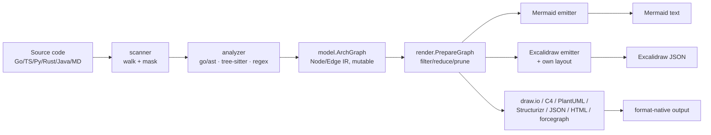
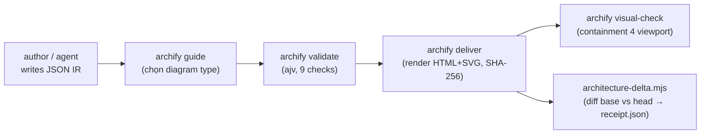
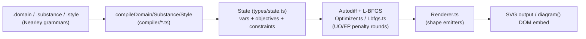
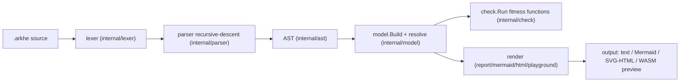

# Weekly Scan — Diagram-as-Code & Visual Tooling (2026-08-15)

**Tóm tắt (executive summary):**
- 4 repo được đào sâu tuần này chia làm 2 nhóm rõ rệt: **hai tool "architecture-from-code"** mới xuất hiện gần đây (`olgasafonova/ridge`, `tt-a1i/archify`) có kiến trúc IR-rồi-fan-out-emitter khá tương đồng với thiết kế multi-backend (`to_svg`/`to_figma`/`to_excalidraw`) của kymostudio, và **hai project layout-algorithm khác trường phái** (`vynazevedo/ARKHE` tự viết layered/Sugiyama layout; `penrose/penrose` dùng constraint-optimization + autodiff thay vì graph layout hoàn toàn).
- Kỹ thuật đáng mang về cụ thể nhất: ý tưởng **"Architecture Delta"** của archify (diff 2 snapshot IR ra receipt JSON có `classifications: semantic/topology/geometry/scope`) áp dụng trực tiếp được lên kiến trúc "data trước, renderer dumb" hiện có của kymostudio — có thể diff 2 lần `Diagram` đã resolve trước khi render.
- Không có phát hiện nào thay đổi hướng đi ngắn hạn của kymostudio; xếp hạng verdict: `ridge` và `archify` = *study deeper* (từng phần cụ thể), `penrose` = *study deeper* (riêng phần optimization layout), `ARKHE` = *glance only* (dự án nhỏ, 1 tác giả, rủi ro maintenance cao nhưng layout engine đáng đọc 30 phút).

**Mục lục:**
1. [Phương pháp & giới hạn nguồn dữ liệu](#phương-pháp--giới-hạn-nguồn-dữ-liệu)
2. [Danh sách ứng viên đã cân nhắc](#danh-sách-ứng-viên-đã-cân-nhắc)
3. [olgasafonova/ridge](#olgasafonovaridge)
4. [tt-a1i/archify](#tt-a1iarchify)
5. [penrose/penrose](#penrosepenrose)
6. [vynazevedo/ARKHE](#vynazevedoarkhe)

---

## Phương pháp & giới hạn nguồn dữ liệu

Phiên này không có quyền truy cập `gh` CLI / GitHub REST API trực tiếp (session GitHub integration bị giới hạn scope về `kymostudio/kymostudio` — không thể dùng để search hoặc đọc repo khác), nên bước discovery và mọi bước deep-dive dùng **WebSearch + WebFetch** (bao gồm fetch trực tiếp `api.github.com/repos/...` như một URL công khai để lấy số liệu star/ngày tháng có cấu trúc, tránh model tóm tắt tự bịa số). Vì vậy quy trình search theo `gh api search/repositories` với filter `topic:` + `pushed:>7d` như đề xuất trong task gốc **không thực hiện được y nguyên**; thay vào đó dùng web search tương đương (site:github.com, GitHub Trending, theo dõi CHANGELOG của ứng viên).

Mỗi repo trong 4 mục deep-dive dưới đây đã được **xác minh tồn tại độc lập** (WebFetch trực tiếp README/CHANGELOG/GitHub Contents API) trước khi viết — không có repo nào được đưa vào chỉ dựa trên tuyên bố của bước discovery ban đầu mà chưa kiểm chứng lại.

## Danh sách ứng viên đã cân nhắc

Bước discovery tìm được các ứng viên khác nhưng bị loại khỏi deep-dive vì traction/độ sâu kiến trúc thấp hoặc không kiểm chứng được đủ evidence trong thời gian cho phép: `cathrynlavery/diagram-design` (skill/reference-doc, không phải parser/layout engine), `DaanV2/isometric-diagrams` (rendering-craft nhỏ, 0 sao), `mamadoudicko/exgram`, `Agents365-ai/drawio-skill`, `wu-tian807/nested-architecture-map-skill` (đều quá mới/thin để đánh giá kiến trúc). 4 repo được chọn deep-dive là những repo có evidence kiến trúc rõ nhất và liên quan trực tiếp nhất tới các thành phần pipeline của kymostudio (parser/IR/layout/renderer).

---

## olgasafonova/ridge

**Đã xác minh:** repo thật, substantial (không phải placeholder) — 12 thư mục gốc, `go.mod` với dependency thật (MCP go-sdk, tree-sitter, OpenTelemetry), 21 file trong `internal/render/`, test đi kèm gần như mọi file `.go`. Chỉ 6 sao (traction thấp, nhưng độ sâu kiến trúc cao).

### §1 — Quick context
MCP server dùng `go/ast` + tree-sitter để dựng lại kiến trúc hệ thống từ source code, xuất sang 9 định dạng diagram. Stack: Go 1.25, `modelcontextprotocol/go-sdk`, `smacker/go-tree-sitter`, OpenTelemetry. 181 commit, test đi kèm gần như mọi file, CI + `.golangci.yml`, nhưng chỉ 6 sao. Cài qua `go install github.com/olgasafonova/ridge/cmd/ridge@latest`, chạy như MCP server qua stdio (không phải CLI batch truyền thống).

### §2 — Architecture deep-dive

**A. Component inventory** — `cmd/ridge/main.go` (entry point MCP server); `internal/scanner/` (14 file: walk + mask + incremental cache); `internal/analyzer/` (7 sub-package theo ngôn ngữ: golang/typescript/python/java/rust/markdown/common); `internal/model/` (`graph.go`, `graph_resolver.go`, `diff.go` — IR); `internal/detector/`, `internal/infra/` (phát hiện DB/queue/cache từ import pattern); `internal/drift/` (10 file: compare/gitref/history/snapshot/narrative); `internal/render/` (9 emitter); `tools/` (21 file map tới MCP tool).

**B. Pipeline (happy path)**: (1) client gọi tool `arch_scan` → scanner walk file tree, áp mask/denylist; (2) từng file khớp ngôn ngữ đưa vào analyzer tương ứng (`go/ast` gốc cho Go; tree-sitter cho TS/Python; regex cho Markdown link-graph) → sinh Node/Edge thô; (3) `model.NewGraph()` gộp thành `*ArchGraph` (IR thống nhất, mutex bảo vệ); (4) `internal/infra` phân loại thêm node hạ tầng; (5) client gọi `arch_generate` → `render.PrepareGraph()` filter/transitive-reduce/prune rồi dispatch tới 1 trong 9 hàm emitter; (6) emitter trả string/JSON qua MCP tool response.

**C. Data model/IR** — `ArchGraph{nodes, edges, RootPath, Topology, Meta}`, **mutable**, có `sync.RWMutex`, các phương thức `AddNode`/`AddEdge`/`Merge` biến đổi tại chỗ — không phải cấu trúc bất biến.

**D. Input "language"** — không có DSL nhập liệu; input là source code thật, phân tích bằng `go/ast` (Go) và tree-sitter (TS/Python) — hướng "program analysis" chứ không phải "declarative authoring" như `.kymo`.

**E. Layout algorithm** — khác nhau theo emitter: Mermaid/PlantUML/Structurizr/C4 chỉ emit text declaration, **giao layout cho engine đích**; draw.io/Excalidraw thì `render/common.go` tự cung cấp `ComputeNodeDepths`, `LayerByDepth`, `BarycenterOrder` (giảm crossing) và tự tính x/y trước khi xuất — tức ridge có layout engine riêng, chỉ dùng khi định dạng đích cần tọa độ tuyệt đối.

**F. Rendering/output** — 9 emitter xác nhận có thật (c4/drawio/excalidraw/forcegraph/html/json/mermaid/plantuml/structurizr), mỗi file có test riêng, cùng chữ ký hàm `func X(graph *model.ArchGraph, opts Options) string` theo **convention chứ không phải interface Go tường minh**.

**G. Extensibility** — thêm ngôn ngữ: thêm sub-package trong `analyzer/`; thêm output format: thêm file trong `render/` theo cùng chữ ký + test.

**H. Dev experience** — không có CLI subcommand truyền thống; chạy như MCP stdio server với 19 tool (`arch_scan`, `arch_diff`, `arch_drift`, `arch_drift_explain`, `arch_blast_radius`, `arch_registry_*`…). `internal/drift/` xác nhận tính năng "diff kiến trúc giữa hai git ref" là có thật, không chỉ tuyên bố README.

### §3 — Architecture diagram

### §4 — Verdict

Pattern IR-rồi-fan-out của ridge **tương đồng về hình dạng** với `to_svg.py`/`to_figma.py`/`to_excalidraw.py` của kymostudio, nhưng khác về gánh nặng layout: ridge chỉ tự làm layout khi định dạng đích cần tọa độ tuyệt đối, còn giao hẳn cho engine đích khi định dạng tự vẽ được (Mermaid/PlantUML). Bài học: nếu tương lai kymostudio thêm backend kiểu "emit text cho engine khác tự vẽ" (vd. xuất D2/Mermaid source), nên tách rõ luồng đó khỏi `alignment.py` thay vì chạy resolve layout một cách vô ích. Red flag: không có `interface` Go ràng buộc emitter — chỉ convention theo chữ ký hàm, kỷ luật thấp hơn kymostudio. Open question: chưa đọc được `Options` struct để biết cấu hình có thống nhất giữa 9 emitter hay không. **Verdict: study deeper** — đặc biệt phần drift-diffing giữa git ref và cách tách layout theo nhu cầu định dạng đích.

---

## tt-a1i/archify

**Đã xác minh:** star count ~12.6k **xác nhận qua `api.github.com/repos/tt-a1i/archify`** dạng JSON có cấu trúc (12,579 sao, 937 fork, tạo 2026-04-15, push gần nhất 2026-08-14) — không chỉ tin theo tóm tắt của bước discovery ban đầu. Đây là một **agent skill** (`npx skills add tt-a1i/archify -g`) cho Claude Code/Cursor/Codex/OpenCode, bên trong có Node.js CLI thực thụ — không phải "JS/Node tool" thuần như nhận diện ban đầu.

### §1 — Quick context
Agent skill biến mô tả hệ thống/codebase thành diagram HTML tương tác, tự kiểm chứng qua JSON Schema. Stack: Node.js ≥18, `ajv`, output HTML/SVG tự chứa. Repo health: stars/forks đã xác minh; CI workflows không xác minh được (403 khi fetch `.github/`); CHANGELOG có entry v2.14.0 (2026-08-11), v2.13.0 (2026-08-03), v2.11.0 (2026-07-16), v2.10.0 (2026-07-05) đều tồn tại thật. Distribution: agent-skill installer, không phải npm/PyPI package độc lập.

### §2 — Architecture deep-dive

**A. Component inventory** — `archify/bin/` (CLI: `archify.mjs`, `preview.mjs`, `visual-check.mjs`, `open-artifact.mjs`); `archify/schemas/` (5 JSON Schema: architecture/workflow/sequence/dataflow/lifecycle + `common.schema.json`); `archify/renderers/{architecture,workflow,sequence,dataflow,lifecycle,shared}/`; `archify/delta/architecture-delta.mjs` (70KB, riêng cho tính năng diff).

**B. Pipeline (6 bước, theo `SKILL.md`)**: (1) chọn diagram type trong 5 loại; (2) đọc schema + ví dụ liên quan; (3) tác giả/agent viết JSON IR trực tiếp ("artifact first" — không có bước parse text-DSL); (4) `validate <type> <file.json> --quality showcase` (9 checks); (5) `deliver <type> <file.json> <output.html>` render HTML tĩnh kèm SHA-256 checksum; (6) `visual-check <output.html>` đo containment ở 4 viewport.

**C. Data model/IR** — JSON với `schema_version: const 1` (bất biến — breaking change phải bump version), `additionalProperties: false` mọi cấp. IR lưu **tọa độ đã tác giả hóa** (`pos [x,y]`, `row/col`) — không phải ngữ nghĩa chờ layout tính toán.

**D. Input language** — KHÔNG có DSL/parser dạng cú pháp riêng. Input là JSON thuần theo JSON Schema; README liệt kê rõ "Automatic Mermaid parsing" là **out of scope**.

**E. Layout algorithm** — file `renderers/architecture/grid.mjs` tự ghi chú: *"Not auto-layout — fixed cell math only."* Chỉ là `pos = origin + [col,row] × (cellSize+gap)`; nếu component có `pos` explicit thì thắng row/col. **Không có auto-layout thật** — `layout.mode` chỉ hỗ trợ `"grid"`. Edge routing (`route: auto/straight/orthogonal-h/orthogonal-v`) là heuristic hình học greedy (thử straight → 2 phương án L-shape → lọc qua `routeClearsComponents()`), không phải pathfinding tối ưu toàn cục.

**F. Rendering/output** — HTML tự chứa + SVG inline, theme sáng/tối, export PNG/SVG/WebM/share-card. **Architecture Delta/PR Proof**: `architecture-delta.mjs` so sánh 2 snapshot JSON (base/head), sinh "receipt" JSON (`schemaVersion, ok, command, base, head, summary, changes{components,connections,boundaries}` với `status` + `classifications: semantic/topology/geometry/scope`) — diff JSON-to-JSON thuần, không phải diff ảnh pixel.

**G. Extensibility** — mở rộng qua thêm schema mới + renderer tương ứng; không có plugin API động.

**H. Dev experience** — CLI có `doctor`, `demo`, `guide` (route yêu cầu mơ hồ sang đúng diagram type), test qua `scripts/run-tests.mjs`. CI thực tế không xác minh được (403 khi fetch).

### §3 — Architecture diagram

### §4 — Verdict

Ý tưởng **"Architecture Delta"** (diff 2 snapshot JSON IR ra added/removed/changed/moved/rerouted với `classifications`) áp dụng được trực tiếp cho kymostudio: có thể diff 2 lần resolve `Diagram` (Python `model.py` dataclasses) trước khi render SVG, xuất "receipt" JSON cho PR review — tận dụng đúng kiến trúc "renderer dumb, data trước" sẵn có. Lưu ý quan trọng: layout của archify **không phải auto-layout thật** (chỉ grid cố định + routing heuristic đơn giản hơn nhiều `alignment.py` 5-pass của kymostudio) nên không có gì để học về thuật toán layout. Red flag: CI/contributor count không xác minh được; "input language" chỉ là JSON có schema, không cạnh tranh trực tiếp với `.kymo`. **Verdict: study deeper riêng phần Architecture-Delta/diff mechanism**, phần còn lại chỉ cần glance.

---

## penrose/penrose

**Đã xác minh:** repo thật, hoạt động tích cực (push gần nhất 2026-08-08), MIT license, TypeScript monorepo, ~7,965 sao, 358 fork.

### §1 — Quick context
Penrose sinh diagram bằng constraint solving từ 3 ngôn ngữ tách biệt (Substance/Style/Domain), không phải graph/tree layout như kymostudio. Stack: TypeScript monorepo (yarn workspaces), autodiff + L-BFGS tự viết, CodeMirror (browser editor), Vite, Storybook, TypeDoc. Sức khỏe repo: ~7,965 sao, 178 issue mở, MIT, CI (build/test/lint) trên mỗi PR, deploy Storybook/TypeDoc lên GitHub Pages. Release GitHub tag chính thức gần nhất v3.3.0 (2023) dù commit vẫn tiếp diễn (có thể phát hành qua npm không gắn tag). Phân phối: npm `@penrose/core` + `@penrose/components`, thử trực tiếp trên trình duyệt tại penrose.cs.cmu.edu.

### §2 — Architecture deep-dive

**A. Component inventory** — `packages/core/src/parser/*.ne` (ngữ pháp Nearley cho Domain/Substance/Style); `packages/core/src/compiler/{Domain,Substance,Style}.ts` (type-checker + biên dịch, `Style.ts` 112KB — file lớn nhất repo); `packages/core/src/engine/{Autodiff,Optimizer,Lbfgs,BBox}.ts` (autodiff + tối ưu số); `packages/core/src/renderer/Renderer.ts` + shape files (xuất SVG); `packages/roger` (CLI + watch-mode); `packages/editor` (IDE trình duyệt); `packages/vscode`; `packages/components` (React wrapper).

**B. Pipeline**: (1) parse 3 file `.domain`/`.substance`/`.style` bằng Nearley grammar → AST; (2) `compileDomain`/`compileSubstance`/`compileStyle` type-check, hợp nhất thành `State` ban đầu (biến số, objective, constraint); (3) `resample()` khởi tạo giá trị ngẫu nhiên; (4) `optimize()`/`stepNextStage()` chạy L-BFGS + exterior-point qua nhiều "layout stage"; (5) `toSVG()` chuyển `State` đã tối ưu thành SVG; (6) tùy chọn `diagram()` nhúng trực tiếp DOM cho preview tương tác.

**C. Data model/IR** — `State` là cấu trúc trung tâm chứa toàn bộ shape, biến tối ưu, objective/constraint đã autodiff-hóa; không có IR trung gian "lowered" tách biệt. `State` **mutable** qua các bước `step()` liên tiếp — giống vòng lặp mô phỏng vật lý hơn cây bất biến.

**D. Input language design** — 3 grammar `.ne` dùng Nearley (LL parser generator, EBNF-like), test riêng cho mỗi parser. Error reporting ở `types/errors.ts` (tài liệu `errors.md` rất ngắn — có thể chưa đầy đủ).

**E. Layout algorithm (điểm khác biệt cốt lõi)** — **automatic differentiation + L-BFGS quasi-Newton** kết hợp exterior/penalty method: mỗi constraint cộng vào objective dưới dạng `λ·Σmax(g,0)²`; chạy vòng UO (hội tụ `<1e-2`) rồi tăng `λ×10` mỗi vòng EP cho tới ổn định `<1e-3`. Có "layout stage" nhiều tầng. Không thấy tài liệu về crossing minimization — edge routing dường như cũng là biến tối ưu (path constraint) chứ không phải thuật toán routing riêng.

**F. Rendering/output** — chỉ SVG, có `diagram()` nhúng DOM tương tác + resample ngẫu nhiên; không có Figma/Excalidraw/WebP emitter như kymostudio. "Animation" chủ yếu là interpolate giữa các bước optimize.

**G. Extensibility** — Domain language cho phép định nghĩa type/predicate mới; Style cho phép map linh hoạt sang shape mới; không có plugin system chính thức ngoài viết thêm file domain/style/renderer.

**H. Dev experience** — `roger` CLI (watch mode); `packages/editor` IDE web đầy đủ; `packages/vscode` extension; thử trực tiếp trên trình duyệt không cần cài đặt.

### §3 — Architecture diagram

### §4 — Verdict

Constraint-based layout của Penrose là hướng tiếp cận hoàn toàn khác kymostudio (declarative position/alignment resolve) — không nên thay thế mà đáng **nghiên cứu như phần bổ sung tùy chọn**: hữu ích cho diagram cần thỏa mãn ràng buộc hình học phức tạp mà layout dựa trên frame/anchor của kymostudio khó biểu đạt. Bài học cụ thể: (1) tách 3 mối quan tâm what/how/domain-schema đáng cân nhắc dù kymostudio đã có kiến trúc riêng; (2) cơ chế "layout stage" nhiều tầng có thể gợi ý cho `alignment.py` resolver hiện tại. Red flag: L-BFGS lặp tới hàng nghìn bước có thể chậm hơn nhiều so với resolve tuyến tính của kymostudio — không phù hợp pipeline build nhanh/CLI batch. Open question: chưa rõ cơ chế edge-routing/crossing minimization thực sự hoạt động thế nào. **Verdict: study deeper** cho riêng phần optimization-based layout; phần rendering/ngôn ngữ chỉ cần glance.

---

## vynazevedo/ARKHE

**Đã xác minh:** repo thật, nhỏ — 7 sao, 0 fork, 349 commit, 1 tác giả (Vinicius Azevedo), default branch `production`, 2 GitHub Actions workflow.

### §1 — Quick context
ARKHE là DSL kiến trúc hệ thống mô hình hóa *architecture governance* (SLO, drift, policy) dưới dạng executable, khác kymostudio ở việc nó không nhắm tới diagram trực quan thuần túy mà tới compliance/fitness-function. Stack: Go 1.26+ (zero external deps cho compiler), frontend React + React Flow nhúng vào binary, WASM cho browser playground, có LSP + MCP server riêng. Sức khỏe repo: rất nhỏ (7 sao, 0 fork, tác giả đơn). Phân phối: single Go binary (`go build`), Docker Compose, GitHub App.

### §2 — Architecture deep-dive

**A. Component inventory** — theo convention Go stdlib: `internal/token`, `internal/lexer`, `internal/ast`, `internal/parser` (recursive-descent), `internal/format` (`arkhe fmt`, idempotent), `internal/diag` (diagnostics), `internal/model` (`build.go`, `model.go`, `resolve.go`), `internal/check` (fitness functions), `internal/slo`, `internal/drift` (OpenAPI/GraphQL/gRPC/Terraform/Go-imports/AsyncAPI), `internal/render` (`report.go`, `mermaid.go`, `html.go`, `view.go`, `playground.go`, `engine.js`, `arkhe.wasm`), `internal/loader` (multi-file + `import`), `internal/lsp`, `internal/mcp`; entrypoint `cmd/arkhe`, `cmd/arkhe-lsp`, `cmd/arkhe-mcp`, `cmd/arkhe-wasm`.

**B. Pipeline**: (1) `loader.Load(path)` đọc file/dir, theo `import`; (2) lexer/parser dựng AST cho từng file; (3) `model.Build(files)` merge multi-file, dựng semantic model + resolve qualified names; (4) `check.Run(m, time.Now())` chạy fitness functions, sinh `[]Diagnostic`; (5) tùy subcommand: `render.Report()` (text CI), `render.HTML()` (single-file explorer), `render.Mermaid()`, hoặc `drift.Sync()`.

**C. Data model/IR** — `Diagnostic` struct (`Sev`, `Code`, `Msg`, `Pos token.Pos`, `Hint`, `Ref`, `Rule`) — pattern giống Go compiler diagnostics, builder methods. Có bước "resolve" tách biệt (parse → build → resolve) — gần giống compile xuống IR thấp hơn nhưng vẫn 1 model duy nhất tái dùng cho mọi renderer.

**D. Input language design** — parser recursive-descent tay viết, có formal grammar EBNF riêng (`docs/GRAMATICA.md`) đồng bộ với reference parser. 53 reserved keyword tập trung 1 chỗ dùng chung parser/editor/catalog. Error reporting: diagnostics có position + code + severity + hint/rule, dùng chung cho CLI/LSP/PR annotation.

**E. Layout algorithm** — trong `internal/render/engine.js` (chạy trong playground WASM): layered/Sugiyama-style **tự viết** — `assignLayers()` gán rank theo propagate cạnh, `orderLayers()` dùng barycenter/median heuristic giảm crossing (sweep hai chiều), edge routing orthogonal qua `orth()` (Bézier bo góc) + channel bundling theo tọa độ làm tròn. Không dùng dagre/elk/graphviz — tự triển khai từ đầu.

**F. Rendering/output** — đa dạng: text report, Mermaid, single-file HTML explorer (go:embed), WASM playground, portal React+ReactFlow. Animation: CSS transitions + `requestAnimationFrame` cho "packet" chạy dọc path (`getPointAtLength`). Không phải pluggable-emitter tách rời rõ ràng như kymostudio — các renderer là file riêng trong 1 package nhưng chia sẻ 1 model.

**G. Extensibility** — thêm `kind` mới qua khai báo DSL (`kind agent { shape hex }`) — contract/policy là first-class construct trong ngôn ngữ chứ không phải plugin API; thêm drift-source mới phải sửa `internal/drift` trực tiếp.

**H. Dev experience** — CLI đa lệnh (`check/fmt/json/mermaid/html/sync/init/import/scan/server/playground`), LSP đầy đủ (diagnostics/hover/definition/references/rename/semantic tokens), browser playground WASM đồng bộ tuyệt đối với `arkhe check` (cùng 1 compiler biên dịch xuống WASM), MCP server cho agent query. Golden corpus test (`GOLDEN=1 go test`) tương tự cơ chế golden SVG của kymostudio.

### §3 — Architecture diagram

### §4 — Verdict

Đáng học nhất: (1) layered layout tự viết trong `engine.js` — rank assignment + barycenter crossing-minimization + orthogonal routing với channel bundling là kỹ thuật cụ thể `alignment.py` có thể tham khảo nếu cần auto-layout mạnh hơn cho graph phức tạp (hiện kymostudio dựa vào `layout {}` khai báo, không tự crossing-minimize). (2) `Diagnostic` struct (`Code/Sev/Pos/Hint/Rule`) là mẫu error-reporting tốt hơn exception thô — `dsl.py` ("parsing validates nothing") có thể học cách gắn code/hint sớm. (3) Nguyên tắc "1 compiler chạy CI + LSP + WASM browser, preview không bao giờ lệch `check`" là bài học kiến trúc quý, đạt được đơn giản hơn kymostudio's dual Python/JS parity vì ARKHE chỉ có 1 codebase Go compile sang WASM. Red flag: dự án rất nhỏ (7 sao, tác giả đơn), README tự nhận đã khảo sát Structurizr/LikeC4/D2 nhưng chưa có bằng chứng adoption thực tế; nhiều tính năng (SLO đo Prometheus, federation multi-repo, GitHub App) nghe over-scoped so với 1-person project — rủi ro maintenance cao. Open question: chưa xác minh CI thực sự pass, chưa rõ license compliance của icon/font. **Verdict: glance only** — không đủ traction để nghiên cứu sâu, nhưng layout engine (`engine.js`) và `Diagnostic` struct đáng đọc thêm 30 phút nếu cần cải thiện auto-layout của kymostudio.
