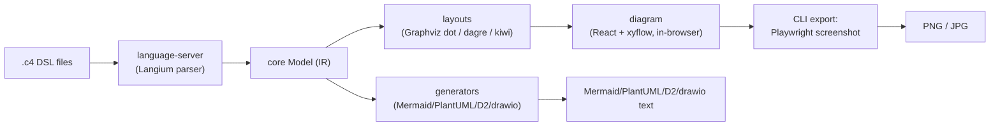
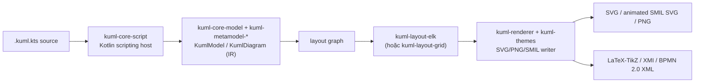
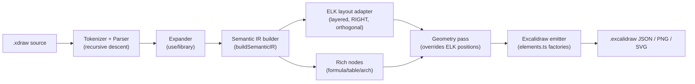
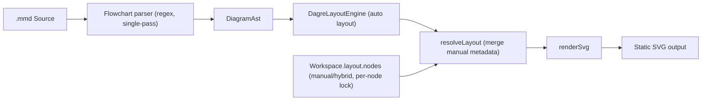

# Weekly Scan: Diagram Tooling — 2026-08-16

**Phạm vi:** repos trong domain diagram-as-code / DSL / layout algorithm / SVG animation, published hoặc significantly updated trong 7 ngày qua (2026-08-09 → 2026-08-16), phục vụ nghiên cứu kiến trúc cho kymostudio.

## Executive Summary

- **kUML** (Kotlin DSL → animated SMIL SVG + BPMN/UML/SysML/C4) là trùng khớp nhất với đúng ngách của kymostudio (DSL → animated vector output + BPMN); kỹ thuật trace-driven SMIL animation và taxonomy 4 kiểu edge-routing đáng đưa thẳng vào `--animate`/`alignment.py`.
- **fractalops/xdraw** và **S1naps1s/sculpt** — dù cả hai đều rất non trẻ (0 sao, vài ngày tuổi) — minh hoạ hai giải pháp gọn cho vấn đề "auto-layout vs manual override" mà kymostudio's 5-pass `alignment.py` hiện giải quyết bằng một resolver nguyên khối: xdraw tách layout/geometry-pass tường minh (ELK), sculpt patch nông per-node sau Dagre.
- **likec4** là competitor trưởng thành nhất (5.4k sao) nhưng kiến trúc lệch hẳn hướng kymostudio (renderer React-in-browser + Playwright screenshot thay vì serialize SVG trực tiếp) — giá trị tham khảo nằm ở `specification {}` block (data-driven shape/color trong DSL) và formal grammar file (Langium) hơn là ở rendering pipeline.

## Mục lục

1. [likec4/likec4](#likec4likec4)
2. [kuml-dev/kUML](#kuml-devkuml)
3. [fractalops/xdraw](#fractalopsxdraw)
4. [S1naps1s/sculpt](#s1naps1ssculpt)

---

## likec4/likec4 — https://github.com/likec4/likec4

### §1 Quick Context (≤80 từ)
- Diagram-as-code cho kiến trúc phần mềm theo C4 Model/Structurizr DSL, nhưng khác biệt ở chỗ có full LSP + IDE integration và output đa dạng (Mermaid/PlantUML/D2/drawio) thay vì chỉ một renderer.
- Tech stack: TypeScript monorepo, parser Langium, layout Graphviz (wasm/binary) + dagre + kiwi (Cassowary), render bằng React (`@xyflow/react`); output PNG/JPG qua Playwright screenshot, JSON, drawio, Mermaid/PlantUML/D2.
- Repo health: ~5.4k stars, MIT license, CI đầy đủ (checks/ci-pr/codeql/e2e), release gần nhất v1.59.2 (22/07/2024), có Discord/OpenCollective — dự án active.
- Distribution: npm (`likec4` CLI + nhiều `@likec4/*` packages), VSCode Marketplace + Open VSX, MCP server.

### §2 Architecture Deep-Dive

**A. Component inventory** (monorepo `packages/`):
- `@likec4/language-server` (`packages/language-server`) — LSP server dùng Langium, grammar viết tại `src/like-c4.langium`, có `validation/`, `references/`, `workspace/` — vai trò parse + phân tích ngữ nghĩa `.c4`.
- `@likec4/core` (`packages/core`) — types, API, guards; đóng vai trò IR (immutable-leaning nhờ `immer`).
- `@likec4/layouts` (`packages/layouts`) — layout engine: thư mục `graphviz/` (dot layout qua `@hpcc-js/wasm-graphviz` hoặc binary) và `sequence/` (cho dynamic view).
- `@likec4/diagram` (`packages/diagram`) — React component library render bằng `@xyflow/react` (React Flow), dùng thêm `@dagrejs/dagre` và `@lume/kiwi` (constraint solver Cassowary) cho tương tác/manual layout.
- `@likec4/generators` (`packages/generators`) — chuyển Model sang Mermaid, PlantUML, D2, drawio, React code, JSON — trực tiếp từ IR, không qua browser.
- `likec4` CLI (`packages/likec4/src/cli`) — subcommands `build`, `serve`, `export` (con `png/` dùng `takeScreenshot.ts` + Playwright, cùng `jpg/json/drawio`), `preview`, `lsp`, `mcp`.
- `packages/mcp` — MCP server cho AI agent tích hợp.

**B. Pipeline** (happy path):
1. User viết file `.c4`/`.likec4` (ví dụ `examples/cloud-system/model.c4`).
2. `LikeC4.fromWorkspace()` gọi `language-server` (Langium) parse + scope-resolve → dựng Model dùng type từ `core`.
3. Mỗi `view` (element/dynamic/deployment) được resolve qua expression predicate (`where` filters trong grammar).
4. `layouts` chạy Graphviz dot (wasm/binary) tính node position + edge routing cho từng view.
5. Live/dev: `diagram` render React tree tương tác trong browser (Vite dev server, `likec4 serve`).
6. Static export: hoặc CLI dùng Playwright mở app headless rồi screenshot → PNG/JPG; hoặc `generators` build trực tiếp từ IR ra text format (Mermaid/PlantUML/D2/drawio), không cần browser.

**C. Data model/IR**: `core` giữ types + dùng `immer` cho cập nhật bất biến; Model sau parse được resolve thành các "layouted view" (node/edge đã có toạ độ từ Graphviz). Có khái niệm hạ tầng thấp hơn (layouted output riêng khỏi AST) nhưng chi tiết cấu trúc IR nội bộ — không xác định.

**D. Input language design**: parser dựa trên **Langium** (framework LSP-first, dùng Chevrotain bên dưới), formal grammar viết tường minh trong `like-c4.langium` (EBNF-mở rộng với `{infer}`, fragment reuse). Error reporting là LSP diagnostics + `validation/` module riêng — thiết kế ưu tiên IDE (autocomplete, hover, go-to-definition) hơn là CLI error message thuần.

**E. Layout algorithm**: chủ yếu delegate cho Graphviz dot (layered/hierarchical, crossing minimization có sẵn của Graphviz), cộng thêm dagre và kiwi (Cassowary linear-constraint solver) trong package diagram cho tương tác/nudge và sequence layout của dynamic view.

**F. Rendering/output**: renderer chính là React component (`@xyflow/react`) chạy **trong browser**, không phải static SVG serializer tự viết. Xuất tĩnh đạt được bằng (a) Playwright headless screenshot React app → PNG/JPG, hoặc (b) generator text-based (Mermaid/PlantUML/D2/drawio) build thẳng từ IR. Không tìm thấy bằng chứng về animated-SVG output; dynamic view animate tương tác qua lib `motion` trong browser, không bake vào file xuất.

**G. Extensibility**: element kind/shape/màu định nghĩa qua block `specification` ngay trong DSL (data-driven, không cần code plugin); icon riêng ở `@likec4/icons`; thêm output format = thêm module trong `generators/src/*`.

**H. Dev experience**: mạnh — VSCode extension + Open VSX, LSP đầy đủ, `likec4 serve` (Vite, live reload), playground web, MCP server cho AI agent, watch mode (chokidar).

### §3 Architecture Diagram

### §4 Verdict (≤140 từ)
Đáng học: (1) grammar viết tường minh dạng file riêng (`like-c4.langium`) song song code — kymostudio nên cân nhắc formal hoá `docs/DSL.md` gần với dạng generator-checkable hơn; (2) `specification { }` block cho phép định nghĩa element kind/shape/color ngay trong DSL — data-driven notation, đáng tham khảo cho hệ icon/shape của kymostudio; (3) tách rời "layout tự động qua Graphviz" khỏi "renderer tương tác" — cho thấy có thể dùng dot làm layout backend thay thế/bổ sung cho alignment resolver hiện tại của kymostudio ở diagram lớn nhiều cạnh.

Red flag: renderer chính phụ thuộc React+browser+Playwright để xuất ảnh tĩnh — nặng, chậm hơn nhiều so với cách kymostudio tự serialize SVG trực tiếp; không có animated-SVG thật sự (chỉ animate trong browser).

Open question: cơ chế parse Graphviz dot output ngược thành node position — không xác định chi tiết.

Verdict: **study deeper** phần DSL grammar design + Graphviz layout integration; phần renderer/export (Playwright) chỉ **glance only**.

---

## kuml-dev/kUML — https://github.com/kuml-dev/kUML

### §1 Quick Context (≤80 từ)
- Kotlin DSL type-safe cho UML 2.x/SysML 2/C4/BPMN 2.0/ERM, khác biệt chính: DSL là Kotlin thật (compile-time type-check) chứ không phải text-DSL riêng như PlantUML/Mermaid, và render ra animated SMIL SVG dựa trên execution trace.
- Tech stack: Kotlin + Kotlin Scripting host, ELK (layout), Apache Batik (PNG); output SVG/PNG/LaTeX-TikZ/SMIL-animated-SVG/XMI/BPMN XML.
- Repo health: 19 stars, contributors không xác định, release rất năng động (v0.50.0 ngày 12/8/2026, cadence ~2-3 ngày/release), có `.github/workflows` nhưng nội dung cụ thể không xác định (lỗi tải trang).
- Distribution: Homebrew, Chocolatey, Docker, Maven Central, native installers (DEB/RPM/DMG/MSI), SDKMAN.

### §2 Architecture Deep-Dive

**A. Component inventory**
- `kuml-core-script` (`kuml-core/kuml-core-script`) — Kotlin scripting host (`KumlScriptDefinition`, `KumlScriptHost`) evaluate file `.kuml.kts`.
- `kuml-core-model` (`kuml-core/kuml-core-model`) — metamodel thuần Kotlin: `KumlElement`, `KumlModel`, `KumlDiagram`, `KumlMetaValue` (sealed interface).
- `kuml-metamodel-{uml,sysml2,c4,bpmn,erm,kerml,blueprint}` — metamodel riêng từng ngôn ngữ.
- `kuml-layout-elk`, `kuml-layout-grid`, `kuml-layout-api`, `kuml-layout-bridge` (trong `kuml-renderer`) — layout engines.
- `kuml-themes-core`/`kuml-themes` — theming, SVG/PNG writer.
- `kuml-cli` — CLI dựa trên Clikt 5.1.0, fat-JAR qua Gradle `application`.
- `kuml-io` — import/export XMI, BPMN 2.0 XML.
- `kuml-plugin-api`/`kuml-plugin-loader` — plugin SPI.
- `kuml-language-server`, `kuml-mcp` — LSP và MCP server (nội dung chi tiết không xác định do lỗi tải trang).

**B. Pipeline / control flow** (theo tài liệu CLI):
1. User viết `hello.kuml.kts`.
2. `kuml render` gọi `kuml-core-script` evaluate script bằng Kotlin Scripting host → trả về `KumlDiagram`/`KumlModel`.
3. Model được chuyển thành "layout graph" (IR trung gian).
4. `kuml-layout-elk` (Sugiyama layered) hoặc `kuml-layout-grid` xử lý layout graph → tọa độ.
5. `kuml-renderer` + `kuml-themes` ghi ra SVG (theme-aware) trực tiếp, hoặc PNG qua Batik.
6. Nếu có trace JSON từ `kuml simulate`, renderer sinh thêm animated SMIL SVG.

**C. Data model/IR** — metamodel thuần Kotlin sealed-interface/data-class ("pure Kotlin metamodel, no EMF"), gợi ý immutable (val-based data classes theo convention Kotlin). Có khái niệm "compile xuống lower IR" rõ ràng: `KumlModel` (ngôn ngữ-độc lập) → "layout graph" (IR trung gian riêng cho renderer) trước khi layout engine xử lý.

**D. Input language design** — không phải custom parser (không regex/PEG/ANTLR): DSL chính là Kotlin, thực thi qua Kotlin Scripting API với `KumlScriptDefinition` (default imports, có tài liệu `INTERPRETER-SUBSET.md`/`SECURITY-COVERAGE.md` gợi ý sandbox một subset Kotlin). Error reporting dựa vào Kotlin compiler diagnostics, không có grammar riêng — EBNF không xác định (vì "grammar" chính là Kotlin syntax).

**E. Layout algorithm** — mặc định ELK (Sugiyama-based layered layout, crossing minimization built-in của ELK, không tự viết); thay thế bằng grid engine thuần Kotlin, deterministic, hint-driven (đặt phần tử lên grid thô, engine tôn trọng vị trí, GraalVM-native-compatible, nhanh hơn ELK ~10x ở 500 nodes). Edge routing 4 kiểu: Direct, OrthogonalRounded (default), TreeRounded, Bezier. Conflict resolution qua `LayoutWarning`.

**F. Rendering/output strategy** — SVG trực tiếp + PNG (Batik), LaTeX/TikZ standalone, JSON (kotlinx.serialization), XMI, BPMN 2.0 XML, Structurizr DSL, APNG/WebP/MP4 (qua ffmpeg ngoài). **SMIL animation**: file trace JSON (từ `kuml simulate`) là single source of truth — renderer đọc trace, tự suy ra timing, không chạy lại model. State machine: overlay `<rect>` pulse opacity cho active state + `<path>` overlay cho transition fired. BPMN/activity: token `<circle>` di chuyển bằng `<animateMotion>` dọc theo flow edge. Cố tình tránh `animateColor` (dùng `<animate attributeName="fill">`) để tương thích Chrome/Safari (bug SVG2 syntax đã fix từ v0.20.1).

**G. Extensibility** — plugin SPI (`kuml-plugin-api`/`kuml-plugin-loader`), Gradle plugin, built-in UML profiles (AUTOSAR/JavaEE/Spring/OpenAPI/SoaML), M2M transformers + M2T codegen (`kuml-codegen`, target Kotlin/Java/SQL/Exposed), theming qua `kuml-themes*`.

**H. Dev experience** — watch mode ~150ms/save (warm script host), `kuml serve` web UI live preview, JetBrains IDE plugin (Marketplace), `kuml-language-server` (LSP, chi tiết cụ thể không xác định), browser playground (kuml.dev/playground), shell completion, đa kênh phân phối (Docker/Homebrew/Chocolatey/native installers).

### §3 Architecture Diagram

### §4 Verdict (≤140 từ)
Điểm đáng học: kỹ thuật animation trace-driven của kUML — tách execution trace (JSON) khỏi renderer, renderer chỉ "phát lại" timing từ trace thay vì re-simulate — là pattern sạch, có thể áp dụng cho `--animate` của kymostudio. Nguyên tắc tránh `animateColor`, dùng `<animate attributeName="fill">` để tương thích Safari/Chrome là bài học SMIL cụ thể, trực tiếp áp dụng được. 4 kiểu edge-routing đặt tên rõ ràng (Direct/OrthogonalRounded/TreeRounded/Bezier) là ý hay cho `alignment.py`. BPMN được model như metamodel độc lập (không phải profile trên UML) — đáng cân nhắc cho `from_bpmn.py`.

Red flag: DSL = Kotlin thật nên portability/parity đa ngôn ngữ (như Python↔JS của kymostudio) gần như bất khả thi — kUML chỉ có một implementation JVM.

Open question: cơ chế sandbox script (`SECURITY-COVERAGE.md`) chưa rõ mức độ an toàn khi chạy `.kuml.kts` không tin cậy.

Verdict: **study deeper** riêng phần animated-SMIL và edge-routing taxonomy; phần DSL/scripting approach chỉ **glance only** vì kiến trúc quá khác kymostudio.

---

## fractalops/xdraw — https://github.com/fractalops/xdraw

### §1 Quick Context (≤80 từ)
- Compiler biến DSL text (`.xdraw`) thành file `.excalidraw` JSON có thể edit tiếp trong Excalidraw — khác biệt chính so với kymostudio là output đích chỉ là Excalidraw (không có SVG/animate/BPMN), và mục tiêu là "keep editing in Excalidraw" chứ không phải render tĩnh cuối cùng.
- Tech stack: TypeScript (strict, ESM), deps chính: `elkjs` 0.11.0 (layout), `shiki` (code highlight), `perfect-freehand`, `@mathjax/src` (formula → SVG), `@resvg/resvg-js` (PNG preview), `@excalidraw/excalidraw` (devDep only).
- Repo health: 0 stars/forks (rất mới), ~60 commits trên main, có CI qua GitHub Actions (`.github/workflows`), có test (`node --test`, Playwright, property-based testing với `fast-check`), 3 releases (v0.1.0 → v0.2.0, 13-15/08/2026) dùng release-please.
- Distribution: npm package `xdraw` (bin CLI qua `npm link`), chưa xác nhận đã publish lên npm registry công khai (không xác định).

### §2 Architecture Deep-Dive

**A. Component inventory**
- `Tokenizer`/`Parser` (`src/language/tokenizer.ts`, `parser.ts`) — recursive-descent parser thủ công, tiêu thụ token đã tokenize trước, có `MAX_NESTING_DEPTH=64` chống stack overflow.
- `Expander` (`src/language/expander.ts`) — mở rộng macro/library (`use "lib" as alias`) trước khi build IR.
- `Registry`/`Validator` (`registry.ts`, `validator.ts`) — resolve constructor (`arch.person`, …), validate against library manifest.
- `Semantic IR builder` (`src/language/semantic.ts`) — `buildSemanticIR()` biến `DiagramDocument` (AST) thành `SemanticDocument` (IR), có `validateSemanticDocument` riêng cho constraint/cross-ref.
- `Contracts` (`src/contracts/{foundation,language,layout,semantic,render,rich-node}.ts`) — types-only modules (không runtime), tách để tránh import cycle.
- `ELK layout adapter` (`src/layout/elk/{graph,prepare,worker-node,worker-browser,worker-transport}.ts`) — build ELK graph, chạy qua worker (Node hoặc browser), có `worker-transport.ts` abstraction.
- `Geometry pass` (`src/compile/geometry-pass.ts`) — override vị trí do layout đề xuất bằng geometry statement tường minh của user ("Layout *proposes*, geometry pass *overrides*").
- `Scene/Render pipeline` (`src/compile/{pipeline,scene,render,measurement,styles}.ts`) — `compile()`/`compileAsync()` orchestrator.
- `Excalidraw emitter` (`src/excalidraw/{elements,components,document,adapter,freedraw-policy}.ts`) — factory functions tạo Excalidraw JSON elements (rectangle/diamond/ellipse/frame/image/text/arrow/freedraw).
- `Rich nodes` (`src/nodes/` — formula/math, table, architecture library) — 3 "family" dispatch qua `RICH_NODE_FAMILIES`.
- CLI (`src/cli.ts`, entry `src/xdraw.ts`) — commands `build`, `check`, `apply`, `list`, `pull`.

**B. Pipeline / control flow**:
1. User chạy `xdraw build file.xdraw` → `cli.ts` đọc source, gọi `parseSyntax()` (tokenize → recursive descent) ra `SourceDocument`/`DiagramDocument`.
2. `expandDocument()` mở rộng `use "lib" as alias` và macro thành statement phẳng.
3. `buildSemanticIR()` build `SemanticDocument` (IR), `validateSemanticDocument()` chạy validation IR.
4. Nếu có formula: `compileAsync` chạy song song `prepareDocumentSyntaxHighlighting` (Shiki) + `prepareDocumentFormulas` (MathJax) + `prepareLayeredLayout()` (gọi ELK qua worker) → trả `layered.bounds`.
5. `renderCompilation()` dựng `scene` cuối, geometry pass override vị trí ELK đề xuất bằng vị trí tường minh do user khai báo.
6. Emitter `src/excalidraw/elements.ts` map từng IR node/edge sang Excalidraw JSON element (rect/text/arrow/frame…), gói thành `Drawing`/`.excalidraw` document, ghi ra file (JSON/PNG/SVG tùy đuôi `-o`).

**C. Data model / IR** — Có "compile to lower IR" rõ ràng: `DiagramDocument` (AST nguồn) → `SemanticDocument` (IR trung gian) → `Drawing`/Excalidraw scene (output). Contracts tách theo layer (`language.ts` cho AST, `semantic.ts` cho IR, `layout.ts` cho kết quả ELK, `render.ts` cho output) — không xác định mutable hay immutable cụ thể.

**D. Input language design** — Custom tokenizer + recursive-descent parser thủ công (không dùng PEG/ANTLR/parser-combinator lib). Không có grammar EBNF chính thức được thấy trong các file đã đọc — không xác định. Error reporting: class `SyntaxError` riêng mang `source` + `offset`, dùng cho location-aware diagnostics; parser cũng track nesting depth để tránh RangeError vô nghĩa.

**E. Layout algorithm** — Dùng `elkjs` với `elk.algorithm: "layered"`, `elk.direction: "RIGHT"`, `elk.edgeRouting: "ORTHOGONAL"`, `elk.randomSeed: "1"` (deterministic), `elk.separateConnectedComponents: "true"`, cấu hình spacing riêng tính từ `ROUTING_CLEARANCE`. Chạy qua worker (Node/browser) — không xác định chi tiết crossing-minimization option cụ thể được set hay dùng default ELK.

**F. Rendering/output strategy** — Emitter là factory-function tập trung (`elements.ts`) chứ không thấy pluggable/multi-emitter architecture — chỉ một target: Excalidraw JSON (+ PNG/SVG preview qua resvg). Mỗi factory chuẩn hóa toạ độ về gốc (0,0) nội bộ nhưng lưu vị trí tuyệt đối, khớp với format `.excalidraw`. Không có animation mechanism (Excalidraw JSON tĩnh).

**G. Extensibility** — Kiến trúc library qua `use "lib" as alias` + `library-manifest.ts` + `registry.ts` cho phép định nghĩa custom construct (person/system/database…) mà không sửa parser. Rich node family (`RICH_NODE_FAMILIES`) là điểm mở rộng cho formula/table/architecture — "extension seams" tường minh.

**H. Dev experience** — CLI có `check` (validate không sinh output), `build` hỗ trợ stdin và chọn format qua đuôi file/`-o`, `apply`/`list`/`pull` để đồng bộ với Excalidraw+ hosted scenes (roundtrip cloud). Có browser entry (`src/browser.ts`) riêng cho preview trong web. Không thấy LSP/IDE integration hay watch mode trong các file đã đọc.

### §3 Architecture Diagram

### §4 Verdict (≤140 từ)
Đáng học nhất: kymostudio's `to_excalidraw.py` nên tham khảo cách xdraw tách rõ "layout đề xuất, geometry pass override" — kymostudio hiện dùng `alignment.py` resolve mọi vị trí một lần, chưa có seam tường minh cho user override cục bộ sau layout tự động. Cấu hình ELK cụ thể (`layered`+`RIGHT`+`ORTHOGONAL`+`randomSeed` cố định để deterministic, spacing tính từ routing clearance) là input tham khảo tốt nếu kymostudio từng cân nhắc ELK thay layout engine tự viết. DSL syntax dùng `use "lib" as alias` + library manifest là ý hay cho việc mở rộng icon/construct mà không sửa parser — tương tự nhưng tách biệt hơn cách `icons.py` scan thư mục.

Red flags: 0 stars/forks, dự án rất non trẻ (3 release trong 3 ngày). Open questions: grammar EBNF chính thức có tồn tại trong `docs/` không (không xác định), crossing-minimization option của ELK có được set hay dùng default.

Verdict: **study deeper** phần ELK config + geometry-pass override pattern; phần còn lại **glance only** do dự án còn quá non và chỉ nhắm 1 output target.

---

## S1naps1s/sculpt — https://github.com/S1naps1s/sculpt

### §1 Quick Context (≤80 từ)
- Text-to-diagram browser-first, tương thích cú pháp Mermaid flowchart nhưng thêm "hybrid" layout: node đã kéo tay giữ nguyên vị trí trong khi phần còn lại vẫn tự re-layout bằng Dagre.
- Stack: TypeScript monorepo (npm workspaces), React+Vite (`apps/web`), `@dagrejs/dagre` cho layout, Vitest + Playwright test; output chỉ **static SVG** (không animation).
- Repo health: 0 sao, 0 fork, 3 commit, tạo ngày 11/8/2026 (5 ngày tuổi), 2 tác giả (chủ yếu solo), **không có CI/Actions**, không release/tag.
- Distribution: root `package.json` `"private": true`, chưa publish npm; chỉ chạy local qua `npm run dev`. Có `packages/cli` nhưng chưa xác minh chức năng cụ thể (không xác định).

### §2 Architecture Deep-Dive

**A. Component inventory**
- `detectType`/`DiagramParser` (`packages/parser/src/index.ts`) — phát hiện loại diagram (hiện chỉ `flowchart`) từ source, throw `DiagramError` nếu rỗng/không nhận dạng.
- Flowchart parser (`packages/flowchart/src/index.ts`) — regex-based, single-pass line-by-line, sinh `DiagramAst`.
- AST types (`packages/ast/src/index.ts`) — `DiagramAst`, `DiagramNode`, `DiagramEdge` — plain object, cập nhật kiểu functional/immutable (spread thay vì mutate).
- Layout (`packages/layout/src/index.ts`) — `DagreLayoutEngine` (wrap `@dagrejs/dagre`), `automaticNodeSize`, `anchorPoint`, `manualRoute`, và mấu chốt: `resolveLayout(ast, automatic, metadata)`.
- Workspace/precision editor (`packages/workspace/src/{index,precision,history,selection,viewport}.ts`) — `Workspace`, `LayoutMetadata{mode:'auto'|'manual'|'hybrid', nodes, edges, grid}`, các hàm `translateNodes/alignNodes/distributeNodes/addEdgeWaypoint...`, `WorkspaceController`, `IndexedDbWorkspaceRepository`, `BroadcastChannelTransport`.
- SVG renderer (`packages/renderer-svg/src/index.ts`) — `renderSvg(ast, layout, options)` → chuỗi SVG tĩnh, theme sáng/tối cố định.
- Core facade (`packages/core/src/index.ts`) — `initialize/parse/validate/render`, framework-agnostic, orchestrate các package trên.
- `packages/themes` — `DiagramTheme` interface + 2 theme cứng (light/dark), không có registration runtime.

**B. Pipeline (happy path)**
1. User nhập/paste `.mmd` source vào `apps/web` editor.
2. `core.parse()` gọi `detectType()` → xác định `flowchart` → gọi flowchart parser (regex) → `DiagramAst`.
3. `DagreLayoutEngine` chạy Dagre trên AST → `automatic: LayoutResult` (node size tính từ label length + shape).
4. `resolveLayout(ast, automatic, workspace.layout)` merge geometry thủ công (nếu có) đè lên kết quả Dagre.
5. `renderSvg(ast, resolvedLayout, options)` sinh SVG tĩnh, áp theme.
6. UI hiển thị SVG; khi user kéo node, `precision.ts` cập nhật `workspace.layout.nodes[id]` và trigger lại bước 3–5.

**C. Data model / IR**: `DiagramAst` là plain, đơn tầng — không có khái niệm "compile xuống IR thấp hơn"; `LayoutResult` chỉ là AST được gắn thêm geometry (annotation layer), không phải IR riêng biệt. Cập nhật theo pattern immutable (`{...workspace, layout:{...}}`).

**D. Input language**: regex thuần, single-pass, không lexer/tokenizer tách biệt, **không có formal grammar**. Error dùng `DiagramError{code, message, stage, severity, source-range line/col}`. Tương thích Mermaid: README tuyên bố tương thích cú pháp flowchart Mermaid hiện có, nhưng engine mới chỉ hỗ trợ flowchart (Phase 1-3), chưa rõ độ phủ đầy đủ.

**E. Layout & manual override (trọng tâm)**: `resolveLayout` là **1 merge-pass thuần function** chạy sau Dagre: với mỗi node, nếu `metadata.nodes[id].positioning === 'manual'` và x/y finite → override x/y; nếu width/height > 0 → override kích thước — không đụng vào graph Dagre, chỉ patch kết quả cuối. `LayoutMetadata.mode` có 3 state `auto|manual|hybrid` ở cấp Workspace, nhưng override thực chất lưu **per-node** trong `layout.nodes` record; hàm `withNodes()` tự động chuyển mode `'auto'→'hybrid'` ngay khi user chạm 1 node, các node chưa touch vẫn để Dagre tự sắp mỗi lần re-layout. Node `locked` reject drag/nudge/inspector edit; resize set `sizing:'manual'` độc lập với `positioning`. Edge routing hỗ trợ waypoint thủ công + chế độ orthogonal, tách biệt khỏi node positioning.

**F. Rendering**: 1 backend duy nhất `renderer-svg`, output SVG tĩnh — **không animation**. Shape: diamond/circle/database/stadium/rect. Edge: arrow/dotted-arrow/thick-arrow/plain, có escape XML + ARIA.

**G. Extensibility**: theme cố định (2 theme, không plugin), shape hard-code trong renderer, không thấy icon/shape plugin system.

**H. Dev experience**: `npm run dev` (Vite dev server), test qua Vitest + Playwright (`tests/visual`) riêng biệt. Không tìm thấy CLI hoạt động cụ thể, không LSP/IDE integration.

### §3 Architecture Diagram

### §4 Verdict (≤140 từ)
Đáng học: `resolveLayout` tách "auto geometry" (Dagre) và "manual geometry" (per-node record) thành 2 nguồn riêng rồi merge ở bước cuối bằng patch nông (chỉ override field có giá trị hợp lệ) — đây là mô hình đơn giản hơn nhiều so với 5-pass `alignment.py`, và quan trọng là **override lưu theo từng node** (không phải toàn cục), nên auto-layout vẫn re-run được cho các node chưa bị chạm mỗi lần user sửa source. Kymostudio có thể tham khảo việc thêm 1 optional override-layer + per-node lock flag lên trên `alignment.py` thay vì rewrite resolver.

Red flags: parser regex không formal grammar (khó mở rộng an toàn); theme/shape không pluggable; dự án cực mới (3 commit, 5 ngày tuổi, 0 sao, không CI) — chất lượng "proof-of-concept", chưa production.

Open questions: chưa rõ cách xử lý override khi node bị xoá/rename trong source; hiệu năng/crossing-minimization của Dagre wrapper; `packages/cli` chưa kiểm chứng (không xác định).

Verdict: **glance only** tổng thể, nhưng cơ chế manual-override-layer đáng **study deeper**.
