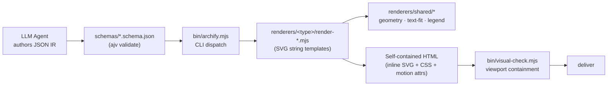
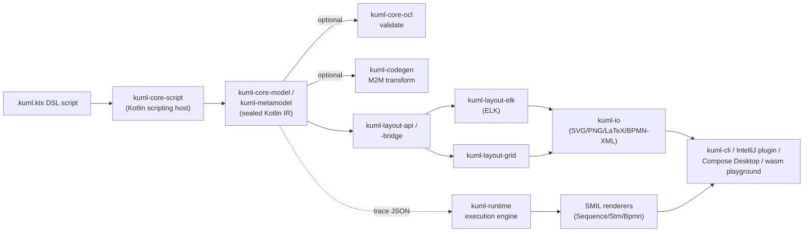
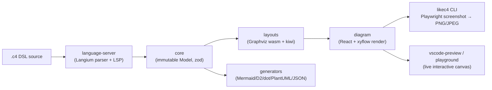
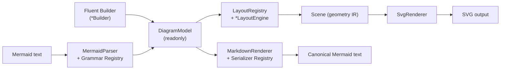

# Weekly Scan — Diagram Tooling (2026-08-17)

Research scout tuần này về diagram-as-code, animation và visual tooling trên GitHub, phục vụ kymostudio side project.

**Executive summary:**

- Không có repo nào trong tuần trực tiếp cạnh tranh với "animated SVG" output của kymostudio — điểm khác biệt cốt lõi vẫn giữ nguyên: `likec4` output chính là live React canvas (animation chỉ sống trong UI, không bake vào file), `atelier/diagram` không có animation, `archify` chỉ animate qua SMIL/CSS attribute có điều kiện trong HTML tĩnh (không phải SVG chuẩn), và `kUML` animate qua execution-trace → SMIL renderer riêng — ý tưởng trace→SMIL của kUML là đáng note nhất cho hướng animation của kymostudio.
- `tt-a1i/archify` (13.4k sao / 983 fork trên chỉ 145 commit, repo 4 tháng tuổi) có dấu hiệu star-farming/growth-hacking rõ rệt — **không dùng số sao làm tín hiệu chất lượng**; code đã kiểm tra không có hành vi độc hại, nhưng cơ chế installer `npx skills add` bên ngoài repo chưa được audit.
- Pattern đáng học nhất tuần này: `atelier/diagram` tách serializer (canonical Mermaid export) hoàn toàn khỏi layout/geometry path — kymostudio nên soi lại `to_bpmn.py`/`to-bpmn.ts` xem có tách sạch tương tự khỏi `to_svg.py` hay không; `likec4` xác nhận rằng dùng resvg-core thay vì Playwright-screenshot (như likec4 làm) là lựa chọn kiến trúc tốt hơn cho kymostudio.

## Mục lục

1. [tt-a1i/archify](#tt-a1iarchify)
2. [kuml-dev/kUML](#kuml-devkuml)
3. [likec4/likec4](#likec4likec4)
4. [ateliersvg/diagram](#ateliersvgdiagram)

---

## tt-a1i/archify

**§1 — Quick context**

Archify là một "agent skill" (không phải app độc lập) giúp LLM (Claude/Cursor/Codex/opencode) tự sinh diagram HTML tĩnh từ JSON IR thay vì auto-layout tự động như kymostudio hay Mermaid — triết lý ngược lại: "layout judgment over generic auto-layout" (LLM tự quyết `pos`/`size`/route, tool chỉ validate + render). Stack: Node.js ES modules, `ajv` (JSON Schema) là dependency duy nhất, không framework khác. Repo health: 13,416 sao/983 fork nhưng chỉ **145 commit**, tạo 2026-04-15 (~4 tháng tuổi), 24 open issue, 7 PR — tỉ lệ sao/commit bất thường. Có CHANGELOG/release đều (v2.14.0, 2026-08-11). Distribution: `npx skills add tt-a1i/archify -g` (skills-registry installer, không phải npm publish thường).

**§2 — Architecture deep-dive**

**A. Component inventory**
- `CLI entry` (`archify/bin/archify.mjs`) — dispatcher cho các lệnh `render/compare/deliver/preview/validate/inspect/check/visual-check/guide/examples/doctor/demo`; dùng `spawnSync` gọi các script con cùng process Node local, không network call.
- `Schemas` (`archify/schemas/*.schema.json`) — JSON Schema riêng cho từng loại diagram (`architecture/workflow/sequence/dataflow/lifecycle`) + `common.schema.json` dùng chung, validate qua ajv.
- `Renderers` (`archify/renderers/{architecture,workflow,sequence,dataflow,lifecycle}/render-*.mjs`) — mỗi loại diagram một module render riêng, sinh SVG bằng **string template literals** (không dùng DOM lib).
- `Grid layout` (`archify/renderers/architecture/grid.mjs`) — cung cấp `gridLayout()`/`resolveComponentPos()`/`validateGridPlacement()` cho chế độ auto-grid, song song với "free placement" (`pos`/`size` thủ công).
- `Shared utils` (`archify/renderers/shared/*.mjs`) — `geometry.mjs`, `text-fit.mjs`, `legend.mjs`, `layout-report.mjs`, `validator.mjs`, `diagnostics.mjs`.
- `Delta` (`archify/delta/architecture-delta.mjs`) — so sánh before/after (base/head) architecture JSON để review kiến trúc trước merge.
- `Preview & visual-check` (`archify/bin/preview.mjs`, `archify/bin/visual-check.mjs`) — kiểm tra containment ở nhiều viewport (1440×900…2048×1320) và chụp screenshot.

**B. Pipeline**
1. Agent (LLM) đọc schema + example tương ứng, tự viết JSON IR với id/pos/size/edge route cụ thể.
2. `archify.mjs validate <type> <file.json> --json` chạy ajv-generated validators + deterministic layout checks, trả lỗi machine-readable để agent tự sửa.
3. `render` gọi `render-<type>.mjs` build SVG qua string template (`renderComponent`/`renderBoundary`/`renderSvg`).
4. Ghi HTML self-contained (inline SVG+CSS, animation attribute có điều kiện).
5. `visual-check` đo containment/chụp ảnh nhiều viewport.
6. `deliver` chốt file sau khi validate pass ("never edit after validation").

**C. Data model/IR** — JSON thuần: `schema_version`, `diagram_type`, `meta` (title, output, quality_profile, `views` — nhiều "focus" khác nhau trên cùng diagram), `components` (id/type/label/pos/size/tag), `boundaries` (region/security-group wrap theo id list), `connections` (from/to/fromSide/toSide/`via` waypoint thủ công), `cards`. Immutable-per-render: tọa độ do LLM author trực tiếp, tool không tính toán lại.

**D. Input language** — không có grammar/parser text; input là JSON được validate bằng JSON Schema (ajv), lỗi báo qua kênh `--json` để agent tự lặp sửa.

**E. Layout** — hybrid: grid-snap tự động HOẶC free placement thủ công do LLM chỉ định; edge routing cũng thủ công qua `fromSide/toSide/via`, không thấy thuật toán crossing-minimization.

**F. Rendering** — SVG string-template → HTML self-contained, 4 visual preset + dark/light, "trace motion" qua chèn thuộc tính SMIL/CSS animation có điều kiện (`animateAttr`); export PNG/JPEG/WebP/SVG/WebM được README nhắc nhưng backend cụ thể **không xác định** trong code đã đọc.

**G. Extensibility** — mỗi loại diagram = 1 schema + 1 renderer module (pattern nhất quán); không thấy plugin system rõ ràng.

**H. Dev experience** — CLI đầy đủ, `preview.mjs`/`visual-check.mjs` cho kiểm tra local; watch mode/IDE integration **không xác định**.

**§3 — Architecture diagram**

**§4 — Verdict**

Điểm đáng học: (1) `meta.views` — nhiều "focus" (subset node/edge highlight) trên cùng 1 IR file, kymostudio có thể tham khảo cho việc xem nhiều góc của cùng diagram mà không cần file riêng; (2) `delta/architecture-delta.mjs` so sánh before/after architecture — pattern review-PR hữu ích chưa thấy trong kymostudio; (3) kênh validate `--json` trả lỗi machine-readable cho agent tự sửa — mẫu tốt cho agent-authoring loop.

Red flag: tỉ lệ 13.4k sao/983 fork trên chỉ 145 commit và repo 4 tháng tuổi là bất thường mạnh, cộng thêm GitHub topics mang tính SEO/marketing dày đặc (claude-skill, opencode, codex, deepseek-harness, dsh-plugin, mermaid-alternative) — nghi vấn star-farming/growth-hacking, không nên coi số sao là tín hiệu chất lượng. Về mặt code: **không phát hiện hành vi độc hại** — không network call, không telemetry, không eval/obfuscation, dependency duy nhất là `ajv`, `spawnSync`/`import()` chỉ trỏ vào file local. Open question: chưa kiểm tra cơ chế `npx skills add tt-a1i/archify -g` (installer bên ngoài repo) thực thi gì; contributors graph không load được nên chưa xác định bus factor. Verdict: **glance only** cho phần code/kiến trúc (ý tưởng `views`/`delta` đáng note riêng), **nghi ngờ** phần growth metrics — không dùng số sao làm căn cứ đánh giá độ trưởng thành.

---

## kuml-dev/kUML

**§1 — Quick context**

kUML là DSL nội bộ (internal DSL) bằng Kotlin builder pattern để mô hình hoá UML 2.x/SysML 2/C4/BPMN 2.0/ERM, chạy như Kotlin script (`.kuml.kts`) thay vì có grammar/parser riêng — khác kymostudio ở chỗ "compile" nghĩa đen (Kotlin compiler validate), không phải text DSL tự parse. Stack: Kotlin đa nền tảng (JVM + wasmJs), ELK layout, Compose Desktop. Repo health: 19 sao, 0 fork, tạo 2026-05-28 (~2.5 tháng tuổi), 50 release, gần như 1 contributor người (betschwa) + commit đồng tác giả với "claude"; CI có 8 workflow (ci/codeql/docs/release…). Distribution: Maven Central, CLI fat-jar, wasm playground.

**§2 — Architecture deep-dive**

**A. Component inventory**
- `kuml-core-dsl` (`kuml-core/kuml-core-dsl`) — builder functions DSL (`diagram{}`, `umlModel{}`, `classOf{}`), đánh dấu scope bằng `@KumlDsl`.
- `kuml-core-model`/`kuml-metamodel` (`kuml-core/kuml-core-model`, `kuml-metamodel`) — sealed Kotlin metamodel hierarchy cho UML/C4/KerML/SysML2/BPMN (thay EMF).
- `kuml-core-script` (`kuml-core/kuml-core-script`) — Kotlin scripting host thực thi file `.kuml.kts`.
- `kuml-core-ocl` — OCL 2.4/2.5 constraint evaluator (dùng bởi `kuml validate`).
- `kuml-layout-elk`/`kuml-layout-grid` (`kuml-renderer/…`) đứng sau `kuml-layout-api`/`kuml-layout-bridge` — hai layout engine hoán đổi được.
- `kuml-io` — emitter đa target: SVG (`KumlSvgRenderer`), PNG/APNG/WebP/MP4, LaTeX/TikZ, BPMN XML, JSON, EMF/ARXML; ba renderer animation `SequenceSmilRenderer`/`StmSmilRenderer`/`BpmnSmilRenderer`.
- `kuml-runtime` — engine chạy state machine/activity, sinh trace JSON (`kuml.trace.v1`) cho animation.
- `kuml-codegen` — M2M transformer (5 built-in: uml-to-jpa/rest/k8s/docker, c4-to-uml) + reverse engineering (Java/Kotlin/C# PSI, SQL DDL→ERM).
- `kuml-cli`, `kuml-desktop`, `kuml-jetbrains/kuml-jetbrains-plugin`, `kuml-language-server`, `kuml-web`+`kuml-wasm-playground`, `kuml-mcp` — các front-end/tooling.
- `kuml-plugin-api`/`kuml-plugin-loader` — ServiceLoader SPI cho plugin ngoài.

**B. Pipeline**
1. Author viết `.kuml.kts` gọi builder functions.
2. `kuml-core-script` compile/execute script qua Kotlin scripting host → tạo object graph metamodel (sealed classes).
3. (tuỳ chọn) `kuml validate` chạy OCL, hoặc `kuml transform` áp M2M transformer lên model.
4. Layout bridge đưa metamodel cho ELK hoặc Grid layout engine tính vị trí node/route cạnh.
5. `kuml-io` renderer tương ứng (SVG/PNG/LaTeX/BPMN-XML…) render output; nếu có `--animated` + trace JSON thì renderer SMIL tương ứng nhúng timeline `<animate>`.
6. Output tới CLI, IntelliJ plugin preview, Compose Desktop, hoặc wasm playground trình duyệt (live preview 300ms).

**C. Data model/IR** — "sealed Kotlin metamodel hierarchy" thuần Kotlin, không dùng EMF; không xác định rõ mutable hay immutable (builder layer tách biệt model layer gợi ý pattern build-rồi-freeze, nhưng không có evidence trực tiếp).

**D. Input language design** — internal DSL qua Kotlin lambda-with-receiver + type-safe builder (`@KumlDsl` DSL-marker), KHÔNG có grammar/ANTLR/lexer riêng — file DSL chính là Kotlin script thật, compile bởi Kotlin compiler. Error reporting: không xác định chi tiết ngoài việc dựa vào compile-time diagnostics gốc của Kotlin.

**E. Layout** — dùng ELK (Eclipse Layout Kernel) qua `kuml-layout-elk`, có layout thay thế `kuml-layout-grid`, trừu tượng hoá qua `kuml-layout-api`. Không tìm thấy evidence cụ thể về thuật toán edge-routing/crossing-minimization riêng của kUML — phần này giao hoàn toàn cho ELK.

**F. Rendering/output** — đa backend: SVG, PNG/APNG/WebP/MP4 (qua ffmpeg), LaTeX/TikZ, BPMN XML, JSON, EMF/ARXML. Animation là pure SMIL sinh từ execution trace, không JS. Obsidian plugin được nêu trong mô tả repo nhưng không thấy thư mục tương ứng trong root listing — không xác định/có thể chỉ là marketing copy.

**G. Extensibility** — plugin SPI qua ServiceLoader (`kuml-plugin-api`/`-loader`, có `kuml-plugin-examples`), lệnh `kuml generate` chạy plugin codegen; theming qua `kuml-themes-core`/`kuml-themes`; 5 profile built-in (AUTOSAR, JavaEE, Spring, OpenAPI, SoaML) làm tiền lệ mở rộng domain.

**H. Dev experience** — CLI phong phú (render/watch/validate/fmt/generate/transform/reverse/simulate/serve/…), shell completion; `watch` poll mtime mỗi 500ms, không exit khi lỗi; `serve` live-preview browser 300ms; IntelliJ plugin + LSP4J language server cho editor tooling.

**§3 — Architecture diagram**

**§4 — Verdict**

Điểm đáng học: (1) kUML tách rõ execution-trace (`kuml-runtime`) khỏi animation-render (3 SMIL renderer riêng theo loại diagram) — mô hình sạch hơn cho hướng animated-SVG mà kymostudio đang theo đuổi. (2) `kuml-io` gom nhiều emitter (SVG/PNG/LaTeX/BPMN/EMF) quanh một metamodel chung — tương đồng cấu trúc `to_svg.py`/`to_figma.py`/`to_excalidraw.py` của kymostudio, xác nhận pattern "renderer dumb, nhiều emitter cùng data" là hợp lý. Khác biệt lớn với kymostudio: kUML KHÔNG có hai implementation độc lập song song (chỉ một Kotlin multiplatform codebase) — nên không có bài học trực tiếp về "dual-impl parity"; "đa dạng" của kUML là đa *output format*, không phải đa *engine*.

Red flags: phạm vi khổng lồ (UML+SysML2+C4+BPMN+ERM+OCL+MDA+XMI+reverse-engineering+multi-LLM agent+MCP+IntelliJ+Obsidian+wasm) cho repo 19 sao, ~11 tuần tuổi, gần như 1 người + AI agent (`.claude/commands`, `AGENTS.md`, `.junie` ở root, commit đồng tác giả "claude"); 50 release trong 11 tuần là nhịp độ bất thường, gợi ý release chưa qua review kỹ. Obsidian plugin claim không khớp cấu trúc thư mục thực tế. Verdict: **glance only** — ghi nhận ý tưởng trace→SMIL và layout-abstraction để tham khảo, nhưng chưa đủ trưởng thành/kiểm chứng để nghiên cứu sâu.

---

## likec4/likec4

**§1 — Quick context**

LikeC4 là DSL kiến trúc lấy cảm hứng từ C4 Model + Structurizr DSL, nhưng khác biệt cốt lõi: output chính là một **live interactive React app** (pan/zoom canvas), không phải static SVG như kymostudio — PNG/export chỉ là phái sinh (Playwright screenshot). Tech stack: TypeScript monorepo (pnpm + turbo), Langium (grammar-driven parser/LSP), Graphviz-wasm cho layout, React + `@xyflow/react` cho render. Repo health: 5,432 sao, 358 fork, 175 open issue, MIT, tạo 2023-03, push gần nhất 2026-08-16 (rất active), CI phong phú (ci-pr, checks, codeql, e2e screenshot regression, release). Distribution: npm `likec4` CLI + `create-likec4` scaffolder, VS Code extension (LSP + preview webview riêng), và cả một `@likec4/mcp` MCP server để AI agent truy vấn model.

**§2 — Architecture deep-dive**

**A. Component inventory** (monorepo `packages/`):
- `@likec4/core` (`packages/core`) — types, model API, guards; state immutable qua `immer`, schema qua `zod`.
- `@likec4/language-server` (`packages/language-server`) — Langium grammar `like-c4.langium` + validation + LSP (folders `lsp/`, `validation/`, `model/`).
- `@likec4/language-services` (`packages/language-services`) — lớp service tách riêng, có bản build cho browser (dùng trong playground) lẫn Node.
- `@likec4/layouts` (`packages/layouts`) — layout engine: `@hpcc-js/wasm-graphviz` + `ts-graphviz`, cộng `@lume/kiwi` (constraint solver).
- `@likec4/diagram` (`packages/diagram`) — React component library render diagram, dùng `@xyflow/react`, `d3-shape`, `xstate`, `motion` (animation), `@mantine/core`.
- `@likec4/generators` (`packages/generators`) — model → Mermaid/PlantUML/D2/dot/React codegen.
- `likec4` (`packages/likec4`) — CLI/toolchain, bin `likec4.mjs`.
- `@likec4/mcp` (`packages/mcp`) — MCP server (hono-based).
- `packages/vscode` + `packages/vscode-preview` — extension + preview webview.
- `apps/docs`, `apps/playground` — docs site + browser playground.

**B. Pipeline**
1. Author viết `.c4` (model.c4, views.c4, spec.c4, deployment.c4).
2. `language-server` parse bằng parser sinh tự động từ `like-c4.langium` → AST + resolve reference + validate (LSP diagnostics ngay trong editor).
3. `core` build AST thành LikeC4 Model đã typed, immutable (immer).
4. `layouts` lấy graph elements/relations của từng view → Graphviz (wasm, thuật toán dot) tính layout, tinh chỉnh thêm bằng kiwi constraint solver.
5. `diagram` (React + xyflow) render view đã layout thành canvas tương tác — đây là output "chính", hiển thị trong playground/VS Code preview/docs.
6. CLI `likec4` `export`/`build`/`gen`: chụp Playwright screenshot app đang chạy → PNG/JPEG, hoặc chạy `generators` xuất text format (Mermaid/D2/dot/PlantUML/JSON), hoặc bundle static website.

**C. Data model/IR** — Model core immutable (immer draft pattern), có bước lowering rõ: parsed AST → LikeC4Model (typed, zod) → computed/resolved view (graph nodes+edges) trước khi layout gắn tọa độ — tách biệt qua package boundary (`core` vs `layouts` vs `diagram`) dù không có tài liệu IR chính thức.

**D. Input language design** — dùng **Langium** (framework Language Engineering của TypeScript) — không phải custom parser hay ANTLR. Grammar file `.langium` (~150+ rules ước tính) là nguồn chuẩn, tự sinh parser + AST types + LSP server. Vì Langium LSP-first nên diagnostics/error-reporting có "miễn phí", dùng chung một grammar cho cả VS Code lẫn web playground.

**E. Layout algorithm** — Graphviz (dot algorithm, wasm) là engine chính — có sẵn crossing minimization/ranking; `@lume/kiwi` constraint solver hỗ trợ thêm (có ví dụ `rank-for-better-layout` gợi ý tinh chỉnh rank). `dagre` cũng là dep của `diagram` nhưng vai trò cụ thể (có thể chỉ cho dynamic-view step layout) — không xác định rõ.

**F. Rendering/output** — renderer chính không phải file exporter mà là React canvas tương tác (`@xyflow/react`); PNG/JPEG lấy qua Playwright screenshot chứ không có SVG serializer riêng. Text-format export (Mermaid/D2/dot/PlantUML/JSON) đi thẳng từ model, bỏ qua renderer. **Không có animated-SVG export** — animation (xstate/motion) chỉ tồn tại trong UI sống, không bake vào file xuất.

**G. Extensibility** — DSL cho phép khai báo `specification { element kind ... tag ... }` ngay trong source — extension ở cấp DSL. Theming qua style block + `globals` package (reusable style/predicate groups). Icon là package riêng (`packages/icons`). Plugin-API runtime chính thức: không xác định (chỉ thấy `vite-plugin` cho tích hợp build).

**H. Dev experience** — CLI đầy đủ `serve/dev/start` (hot-reload live preview), `build` (static site), `export` (png/jpeg/drawio), `gen`, `validate`, `format/fmt` (có CI check mode), `lsp`, `preview`. VS Code extension + preview webview riêng biệt. `create-likec4` scaffolder. MCP server cho phép AI agent thao tác model trực tiếp.

**§3 — Architecture diagram**

**§4 — Verdict**

Đáng học: (1) Langium cho grammar formal + LSP "miễn phí" — nếu kymostudio muốn diagnostics/IDE support mạnh hơn ngoài VS Code extension hiện tại, đây là mẫu tham khảo tốt (dù đổi từ custom line-oriented `dsl.py` sang Langium là refactor lớn). (2) Graphviz-wasm làm layout engine chính, chứng minh embed một engine trưởng thành (thay vì tự viết toàn bộ alignment logic) khả thi ở production scale — có thể so sánh với `alignment.py`/`layout.py` của kymostudio khi cần crossing-minimization phức tạp hơn.

Red flag: PNG export qua Playwright screenshot là kiến trúc nặng, chậm, phụ thuộc headless browser — **xác nhận hướng đi của kymostudio (resvg core `kymostudio-core`) là lựa chọn tốt hơn**, không phải dư thừa.

Điểm khác biệt cốt lõi: likec4 **không có animated-SVG** làm output độc lập — animation chỉ sống trong live UI. Điều này củng cố rằng "compile ra animated SVG" của kymostudio là differentiation thật, không trùng lặp với likec4.

Open questions: vai trò thực sự của `dagre` và `kiwi` trong pipeline layout (đọc source, không chỉ package.json, mới rõ); có formal plugin API không.

Verdict: **study deeper** phần Langium grammar/LSP và Graphviz-layout integration; phần rendering/animation chỉ nên **glance** vì triết lý output khác hẳn.

---

## ateliersvg/diagram

**§1 — Quick context**

`atelier/diagram` là thư viện PHP thuần (>=8.3) render 15 loại diagram (flowchart, state, sequence, class, ER, git graph, timeline, journey, mindmap, requirement, kanban, block, architecture, C4, Venn) ra SVG tĩnh. Khác biệt chính: **zero runtime deps** — không cần browser/Node/binary ngoài, chỉ dựa vào 2 companion package cùng org (`atelier/svg`, `atelier/layout`, cũng thuần PHP). Repo health: 0 sao/1 fork, 1 contributor (tác giả Simon André), tạo 14/6/2026, push gần nhất 15/8/2026 (~2 tháng tuổi, đang active), 1 release duy nhất `v0.7.0` (pre-release), 1 CI workflow. Phân phối qua Packagist (`composer require atelier/diagram`).

**§2 — Architecture deep-dive**

**A. Component inventory**
- `Diagram` (`src/Diagram.php`) — facade duy nhất: factory cho 15 builder + `fromMermaid()`/`of()`, export `toSvg()`/`toMarkdown()`/`toMermaid()`.
- `MermaidParser` (`src/Parser/MermaidParser.php`) — dispatcher, chọn grammar theo dòng header đầu.
- `MermaidGrammarRegistry` + 15 `*DiagramParser.php` (`src/Parser/`, vd `FlowchartParser.php`) — mỗi diagram type một parser riêng.
- `LineStream`/`SourceLineStream` (`src/Parser/`) — line-based reader giữ số dòng cho error reporting.
- `*Builder` per type (vd `FlowchartBuilder`) — fluent API, build ra model con.
- `DiagramModel` (`src/Model/DiagramModel.php`) — marker interface rỗng cho mọi model immutable.
- `LayoutRegistry`/`LayoutHandlerInterface` (`src/Layout/`) — match theo class model → 15 `*LayoutEngine` tương ứng.
- `Scene` (`src/Scene/Scene.php`) — IR hình học trung gian, độc lập diagram type.
- `SvgRenderer` (`src/Renderer/Svg/SvgRenderer.php`) — Scene → SVG string.
- `MarkdownRenderer` + `MermaidSerializerRegistry` (`src/Renderer/Markdown/`) — DiagramModel → canonical Mermaid text/markdown.
- `Theme` (`src/Theme/`) — 5 preset (default/dark/blueprint/mono/neutral).

**B. Pipeline**
1. Input: Mermaid text hoặc chuỗi gọi builder.
2a. (Mermaid) `MermaidParser` → `MermaidGrammarRegistry::detect()` đọc header → chọn `*DiagramParser`.
2b. (Builder) `Diagram::flowchart()`... → `->build()`.
3. Hai nhánh hội tụ ở `DiagramModel` con, `final readonly class` immutable.
4. `LayoutRegistry::layout($model, $theme)` match class → `*LayoutEngine::layout()` → sinh `Scene` (geometry IR).
5. `SvgRenderer::render($scene)` duyệt node tree, mechanical "1 Scene node = 1 SVG element" → chuỗi SVG qua `atelier/svg`.
6. Song song (bỏ qua Scene/layout): `MarkdownRenderer::renderMermaid($model)` → `MermaidSerializerRegistry` serialize thẳng từ model → Mermaid canonical text. Doc ghi rõ nguyên tắc round-trip: "render, then parse, then render again is the identity".

**C. Data model/IR** — `DiagramModel` là marker interface rỗng; mỗi concrete model (vd `Flowchart`) là `final readonly class` với property `public readonly` qua constructor promotion — value-object, hoàn toàn immutable. `Scene` là IR thứ 2, geometry-only, tách khỏi model ngữ nghĩa.

**D. Input language design** — line-based + regex-driven (không phải PEG/generic tokenizer). Mỗi type có parser riêng dùng `LineStream`, regex cố định cho từng statement shape (header/subgraph/node/edge), `BlockScanner` theo dõi nesting. Lỗi ném `ParseException` kèm line number (`ParseErrors::wrap()`). Builder API: mỗi type một fluent builder riêng biệt, không builder chung.

**E. Layout** — registry dispatch theo class model → engine riêng per type, đo text qua `ThemeTextMeasurer`, toán học qua companion `atelier/layout`. Thuật toán cụ thể bên trong từng engine (layered DAG? force-directed?) — không xác định, chỉ thấy kiến trúc dispatch.

**F. Rendering** — `SvgRenderer` mechanical, hardcoded switch theo node type — **không animation** (không CSS keyframes, không SMIL), **không pluggable emitter**. `MarkdownRenderer` là renderer thứ 2 hoàn toàn tách biệt (không qua Scene).

**G. Extensibility** — registry pattern ở cả layout và parser, nhưng thêm 1 diagram type mới đòi hỏi chạm 5 điểm (model, builder, parser, layout engine, serializer) — không có plugin interface hợp nhất.

**H. Dev experience** — `tests/` mirror `src/` 1:1 (23 thư mục con); PHPStan level max, PHPUnit 12.5, php-cs-fixer, script `qa` gộp cả 3. 28 file `examples/` minh họa từng type + demo/gallery — DX tốt cho repo <3 tháng tuổi.

**§3 — Architecture diagram**

**§4 — Verdict**

Đáng học nhất: **canonical Mermaid serialization tách biệt hoàn toàn khỏi layout path** — `MarkdownRenderer` đi thẳng từ `DiagramModel` ra text, không qua `Scene`, với tuyên ngôn round-trip rõ ràng ("render→parse→render = identity"). kymostudio nên soi lại `to_bpmn.py`/`to-bpmn.ts` xem có tách sạch tương tự khỏi `to_svg.py`, tránh để export XML phụ thuộc geometry đã layout. Zero-dep philosophy (chỉ 2 companion package cùng org, thuần PHP) tương đồng triết lý "renderer dumb" của kymostudio, đáng tham khảo cho tách concerns. Red flag: extensibility đòi 5 điểm chạm cho 1 diagram type mới, không animation, không pluggable emitter — kymostudio's animated-SVG + conditional-CSS-injection approach vẫn tinh vi hơn. Repo quá non (0 sao, 1 contributor, 1 pre-release) để đánh giá độ ổn định lâu dài. Verdict: **glance only** — đáng ghi chú pattern round-trip serializer, chưa cần study sâu.
