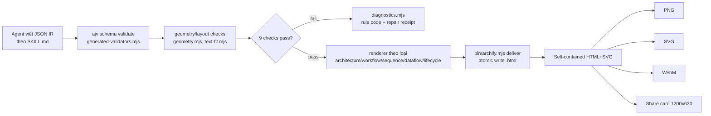
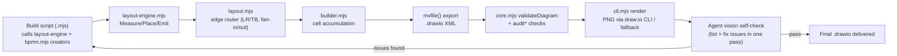
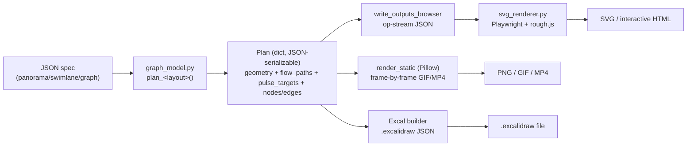
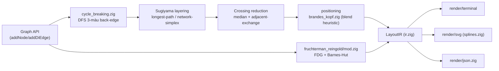

# Weekly scan: diagram-as-code & visual tooling — 2026-08-19

**Cửa sổ quét**: repos published/significantly updated trong ~7-14 ngày qua (12/08–19/08/2026), nguồn: GitHub search API (topic + keyword fallback, không dùng `gh` CLI vì phiên này bị giới hạn scope tới `kymostudio/kymostudio`) + WebSearch cho tín hiệu ngoài GitHub.

## Executive summary

- **Xu hướng nổi bật tuần này: "agent skill" diagram tools, không phải DSL text truyền thống.** 3/4 repo được chọn (archify, drawio-ai-kit, Archscribe) đều là skill cho Claude Code/Codex CLI — agent tự viết JSON IR/code JS thay vì người dùng gõ text DSL, và layout dựa vào "judgment" của LLM hoặc auto-layout khai báo, không phải grammar hình thức như `.kymo`.
- **Pattern kiến trúc lặp lại độc lập ở cả 3 tool: "một geometry plan/IR duy nhất nuôi nhiều emitter"** (archify's validated JSON IR → 5 renderer theo loại; Archscribe's `graph_model.py` plan → Pillow/browser/Excalidraw; drawio-ai-kit's layout-engine → builder → mxfile). Đây là xác nhận độc lập, không phải phát hiện mới, cho triết lý "dumb renderer, resolver thông minh" mà kymostudio đã theo.
- **Không có DSL parser mới đáng chú ý tuần này.** Điểm sáng duy nhất về thuật toán layout là zigraph (Zig, Sugiyama + biến thể Brandes-Kopf + Fruchterman-Reingold) — nhưng dự án còn non trẻ (17 sao, 1 tác giả, không CI) và phần đặt tên "Brandes-Kopf" là misnomer (không có 4-alignment averaging thật).

## Mục lục

1. [tt-a1i/archify](#tt-a1iarchify) — agent skill, JSON IR → HTML/SVG/WebM tự chứa
2. [sparklabx/drawio-ai-kit](#sparklabxdrawio-ai-kit) — declarative layout engine + BPMN + vision self-check cho draw.io
3. [lazypay/Archscribe](#lazypayarchscribe) — hand-drawn animated diagrams → .excalidraw/PNG/GIF/MP4
4. [AshutoshMahala/zigraph](#ashutoshmahalazigraph) — Zig, Sugiyama + Fruchterman-Reingold layout engine

---

## tt-a1i/archify — Agent skill biến JSON IR đã validate thành HTML/SVG kiến trúc tự chứa, có animation và xuất PNG/SVG/WebM

### §1 — Quick Context

Archify là một *agent skill* (không phải thư viện/CLI độc lập) cho Claude Code, Cursor, Codex CLI, opencode: agent tự viết JSON IR mô tả kiến trúc/workflow/sequence/dataflow/lifecycle, hệ thống validate bằng JSON Schema (ajv) rồi render ra HTML tự chứa (SVG + JS nội tuyến) kèm xuất PNG/SVG/WebM/share-card 1200×630. Stack: Node.js ≥18, zero runtime dependency (chỉ devDeps `ajv`, `simple-icons`). Sức khỏe repo: 14.240 sao, 1.036 fork, MIT license, `has_pages`/`has_discussions`=true, có CI (`ci.yml`, `release.yml`, `dsh.yml`), version hiện tại v2.15.0, push gần nhất 2026-08-17 (rất active), tạo repo 2026-04-15. Phân phối qua `npx skills add tt-a1i/archify -g` cài vào thư mục skill của agent (`~/.claude/skills/`…), không publish npm/PyPI như một thư viện thông thường.

### §2 — Architecture Deep-Dive

**A. Component inventory**
- `archify/SKILL.md` — manifest agent-facing: quy ước IR, pipeline validate→deliver, danh sách lệnh CLI.
- `archify/bin/archify.mjs` — CLI entry (`validate`, `preview`, `deliver`, `compare`, `guide`, `doctor`, `demo`).
- `archify/schemas/*.schema.json` + `common.schema.json` — JSON Schema cho 5 loại diagram, `additionalProperties:false` mọi cấp.
- `archify/renderers/{architecture,workflow,sequence,dataflow,lifecycle}/render-*.mjs` — emitter riêng cho từng loại diagram; `architecture/grid.mjs` hỗ trợ đặt lưới.
- `archify/renderers/shared/` — `validator.mjs` + `generated-validators.mjs` (ajv precompiled), `diagnostics.mjs` (mã lỗi có cấu trúc), `geometry.mjs`/`layout-report.mjs`/`text-fit.mjs` (kiểm tra chồng lấn, va chạm nhãn), `legend.mjs`, `brand-marks.mjs`.
- `archify/bin/preview.mjs` — desktop watch-loop chỉ bind `127.0.0.1`.
- `archify/bin/visual-check.mjs` — kiểm tra tràn viewport bằng Chrome headless ở 4 kích thước màn hình.

**B. Pipeline/control flow**: (1) Agent nhận yêu cầu, viết JSON IR theo hướng dẫn SKILL.md; (2) `archify validate <type> <file>.json --quality showcase --json` chạy ajv + geometry checks, trả về diagnostics có rule code nếu fail; (3) tuỳ chọn `preview` mở watch-loop local render lại khi file JSON hợp lệ; (4) `deliver` render candidate ra thư mục tạm, chạy lại toàn bộ 9 check (showcase) hoặc 4 check (basic); (5) nếu pass, ghi đè atomically vào file `.html` đích kèm SHA-256; (6) trình duyệt/`visual-check` xuất PNG/SVG/WebM/share-card từ HTML đã deliver.

**C. Data model/IR**: JSON có `schema_version:1`, `diagram_type`, `meta`; mỗi loại có mảng riêng (`components/connections`, `nodes/edges`, `participants/messages`…). IR là **input tĩnh, bất biến sau khi deliver** ("no post-delivery edits" — final validation đóng băng candidate). Không có khái niệm "compile xuống IR thấp hơn" — schema chỉ bắt lỗi hình dạng, việc đo geometry (chồng lấn, route) là việc của renderer, không tách pass riêng như `alignment.py` của kymostudio.

**D. Input language design**: không phải DSL văn bản có grammar hình thức — là JSON thuần, "parser" = `JSON.parse` + ajv validate theo JSON Schema sinh sẵn (`generated-validators.mjs`). Báo lỗi có cấu trúc máy đọc được (rule code, subject, evidence, "supportedFixes"), không phải Node stack trace.

**E. Layout algorithm**: chủ đích **không** dùng auto-layout tổng quát — triết lý "layout judgment over generic auto-layout": agent (LLM) tự quyết định hierarchy/spacing/route trong JSON. Tuy vậy có `grid.mjs` hỗ trợ đặt lưới cho architecture và renderer tự động rải các endpoint dùng chung để tránh dồn cạnh vào một điểm ("Port Spread"), cộng `geometry.mjs` chống crossing/overlap — tức có tầng kiểm tra/điều chỉnh cục bộ chứ không phải thuần thủ công 100%. Routing: `via`, `channelX`, `labelAt` cho phép ép route thủ công; route tự động tránh đoạn <8px và tránh cắt qua node/nhãn không liên quan.

**F. Rendering/output strategy**: renderer tách theo thư mục per diagram-type dưới `renderers/`, có cấu trúc pluggable rõ ràng (mỗi loại có `render-*.mjs` riêng, dùng chung `shared/`). Output là một file HTML tự chứa (SVG + JS nội tuyến) với pan/zoom/search/theme/export built-in; animation qua `meta.animation:"trace"`, tôn trọng `prefers-reduced-motion`, xuất thêm WebM cho motion.

**G. Extensibility**: thêm loại diagram/route/tính năng theo pattern "Semantic Passport" (một panel duy nhất mở rộng thay vì nhân bản UI); brand marks/icon qua `simple-icons` + digest-pinned. Không thấy plugin API công khai cho renderer bên thứ ba.

**H. Dev experience**: CLI có `doctor`, `demo`, `guide` (gợi ý loại diagram phù hợp); `preview` là watch-mode chỉ chạy khi user yêu cầu tường minh (không phải service nền mặc định), giữ lại bản "last-good" khi candidate lỗi; `visual-check` là gate containment tự động qua Chrome headless — không có tích hợp IDE trực tiếp ngoài agent-skill.

### §3 — Architecture Diagram

### §4 — Verdict

Điểm đáng học cho kymostudio: (1) diagnostics dạng rule-code + "supportedFixes" máy đọc được — kymostudio có thể áp cho lỗi DSL/BPMN parse thay vì stack trace Python thuần; (2) "Port Spread" tự động rải cạnh dùng chung tại điểm neo giống một phần trách nhiệm của pass fan-in/trunk-lane staggering trong `alignment.py` — xác nhận đây là bài toán chung, không riêng gì kymostudio. Về triết lý layout: Archify's "layout judgment" là sự đánh đổi có thật — đẩy trách nhiệm bố cục sang LLM/agent ở lượt tạo, đổi lấy kiểm soát ngữ nghĩa cao hơn nhưng phụ thuộc năng lực agent và không tái lập được nếu không dùng đúng agent đó; 5-pass resolver tự động của kymostudio đổi lại tính xác định (deterministic) không cần agent. Cờ đỏ: JSON IR không có DSL súc tích như `.kymo`, tác giả tự nhận không hỗ trợ import Mermaid hay auto-layout tổng quát — phạm vi hẹp hơn kymostudio. Câu hỏi mở: renderer thực sự tự động điều chỉnh geometry đến mức nào khi "layout judgment" của agent sai (không xác định chi tiết thuật toán trong `geometry.mjs`). Kết luận: **study deeper** (riêng phần diagnostics-as-JSON và cơ chế atomic-deliver-with-rollback, không phải toàn bộ layout philosophy).

---

## sparklabx/drawio-ai-kit — Bộ công cụ giúp AI vẽ draw.io diagrams đúng cấu trúc và nhất quán về thẩm mỹ

### §1 — Quick Context

Khác với các diagram-as-code khác (sinh diagram trực tiếp), drawio-ai-kit là một **framework điều phối AI agent** để tạo `.drawio` XML đúng chuẩn, chống hallucination bằng catalog stencil gốc + validator tĩnh + vòng lặp "vision self-check" thay vì tự render/animate. Tech stack: Node.js ≥18 ESM thuần (`.mjs`, không TypeScript/bundler), zero runtime dependency, tùy chọn Python 3.11 để build icon pack. Sức khỏe repo: 631 sao, 110 fork, MIT license, CI có test + Semgrep SAST + gitleaks, phát hành đến v1.0.2 (04/08/2026). Phân phối qua `npm i -g github:...` kèm `npx skills add` để cài "Agent Skills" (Claude Code, v.v.).

### §2 — Architecture Deep-Dive

**A. Component inventory**
- `core.mjs` (`src/core.mjs`) — nạp/merge catalog icon JSON, tìm kiếm icon theo alias/token scoring, sinh style string cho stencil, và toàn bộ engine `validateDiagram`/7 hàm `audit*` (aesthetics, AWS convention, edge labels, geometry, architecture Well-Architected, edge crossing, BPMN semantics).
- `layout-engine.mjs` (`src/layout-engine.mjs`) — engine layout khai báo kiểu flexbox 3 pha (Measure → Place → Emit) cho group/grid/pool/phantom.
- `layout.mjs` (`src/layout.mjs`) — auto edge router (routeLR/TB, fan-out/fan-in, giữ đường thẳng, đi giữa "corridor").
- `builder.mjs` (`src/builder.mjs`) — Diagram builder, gom cell theo thứ tự render, xuất `mxfile()`.
- `bpmn.mjs` (`src/bpmn.mjs`) — lớp mỏng phủ lên layout engine, cung cấp các "creator" cho shape BPMN chuẩn (`pool`, start/end event, gateway, typed task…), style token `BPMN` cố định.
- `theme.mjs`, `types.mjs` — token màu/kiểu dùng chung và định nghĩa kiểu dữ liệu.
- `cli.mjs` / `cli-lib.mjs` (`src/cli.mjs`) — CLI `drawio-ai` (search, validate, audit, render, principles, workflow…), dispatch theo `switch(cmd)` tới core/cli-lib/vendor.
- Skills (`skills/drawio-{aws,azure,gcp,databricks,bpmn}`) — 5 "Agent Skill" frontend mỏng, mỗi cái mô tả quy trình build cho domain tương ứng, gọi CLI bên dưới.

**B. Pipeline/control flow** (6 bước): 1) Người dùng/agent gọi `drawio-ai principles --mode bpmn` để lấy rule + catalog stencil → 2) viết build script `.mjs` gọi các creator (`group`/`frame`/`grid`/`pool`, `icon`/`box`, BPMN task/gateway…) khai báo cấu trúc lồng nhau, không toạ độ tay → 3) `renderTree()`/layout-engine tính x/y/w/h qua Measure→Place→Emit, `layout.mjs` route cạnh → 4) `d.mxfile()` xuất XML `.drawio`, sau đó `drawio-ai validate` chạy `validateDiagram` (structural) → 5) `drawio-ai render --check -o out.png` xuất PNG (qua draw.io desktop CLI, fallback Graphviz `dot` hoặc `vendor/encode_drawio_url.py`) → 6) agent có khả năng vision tự "nhìn" ảnh, liệt kê mọi lỗi bố cục trong một lượt rồi sửa gộp, lặp lại tối đa ~2 vòng nếu cần.

**C. Data model/IR** — Không xác định rõ có một IR trung gian tường minh tách biệt kiểu dataclass; builder dường như tích luỹ trực tiếp các "cell" (node/edge) rồi serialize thành mxGraph XML qua `mxfile()` — gần với "build cell list rồi emit XML" hơn là một IR immutable riêng biệt như `model.py` của kymostudio.

**D. Input language design** — Không có DSL text; input là **code JavaScript trực tiếp** (gọi hàm creator từ `layout-engine.mjs`/`bpmn.mjs`), tức "code-as-diagram" chứ không phải "declarative text DSL" có grammar hình thức. Không có parser/EBNF; báo lỗi qua kết quả JSON của `validate`/`audit` (errors/warnings có cấu trúc), không phải qua thông báo lỗi parser dòng-cột.

**E. Layout algorithm** — Auto-layout hoàn toàn khai báo (3 pha Measure/Place/Emit), có "distribute-to-fill" cho slack space, constraint equal-height/equal-width giữa sibling. Edge routing dùng router riêng (`routeLR/TB`, fan-in/fan-out, "route qua giữa corridor"); tài liệu nhắc tới "A* edge routing" (đổi mới ở release v0.2.0) nhưng code `layout.mjs` đọc được chỉ lộ ra các hàm route dạng heuristic geometric, không thấy bằng chứng thuật toán minimization crossing tường minh.

**F. Rendering/output strategy** — Backend output duy nhất là **draw.io XML** (`.drawio`/mxGraph), không có emitter khác (không SVG riêng, không animation). PNG là bước phụ trợ cho self-check, dựa vào draw.io desktop CLI ngoài hoặc fallback browser-URL — không phải renderer nội bộ. Không có pluggable-emitter pattern rõ ràng (khác kymostudio's `to_svg`/`to_figma`/`to_excalidraw`/`to_webp`).

**G. Extensibility** — Icon pack mở rộng qua `catalog/`+`packs/` (JSON, sinh bằng `scripts/ingest_index.py` Python), domain mới thêm qua "Skill" (thư mục `skills/drawio-*`) là lớp mỏng gọi lại engine core dùng chung — mô hình "5 domain skill trên 1 core engine" khá giống ý tưởng plugin nhưng ở tầng prompt/skill hơn là tầng code.

**H. Dev experience** — CLI khá đầy đủ (search/validate/audit/render/scaffold/principles/workflow/types/root), có `--check` machine-readable mode. Không thấy watch mode hay browser live-preview. "IDE integration" thực chất là tích hợp Agent Skill (Claude Code, và theo release note còn Antigravity/Gemini CLI) chứ không phải plugin editor truyền thống.

### §3 — Architecture Diagram

### §4 — Verdict

"Vision self-check" ở đây là **quy trình prompt cho agent** (render PNG rồi để chính AI agent tự nhìn, liệt kê lỗi, sửa gộp một lượt), không phải một cơ chế code so khớp ảnh tự động — nên không portable trực tiếp vào golden-SVG test (byte-for-byte) của kymostudio, nhưng đáng cân nhắc như một **bước review bổ sung cho BPMN importer**: sau khi `resolve_alignments()` chạy, render PNG rồi yêu cầu agent liệt kê lỗi chồng lấn/label cắt cạnh trước khi merge — hữu ích cho corpus MIWG mà `baseline.json` chỉ so hash, không phát hiện lỗi thẩm mỹ. Cách `bpmn.mjs` tách BPMN thành "thin creator layer" trên layout engine chung (không phải renderer riêng) khá gần triết lý "dumb renderer" của kymostudio, và bộ `audit*` (semantic BPMN rules: gateway phải split/merge, start không có incoming...) là gợi ý tốt để `bpmn_shapes.py`/`from_bpmn.py` bổ sung validator ngữ nghĩa tương tự. Red flag: không có DSL text hình thức (chỉ code JS), IR không rõ ràng, phụ thuộc binary ngoài (draw.io desktop CLI) cho render — làm giảm tính "self-contained" so với kymostudio. Câu hỏi mở: A* routing được nhắc trong changelog nhưng không thấy rõ trong code đọc được; cần đọc thêm `builder.mjs`/`theme.mjs` để xác nhận IR thật sự. **study deeper** (riêng phần audit BPMN semantic + quy trình vision-check, phần còn lại glance only).

---

## lazypay/Archscribe — công cụ sinh diagram kiến trúc dạng hand-drawn, animated, xuất ra .excalidraw/PNG/GIF/MP4 từ một JSON spec duy nhất

### §1 — Quick Context

Skill Codex/Claude + renderer Python local, biến một JSON spec thành diagram kiến trúc "hand-drawn" nền tối, animated (.excalidraw + PNG + GIF thật, tùy chọn MP4/SVG/HTML). Stack: Python 3.9+, Pillow, Playwright + rough.js (Chromium headless). Repo: 311 sao, 21 fork, chỉ 9 commit trên `main`, 1 open issue, MIT license, tạo 2026-06-27, **không có** `.github/workflows` (không CI), **không có release** nào được publish. Phân phối qua chính GitHub repo (không phải PyPI/npm), dùng như skill offline.

### §2 — Architecture Deep-Dive

**A. Component inventory**
- `graph_model.py` (`scripts/`) — "single source of truth" cho geometry: mỗi layout preset có hàm `plan_<layout>(spec)` sinh ra một *plan* gồm hình học element, dữ liệu animation (`flow_paths`, `pulse_targets`), icon instances, và graph tương tác (`nodes`/`edges`). Thuần stdlib, không phụ thuộc thư viện ngoài.
- `render_animated_diagram.py` — pipeline "hai renderer": `render_static` (Pillow) và `write_outputs_browser` (ghi op-stream JSON rồi giao cho `svg_renderer.py`). Chứa class `Excal` để build JSON `.excalidraw` (rect/ellipse/diamond/text/line).
- `svg_renderer.py` — renderer Chromium headless qua Playwright, dùng rough.js để vẽ nét tay; đọc op-stream (không tự chứa tọa độ) để dựng SVG/PNG/GIF/MP4/HTML tương tác.
- `icon_browser.py`, `prepare_fonts.py`, `doctor.py` — tiện ích phụ trợ (font, icon, health-check môi trường).
- `assets/default-spec.json`, `assets/examples/*.json` — spec mẫu cho từng layout (panorama dùng panel/card phân cấp; graph dùng `nodes`/`edges` phẳng).

**B. Pipeline/control flow** (5 bước): (1) người dùng viết JSON spec (`--spec`) → (2) `render_animated_diagram.py` gọi `graph_model.plan_<layout>()` để dựng plan hình học + animation duy nhất → (3) plan được fan-out: nhánh Pillow vẽ raster tĩnh + ghép frame animation trực tiếp từ plan, nhánh browser ghi op-stream rồi gọi `svg_renderer.py` chạy Chromium/rough.js → (4) `Excal` builder đọc cùng plan để phát `.excalidraw` JSON → (5) tùy `--formats`, output PNG/GIF/MP4/SVG/HTML/.excalidraw được ghi ra `--outdir`, có thể `--check`/`--verify` để validate.

**C. Data model/IR** — Plan là dict Python thuần (JSON-serializable, test `test_plans_are_json_serializable` xác nhận), không phải class immutable; đây chính là "compile to lower IR": spec JSON (khai báo, cấp cao — panel/card hoặc node/edge) được "compile" một lần thành plan cấp thấp (tọa độ tuyệt đối, path, màu THEME-key) mà mọi emitter dùng chung, tương tự `resolve_alignments()` → `Diagram` đã resolve của kymostudio.

**D. Input language design** — Không phải DSL text mà là JSON spec khai báo thuần túy (3 layout: `panorama` dùng panel/card phân cấp, `swimlane` dùng lane/step, `graph` dùng `nodes`/`edges` phẳng với `kind: "decision"|"loop"`...). Không có formal grammar (EBNF); không xác định cơ chế báo lỗi cú pháp chi tiết ngoài `--validate-only`.

**E. Layout algorithm** — Auto-layout mặc định, nhưng cho phép override thủ công (`test_manual_coordinates_override_auto_layout`). Với `graph`: phát hiện DAG bằng DFS theo thứ tự khai báo, gán `state[nid]=1` (đang trên stack)/`2` (đã xong); cạnh trỏ tới node đang `state==1` bị đánh dấu `_loop` (back-edge tự phát hiện, không cần khai `kind:"loop"`). Sau đó `_graph_layers()` tính "longest-path layer" cho từng node (topological), rồi sắp thứ tự trong layer bằng barycenter heuristic (trung bình vị trí predecessor) để giảm crossing. Tọa độ suy từ lưới `col`/`row` qua công thức cell-grid, có auto-stack dọc khi chain quá dài theo chiều ngang. Loop-edge và skip-edge (nhảy ≥2 layer) được route qua "lane" riêng tránh chồng box.

**F. Rendering/output strategy** — Nhiều backend cùng đọc một plan: Pillow (raster tĩnh + frame-by-frame animation, KHÔNG dùng CSS animation — mỗi GIF/MP4 frame được vẽ lại độc lập qua `animate_frame(base, idx, total, ...)` với `progress = idx/total`), browser/rough.js (SVG animate qua JS `setProgress(t)` frame-driven, dùng easing riêng: `winf/eio/eoq/eob/bell/sinS/cyc`), và `Excal` builder cho `.excalidraw`. Đây đúng là pluggable-emitter pattern (mỗi output format = một hàm/class tiêu thụ cùng plan), tương đồng cấu trúc `to_svg.py`/`to_figma.py`/`to_excalidraw.py` của kymostudio.

**G. Extensibility** — Thêm layout mới cần viết `plan_<layout>()` mới + đăng ký vào registry (test khẳng định registry "trimmed" chỉ 3 loại — có vẻ cố ý giới hạn, không mở rộng dễ dàng). Icon: "Illustrated Icon Engine v2" với 40+ builder JS (brain, gear, eye, db...) — thêm icon mới đòi hỏi viết JS builder tay, không xác định có config-driven hay không. Theming: 2 style cứng (`default` neon-dark, `paper` light) qua `THEME` dict, không xác định cơ chế theme plugin.

**H. Dev experience** — CLI qua `render_animated_diagram.py` với `--spec/--outdir/--formats/--style/--renderer/--validate-only/--check/--strict-formats`; có `doctor.py` để kiểm tra môi trường (Playwright/Chromium/ffmpeg). Không có watch mode, không xác định IDE/editor integration ngoài vai trò "skill" cho Codex/Claude. Có `--formats html` cho browser-preview tương tác (click node để highlight adjacency).

### §3 — Architecture Diagram

### §4 — Verdict

`graph_model.py` xác nhận đúng pattern "một plan hình học nuôi mọi emitter" mà kymostudio đã theo (Diagram đã resolve → `to_svg`/`to_figma`/`to_excalidraw`/`to_webp`) — không phải phát minh mới nhưng là bằng chứng độc lập cho tính đúng đắn của kiến trúc "renderer dumb, resolver thông minh". Đáng học: (1) DFS back-edge tự phát hiện loop mà không cần khai báo `kind:"loop"` — kymostudio's `alignment.py` có thể tham khảo cho auto-detect cycle trong `graph`-style diagram; (2) golden tests so plan hiện tại với "legacy" flow_paths/positions/pulse_targets — mô hình test y hệt golden-SVG của kymostudio, xác nhận cách tiếp cận là chuẩn ngành; (3) animation frame-by-frame độc lập (Pillow) song song với JS `setProgress(t)` (browser) cho cùng plan — kỹ thuật hai renderer chia sẻ cùng op-stream đáng cân nhắc nếu kymostudio mở rộng animated-GIF export thật. Red flag: chỉ 9 commit dù 311 sao, không CI, không release — độ trưởng thành/duy trì thấp, khó tin cậy lâu dài. Câu hỏi mở: cơ chế phát hiện DAG có xử lý được đồ thị không liên thông tốt không; license MIT cho phép tham khảo thuật toán tự do. Kết luận: **study deeper** (riêng phần DAG-layer + barycenter crossing-minimization và golden-test pattern của `graph_model.py`).

---

## AshutoshMahala/zigraph — Zero-dependency Zig graph layout engine (Sugiyama + Fruchterman-Reingold) xuất ra terminal, SVG, JSON

### §1 — Quick Context

Thư viện Zig thuần (zero dependencies, không libc) cung cấp hai layout engine — Sugiyama phân lớp cho DAG và Fruchterman-Reingold force-directed cho đồ thị vô hướng — với 3 renderer (Unicode terminal, SVG spline, JSON). Repo nhỏ, một tác giả (Ash), tạo 2026-01-25, ~80 commit, tag mới nhất v0.3.0 (2026-04-27), push gần nhất 2026-07-28, 17 sao, 2 fork, 0 issue mở. License Apache-2.0/MIT kép. Không có phân phối qua registry gói — Zig chưa có PyPI/npm tương đương, cài đặt qua `build.zig.zon` trỏ trực tiếp vào git repo (source-only).

### §2 — Architecture Deep-Dive

**A. Component inventory**
- `Graph` (`src/core/graph.zig`, hỗ trợ `csr.zig`) — model đồ thị nguồn người dùng thao tác trực tiếp qua API.
- `LayoutIR` (`src/core/ir.zig`) — IR trung gian bất biến-với-renderer giữa thuật toán layout và renderer.
- `interface.zig` (`src/algorithms/interface.zig`) — hợp đồng comptime cho pluggable algorithm (BYOA).
- Sugiyama pipeline (`src/algorithms/sugiyama/`): `layering/`, `crossing/`, `positioning/{barycentric,brandes_kopf,common}.zig`, `routing/`, `subgraph/`, `cycle_breaking.zig`.
- FDG (`src/algorithms/fruchterman_reingold/mod.zig`).
- Renderer: `src/render/{Renderer.zig, json.zig, svg/{mod,nodes,edges,splines,defs,subgraphs,config}.zig, terminal/, color/}`.
- `presets.zig` — cấu hình đóng gói sẵn (`sugiyama.standard()`...).

**B. Pipeline**: (1) người dùng gọi `Graph.init` + `addNode`/`addDiEdge` bằng Zig API; (2) chọn preset/config rồi gọi `compute()` — chạy `cycle_breaking` (DFS 3-màu phát hiện back-edge) → `layering` (longest-path hoặc network-simplex) → `crossing reduction` (median/barycenter, adjacent-exchange) → `positioning` (Brandes-Kopf-biến-thể/barycentric/compact); (3) kết quả build thành `LayoutIR` qua builder pattern (`addNode`/`addEdge`/`ensureLevels`/`setDimensions`); (4) `LayoutIR` đưa vào `Renderer.zig`; (5) renderer đã chọn (SVG/terminal/JSON) sinh output cuối.

**C. Data model/IR**: có bước "compile xuống lower IR" rõ ràng: `Graph` (input, có thể mutable) → thuật toán layout → `LayoutIR` (renderer-agnostic, built incrementally, không sửa `Graph` gốc — mỗi pass tạo instance IR mới, ví dụ `convertCoord` tạo bản sao tọa độ đã convert).

**D. Input language design**: **không có text DSL** — hoàn toàn là Zig API lập trình (`graph.addNode(1,"Parse")`, `graph.addDiEdge(1,2)`). Không tìm thấy bất kỳ định dạng input dạng text nào ở examples hay docs. Đây là khác biệt căn bản so với `.kymo` của kymostudio.

**E. Layout algorithm (trọng tâm)**: Layering hỗ trợ longest-path và network-simplex (bản optimal + bounded). Crossing reduction dùng pipeline có thể tùy biến, median heuristic + adjacent-exchange. **Điểm quan trọng**: file `brandes_kopf.zig` **không** triển khai thuật toán Brandes-Köpf cổ điển (4 alignment upper-left/upper-right/lower-left/lower-right + phân loại type-1/type-2 conflict + trung vị-của-trung vị) — thay vào đó là heuristic đơn giản hơn: đặt level rộng nhất trước, lan tỏa căn-giữa cha-con hai chiều, rồi 3 vòng lặp "blend 50%" xen kẽ top-down/bottom-up để hội tụ, cuối cùng normalize + ép về int. Tên gọi "brandes_kopf" do đó là **misnomer/phiên bản rút gọn**, không có 4-alignment averaging thật sự. Cycle-breaking dùng DFS 3-màu (WHITE/GRAY/BLACK) chuẩn, O(V+E), trả về mask `reversed[]` theo edge-index thay vì sửa graph gốc — thiết kế sạch. FDG: Fruchterman-Reingold cơ bản + tùy chọn Barnes-Hut quadtree (`computeFast`, tham số `theta`) cho O(N log N); cluster cohesion qua 2 tham số `subgraph_cohesion` (hút về centroid) và `cluster_separation` (đẩy giữa centroid các cụm), chạy như một pha riêng. Edge routing: Catmull-Rom → cubic Bézier (tension cố định 6.0); cạnh dài qua dummy node được gom theo `edge_index`, sort top-to-bottom, nối thành một spline liên tục.

**F. Rendering/output**: 3 backend độc lập qua `Renderer.zig` — terminal (Unicode box-drawing, ANSI 256/truecolor, gradient edge), SVG (spline, palette tùy biến, text-on-path, CSS/JS event hook), JSON (schema v1.2, bounding box, subgraph metadata). Không có animation thật sự (chỉ gradient tĩnh). Cơ chế dispatch renderer cụ thể — không xác định (không thấy rõ vtable runtime hay switch tĩnh).

**G. Extensibility (BYOA)**: `interface.zig` định nghĩa hợp đồng comptime — thuật toán tùy biến cần có kiểu `Config` lồng bên trong và hàm `compute(g: *const Graph, allocator, config: Config) !LayoutResult` đúng chữ ký; gọi `assertValidAlgorithm(MyAlgo)` trong khối `comptime{}` sẽ lỗi biên dịch nếu sai hợp đồng; `isValidAlgorithm` cho kiểm tra boolean runtime-safe. Đây là duck-typing zero-cost tại comptime, không cần vtable.

**H. Dev experience**: ~26 file ví dụ (basic, benchmark, fdg_basic, cycle_breaking, subgraph_demo, svg_export, json_export, fuzz...) — đầu tư demo khá tốt cho một dự án cá nhân; có `ARCHITECTURE.md`, `JSON_SCHEMA.md`, `CHANGELOG.md` riêng biệt. Có `fuzz_harness.zig`/`fuzz_tests.zig`/`parallel_contract_tests.zig` trong `src/` nhưng **không tìm thấy `.github/workflows`** (404) — nghĩa là test tồn tại nhưng không có CI gate tự động trên GitHub. Không có watch mode (hợp lý, đây là thư viện).

### §3 — Architecture Diagram

### §4 — Verdict

Cycle-breaking (DFS 3-màu, mask reversed thay vì sửa graph) và cấu trúc "Graph → LayoutIR → renderer" đáng học cho kymostudio nếu muốn thêm auto-layout DAG mode tùy chọn — tách bạch pass tính toán khỏi renderer giống triết lý "dumb renderer" của kymostudio. Tuy nhiên phần đặt tên "Brandes-Kopf" gây hiểu lầm — thực chất chỉ là heuristic blend đơn giản, không phải 4-alignment thật, nên **không dùng làm tài liệu tham chiếu thuật toán Brandes-Köpf chuẩn**, chỉ tham khảo được phần kiến trúc pipeline. Pattern BYOA (comptime interface + `assertValidAlgorithm`) là ý tưởng Zig-specific hay nhưng khó chuyển thẳng sang Python (`alignment.py`) — Python không có comptime duck-typing zero-cost, sẽ cần ABC/Protocol runtime. Dự án còn non trẻ: 1 tác giả, 17 sao, không CI, 0 PR — code sạch nhưng chưa được cộng đồng kiểm chứng.

**study deeper** (chỉ phần kiến trúc pipeline/cycle-breaking, không phải phần Brandes-Kopf).
