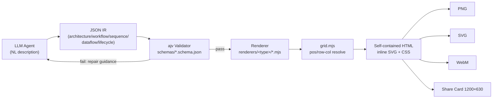
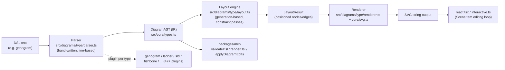
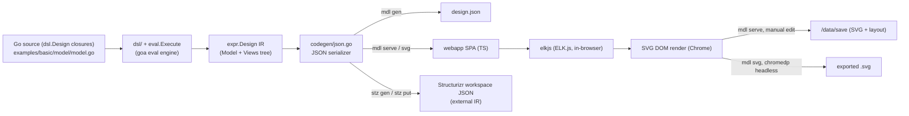
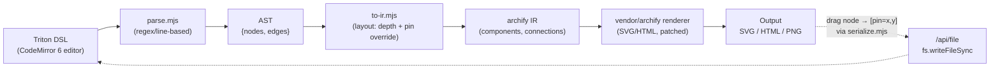

# Weekly Scan: Diagram Tooling — 2026-08-20

Phạm vi: repos trong domain diagram-as-code / DSL / SVG animation / graph
visualization / layout algorithm, published hoặc significantly updated trong
7 ngày qua (13–20/8/2026), phục vụ nghiên cứu kiến trúc cho kymostudio.

**Executive summary:**

- Tuần này bị chi phối bởi **`tt-a1i/archify`** (14.5k sao, v2.15.0 ra
  17/8/2026) — một "agent skill" biến JSON Schema thành ngôn ngữ đầu vào,
  cố tình bỏ auto-layout để giao hẳn phán đoán bố cục cho LLM; đáng học ở
  validation-gate (ajv) + atomic-write, không đáng học ở layout.
- **`SchemaTex/SchemaTex`** là phát hiện chất lượng nhất về kiến trúc: 52
  "diagram family" theo chuẩn ngành thực (y khoa, điện, luật), mỗi loại là
  một plugin `parser/layout/renderer/symbols` độc lập — mô hình tổ chức
  code đáng tham khảo trực tiếp cho kymostudio khi mở rộng ngoài BPMN.
- **`goadesign/model`** (DSL nhúng trong Go, layout đẩy hẳn ra ELK.js chạy
  trong Chrome headless) và **`devpilgrin/triton2`** (editor bidirectional
  canvas↔code vá ngay trên archify, 0 sao, rất non) là hai điểm dữ liệu đối
  lập nhau về độ trưởng thành — cả hai đều có 1-2 ý tưởng nhỏ đáng ghi chú
  (Structurizr-JSON-as-IR; `[pin=x,y]` round-trip) nhưng không có gì để
  đại tu kiến trúc hiện tại của kymostudio.

**Mục lục**

1. [Archify (tt-a1i/archify)](#archify-tt-a1iarchify)
2. [SchemaTex (SchemaTex/SchemaTex)](#schematex-schematexschematex)
3. [Model (goadesign/model)](#model-goadesignmodel)
4. [Triton2 (devpilgrin/triton2)](#triton2-devpilgrintriton2)
5. [Repos khác đáng chú ý (không deep-dive)](#repos-khác-đáng-chú-ý-không-deep-dive)

---

## Archify (tt-a1i/archify)

### §1 — Quick context

Archify không tự tính layout — nó biến JSON Schema thành "ngôn ngữ đầu vào" để agent LLM tự sinh IR có tọa độ sẵn, thay vì auto-layout hay DSL. Tech stack: Node.js ≥18 (bin `archify.mjs`), dep chính là `ajv` (JSON Schema validation) + `simple-icons`; xuất ra HTML self-contained, PNG/SVG/WebM, share-card 1200×630. Repo health: ~14.5k sao, 1k fork, nhưng chỉ ~2 contributor (tt-a1i, Yangtze-Seventh), có CI (`ci.yml`, `release.yml`, `dsh.yml`), release mới nhất v2.15.0 (17/8/2026), MIT. Phân phối: cài như "agent skill" qua `npx skills add tt-a1i/archify -g` vào thư mục skill của Claude Code/Cursor/Codex CLI, không phải package người dùng chạy trực tiếp.

### §2 — Architecture deep-dive

**A. Component inventory**
- `archify/bin/archify.mjs` — CLI entry, dispatch 11-12 subcommand (render, validate, deliver, preview, compare, inspect, check, visual-check, guide, brands, doctor, demo).
- `archify/bin/preview.mjs` — desktop watch-mode, reload chỉ khi revision hợp lệ.
- `archify/bin/visual-check.mjs`, `open-artifact.mjs` — kiểm tra hồi quy trực quan, mở artifact đã render.
- `archify/schemas/*.schema.json` (`architecture`, `workflow`, `sequence`, `dataflow`, `lifecycle`, `common`) — JSON Schema validate từng loại IR, `additionalProperties:false`.
- `archify/renderers/{architecture,workflow,sequence,dataflow,lifecycle}/` — mỗi loại có module render riêng (vd `render-architecture.mjs` + `grid.mjs`).
- `archify/renderers/shared/` — `geometry.mjs`, `text-fit.mjs`, `legend.mjs`, `layout-report.mjs`, `validator.mjs`, `diagnostics.mjs`, `cli.mjs`, `brand-marks.mjs`, `repository-evidence.mjs`.
- `archify/examples/*.json` — IR mẫu cho cả 5 loại diagram.

**B. Pipeline (happy path)**
1. Agent (được `SKILL.md` hướng dẫn) sinh trực tiếp file JSON IR đúng schema loại diagram cần vẽ, có sẵn `pos`/`size`.
2. Chạy `archify.mjs validate <type> file.json` — ajv kiểm schema, báo lỗi theo instance-path + id/label gần nhất.
3. Qua validate, chạy `deliver <type> source.json output.html --quality showcase` — CLI `spawnSync` renderer tương ứng.
4. Renderer (vd `render-architecture.mjs`) gọi `grid.mjs` để resolve tọa độ (pos ưu tiên, row/col chỉ là gợi ý), dựng HTML self-contained (inline SVG+CSS) bằng các util `shared/`.
5. Kết quả render trước tiên vào thư mục `mkdtemp` staging, rồi `fs.renameSync` thay thế atomically file đích — file cũ không bị hỏng nếu render lỗi.
6. HTML mở trong browser (`--open`) có menu export ra PNG/SVG/WebM/share-card.

**C. Data model / IR**: JSON thuần (không class/dataclass), validate bằng JSON Schema qua ajv. Vị trí (`pos`, `size`) là dữ liệu đầu vào tường minh, bất biến — renderer không tính lại layout, chỉ map row/col→pixel nếu thiếu `pos`. Không thấy khái niệm "compile xuống IR thấp hơn" — một tầng JSON IR duy nhất được renderer tiêu thụ trực tiếp.

**D. Input language design**: Không có DSL văn bản/grammar riêng — chính JSON Schema (`schemas/*.schema.json`) đóng vai trò "ngôn ngữ đầu vào", agent LLM được prompt (qua README/SKILL.md) để sinh JSON tuân thủ trực tiếp. Validation-gate là ajv: lỗi có instance path + id/label lân cận + message/params, chặn render nếu fail; lỗi hình học (chồng lấp...) không được schema bắt, để renderer xử lý riêng.

**E. Layout algorithm**: Không có auto-layout, không force-directed, không crossing-minimization — README nói rõ "general-purpose auto-layout... intentionally outside the current scope". `grid.mjs` chỉ làm toán grid tuyến tính (`x = origin_x + col*(cellW+gapX)`), "pos wins; row/col are optional hints". Routing cạnh qua `via` waypoint thủ công. Layout judgment giao hẳn cho agent LLM.

**F. Rendering/output**: 5 renderer riêng theo loại diagram, xuất HTML self-contained (inline SVG+CSS), animation opt-in qua `meta.animation:"trace"` (CSS/SVG motion, tôn trọng reduced-motion, 140–200ms theo DESIGN.md) — không có JS animation engine riêng được xác nhận. 4 preset thị giác (classic/signal-flow/blueprint/editorial) + dark/light chỉ đổi style, không đổi hình học. Export PNG/SVG/WebM/share-card qua menu trong HTML đã render; cơ chế convert cụ thể (headless browser?) — không xác định.

**G. Extensibility**: Không có plugin system hay API mở rộng loại diagram mới — 5 loại cố định (schema + renderer module theo cặp), thêm loại mới nghĩa là sửa trực tiếp trong repo. Theming giới hạn 4 preset dựng sẵn + toggle sáng/tối.

**H. Dev experience**: CLI phong phú (doctor, demo, guide gợi ý loại diagram từ mô tả tự nhiên, preview watch-mode "last-good", compare cho delta kèm rollback qua rename backup, visual-check hồi quy). Không phải IDE plugin/LSP — cài như agent skill vào thư mục skill của Claude Code/Cursor/Codex CLI.

### §3 — Architecture diagram



### §4 — Verdict

Đáng học: (1) validation-gate rõ ràng (ajv, lỗi gắn instance-path + id/label, chặn render khi fail) — kymostudio's `dsl.py` hiện "parsing... validates nothing" nên đây là pattern nên bổ sung trước layout/render; (2) staging + atomic rename (`mkdtemp` → `renameSync`) khi ghi output, tránh file dở dang — áp dụng được cho CLI `kymo`. JSON-IR-as-input-language là hướng ngược với `.kymo` text DSL: dễ cho LLM sinh trực tiếp nhưng mất khả năng con người viết tay gọn gàng — không nên bỏ `.kymo`, có thể học cách JSON Schema strict (`additionalProperties:false`) làm error-reporting tốt hơn.

Red flag: chỉ ~2 contributor dù 14.5k sao — cần nghi ngờ về mức độ trưởng thành thực sự; không có auto-layout nghĩa là chất lượng bố cục phụ thuộc hoàn toàn phán đoán của LLM, rủi ro chồng lấp/crossing không kiểm soát — đây chính là điểm kymostudio's `layout.py`/`alignment.py` đang làm tốt hơn. Cơ chế export HTML→PNG/SVG/WebM chưa xác minh được.

Kết luận: **study deeper** cho validation-gate + atomic-write pattern; **glance only** cho layout (không có gì để học vì họ cố tình bỏ auto-layout).

---

## SchemaTex (SchemaTex/SchemaTex)

### §1 — Quick context

Diagram engine tái tạo 52 loại sơ đồ theo *chuẩn ngành thực* (y khoa, điện, luật, PM) thay vì flowchart chung chung như Mermaid. Stack: TypeScript strict-mode, zero runtime deps, output SVG thuần (SSR-ready). Repo health: 64 sao, 3 fork, 21 issue mở, 364 commit trên main, có CI (`ci.yml`, `publish.yml`) nhưng số contributor và ngày release gần nhất không xác định. Phân phối qua npm (`schematex`, hiện bản 1.0.9, tree-shakable per diagram type) + package MCP riêng (`@schematex/mcp`).

### §2 — Architecture deep-dive

**A. Component inventory**
- `src/core/` — hạ tầng dùng chung: `types.ts` (IR/AST types), `svg.ts` (SVG string builder), `theme.ts` (token theming), `legend-parser.ts`/`legend.ts`, `source-range.ts` + `logical-lines.ts` (map lỗi/edit về vị trí source), `interactive-capabilities.ts`, `editing.ts`, `revision.ts` (interactive editing có version), `text-metrics.ts`.
- `src/diagrams/<type>/` — mỗi loại sơ đồ (47+ thư mục trong `examples/`, khớp README "52 families") là một plugin độc lập với `parser.ts`, `layout.ts`, `renderer.ts`, `symbols.ts`, `index.ts` riêng (đã xác nhận cấu trúc này ở `genogram/`).
- `src/ai/` — `examples.ts`, `syntax.ts`, `tools.ts`, `registry.ts`, `prompt-context.ts` v.v.: sinh nội dung phục vụ LLM (docs, ví dụ, tool schema) — build riêng qua `scripts/build-ai-content.mjs`.
- `packages/mcp/` — MCP server (`@schematex/mcp`), 8 tool: `listDiagrams`, `getSyntax`, `getExamples`, `validateDsl`, `renderDsl`, `getDiagramCapabilities`, `inspectDiagram`, `applyDiagramEdits`.
- `src/react.tsx`, `src/interactive.ts`, `src/browser.ts`, `src/export.ts`, `src/viewport.ts` — layer tích hợp React/browser/export, tách biệt khỏi core render.

**B. Pipeline / control flow** (dẫn chứng từ ví dụ genogram "The Potter Family" đọc được ở `docs/genogram.md`):
1. User gọi `render(dslText)` từ `schematex` (hoặc `schematex/genogram`).
2. Engine auto-detect diagram type từ dòng đầu (`genogram "The Potter Family"`), route tới `src/diagrams/genogram/parser.ts`.
3. Parser (line-based, tay viết) đọc từng dòng — vd `fleamont -- euphemia` (couple op), `harry [male, 1980, index]` (individual + attrs), `harry -hostile- dudley` (emotional relationship) — sinh `DiagramAST` (individuals + relationships).
4. `layout.ts` chạy 7 bước tuần tự: buildGraph → assignGenerations (BFS theo thế hệ) → orderNodesInGenerations → assignPositions → 3 pass constraint-resolution (centerChildrenUnderParents, unscrambleSibships, resolveOverlaps) → computeEdges → packageResult, sinh `LayoutResult` (nodes/edges có toạ độ).
5. `renderer.ts` đọc `LayoutResult`, build chuỗi SVG semantic qua `core/svg.ts`.
6. (Tuỳ chọn) `react.tsx`/`interactive.ts` bọc kết quả thành `SceneItem` để editor ghi ngược thay đổi vào DSL gốc qua `sourceRange`.

**C. Data model / IR**: Pipeline bất biến "Text → Parser → AST → Layout → LayoutResult → Renderer → SVG" — mỗi giai đoạn sinh cấu trúc mới, không mutate input. `DiagramAST` là union theo loại sơ đồ (`FishboneAST`, `PhyloTreeAST`, `FlowchartAST`, `BpmnAST`...); `LayoutResult` chứa `LayoutNode`/`LayoutEdge` đã có toạ độ + path SVG. `SceneItem` là lớp IR phụ cho interactive editing (key, kind, sourceRange, editable policy) — cho phép edit ghi ngược DSL mà không sửa AST gốc.

**D. Input language design**: Parser hand-written, line/token-based theo regex, mỗi diagram-type có parser riêng (không có parser generator chung). Có `ParseError` chuẩn hoá: `"Line ${line}, col ${column}: ${message}\n → ${source}"`, kèm gợi ý cho lỗi hay gặp (vd conflict thuộc tính, alias từ đồng nghĩa "dead"→"deceased" để chịu lỗi từ LLM). Không thấy EBNF chính thức trong source repo, nhưng docs website mô tả ngữ pháp bằng EBNF-style cho từng loại (README gọi là "AI-optimized DSL... avoids LLM failure modes").

**E. Layout algorithm**: Genogram dùng thuật toán phân tầng theo thế hệ (generation-based, giống Sugiyama nhưng tay viết, không force-directed) với nhiều pass constraint resolution — không rõ có tối thiểu hoá edge-crossing tường minh. README liệt kê thêm engine tính toán chuyên biệt theo chuẩn: PERT/CPM (ES/EF/LS/LF, critical path), fault-tree MOCUS, Petri-net token dynamics, Pugh weighted-scoring, RBD reliability — mỗi thứ là thuật toán layout/tính toán riêng theo domain, không xác nhận được chi tiết source cho từng cái ngoài genogram.

**F. Rendering/output**: SVG-only, chuỗi string thuần (SSR-ready, không phụ thuộc DOM); có export layer (`src/export.ts`) nhưng không xác định định dạng khác ngoài SVG. Không có bằng chứng hỗ trợ animation.

**G. Extensibility**: Thêm loại sơ đồ mới = thêm thư mục `src/diagrams/<type>/` với bộ 4 file chuẩn (parser/layout/renderer/symbols) + đăng ký export trong `package.json` `exports` map (tree-shakable). Theming: 2 lớp token (`BaseTheme` chung + semantic extension theo họ sơ đồ như `PersonTokens`, `BiologyTokens`), 3 preset dựng sẵn (default/monochrome/dark), có hàm resolve như `resolveFlowchartTheme()` merge base+specific, xuất cả JS object lẫn CSS custom properties.

**H. Dev experience**: CLI/API qua `npm install schematex` + `render()`; React component `InteractiveSchematexDiagram` cho editor tích hợp; MCP server hosted (`https://schematex.js.org/mcp`) hoặc local (`npx @schematex/mcp`) với 8 tool bao gồm validate/render/inspect/apply-edits (có revision-protected edit). Không xác định watch-mode CLI riêng cho DSL, nhưng có `tsup --watch` cho dev build và playground web (`schematex.js.org/playground`).

### §3 — Architecture diagram



### §4 — Verdict

Bài học cụ thể cho kymostudio: (1) mô hình "1 domain-standard = 1 plugin thư mục với 4 file chuẩn" (parser/layout/renderer/symbols) là cách tổ chức đáng tham khảo để mở rộng ngoài BPMN — rõ ràng hơn cách kymostudio hiện gộp layout/alignment chung một pipeline; (2) hệ theme 2-lớp token (base + semantic-per-family) là mẫu hình đơn giản, đáng học cho hệ icon của kymostudio; (3) MCP server tách riêng gói `@schematex/mcp` với tool `validateDsl`/`applyDiagramEdits` (revision-protected) là ý hay nếu kymostudio định làm AI-editing loop. Cờ đỏ: không tìm thấy animation support (khác biệt cốt lõi của kymostudio); "52 diagram families" là tổng hợp domain hẹp chứ chưa chắc mỗi loại có layout algorithm tinh vi — evidence chỉ xác nhận sâu ở genogram; AGPL-3.0 giới hạn tái sử dụng code trực tiếp. Câu hỏi mở: JS-only (không có Python song song) nên khó so sánh mô hình "hai impl song song" của kymostudio.

Kết luận: **study deeper** phần plugin/theme/MCP architecture, nhưng không cần đọc sâu từng thuật toán layout domain-cụ-thể.

---

## Model (goadesign/model)

### §1 — Quick context

DSL của model là Go API lồng closure (`func()`), biên dịch bằng `go build` — khác hẳn `.kymo`, một text-DSL được parse độc lập bởi kymostudio. Tech stack: Go 1.26, engine DSL mượn từ `goa.design/goa/v3/eval`, layout ELK.js chạy **trong trình duyệt** (chromedp headless Chrome cho export). Repo khỏe (465 sao, 1248 commit, MIT, có `.claude/` skill riêng). Phân phối qua `go install goa.design/model/cmd/{mdl,stz}`; không thấy binary release riêng.

### §2 — Architecture deep-dive

**A. Component inventory**
- `dsl/` (`design.go`, `elements.go`, `person.go`, `relationship.go`, `styles.go`, `views.go`, `deployment.go`) — fluent Go builder API (`Design`, `SoftwareSystem`, `Person`, `Views`, `Styles`...), thực thi qua `goa.design/goa/v3/eval`.
- `expr/` (`design.go`, `model.go`, `system.go`, `container.go`, `component.go`, `relationship.go`, `views.go`, `render.go`, `registry.go`) — cây IR runtime.
- `mdl/` (`model.go`, `elements.go`, `views.go`, `eval.go`) — lớp DTO có thể serialize JSON, mirror `expr/`.
- `cmd/mdl/` (`main.go`, `serve.go`, `watch.go`, `skill.go`, `webapp/`) — CLI + SPA editor nhúng (`go:embed webapp/dist`), subcommand `serve|gen|svg|skill install`.
- `cmd/mdl/webapp/src/` — SPA TypeScript, dùng `elkjs` v0.10.0 (6 thuật toán) để layout, render SVG qua DOM.
- `cmd/stz/` — CLI upload/download Structurizr workspace.
- `codegen/json.go` — serializer JSON cho `mdl gen`.
- `plugin/generate.go` — hook tích hợp vào pipeline `goa gen`.

**B. Pipeline** (dẫn chứng từ `examples/basic/model/model.go` đọc trực tiếp):
1. Dev viết file Go gọi `Design("Getting Started", "...", func(){ SoftwareSystem(...); Person(...); Views(func(){ SystemContextView(System,...,func(){ AddAll(); AutoLayout(RankLeftRight) }) ... }) })`.
2. `mdl svg/serve` load package này, chạy `dsl.RunDSL`/`eval.Execute`, xây `expr.Design` IR.
3. IR → JSON qua `codegen/json.go`, phục vụ tại `/data/model.json` bởi `serve.go`.
4. SPA TS trong `webapp/src` nạp JSON, gọi `elkjs` tính layout (theo `AutoLayout(RankLeftRight)`), render SVG DOM trong browser.
5. `mdl svg`: chromedp điều khiển Chrome headless, đợi layout ổn định, trích SVG ghi ra `-dir`.
6. `mdl serve`: người dùng kéo-thả chỉnh tay, SVG (kèm layout JSON nhúng trong `<script>`) POST về `/data/save`.

**C. Data model / IR**: `expr.Design{Name, Description, Version string; Model *Model; Views *Views}` — pointer-based, mutable; `Model` chứa `People/Systems/DeploymentNodes` (slice), lồng `Containers→Components`. Structurizr workspace JSON (qua `stz`) là một IR/export format thứ hai, tương thích hệ sinh thái Structurizr bên ngoài.

**D. Input language**: không có grammar text — là Go thật, hàm top-level nhận `func()` closure, chạy qua eval engine của Goa (dùng chung engine DSL API của Goa). Lỗi cú pháp/type bắt bởi `go build`; lỗi domain (thiếu argument, nesting sai) chỉ phát hiện lúc `eval.Execute` chạy, báo qua `eval.ReportError`/`eval.InvalidArgError` — hai tầng lỗi: compiler Go + evaluator runtime riêng.

**E. Layout**: ELK.js không chạy trong Go — nó là dependency npm (`elkjs`) bundle trong SPA TS, chạy hoàn toàn trong JS engine của trình duyệt (browser thật hoặc Chrome headless qua chromedp), Go không đụng ELK trực tiếp. 6 thuật toán: Layered, Stress, Tree, Force, Radial, Disco; edge routing orthogonal; crossing-minimization là nội bộ elkjs.

**F. Rendering/output**: SVG là DOM SVG do Chrome render rồi trích xuất — không phải string emitter như `to_svg.py`. Không tìm thấy bằng chứng animation ở bất kỳ đâu (`dsl/`, `expr/`, `mdl/`, `codegen/`, webapp).

**G. Extensibility**: thêm element type mới cần sửa 4 lớp xuyên 2 ngôn ngữ: `expr/` (struct+registry) + `dsl/` (builder func) + `mdl/` (DTO JSON) + webapp TS (renderer). Theming: `Styles(func(){ ElementStyle("tag", func(){ Background(...); Shape(...) }) })` theo `Tag(...)`.

**H. Dev experience**: `mdl serve` có watch (fsnotify) + livereload (`lrserver`), editor kéo-thả/undo-redo/snap-grid theo README, không auto-open browser. `mdl svg -all` cho CI headless. Có "diagram-editing skill" (`cmd/mdl/skill.go`) cài qua `mdl skill install`, dành riêng cho AI-agent (Claude Code) tích hợp.

### §3 — Architecture diagram



### §4 — Verdict

Bài học: (1) goadesign đẩy layout ra hẳn browser (ELK.js qua chromedp) thay vì tự viết resolver như `alignment.py` — đổi lấy 6 thuật toán mạnh nhưng phụ thuộc Chrome runtime, khó test byte-for-byte, trái ngược golden-SVG test của kymostudio. (2) DSL-as-Go-API được `go build` bắt lỗi cú pháp miễn phí nhưng mất tính portable/parse độc lập — kymostudio giữ text DSL để có dual Python/JS conformance mà goadesign không thể có (DSL của họ chỉ chạy được trong Go). (3) Structurizr workspace JSON là ví dụ interop format ngoài đáng tham khảo, tương tự BPMN import/export của kymostudio. (4) khái niệm multi-`View` cùng một model (SystemContext/Container view, `AddAll`+`AutoLayout` filter) đáng nghiên cứu thêm.

Red flag: không animation, SVG phụ thuộc browser render nên khó tái lập/headless thuần. Verdict: **glance only** — kiến trúc layout-in-browser & DSL-as-Go không áp dụng trực tiếp cho kymostudio, nhưng khái niệm View và Structurizr-JSON-as-IR đáng ghi chú.

---

## Triton2 (devpilgrin/triton2)

### §1 — Quick context

Triton2 là một **editor DSL-to-diagram song hướng** (bidirectional canvas↔code), bản chất là lớp phủ mỏng (parser + IR converter) trên engine render **archify** được vendor sẵn — không phải một rendering engine tự viết từ đầu. Stack: Node.js ≥20, JavaScript thuần (`.mjs`), CodeMirror 6 cho editor pane, esbuild để bundle bản browser. Tình trạng repo: **0 sao, rất mới, chỉ ~15 commit, version 0.4.0 nhưng README tự mô tả là "editor phase" v0.2** — cần lưu ý rõ đây là dự án cá nhân giai đoạn cực sớm. Phân phối qua npm (`npm install -g triton2`).

### §2 — Architecture deep-dive

**A. Component inventory**
- `bin/triton2.mjs` — CLI entry point, định nghĩa các lệnh `edit`, `demo`, `render`, `validate`, `--version` *(code gốc)*.
- `src/cli/edit-server.mjs` — HTTP server nội bộ (Node `http` module, bind loopback port ngẫu nhiên), phục vụ file tĩnh + API `GET/POST /api/file` để đọc/ghi trực tiếp file DSL trên đĩa *(code gốc)*.
- `src/convert/parse.mjs` — parser DSL→AST, dùng regex + xử lý theo dòng *(code gốc)*.
- `src/convert/to-ir.mjs` — converter AST→archify IR, **đồng thời tự tính layout** (longest-path depth algorithm) *(code gốc)*.
- `src/convert/{archimate.mjs, archimate-icons.mjs, keywords.mjs, shapes.mjs, serialize.mjs}` — hỗ trợ từ vựng ArchiMate, icon mapping, và serialize AST ngược lại thành DSL text *(code gốc)*.
- `src/core/{index.mjs, build.mjs, browser/}` — API core + bundle cho browser *(code gốc)*.
- `vendor/archify/` (renderers/, schemas/, assets/, PROVENANCE.md) — **archify v2.15.0 vendor nguyên khối, MIT**, chỉ patch 3 điểm nhỏ (export thêm hàm `render<Type>()`, export `validateSchema`, thêm ArchiMate preset vào template viewer) — phần validate + render SVG/HTML vẫn là code archify gốc, không sửa.

**B. Pipeline / control flow (happy path)**
1. User gõ Triton DSL trong CodeMirror 6, ví dụ:
```
archimate TD
  customer[Client] [arch:business.actor]
  crm[CRM] [arch:application.component]
  customer --> ordering
  crm --> api
```
2. Frontend gửi nội dung tới `parse.mjs` → sinh AST `{ direction, notation, nodes: [], edges: [] }`.
3. AST được đưa qua `to-ir.mjs`: tính depth layer (longest-path, chịu được cycle), gán tọa độ x/y (trừ khi node có `[pin=x,y]` — override), build `connections` với label anchor tránh chồng lấp node.
4. IR (schema archify: `schema_version`, `diagram_type`, `meta`, `components`, `connections`) được truyền cho archify renderer (vendor) → xuất SVG/HTML.
5. Canvas hiển thị kết quả; khi user kéo node, tọa độ mới được ghi ngược thành annotation `[pin=x,y]` trong DSL text (qua `serialize.mjs`), rồi POST lên `/api/file` để `fs.writeFileSync` ghi đè file nguồn trên đĩa.
6. Vòng lặp lặp lại: sửa code → redraw canvas ngay (in-browser, không có file-watch hay websocket được xác nhận).

**C. Data model / IR**: Node AST: `{ id, shape, label, color, pin, archimate }`; Edge AST: `{ id, source, target, label, direction, lineStyle, color }`. IR archify là JSON tĩnh (components có `pos`/`size` tuyệt đối) — **mutable mỗi lần re-render**, không giữ state giữa các vòng; nguồn sự thật duy nhất là chuỗi DSL text trên đĩa, IR chỉ là artifact trung gian tính lại từ đầu mỗi lần.

**D. Input language**: Parser **line-based, regex-driven**, không dùng lexer/grammar library (không giống PEG/ANTLR, cũng không tái dùng grammar Mermaid có sẵn — chỉ lấy cảm hứng cú pháp). Có các regex riêng cho header, arrow, ArchiMate annotation. **Không báo lỗi**: dòng không khớp bị bỏ qua âm thầm, không có số dòng, không exception — độ bền vững kém với input sai.

**E. Layout**: Không phải "chỉ pin thủ công": có **auto-layout mặc định** (longest-path depth → lưới theo GAP_COL/GAP_ROW, hướng TB/BT/LR/RL), `[pin=x,y]` chỉ override từng node khi user đã kéo. archify tự nó dường như không làm auto-layout — nhận IR đã có `pos` tuyệt đối, chỉ validate + render.

**F. Rendering/output**: Xác nhận: render SVG/HTML **hoàn toàn giao cho archify** (vendor, không sửa logic render), triton2 chỉ sinh IR. Export: HTML (standalone viewer), SVG, PNG (qua `upng-js`). Không có bằng chứng về animation thực sự trong archify — README chỉ nói "deterministic SVG/HTML".

**G. Extensibility**: Từ vựng ArchiMate mở rộng qua `src/convert/{archimate.mjs, archimate-icons.mjs, keywords.mjs}` — thêm layer/element mới cần sửa code, không có plugin API công khai.

**H. Dev experience**: Không phải websocket/SSE: cơ chế đồng bộ là **HTTP request-response đơn giản** (`GET/POST /api/file`), ghi thẳng xuống đĩa mỗi lần đổi — không có file-watch, không có push real-time từ server; đồng bộ canvas↔code chạy hoàn toàn **in-browser** (parse lại mỗi keystroke/drag), server chỉ đóng vai trò lưu trữ persist. Không thấy bằng chứng về autocomplete CodeMirror hay watch mode ngoài request/response cơ bản — "không xác định".

### §3 — Architecture diagram



### §4 — Verdict

Bài học đáng giá nhất cho kymostudio: cơ chế **round-trip vị trí qua annotation trong source** (`[pin=x,y]`) — đơn giản, không cần IR editor riêng, tương thích tự nhiên với pipeline text-DSL hiện có của kymostudio; đáng nghiên cứu nếu sau này muốn thêm visual editor. Cách kết hợp "auto-layout mặc định + override thủ công từng node" cũng là pattern hợp lý, gần với `alignment.py` resolver của kymostudio.

Red flags: 0 sao, ~15 commit, parser không báo lỗi (silent-fail), version tag lệch với mô tả "editor phase", không thấy CI/test coverage rõ ràng ngoài 1 file smoke test, không có bằng chứng animation thực. Câu hỏi mở: archify tự nó có auto-layout không, hay 100% dựa vào IR đã positioned (không xác định đầy đủ); cơ chế thực sự trong frontend khi kéo node (không đọc được code frontend).

Kết luận: **glance only, revisit later** — ý tưởng pin-annotation + round-trip đáng ghi chú ngắn, nhưng bản thân repo quá non và mỏng để đầu tư nghiên cứu sâu lúc này.

---

## Repos khác đáng chú ý (không deep-dive)

Các repo dưới đây khớp filter tuần này nhưng không đủ "thịt" kiến trúc (quá nhỏ,
quá thiết lập sẵn, hoặc đã quá quen thuộc) để deep-dive đầy đủ — ghi chú ngắn
để theo dõi tiếp trong các tuần sau:

- **`kieler/elkjs`** (2.7k sao, cập nhật 6 ngày trước) — bản build JS của
  Eclipse Layout Kernel (ELK); chính là layout engine mà cả `goadesign/model`
  lẫn nhiều tool khác (draw.io, Sprotty) dựa vào. Đáng theo dõi vì kymostudio
  hiện tự viết `alignment.py`/`layout.ts` thay vì dùng thư viện layout ngoài —
  so sánh chi phí "tự viết resolver" vs "nhúng ELK" là câu hỏi chiến lược dài
  hạn, không phải việc của tuần này.
- **`plantuml/plantuml`** (13.3k sao, cập nhật 3 ngày trước) — công cụ đã
  trưởng thành, không có novelty mới tuần này; liệt kê để ghi nhận vẫn còn
  hoạt động tích cực.
- **`sentimental37/lumeflow`** (0 sao, rất mới) — diagram system TypeScript
  dùng JSON làm "nguồn sự thật" (không phải DSL riêng), layout Dagre/grid/
  lane/manual, có visual builder kéo-thả + adapter React/Angular/Next.js/Web
  Component. Ý tưởng "JSON as source of truth + multi-framework adapter"
  đáng ghi chú nhưng repo 0 sao, quá non để đánh giá chất lượng thực.
- **`nordstad/PinViz`** (Python, 5 sao) — sinh sơ đồ đấu nối GPIO cho
  Raspberry Pi/ESP32 từ YAML/JSON hoặc Python API, tự động orthogonal/curved
  wire routing theo màu theo chức năng chân, có MCP server cho sinh sơ đồ
  bằng ngôn ngữ tự nhiên. Domain rất hẹp (GPIO), nhưng cách tổ chức
  "board template + wire router" là ví dụ nhỏ gọn của pattern "domain-specific
  layout" giống hướng tiếp cận của SchemaTex.
