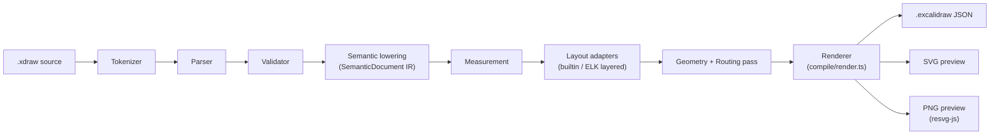
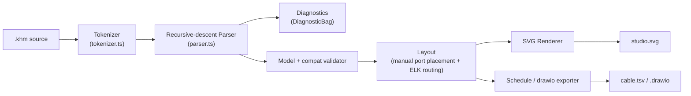
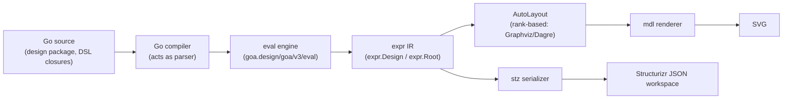
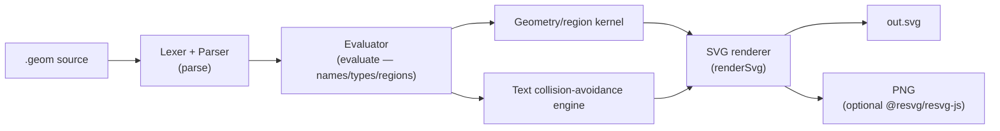

# Weekly Scan: Diagram Tooling — 2026-08-21

Phạm vi: các repo diagram-as-code / DSL-to-visual có hoạt động trong 7-30 ngày qua (2026-07-22 → 2026-08-21), tìm qua GitHub topic search (`diagram-as-code`, `dsl`, `graph-visualization`) và fallback WebSearch. Mỗi repo dưới đây đã được đọc trực tiếp: README, package manifest, ít nhất một file DSL mẫu, và các module lõi (parser/layout/renderer) qua `raw.githubusercontent.com`.

## Tóm tắt điều hành

- **3/4 repo chọn là dependency-free hoặc gần như dependency-free TypeScript**, và cả ba đều có một "seam" IR tường minh giữa parse và layout/render (xdraw gọi thẳng nó là `SemanticDocument`) — một pattern kiến trúc mà kymostudio đã có một phần (`model.py`/`model.ts` là IR chung) nhưng có thể học thêm về việc *đặt tên và ép kiểu tường minh* ranh giới đó.
- **Xu hướng đáng chú ý nhất trong tuần**: hai trong bốn repo (`goadesign/model`, `shand001/geometry-dsl`) đóng gói chính công cụ của mình thành **"agent skill"** (Claude/Cursor skill cài vào `.claude/skills/`) để LLM tự sửa lỗi qua mã lỗi có cấu trúc — một hướng đi kymostudio chưa có nhưng nên cân nhắc, vì `.kymo` cũng là ngôn ngữ mà agent hay sinh ra.
- **Kỹ thuật layout đáng học nhất**: `kumihimo` (Love-Rox) kết hợp layout thủ công cho vị trí port (theo hướng in/out cố định) với ELK chỉ để định tuyến cạnh trực giao — một mô hình lai "vị trí cố định + auto-routing" khác với cách kymostudio dùng resolver 5-pass cho toàn bộ vị trí.

## Mục lục

1. [fractalops/xdraw](#1-fractalopsxdraw)
2. [Love-Rox/kumihimo](#2-love-roxkumihimo)
3. [goadesign/model](#3-goadesignmodel)
4. [shand001/geometry-dsl](#4-shand001geometry-dsl)

---

## 1. fractalops/xdraw

**Repo**: https://github.com/fractalops/xdraw

### §1 — Bối cảnh nhanh

Compiler DSL biên dịch text thành scene Excalidraw gốc, mở lại và chỉnh tay được thay vì chỉ xuất ảnh tĩnh. Stack: TypeScript, Node ≥22.18; deps chính: Excalidraw, ELK.js (layout), MathJax, Shiki, resvg-js. Output: `.excalidraw` JSON, PNG, SVG, Excalidraw+ API. Repo health: 0 sao, 4 release/5 ngày (13–17/08/2026), có CI, test Node+Playwright+corpus fingerprint. Phân phối: npm (`npm link`), chưa rõ đã publish registry — không xác định.

### §2 — Kiến trúc chi tiết

**A. Component inventory** (từ `docs/architecture.md` và đường dẫn source thực tế đã fetch):
- `Tokenizer` (`src/language/` — tên file suy ra là `tokenizer.ts`) — biến source thành token có offset.
- `Parser` (`src/language/parser.ts`) — dựng `SourceDocument`, resolve theo manifest ra `DiagramDocument`.
- `Validator` (`src/language/validator.ts`) — kiểm tra tên constructor, thuộc tính, arity, quy tắc con; sinh lỗi kiểu "unknown constructor".
- `Semantic lowering` (`src/language/semantic.ts`) — hạ AST đã expand xuống `SemanticDocument` (ranh giới IR chính).
- `Expression/Curve` (`src/language/expression.ts`, `curve-sampler.ts`) — sublanguage biểu thức (18 hàm, 3 hằng, 5 toán tử) + lấy mẫu đường cong bằng interval arithmetic.
- `Measurement` (`src/compile/measurement.ts`) — đo kích thước nội dung trước khi đặt vị trí.
- `Layout adapters` (`src/compile/layout/builtin.ts` cho rows/columns/grid, `layered.ts` cho đồ thị ELK).
- `Geometry/Routing` (`src/compile/geometry-pass.ts`, `src/routing/`) — tinh chỉnh hình học sau auto-layout, định tuyến quanh node đã đặt.
- `Renderer` (`src/compile/render.ts`, `src/excalidraw/`) — module import nhiều nhất (~24 module), sinh `Drawing` cuối cùng.
- `Pipeline orchestrator` (`src/compile/pipeline.ts`) — export `compile`/`compileAsync`.

**B. Pipeline / control flow** — 6 bước happy path cho `xdraw build diagram.xdraw`:
1. CLI đọc file/stdin, gọi `pipeline.ts`.
2. `normalizeCompileInput`: `expandRepeats` → `expandDocument` → `drawPlots` → `buildSemanticIR` (template/`each`/`count` được expand trước khi vẽ curve).
3. Tokenize + parse + validate theo `src/language/` → `DiagramDocument`.
4. Hạ xuống `SemanticDocument` — ranh giới "source terms" → "geometry terms".
5. `compileAsync` chạy song song: chuẩn bị syntax highlighting + layout ELK (`layered.ts`) cho các node cần.
6. Đo đạc, đặt hình học, định tuyến cạnh, render ra Excalidraw elements → ghi `.excalidraw`/SVG/PNG.

**C. Data model/IR**: `SemanticDocument` là ranh giới IR trung tâm, tường minh gọi là "the seam" trong tài liệu — trước nó mọi thứ là "source terms, tokens, spans, constructors, templates", sau nó là "geometry, measured text, positioned bounds, routed connectors". Kiểu dữ liệu chia sẻ đặt trong `src/contracts/` (chỉ chứa type, bị TypeScript erase, không tốn runtime) — đúng khái niệm "compile xuống IR thấp hơn" mà đề bài hỏi (giống tinh thần TALA của D2 dù không cùng cơ chế). Không rõ mutable hay immutable qua từng pass — không xác định.

**D. Input language design**: parser tự viết (không phải PEG/ANTLR có sẵn) — có **EBNF chính thức** trong `docs/spec.md` (định nghĩa identifier, number, string, punctuation, và production đầy đủ cho `diagram-document`, `connection`, `expression`, `arrangement`/`align`/`distribute` v.v.). Lỗi cú pháp báo "unexpected token + vị trí nguồn"; lỗi ngữ nghĩa báo "invariant bị vi phạm + khai báo gốc nếu có". `check` command validate mà không sinh output.

**E. Layout algorithm**: hai chế độ song song — layout dựng sẵn (rows/columns/grid, tự viết) và layout dạng đồ thị qua **ELK** (`layered.ts`, tức Sugiyama-style layered layout của Eclipse Layout Kernel) cho sơ đồ kiến trúc dạng node-edge. Routing cạnh: định tuyến quanh node đã đặt ở pass geometry riêng sau layout (`geometry-pass.ts`, `src/routing/`) — không xác định đây là orthogonal thuần hay spline.

**F. Rendering/output**: một backend đích (Excalidraw JSON) nhưng nhiều preview format (SVG/PNG qua resvg-js). Không phải animation SVG — xdraw không có cơ chế animation.

**G. Extensibility**: tài liệu liệt kê 4 "seam" mở rộng chính thức: layout adapter (builtin vs layered), rich node family (formula/table/architecture — dùng cơ chế `template`), worker host (node vs browser), filesystem (rooted vs in-memory).

**H. Dev experience**: CLI có `build`/`check`/`apply`/`list`/`pull`; hỗ trợ pipe stdin; `--watch` không thấy nhắc tới trực tiếp — không xác định. Không có VS Code extension trong tài liệu đọc được.

### §3 — Sơ đồ kiến trúc

### §4 — Đánh giá

Đáng học nhất: ranh giới IR `SemanticDocument` được đặt tên tường minh, tài liệu hóa như "hợp đồng" kiến trúc ("everything before/after"), cùng nguyên tắc "dependencies point downward" (`contracts/` chỉ chứa type) — kymostudio có `model.py`/TS tương đương, có thể học cách viết architecture doc mô tả rõ ranh giới pass cho `alignment.py`. Layout đáng chú ý: tách layout builtin (rows/columns, tự viết) khỏi layout đồ thị (ELK) thay vì một engine duy nhất. Cú pháp đáng cân nhắc: expression sublanguage giới hạn (18 hàm/3 hằng/5 toán tử) để tolerance layout "provable, never underestimated". Red flag: 0 sao, cực mới, rủi ro breaking change cao. Verdict: **study deeper** (architecture doc, tách IR), theo dõi độ ổn định trước khi vay code cụ thể.

---

## 2. Love-Rox/kumihimo

**Repo**: https://github.com/Love-Rox/kumihimo

### §1 — Bối cảnh nhanh

DSL vẽ signal-flow AV, khác chỗ hiểu loại tín hiệu và **validate tương thích port-to-port** (cắm vừa vật lý nhưng sai chuẩn tín hiệu vẫn bị cảnh báo). Stack: TS monorepo (pnpm), `@love-rox/kumihimo-core` (parser/validator/layout/SVG) + `-cli`/`-rehype`/`-react`/`-vue`/`-astro`/`-editor`. Output: SVG, cable schedule TSV, tần số wireless, draw.io. Repo health: 1 sao, CI xanh, changesets, release 08/08/2026 (v0.12.1). Phân phối: npm scope `@love-rox`, VS Code extension riêng.

### §2 — Kiến trúc chi tiết

**A. Component inventory** (từ `packages/core/src/index.ts` và các file đã fetch trực tiếp):
- `Tokenizer` (`packages/core/src/tokenizer.ts`) — hàm `tokenize(source): Token[]`, không bao giờ throw, ký tự lạ thành token `invalid` mang theo span.
- `Parser` (`packages/core/src/parser.ts`) — class `Parser` recursive-descent, method riêng cho từng rule (`#statement()`, `#diagram()`, `#device()`, `#connection()`, `#portDecl()`...).
- `Diagnostics` (nội bộ `DiagnosticBag`, exception nội bộ `RecoverError`).
- `Compatibility checker` — module xử lý luật tương thích connector/signal (compat resolution).
- `Layout` (`packages/core/src/layout.ts`) — `layoutDiagram(diagram, options): Promise<DiagramLayout>`, kết hợp đặt port thủ công + ELK cho routing.
- `SVG renderer` — theming (4 theme, gồm "mono" cho in ấn).
- `Schedule/export generators` — cable schedule, wireless frequency map, drawio export.

**B. Pipeline/control flow** — happy path cho `kumihimo build studio.khm -o studio.svg`:
1. CLI đọc `.khm`, gọi `tokenize(source)` → `Token[]`.
2. `Parser` recursive-descent duyệt token stream, dựng AST, thu thập lỗi vào `DiagnosticBag` (không throw ra ngoài trừ lỗi không phục hồi được).
3. Model builder validate liên kết device/port và resolve compatibility signal (bảng ưu tiên 7 cấp: override thủ công → cùng loại → nhầm connector → adapter thụ động → cặp lossy → nhóm tương thích → không khớp).
4. `layoutDiagram`: tính vị trí box thiết bị + vị trí port cục bộ theo hướng in/out và thứ tự khai báo; gọi ELK chỉ để route cạnh trực giao giữa các port đã cố định vị trí; nhóm (`group`) xử lý đệ quy, cạnh được "park" ở group tổ tiên chung gần nhất để giữ nhất quán tọa độ.
5. SVG renderer áp theme, vẽ device box + cạnh đã route + nhãn cable.
6. Ghi `studio.svg` (hoặc chạy thêm export schedule/drawio nếu được gọi).

**C. Data model/IR**: AST (parser output) → model đã validate (device/port/compat) → `DiagramLayout` (kết quả layout). Không xác định rõ mutable/immutable qua các pass, nhưng thiết kế "never throws, mọi lỗi thành diagnostic" gợi ý các pass hoạt động độc lập, chịu lỗi tốt hơn là biến đổi tại chỗ một object dùng chung.

**D. Input language design**: **recursive-descent parser tự viết**, không dùng PEG/ANTLR. Không có EBNF chính thức công khai trong `docs/SPEC.md` đọc được (spec tập trung mô tả cú pháp bằng văn xuôi + ví dụ, không phải BNF) — nên phần grammar formal ghi "không xác định". Error-reporting: **error recovery theo từng statement** — một dòng lỗi chỉ làm hỏng 1 statement, không hỏng cả file; cơ chế `#fail()` ném `RecoverError`, `#recover()` skip token tới statement separator tiếp theo; `parse()` trả về `ParseResult` gồm cả syntax tree lẫn toàn bộ diagnostics — thiết kế rõ ràng nhắm tới live-editing (editor có thể hiển thị partial result trong lúc gõ).

**E. Layout algorithm**: **layout lai** — vị trí box thiết bị và vị trí port tính thủ công (theo hướng port và thứ tự khai báo, không phải force-directed hay Sugiyama đầy đủ), còn **routing cạnh dùng ELK orthogonal** giữa các điểm neo cố định. Crossing minimization: dùng chiến lược `INTERACTIVE` của ELK khi `order: fixed` được bật trong DSL. Đây khác hẳn cả xdraw (ELK layout node lẫn edge) và kymostudio (resolver 5-pass tự viết toàn bộ).

**F. Rendering/output**: SVG là backend chính, có theming (4 theme). Không phải animation. Emitter khác (drawio, TSV schedule) là các "exporter" riêng đọc từ cùng model đã layout — pattern pluggable emitter khá rõ (giống to_svg.py/to_figma.py của kymostudio).

**G. Extensibility**: builtin signal type có 38 loại theo category (video/audio/control/network/power/sync/wireless); `compat` declaration cho phép user override luật tương thích — đây là plugin/theming point rõ nhất được xác nhận. Cơ chế thêm shape/icon mới — không xác định.

**H. Dev experience**: CLI có `build --watch`, `check`, `export <collection>`; có VS Code extension riêng; có live editor component nhúng được (React/Vue/Astro); rehype plugin cho phép nhúng diagram trong Markdown — dev experience rất đầu tư.

### §3 — Sơ đồ kiến trúc

### §4 — Đánh giá

Đáng học nhất: (1) **statement-scoped error recovery** ("một dòng lỗi chỉ hỏng một statement") — nếu `dsl.py`/`dsl.ts` hiện fail-fast toàn file, đây là hướng nâng cấp rõ cho editor/LSP tương lai; (2) **layout lai vị trí-cố-định + auto-route** hợp với diagram có port/anchor tường minh (BPMN cũng vậy) — có thể xem xét cho edge phức tạp trong `alignment.py`; (3) **compat resolution 7 cấp ưu tiên** là mẫu validate ngữ nghĩa domain-specific sạch, đáng tham khảo cho kiểm tra kiểu port BPMN. Red flag: SPEC.md không có EBNF chính thức dù DSL khá phức tạp — rủi ro drift giống cảnh báo mà CLAUDE.md nhấn mạnh với `docs/DSL.md`. Verdict: **study deeper**, nhất là error-recovery và layout hybrid.

---

## 3. goadesign/model

**Repo**: https://github.com/goadesign/model

### §1 — Bối cảnh nhanh

Vẽ kiến trúc C4 bằng **Go code thật** — "diagram-as-code" nghĩa là closure Go lồng nhau, dùng toolchain Go thay vì viết ngôn ngữ mới. Stack: Go ≥1.23, dựa `goa.design/goa/v3/eval` (eval engine chung với Goa), chromedp, fsnotify, lrserver. Output: SVG, JSON Structurizr workspace, tích hợp cloud Structurizr. Repo health: 465 sao, CI xanh, release rất dày (5 bản/2 ngày, 20–21/08/2026), Go Report Card. Phân phối: `go install .../cmd/mdl` và `cmd/stz`, MIT.

### §2 — Kiến trúc chi tiết

**A. Component inventory** (đọc trực tiếp `dsl/design.go`, `go.mod`, README):
- `DSL package` (`dsl/design.go`, `dsl/element.go`, `dsl/view.go`, `dsl/relationship.go`, `dsl/style.go`) — các hàm Go top-level như `Design()`, `Version()`, `SoftwareSystem()`, `Views()`, `AutoLayout()`, `ElementStyle()` xây dựng cây expression.
- `Eval engine` (bên ngoài repo, `goa.design/goa/v3/eval`) — quản lý "current evaluation context" stack, được `dsl` package gọi (`eval.Current()`, `eval.Execute()`, `eval.ReportError()`).
- `expr` package (`goa.design/model/expr`) — cây `expr.Design`/`expr.Root` mà DSL functions thao tác lên — đây là IR trung gian.
- `mdl` package/binary (`cmd/mdl`) — editor đồ họa tương tác + renderer SVG + CLI (`serve`, `gen`, `skill install`).
- `stz` package/binary (`cmd/stz`) — serialize ra Structurizr JSON workspace, đồng bộ với dịch vụ Structurizr cloud (`put`/`get`).
- `plugin` package — code generator plugin, đăng ký qua blank import `_ "goa.design/model/plugin"` trong `dsl/design.go`.
- `codegen` package — sinh code/tài liệu từ model.

**B. Pipeline/control flow** — happy path cho `mdl gen mymodule/model -out design.json`:
1. Go build compile package `design` của user, trong đó biến `var _ = Design(...)` chạy như một side-effect khi package init.
2. `Design()` push `expr.Root` lên stack eval context của `goa.design/goa/v3/eval`, chạy closure con (các hàm `SoftwareSystem`, `Person`, `Views`...), mỗi hàm append vào `expr.Root` tương ứng vị trí hiện tại trên stack (không có bước "parse text" — Go compiler đã làm việc đó).
3. `eval.Execute` validate cấu trúc (đúng DSL context hay không — vd. gọi sai chỗ thì `eval.IncompatibleDSL()`).
4. `mdl` CLI load package đã build, gọi `AutoLayout` (nếu có) với thuật toán rank-based (RankTopBottom/LeftRight/... qua Graphviz hoặc Dagre) để tính vị trí node.
5. Renderer đo nội dung, tính layout đầy đủ, kiểm tra hình học (v1.16.6: "measures diagram content, computes one complete layout, checks it before drawing").
6. Ghi SVG/JSON ra `gen/` hoặc mở editor đồ họa tương tác (`mdl serve`).

**C. Data model/IR**: cây `expr.Design`/`expr.Root` (struct Go, không phải dataclass — nhưng tương đương). Không phải text AST — bản thân Go closures đóng vai trò "AST" tại thời điểm build. Có "compile xuống lower IR" không? Có phần: `expr` package tách biệt với `dsl` (mô tả) và `mdl`/`stz` (tiêu thụ), giống D2's TALA ở việc tách API viết vs. cấu trúc dữ liệu tiêu thụ, nhưng không có bước lowering rõ ràng như xdraw — không xác định chi tiết hơn.

**D. Input language design**: đây không phải parser text (không lexer/PEG/ANTLR) mà là **internal DSL bằng Go native syntax + closure**, dùng chung eval engine với framework Goa. Lỗi báo qua `eval.ReportError()`/`eval.InvalidArgError()`/`eval.IncompatibleDSL()` — về bản chất là runtime validation khi Go program chạy, **không có formal grammar** (Go compiler đã là "parser"). Ghi "không xác định" cho error-location reporting chi tiết (line/col) — không đọc được code xử lý vị trí lỗi.

**E. Layout algorithm**: `AutoLayout(RankDirection, ...)` — **rank-based/layered layout** (kiểu Sugiyama), có `RankSep`/`NodeSep`/`EdgeSep` để chỉnh khoảng cách, implementation pluggable (Graphviz hoặc Dagre theo tài liệu tìm được qua pkg.go.dev). Cũng cho phép người dùng tự đặt vị trí (drag trong editor `mdl serve`) — nghĩa là hỗ trợ cả auto lẫn manual.

**F. Rendering/output**: single primary backend (SVG qua `mdl`), cộng JSON Structurizr workspace (qua `stz`) để tương tác với dịch vụ cloud của bên thứ ba. Không có animation.

**G. Extensibility**: style qua `ElementStyle()`/`Background()`/`Color()`/`Shape()` trong `Styles()` block; code-gen plugin đăng ký qua blank import (`plugin` package) — đúng pattern Go idiomatic cho extensibility nhưng đòi hỏi recompile, không phải config runtime.

**H. Dev experience**: nổi bật nhất trong 4 repo — `mdl serve` là **editor đồ họa tương tác** với live-reload (`fsnotify` + `lrserver`), và **v1.16.9 vừa thêm `mdl skill install`**: cài "Agent Skill" (cho Cursor/Claude) vào `.agents/skills/` hoặc `.claude/skills/` để agent tự sửa/render/review diagram theo đúng ngữ nghĩa C4 ownership/boundary — xu hướng đóng gói tool thành skill cho coding agent, xuất hiện đồng thời ở `shand001/geometry-dsl` tuần này.

### §3 — Sơ đồ kiến trúc

### §4 — Đánh giá

Đáng học nhất: **internal DSL bằng Go thay vì text DSL riêng** là trade-off khác hẳn kymostudio's `.kymo`, nhưng cách tách `dsl` (API viết) khỏi `expr` (IR tiêu thụ bởi renderer) xác nhận đúng pattern `dsl.py`/`model.py` đã dùng. Ý tưởng layout: `RankSep`/`NodeSep`/`EdgeSep` — tham số tinh chỉnh rank-layout đáng expose tương tự cho auto-layout frame trong `alignment.py`. Điểm nổi bật tuần này: `mdl skill install` đóng gói CLI thành Agent Skill cài vào `.claude/skills/` dạy agent sửa diagram đúng ngữ nghĩa — kymostudio có CLAUDE.md chi tiết nhưng chưa có skill đóng gói tương tự cho `.kymo`, đáng học. Red flag: release dày (5 bản/2 ngày) gợi ý quy trình thiếu batch hoặc test coverage yếu. Verdict: **study deeper** (Agent Skill packaging, tham số layout); phần internal-DSL chỉ **glance only**.

---

## 4. shand001/geometry-dsl

**Repo**: https://github.com/shand001/geometry-dsl

### §1 — Bối cảnh nhanh

DSL vẽ hình học (không phải kiến trúc/flowchart), khác biệt ở chỗ nhắm thẳng tới **AI agent tự sửa lỗi** qua mã lỗi có cấu trúc, không phải người dùng cuối. Stack: TypeScript, Node ≥22.18, **zero runtime dependency** (resvg-js cho PNG là optional). Output: SVG, PNG. Repo health: 2 sao, **1 commit duy nhất**, không CI badge, contributor không rõ — dự án rất sớm, giống một lần "code dump". Phân phối: npm `@geometry-dsl/renderer`, CLI `dist/cli.js`, MIT.

### §2 — Kiến trúc chi tiết

**A. Component inventory** (từ README + package.json + `references/language-reference.md` đã đọc trực tiếp):
- `Lexer + Parser` — mô tả là "pure syntax front end", export hàm `parse()`.
- `Evaluator` — xử lý "names, types, overloads, styles, region expressions", export hàm `evaluate()`; đây là nơi 15 hàm hình học lõi (`point`, `along`, `line`, `circle`, `arc`, `path`, `project`, `intersect`, `transform`, `mark`, `text`, `inside`, `union`, `intersection`, `difference`) được thực thi thành hình học cụ thể.
- `Geometry/region kernel` — mô tả là "platform-independent numeric geometry and region kernel", xử lý các phép toán region (`union`/`intersection`/`difference`).
- `Text layout engine` — "deterministic collision-avoidance engine" đặt nhãn tự động trong vùng cho phép.
- `SVG renderer` — export `renderSvg()`; và hàm gộp một bước `compileToSvg()`.
- `CLI` (`dist/cli.js`) — `node dist/cli.js file.geom -o out.svg`.

**B. Pipeline/control flow** — happy path cho `node dist/cli.js pythagoras.geom -o out.svg`:
1. CLI đọc file `.geom`, gọi `compileToSvg(source)` (hoặc gọi tách bước `parse` → `evaluate` → `renderSvg`).
2. `parse()`: lexer + parser (pure syntax) dựng AST từ token — theo `references/language-reference.md`, identifier/number/string theo lexical rule dạng regex-like đơn giản (`[A-Za-z_][A-Za-z0-9_]*`, số có thể có mũ khoa học).
3. `evaluate()`: AST được duyệt, mỗi tên (point, line, ...) được định nghĩa **một lần, không gán lại** ("Names are defined before use and cannot be reassigned") — style gần với biến immutable/SSA; các hình dẫn xuất qua `along`/`project`/`intersect`/`transform` từ định nghĩa gốc.
4. Text/label: engine collision-avoidance tìm vị trí chữ hợp lệ trong region cho phép; nếu không có vị trí nào ở mọi cỡ chữ được phép → lỗi cứng `E_LAYOUT`.
5. `renderSvg()`: sinh SVG xác định (deterministic, "byte-identical output" theo README).
6. Ghi ra `out.svg` (hoặc PNG nếu có `@resvg/resvg-js`).

**C. Data model/IR**: AST (từ parser) → giá trị đã evaluate (điểm/đường/vùng cụ thể, kiểu dữ liệu hình học số) → lệnh vẽ SVG. Ràng buộc "định nghĩa một lần, không gán lại" cho thấy IR có xu hướng bất biến (immutable) qua pass evaluate, nhưng không đọc được source thực tế để xác nhận cấu trúc struct/class cụ thể — không xác định chi tiết implementation.

**D. Input language design**: **lexer + parser tự viết** (không PEG/ANTLR theo mô tả "pure syntax front end"). Không có EBNF hình thức đầy đủ tìm thấy (chỉ có lexical rule dạng regex cho identifier/number trong `references/language-reference.md`, phần còn lại mô tả bằng văn xuôi + danh sách reserved words) — ghi "không xác định" cho grammar production đầy đủ. Error-reporting là điểm mạnh nhất: **mã lỗi có cấu trúc kèm line/column** (ví dụ `E_LAYOUT`), thiết kế rõ ràng để phục vụ "self-repair loop" của AI agent (agent đọc mã lỗi, tự sửa DSL, thử lại) — khác hẳn cách báo lỗi dạng câu văn tự do của 3 repo còn lại.

**E. Layout algorithm**: không phải auto-layout kiểu graph (không có khái niệm node/edge như 3 repo trên) — đây là **hệ dựng hình quyết định luận** (deterministic construction): người dùng định nghĩa điểm/đường gốc, mọi hình khác *dẫn xuất* qua các hàm thuần túy (`along`, `project`, `intersect`, `transform`) chứ không phải constraint solver giải hệ phương trình. Duy nhất phần đặt nhãn chữ (`text`/`mark`) dùng thuật toán collision-avoidance tự động trong region cho phép.

**F. Rendering/output**: một backend duy nhất (SVG), PNG là lớp raster tùy chọn phía sau. Không có animation.

**G. Extensibility**: không xác định — không đọc được cơ chế thêm hàm hình học mới hay theme; README chỉ liệt kê 15 hàm cố định.

**H. Dev experience**: CLI đơn giản, có script `validate_geometry.mjs` (chỉ check lỗi, không render) và `render_geometry.mjs` (render PNG) tách biệt — hữu ích cho agent muốn validate nhanh trước khi render tốn kém. Không có VS Code extension/watch mode/browser preview tìm thấy — không xác định/không có bằng chứng.

### §3 — Sơ đồ kiến trúc

### §4 — Đánh giá

Đáng học nhất: **mã lỗi có cấu trúc (`E_LAYOUT`...) kèm line/column, thiết kế riêng cho vòng lặp tự-sửa của AI agent**. Agent sinh `.kymo`/`.bpmn` trực tiếp rất nhiều — nếu `dsl.py`/`dsl.ts` chuẩn hóa mã lỗi ổn định (thay vì exception message tự do), các agent-loop sẵn có (`kymo-parity`, `loop-design`) sẽ tự sửa hiệu quả hơn. Ý tưởng ngôn ngữ: ràng buộc "định nghĩa một lần, không gán lại" buộc luồng dữ liệu dẫn xuất tường minh — đáng tham khảo cho validate nếu `.kymo` có case gán lại gây khó debug. Layout không áp dụng trực tiếp (không phải graph). Red flag lớn: **1 commit, 2 sao, không CI** — gần chắc chắn là code dump chưa qua kiểm chứng. Verdict: **glance only** code cụ thể; **study deeper** riêng ý tưởng structured error code cho self-repair.
