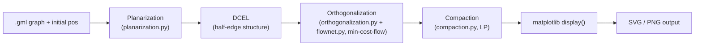
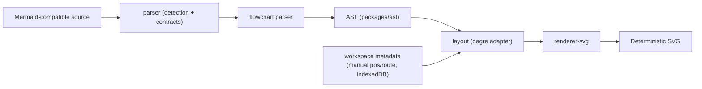
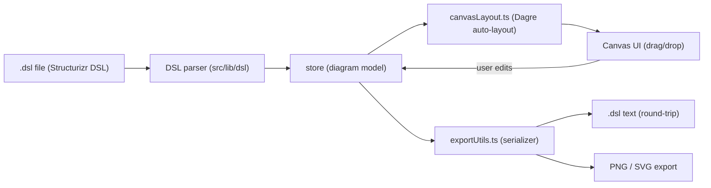
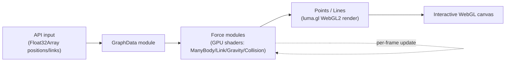

# Weekly Diagram Tooling Scan — 2026-08-22

## Executive Summary

- **Layout algorithm đáng học nhất tuần này là `tsmpy`**: cài đặt đầy đủ pipeline TSM (planarization → orthogonalization → compaction) cho orthogonal routing bằng min-cost-flow LP — kymo hiện chưa có orthogonal edge routing, đây là tài liệu tham khảo thuật toán cụ thể nhất tìm được.
- **`sculpt` là bản thiết kế package boundary gần với kiến trúc kymo nhất**: tách rõ `parser → ast → layout → renderer-svg` thành các package độc lập, và có nguyên tắc "không nhúng toạ độ thủ công vào Mermaid source" — đáng đối chiếu với cách kymo tách `dsl.py`/`layout.py`/`alignment.py`/`to_svg.py`.
- **`c4hero`** minh hoạ pattern "bidirectional DSL ⇄ visual editor" (kéo-thả trên canvas ghi ngược lại `.dsl` text) mà kymo/editor chưa làm; **`cosmos.gl`** là case study về tách simulation (GPU force) khỏi rendering (WebGL) — ít liên quan trực tiếp đến kymo (kymo không làm force-directed) nhưng đáng glance về kỹ thuật tách physics/render.

**Repos scan được (không đủ 4 kết quả topic-search cấp cao ở mức stars>50 trong 7 ngày** — đã fallback sang keyword-based + duyệt trực tiếp GitHub Topics `diagram-as-code`/`layout-algorithm` sort theo "recently updated", loại bỏ template-pack/agent-skill repos như `diagram-design`, `archify`, `diag-agent` vì không có parser/layout/renderer riêng để phân tích kiến trúc):

| # | Repo | Pitch | Verdict |
|---|------|-------|---------|
| 1 | [`uknfire/tsmpy`](https://github.com/uknfire/tsmpy) | TSM orthogonal layout algorithm (Python) | study deeper |
| 2 | [`S1naps1s/sculpt`](https://github.com/S1naps1s/sculpt) | Mermaid-compatible text-to-diagram engine, package theo pipeline | study deeper |
| 3 | [`c4hero/c4hero`](https://github.com/c4hero/c4hero) | Visual C4 editor ghi ra Structurizr DSL thuần | glance only |
| 4 | [`cosmosgl/graph`](https://github.com/cosmosgl/graph) | GPU force-directed graph rendering v3.0 | glance only |

---

## 1. `uknfire/tsmpy`

### §1 — Quick Context
Thư viện Python cài đặt thuật toán **Topology-Shape-Metrics (TSM)** để tạo orthogonal layout cho planar graph — khác các layout engine phổ biến (dagre/ELK) ở chỗ đây là cài đặt trực tiếp một thuật toán học thuật cụ thể (dựa trên thesis "A Generic Framework for the TSM Based Layout"), không phải một framework layout đa năng.
- **Tech stack**: Python, phụ thuộc `networkx` (xử lý đồ thị) + `matplotlib` (visualize), tối ưu bằng linear programming / min-cost-flow (networkx built-in solver hoặc LP).
- **Repo health**: 8 stars, 5 forks, 184 commits, 1 issue mở — dự án nhỏ, một người maintain, không có badge CI rõ trong README.
- **Distribution**: `pip install -r requirements.txt` — chưa publish lên PyPI, cài từ source.

### §2 — Architecture Deep-dive

**A. Component inventory**
- `TSM` class (`tsmpy/tsm/tsm.py`) — orchestrator chính, nhận `networkx.Graph` + vị trí node ban đầu.
- `planarization.py` — giai đoạn 1: resolve edge crossing, biến graph tổng quát thành planar graph.
- `orthogonalization.py` — giai đoạn 2: gán hướng cạnh (H/V) theo lưới orthogonal.
- `compaction.py` — giai đoạn 3: nén toạ độ để giảm kích thước diagram, giữ nguyên topology orthogonal.
- `flownet.py` — dựng flow network dùng chung bởi orthogonalization/compaction để giải bài toán bằng min-cost-flow.
- `dcel/` — cấu trúc **Doubly Connected Edge List**, nền tảng hình học tính toán cho planar graph traversal (half-edge structure).

**B. Pipeline / control flow**
1. User load graph từ file `.gml` bằng `networkx.read_gml`, có sẵn vị trí node ban đầu (`pos = {node: eval(node) for node in G}`).
2. `TSM(G, pos)` khởi tạo — constructor chạy pipeline nội bộ.
3. Bước Topology: `planarization` resolve crossing → sinh planar embedding.
4. Bước Shape: `orthogonalization` gán hướng cạnh H/V cho từng planar face, dùng `flownet` model hoá bằng min-cost-flow (LP nếu `uselp=True`, ngược lại dùng networkx solver có sẵn).
5. Bước Metrics: `compaction` giải LP thứ hai để nén toạ độ thực (x, y) trong khi giữ ràng buộc orthogonal.
6. `tsm.display()` vẽ layout qua matplotlib → `plt.savefig(...)` xuất SVG.

**C. Data model / IR**
IR chính là `networkx.Graph`/`PlanarEmbedding` được biến đổi qua từng giai đoạn (mutate in-place qua pipeline), cộng với `DCEL` (half-edge) làm cấu trúc hình học trung gian cho planarization/orthogonalization. Không có class IR riêng biệt kiểu dataclass — model dựa hoàn toàn vào cấu trúc dữ liệu của networkx + DCEL, mutable giữa các pass (không có concept "compile xuống lower IR" tách bạch như D2's TALA).

**D. Input language design**
Không có input DSL text — input là graph object (`networkx.Graph`) load từ `.gml`, tức đây là một **layout algorithm library**, không phải diagram-as-code tool có parser văn bản. Không xác định error-reporting strategy (không thấy custom exception/diagnostics trong các file đã đọc).

**E. Layout algorithm — trọng tâm của repo**
- Orthogonal layout theo đúng 3 giai đoạn kinh điển của TSM: **Topology** (planarize) → **Shape** (orthogonalize, gán hướng cạnh) → **Metrics** (compact toạ độ).
- Input constraint chặt: đồ thị phải planar, connected, max-degree 4, không self-loop — đặc trưng của lớp thuật toán orthogonal-layout (không tổng quát hoá được cho degree cao như kymo cần).
- Không có crossing-minimization kiểu Sugiyama/barycentric riêng — planarization giả định input đã planar hoặc gần-planar.
- Edge routing: orthogonal thuần (chỉ ngang/dọc), không có spline/curve.

**F. Rendering / output**
Chỉ có 1 backend: matplotlib → PNG/SVG qua `savefig`. Không animation, không pluggable emitter — display() là hard-coded matplotlib.

**G. Extensibility**
Không thấy plugin system, theme, hay cách thêm shape mới — đây là research-grade single-purpose library, không phải sản phẩm end-user.

**H. Dev experience**
CLI không có (chỉ import Python). Không IDE integration, không watch mode, không browser preview. `test.py` chạy qua `python test.py` với test-case cụ thể trong `test/inputs/*.gml`.

### §3 — Architecture Diagram

### §4 — Verdict
**Đáng học**: TSM là mô hình 3-giai-đoạn (topology/shape/metrics) rõ ràng nhất tìm được tuần này cho orthogonal edge routing — kymo's `alignment.py` hiện chỉ làm auto-layout frame + fan-in staggering, chưa có orthogonal routing thực sự (min-bend). Ý tưởng đáng steal: dùng min-cost-flow để tối ưu số lần bẻ góc cạnh (edge bends) thay vì heuristic — có thể áp dụng cho trường hợp kymo cần route cạnh qua nhiều region tránh chồng lấn.
**Red flag**: input constraint quá chặt (planar, max-degree 4) — không áp dụng trực tiếp được cho kymo diagrams thực tế (nhiều diagram BPMN/flowchart có node degree cao, non-planar). Code chưa có test coverage rõ ràng cho edge case, 1 người maintain, không CI badge.
**Open question**: chưa rõ hiệu năng trên graph lớn (không có benchmark trong README).
**Verdict: study deeper** (thuật toán, không phải để dùng trực tiếp — đọc `orthogonalization.py`/`flownet.py` để lấy ý tưởng cho tương lai nếu kymo làm orthogonal routing).

---

## 2. `S1naps1s/sculpt`

### §1 — Quick Context
Text-to-diagram engine tương thích cú pháp Mermaid flowchart, khác biệt chính: **tách cứng "structure" (Mermaid source) khỏi "presentation"** (vị trí thủ công, route cạnh) — sửa vị trí trên canvas không ghi đè lên DSL source mà lưu riêng như workspace metadata.
- **Tech stack**: TypeScript monorepo, React + Vite (UI), Dagre (layout adapter), SVG renderer tự viết, IndexedDB (persistence).
- **Repo health**: 0 stars, 0 forks, 1 open issue/PR — dự án rất mới (giai đoạn Phase 1-3), có test suite (unit + Playwright visual regression + security tests) nhưng chưa thấy CI badge xác nhận.
- **Distribution**: chưa publish — chạy qua `npm install && npm run dev`, có `packages/cli` đang phát triển.

### §2 — Architecture Deep-dive

**A. Component inventory**
- `packages/ast` — typed diagram representation (AST layer).
- `packages/parser` — "detection và parsing contracts" (interface chung cho nhiều diagram type).
- `packages/flowchart` — parser cụ thể tương thích cú pháp Mermaid flowchart.
- `packages/layout` — dagre adapter + geometry resolution.
- `packages/renderer-svg` — sinh SVG deterministic.
- `packages/core` — API layer tái sử dụng cho parse+render.
- `packages/workspace` — persistence/sync (IndexedDB) cho manual position/route metadata.
- `packages/themes` — hệ thống styling.
- `packages/cli` — CLI nền tảng (đang phát triển).
- `apps/web` — editor UI (React/Vite), tiêu thụ các package trên.

**B. Pipeline / control flow**
1. User gõ Mermaid flowchart syntax trong editor (`apps/web`) hoặc nạp qua `packages/core`.
2. `packages/parser` detect diagram type → dispatch cho `packages/flowchart` parse cú pháp cụ thể.
3. Parser sinh **AST** (`packages/ast`) + layout metadata kèm theo (nếu user đã có manual position lưu trong workspace).
4. `packages/layout` (dagre adapter) tính toán geometry cho node/edge chưa có vị trí thủ công.
5. `packages/renderer-svg` render AST + geometry → SVG deterministic.
6. Vị trí/route user kéo-thả trên canvas được ghi vào `packages/workspace` (IndexedDB) — **không** ghi ngược vào Mermaid source text.

**C. Data model / IR**
AST typed (package riêng `ast`) tách biệt khỏi layout metadata — 2 lớp dữ liệu: (1) structure AST từ parse, (2) layout/geometry state lưu ngoài source. Đây là **immutable source, mutable presentation layer** — một quyết định thiết kế rõ ràng để giữ Mermaid source "sạch", khác cách nhiều tool (kể cả kymo) nhúng toạ độ ngay trong file `.kymo`. Không xác định rõ AST có concept "compile xuống lower IR" hay không (không đọc được source code, chỉ dựa vào README + tree listing).

**D. Input language design**
Parser approach: không xác định rõ (regex line-based hay proper tokenizer) — README mô tả "detection and parsing contracts" gợi ý kiến trúc pluggable multi-format (mỗi diagram-type có parser riêng implement chung interface), tương tự cách kymo có `dsl.py` (native) và `from_bpmn.py` (BPMN) cùng đổ vào `Diagram` model. Formal grammar (EBNF/BNF) không thấy được nhắc trong README — khác kymo, nơi `docs/DSL.md` là spec chuẩn dual-sourced. Error reporting: có "structured diagnostics" theo README nhưng không xác định chi tiết cơ chế.

**E. Layout algorithm**
Dùng Dagre (hierarchical, Sugiyama-family) qua adapter riêng — không tự cài thuật toán layout, mà bọc dagre rồi cộng thêm layer "manual override" cho vị trí/route user chỉnh tay trên canvas (tương tự Structurizr view overrides). README nói rõ "advanced constrained hybrid layout" **chưa** implement — roadmap tương lai, không phải hiện trạng.

**F. Rendering / output**
Single backend: SVG deterministic (không PNG/PDF theo README). Không animation. Renderer tách riêng package (`renderer-svg`) — kiến trúc pluggable-emitter tiềm năng dù hiện chỉ có 1 emitter.

**G. Extensibility**
`packages/themes` cho styling; kiến trúc multi-package cho phép thêm diagram-type mới bằng cách thêm 1 package parser mới implement chung "parsing contract" (giống mô hình front-end pluggable của kymo: `.kymo`/`.bpmn`/`.py` → cùng đổ vào `Diagram`).

**H. Dev experience**
CLI đang ở giai đoạn "foundation" (`packages/cli`), chưa rõ UX. Có Playwright visual regression test — dấu hiệu coi trọng correctness của SVG output byte-for-byte (tương tự golden-SVG test của kymo). Không thấy VS Code extension/LSP. Có browser preview qua `apps/web` dev server.

### §3 — Architecture Diagram

### §4 — Verdict
**Đáng học cho kymo**: nguyên tắc "structure source ≠ presentation override, lưu tách biệt" là điểm đối chiếu trực tiếp có giá trị — kymo hiện dùng `LAYOUT`/`layout {}` block ngay trong `.kymo`/`.py`, còn sculpt tách hẳn override ra workspace state riêng, cho phép cùng 1 source Mermaid chạy được ở tool khác không mất tính tương thích. Đáng cân nhắc khi thiết kế editor.kymo.studio: có nên tách "user đã kéo tay vị trí X" ra khỏi `.kymo` source để giữ file diff sạch không.
**Red flag**: 0 sao, rất sớm (Phase 1-3), chưa có DSL formal grammar viết ra — khó đánh giá độ trưởng thành của parser thực sự.
**Open question**: "detection and parsing contracts" cụ thể là interface gì — cần đọc source `packages/parser` để biết có đúng pattern pluggable-parser hay không.
**Verdict: study deeper** — theo dõi tiếp vì kiến trúc package boundary rất gần với kymo, nhưng còn quá sớm để rút bài học chắc chắn.

---

## 3. `c4hero/c4hero`

### §1 — Quick Context
Visual editor kéo-thả cho C4 diagram nhưng lưu file ra **Structurizr DSL thuần** (không proprietary format) — khác các web-based C4 tool khác ở chỗ local-first (không server) và round-trip DSL ⇄ canvas hai chiều.
- **Tech stack**: TypeScript, React, Vite, Dagre (auto-layout), Vitest + Playwright.
- **Repo health**: 45 stars — nhỏ nhưng có traction thật, một người maintain, có test suite (unit + E2E), không rõ CI badge trong nội dung đã đọc.
- **Distribution**: source-available, `package.json` private — không publish npm, chạy local qua Vite dev server (port 3004) hoặc self-host.

### §2 — Architecture Deep-dive

**A. Component inventory**
- `src/lib/dsl/` — DSL parser (đọc `.dsl` Structurizr) — không xác định file cụ thể bên trong (không đọc sâu được).
- `src/lib/exportUtils.ts` — DSL serializer/writer (ghi ngược canvas state ra `.dsl` text) + export PNG/SVG.
- `src/lib/canvasLayout.ts` — tích hợp Dagre để auto-layout canvas.
- `src/store/` — state management (nắm giữ model diagram hiện tại, nguồn "truth" cho cả canvas và DSL view).
- `src/components/` — UI canvas kéo-thả.

**B. Pipeline / control flow**
1. User mở file `.dsl` (Structurizr DSL) hoặc tạo mới trên canvas.
2. DSL parser (`src/lib/dsl/`) đọc text → model nội bộ trong `store/`.
3. `canvasLayout.ts` (Dagre) tính vị trí node nếu chưa có, hoặc giữ vị trí user đã kéo tay.
4. User tương tác trực tiếp trên canvas (kéo/thả/nối) → `store` cập nhật model real-time.
5. `exportUtils.ts` serialize model ngược lại thành `.dsl` text (round-trip) hoặc export PNG/SVG.
6. File `.dsl` lưu local (File System Access API trên Chromium) — không qua server.

**C. Data model / IR**
Model trung tâm nằm trong `store/` (không xác định là dataclass/plain object hay Redux-style store cụ thể — cần đọc source). Đặc điểm quan trọng: model phải **round-trip an toàn** giữa DSL text ↔ canvas state ↔ DSL text, nghĩa là IR gần như phải giữ 1-1 với cấu trúc Structurizr DSL (workspace/model/views) để không mất thông tin khi save lại.

**D. Input language design**
Không tự thiết kế DSL — dùng nguyên cú pháp **Structurizr DSL** đã có sẵn (tận dụng ecosystem C4 model có sẵn thay vì tạo ngôn ngữ mới). Đây là quyết định thiết kế đáng chú ý: ưu tiên interop hơn là kiểm soát ngôn ngữ riêng. Không xác định parser approach cụ thể (regex/PEG/recursive-descent) vì không đọc được source `dsl/`.

**E. Layout algorithm**
Dagre (hierarchical/Sugiyama-family) cho auto-layout ban đầu, nhưng cho phép user override bằng kéo-thả tay — kiểu hybrid giống Structurizr's view-level position override. Không xác định edge routing style (thẳng/orthogonal) hay crossing-minimization riêng ngoài dagre mặc định.

**F. Rendering / output**
3 backend: canvas UI (tương tác), PNG export, SVG export, cộng với DSL text export — 4 "output" thực chất nếu tính DSL. Không animation.

**G. Extensibility**
Optional AI assistant (BYO API key: Anthropic/OpenAI/Gemini) tích hợp cho gợi ý — không rõ cơ chế plugin cho shape/icon mới. Theme không được nhắc trong README.

**H. Dev experience**
Accessibility tốt (focus-trap, ARIA, keyboard shortcut, reduced-motion) — hiếm thấy ở dev tool nhỏ. Voice-to-text dictation. Không có CLI, không VS Code extension, không watch-mode kiểu file-based (vì là canvas-first, không file-watch).

### §3 — Architecture Diagram

### §4 — Verdict
**Đáng học cho kymo**: pattern "canvas edit ghi ngược ra DSL text, round-trip an toàn" là thứ editor.kymo.studio chưa có (hiện tại editor chỉ preview, không round-trip ngược lại `.kymo`). Nếu kymo muốn làm visual editor thực sự cho `.kymo`, đây là ví dụ gần nhất về cách giữ file text là nguồn sự thật trong khi vẫn cho kéo-thả trực quan.
**Red flag**: không có DSL riêng — v là con của Structurizr, không tự thiết kế ngôn ngữ, nên bài học về "input language design" hạn chế; không rõ cách xử lý conflict khi DSL source có comment/formatting mà canvas edit có thể làm mất khi serialize lại (risk kinh điển của mọi round-trip serializer, không thấy README nhắc test case này).
**Open question**: `exportUtils.ts` có giữ nguyên comment/whitespace gốc của `.dsl` khi ghi lại không, hay format lại toàn bộ file mỗi lần save?
**Verdict: glance only** — không phải kiến trúc phức tạp để nghiên cứu sâu, nhưng UX pattern (round-trip canvas ⇄ text) đáng ghi nhớ khi thiết kế editor.

---

## 4. `cosmosgl/graph`

### §1 — Quick Context
Engine visualize graph quy mô lớn (hàng trăm nghìn node) chạy hoàn toàn trên GPU — khác các graph-viz JS lib khác (d3-force, vis.js) ở chỗ **cả simulation lẫn rendering đều chạy trong shader**, không đụng CPU/main-thread cho vòng lặp force.
- **Tech stack**: TypeScript, luma.gl (WebGL2) từ bản v3.0 (trước đó dùng regl), Float32Array làm data format cho toàn bộ pipeline.
- **Repo health**: 1.3k stars, 83 forks, 645 commits — dự án trưởng thành, có release v3.0 (major, ngay trong khung 7 ngày gần đây) với breaking changes (regl → luma.gl).
- **Distribution**: npm (`@cosmos.gl/graph`).

### §2 — Architecture Deep-dive

**A. Component inventory**
- `src/index.ts` — public API entry (class `Graph`).
- `src/modules/` — chứa các force module: `ForceCenter`, `ForceCollision`, `ForceGravity`, `ForceLink`, `ForceManyBody`, `ForceMouse` (simulation/physics, mỗi force một module riêng).
- `src/modules/GraphData` — quản lý cấu trúc đồ thị (node/link) dưới dạng Float32Array.
- `src/modules/Points`, `Lines` — rendering module (vẽ node/edge qua WebGL2).
- `src/modules/Zoom`, `Drag` — tương tác viewport.
- `src/modules/Clusters`, `FPSMonitor`, `Transition` — infra phụ trợ (spatial clustering, performance monitor, animation interpolation).
- `src/config.ts` — tách config init-only vs runtime-updatable.

**B. Pipeline / control flow**
1. User gọi `new Graph(div, config)` với DOM container + config (spaceSize, simulationRepulsion, v.v.) — async init nếu cần share `Device` giữa nhiều instance.
2. Nạp dữ liệu qua `setPointPositions()` + `setLinks()` (Float32Array trực tiếp, không qua parser text).
3. `graph.render()` khởi động simulation — các `Force*` module chạy song song trên GPU (fragment/vertex shader) để cập nhật vị trí.
4. Rendering module (`Points`/`Lines`) đọc buffer vị trí GPU-side, vẽ trực tiếp qua luma.gl, không round-trip dữ liệu về CPU.
5. `Zoom`/`Drag`/click-hover xử lý tương tác, output là canvas WebGL hiển thị real-time (không phải file tĩnh).

**C. Data model / IR**
IR là **buffer-native**: toàn bộ state (position, color, size, link) biểu diễn bằng `Float32Array`, sống trực tiếp trên GPU qua luma.gl `Device`. Không có object model kiểu dataclass/class-per-node — đây là data-oriented design tối ưu cho throughput, đối lập hoàn toàn với model `Diagram`/`Component` dạng dataclass của kymo. Mutable liên tục qua từng animation frame (không có khái niệm "pass" rời rạc như alignment.py's 5-pass).

**D. Input language design**
Không có DSL text — input là API trực tiếp (Float32Array). Không áp dụng được các dimension D (parser/grammar/error-reporting) cho repo này.

**E. Layout algorithm — trọng tâm**
Force-directed thuần (many-body + link + gravity + collision), **không phải** hierarchical/orthogonal như kymo cần — nhưng kỹ thuật **collision force bằng spatial-hash grid chạy trên GPU** là điểm kỹ thuật đáng chú ý cho bất kỳ ai cần tối ưu overlap-avoidance ở quy mô lớn. Không có crossing-minimization (không áp dụng cho force-directed).

**F. Rendering / output**
Backend duy nhất: WebGL2 canvas (không SVG/PNG/PDF — đây không phải diagram-as-code tool xuất file tĩnh, mà là interactive visualization runtime). Animation: có, native qua GPU transition (`transitionDuration`, `transitionEasing`) — khác biệt lớn với animation kiểu CSS/SMIL mà kymo dùng cho SVG.

**G. Extensibility**
Config chia init-only vs runtime-updatable (`setConfig`/`setConfigPartial`) — pattern rõ ràng cho việc mở rộng tham số mà không cần rebuild toàn bộ Device. Không thấy plugin system cho node-shape/icon (point rendering là hình tròn/sprite, không phải icon-based như kymo).

**H. Dev experience**
API-first, không CLI. Có Storybook (`src/stories`) làm dev/demo environment — tương đương "browser preview" nhưng cho việc phát triển component, không phải preview cho end-user diagram.

### §3 — Architecture Diagram

### §4 — Verdict
**Đáng học cho kymo**: kỹ thuật **spatial-hash grid trên GPU cho collision/overlap avoidance** là ý tưởng có thể tham khảo nếu kymo cần tăng tốc auto-canvas-sizing/overlap-check ở diagram lớn (hiện `alignment.py`'s auto-bounds pass chạy CPU, single-thread) — dù kymo không cần GPU (diagram thường nhỏ), nguyên lý "chia không gian thành hash grid để check overlap O(1) thay vì O(n²)" áp dụng được cho CPU thuần.
**Red flag/không liên quan**: đây không phải diagram-as-code tool (không DSL, không static SVG/PNG output, không layout xác định lại được từ source) — hầu hết dimension D/F không áp dụng.
**Open question**: không có.
**Verdict: glance only** — không phải category "diagram tool" đúng nghĩa, nhưng kỹ thuật rendering/collision GPU đáng note lại nếu sau này kymo cần scale lên diagram cực lớn.
