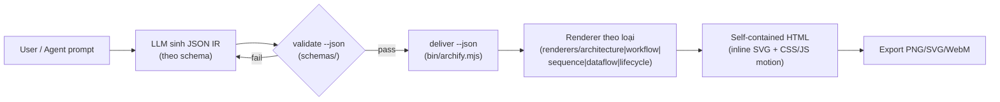
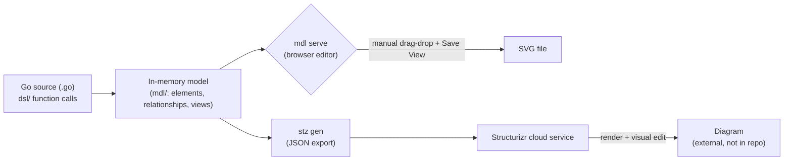
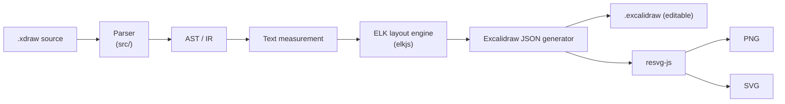
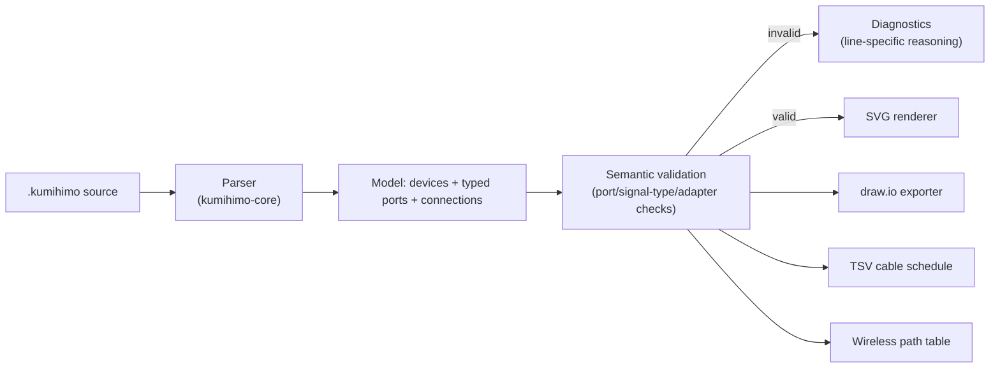

# Weekly Scan: Diagram-as-Code & Visual Tooling — 2026-08-23

**Cửa sổ quét:** 2026-08-16 → 2026-08-23 (fallback mở rộng tới 30 ngày cho vài query do tín hiệu topic-based quá mỏng).

## Executive summary

- Tín hiệu GitHub topic-based (`diagram-as-code`, `dsl`, `graph-visualization`, `svg-animation`, `layout-algorithm`) tuần này rất mỏng: phần lớn kết quả `pushed:>7d` là repo 0★ mới tạo hoặc là "agent skill" wrapper (Claude Code / Cursor skill packs) chứ không phải engine diagram-as-code thực thụ — báo cáo dưới đây chọn lọc 4 repo có evidence code thật, loại các chart-lib, whiteboard SDK generic (`quickdrawjs/quickdraw`), và course/tutorial repo theo đúng exclusion filter.
- Phát hiện đáng chú ý nhất: **`fractalops/xdraw`** — DSL biên dịch thẳng sang Excalidraw JSON dùng **ELK layout engine** + **resvg-js** để xuất PNG/SVG — kiến trúc gần như song song với `to_excalidraw.py` + `kymostudio-core` (resvg) của kymostudio, đáng đọc kỹ nhất tuần này dù mới 0★.
- **`goadesign/model`** (465★, Go, C4 model) hóa ra **không có auto-layout algorithm** — layout là thao tác kéo-thả thủ công trong một trình biên tập trình duyệt tích hợp (`mdl serve`) hoặc render qua Structurizr cloud; một data point hữu ích về việc auto-layout không phải lựa chọn bắt buộc cho mọi diagram-as-code tool.

## Mục lục

1. [tt-a1i/archify](#1-tt-a1iarchify) — agent-driven animated system-map generator (15.1k★)
2. [goadesign/model](#2-goadesignmodel) — Go DSL cho C4 architecture diagrams (465★)
3. [fractalops/xdraw](#3-fractalopsxdraw) — DSL → editable Excalidraw compiler (0★, kiến trúc rất liên quan tới kymo)
4. [Love-Rox/kumihimo](#4-love-roxkumihimo) — text DSL cho AV signal-flow diagrams với port-aware validation (1★)

---

## 1. `tt-a1i/archify`

### §1 — Quick context

Skill/CLI cho AI agent (Claude Code, Cursor, Codex…) biến mô tả codebase/hệ thống thành 5 loại diagram (architecture, workflow, sequence, data-flow, lifecycle) dạng **self-contained HTML** có motion — khác biệt với kymo ở chỗ layout do **agent quyết định** (LLM chọn hierarchy/spacing/route) thay vì thuật toán auto-layout cố định. Tech stack: Node.js/JavaScript, output HTML tự chứa + export PNG/SVG/WebM, validate bằng JSON Schema. 15.1k★, 1.1k fork, version v2.15.0, có `.github/` CI. Phân phối: cài như skill cho các coding agent (không thấy trên npm registry công khai trong nội dung đã đọc).

### §2 — Architecture deep-dive

**A. Component inventory**
- `archify/bin/` — CLI entry point (`node bin/archify.mjs`), lệnh `validate --json`, `deliver --json`.
- `archify/schemas/` — JSON Schema validators cho từng renderer mode; trả "repair receipt" máy-đọc-được khi validate fail.
- `archify/renderers/{architecture,dataflow,lifecycle,sequence,workflow}/` — một renderer riêng cho mỗi trong 5 loại diagram, cộng `renderers/shared/` cho utilities dùng chung.
- `archify/delta/` — không xác định rõ chức năng chính xác từ nội dung đọc được (có thể là diff/incremental-update logic cho việc re-render).
- `benchmarks/`, `experiments/` — hạ tầng đánh giá chất lượng, không phải runtime path.

**B. Pipeline / control flow**
1. User (hoặc agent thay mặt user) gõ yêu cầu tự nhiên, ví dụ "Use archify to map this repo's runtime architecture".
2. Agent (LLM) tự sinh **typed JSON IR** theo schema tương ứng loại diagram — không có bước "parse DSL văn bản" theo nghĩa cổ điển, vì input là JSON có cấu trúc do LLM tạo trực tiếp.
3. `archify validate --json` chạy JSON Schema check; fail → trả structured "repair receipt" cho agent tự sửa và validate lại (self-repair loop).
4. `archify deliver --json` gọi renderer tương ứng loại diagram trong `renderers/<type>/`.
5. Renderer sinh self-contained HTML (SVG/CSS/JS inline), áp animation nếu `meta.animation` được set.
6. Output HTML mở trực tiếp trong chat/browser; có thể export thêm PNG/SVG/WebM.

**C. Data model / IR**
IR là **typed JSON**, mỗi renderer-mode có schema riêng (`archify/schemas/README.md`). Không xác định rõ có "lower IR" kiểu D2's TALA hay không — evidence chỉ cho thấy 1 tầng IR (JSON) đi thẳng vào renderer theo loại.

**D. Input language design**
**Không có formal DSL/grammar** — input chính là **JSON IR** viết trực tiếp (bởi agent hoặc người dùng), có schema nhưng không phải EBNF/BNF cho cú pháp văn bản. Đây là điểm khác biệt cơ bản với kymo's `.kymo` line-oriented DSL. Error reporting: schema validation trả JSON có structure, được mô tả là "repair receipt" — thiết kế rõ ràng nhắm tới agent tự sửa lỗi (machine-actionable), không phải human-readable parse error truyền thống.

**E. Layout algorithm**
**Không dùng auto-layout algorithm cổ điển.** Nguyên văn README: "Layout judgment over generic auto-layout — the agent chooses hierarchy, spacing, routes, and emphasis; shared automatic endpoints spread deterministically." Tức là vị trí phần lớn do LLM quyết định lúc sinh JSON IR, chỉ có phần "shared automatic endpoints" (có thể là điểm nối cạnh dùng chung) được tính tự động/deterministic. Không xác định được kỹ thuật crossing-minimization nào được dùng — evidence không đủ.

**F. Rendering / output strategy**
Backend chính: self-contained HTML (SVG inline + CSS animation + JS). Animation: opt-in qua `meta.animation` (ví dụ giá trị `"trace"`), tôn trọng `prefers-reduced-motion`; cơ chế cụ thể (CSS transition/SMIL/JS timeline) không xác định rõ từ nội dung đã đọc. Pluggable theo diagram-type (5 renderer riêng biệt trong `renderers/`) chứ không phải 1 renderer chung.

**G. Extensibility**
Thêm loại diagram mới = thêm 1 schema (`schemas/`) + 1 renderer (`renderers/<new-type>/`). Không xác định rõ có plugin system cho third-party hay không.

**H. Dev experience**
Thiết kế chủ yếu cho agent-in-the-loop (Claude Code, Cursor, Codex, opencode, Raven) chứ không phải human CLI truyền thống — không xác định rõ mức độ `--help` hay browser preview độc lập ngoài luồng agent.

### §3 — Architecture diagram

### §4 — Verdict

Điểm đáng học: cơ chế **"repair receipt"** (validation error trả về structured, machine-actionable thay vì text) là ý hay có thể áp dụng cho kymo's DSL parser errors nếu muốn tối ưu cho agent-driven editing flow trong tương lai. Ngược lại, việc bỏ hẳn auto-layout algorithm để giao layout cho LLM là hướng đi **trái ngược triết lý của kymo** (`alignment.py`'s 5-pass deterministic resolver) — không nên bắt chước cho core renderer, vì mất tính reproducible/byte-for-byte mà golden-SVG test suite của kymo phụ thuộc vào. Red flag: thiếu evidence rõ ràng về cơ chế animation cụ thể và về crossing-minimization, khó đánh giá chất lượng kỹ thuật thực sự đằng sau con số 15.1k★ (nhiều khả năng đến từ việc dễ cài làm agent skill hơn là đột phá kỹ thuật). Verdict: **glance only** — ý tưởng "repair receipt" đáng ghi chú, còn lại không đổi hướng kiến trúc render/layout của kymo.

---

## 2. `goadesign/model`

### §1 — Quick context

DSL nhúng trong Go (không phải text DSL riêng) để mô tả kiến trúc phần mềm theo **C4 model**, xuất SVG qua trình biên tập trình duyệt tích hợp hoặc JSON tương thích Structurizr — khác kymo ở chỗ dùng ngôn ngữ chủ (Go function calls) làm cú pháp thay vì grammar riêng, và **layout là thao tác thủ công** chứ không tự động. Tech stack: Go 1.23+, output SVG/JSON, tích hợp Goa framework + Structurizr cloud. 465★, 23 fork, 1266 commit trên main, có GitHub Actions CI. Phân phối: Go module (`go get`), 2 CLI binary (`mdl`, `stz`) trong `cmd/`.

### §2 — Architecture deep-dive

**A. Component inventory**
- `dsl/` — các hàm Go (`Design`, `SoftwareSystem`, `Person`, `Views`, …) định nghĩa "cú pháp" DSL bằng closures lồng nhau.
- `expr/` — expression handling, khả năng là AST/eval trung gian giữa DSL calls và model.
- `mdl/` — package biểu diễn model: `model.go`, `elements.go`, `relationship.go`, `deployment.go`, `views.go`, `eval.go` (evaluation/processing logic).
- `cmd/` — 2 CLI: `mdl` (local editor + SVG) và `stz` (Structurizr client, xem `stz/` package).
- `codegen/` — code generation (không xác định rõ sinh gì — có thể sinh Go structs hoặc doc).
- `plugin/` — tích hợp làm plugin cho Goa API-design framework.

**B. Pipeline / control flow**
1. User viết file `.go` gọi các hàm DSL (`Design(...)`, `SoftwareSystem(...)`, `Views(...)`) — đây thực chất là code Go, chạy qua `go run`.
2. Khi chạy, các closure DSL side-effect vào `expr`/`mdl` để build model in-memory (elements, relationships, views).
3a. **Nhánh local**: `mdl serve` khởi động một graphical editor trong trình duyệt — user kéo-thả để định vị element trong từng view.
3b. **Nhánh cloud**: `stz gen` xuất JSON tương thích Structurizr; `stz put` upload lên Structurizr service để render + có visual editor riêng.
4. Trong nhánh local, nút "Save View" trên editor sinh **SVG rendering** của view đang chỉnh, ghi ra target directory.
5. (Cloud) `stz get` lấy lại workspace JSON đã chỉnh từ Structurizr.

**C. Data model / IR**
Model in-memory build từ Go structs trong `mdl/` (`model.go`, `elements.go`, `relationship.go`) — mutable trong lúc DSL closures chạy (build pass), sau đó "eval" (`eval.go`) xử lý/validate. Có "lower IR" ở dạng JSON tương thích Structurizr workspace format khi qua `stz` — tương tự khái niệm compile-to-lower-IR nhưng mục đích là interop với service ngoài, không phải optimize layout.

**D. Input language design**
Parser approach: **không có parser văn bản** — DSL là Go source thật, compiler Go làm việc parse/typecheck. Ưu điểm: full IDE support (autocomplete, type-check) miễn phí; nhược điểm: không phải "diagram-as-text" thuần, cần biết Go. Không có grammar EBNF/BNF riêng — cú pháp là Go syntax + convention đặt tên hàm. Error reporting: dựa hoàn toàn vào Go compiler errors.

**E. Layout algorithm**
**Không có auto-layout algorithm nội bộ.** `AutoLayout(RankLeftRight)` trong ví dụ DSL chỉ set gợi ý hướng, còn vị trí thật được người dùng **kéo-thả thủ công** trong `mdl serve`'s browser editor, hoặc do Structurizr cloud service tự xử lý (không nằm trong repo này — external). Đây là phát hiện quan trọng: readme ban đầu gây hiểu lầm "AutoLayout" là auto-layout engine, nhưng đọc kỹ workflow thì layout thật sự chủ yếu manual/external.

**F. Rendering / output strategy**
Hai backend hoàn toàn khác nhau: (1) local SVG qua browser editor tích hợp trong `mdl serve` — pluggable ở mức "swap file output directory", không phải emitter pattern đa-target như kymo; (2) JSON export cho Structurizr cloud renderer (không phải code trong repo này). Không có animation.

**G. Extensibility**
Thêm element/relationship type mới = thêm Go function trong `dsl/` + struct trong `mdl/`. Không có plugin system cho third-party ngoài việc fork Go package.

**H. Dev experience**
CLI có 2 lệnh riêng biệt (`mdl`, `stz`) dễ gây nhầm lẫn về workflow. Có browser-based visual editor cho layout (điểm mạnh UX so với kymo hiện chưa có editor GUI). Không xác định watch-mode/hot-reload. Không có VS Code extension riêng cho `.go` DSL này (thừa hưởng Go tooling chuẩn).

### §3 — Architecture diagram

### §4 — Verdict

Điểm đáng học cho kymo: việc dùng ngôn ngữ chủ (ở đây là Go) làm DSL host — không áp dụng trực tiếp cho `.kymo` (đã là text DSL riêng, đúng hướng cho portability/parity Python↔JS), nhưng ý tưởng "có một browser editor cho phép override layout thủ công khi auto-layout không đủ tốt" là gap thực sự đáng cân nhắc: `alignment.py`/`alignment.ts` hiện là pure deterministic, không có escape hatch tương tác khi user muốn chỉnh tay 1 vài node. Red flag: kiến trúc phụ thuộc Structurizr cloud cho nhánh chính (không tự chủ hoàn toàn, khác kymo hoàn toàn tự render offline). Open question: `codegen/` sinh gì — chưa đọc được nội dung cụ thể. Verdict: **study deeper** phần "manual layout override UX", còn lại (Go-as-DSL, cloud dependency) không áp dụng cho kymo.

---

## 3. `fractalops/xdraw`

### §1 — Quick context

DSL text biên dịch trực tiếp sang **Excalidraw JSON editable** (không phải ảnh tĩnh) — điểm khác biệt cốt lõi: output vẫn mở và sửa được trong Excalidraw's visual editor, không phải "diagram as final image". Tech stack: TypeScript, layout qua **ELK (kieler/elkjs)**, rendering PNG/SVG qua **resvg-js** — cùng họ resvg mà kymostudio dùng (`kymostudio-core`). 0★ (repo rất mới), 125 commit, MIT license, có GitHub Actions CI + Playwright/Jest tests. Phân phối: npm package (Node.js ≥22.18), có CLI.

### §2 — Architecture deep-dive

**A. Component inventory**
- `src/` — compiler source: parser, validator, layout integration, codegen sang Excalidraw JSON, CLI (không tách rõ subfolder từ nội dung đọc được, nhưng docs xác nhận đủ 4 giai đoạn: parse → validate → layout → generate).
- `test/` — unit + integration tests (bao gồm Playwright cho browser-level test, hợp lý vì output cần mở được trong Excalidraw thật).
- `examples/` — sample `.xdraw` projects minh họa cú pháp (basic shape, layout grid, nested frame).
- `docs/` — language reference, "interactive tour", formal specification, architecture guide.
- `scripts/` — build utilities.

**B. Pipeline / control flow**
1. User viết file `.xdraw` — ví dụ khai báo `diagram "..." { shape: rectangle "label"; a -> b "edge label" }`.
2. Compiler parse text thành AST/IR nội bộ.
3. Compiler **đo kích thước text** (text measurement) cho mỗi node label — bước bắt buộc trước layout vì Excalidraw cần box size chính xác.
4. **ELK (elkjs)** nhận graph (node sizes + edges) và tính toán layout (vị trí, routing).
5. Compiler sinh **Excalidraw JSON native** (`.excalidraw`) từ kết quả layout + style.
6. Tùy target, pipe qua `resvg-js` để rasterize thêm PNG/SVG, hoặc xuất thẳng `.excalidraw` để mở trong app Excalidraw.

**C. Data model / IR**
Không xác định rõ IR có phải class/dataclass hay plain object — nhưng có ít nhất 2 tầng biến đổi rõ ràng: AST (từ parse) → graph-for-layout (node sizes + edges, input cho ELK) → Excalidraw JSON (output cuối). Đây là 3-tầng pipeline khá gần với model.py → layout.py → to_svg.py của kymo, chỉ khác target cuối là Excalidraw thay vì SVG thô.

**D. Input language design**
Cú pháp block-based với keyword tường minh (`diagram`, `frame`, `arrange grid/row`, kiểu shape như `rectangle`/`ellipse`), gần giống DSL của kymo hơn là YAML/JSON config. Có **formal specification** trong `docs/` (không xác nhận được có phải EBNF chính thức hay prose spec). Không xác định rõ parser approach cụ thể (regex/PEG/recursive-descent) — cần đọc source `src/` trực tiếp để biết, ngoài tầm nội dung đã fetch.

**E. Layout algorithm**
**Auto-layout qua ELK** — tức delegate cho thư viện layout engine ngoài (Eclipse Layout Kernel, hỗ trợ layered/hierarchical, force, orthogonal routing tùy config) thay vì tự viết thuật toán. Đây là lựa chọn thực dụng: outsource bài toán layout khó cho engine đã trưởng thành, tương tự cách nhiều tool JS dùng dagre/elkjs thay vì tự implement Sugiyama. `arrange grid`/`arrange row` trong DSL gợi ý có thêm layer "constraint hint" phía trên ELK thay vì auto-layout thuần túy.

**F. Rendering / output strategy**
3 output format: `.excalidraw` (native, editable — mục tiêu chính), PNG, SVG (2 định dạng sau qua `resvg-js`, không phải browser-based rasterizer — nhẹ và không cần headless Chrome). Không có animation. Kiến trúc renderer là pluggable-ish theo nghĩa "1 IR, nhiều output adapter" — giống triết lý sibling-emitter của kymo (`to_svg.py`, `to_figma.py`, `to_excalidraw.py`).

**G. Extensibility**
Không xác định rõ cơ chế add shape/icon mới từ nội dung đã đọc — cần đọc `src/` sâu hơn.

**H. Dev experience**
Có syntax highlighting (Shiki), math rendering (MathJax) — gợi ý DSL hỗ trợ rich label content. Test bằng Playwright cho thấy có kiểm tra output thực sự mở được trong Excalidraw (browser-level assertion), không chỉ so JSON string — mức độ nghiêm túc về correctness cao hơn kỳ vọng cho 1 repo 0★. Không xác định watch-mode hay VS Code extension.

### §3 — Architecture diagram

### §4 — Verdict

Đây là repo **đáng học nhất tuần này cho kymo** dù 0★, vì kiến trúc gần như song song trực tiếp: (1) dùng cùng họ resvg cho rasterization — có thể tham khảo cách họ gọi `resvg-js` để so sánh performance/API với `kymostudio-core`; (2) outsource layout cho ELK thay vì tự viết — kymo hiện tự implement `alignment.py`'s 5-pass resolver, đáng cân nhắc xem có edge-case (orthogonal routing phức tạp) nào ELK xử lý tốt hơn không, dù chuyển sang ELK sẽ phá vỡ golden SVG byte-for-byte nên chỉ nên tham khảo ý tưởng chứ không port trực tiếp; (3) chiến lược "compile sang format editable của tool khác" (ở đây là Excalidraw) giống hệt mục tiêu `to_excalidraw.py` của kymo — đáng so sánh cách 2 bên xử lý text-measurement trước layout, vì đây thường là nguồn sai lệch kích thước hay gặp. Red flag: 0★, repo rất mới (có thể là side project cá nhân, chưa được cộng đồng kiểm chứng) — cần thận trọng, không lấy làm chuẩn tham chiếu. Open question: parser approach cụ thể chưa xác nhận được. Verdict: **study deeper**, đặc biệt phần text-measurement-before-layout và cách gọi resvg-js.

---

## 4. `Love-Rox/kumihimo`

### §1 — Quick context

DSL text mô tả sơ đồ đấu nối AV (audio/video signal-flow) với **port-aware type validation** — khác biệt cốt lõi so với Mermaid/kymo: không chỉ vẽ node-edge, mà **validate tính tương thích tín hiệu thực tế** (SDI không cắm vào Ethernet switch, balanced≠unbalanced audio…). Tech stack: TypeScript, pnpm monorepo, output SVG + draw.io + TSV cable schedule. 1★, 95 commit, MIT license, CI đang pass, có live editor (kumihimo.love-rox.cc). Phân phối: nhiều npm package (`@love-rox/kumihimo-core`, CLI, React/Vue/Astro components, rehype plugin) + VS Code extension.

### §2 — Architecture deep-dive

**A. Component inventory**
- `packages/core` (`@love-rox/kumihimo-core`) — parser + semantic validation (port direction, signal-type compatibility, adapter legality, input over-booking).
- `packages/cli` — CLI wrapper quanh core.
- `packages/react`, `packages/vue`, `packages/astro`, `packages/rehype` — integration components cho các framework/static-site pipeline khác nhau — tất cả cùng dùng chung core làm nguồn sự thật.
- `packages/editor` — live/interactive editor (phục vụ kumihimo.love-rox.cc).
- `docs/SPEC.md` — đặc tả ngôn ngữ đầy đủ.

**B. Pipeline / control flow**
1. User viết `.kumihimo` (hoặc tên đuôi tương ứng) khai báo `device` với `in`/`out` port kèm signal type (vd `out SDI : sdi`), rồi các cạnh nối `cam.SDI -> sw.1 : sdi 30m "V-01" [color=blue]`.
2. `@love-rox/kumihimo-core` parse text thành model (devices, ports, connections) kèm metadata (length, label, color).
3. Core chạy **semantic validation pass**: so khớp signal type 2 đầu port, kiểm tra port đã bị chiếm chưa (over-booking), kiểm tra adapter (`via`) hợp lệ — sinh diagnostic có line number khi sai.
4. Nếu hợp lệ, model đi vào SVG renderer sinh diagram tĩnh theo 1 trong các theme (light/dark/blueprint/mono).
5. Song song, model có thể xuất sang **draw.io** (editable), **TSV cable schedule** (bảng cáp kèm độ dài/màu jacket), hoặc **wireless path** (bảng tần số kênh) — đều từ cùng 1 model đã validate.
6. Các package `react`/`vue`/`astro`/`rehype` gọi lại core để render inline trong ứng dụng/blog tương ứng.

**C. Data model / IR**
Model gồm devices (với port list có signal-type) + connections (typed edges) — có khái niệm **type system cho tín hiệu** (38 builtin signal type) là điểm khác biệt độc đáo nhất so với các DSL diagram thông thường (Mermaid/D2 không có type-checking giữa 2 đầu edge). Không xác định rõ mutable/immutable giữa các pass.

**D. Input language design**
Cú pháp block/khai báo tường minh: `device <id> "<label>" as <role> { in/out <name> : <type> }`, hỗ trợ port range (`1..8`), nhóm cổng song song (`.(L, R)`), adapter (`via`). Có `docs/SPEC.md` làm formal spec (không xác nhận có phải EBNF chuẩn). Error reporting: diagnostic có line-specific reasoning (ví dụ giải thích *tại sao* 2 tín hiệu không tương thích) — mức độ chi tiết cao hơn typical parser error, gần với "linter" hơn là chỉ syntax error.

**E. Layout algorithm**
Không xác định rõ từ nội dung đã đọc — không có evidence về auto-layout hierarchical/force-directed cụ thể; nhiều khả năng layout đơn giản theo thứ tự khai báo device (kiểu signal-chain tuyến tính) vì domain AV signal-flow thường không cần layout phức tạp như sơ đồ kiến trúc phần mềm. **Không xác định.**

**F. Rendering / output strategy**
Đa backend rõ ràng từ 1 model: SVG (chính), draw.io XML, TSV, wireless-frequency table — pattern "1 IR, nhiều emitter" giống triết lý kymo. Theme system (4 theme, gồm cả "photocopied printout"-optimized mono) là chi tiết UX thực dụng đáng chú ý. Không có animation.

**G. Extensibility**
Thêm signal type mới = mở rộng danh sách 38 builtin type trong core (chưa xác nhận có external plugin registration hay không). Theme = thêm 1 theme definition, cơ chế cụ thể chưa xác định.

**H. Dev experience**
Có VS Code extension, live web editor riêng, tích hợp rehype (dùng được trong static site/blog pipeline dạng markdown), React/Vue component cho app tương tác — độ phủ dev-experience cao bất thường so với 1★ — gợi ý đây là công cụ được xây rất chỉn chu cho 1 niche hẹp (broadcast/AV engineering) hơn là "vibe-coded" nhanh.

### §3 — Architecture diagram

### §4 — Verdict

Điểm đáng học rõ nhất cho kymo: ý tưởng **domain type-checking giữa 2 đầu edge** (không chỉ "connect A→B" mà "connect A→B chỉ khi type tương thích") là hướng mở rộng thú vị nếu kymo từng muốn hỗ trợ diagram domain-specific có ràng buộc kỹ thuật (network diagram với port type, hoặc BPMN với message-flow type-checking) — hiện `.kymo` DSL không có khái niệm type-check nào giữa edge endpoints. Cũng đáng chú ý: diagnostic "giải thích lý do" thay vì chỉ báo lỗi, một chuẩn UX tốt hơn cho parser error nói chung. Red flag: layout algorithm không xác định được — nếu chỉ là linear/declaration-order thì không có gì để học ở mảng layout. Open question: cơ chế mở rộng signal-type có phải mở cho user tự định nghĩa hay hard-coded 38 loại. Verdict: **study deeper** phần type-checking-on-edges, phần còn lại **glance only**.

---

## Nguồn dữ liệu & phương pháp

Do session này chỉ có GitHub API scope giới hạn vào `kymostudio/kymostudio` (không gọi được `search/repositories` qua API/`gh` CLI), toàn bộ khảo sát dùng `github.com/search?type=repositories` (web UI, fetch qua WebFetch) với các query topic-based/keyword-based/date-filtered đúng theo fallback cascade đã định nghĩa, cộng WebSearch để đối chiếu bối cảnh chung. Repo bị loại: `quickdrawjs/quickdraw` (whiteboard SDK generic), `SuchanMadhikarmi/kubernetes-zero-to-production` (course), `CurateLabs/xyg` (charting lib), `sokoloowski/graphx` (thin wrapper quanh `@memgraph/orb`, không đủ độ sâu kiến trúc riêng).
